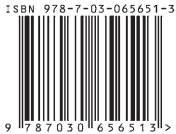

# 22-封底

[返回全书目录](../../README.md)

> PDF 页码：377–377

<!-- page: 377 -->

(O-8118.31)

本书第一版荣获国家教委优秀教材二等奖

本书第二版荣获教育部科技进步二等奖

# 数学物理方法（第四版）

科学出版社互联网入口

高教数理分社：（010）64015178 销售：（010）64031535

E-mail: mph@mail.sciencep.com

www.sciencep.com

销售分类建议：数学物理方法

定价：59.00元
