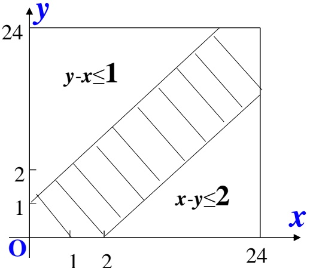

# 01-第1章 随机事件与概率

[返回全书目录](../../README.md)

> PDF 页码：1–18

<!-- page: 1 -->

#### 习题1-1 随机事件

1. 设  $ \Omega = \{x \mid 0 \leq x \leq 2\} $， $ A = \{x \mid \frac{1}{2} < x \leq 1\} $， $ B = \{x \mid \frac{1}{4} \leq x < \frac{3}{2}\} $，写出下列事件：

(1)  $ \overline{AB} $; (2)  $ \overline{A} \cup B $; (3)  $ \overline{AB} $; (4)  $ \overline{A} \cup \overline{B} $.

解： $ (1)\overline{AB}=\left\{0\leq x\leq\frac{1}{2}或1<x\leq2\right\}\cap\left\{\frac{1}{4}\leq x<\frac{3}{2}\right\}=\left\{\frac{1}{4}\leq x\leq\frac{1}{2}\right\} $或 $ \left\{1<x<-\frac{3}{2}\right\} $;

 $$ (3)\overline{AB}=\overline{\left\{\frac{1}{2}<x\leq1\right\}}\bigcap\overline{\left\{\frac{1}{4}\leq x<\frac{3}{2}\right\}}=\overline{\left\{\frac{1}{2}<x\leq1\right\}}=\overline{A}=\left\{0\leq x\leq\frac{1}{2} 或 1<x\leq2\right\}; $$ 

 $$ (4)\overline{A\cup B}=\overline{\left\{\frac{1}{2}<x\leq1\right\}}\cup\overline{\left\{\frac{1}{4}\leq x<\frac{3}{2}\right\}}=\overline{\left\{\frac{1}{4}\leq x<\frac{3}{2}\right\}}=\overline{B}=\left\{0\leq x<\frac{1}{4} 或 \frac{3}{2}\leq x\leq2\right\}. $$ 

2. 用事件的关系与运算证明下列等式成立：

解： $  (1) A - B = A \overline{B};  $

证明：由定义， $ A - B = A - AB = A \cap (\Omega - B) = A \overline{B} $;

(2) $ (A-B)\cup B=A\cup B $;

证明：由(1)可得， $ (A-B)\cup B=A\overline{B}\cup B=(A\cup B)\cap(\overline{B}\cup B)=(A\cup B) $;

<!-- page: 2 -->

3. 化简  $ (A \cup B)(A \cup \overline{B})(\overline{A} \cup B) $.

解：根据集合的分配律，有

 $$  上式 =[(A\cup B)(A\cup\overline{B})](\overline{A}\cup B)=[A\cup(B\overline{B})](\overline{A}\cup B)=A(\overline{A}\cup B)=AB $$ 

4. 设事件A、B、C满足等式 $ A \cup C = B \cup C $，问 A = B 是否成立？

解：不一定，如  $ A=\{3\} $,  $ B=\{2,3\} $,  $ C=\{1,2,3\} $

5. 设 A、B、C 为三个事件，用 A、B、C 运算关系表示下列各事件：

（1）A、B、C都发生；

(2) A、B、C都不发生；

（3）A发生，而B与C不发生；

（4）A、B、C中至少有一个发生；

（5）A、B、C中至少有两个发生；

（6）A、B、C中不多于两个发生。

解：(1)ABC;

(2) $ \overline{A}\overline{B}\overline{C} $;

(3) $ AB\overline{C} $（或A-B-C);

(4) $ A\cup B\cup C $;

(5) $ AB\cup BC\cup AC $;

(6) $ \overline{ABC} $.

<!-- page: 3 -->

6. 设某工人连续生产了4个零件， $ A_i $ 表示他生产的第  $ i $ 个零件是正品（ $ i=1,2,3,4 $），试用  $ A_i $ 表示下列各事件：

（1）只有一个次品；

(2) 至少有一个是次品；

(3) 没有一个是次品；

（4）恰好有三个是次品；

（5）至少有三个不是次品。

解：(1) $ \overline{A_{1}}A_{2}A_{3}A_{4}\cup A_{1}\overline{A_{2}}A_{3}A_{4}\cup A_{1}A_{2}\overline{A_{3}}A_{4}\cup A_{1}A_{2}A_{3}\overline{A_{4}} $;

(2) $ \overline{A_1} \cup \overline{A_2} \cup \overline{A_3} \cup \overline{A_4} $; (或 $ \overline{A_1A_2A_3A_4} $);

(3) $ A_{1}A_{2}A_{3}A_{4} $;

(4) $ A_{1}\overline{A_{2}}\overline{A_{3}}\overline{A_{4}}\cup\overline{A_{1}}A_{2}\overline{A_{3}}\overline{A_{4}}\cup\overline{A_{1}}\overline{A_{2}}A_{3}\overline{A_{4}}\cup\overline{A_{1}}\overline{A_{2}}\overline{A_{3}}A_{4}; $

 $$ ) \overline { { A _ { 1 } } } A _ { 2 } A _ { 3 } A _ { 4 } \bigcup A _ { 1 } \overline { { A _ { 2 } } } A _ { 3 } A _ { 4 } \bigcup A _ { 1 } A _ { 2 } \overline { { A _ { 3 } } } A _ { 4 } \bigcup A _ { 1 } A _ { 2 } A _ { 3 } \overline { { A _ { 4 } } } \bigcup A _ { 1 } A _ { 2 } A _ { 3 } A _ { 4 } ; $$

<!-- page: 4 -->

习题 1-2 随机事件的概率
 

1.已知 $ A \subset B $， $ P(A)=0.4 $， $ P(B)=0.6 $，求：

(1) $ P\left(\overline{A}\right) $， $ P\left(\overline{B}\right) $，(2) $ P(AB) $，(3) $ P(A\cup B) $，(4) $ P\left(\overline{A}B\right) $， $ P\left(A\overline{B}\right) $，(5) $ P\left(\overline{A}\overline{B}\right) $.

解:(1)由已知， $ P(\overline{A})=0.6 $， $ P(\overline{B})=0.4 $;

(2)由已知， $ P(AB)=P(A)=0.4 $;

(3)由(2)，有 $ P(A \cup B) = P(A) + P(B) - P(AB) = 0.6 $;

(4)由(2)， $ P(\overline{A}B)=P(B-A)=P(B)-P(AB)=0.2 $;

由(2)， $ P(A\overline{B})=P(A-B)=P(A)-P(AB)=0; $

(5)由(3)， $ P(\overline{A}\overline{B})=P(\overline{A\cup B})=1-P(A\cup B)=0.4 $.

2. 设  $ P(AB) = P(\overline{A}\overline{B}) $， $ P(A) = 0.4 $，求  $ P(B) $。

解：由已知，有 $ P\left(\overline{A}\overline{B}\right)=P\left(\overline{A\cup B}\right)=1-P(A\cup B)=1-P(A)-P(B)+P(AB)=P(AB) $，

所以有， $ 1-P(A)-P(B)=0,\quad P(B)=0.6. $

<!-- page: 5 -->

3. 从5双不同的鞋子中任取4只，求取到的4只鞋子中至少有2只配成一双的概率。

解1: 记 $ A = \{ $所取4只鞋子中至少有2只配成一对 $ \} $,

 $$  则 \overline{A}=\left\{ 所取 4 只鞋子中没有配成对的 \right\}. $$ 

基本事件的总数：从10只鞋子中任取4只，总共有 $ C_{10}^{4} $种取法； $ \overline{A} $中所含的个数：从5双鞋子中取4双共有 $ C_{5}^{4} $种取法，再从取出的每双鞋子中各取一只，共有 $ 2^{4} $（或 $ C_{2}^{1}C_{2}^{1}C_{2}^{1}C_{2}^{1} $）种取法，即 $ \overline{A} $所含的基本事件数为 $ 2^{4}C_{5}^{4} $，故 $ P(A)=1-P(\overline{A})=1-\frac{2^{4}C_{5}^{4}}{C_{10}^{4}}=\frac{13}{21} $。

解2:  $ P(A) = 1 - P(\overline{A}) = 1 - \frac{10 \cdot 8 \cdot 6 \cdot 4}{10 \cdot 9 \cdot 8 \cdot 7} = \frac{13}{21} $.

解3:  $ P(A)=\frac{C_{5}^{1}(C_{8}^{2}-4)+C_{5}^{2}}{C_{10}^{4}}=\frac{13}{21} $.

<!-- page: 6 -->

4.已知 $ P(A)=P(B)=\frac{1}{4},P(C)=\frac{1}{2} $,

试求A, B, C中至少有一个发生的概率。

解 即求 $ P(A \cup B \cup C) $.

$\because$ 上式 $=P(A)+P(B)+P(C)-P(AB)-P(BC)-P(CA)+P(ABC)$

又$\because ABC \subseteq CA, \therefore P(ABC) \leq P(CA) = 0$, （根据性质3）

 $$ \therefore P\left(ABC\right)=0 $$ 

 $$ \therefore P\big(A\cup B\cup C\big)=\frac{1}{4}+\frac{1}{4}+\frac{1}{2}-\frac{1}{8}-0-0+0=\frac{7}{8} $$

<!-- page: 7 -->

5. 向三个相邻的军火库投掷一枚炸弹，炸中第一个军火库的概率为0.025，炸中其余两个军火库的概率各为0.1，且只要炸中一个，另外两个必然爆炸，求军火库发生爆炸的概率。

解：设 $ A = \{\text{炸中第一个军火库}\} $， $ B = \{\text{炸中第二个军火库}\} $， $ C = \{\text{炸中第三个军火库}\} $，

D={军火库爆炸}, 因为这一枚炸弹要么炸中第一个军火库, 要么炸中第二个军火库, 要么炸中第三个军火库, 要么谁也炸不中, 故A、B、C三个事件是互不相容的, 则有

 $$ P\bigl(D\bigr)=P\bigl(A\bigcup B\bigcup C\bigr)=P\bigl(A\bigr)+P\bigl(B\bigr)+P\bigl(C\bigr)=0.025 $$

<!-- page: 8 -->

6.两艘轮船都要停靠同一个泊位，它们可能在一昼夜的任意时刻到达。设两艘轮船停靠泊位的时间分别为1h和2h。求有一艘轮船停靠泊位时需要等待一段时间的概率。

解：记o点为计算时刻的0时，以小时为单位，x,y分别表示甲、乙船到达泊位的时刻，甲停1h，乙停2h，则样本空间为： $ \Omega=\{(x,y)\mid0\leq x\leq24,\ 0\leq y\leq24\} $，以A表示事件“有一艘船需要等待”，故二船需要等待的充要条件是：

 $$ \left\{\begin{aligned}&y-x\leq\mathbf{1}, 甲先到 ;\\ &x-y\leq2, 乙先到 .\end{aligned}\right.(x,y)\in\left(\mathbf{0},24\right),\therefore A=\left\{\left(x,y\right)|\left\{\begin{aligned}&y-x\leq\mathbf{1};\\ &x-y\leq2.\end{aligned}\right.,\left(x,y\right)\in\left(\mathbf{0},24\right)\right\}, $$ 

见上图阴影部分。这是一个几何概型问题，于是有

 $$ P\left(A\right)=\frac{S\left(A\right)}{S\left(\Omega\right)}=\frac{24^{2}-\frac{1}{2}{\bullet}23^{2}-\frac{1}{2}{\bullet}22^{2}}{24^{2}}\approx0.121. $$ 

本题中的等待相当于例题8里的会面.

<!-- page: 9 -->

习题1-3 条件概率
 

1. 掷两颗骰子，观察出现的点数：

(1) 已知两颗骰子的点数之和为7，求其中有一颗为1点的概率；

(2) 已知其中有一颗为1点，求两颗骰子的点数之和为7的概率。

解：(1) 两颗骰子的点数之和为7，共有{1,6}，{6,1}，{2,5}，{5,2}，{3,4}，{4,3}六种情况，故其中有一颗为1点的概率为 $ p=\frac{2}{6}=\frac{1}{3} $;

(2)两颗骰子中有一颗为1点，共有{1,1}，{1,2}，{2,1}，{1,3}，{3,1}，{1,4}，{4,1}，{1,5}，{5,1}，{1,6}，{6,1}这十一种情况，故两颗骰子的点数之和为7的概率为 $ p=\frac{2}{11} $。

2.已知 $ P(A)=0.5 $， $ P(B)=0.6 $， $ P(B|A)=0.8 $，求: $ (1)P(A\overline{B}) $； $ (2)P(\overline{A}\overline{B}) $。

解:(1)由已知， $ P(B|A)=\frac{P(AB)}{P(A)}=0.8 $，有 $ P(AB)=0.8P(A)=0.4 $，

故 $ P\left(A\overline{B}\right)=P(A)-P(AB)=0.5-0.4=0.1; $

$$\left(2\right)P\left(\overline{AB}\right)=P\left(\overline{A\cup B}\right)=1-P\left(A\cup B\right)=1-P(A)-P(B)+P(AB)=1-0.5-0.6+0.4=0.3.$$

<!-- page: 10 -->

练习册1.3中的第3题.

设口袋中有20个球，其中有二个是红球，现从袋中取球三次，每次取一球，取后不放回，求第三次才取到红球的概率。

解1：设 $ A = \{ $第三次才取到红球 $ \} $，

 $$ P\left(A\right)=\frac{C_{18}^{2}\bullet C_{2}^{1}}{C_{20}^{3}}=\frac{18\bullet17}{20\bullet19\bullet18}\bullet3\bullet2=\frac{17\bullet3}{10\bullet19}=\frac{51}{190}, $$ 

解2: 记 $ A=\left\{ $第三次才取到红球 $ \right\} $,

即A表示前2次没有抽到红球，而第3次才抽到红球，

则 $ P(A)=\frac{C_{18}^{2}}{C_{20}^{2}}\times\frac{2}{18}=\frac{17}{190} $

解1表达的是三次取球中恰有一次取到红球，但第几次取到红球并不重要。

解2解3是确定第三次取到红球，更符合题意。

解3：记 $ A_i = \{ $第 $ i $次取到红球 $ \} $，则所求为 $ P\left(\overline{A_1}\overline{A_2}A_3\right) $，而 $ P\left(\overline{A_1}\overline{A_2}A_3\right) = P\left(\overline{A_1}\right)P\left(\overline{A_2}\left|\overline{A_1}\right|\right)P\left(A_3\left|\overline{A_1}\overline{A_2}\right|\right) $

本题跟前面第4题(找次品)不一样，找次品是强调四件次品都被找到，问其中一种情况的概率；本题只是取3个球，问其中一种情况发生的概率。

<!-- page: 11 -->

4. 已知甲乙两箱中装有同种产品，其中甲箱中装有3件合格品和3件次品，乙箱中仅装有3件合格品。现从甲箱中任取3件放入乙箱，然后再从乙箱中任取一件产品，求该产品为次品的概率。

解：设 $ A_{i}=\left\{\text{从甲箱中取3件放入乙箱,其中有}i\text{次品}\right\} $，i=0,1,2,3，则 $ P\left(A_{i}\right)=\frac{C_{3}^{i}C_{3}^{3-i}}{C_{6}^{3}} $

 $ B=\left\{ $从乙箱中任取一件是次品 $ \right\} $，根据全概率公式，有

 $$ \begin{aligned}&P(B)=P(A_{0}B)+P(A_{1}B)+P(A_{2}B)+P(A_{3}B)\\&=P(A_{0})P(B|A_{0})+P(A_{1})P(B|A_{1})+P(A_{2})P(B|A_{2})+P(A_{3})P(B|A_{3})\\&=0+\frac{C_{3}^{1}C_{3}^{2}}{C_{6}^{3}}\times\frac{1}{6}+\frac{C_{3}^{2}C_{3}^{1}}{C_{6}^{3}}\times\frac{2}{6}+\frac{C_{3}^{3}C_{3}^{0}}{C_{6}^{3}}\times\frac{3}{6}=\frac{3\times3}{6\times5\times4/3!}\times\frac{1}{6}+\frac{3\times3}{6\times5\times4/3!}\times\frac{2}{6}+\frac{1}{6\times5\times4/3!}\times\frac{3}{6}\\&=\frac{9}{20}\times\frac{1}{6}+\frac{9}{20}\times\frac{2}{6}+\frac{1}{20}\times\frac{3}{6}=\frac{3}{20}\times\frac{1}{2}+\frac{3}{20}+\frac{1}{20}\times\frac{1}{2}=\frac{3}{40}+\frac{3}{20}+\frac{1}{40}=\frac{10}{40}=0.25\\ \end{aligned} $$

<!-- page: 12 -->

5. 将二信息分别编码为 X 和 Y 后传送出去，接收站接受时，X 被误收作 Y 的概率为 0.02，而 Y 被误收作 X 的概率为 0.01。信息 X 和信息 Y 传送的频繁程度之比为 2:1。若接收站收到的信息是 X，问原发信息也是 X 的概率是多少？

解 记 $ A_1 = \{发送信息X\} $； $ A_2 = \{发送信息Y\} $，

 $$ \boldsymbol{B}_{1}=\left\{ 接受信息 \boldsymbol{X}\right\},\boldsymbol{B}_{2}=\left\{ 接受信息 \boldsymbol{Y}\right\}. $$ 

依题意需求概率 $ P\left(A_{1}|B_{1}\right) $，又已知

 $$ P\left(B_{2}\left|A_{1}\right.\right)=0.02,P\left(B_{1}\left|A_{2}\right.\right)=0.01, $$ 

且 $ \frac{P(A_{1})}{P(A_{2})}=\frac{2}{1}\left( $即 $ P(A_{1})=\frac{2}{3},P(A_{2})=\frac{1}{3}\right) $.

由贝叶斯公式有

 $$ \begin{aligned}P\left(A_{1}\big|B_{1}\right)&=\frac{P\left(A_{1}B_{1}\right)}{P\left(B_{1}\right)}=\frac{P\left(A_{1}\right)P\left(B_{1}\big|A_{1}\right)}{P\left(A_{1}\right)P\left(B_{1}\big|A_{1}\right)+P\left(A_{2}\right)P\left(B_{1}\big|A_{2}\right)}\\&=\frac{\frac{2}{3}\bullet(1-0.02)}{\frac{2}{3}\bullet(1-0.02)+\frac{1}{3}\bullet0.01}=\frac{196}{197}.\end{aligned} $$

<!-- page: 13 -->

6. 某学校五年级有二个班，一班50名学生，其中10名女生；二班30名学生，其中有18名女生。现从两班中任选一个班，然后从中先后挑选两名学生，求：

（1）先选出的是女生的概率；

（2）在已知先选出的是女生的条件下，后选出的也是女生的概率。

解 记 $ A_{i}=\left\{第i次挑到女生\right\}, i=1,2. $

 $ B_{1}=\left\{ $从一班中挑学生 $ \right\} $，则 $ B_{2}=\left\{ $从二班中挑学生 $ \right\} $。

(1)由题可知 $ P(B_1) = P(B_2) = \frac{1}{2} $,  $ P(A_1 | B_1) = \frac{10}{50} = \frac{1}{5} $,  $ P(A_1 | B_2) = \frac{18}{30} = \frac{3}{5} $,

故由全概率公式有： $ P(A_{1})=P(A_{1}B_{1})+P(A_{1}B_{2}) $

 $$ \begin{aligned}&=P\left(B_{1}\right)P\left(A_{1}\big|B_{1}\right)+P\left(B_{2}\right)P\left(A_{1}\big|B_{2}\right)\\&=\frac{1}{2}\Biggl(\frac{1}{5}+\frac{3}{5}\Biggr)=\frac{1}{10}+\frac{3}{10}=\frac{2}{5}=0.4\end{aligned} $$

<!-- page: 14 -->

$ P(A_1)=2\left(\frac{10}{50}\cdot\frac{9}{49}+\frac{18}{30}\cdot\frac{17}{29}\right)=0.4856 $

<!-- page: 15 -->

##### 习题1-4 独立性

1.已知 $ P(A)=\alpha $， $ P(B)=0.3 $， $ P(\overline{A}\cup B)=0.7 $。

(1)若事件A与B互不相容，求 $ \alpha $; (2)若事件A与B相互独立，求 $ \alpha $.

 $$ 1)P\big(\overline{A}\bigcup B\big)=1-P\big(\overline{\overline{A}\bigcup B}\big)=1-P\big(A\overline{B}\big)=1-P\big(A-B\big)=1-P\big(A\big)+P\big(AB\big)=0.7, $$ 

因为事件A与B互不相容，故有 $ 1-P(A)=0.7 $，即 $ \alpha=0.3 $。

(2)由(1)有， $ P(\overline{A}\cup B)=1-P(A\overline{B})=1-P(A)+P(AB)=0.7 $,

因为事件A与B相互独立，故有 $ 1-\alpha+0.3\alpha=0.7 $，即 $ \alpha=\frac{3}{7} $.

2.已知事件A与B相互独立，且 $ P(\overline{A}\overline{B})=\frac{1}{9} $， $ P(A\overline{B})=P(\overline{A}B) $，求 $ P(A) $， $ P(B) $。

解：由已知有， $ P(A\overline{B})=P(A)P(\overline{B})=P(\overline{A}B)=P(\overline{A})P(B) $，

即 $ P(A)(1-P(B))=(1-P(A))P(B)\Rightarrow P(A)-P(A)P(B)=P(B)-P(A)P(B) $，则有 $ P(A)=P(B) $，

 $$ P\big(\overline{A}\overline{B}\big)=P\big(\overline{A}\big)P\big(\overline{B}\big)=\frac{1}{9}\Rightarrow\big(1-P\big(A\big)\big)\big(1-P\big(B\big)\big)=\big(1-P\big(A\big)\big)^{2}=\frac{1}{9}, $$ 

所以有， $ 1-P(A)=\frac{1}{3} $， $ P(A)=\frac{2}{3} $。

<!-- page: 16 -->

3设A与B是任意两事件，其中A的概率不等于0和1，证明： $ P(B|A)=P(\overline{A})^{\frac{1}{2}} $ 

是事件A与B相互独立的充分必要条件.

证明：充分性：即 $ P(B|A)=P(\overline{B}|\overline{A}) \Rightarrow $事件 $ A $与 $ B $相互独立.

由 $ P(B|A)=P(B|\overline{A})= $  $ \frac{P(AB)}{P(A)}=\frac{P(\overline{A}B)}{P(\overline{A})}\Rightarrow\frac{P(AB)}{P(A)}=\frac{P(B)-P(AB)}{1-P(A)} $，通分化简得，

 $ P(AB)-P(A)P(AB)=P(A)P(B)-P(A)P(AB) $，即有 $ P(AB)=P(A)P(B) $，A与B独立。

必要性：即事件A与B相互独立 $ \Rightarrow P(B|A)=P(\overline{A}) $

由已知条件有， $ P(B|A)=\frac{P(AB)}{P(A)}=P(B) $， $ P(\overline{B|A})=\frac{P(\overline{A}B)}{P(\overline{A})}=P(B) $，所以 $ P(B|A)=P(\overline{B|A}) $。

<!-- page: 17 -->

4. 一个工人看管3台独立运转的机床，在一小时内三台机床不需要工人照管的概率分别为0.9、0.8、0.7，求在一小时内三台机床中最多有一台需要工人照管的概率。

解：设 $ A=\{ $第一台机床需要照管 $ \} $， $ B=\{ $第二台机床需要照管 $ \} $，

 $ C=\left\{ $第三台机床需要照管 $ \right\}, $  $ D=\left\{ $三台机床中最多有一台需要照管 $ \right\}, $

则 $ D = \overline{A}\overline{B}\overline{C} \cup \overline{A}\overline{B}\overline{C} \cup \overline{A}\overline{B}\overline{C} \cup \overline{A}\overline{B}\overline{C} $，这四种情况是互不相容的，故有

 $$ P\left(D\right)=P\left(\overline{A}\overline{B}\overline{C}\right)+P\left(A\overline{B}\overline{C}\right)+P\left(\overline{A}B\overline{C}\right)+P\left(\overline{A}\overline{B}C\right) $$ 

 $$ =0.9\times0.8\times0.7+0.1\times0.8\times0.7+0.9\times0.2\times0.7+0.9\times0.8\times0.3 $$ 

 $$ =0.504+0.056+0.126+0.216=0.902. $$ 

5. 三个人独立地去破译一份密码，已知各人能译出密码的概率分别为1/5，1/3，1/4，问三人中至少有一人能将此密码译出的概率是多少？

解：设 $ A=\left\{\text{第一人译出密码}\right\},\quad B=\left\{\text{第二人译出密码}\right\},\quad C=\left\{\text{第三人译出密码}\right\}, $

D= $ \left\{ \text{三人中至少有一人能译出密码} \right\} $，由于三人独立译出密码，

 $$  故 P(D)=P(A\cup B\cup C)=1-P(\overline{A})P(\overline{B})P(\overline{C})=1-\frac{4}{5}\times\frac{2}{3}\times\frac{3}{4}=1-\frac{2}{5}=\frac{3}{5}. $$

<!-- page: 18 -->

6. 甲、乙、丙三人同时各用一发子弹对目标进行射击，三人各自击中目标的概率分别为0.4、0.5、0.7，目标被击中一发子弹而冒烟的概率为0.2，被击中二发子弹而冒烟的概率为0.6，被击中三发子弹则必冒烟，求目标冒烟的概率。

解： $ A_1 = \{\text{甲击中目标}\}, A_2 = \{\text{乙击中目标}\}, A_3 = \{\text{丙击中目标}\} $， $ B = \{\text{目标被一发子弹击中}\} $， $ C = \{\text{目标被二发子弹击中}\} $， $ D = \{\text{目标被三发子弹击中}\} $， $ E = \{\text{目标冒烟}\} $，

 $$ P\left(B\right)=P\left(A_{1}\overline{A_{2}}\overline{A_{3}}\right)+P\left(\overline{A_{1}}A_{2}\overline{A_{3}}\right)+P\left(\overline{A_{1}}\overline{A_{2}}A_{3}\right) $$ 

 $$ =0.4\times0.5\times0.3+0.6\times0.5\times0.3+0.6\times0.5\times0.7=0.06+0.09+0.21=0.36, $$ 

 $$ P\left(C\right)=P\left(A_{1}A_{2}\overline{A_{3}}\right)+P\left(\overline{A_{1}}A_{2}A_{3}\right)+P\left(A_{1}\overline{A_{2}}A_{3}\right) $$ 

 $$ =0.4\times0.5\times0.3+0.6\times0.5\times0.7+0.4\times0.5\times0.7=0.06+0.21+0.14=0.41, $$ 

 $$ P\big(D\big)=P\big(A_{1}A_{2}A_{3}\big)=0.4\times0.5\times0.7=0.14, $$ 

由于B、C、D是互不相容的，故有

 $$ P(E)=0.2P(B)+0.6P(C)+P(D)=0.2\times0.36+0.6\times0.41+0.14=0.072+0.246+0.14=0.458. $$

