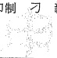
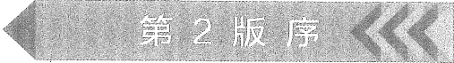

# 00-封面与前言目录

[返回全书目录](../../README.md)

> PDF 页码：1–28

<!-- page: 1 -->

# 电子技术基础

# 模拟部分（第7版）

主 编 康华光 张 林

华中科技大学电子技术课程组 编

副主编 陈大钦

参编秦臻 邓天平 罗杰

高等教育出版社·北京

<!-- page: 2 -->

##### 内容简介

本书为“十二五”普通高等教育本科国家级规划教材，曾荣获全国高等学校优秀教材奖、优秀教材全国特等奖、科技进步二等奖和优秀教材一等奖。

本次修订力求突出运放的实际应用，强化线性和开关稳压电路的基本原理和工程应用，践行三极管电路以 MOSFET 为主线的思路。

全书共11章，分别是：绪论，运算放大器，二极管及其基本电路，场效应三极管及其放大电路，双极结型三极管及其放大电路，频率响应，模拟集成电路，反馈放大电路，功率放大电路，信号处理与信号产生电路和直流稳压电源。附录包含PSpice/SPICE软件简介（扫码资源形式）、电路理论简明复习、电阻的彩色编码和标称阻值。结合新形态教材的特点，本书配套了“重难点视频”“仿真例证”“知识扩展”等数字化资源。

本书可作为高等学校电子信息类、电气类、自动化类等专业的“模拟电子技术基础”课程的教材，也可供相关工程技术人员参考。

##### 图书在版编目（CIP）数据

电子技术基础. 模拟部分 / 康华光, 张林主编; 华中科技大学电子技术课程组编. -- 7 版. -- 北京: 高等教育出版社, 2021.6

ISBN 978-7-04-055419-9

Ⅰ．①电…Ⅱ．①康…②张…③华…Ⅲ．①电子技术-高等学校-教材②模拟电路-电子技术-高等学校-教材Ⅳ．①TN

中国版本图书馆 CIP 数据核字（2021）第 015356 号

##### Dianzi Jishu Jichu Moni Bufen

策划编辑 欧阳舟 责任编辑 欧阳舟 封面设计 张楠 版式设计 张杰

插图绘制 黄云燕

责任校对 窦丽娜 责任印制 刁毅

刁制

<table border=1 style='margin: auto; word-wrap: break-word;'><tr><td style='text-align: center; word-wrap: break-word;'>出版发行</td><td style='text-align: center; word-wrap: break-word;'>高等教育出版社</td><td style='text-align: center; word-wrap: break-word;'>网址</td><td style='text-align: center; word-wrap: break-word;'>http://www.hep.edu.cn</td></tr><tr><td style='text-align: center; word-wrap: break-word;'>社址</td><td style='text-align: center; word-wrap: break-word;'>北京市西城区德外大街4号</td><td style='text-align: center; word-wrap: break-word;'></td><td style='text-align: center; word-wrap: break-word;'>http://www.hep.com.cn</td></tr><tr><td style='text-align: center; word-wrap: break-word;'>邮政编码</td><td style='text-align: center; word-wrap: break-word;'>100120</td><td style='text-align: center; word-wrap: break-word;'>网上订购</td><td style='text-align: center; word-wrap: break-word;'>http://www.hepmall.com.cn</td></tr><tr><td style='text-align: center; word-wrap: break-word;'>印刷</td><td style='text-align: center; word-wrap: break-word;'>山东临沂新华印刷物流集团有限责任公司</td><td style='text-align: center; word-wrap: break-word;'></td><td style='text-align: center; word-wrap: break-word;'>http://www.hepmall.com</td></tr><tr><td style='text-align: center; word-wrap: break-word;'>开本</td><td style='text-align: center; word-wrap: break-word;'>787 mm×1092 mm 1/16</td><td style='text-align: center; word-wrap: break-word;'></td><td style='text-align: center; word-wrap: break-word;'>http://www.hepmall.cn</td></tr><tr><td style='text-align: center; word-wrap: break-word;'>印张</td><td style='text-align: center; word-wrap: break-word;'>33.25</td><td style='text-align: center; word-wrap: break-word;'>版次</td><td style='text-align: center; word-wrap: break-word;'>1979年3月第1版</td></tr><tr><td style='text-align: center; word-wrap: break-word;'>字数</td><td style='text-align: center; word-wrap: break-word;'>780千字</td><td style='text-align: center; word-wrap: break-word;'></td><td style='text-align: center; word-wrap: break-word;'>2021年6月第7版</td></tr><tr><td style='text-align: center; word-wrap: break-word;'>购书热线</td><td style='text-align: center; word-wrap: break-word;'>010-58581118</td><td style='text-align: center; word-wrap: break-word;'>印次</td><td style='text-align: center; word-wrap: break-word;'>2021年6月第1次印刷</td></tr><tr><td style='text-align: center; word-wrap: break-word;'>咨询电话</td><td style='text-align: center; word-wrap: break-word;'>400-810-0598</td><td style='text-align: center; word-wrap: break-word;'>定价</td><td style='text-align: center; word-wrap: break-word;'>67.00元</td></tr></table>

本书如有缺页、倒页、脱页等质量问题，请到所购图书销售部门联系调换

版权所有 侵权必究

物 料 号 55419-00

<!-- page: 3 -->

# 第7版序

《电子技术基础（模拟、数字）》是高等学校电子信息类、电气类、自动化类等专业的重要基础课程教材。根据当今电子技术发展及教材使用实际情况，我们对前一版教材进行了本次修订。

## 一、遵循原则

（1）保持内容的科学性、先进性，以适应电子技术的发展。

（2）坚守基础性特征，精选内容，科学合理地控制内容的深度和广度，以适应我国高校的教学要求，力争好教好学。

(3) 加强与工程实际应用的联系。

（4）适当引入新形态教材形式，以便更好地辅助读者学习。

## 二、主要变动

### 1. 模拟部分

（1）将差模增益、共模增益和共模抑制比等概念提前到第2章运算放大器介绍，更加贴近运放实际应用。补充了应用实例——心电信号放大电路。

（2）不再采用 MOS 管和 BJT 并重的方式组织第4、5章内容，改为以 MOSFET 为主介绍三极管放大电路，而简要介绍 BJT 放大电路。并将4.6节更新为 MOSFET 大信号工作及开关应用。

（3）重新组织编排了第6章并缩减了内容，补充了短路时间常数法和开路时间常数法。

（4）合并了7.2节和7.3节并重新梳理了内容。集成运算放大器补充了全差分运算放大器和电流反馈运算放大器，将LF356移至习题。加强了运放主要参数对实际应用影响的相关内容，补充了运放在单电源下工作的内容。

（5）第8章用MOS管放大电路更换了部分BJT放大电路。

（6）第9章新增了丁类(D类)功率放大电路原理简介，更新了集成功率放大器。

（7）第10章重写了有源滤波电路，使之更加符合当前实际设计应用情况。

（8）重写了11.2线性稳压电路和11.3开关式稳压电路，补充了低压差稳压电路。

（9）删除每章的“SPICE 仿真例题”一节，将部分内容分散到了正文适当的位置和习题中。删除了第12章电子电路的计算机辅助分析与设计的内容。

<!-- page: 4 -->

（10）在新媒体方面，有若干重难点讲解视频、例题仿真说明、各章的概念图和思维导图小结视频，附录 A PSpice/SPICE 软件简介，以及软件使用操作演示视频等。读者都可扫码浏览观看。

### 2. 数字部分

（1）注重组合和时序单元电路的模块化。压缩和删减了较少使用或已经淘汰的集成芯片内部结构的详细介绍。

（2）根据 Verilog HDL 最新版本更新了语法规则，并调整了描述顺序（先举例，再讲语法）。增加了测试激励模块的简介。仿真软件改用 ModelSim 并在附录中介绍测试模块的编写方法及软件的使用说明。

（3）第3章缩减了TTL逻辑门电路的内容，删除了ECL逻辑门电路，增加了差分信号传输内容的介绍。

（4）第4章注重单元电路的工作原理，弱化产品芯片型号及电路内部结构的介绍，增加了移位器等内容。在4.6节增加了实例引用带参数模块的例题。扩充了Verilog习题。

（5）第5章注重触发器的原理功能介绍，缩减了实际芯片内部电路的相关内容。删除了传输延迟触发器。

（6）第6章删除了已淘汰产品GAL的内容。

(7) 第7章补充了 Flash 存储器的相关内容。

（8）第8章调整了CPLD和FPGA的顺序，补充了CPLD中逻辑宏单元的内容。

（9）第9章精简了单稳态和施密特内部电路的介绍，修改了多谐振荡电路的描述。补充了相关电路芯片信息。新增了并联谐振型晶体振荡电路。

（10）第10章增加了电阻串联分压式D/A转换器，修改了双极性输出的描述，以及误差的相关描述。补充了半闪速型、流水线型A/D转换器。

（11）第11章精简了ASM图介绍，重新组织了交通信号控制系统及数字密码锁的设计内容，便于用CAD方法设计。

（12）在新媒体方面，有若干难点视频讲解，Verilog 例题仿真说明文档，每章的思维导图，附录 D ModelSim 软件简介，以及软件使用操作演示视频等。读者都可扫码浏览观看。

参加模拟部分修订工作的有张林（第1~7章、附录及17个新媒体文档、15个视频）、秦臻（第8章及3个新媒体文档）、邓天平（第9、11章及1个新媒体文档、9个视频）、罗杰（第10章）等。参加数字部分修订工作的有秦臻（第1、3、4、5、11章、附录A、B及6个新媒体文档、2个视频）、罗杰（第2、8、9、10章、各章Verilog语言部分、附录C、D、E及12个新媒体文档、14个视频）、张林（第6、7章及2个新媒体文档、1个视频）。张林为主编，负责全书的策划、组织和定稿。副主编协助主编工作。

与本教材配套的实验教材是罗杰、陈大钦主编的《电子技术基础实验》(高等教育出版社出版，2017年)。

<!-- page: 5 -->

本书模拟部分分别由四川大学周群教授、大连理工大学林秋华教授主审，参加审阅的还有四川大学的刘婕副教授和刘雪山副教授。数字部分由浙江大学张德华教授主审。他们认真审阅了本书，提出了不少中肯的修改意见，在此表示衷心的感谢。原编者王岩教授也仔细审阅了模拟部分全稿，并提出了宝贵意见，也在此表示衷心感谢。

另外，原编者康华光、陈大钦、王岩、彭容修、瞿安连、杨华等前辈为本套教材的建设和发展做出了巨大贡献，也对本次修订工作给予了大力支持和帮助。特此向他们致以崇高的敬意！

第6版发行期间，承全国各兄弟院校师生给我们以鼓励，提出了不少宝贵意见和建议，编者在此一并致以谢忱。编者邮箱：campzh@hust.edu.cn。

编者

2021年2月于武汉华中科技大学

<!-- page: 6 -->

<!-- page: 7 -->

# 第6版序

《电子技术基础（模拟、数字）》是电子电气类专业的技术基础课程教材，该教材自1979年春由高等教育出版社出版发行以来，深受广大读者的欢迎。根据当前电子技术发展的新形势，在第5版的基础上，推陈出新。如今电子技术发展的现实是，MOSFET器件在电子产品中已占统治地位。为了适应这一发展形势，新版教材大力加强了MOSFET的相关内容。现就模拟和数字两部分提出如下的新思路。

## 一、模拟部分

1. 运算放大器是模拟部分的核心内容。在第2章中，首先把它理想化，称之为理想运算放大器，实际的运放将在第7章（模拟集成电路）中讲述。这样的安排是为了让学生易于入门，分散难点，也为了让教师根据各专业的要求作相应的选择。讲完第2章后，即可在教师的指导下进行运放的基本实验，可使学生对该课程产生兴趣，并有初步的成就感。

2. 由于半导体材料和器件制造工艺的进步，场效应管（MOSFET）与双极结型三极管（BJT）相比显示出新的优越性而获得较广泛的应用。考虑到历史和现实将第4、5两章写成相互独立的内容，教师可以自由选择其中任一章先讲。不言而喻，后讲的章节可以加快进度。

3. 频率响应一章，除一般知识外，可有选择性地讲述 MOSFET 和 BJT 的相关电路。例如重点介绍 MOS 管及共源放大电路的高低频响应，最后介绍扩展频带的方法。

4. 模拟集成电路一章的内容丰富，可有选择性地讲述 MOSFET 和 BJT 的相关电路。至于运算放大器，也可按同样方法处理。

5. 反馈电子电路是电子电路的重要内容，通过大量的例题和习题来阐明负反馈的基本概念与分析方法，对反馈电路的稳定问题也作了简明分析。

## 二、数字部分

1. 现代数字电路和系统基本上不再使用中规模集成芯片搭建，而是采用 CPLD 或 FPGA 实现，甚至将系统集成在单一芯片上。其设计过程是将组合与时序单元电路作为基本模块由高层调用。因此，教材力求在弱化中规模集成芯片应用的同时，将组合与时序单元电路作为宏模型介绍。

<!-- page: 8 -->

2. 便携设备的发展要求 CMOS 集成电路的电源电压越来越低，导致低电压、超低电压器件的广泛使用。教材加强了低电源电压器件及其接口内容介绍，同时削减了 TTL 系列的内容。

3. 增加了 CMOS 通用电路中小逻辑与宽总线内容的介绍。小逻辑芯片是用来修改完善大规模集成芯片之间连线或外围电路的。与中规模器件相比，体积更小，速度更快。宽总线芯片是为满足计算机总线驱动而产生的。

4. 为了便于学生掌握 Verilog 描述单元电路的方法，加强了 Verilog 描述组合及时序单元电路的例题。

5. 当用指定器件实现电路设计时，力求成本低、速度快。介绍了 EDA 工具实现优化设计时，需要用到多乘积项的共用，提取公因子、函数分解等方法。

6. 增加了时钟同步状态机的同步问题。当数字系统的结构复杂、工作速度快时，时钟同步问题也越来越突出。由时钟偏移等问题引起触发器误翻转会造成系统的误动作。因此要在设计上避免这类问题的出现。

在本版修订工作中，重新改编了例题、复习思考题和习题，以利读者深入理解教材内容。SPICE 部分和 Verilog 语言部分的内容，供各校师生灵活选用。

参加本版模拟部分修订工作的有张林（第1、3、12章及附录A、B、C）、王岩（第2、7、11章）、陈大钦（第4、9、10章）、杨华（第5、6、8章）等。

参加数字部分修订工作的有秦臻（第1、3、4、11章及附录B、C）、罗杰（第2章及附录A）、瞿安连（第5、6章）、张林（第7、8章）、彭容修（第9、10章）。康华光为主编，负责全书的策划、组织和定稿。陈大钦、张林为模拟部分的副主编；秦臻、张林为数字部分的副主编，协助主编工作。此外，张林还完成了模拟电路的SPICE分析；罗杰还完成了数字电路的Verilog的语言描述。

电子技术基础是一门实践性很强的课程，与本教材配套的实验教材是由高等教育出版社出版的，陈大钦、罗杰主编的《电子技术基础实验》。

本书由哈尔滨工业大学蔡惟铮教授主审，参加审阅的还有王淑娟教授、杨春玲教授和王立欣教授。他们认真审阅了本书，提出了不少中肯的修改意见，在此表示衷心的感谢。第5版发行期间，承全国各兄弟院校师生给我们以鼓励，寄来了不少宝贵意见和建议，编者在此一并致以谢忱。

康华光

2013年5月于武汉华中科技大学

<!-- page: 9 -->

### 第5版序

当代电子技术的迅速发展，为人们的文化、物质生活提供了优越的条件，数码摄像机、家庭影院、空调、电子计算机等，都是典型的电子技术应用实例，可谓琳琅满目、异彩纷呈。至于电子技术在科技领域的应用，更是起着龙头作用，例如通信工程、测控技术、空间科学等比比皆是。而计算机的普及，也为大学生们提供了良好的学习平台。

本版是在前版的基础上修订而成，在修订过程中，参考了教育部组织编写的《电子技术基础（A）课程基本要求》，提出了如下的思路：精选内容，推陈出新；讲清基本概念、基本电路的工作原理和基本分析方法。对于较简单的电路，可用手工的方法进行近似计算；对于较复杂的电路，则可利用计算机及相应的软件进行仿真分析和设计。具体考虑有如下几点：

1. 简述信号与电子系统的概念，为学习模拟电路和数字电路提供引导性的背景知识。

2. 由于微电子学与制造工艺的进步，特别是在数字电路中，与双极型器件的性能相比，MOS 器件具有明显的优势。

3. 在模拟电路中增加了器件建模的内容，并利用 SPICE 软件对电路作具体的仿真分析与设计。在数字电路中增加了用 Verilog 语言建模的内容，借助 Quartus II 集成开发软件对电路进行仿真分析与设计。

目前，硬件与软件之间的界限越来越模糊，模拟电路或数字电路均属硬件，在利用软件对电路进行辅助设计时，不能轻视硬件，应引导学生全面发展。

4. 重新改编了例题、复习思考题和习题，以便读者深入理解教材内容。SPICE 部分和 Verilog 语言部分的内容，供各院校师生灵活选用。

参加本版模拟部分修订工作的有张林（第1、3、11章及附录A、B、C）、王岩（第2、6、10章）、杨华（第4、7章）、陈大钦（第5、8、9章）等。参加数字部分修订工作的有秦臻（第1、3、4、10章及附录A、C、D）、罗杰（第2章及附录B）、瞿安连（第5、6章）、张林（第7章）、彭容修（第8、9章）等。康华光为主编，负责全书的策划、组织和定稿。陈大钦、张林为模拟部分的副主编；邹寿彬、秦臻为数字部分的副主编，协助主编工作。此外，张林还完成了模拟电路的SPICE分析；罗杰还完成了数字电路的Verilog语言描述。

<!-- page: 10 -->

##### Ⅱ第5版序

本书由哈尔滨工业大学蔡惟铮教授主审，参加模拟部分审阅的为王淑娟教授，数字部分审阅的为杨春玲教授，在此表示衷心的感谢。第4版发行期间，承全国各兄弟院校师生给我们以鼓励，寄来了不少宝贵意见和建议，编者在此一并致以谢忱。

康华光

2005年7月于武汉华中科技大学

<!-- page: 11 -->

### 第4版序

在电子技术日新月异的形势下，为了培养跨世纪的电子技术人才，本书在第3版的基础上，经过教学改革与实践，对其内容作了较大的修改和更新，使之更符合电子信息时代的要求。在修订过程中，依照1995年教育部（原国家教委）颁发的《高等工业学校电子技术基础课程教学基本要求》，提出了如下的总思路：精选内容，推陈出新；讲清基本概念、基本电路的工作原理和基本分析方法。对其主要的技术指标，采用工程近似方法进行计算。至于更全面的分析或设计，则可借助PSPICE $ ^{①} $软件来实现，这将有利于读者拓展思路。具体考虑如下：

1. 加强电子系统与信号的概念，为学习模拟电路和数字电路提供了引导性的背景知识。

2. 增加了部分新器件的内容，如砷化镓场效应管（MESFET）、VMOS 功率器件、BiCMOS 电路、现场可编程门阵列（FPGA）器件等，以适应新技术发展的需要。

3. 将三端有源器件（BJT、FET）的六种电路组态（共射、共集、共基和共源、共漏、共栅）归结为三种通用的电路组态，即反相电压放大器、电压跟随器和电流跟随器，这就有利于电子电路的分析与综合，也为学习和使用 BiFET 和 BiCMOS 等一类新型集成电路器件奠定了基础。

4. 根据当前教学上的需要与设备条件的可能性，模拟部分增设了“电子电路的计算机辅助分析与设计”一章；数字部分增设了数字系统的分析与设计一章，为电子电路的仿真与设计自动化作了入门性的介绍。

5. 为便于读者深入理解教材内容，加强了例题，其中部分电路具有实用性。同时也改编了具有启发意义的复习思考题和习题，并附有少量的 PSPICE 例题及习题供各院校师生灵活选用。

参加本版模拟部分修订工作的有瞿安连（第1章）、康华光（第2、3、7章）、陈大钦（第4、5、8、9章）、王岩（第6、8、10章）、张林（第11章及附录）等同志。参加数字部分修订工作的有康华光（第1章及附录A、B）、邹寿彬（第2、3、4、5章）、杨华（第6、7章）、李玲和张林（第8章）、彭容修（第9、10章）、秦臻和罗杰（第11章及附录C）。康华光同志为主编，负责全书的策划、组织和定稿。陈大钦和邹寿彬同志分别为模拟部分和数字部分的副主编，协助主编工作。此外，杨华同志负责改编模拟部分第2、3、7章的习题和第1章的校订工作；张林同志协助有关各章的编

<!-- page: 12 -->

者，完成了 PSPICE 例题及习题的解答工作。

本书由东南大学衣承斌教授主审，参加审阅的，模拟部分为刘京南教授、李桂安副教授；数字部分为皇甫正贤教授、戴义宝副教授。第3版发行期间，承全国各兄弟院校师生给我们以鼓励，寄来了不少宝贵意见和建议，编者谨此一并致以衷心的谢意。

编者

1998年8月于武汉华中理工大学

<!-- page: 13 -->

### 第3版序

自本书第1版问世以来，已经历了近十年。在这期间，电子技术领域发生了迅猛而巨大的变化。新技术革命和教学改革的不断深入，促使本教材不断改进完善，第3版现在与读者见面了。

新版是在第2版的基础上，经过改革试验、总结提高、修改增删而成的。在修订工作中，依照1987年经国家教委批准的《高等工业学校电子技术课程教学基本要求》，在保证基本教学内容的前提下，为适应电子技术新发展的新形势和教学上的灵活性以及因材施教的需要，本版适当增加了部分加宽加深的选讲内容，具体考虑如下：

1. 新版在体系上做了较大的调整。在模拟部分中，将“模拟集成电路”一章的位置提前，以致有可能在“反馈放大器”以及后续各章中，均以模拟集成电路为对象进行讨论，这就形成了以模拟集成电路为主干的体系。数字部分则直接以小规模数字集成电路引路，逐步向中大规模集成电路深入，几乎大部分内容都纳入“组合逻辑”和“时序逻辑”两大类电路之中。

2. 在保证基本理论完整性的原则下，删去或精简了一些分立元件电路内容，增强了集成电路的应用，并引入模拟乘法器、开关电容滤波器、压控振荡器、锁相环、直流变换器、门阵列、算术逻辑单元、动态存储器、集成 A/D 与 D/A 转换器等新技术内容。

3. 为了开拓学生的知识广度，新增了“调制与解调”一章。

4. 本书数字部分的内容安排与讲述方法，注意到了与“微处理器基础”的密切联系，以利于压缩学时，提高教学效果。

5. 为了贯彻理论联系实际的原则，书中以不同的方式，安排了一定数量的电路实例，并注意阅读电子电路图和查阅电子器件手册的训练。

6. 教材正文与例题、习题紧密配合。例题是正文的补充。某些内容则有意地让读者通过习题来掌握，以调节教学节律，利于理解深化。

7. 在编排上，对于加宽加深的内容，均注有 * 号，以便于教师选讲和读者自学参考。

本版仍沿用从模拟到数字的体系，若有需要，亦可按数字到模拟的体系讲授，只需将模拟部分的“半导体二极管和三极管”一章移到数字部分之前讲授即可。

<!-- page: 14 -->

参加新版模拟部分修订工作的有汤之璋(第1章)、康华光(第1、2、6、7章)、王岩(第5、8、11章)和陈大钦(第3、4、8、9、10章及附录A)等同志。参加数字部分修订工作的有康华光(第1、2章)、邹寿彬(第3、4、7章)和赵德宝(第5、6章及附录A)等同志。康华光同志为主编，负责全书的组织和定稿。陈大钦和邹寿彬同志分别为模拟和数字部分的副主编，协助主编工作。在修订过程中，得到了汤之璋教授的支持与帮助。赵德宝、瞿安连、肖锡湘同志协助校订了模拟部分的原稿。陈大钦、瞿安连同志协助校订了数字部分的原稿。丁素芳、罗杰、杨晓安和汪菊华等同志绘制了全书的插图。教研室的其他同志也参加了部分工作。

本书由南京工学院李士雄教授主审，负责组织审稿工作的为衣承斌副教授，参加审阅的，模拟部分为衣承斌、陈黎明、陈天授副教授，李桂安讲师；数字部分为丁康源副教授，郑虎申、严振祥、皇甫正贤讲师。在第2版发行期间，承全国许多师生给我们以鼓励，寄来了不少宝贵意见和建议，编者谨此一并致以谢忱。

本版虽有所改进提高，但离教学改革的要求尚远。敬希读者予以批评指正。

编者

1987年8月于武昌华工园

<!-- page: 15 -->

# 第2版序

本书是在第1版的试用基础上，并按照高等工业学校《电子技术基础教学大纲(草案))（四年制自动化类和电力类专业试用），总结提高、修改增删而成的。主要做了下列几方面的工作：（1）从本课程的目的和任务出发，在保证打好基础的前提下，精选了内容，例如删去了“电子电路的计算机辅助分析”一章，适当精简了器件内部的物理过程、放大器的频率特性分析、分立元件电路以及设计方面的内容等，在篇幅上有较大的缩减；（2）删繁就简改写了第二、四、六章的大部分内容。同时，将第一版的第九、十章各分为两章，以利于教学；（3）增加了部分新内容，如集成运算放大器的应用电路，中规模数字集成电路等；（4）加强了电路分析方法，如用“虚短”的概念分析集成运算放大器的线性应用电路；在数字电路中，突出了组合逻辑与时序逻辑电路的分析方法；（5）近几年来，由于大规模集成电路的飞速发展，出现了微处理机对各个科学技术领域的渗透，为此，我们充实了“MOS数字集成电路”一章的内容；（6）重新整理并增删了各章所附的思考题和习题。此外，在编排上，把基本内容排大字，选讲内容排小字，自学参考内容既排小字，又带*号。

本版各章基本上由原编者修订，参加的人员有汤之璋、康华光、陈婉儿、王岩、陈大钦、邹寿彬、朱立群等同志，全书由康华光同志定稿。在修订过程中，得到了汤之璋教授的帮助与指导，陈婉儿同志协助校阅了第一至第六章的书稿，肖锡湘、陈晓天、丘小云、石友惠、罗玉兰以及其他同志参加了许多工作。

本书由南京工学院李士雄教授主审，参加审阅工作的还有陈天授、陈黎明、皇甫正贤、郑虎申等同志；在本书第1版的试用期间，承全国有关兄弟院校的师生寄来不少宝贵意见和建议，编者在此深表谢忱。

本版内容虽有所改进，但离教学要求尚有差距，恳请使用本教材的师生和其他读者予以批评指正，以便不断提高。

编者

1982年10月于武汉

<!-- page: 16 -->

<!-- page: 17 -->

# 第1版序

本书是根据高等学校工科基础课电工、无线电类教材编写会议（1977年11月合肥会议）所制订的“电子技术基础”（电力类）教材编写大纲编写的。在编写过程中，我们力图以马列主义、毛泽东思想为指导，运用辩证唯物主义观点和方法来阐明本学科的规律。

“电子技术基础”是电力工程类各专业的一门技术基础课，它是研究各种半导体器件的性能、电路及其应用的学科。从本学科内容大的方面来划分，本书上、中两册属模拟电子技术，下册属数字电子技术：前者主要是讨论线性电路，后者则着重讨论脉冲数字电路。

教材中注意总结我们近年来的教学实践经验，加强了基础理论，如加强了半导体的物理基础和电路的基本分析方法；同时也注意吸取国内外的先进技术，如加强了线性集成电路和数字集成电路（包括中、大规模集成电路）的原理和应用，新增了电子电路的计算机辅助分析等内容。

在内容的安排上，注意贯彻从实际出发，由浅入深、由特殊到一般、从感性上升到理性等原则。通过各种半导体器件及其电路来阐明电子技术中的基本概念、基本原理和基本分析方法。对于基本的和常用的半导体电路（包括脉冲数字电路），除了作定性的分析外，还介绍了工程计算或设计方法。为了加深对课堂知识的理解，列举了若干电路实例，并配有一定数量的例题、思考题和习题。

在使用本教材时，请注意下列几点：

（1）本课程是在学完普通物理学和电工原理的大部分内容之后开设的，课程之间的相互配合和衔接非常重要。例如，在第一章用能带理论来解释半导体内两种载流子——电子和空穴的导电规律时，应以普通物理学中讲的固体能带理论为基础；又如在分析放大器时，既讨论了稳态分析（频域），也介绍了瞬态分析（时域），在“运算放大器”一章中，又有积分、微分电路以及其他应用，这些内容应以电工原理中的无源线性电路的瞬态分析为基础，只有配合得好，才能取得满意的效果。

（2）本教材是按课程总学时数约200（包括实验课等环节）而编写的，除了基本内容之外，还编入了部分较深入的内容，这些内容均在标题前注有星号（*）或用小字排印，自成体系。不同专业可按学时多少，由教师灵活选择，也可供读者自学参考。

<!-- page: 18 -->

（3）课程中各个教学环节的配合十分重要，除了课堂讲授外，还必须通过习题课和实验课等环节加以补充，有些内容可以把这几个环节有机地结合起来。对于实验课，必须予以高度重视，通过实验课，不仅可以验证理论，加深对理论知识的理解，更重要的是，可以学会电子测试技术，使理论紧密结合实践。

参加本书编写工作的有汤之璋(第一章)、陈婉儿(第一、二、九章)、陈大钦(第三、五、十章)、康华光(第四、十一章)、王岩(第六、七、十三章)、林家瑞(第六章)、邹寿彬(第八、十二章)、周劲青(第十一章)和江庚和(第十三章)等同志，最后由康华光同志定稿。在编写过程中，张瑾、朱立群、赵月怀、肖锡湘、杨华、石友惠、汪菊华、罗玉兰以及其他同志参加了许多工作，给予很大支持。

本书由南京工学院李士雄副教授主审；参加主审工作的还有江正战、张志明、衣承斌、陈黎明和丁康源等同志。

在武汉和南京举行的审稿会上，承西安交通大学沈尚贤教授、清华大学童诗白教授、浙江大学邓汉馨副教授、上海交通大学徐俊荣副教授以及重庆大学、山东工学院、沈阳机电学院、合肥工业大学、大连工学院、湖南大学、华南工学院、同济大学、哈尔滨工业大学、天津大学、太原工学院和昆明工学院等兄弟院校的教师代表对初稿进行了认真的审阅，并提出了许多宝贵的意见。

在编写本书第八章（电子电路的计算机辅助分析）的过程中，承中国科学院湖北岩体土力学研究所计算机室协助解题。

对所有为本教材进行审阅并提出宝贵意见以及在编写出版过程中给予热情帮助和支持的同志们，我们在此一并表示衷心的感谢。

由于我们的水平有限，加之时间比较仓促，书中错误和不妥之处，在所难免，殷切希望使用本教材的师生及其他读者，给予批评指正。

编者

1979年3月

<!-- page: 19 -->

### 本书常用符号表

<table border=1 style='margin: auto; word-wrap: break-word;'><tr><td style='text-align: center; word-wrap: break-word;'>A</td><td style='text-align: center; word-wrap: break-word;'>集成运放器件</td><td style='text-align: center; word-wrap: break-word;'>$ C_{ds} $</td><td style='text-align: center; word-wrap: break-word;'>漏极-源极电容</td></tr><tr><td style='text-align: center; word-wrap: break-word;'>$ A, \dot{A} $</td><td style='text-align: center; word-wrap: break-word;'>增益</td><td style='text-align: center; word-wrap: break-word;'>$ C_B $</td><td style='text-align: center; word-wrap: break-word;'>势垒电容</td></tr><tr><td style='text-align: center; word-wrap: break-word;'>a</td><td style='text-align: center; word-wrap: break-word;'>整流元件的阳极（正极）</td><td style='text-align: center; word-wrap: break-word;'>$ C_D $</td><td style='text-align: center; word-wrap: break-word;'>扩散电容</td></tr><tr><td style='text-align: center; word-wrap: break-word;'>$ A_f $</td><td style='text-align: center; word-wrap: break-word;'>反馈放大电路的闭环增益</td><td style='text-align: center; word-wrap: break-word;'>$ C_i $</td><td style='text-align: center; word-wrap: break-word;'>结电容</td></tr><tr><td style='text-align: center; word-wrap: break-word;'>$ A_v, \dot{A}_s $</td><td style='text-align: center; word-wrap: break-word;'>电压增益</td><td style='text-align: center; word-wrap: break-word;'>$ C_f $</td><td style='text-align: center; word-wrap: break-word;'>反馈电容</td></tr><tr><td style='text-align: center; word-wrap: break-word;'>$ A_i, \dot{A}_i $</td><td style='text-align: center; word-wrap: break-word;'>电流增益</td><td style='text-align: center; word-wrap: break-word;'>$ C_{ox} $</td><td style='text-align: center; word-wrap: break-word;'>栅极（与衬底间）氧化层单位面积电容</td></tr><tr><td style='text-align: center; word-wrap: break-word;'>$ A_r, \dot{A}_r $</td><td style='text-align: center; word-wrap: break-word;'>互阻增益</td><td style='text-align: center; word-wrap: break-word;'></td><td style='text-align: center; word-wrap: break-word;'></td></tr><tr><td style='text-align: center; word-wrap: break-word;'>$ A_g, \dot{A}_g $</td><td style='text-align: center; word-wrap: break-word;'>互导增益</td><td style='text-align: center; word-wrap: break-word;'>$ C_L $</td><td style='text-align: center; word-wrap: break-word;'>负载电容</td></tr><tr><td style='text-align: center; word-wrap: break-word;'>$ A_{vo} $</td><td style='text-align: center; word-wrap: break-word;'>共模电压增益</td><td style='text-align: center; word-wrap: break-word;'>D</td><td style='text-align: center; word-wrap: break-word;'>二极管</td></tr><tr><td style='text-align: center; word-wrap: break-word;'>$ A_{vd} $</td><td style='text-align: center; word-wrap: break-word;'>差模电压增益</td><td style='text-align: center; word-wrap: break-word;'>d</td><td style='text-align: center; word-wrap: break-word;'>场效应管的漏极</td></tr><tr><td style='text-align: center; word-wrap: break-word;'>$ A_{vo} $</td><td style='text-align: center; word-wrap: break-word;'>开环电压增益</td><td style='text-align: center; word-wrap: break-word;'>E</td><td style='text-align: center; word-wrap: break-word;'>能量</td></tr><tr><td style='text-align: center; word-wrap: break-word;'>$ A_{vf} $</td><td style='text-align: center; word-wrap: break-word;'>闭环电压增益</td><td style='text-align: center; word-wrap: break-word;'>e</td><td style='text-align: center; word-wrap: break-word;'>BJT 的发射极,自然对数的底</td></tr><tr><td style='text-align: center; word-wrap: break-word;'>B</td><td style='text-align: center; word-wrap: break-word;'>势垒,衬底</td><td style='text-align: center; word-wrap: break-word;'>E</td><td style='text-align: center; word-wrap: break-word;'>电场强度</td></tr><tr><td style='text-align: center; word-wrap: break-word;'>b</td><td style='text-align: center; word-wrap: break-word;'>BJT 的基极</td><td style='text-align: center; word-wrap: break-word;'>F</td><td style='text-align: center; word-wrap: break-word;'>反馈系数</td></tr><tr><td style='text-align: center; word-wrap: break-word;'>BW</td><td style='text-align: center; word-wrap: break-word;'>频谱宽度,带宽</td><td style='text-align: center; word-wrap: break-word;'>$ F_v $</td><td style='text-align: center; word-wrap: break-word;'>电压反馈系数</td></tr><tr><td style='text-align: center; word-wrap: break-word;'>$ BW_c $</td><td style='text-align: center; word-wrap: break-word;'>单位增益带宽</td><td style='text-align: center; word-wrap: break-word;'>f</td><td style='text-align: center; word-wrap: break-word;'>频率</td></tr><tr><td style='text-align: center; word-wrap: break-word;'>$ BW_p $</td><td style='text-align: center; word-wrap: break-word;'>全功率带宽</td><td style='text-align: center; word-wrap: break-word;'>$ f_L $</td><td style='text-align: center; word-wrap: break-word;'>放大器的下限频率</td></tr><tr><td style='text-align: center; word-wrap: break-word;'>C</td><td style='text-align: center; word-wrap: break-word;'>电容</td><td style='text-align: center; word-wrap: break-word;'>$ f_H $</td><td style='text-align: center; word-wrap: break-word;'>放大器的上限频率</td></tr><tr><td style='text-align: center; word-wrap: break-word;'>c</td><td style='text-align: center; word-wrap: break-word;'>BJT 的集电极</td><td style='text-align: center; word-wrap: break-word;'>$ f_T $</td><td style='text-align: center; word-wrap: break-word;'>特征频率</td></tr><tr><td style='text-align: center; word-wrap: break-word;'>$ C_b $</td><td style='text-align: center; word-wrap: break-word;'>隔直电容（耦合电容）</td><td style='text-align: center; word-wrap: break-word;'>$ f_B $</td><td style='text-align: center; word-wrap: break-word;'>$ \beta $ 的截止频率</td></tr><tr><td style='text-align: center; word-wrap: break-word;'>$ C_e $</td><td style='text-align: center; word-wrap: break-word;'>发射极旁路电容</td><td style='text-align: center; word-wrap: break-word;'>$ f_P $</td><td style='text-align: center; word-wrap: break-word;'>通带截止频率</td></tr><tr><td style='text-align: center; word-wrap: break-word;'>$ C_{b&#x27;c} $</td><td style='text-align: center; word-wrap: break-word;'>基极-集电极电容</td><td style='text-align: center; word-wrap: break-word;'>$ f_S $</td><td style='text-align: center; word-wrap: break-word;'>阻带截止频率</td></tr><tr><td style='text-align: center; word-wrap: break-word;'>$ C_{b&#x27;c} $</td><td style='text-align: center; word-wrap: break-word;'>基极-发射极电容</td><td style='text-align: center; word-wrap: break-word;'>G</td><td style='text-align: center; word-wrap: break-word;'>电导</td></tr><tr><td style='text-align: center; word-wrap: break-word;'>$ C_{gb} $</td><td style='text-align: center; word-wrap: break-word;'>栅极-衬底电容</td><td style='text-align: center; word-wrap: break-word;'>g</td><td style='text-align: center; word-wrap: break-word;'>微变电导</td></tr><tr><td style='text-align: center; word-wrap: break-word;'>$ C_{gd} $</td><td style='text-align: center; word-wrap: break-word;'>栅极-漏极电容</td><td style='text-align: center; word-wrap: break-word;'></td><td style='text-align: center; word-wrap: break-word;'></td></tr><tr><td style='text-align: center; word-wrap: break-word;'>$ C_{gs} $</td><td style='text-align: center; word-wrap: break-word;'>栅极-源极电容</td><td style='text-align: center; word-wrap: break-word;'>$ g_m $</td><td style='text-align: center; word-wrap: break-word;'>双口有源器件的互导（跨导）</td></tr></table>

<!-- page: 20 -->

本书常用符号表
 

<table border=1 style='margin: auto; word-wrap: break-word;'><tr><td style='text-align: center; word-wrap: break-word;'>g</td><td style='text-align: center; word-wrap: break-word;'>场效应管的栅极</td><td style='text-align: center; word-wrap: break-word;'>N</td><td style='text-align: center; word-wrap: break-word;'>绕组匝数</td></tr><tr><td style='text-align: center; word-wrap: break-word;'>H</td><td style='text-align: center; word-wrap: break-word;'>双口网络的混合参数</td><td style='text-align: center; word-wrap: break-word;'>$ N_F $</td><td style='text-align: center; word-wrap: break-word;'>噪声系数</td></tr><tr><td style='text-align: center; word-wrap: break-word;'>$ h_{ie} $,  $ h_{re} $,  $ h_{fe} $,  $ h_{ee} $</td><td style='text-align: center; word-wrap: break-word;'>BJT 共射接法的  $ h $ 参数</td><td style='text-align: center; word-wrap: break-word;'>P</td><td style='text-align: center; word-wrap: break-word;'>功率</td></tr><tr><td style='text-align: center; word-wrap: break-word;'>$ I_i $,  $ i $</td><td style='text-align: center; word-wrap: break-word;'>电流</td><td style='text-align: center; word-wrap: break-word;'>$ P_o $</td><td style='text-align: center; word-wrap: break-word;'>输出功率</td></tr><tr><td style='text-align: center; word-wrap: break-word;'>$ I_B $,  $ I_C $,  $ I_E $</td><td style='text-align: center; word-wrap: break-word;'>BJT 的基极、集电极、发射极</td><td style='text-align: center; word-wrap: break-word;'>$ P_T $</td><td style='text-align: center; word-wrap: break-word;'>管耗</td></tr><tr><td style='text-align: center; word-wrap: break-word;'></td><td style='text-align: center; word-wrap: break-word;'>电流</td><td style='text-align: center; word-wrap: break-word;'>$ P_V $</td><td style='text-align: center; word-wrap: break-word;'>直流电源供给的功率</td></tr><tr><td style='text-align: center; word-wrap: break-word;'>$ I_g $,  $ I_d $,  $ I_s $</td><td style='text-align: center; word-wrap: break-word;'>FET 的栅极、漏极、源极电流</td><td style='text-align: center; word-wrap: break-word;'>P</td><td style='text-align: center; word-wrap: break-word;'>空穴型半导体</td></tr><tr><td style='text-align: center; word-wrap: break-word;'>$ I_s $</td><td style='text-align: center; word-wrap: break-word;'>信号源电流</td><td style='text-align: center; word-wrap: break-word;'>Q</td><td style='text-align: center; word-wrap: break-word;'>静态工作点, 电荷, 品质因数</td></tr><tr><td style='text-align: center; word-wrap: break-word;'>$ I_i $</td><td style='text-align: center; word-wrap: break-word;'>输入电流</td><td style='text-align: center; word-wrap: break-word;'>q</td><td style='text-align: center; word-wrap: break-word;'>脉冲波形占空比</td></tr><tr><td style='text-align: center; word-wrap: break-word;'>$ I_o $</td><td style='text-align: center; word-wrap: break-word;'>输出电流</td><td style='text-align: center; word-wrap: break-word;'>R</td><td style='text-align: center; word-wrap: break-word;'>电阻(直流电阻或静态电阻)</td></tr><tr><td style='text-align: center; word-wrap: break-word;'>$ I_{cc} $,  $ I_{DD} $</td><td style='text-align: center; word-wrap: break-word;'>空载正电源电流</td><td style='text-align: center; word-wrap: break-word;'>$ R_b $,  $ R_c $,  $ R_o $</td><td style='text-align: center; word-wrap: break-word;'>BJT 的基极、集电极、发射极</td></tr><tr><td style='text-align: center; word-wrap: break-word;'>$ I_{EE} $,  $ I_{SS} $</td><td style='text-align: center; word-wrap: break-word;'>空载负电源电流</td><td style='text-align: center; word-wrap: break-word;'></td><td style='text-align: center; word-wrap: break-word;'>电阻</td></tr><tr><td style='text-align: center; word-wrap: break-word;'>$ I_{CM} $</td><td style='text-align: center; word-wrap: break-word;'>最大集电极电流</td><td style='text-align: center; word-wrap: break-word;'>$ R_g $,  $ R_d $,  $ R_s $</td><td style='text-align: center; word-wrap: break-word;'>FET 的栅极、漏极、源极电阻</td></tr><tr><td style='text-align: center; word-wrap: break-word;'>$ I_{DM} $</td><td style='text-align: center; word-wrap: break-word;'>最大漏极电流</td><td style='text-align: center; word-wrap: break-word;'>$ R_{si} $</td><td style='text-align: center; word-wrap: break-word;'>放大电路输入端的信号源</td></tr><tr><td style='text-align: center; word-wrap: break-word;'>$ I_L $</td><td style='text-align: center; word-wrap: break-word;'>负载电流</td><td style='text-align: center; word-wrap: break-word;'></td><td style='text-align: center; word-wrap: break-word;'>内阻</td></tr><tr><td style='text-align: center; word-wrap: break-word;'>$ I_o $</td><td style='text-align: center; word-wrap: break-word;'>噪声电流</td><td style='text-align: center; word-wrap: break-word;'>$ R_L $</td><td style='text-align: center; word-wrap: break-word;'>负载电阻</td></tr><tr><td style='text-align: center; word-wrap: break-word;'>$ I_{IB} $</td><td style='text-align: center; word-wrap: break-word;'>输入偏置电流</td><td style='text-align: center; word-wrap: break-word;'>$ R_p $</td><td style='text-align: center; word-wrap: break-word;'>电位器(可变电阻)</td></tr><tr><td style='text-align: center; word-wrap: break-word;'>$ I_{10} $</td><td style='text-align: center; word-wrap: break-word;'>输入失调电流</td><td style='text-align: center; word-wrap: break-word;'>r</td><td style='text-align: center; word-wrap: break-word;'>电阻(交流电阻或动态电阻)</td></tr><tr><td style='text-align: center; word-wrap: break-word;'>$ I_{os} $</td><td style='text-align: center; word-wrap: break-word;'>输出短路电流</td><td style='text-align: center; word-wrap: break-word;'>$ r_{be} $</td><td style='text-align: center; word-wrap: break-word;'>BJT 的输入电阻</td></tr><tr><td style='text-align: center; word-wrap: break-word;'>$ I_{REF} $</td><td style='text-align: center; word-wrap: break-word;'>参考电流(基准电流)</td><td style='text-align: center; word-wrap: break-word;'>$ r_{oe} $</td><td style='text-align: center; word-wrap: break-word;'>BJT 的输出电阻</td></tr><tr><td style='text-align: center; word-wrap: break-word;'>$ i_s $</td><td style='text-align: center; word-wrap: break-word;'>信号源电流</td><td style='text-align: center; word-wrap: break-word;'>$ R_i $</td><td style='text-align: center; word-wrap: break-word;'>放大电路交流输入电阻</td></tr><tr><td style='text-align: center; word-wrap: break-word;'>$ i_i $</td><td style='text-align: center; word-wrap: break-word;'>输入电流</td><td style='text-align: center; word-wrap: break-word;'>$ R_{id} $</td><td style='text-align: center; word-wrap: break-word;'>放大电路差模输入电阻</td></tr><tr><td style='text-align: center; word-wrap: break-word;'>$ i_o $</td><td style='text-align: center; word-wrap: break-word;'>输出电流</td><td style='text-align: center; word-wrap: break-word;'>$ R_{io} $</td><td style='text-align: center; word-wrap: break-word;'>放大电路共模输入电阻</td></tr><tr><td style='text-align: center; word-wrap: break-word;'>K</td><td style='text-align: center; word-wrap: break-word;'>热力学温度的单位(开尔文)</td><td style='text-align: center; word-wrap: break-word;'>$ R_o $</td><td style='text-align: center; word-wrap: break-word;'>放大电路交流输出电阻</td></tr><tr><td style='text-align: center; word-wrap: break-word;'>$ K_n $</td><td style='text-align: center; word-wrap: break-word;'>电导常数</td><td style='text-align: center; word-wrap: break-word;'>$ r_o $</td><td style='text-align: center; word-wrap: break-word;'>电流源、运放输出电阻</td></tr><tr><td style='text-align: center; word-wrap: break-word;'>$ K'_n $</td><td style='text-align: center; word-wrap: break-word;'>本征电导因子</td><td style='text-align: center; word-wrap: break-word;'>$ R_f $</td><td style='text-align: center; word-wrap: break-word;'>反馈电阻</td></tr><tr><td style='text-align: center; word-wrap: break-word;'>k</td><td style='text-align: center; word-wrap: break-word;'>玻耳兹曼常数</td><td style='text-align: center; word-wrap: break-word;'>S</td><td style='text-align: center; word-wrap: break-word;'>面积, 归一化频率, 脉动系数</td></tr><tr><td style='text-align: center; word-wrap: break-word;'>k</td><td style='text-align: center; word-wrap: break-word;'>整流元件的阴极(负极)</td><td style='text-align: center; word-wrap: break-word;'>S</td><td style='text-align: center; word-wrap: break-word;'>开关</td></tr><tr><td style='text-align: center; word-wrap: break-word;'>$ K_{CMR} $</td><td style='text-align: center; word-wrap: break-word;'>共模抑制比</td><td style='text-align: center; word-wrap: break-word;'>s</td><td style='text-align: center; word-wrap: break-word;'>复频率变量</td></tr><tr><td style='text-align: center; word-wrap: break-word;'>$ K_{SVR} $</td><td style='text-align: center; word-wrap: break-word;'>电源电压抑制比</td><td style='text-align: center; word-wrap: break-word;'>s</td><td style='text-align: center; word-wrap: break-word;'>FET 的源极, 时间的单位(秒)</td></tr><tr><td style='text-align: center; word-wrap: break-word;'>L</td><td style='text-align: center; word-wrap: break-word;'>自感系数, 电感, 沟道长度</td><td style='text-align: center; word-wrap: break-word;'>S/N</td><td style='text-align: center; word-wrap: break-word;'>信噪比</td></tr><tr><td style='text-align: center; word-wrap: break-word;'>L</td><td style='text-align: center; word-wrap: break-word;'>负载</td><td style='text-align: center; word-wrap: break-word;'>$ S_R $</td><td style='text-align: center; word-wrap: break-word;'>转换速率</td></tr><tr><td style='text-align: center; word-wrap: break-word;'>l</td><td style='text-align: center; word-wrap: break-word;'>长度</td><td style='text-align: center; word-wrap: break-word;'>$ S_T $</td><td style='text-align: center; word-wrap: break-word;'>温度系数</td></tr><tr><td style='text-align: center; word-wrap: break-word;'>M</td><td style='text-align: center; word-wrap: break-word;'>互感系数</td><td style='text-align: center; word-wrap: break-word;'>$ S_V $</td><td style='text-align: center; word-wrap: break-word;'>电压调整率或线路调整率</td></tr><tr><td style='text-align: center; word-wrap: break-word;'>N</td><td style='text-align: center; word-wrap: break-word;'>电子型半导体</td><td style='text-align: center; word-wrap: break-word;'>$ S_I $</td><td style='text-align: center; word-wrap: break-word;'>电流调整率或负载调整率</td></tr><tr><td rowspan="2">T</td><td rowspan="2">温度(热力学温度以 K 为单位)</td><td style='text-align: center; word-wrap: break-word;'>$ V_{(BR)GS} $</td><td style='text-align: center; word-wrap: break-word;'>栅源击穿电压</td></tr><tr><td style='text-align: center; word-wrap: break-word;'>W</td><td style='text-align: center; word-wrap: break-word;'>沟道宽度</td></tr><tr><td style='text-align: center; word-wrap: break-word;'>T</td><td style='text-align: center; word-wrap: break-word;'>三端有源器件 $ ^{①} $</td><td style='text-align: center; word-wrap: break-word;'>X</td><td style='text-align: center; word-wrap: break-word;'>电抗</td></tr><tr><td style='text-align: center; word-wrap: break-word;'>Tr</td><td style='text-align: center; word-wrap: break-word;'>变压器</td><td style='text-align: center; word-wrap: break-word;'>x</td><td style='text-align: center; word-wrap: break-word;'>反馈电路中的信号量</td></tr><tr><td style='text-align: center; word-wrap: break-word;'>t</td><td style='text-align: center; word-wrap: break-word;'>时间</td><td style='text-align: center; word-wrap: break-word;'>$ x_o $</td><td style='text-align: center; word-wrap: break-word;'>源信号</td></tr><tr><td style='text-align: center; word-wrap: break-word;'>$ t_{on} $</td><td style='text-align: center; word-wrap: break-word;'>导通时间</td><td style='text-align: center; word-wrap: break-word;'>$ x_i $</td><td style='text-align: center; word-wrap: break-word;'>输入信号</td></tr><tr><td style='text-align: center; word-wrap: break-word;'>$ t_{off} $</td><td style='text-align: center; word-wrap: break-word;'>截止时间</td><td style='text-align: center; word-wrap: break-word;'>$ x_{id} $</td><td style='text-align: center; word-wrap: break-word;'>差值信号</td></tr><tr><td style='text-align: center; word-wrap: break-word;'>V,v</td><td style='text-align: center; word-wrap: break-word;'>电压</td><td style='text-align: center; word-wrap: break-word;'>$ x_f $</td><td style='text-align: center; word-wrap: break-word;'>反馈信号</td></tr><tr><td style='text-align: center; word-wrap: break-word;'>$ V_A $</td><td style='text-align: center; word-wrap: break-word;'>厄利电压</td><td style='text-align: center; word-wrap: break-word;'>$ x_o $</td><td style='text-align: center; word-wrap: break-word;'>输出信号</td></tr><tr><td style='text-align: center; word-wrap: break-word;'>$ V_n $</td><td style='text-align: center; word-wrap: break-word;'>噪声电压</td><td style='text-align: center; word-wrap: break-word;'>$ Y,y $</td><td style='text-align: center; word-wrap: break-word;'>导纳</td></tr><tr><td style='text-align: center; word-wrap: break-word;'>$ v_s $</td><td style='text-align: center; word-wrap: break-word;'>信号源电压</td><td style='text-align: center; word-wrap: break-word;'>$ Z,z $</td><td style='text-align: center; word-wrap: break-word;'>阻抗</td></tr><tr><td style='text-align: center; word-wrap: break-word;'>$ v_i $</td><td style='text-align: center; word-wrap: break-word;'>输入电压</td><td style='text-align: center; word-wrap: break-word;'>$ \alpha $</td><td style='text-align: center; word-wrap: break-word;'>BJT 共基极接法的电流放大系数</td></tr><tr><td style='text-align: center; word-wrap: break-word;'>$ v_f $</td><td style='text-align: center; word-wrap: break-word;'>反馈电压</td><td style='text-align: center; word-wrap: break-word;'></td><td style='text-align: center; word-wrap: break-word;'>BJT 共射极接法的电流放大系数</td></tr><tr><td style='text-align: center; word-wrap: break-word;'>$ v_{id} $</td><td style='text-align: center; word-wrap: break-word;'>差模输入电压</td><td style='text-align: center; word-wrap: break-word;'>$ \beta $</td><td style='text-align: center; word-wrap: break-word;'>BJT 共射极接法的电流放大系数</td></tr><tr><td style='text-align: center; word-wrap: break-word;'>$ v_{ic} $</td><td style='text-align: center; word-wrap: break-word;'>共模输入电压</td><td style='text-align: center; word-wrap: break-word;'></td><td style='text-align: center; word-wrap: break-word;'>BJT 共基极接法的电流放大系数</td></tr><tr><td style='text-align: center; word-wrap: break-word;'>$ V_{th} $</td><td style='text-align: center; word-wrap: break-word;'>二极管、BJT 的门坎电压</td><td style='text-align: center; word-wrap: break-word;'>$ \gamma $</td><td style='text-align: center; word-wrap: break-word;'>稳压系数</td></tr><tr><td style='text-align: center; word-wrap: break-word;'>$ V_{TN} $</td><td style='text-align: center; word-wrap: break-word;'>N 沟道 MOS 管的阈值电压</td><td style='text-align: center; word-wrap: break-word;'>$ \eta $</td><td style='text-align: center; word-wrap: break-word;'>效率</td></tr><tr><td style='text-align: center; word-wrap: break-word;'>$ V_{TP} $</td><td style='text-align: center; word-wrap: break-word;'>P 沟道 MOS 管的阈值电压</td><td style='text-align: center; word-wrap: break-word;'>$ \theta $</td><td style='text-align: center; word-wrap: break-word;'>整流元件的导电角</td></tr><tr><td style='text-align: center; word-wrap: break-word;'>$ V_T $</td><td style='text-align: center; word-wrap: break-word;'>温度的电压当量</td><td style='text-align: center; word-wrap: break-word;'>$ \mu $</td><td style='text-align: center; word-wrap: break-word;'>BJT 的内部电压反馈系数</td></tr><tr><td style='text-align: center; word-wrap: break-word;'>$ V_P $</td><td style='text-align: center; word-wrap: break-word;'>结型场效应管的夹断电压</td><td style='text-align: center; word-wrap: break-word;'>$ \rho $</td><td style='text-align: center; word-wrap: break-word;'>电阻率</td></tr><tr><td style='text-align: center; word-wrap: break-word;'>$ V_{CC}、V_{DD}、V_{+} $</td><td style='text-align: center; word-wrap: break-word;'>正电源电压</td><td style='text-align: center; word-wrap: break-word;'>$ \sigma $</td><td style='text-align: center; word-wrap: break-word;'>电导率</td></tr><tr><td style='text-align: center; word-wrap: break-word;'>$ V_{EE}、V_{SS}、V_{-} $</td><td style='text-align: center; word-wrap: break-word;'>负电源电压</td><td style='text-align: center; word-wrap: break-word;'>$ \varepsilon_{ox} $</td><td style='text-align: center; word-wrap: break-word;'>氧化物介电常数</td></tr><tr><td style='text-align: center; word-wrap: break-word;'>$ V_{IO} $</td><td style='text-align: center; word-wrap: break-word;'>输入失调电压</td><td style='text-align: center; word-wrap: break-word;'>$ \varphi $</td><td style='text-align: center; word-wrap: break-word;'>相角</td></tr><tr><td style='text-align: center; word-wrap: break-word;'>$ V_{REF} $</td><td style='text-align: center; word-wrap: break-word;'>参考电压(基准电压)</td><td style='text-align: center; word-wrap: break-word;'>$ \phi $</td><td style='text-align: center; word-wrap: break-word;'>时钟脉冲</td></tr><tr><td rowspan="2">$ V_{(BR)CBO} $</td><td style='text-align: center; word-wrap: break-word;'>发射极开路,集电极-基极</td><td style='text-align: center; word-wrap: break-word;'>$ \tau $</td><td style='text-align: center; word-wrap: break-word;'>时间常数</td></tr><tr><td style='text-align: center; word-wrap: break-word;'>反向击穿电压</td><td style='text-align: center; word-wrap: break-word;'>$ \Omega $</td><td style='text-align: center; word-wrap: break-word;'>电阻的单位(欧[姆])</td></tr><tr><td rowspan="2">$ V_{(BR)EBO} $</td><td style='text-align: center; word-wrap: break-word;'>集电极开路,发射极-基极</td><td style='text-align: center; word-wrap: break-word;'>$ \Omega, \omega $</td><td style='text-align: center; word-wrap: break-word;'>角频率</td></tr><tr><td style='text-align: center; word-wrap: break-word;'>反向击穿电压</td><td style='text-align: center; word-wrap: break-word;'>$ \omega_c、\omega_0 $</td><td style='text-align: center; word-wrap: break-word;'>特征角频率、中心角频率</td></tr><tr><td rowspan="2">$ V_{(BR)CEO} $</td><td style='text-align: center; word-wrap: break-word;'>基极开路,集电极-发射极</td><td style='text-align: center; word-wrap: break-word;'>$ \omega_p $</td><td style='text-align: center; word-wrap: break-word;'>通带截止角频率</td></tr><tr><td style='text-align: center; word-wrap: break-word;'>反向击穿电压</td><td style='text-align: center; word-wrap: break-word;'>$ \omega_s $</td><td style='text-align: center; word-wrap: break-word;'>阻带截止角频率</td></tr><tr><td style='text-align: center; word-wrap: break-word;'>$ V_{(BR)DS} $</td><td style='text-align: center; word-wrap: break-word;'>漏源击穿电压</td><td style='text-align: center; word-wrap: break-word;'>$ \lambda $</td><td style='text-align: center; word-wrap: break-word;'>沟道长度调制参数</td></tr><tr><td style='text-align: center; word-wrap: break-word;'>$ V_{(BR)GD} $</td><td style='text-align: center; word-wrap: break-word;'>栅漏击穿电压</td><td style='text-align: center; word-wrap: break-word;'></td><td style='text-align: center; word-wrap: break-word;'></td></tr></table>

<!-- page: 21 -->

<!-- page: 22 -->

在电路原理图中，以 BJT 为例，各电压和电流的符号规定如下表所示。

<table border=1 style='margin: auto; word-wrap: break-word;'><tr><td rowspan="2">项目</td><td rowspan="2">电源</td><td rowspan="2">静态值</td><td colspan="3">交流或随时间变化的分量</td><td style='text-align: center; word-wrap: break-word;'>总量（直流+交流）</td></tr><tr><td style='text-align: center; word-wrap: break-word;'>瞬时值</td><td style='text-align: center; word-wrap: break-word;'>有效值</td><td style='text-align: center; word-wrap: break-word;'>相量</td><td style='text-align: center; word-wrap: break-word;'>瞬时值</td></tr><tr><td style='text-align: center; word-wrap: break-word;'>集电极电压</td><td style='text-align: center; word-wrap: break-word;'>$ V_{CC} $</td><td style='text-align: center; word-wrap: break-word;'>$ V_{C} $</td><td style='text-align: center; word-wrap: break-word;'>$ v_c $</td><td style='text-align: center; word-wrap: break-word;'>$ V_o $</td><td style='text-align: center; word-wrap: break-word;'>$ \dot{V}_c $</td><td style='text-align: center; word-wrap: break-word;'>$ v_c = V_C + v_o $</td></tr><tr><td style='text-align: center; word-wrap: break-word;'>集电极电流</td><td style='text-align: center; word-wrap: break-word;'>$ I_{CC} $</td><td style='text-align: center; word-wrap: break-word;'>$ I_C $</td><td style='text-align: center; word-wrap: break-word;'>$ i_c $</td><td style='text-align: center; word-wrap: break-word;'>$ I_o $</td><td style='text-align: center; word-wrap: break-word;'>$ \dot{I}_c $</td><td style='text-align: center; word-wrap: break-word;'>$ i_c = I_C + i_o $</td></tr><tr><td style='text-align: center; word-wrap: break-word;'>基极电压</td><td style='text-align: center; word-wrap: break-word;'>$ V_{BB} $</td><td style='text-align: center; word-wrap: break-word;'>$ V_B $</td><td style='text-align: center; word-wrap: break-word;'>$ v_b $</td><td style='text-align: center; word-wrap: break-word;'>$ V_b $</td><td style='text-align: center; word-wrap: break-word;'>$ \dot{V}_b $</td><td style='text-align: center; word-wrap: break-word;'>$ v_b = V_B + v_b $</td></tr><tr><td style='text-align: center; word-wrap: break-word;'>基极电流</td><td style='text-align: center; word-wrap: break-word;'>$ I_{BB} $</td><td style='text-align: center; word-wrap: break-word;'>$ I_B $</td><td style='text-align: center; word-wrap: break-word;'>$ i_b $</td><td style='text-align: center; word-wrap: break-word;'>$ I_b $</td><td style='text-align: center; word-wrap: break-word;'>$ \dot{I}_b $</td><td style='text-align: center; word-wrap: break-word;'>$ i_B = I_B + i_b $</td></tr><tr><td style='text-align: center; word-wrap: break-word;'>发射极电压</td><td style='text-align: center; word-wrap: break-word;'>$ V_{EE} $</td><td style='text-align: center; word-wrap: break-word;'>$ V_E $</td><td style='text-align: center; word-wrap: break-word;'>$ v_e $</td><td style='text-align: center; word-wrap: break-word;'>$ V_e $</td><td style='text-align: center; word-wrap: break-word;'>$ \dot{V}_e $</td><td style='text-align: center; word-wrap: break-word;'>$ v_E = V_E + v_o $</td></tr><tr><td style='text-align: center; word-wrap: break-word;'>发射极电流</td><td style='text-align: center; word-wrap: break-word;'>$ I_{EE} $</td><td style='text-align: center; word-wrap: break-word;'>$ I_E $</td><td style='text-align: center; word-wrap: break-word;'>$ i_e $</td><td style='text-align: center; word-wrap: break-word;'>$ I_e $</td><td style='text-align: center; word-wrap: break-word;'>$ \dot{I}_e $</td><td style='text-align: center; word-wrap: break-word;'>$ i_E = I_E + i_o $</td></tr></table>

注：在电子电路的交流通路和小信号等效电路中，各元器件的电流、电压均标交流分量；在正弦稳态分析中，各信号量标为相量，如  $ \dot{V}_{c} $、 $ \dot{I}_{c} $ 等；对于输入信号为非正弦波的，而且电路在零输入时为零输出，则标为  $ v_{1} $、 $ v_{0} $ 等；对于输入为非正弦波信号，而且在电路为零输入时为非零输出，则标为  $ \Delta v_{1} $、 $ \Delta v_{0} $ 等。

<!-- page: 23 -->

## 目录

1 绪论    
    
1.1 信号    
1.2 信号的频谱    
1.3 模拟信号和数字信号    
1.4 放大电路模型    
1.5 放大电路的主要性能指标    
小结    
习题    
    
2 运算放大器    
2.1 集成电路运算放大器    
2.2 理想运算放大器    
2.3 基本线性运放电路    
2.3.1 同相放大电路    
2.3.2 反相放大电路    
2.4 同相输入和反相输入放大电路的其他应用    
2.4.1 求和电路    
2.4.2 求差电路    
2.4.3 仪用放大器    
2.4.4 积分电路和微分电路    
小结    
习题

3 二极管及其基本电路 …… 51    
3.1 半导体的基本知识 …… 51    
3.2 PN 结的形成及特性 …… 55    
3.2.1 载流子的漂移与扩散 …… 55    
3.2.2 PN 结的形成 …… 56    
3.2.3 PN 结的单向导电性 …… 57    
3.2.4 PN 结的反向击穿 …… 59    
3.2.5 PN 结的电容效应 …… 60    
3.3 二极管 …… 61    
3.4 二极管的基本电路及其分析    
方法 …… 65    
3.4.1 简单二极管电路的图解分析    
方法 …… 65    
3.4.2 二极管电路的简化模型分析    
方法 …… 66    
3.5 特殊二极管 …… 77    
3.5.1 齐纳二极管 …… 77    
3.5.2 变容二极管 …… 79    
3.5.3 肖特基二极管 …… 80    
3.5.4 光电器件 …… 80    
小结 …… 83    
习题 …… 84

<!-- page: 24 -->

场效应三极管及其放大电路 ..... 89    
4.1 金属-氧化物-半导体场效应    
三极管 ..... 89    
4.1.1 N 沟道增强型 MOSFET ..... 90    
4.1.2 N 沟道耗尽型 MOSFET ..... 95    
4.1.3 P 沟道 MOSFET ..... 96    
4.1.4 沟道长度调制等几种    
效应 ..... 98    
4.1.5 MOSFET 的主要参数 ..... 99    
4.2 MOSFET 基本共源极放大    
电路 ..... 102    
4.2.1 基本共源极放大电路的    
组成 ..... 102    
4.2.2 基本共源极放大电路的    
工作原理 ..... 102    
4.2.3 放大电路的习惯画法 ..... 105    
4.3 图解分析法 ..... 105    
4.3.1 用图解方法确定静态    
工作点 Q ..... 105    
4.3.2 动态工作情况的图解    
分析 ..... 106    
4.4 小信号模型分析法 ..... 111    
4.4.1 MOSFET 的小信号模型 ..... 111    
4.4.2 用小信号模型分析共源极    
放大电路 ..... 112    
4.4.3 带源极电阻的共源极放大    
电路的分析 ..... 114    
4.4.4 MOS 管做负载的共源极    
放大电路分析 ..... 118    
4.5 共漏极和共栅极放大电路 ..... 121    
4.5.1 共漏极（源极跟随器）放大    
电路 ..... 121    
4.5.2 共栅极放大电路 ..... 123    
4.5.3 MOSFET 放大电路三种    
组态的总结和比较 ..... 126    
4.6 MOSFET 大信号工作及开关    
应用 ..... 127    
4.6.1 共源极电路的引入与工作    
分析 ..... 127    
4.6.2 MOSFET 开关应用 ..... 128    
4.7 多级放大电路 ..... 131    
4.7.1 共源-共漏放大电路 ..... 131    
4.7.2 多级放大电路讨论 ..... 134    
4.7.3 共源-共栅放大电路 ..... 135    
4.8 结型场效应管（JFET）及其    
放大电路 ..... 136    
4.8.1 JFET 的结构和工作    
原理 ..... 136    
4.8.2 JFET 的特性曲线 ..... 139    
4.8.3 JFET 放大电路的小信号    
模型分析法 ..... 139    
4.9 各种 FET 的特性及使用    
注意事项 ..... 141    
小结 ..... 144    
习题 ..... 145    
5 双极结型三极管（BJT）及其放大    
电路 ..... 152    
5.1 BJT ..... 152    
5.1.1 BJT 的结构简介 ..... 152    
5.1.2 放大状态下 BJT 的工作    
原理 ..... 154    
5.1.3 BJT 的 I-V 特性曲线 ..... 158    
5.1.4 BJT 的主要参数 ..... 160    
5.2 BJT 放大电路 ..... 162    
5.2.1 基本共射极放大电路 ..... 162    
5.2.2 BJT 放大电路的图解    
分析 ..... 163    
5.2.3 BJT 的小信号模型 ..... 164    
5.2.4 共射极放大电路 ..... 167    
5.2.5 共集电极和共基极放大    
电路 ..... 172    
5.3 FET 和 BJT 及其基本放大电路    
性能的比较 ..... 175

<!-- page: 25 -->

5.3.1 FET 和 BJT 重要特性的    
比较 ..... 175    
5.3.2 FET 和 BJT 放大电路性能的    
比较 ..... 177    
5.4 多级放大电路 ..... 177    
5.4.1 共源-共基放大电路 ..... 178    
5.4.2 共集-共集放大电路 ..... 179    
5.5 光电三极管 ..... 181    
小结 ..... 183    
习题 ..... 183    
    
5 频率响应 ..... 190    
6.1 单时间常数 RC 电路的    
频率响应 ..... 191    
6.1.1 RC 高通电路的频率    
响应 ..... 191    
6.1.2 RC 低通电路的频率    
响应 ..... 193    
6.2 单管放大电路的低频响应 ..... 194    
6.2.1 共源放大电路的低频    
响应 ..... 194    
6.2.2 共射放大电路的低频    
响应 ..... 198    
6.3 单管放大电路的高频响应 ..... 200    
6.3.1 三极管的高频小信号    
模型 ..... 200    
6.3.2 共源放大电路的高频    
响应 ..... 205    
6.3.3 共射放大电路的高频    
响应 ..... 210    
6.3.4 共栅和共基放大电路的高频    
响应 ..... 212    
6.3.5 三极管基本放大电路通频带    
比较 ..... 214    
6.4 扩展放大电路通频带的    
方法 ..... 215    
6.4.1 共源-共基电路 ..... 215

6.4.2 共集-共射电路 …… 217    
6.5 多级放大电路的频率响应 …… 218    
6.6 单级放大电路的瞬态响应 …… 218    
小结 …… 222    
习题 …… 223    
    
7 模拟集成电路 …… 228    
7.1 模拟集成电路中的直流偏置技术 …… 228    
7.1.1 FET 电流源电路 …… 228    
7.1.2 BJT 电流源电路 …… 231    
7.2 差分式放大电路 …… 233    
7.2.1 FET 差分式放大电路 …… 233    
7.2.2 BJT 差分式放大电路 …… 244    
7.2.3 差分式放大电路的传输特性 …… 248    
    
* 7.3 带有源负载的差分式放大电路 …… 251    
7.3.1 带有源负载的源极耦合差分式放大电路 …… 251    
7.3.2 带有源负载的射极耦合差分式放大电路 …… 254    
7.4 集成运算放大器电路简介 …… 255    
7.4.1 两级 CMOS 运算放大器 …… 255    
7.4.2 全差分运算放大器 …… 259    
7.4.3 BJT 型 LM741 集成运算放大器 …… 261    
7.4.4 电流反馈运算放大器 …… 263    
7.5 实际运算放大器的主要参数和相关应用问题 …… 265    
7.5.1 输入直流误差特性（输入失调特性） …… 266    
7.5.2 差模特性 …… 268    
7.5.3 共模特性 …… 269    
7.5.4 大信号动态特性 …… 270    
7.5.5 电源特性 …… 271    
7.5.6 运放在单电源下工作 …… 272

<!-- page: 26 -->

7.6 变频导式模拟乘法器 ..... 277    
7.6.1 变跨导式模拟乘法器的    
工作原理 ..... 277    
7.6.2 模拟乘法器的应用 ..... 280    
7.7 放大电路中的噪声与干扰 ..... 283    
7.7.1 放大电路中的噪声 ..... 284    
7.7.2 放大电路中的干扰 ..... 287    
7.7.3 低噪声放大电路举例 ..... 289    
小结 ..... 291    
习题 ..... 292    
8 反馈放大电路 ..... 302    
8.1 反馈的基本概念与分类 ..... 302    
8.1.1 什么是反馈 ..... 302    
8.1.2 直流反馈与交流反馈 ..... 304    
8.1.3 正反馈与负反馈 ..... 305    
8.1.4 串联反馈与并联反馈 ..... 306    
8.1.5 电压反馈与电流反馈 ..... 307    
8.1.6 负反馈放大电路的四种组态 ..... 309    
8.2 负反馈放大电路增益的一般表达式 ..... 314    
8.3 负反馈对放大电路性能的影响 ..... 316    
8.3.1 提高增益的稳定性 ..... 316    
8.3.2 减小非线性失真 ..... 317    
8.3.3 抑制反馈环内噪声 ..... 318    
8.3.4 对输入电阻和输出电阻的影响 ..... 319    
8.3.5 扩展带宽 ..... 323    
8.4 深度负反馈条件下的近似计算 ..... 328    
8.5 负反馈放大电路设计 ..... 332    
8.5.1 设计负反馈放大电路的一般步骤 ..... 332    
8.5.2 设计举例 ..... 333    
8.6 负反馈放大电路的稳定性 ..... 337    
8.6.1 负反馈放大电路的自激振荡及稳定工作的条件 ..... 338    
8.6.2 自激振荡的消除——频率补偿 ..... 343    
小结 ..... 347    
习题 ..... 348    
9 功率放大电路 ..... 359    
9.1 功率放大电路的一般问题 ..... 359    
9.2 射极输出器——甲类放大的实例 ..... 361    
9.3 乙类双电源互补对称功率放大电路 ..... 362    
9.3.1 BJT 乙类双电源互补对称功率放大电路组成 ..... 362    
9.3.2 分析计算 ..... 363    
9.3.3 功率 BJT 的选择 ..... 365    
9.3.4 MOSFET 乙类双电源互补对称功率放大电路 ..... 367    
9.4 甲乙类互补对称功率放大电路 ..... 368    
9.4.1 甲乙类双电源互补对称电路 ..... 368    
9.4.2 甲乙类单电源互补对称电路 ..... 369    
9.4.3 MOS 管甲乙类双电源互补对称电路 ..... 370    
9.5 丁类(D 类)功率放大电路原理简介 ..... 371    
9.6 功率管 ..... 372    
9.6.1 功率 BJT ..... 372    
9.6.2 功率 VMOSFET 和DMOSFET ..... 373    
9.6.3 功率器件 IGBT ..... 375    
9.7 集成功率放大器举例 ..... 376    
9.7.1 以 MOS 功率管作输出级的集成功率放大器 ..... 376

<!-- page: 27 -->

9.7.2 BJT 集成功率放大器    
    
举例 ..... 377    
小结 ..... 379    
习题 ..... 379    
    
10 信号处理与信号产生电路 ..... 383    
10.1 滤波电路的基本概念与分类 ..... 383    
10.2 一阶有源滤波电路 ..... 388    
10.3 高阶有源滤波电路 ..... 389    
10.3.1 有源低通滤波电路 ..... 389    
10.3.2 有源高通滤波电路 ..... 395    
10.3.3 有源带通滤波电路 ..... 396    
10.3.4 有源带阻滤波电路 ..... 399    
    
* 10.4 开关电容滤波器 ..... 401    
10.5 正弦波振荡电路的振荡条件 ..... 404    
10.6 RC 正弦波振荡电路 ..... 406    
10.7 LC 正弦波振荡电路 ..... 411    
10.7.1 LC 并联谐振回路 ..... 411    
10.7.2 变压器反馈式 LC 振荡电路 ..... 414    
10.7.3 三点式 LC 振荡电路 ..... 415    
10.7.4 石英晶体振荡电路 ..... 418    
10.8 非正弦信号产生电路 ..... 421    
10.8.1 电压比较器 ..... 421    
10.8.2 方波产生电路 ..... 428    
10.8.3 锯齿波产生电路 ..... 431    
小结 ..... 433    
习题 ..... 433    
    
11 直流稳压电源 ..... 444

11 直流稳压电源 …… 444    
11.1 小功率整流滤波电路 …… 445    
11.1.1 单相桥式整流电路 …… 445

11.1.2 滤波电路 …… 447    
    
*11.1.3 倍压整流电路 …… 451    
    
11.2 线性稳压电路 …… 452    
    
11.2.1 线性串联反馈式稳压电路 …… 452    
    
11.2.2 线性集成稳压器及其应用举例 …… 455    
    
11.3 开关式稳压电路 …… 460    
    
11.3.1 无变压器的开关稳压电路 …… 461    
    
11.3.2 带变压器的开关稳压电路 …… 467    
    
小结 …… 473    
    
习题 …… 473    
    
附录 A PSpice/SPICE 软件简介 …… 481    
    
附录 B 电路理论简明复习 …… 484    
    
B.1 基尔霍夫电流、电压定律 …… 484    
    
B.2 叠加原理 …… 485    
    
B.3 戴维南定理和诺顿定理 …… 486    
    
B.3.1 戴维南定理 …… 486    
    
B.3.2 诺顿定理 …… 487    
    
B.4 密勒定理 …… 487    
    
附录 C 电阻的彩色编码和标称阻值 …… 489    
    
参考文献 …… 491    
    
索引 …… 493

<!-- page: 28 -->

