# 01-第1章 绪论

[返回全书目录](../../README.md)

> PDF 页码：29–45

<!-- page: 29 -->

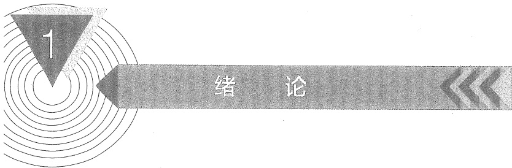

## 绪论

## 引言

由于物理学的重大突破，电子技术在20世纪取得了惊人的进步。特别是近50年来，微电子技术和其他技术的飞速发展，致使工业、农业、科技和国防等领域发生了令人瞩目的变革。与此同时，电子技术也正在改变着人们的日常生活。手机、机顶盒、电视机、个人计算机等大量的电子产品，几乎成为人们生活中不可缺少的部分。

本书作为电子技术基础课程教材（含模拟和数字两部分），在介绍半导体器件（包括分立元件和集成电路）的基础上，着重讨论一些基本电子电路的分析与设计方法，包括用EDA $ ^{①} $软件进行的分析与设计。当今世界集成电路产品丰富，功能强大，读者掌握基本电子电路的工作原理、主要特性以及电路之间的互连匹配等基本知识后，通过阅读器件产品手册，就可能设计出满足技术要求、性能可靠、成本低廉的应用电子电路，乃至构成某种功能完善的电子系统。

作为绪论，本章主要介绍电子电路的一些基本概念和放大电路的基本知识，为后续各章的学习提供入门知识。

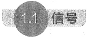

宇宙万物以及人类的活动中，包含着各种各样的信息。例如，环境气候中的温度、气压、风速等，机械运动中的力、位移、振动等，人类的语言、脉搏、呼吸等。信号就是这些信息的载体或表达形式。因此，信号的物理量形式是多种多样的。从信号处理的实现技术来看，目前最便于实现的是电信号的处理，所以在处理各种非电信号时，通常先将非电信号转换为电信号再进行处理。例如，播音员播音时，微音器（话筒）将声音（声波）信号转换为电信号，然后经过电子系统中的放大、滤波等处理电路，最后通过驱动扬声器复原出扩音后播音员的声音，为广大听众所收听。

能将各种非电信号转换为电信号的器件或装置称为传感器。上述的微音器即是将声音信号转换为电信号的传感器。由于传感器输出的是电信号，所以在电路中，常把传感器描述为信号源。根据电路理论知识，电路中的信号源都可以等效为图1.1.1所示的两种形式。其中图1.1.1a是理想电压源 $ v_{s} $和源内阻 $ R_{si} $串联的等效形式，称为戴维南（Thevenin）等效电

<!-- page: 30 -->

路；而图1.1.1b则是理想电流源 $ i_{a} $和源内阻 $ R_{si} $并联的等效形式，称为诺顿（Norton）等效电路。当信号源内阻为线性时不变电阻时，这两种信号源电路可以等效转换。根据不同的场合和需要，可以使用不同的信号源形式。

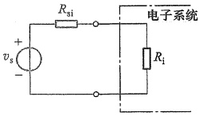

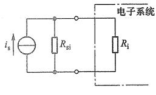

图1.1.1 信号源的等效电路
 

（a）电压源等效电路 （b）电流源等效电路

通常，信号都是与时间有关的，即是时间的函数。前述的微音器输出的某一段电压信号的波形可能如图1.1.2所示。这个波形看似无规则，分析其特性显得有些困难，但实际上有办法从中提取出它的特征参数。信号中的特征参数是设计放大电路和电子系统的重要依据。

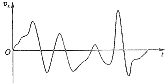

图 1.1.2 微音器输出的某一段电压信号的波形
 

#### 信号的频谱

在信号分析中，为了简化信号特征参数的提取，通常是将信号从时域变换到频域。信号在频域中表示的图形或曲线称为信号的频谱。通过傅里叶变换可以实现信号从时域到频域

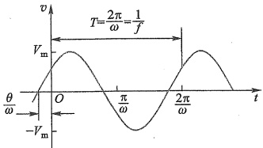

图 1.2.1 正弦波形
 

的变换。为了对信号的频谱有进一步的了解，下面首先以正弦电压信号为例说明信号的表达方式及其基本特性。在此基础上，以最典型的方法为例介绍频谱的概念。图1.2.1以最直观的方式在时域中描述了正弦电压幅值与时间的函数关系，其数学表达式为

$$  v(t)=V_m\sin\left(\omega t+\theta\right)   \tag*{(1.2.1)}$$

式中  $ V_{m} $ 是正弦电压的幅值， $ \omega $ 为角频率， $ \theta $ 为初始相角。当  $ \omega = 0 $ 时， $ v(t) $ 为直流电压信号。当

 $ V_{m} $、 $ \omega $、 $ \theta $ 均为已知常数时，信号中就不再含有任何未知信息，这是最简单的信号。止因为如此，在电路中正弦波信号经常作为标准测试信号。

根据高等数学知识，任意周期函数只要满足狄里赫利条件，都可以展开成傅里叶级数。对于图1.2.2所示周期性方波信号，它的时间函数表达式为

<!-- page: 31 -->

$$  v\left(t\right)=\left\{\begin{aligned}&V_{s}&& 当 nT\leq t<(2n+1)\frac{T}{2} 时 \\ &0&& 当 (2n+1)\frac{T}{2}\leq t<(n+1)T 时 \end{aligned}\right.   \tag*{(1.2.2)}$$

式中  $ V_{s} $ 为方波幅值，T 为周期，n 为从  $ -\infty $ 到  $ +\infty $ 的整数。

图 1.2.2 和式(1.2.2)中的电压 v 是时间 t 的函数，所以称为方波信号的时域表达方式。

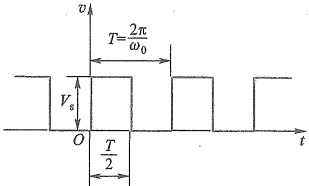

图 1.2.2 方波的时域表示
 

此方波信号可展开为傅里叶级数表达式

$$  v\left(t\right)=\frac{V_{s}}{2}+\frac{2V_{s}}{\pi}\left(\sin\omega_{0}t+\frac{1}{3}\sin3\omega_{0}t+\frac{1}{5}\sin5\omega_{0}t+\cdots\right),\quad t\neq0,\pm\frac{T}{2},\cdots,\pm m\frac{T}{2}   \tag*{(1.2.3)}$$

式中 $ \frac{V_{s}}{2} $是方波信号的直流分量， $ \omega_{0}=\frac{2\pi}{T} $为基波角频率， $ \frac{2V_{s}}{\pi}\sin\omega_{0}t $为该方波信号的基波，它的周期 $ \frac{2\pi}{\omega_{0}} $与方波本身的周期相同。式(1.2.3)中其余各项都是高次谐波分量，它们的角频率是基波角频率的整数倍。 $ m=0,1,2,\cdots $。当 $ t=0,\pm\frac{T}{2},\cdots,\pm m\frac{T}{2} $时， $ v(t) $收敛于 $ \frac{V_{s}}{2} $。

由此可以得到如图1.2.3所示的幅值与角频率关系的图解形式。这种信号各频率分量的振幅随角频率变化的分布，称为该信号的幅度频谱（简称幅度谱）。由此可知，正弦波的频谱只在基波频率上有相应的幅值，其他频率上的分量全部为零。

由傅里叶级数特性可知，许多周期信号的频谱都由直流分量、基波分量以及无穷多项次谐波分量所组成。频谱表现为一系列离散频率上的幅值（常称为谱线），并且随着谐波次数的递增，信号幅值

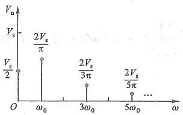

图1.2.3 图1.2.2 方波的幅度频谱
 

的总趋势是逐渐减小的。如果只截取  $ N\omega_{0} $ (N 为有限正值) 以下的信号组合，则可以得到原周期信号的近似波形，N 越大，波形的误差越小。

上述正弦信号和方波信号都是周期信号，即在一个周期内已包含信号的全部信息，任何重复周期都没有新的信息出现。实际上，客观物理世界的信号远没有这么简单，如果从时间函数来看，往往很难直接用一个简单的表达式来描述，例如气温变化曲线可能如图1.2.4a所示，它是一个非周期的时间函数波形。运用傅里叶变换可以将非周期信号波形变换为连续频率函数的频谱，它包含所有可能的频率（ $ 0 \leq \omega < \infty $）成分。图1.2.4b为图1.2.4a的频谱示意图。

实际物理世界的各种非周期信号，随角频率升高，其频谱函数总趋势是衰减的。由于实际电路处理信号时，频率范围不可能延伸至无穷大频率处，所以对信号来说，通常选择一个

<!-- page: 32 -->

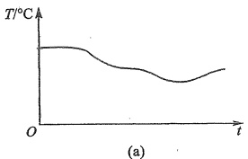

(a)
 

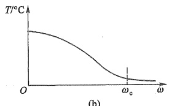

(b)
 

图 1.2.4 气温波形的时域和频域表示
 

（a）气温时域波形 （b）气温波形的频谱示意图
 

适当的  $ \omega_{c} $ (截止角频率)，若把高于此频率的部分截断，也能满足信号处理精度的要求，则把保留部分的频率范围称为信号的带宽。

由上述分析可知，从信号的频域表达方式中，可以得到比时域表达方式更有意义的参数。信号的频谱特性是设计电子电路频率响应指标的主要依据。

在计算机广泛应用之前，确定一个任意非周期信号的频谱并非易事。自从快速傅里叶变换（fast Fourier transformation，FFT）算法出现以后，人们可以用计算机迅速求出非周期时间函数的频谱函数。在电路的频率特性测试中，用此方法可以快速获得输入信号的频谱函数和输出信号的频谱函数，再将它们进行比较，可直接计算出被测电路的频率响应特性。这种快速测试方法经常用于电子装置的自动生产线上，也可以安装在所谓智能仪器中，用于仪器的自校正和故障自诊断。在一般的电路仿真软件中都包含有FFT程序，用来分析信号和电路的频率特性。

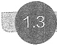

#### 模拟信号和数字信号

实际上，信号从来都不是孤立存在的，它总是由某个系统产生又被另外的系统所处理。传感器输出的电信号总是被某个电子系统所处理。所谓电子系统，是指由若干相互连接、相互作用的基本电路组成的、具有特定功能的电路整体。视实际情况需要，电子系统的规模可大可小。由于集成电路技术的快速发展，目前已有单颗芯片就自成一个系统的集成电路，也称为芯片级系统或片上系统，常简称为 SoC (system on chip)。尽管如此，学习各种基本电子电路的工作原理和分析方法，仍然是分析设计电子系统必不可少的前提。根据处理信号类型的不同，通常可将电子系统分为模拟系统、数字系统和混合系统。信号类型的相关概念如下：

在时间上和幅值上均是连续的信号称为模拟信号，也就是数学上所说的连续函数。图1.1.2中微音器输出的电压信号以及经放大器放大后的电压信号都是模拟信号。从宏观上看，我们周围世界中的大多数物理量都是时间连续、数值连续的变量，如气温、气压、风速等，这些变量通过相应的传感器都可转换为模拟电信号，然后输入电子系统中。处理模拟信号的电子电路称为模拟电路。本书是教材的模拟部分，主要讨论各种模拟电子电路的基本概念、基本原理、基本分析方法及基本应用。

在信号分析中，按时间和幅值的连续性和离散性把信号分为4类：（1）时间连续、数值

<!-- page: 33 -->

连续信号；（2）时间离散、数值连续信号；（3）时间连续、数值离散信号；（4）时间离散、数值离散信号。其中第（1）类即是前面所述的模拟信号；第（4）类称为数字信号。与本书配套的数字部分教材涉及上述（2）、（3）、（4）三类信号的处理电路。随着计算机技术的发展和普及，绝大多数电子系统都引入了计算机或微处理器来处理信号。由于微处理器是数字电路系统，只能处理数字信号，所以模拟信号需要通过模数转换器转换为数字信号，才能被这样的系统处理。相关的转换电路以及数字信号、数字电路的内容详见本套教材的数字部分。

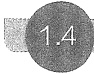

#### 放大电路模型

模拟信号最基本的处理是放大，它是通过放大电路实现的，大多数模拟电子系统中都包含放大电路。放大电路也是构成其他模拟电路，如滤波、振荡、稳压等电路的基本单元电路。可以说，放大电路是模拟电子技术的核心电路。

### 1. 模拟信号放大

传感器输出的电信号通常是很微弱的，例如，1.1节提到的微音器的输出电压仅有毫伏量级，而细胞电生理实验中所检测到的电流甚至只有皮安（pA， $ 10^{-12} $ A）量级。对这些过于微弱的信号，一般情况下既无法直接显示，也很难做进一步分析处理。若想用传统指针式仪表显示出来，通常必须把它们放大到数百毫伏量级才行。若对信号进行数字化处理，则需要把信号放大到伏特量级，才能被一般的模数转换器所接受。还有些电子系统需要输出较大的功率，例如，家用音响系统往往需要把音频信号功率提高到数瓦、数十瓦甚至更高。对这些信号的处理都离不开放大电路。

这里所说的放大都是指线性放大，也就是说放大电路输出信号中包含的信息与输入信号完全相同，既不减少任何原有信息，也不增加任何新的信息，只改变信号幅度或功率的大小，如果在时域或频域观察，就意味着信号任何一点的幅值都是按照相同的比例变化的。例如，将图1.1.2所示信号送入放大电路放大后，希望放大电路输出的信号，除了幅值增大外，应是输入信号的重现。输出波形的任何变形，都被认为是产生了失真。

针对不同的应用，需要设计不同的放大电路，其细节将在本书后续各章中讨论，这里作为引导，只简要介绍有关放大电路的基本概念。

我们知道，放大电路是用来放大信号的，所以放大电路应为双口网络，即它有一个信号输入口和一个信号输出口。在电子电路中，信号放大过程一般可用图1.4.1表示。其中 $ v_{s} $为信号源电压， $ R_{si} $为信号源内阻， $ R_{L} $为负载电阻（本书中 $ R_{L} $都表示负载电阻）。A为放大电路， $ v_{i} $和 $ i_{i} $分别为放大电路输入口的输入电压和输入电流； $ v_{o} $和 $ i_{o} $分别为放大电路输出口的输出电压和输出电流。

在实际应用中，根据输入信号的形式不同和对输出信号的要求不同，放大电路可以有不同的增益（放大倍数）表达形式。如果只需要考虑电路的输出电压 $ v_{0} $和输入电压 $ v_{i} $的关系，则可表达为

$$  v_{_{0}}=A_{_{v}}v_{_{i}}   \tag*{(1.4.1)}$$

<!-- page: 34 -->

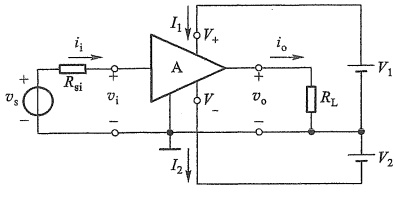

(a)
 

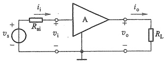

(b)
 

图1.4.1 信号放大过程电路图   (a) 实际电路 (b) 简化电路
 

式中  $ A_{v} $ 为电路的电压增益。这种主要考虑电压增益的电路称为电压放大电路。语音放大系统中对微音器输出电压信号的放大，使用的就是这种放大电路。

同样，若主要考虑图1.4.1中放大电路的输出电流 $ i_{0} $和输入电流 $ i_{i} $的关系，则可表达为

$$  i_{o}=A_{i}i_{i}   \tag*{(1.4.2)}$$

式中  $ A_{i} $ 为电流增益，这种电路称为电流放大电路。

当需要把电流信号转换为电压信号时，则可利用互阻放大电路，其表达式为

$$  \boldsymbol{v}_{o}=\boldsymbol{A}_{r}\boldsymbol{i}_{i}   \tag*{(1.4.3)}$$

式中  $ A_{r}=v_{0}/i_{1} $ 为互阻增益，其单位为  $ \Omega $。与前述量纲为 1 的电压增益和电流增益不同，这里把信号放大的概念延伸了。

与上述情况相反，有时要求把电压信号转换为相应的电流输出，则电路中输入信号取电压 $ v_{i} $，输出信号取电流 $ i_{0} $，输出信号与输入信号的关系可表达为

$$  i_{o}=A_{g}v_{i}   \tag*{(1.4.4)}$$

式中  $ A_{g}=i_{0}/v_{i} $ 称为放大电路的互导增益，它具有导纳量纲，单位为 S。相应地，这种放大电路得名为互导放大电路。

上述的  $ A_{v}, A_{i}, A_{r} $ 和  $ A_{g} $ 是放大电路工作在线性条件下的增益。实际上放大电路还有一种增益表达形式——功率增益，它等于输出信号功率与输入信号功率之比，即  $ A_{p} = v_{0} i_{0} / (v_{i} i_{i}) = A_{v} A_{i} $。在通信系统中它受到更多关注。

通常，放大电路输出信号的幅度远大于输入信号的幅度，即意味着输出的能量增加了。增加的能量并非无中生有，而是由供电电源能量转换得来的。因此，完整的放大电路应包括供电电源。图1.4.1a中的 $ V_{1} $为正电压供电电源， $ V_{2} $为负电压供电电源，电路为双电源供电形式，有些放大电路也可以只用单电源供电。符号“⊥”是电路输入与输出信号的共同端点，也是电路中正、负电压的参考电位点，常称为电路中的“地”。对于电子电路来说，这个参考点必不可少，它还可以为电路分析带来方便。图1.4.1b是图1.4.1a的简化表示，只是省略了供电电源符号。放大电路A是一个双口网络，有时也用矩形符号表示。

### 2. 放大电路模型

为了进一步讨论前述四类放大电路的性能指标，可以根据双口网络的端口特性，建立四种不同类型的放大电路模型，如图1.4.2所示。这些模型仅从输入和输出端口特性上等效

<!-- page: 35 -->

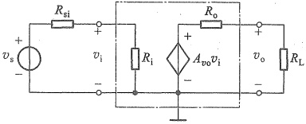

(a)
 

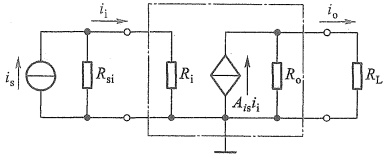

(b)
 

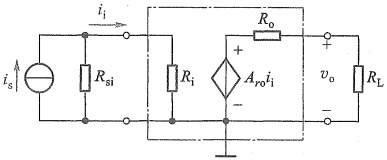

(c)
 

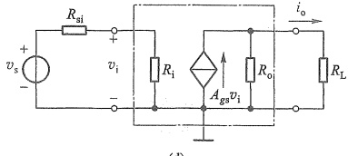

(d)
 

图 1.4.2 四种类型的放大电路模型
 

（a）电压放大 （b）电流放大 （c）互阻放大 （d）互导放大
 

放大电路，而并不关注各种放大电路实际的内部结构。

在图 1.4.1 中，放大电路输入端口电压和电流的关系，可以用一个等效电阻来反映。而对于放大电路的输出端口，一定会有输出信号，根据电路理论知识，可以用一个信号源和它的内阻来等效。这样，便得到图 1.4.2a 中点画线框内一般化的电压放大电路模型 $ ^{①} $。模型由输入电阻  $ R_i $、输出电阻  $ R_o $ 和受控电压源  $ A_{vo}v_i $ 三个基本元件构成，其中  $ v_i $ 为输入电压， $ A_{vo} $ 为输出开路 ( $ R_L = \infty $) 时的电压增益。值得注意的是，由于放大电路的输出总是与输入有关，即受输入信号的控制，所以，电路模型输出端口中的信号源是受控源，而不是独立信号源。在图 1.4.2a 所示模型中，受控电压源  $ A_{vo}v_i $ 受输入电压  $ v_i $ 的控制，并随  $ v_i $ 线性变化。信号源中的信号通过该模型产生输出信号，在  $ R_L $ 两端得到与  $ v_a $ 呈线性关系的  $ v_o $。

从图 1.4.2a 可以看出，由于  $ R_{0} $ 与  $ R_{L} $ 的分压作用，使负载电阻  $ R_{L} $ 上的  $ v_{0} $ 小于受控电压源的幅值，即

$$  v_{_{0}}=A_{_{so}}v_{_{i}}\frac{R_{_{L}}}{R_{_{L}}+R_{_{o}}}   \tag*{(1.4.5)}$$

那么，实际的电压增益 $ ^{②} $为

$$  A_{_{v}}=\frac{v_{_{o}}}{v_{_{i}}}=A_{_{so}}\frac{R_{_{L}}}{R_{_{L}}+R_{_{o}}}   \tag*{(1.4.6)}$$

<!-- page: 36 -->

可见， $ A_{v} $ 会受  $ R_{L} $ 影响，随  $ R_{L} $ 的减小而降低。为了减小负载电阻对放大电路电压增益的影响，就要求在电路设计时努力使  $ R_{0} \ll R_{L} $。理想电压放大电路的输出电阻应为  $ R_{0} = 0 $。

信号衰减的另一个环节在输入回路。信号源内阻  $ R_{si} $ 和放大电路输入电阻  $ R_{i} $ 的分压作用，使真正到达放大电路输入端的实际电压为

$$  v_{i}=v_{s}\frac{R_{i}}{R_{si}+R_{i}}   \tag*{(1.4.7)}$$

显然，只有当  $ R_{i} \gg R_{si} $ 时，才能明显减小  $ R_{si} $ 对信号的衰减作用，这就要求设计电压放大电路时，应尽量提高电路的输入电阻  $ R_{i} $。理想电压放大电路的输入电阻应为  $ R_{i} \to \infty $。此时， $ v_{i} = v_{s} $，避免了信号在信号源内阻上的衰减。

从上述分析可知，电压放大电路适用于信号源内阻  $ R_{si} $ 较小而且负载电阻  $ R_{L} $ 较大的场合。

图 1.4.2b 中点画线框内是电流放大电路模型，与电压放大电路模型不同，其输出回路由受控电流源  $ A_{is}i_{1} $ 和输出电阻  $ R_{0} $ 并联而成，受控电流源的控制信号是输入电流  $ i_{1} $。其中  $ A_{is} $ 为输出短路 ( $ R_{L}=0 $) 时的电流增益。该模型与信号源和负载相连时同样存在信号衰减问题。与电压放大电路类似，输出电阻  $ R_{0} $ 和信号源内阻  $ R_{si} $ 分别在电路输出端和输入端对信号电流产生分流，造成了信号的衰减。由图 1.4.2b 可知，在电路输出端， $ R_{L} $ 和  $ R_{0} $ 有如下的分流关系

$$  i_{_{0}}=A_{_{is}}i_{_{i}}\frac{R_{_{o}}}{R_{_{L}}+R_{_{o}}}   \tag*{（1.4.8）}$$

带负载  $ R_{L} $ 时的电流增益为

$$  A_{i}=\frac{i_{o}}{i_{i}}=A_{is}\frac{R_{o}}{R_{L}+R_{o}}   \tag*{(1.4.9)}$$

在电路输入端, $ R_{si} $和 $ R_{i} $有如下的分流关系：

$$  i_{i}=i_{s}\frac{R_{si}}{R_{si}+R_{i}}   \tag*{（1.4.10）}$$

由此可见，只有当  $ R_{0} \gg R_{L} $ 和  $ R_{i} \ll R_{si} $ 时，才可以使电路具有较理想的电流放大效果。因此，在设计电流放大电路时，应尽量减小电路的输入电阻  $ R_{i} $，而尽量提高电路的输出电阻  $ R_{0} $。换言之，电流放大电路一般更适用于信号源内阻  $ R_{si} $ 较大而负载电阻  $ R_{L} $ 较小的场合。

图 1.4.2c 和图 1.4.2d 中点画线框内分别为互阻放大和互导放大电路模型。两电路的输出信号分别由受控电压源  $ A_{ro}i_{i} $ 和受控电流源  $ A_{gs}v_{i} $ 产生。在理想状态下，互阻放大电路要求输入电阻  $ R_{i}=0 $ 且输出电阻  $ R_{o}=0 $，而互导放大电路则要求输入电阻  $ R_{i}\rightarrow\infty $，输出电阻  $ R_{o}\rightarrow\infty $。电路中的  $ A_{ro} $ 称为输出开路时的互阻增益， $ A_{gs} $ 称为输出短路时的互导增益。两模型的详细情况读者可自行分析。

根据信号源的戴维南-诺顿等效变换原理，上述四种电路模型之间可以相互任意转换。例如，图1.4.2a所示电压放大电路模型的开路输出电压为 $ A_{vo}v_{i} $，而根据电流放大电路模型可得开路输出电压为 $ A_{is}i_{i}R_{o} $且 $ i_{i}=v_{i}/R_{i} $，令两电路等效，于是有

$$  A_{_{v o}}v_{_{i}}=A_{_{i s}}i_{_{i}}R_{_{o}}=A_{_{i s}}\frac{v_{_{i}}}{R_{_{i}}}R_{_{o}}   \tag*{(1.4.11)}$$

<!-- page: 37 -->

即可得  $ A_{vo}=A_{ia}R_{o}/R_{i} $。同理可得  $ A_{vo}=A_{ro}/R_{i} $ 和  $ A_{vo}=A_{gs}R_{o} $。这样，其他三种电路模型都可转换为电压放大电路模型。同理可实现其他放大电路模型之间的转换。换言之，一个实际的放大电路原则上可以取四类模型中的任意一种，但是根据信号源的性质和负载的要求，一般只有一种模型在电路设计或分析中概念最明确，运用最方便。例如，信号源为低内阻的电压源，要求输出为电压信号时，以选用电压放大电路模型为宜。而某种场合需要将来自高阻抗传感器的电流信号变换为电压信号时，则采用互阻放大电路模型更方便，如此等等。

图 1.4.2 模型中的元件参数值，可以通过对实际电路和元器件的分析来确定，也可以通过对实际电路的测量而得到。

图 1.4.2 所示的所有电路模型中，输入回路和输出回路之间都是相连的。然而，为了提高安全性和抗干扰能力，目前有许多工业控制设备及医疗设备，在前级信号预放大中，普遍采用所谓的隔离放大，即放大电路的输入与输出电路（包括供电电源）相互绝缘，输入与输出信号之间不存在任何公共参考点。这种类型的电压放大电路通过磁或光传输信号，其模型如图 1.4.3 所示。输入和输出之间有无公共参考点对本章所有内容的讨论没有影响。

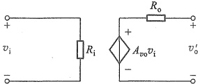

图 1.4.3 隔离型放大电路模型
 

##### 复习思考题

1.4.1 某放大电路输入信号为 10 pA 时，输出为 500 mV，它的增益是多少？属于哪一类放大电路？

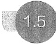

#### 放大电路的主要性能指标

放大电路的性能指标是衡量它品质优劣的标准，并决定其适用范围。这里主要讨论放大电路的输入电阻、输出电阻、增益、频率响应和非线性失真等几项主要性能指标。

### 1. 输入电阻

由于四种模型之间可以相互转换，所以放大电路的输入电阻  $ R_i $ 和输出电阻  $ R_0 $ 均可用图 1.5.1 来表示。由图看出，输入电阻等于输入电压与输入电流的比值，即  $ R_i = v_i / i_0 $。 $ R_i $ 的大小决定了放大电路能从信号源获取多大的信号。对于输入为电压信号的放大电路，即电压放大和互导放大电路， $ R_i $ 越大，放大电路输入端的  $ v_i $ 值则越大。反之，输入为电流信号的放大电路，即电流放大和互导放大电路， $ R_i $ 越小，流入放大电路的输入电流  $ i_i $ 越大。

当定量分析放大电路的输入电阻时，一般可假定在输入端外加一测试电压 $ v_{t} $，如图1.5.2a所示，相应地产生一测试电流 $ i_{t} $，于是可算出输入电阻

$$  R_{i}=\frac{v_{i}}{i_{i}}   \tag*{(1.5.1)}$$

实际上，实验中大多采用测电压的方法求输入电阻，即在输入回路串入一个已知的电阻 $ R_{1} $，如图1.5.2b所示，测得电压 $ v_{i} $，由于回路中电流相同，所以由式 $ R_{i}=R_{1}v_{i}/(v_{t}-v_{i}) $计算得

<!-- page: 38 -->

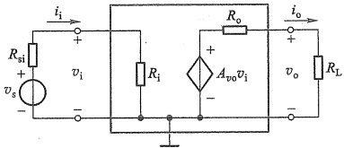

图 1.5.1 放大电路的输入电阻和输出电阻
 

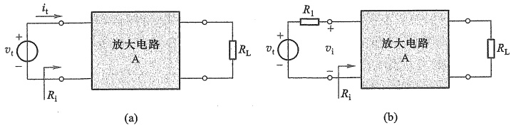

图 1.5.2 放大电路的输入电阻
 

到 $ R_{i} $的值。

### 2. 输出电阻

放大电路输出电阻  $ R_{0} $ 的大小将影响它带负载的能力。所谓带负载能力，是指放大电路输出量随负载变化的程度。当负载变化时，输出量变化很小或基本不变表示带负载能力强，即输出量与负载大小的关联程度越弱，放大电路的带负载能力越强。对于不同类型的放大电路，输出量的表现形式是不一样的。例如，电压放大和互阻放大电路，输出量为电压信号。对于这类放大电路， $ R_{0} $ 越小，负载电阻  $ R_{L} $ 的变化对输出电压  $ v_{0} $ 的影响就越小[参见式(1.4.5)]，表明带负载能力越强。对输出为电流信号的放大电路，即电流放大和互导放大，与受控电流源并联的输出电阻  $ R_{0} $ 越大，负载电阻  $ R_{L} $ 的变化对输出电流  $ i_{0} $ 的影响就越小[参见式(1.4.8)]，表明带负载能力越强。

当定量分析放大电路的输出电阻时，可采用图1.5.3所示的方法。在信号源置零 $ (v_{s}=0 $，但保留 $ R_{si} $)和负载开路 $ (R_{L}=\infty) $的条件下，在放大电路的输出端加一测试电压 $ v_{t} $，相应地产生一测试电流 $ i_{t} $，于是可得输出电阻为

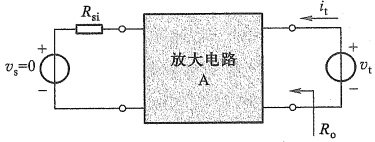

图 1.5.3 放大电路的输出电阻
 

$$  R_{o}=\frac{v_{t}}{i_{t}}\bigg|_{v_{s}=0,R_{L}=\infty}   \tag*{(1.5.2)}$$

根据这个关系，即可算出各种放大电路的输出电阻。

在实验中，通常采用测量电压的方法求输出电阻，即分别测得放大电路负载开路时的输出电压  $ v_{0}^{\prime} $ 和带已知负载  $ R_{L} $ 时的输出电压  $ v_{0} $，可由式  $ R_{0}=(v_{0}^{\prime}/v_{0}-1)R_{L} $ 计算得到  $ R_{0} $ 的值。

<!-- page: 39 -->

必须注意，以上所讨论的输入电阻和输出电阻不是直流电阻，而是放大电路在线性运用情况下的交流电阻（也称动态电阻），用符号 R 带有小写字母下标 i 和 o 来表示。有关这方面的详细情况，将在后续章节中讨论。

### 3. 增益

如前所述，四种放大电路分别具有不同的增益，如电压增益  $ A_{g} $、电流增益  $ A_{i} $、互阻增益  $ A_{r} $，及互导增益  $ A_{g} $。它们实际上反映了放大电路在输入信号控制下，将供电电源能量转换为信号能量的能力。其中  $ A_{g} $ 和  $ A_{i} $ 两种量纲为 1 的增益在工程上常用以 10 为底的对数增益表达，其基本单位为贝尔 (Bel, B)，平时用它的 1/10 单位“分贝”(decibel, dB)。这样用分贝表示的电压增益和电流增益分别如下所示：

$$   电压增益 =20lg\ \left|\ A_{v}\ \right|\ ^{ \textcircled{1} }dB   \tag*{(1.5.3)}$$

$$   电流增益 =20lg\ \left|A_{i}\right|\ dB   \tag*{（1.5.4）}$$

由于功率与电压（或电流）的平方成比例，因而功率增益表示为

$$   功率增益 =10lg A_{p}dB   \tag*{（1.5.5）}$$

因为在某些情况下， $ A_{v} $ 或  $ A_{i} $ 可能为负数，意味着信号的输出与输入之间存在  $ 180^{\circ} $ 的相位差，这与对数增益为负值时的意义是不同的。所以为避免混淆，用分贝表示增益时， $ A_{v} $ 和  $ A_{i} $ 取绝对值。例如，当放大电路的电压增益为 -20 dB 时，表示信号电压经过放大电路后，衰减到原来的 1/10，即  $ \left|A_{v}\right|=0.1 $；而当增益为 -20 倍时，表示  $ \left|A_{v}\right|=20 $，但输出电压与输入电压之间是反相的。也就是说，当用分贝数表示放大电路增益时，仅反映输出与输入信号之间的大小关系，不包含相位关系。

在工程上，之所以广泛使用对数方式表达放大电路的增益是因为：（1）当用对数坐标表达增益随频率变化的曲线时，可大大扩大增益变化的视野（参见本书有关频率响应的讨论）；（2）计算多级放大电路的总增益时，可将乘法运算化为加法运算，简化电路的分析和设计。

例 1.5.1 放大电路需要将幅值为 5 mV 的正弦波放大后，使 16 Ω 负载上获得 20 W 的功率，已知信号源的内阻  $ R_{si}=10\ k\Omega $，放大电路的输入电阻  $ R_{i}=20\ k\Omega $，试求放大电路对信号源的电压增益、电流增益和功率增益。

解：由负载阻值和其上功率可求得放大电路的输出电压幅值（不是有效值）：

 $$ V_{\mathrm{o m}}=\sqrt{2P_{\mathrm{o}}R_{\mathrm{L}}} $$ 

所以电压增益

 $$ \begin{aligned}A_{vs}=\frac{V_{om}}{V_{sm}}=\frac{\sqrt{2P_{o}R_{L}}}{5\ mV}=\frac{\sqrt{2\times20\ W\times16\ \Omega}}{5\ mV}\approx5\ 060\\20\lg\left|A_{vs}\right|\approx74\ dB\end{aligned} $$

<!-- page: 40 -->

由于信号源是电压源，所以其内阻与放大电路的输入电阻是串联结构，输入回路的电流幅值为

 $$ I_{sm}=\frac{V_{sm}}{R_{si}+R_{i}}=\frac{5\ mV}{10\ k\Omega+20\ k\Omega}=1.67\times10^{-7}A $$ 

而输出电流为

 $$ I_{om}=\sqrt{2P_{o}/R_{L}} $$ 

所以电流增益

 $$ \begin{aligned}A_{_{is}}=\frac{I_{_{om}}}{I_{_{sm}}}=\frac{\sqrt{2P_{_{o}}/R_{_{L}}}}{1.67\times10^{-7}A}=\frac{\sqrt{2\times20\ W\div16\ \Omega}}{1.67\times10^{-7}A}\approx9.47\times10^{6}\\20\lg\left|A_{_{is}}\right|\approx139.5\ dB\end{aligned} $$ 

功率增益

 $$ \begin{aligned}A_{p}=\frac{P_{o}}{P_{s}}=\frac{20\ W}{\frac{V_{sm}}{\sqrt{2}}\cdot\frac{I_{sm}}{\sqrt{2}}}=\frac{20\ W\times2}{5\ mV\times1.67\times10^{-7}A}\approx4.79\times10^{10}\\10\lg\left|A_{p}\right|\approx106.8\ dB\end{aligned} $$ 

### 4. 频率响应

1.4 节介绍的放大电路模型是极为简单的模型，实际的放大电路中总是存在电抗性元件的，如电容和电感元件，以及电子器件的极间电容、接线电容和接线电感等。因此，放大电路输出与输入之间的关系必然和信号频率有关。放大电路的频率响应是指，在输入正弦信号情况下，输出随输入信号频率连续变化的稳态响应。

若考虑电抗元件的作用和信号角频率变量，则放大电路的电压增益可表达为

$$  \dot{A}_{v}(\mathrm{j}\omega)=\frac{\dot{V}_{o}(\mathrm{j}\omega)}{\dot{V}_{i}(\mathrm{j}\omega)}   \tag*{（1.5.6）}$$

$$  \dot{A}_{v}=A_{v}(\omega)\underline{\left/\varphi\left(\omega\right)\right.}   \tag*{(1.5.7)}$$

式中  $ \omega $ 为信号的角频率,  $ A_{v}(\omega) $ 表示电压增益的模与角频率之间的关系, 称为幅频响应; 而  $ \varphi(\omega) $ 表示放大电路输出与输入正弦电压信号的相位差与角频率之间的关系, 称为相频响应, 将二者综合起来可全面表征放大电路的频率响应。

图1.5.4是一个普通音响系统放大电路的幅频响应。为了符合通常的习惯，横坐标采用频率单位 $ f=\omega/(2\pi) $。值得注意的是，图中的坐标均采用对数刻度。这样处理不仅把频率和增益的变化范围扩展得很宽，而且在绘制近似频率响应曲线时也十分简便（详见6.1节）。

图 1.5.4 所示幅频响应的中间一段是平坦的，即增益保持常数 60 dB，称为中频区，也称为通带区。在 20 Hz 和 20 kHz 两点处，增益分别下降 3 dB，而在低于 20 Hz 和高于 20 kHz 的两个区域，随着频率远离这两点，增益逐渐下降。在输入信号幅值保持不变的条件下，对应于增益下降 3 dB 的频率点处，其输出功率约等于中频区输出功率的一半，因此该频率点也常称为半功率点。一般把幅频响应增益降 3 dB 所对应的高、低两个频率点间的频率差，

<!-- page: 41 -->

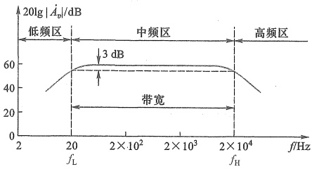

图 1.5.4 某音响系统放大电路的幅频响应
 

定义为放大电路的带宽或通频带，即

$$  B\mathbb{W}=f_{H}-f_{L}   \tag*{（1.5.8）}$$

式中  $ f_{H} $ 是频率响应的高端半功率点频率，也称为上限频率，而  $ f_{L} $ 则称为下限频率。由于通常有  $ f_{L} \ll f_{H} $ 的关系，故有  $ BW \approx f_{H} $。

有些放大电路的通频带一直延伸到直流，如图1.5.5所示。可以认为它是图1.5.4中下限频率为零的一种特殊情况。这种放大电路称为直流（直接耦合）放大电路，是指至少可以正常放大直流信号的一种放大电路。目前广泛使用的集成运算放大器大多具有这样的幅频响应。

现实生活中的绝大部分信号都不是单一频率的信号，它们的频率分布范围不尽相同。表1.5.1给出了某些典型信号的频率范围。放大这些信号时，放大电路的通频带应涵盖相应信号的频率范围。

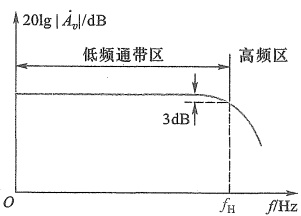

图 1.5.5 直流放大电路的幅频响应
 

表1.5.1 某些典型信号的频率范围
 

<table border=1 style='margin: auto; word-wrap: break-word;'><tr><td style='text-align: center; word-wrap: break-word;'>信号</td><td style='text-align: center; word-wrap: break-word;'>频率范围</td><td style='text-align: center; word-wrap: break-word;'>信号</td><td style='text-align: center; word-wrap: break-word;'>频率范围</td></tr><tr><td style='text-align: center; word-wrap: break-word;'>心电图</td><td style='text-align: center; word-wrap: break-word;'>0.05~200 Hz</td><td style='text-align: center; word-wrap: break-word;'>调频无线广播</td><td style='text-align: center; word-wrap: break-word;'>88~108 MHz</td></tr><tr><td style='text-align: center; word-wrap: break-word;'>音频信号</td><td style='text-align: center; word-wrap: break-word;'>20 Hz~20 kHz</td><td style='text-align: center; word-wrap: break-word;'>超高频电视</td><td style='text-align: center; word-wrap: break-word;'>470~806 MHz</td></tr><tr><td style='text-align: center; word-wrap: break-word;'>模拟视频信号</td><td style='text-align: center; word-wrap: break-word;'>直流~4.5 MHz</td><td style='text-align: center; word-wrap: break-word;'>卫星电视</td><td style='text-align: center; word-wrap: break-word;'>3.7~4.2 GHz</td></tr><tr><td style='text-align: center; word-wrap: break-word;'>中波调幅无线广播</td><td style='text-align: center; word-wrap: break-word;'>540~1 600 kHz</td><td style='text-align: center; word-wrap: break-word;'></td><td style='text-align: center; word-wrap: break-word;'></td></tr></table>

从1.2节的讨论可知，理论上许多非正弦信号的频谱范围都延伸到无穷大，而放大电路的带宽却是有限的，并且相频响应也不能保持为常数。例如，图1.5.6a中输入信号由基波和二次谐波组成，如果受放大电路带宽限制，基波增益较大，而二次谐波增益较小，于是输出电压波形产生了失真。这种由于放大电路带宽所限，导致对信号不同频率分量幅值的放大倍数不同而产生的失真，称为幅度失真。同样，当放大电路对信号不同频率分量产生的时延不同时，也会产生失真，称为相位失真。在图1.5.6b中，如果放大后二次谐波的时延与基波的时延不同，输出电压波形也会变形。应当指出，一般情况下幅度失真和相位失真几乎是同时

<!-- page: 42 -->

发生的，在图1.5.6中分开讨论这两种失真，只是为了方便读者理解。幅度失真和相位失真总称为频率失真，它们都是由线性电抗元件引起的，所以又称为线性失真，以区别于由于元器件非线性特性造成的非线性失真。

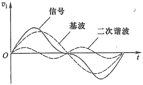

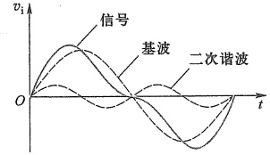

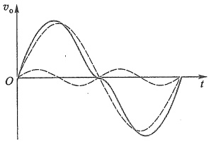

(a)
 

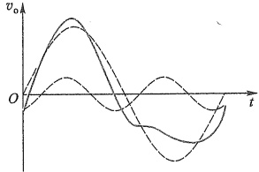

(b)
 

图1.5.6 放大电路的输入输出波形   (a) 幅度失真 (b) 相位失真
 

为将信号的频率失真限制在容许的范围内，在设计放大电路时，就要求正确估计信号的有效带宽（即包含信号主要能量或信息的频谱宽度），以使放大电路带宽与信号带宽相匹配。若放大电路带宽不够，则会带来明显的频率失真；而带宽过宽，往往造成噪声电平升高或使电路成本增加。

前述音频系统放大电路带宽定在  $ 20 \, Hz \sim 20 \, kHz $，这与人类听觉的生理功能相匹配。由于人耳对音频信号的相位变化不敏感，所以不过多考虑放大电路的相频响应特性。但在有些情况下，特别是对信号的波形形状有严格要求的场合，确定放大电路的带宽还须兼顾其相频响应特性。

### 5. 非线性失真

在 1.4 节曾提到，放大电路对信号的放大应是线性的。例如，可以通过图 1.5.7a 所示的电压传输特性曲线，来描述放大电路输出电压与输入电压的这种线性关系。描述放大电路输出量与输入量关系的曲线，称为放大电路的传输特性曲线。图 1.5.7a 中的电压传输特性是一条直线，表明输出电压  $ v_{a} $ 与输入电压  $ v_{i} $ 具有线性关系，直线的斜率就是电压增益。然而，实际的放大电路并非如此。由于构成放大电路的元器件本身是非线性的（将在第 3、4、5 章介绍），加之放大电路工作电源的电压都是有限的，意味着输出电压不能沿着图 1.5.7a 中的直线向两端无限延伸，较典型的情况如图 1.5.7b 所示。由此看出，曲线上各点切线的斜率并不完全相同，表明放大电路的电压增益不能保持恒定，而是随输入电压变化的。由放大电路这种非线性特性引起的失真称为非线性失真。在这种关系下，输入为标准正弦波时，输

<!-- page: 43 -->

出不再是正弦波，从频域的角度看，非线性失真会使输出波形产生新的高次谐波分量。在设计和应用放大电路时，应尽可能使放大电路工作在线性区。对于图1.5.7b来说，应工作在曲线的中间部位，该部位的斜率基本相同。有关非线性失真的细节，将在后续相关章节中讨论。

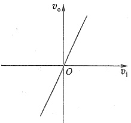

(a)
 

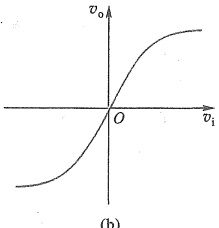

(b)
 

图1.5.7 放大电路的电压传输特性   (a) 理想特性 (b) 实际特性
 

向放大电路输入标准的正弦波信号，可以测定输出信号的非线性失真程度，并用下面定义的非线性失真系数来衡量

$$  \gamma=\frac{\sqrt{\sum_{k=2}^{\infty}V_{ok}^{2}}}{V_{o1}}\times100\%   \tag*{(1.5.9)}$$

式中  $ V_{o1} $ 是输出电压信号基波分量的有效值， $ V_{ok} $ 是各高次谐波分量的有效值，k 为正整数。可见，非线性失真系数越大，表明失真越严重。非线性失真程度对某些放大电路来说显得比较重要，高保真度的音响系统即是常见的例子。随着电子技术的进步，目前即使增益较高、输出功率较大的放大电路，非线性失真系数也可做到不超过 0.01%。

放大电路除上述五种主要性能指标外，针对不同用途的电路，还会提出一些其他指标，诸如最大输出功率、效率、转换速率、信号噪声比、抗干扰能力等，甚至在某些特殊使用场合还会提出体积、质量、工作温度、环境温度等要求。其中有些在通常条件下很容易达到的技术指标，在特殊条件下往往就变得很难达到。高温、强噪声等恶劣运行环境，即属于这类特殊条件。要想全面达到应用中所要求的性能指标，除合理设计电路外，还要靠选择高质量的元器件及高水平的制造工艺来保证，尤其是后者经常被初学者忽视。上述问题有些在后续章节中进行讨论，有些则不属于本课程的范围，有兴趣的读者可参考有关文献资料及在以后工作实践中学习。

复习思考题

1.5.1 某放大电路开路输出电压为  $ v_{0}^{\prime} $，短路输出电流为  $ i_{os} $，试求其输出电阻  $ R_{0} $。

1.5.2 为什么常选用可产生正弦波的信号发生器作为放大电路实验、测试的信号源？配合示波器，能够测量放大电路的哪些性能指标。

1.5.3 一个有限带宽的放大电路，在放大一个正弦波信号时，是否有可能出现频率失真？为什么？

<!-- page: 44 -->

#### 小结

教学视频1.1：

绪论小结

自然界及人类活动中的信号大多是非电信号，通过相应的传感器将它们转换为电信号才能被电子系统处理。任何电信号在电路中都可以等效为两种信号源电路，即戴维南等效电路和诺顿等效电路。

- 自然界及人类活动中的信号大多是非电信号，通过相应的传感器将它们转换为电信号才能被电子系统处理。任何电信号在电路中都可以等效为两种信号源电路，即戴维南等效电路和诺顿等效电路。

· 同一个信号既可以在时域中描述，也可以在频域中描述。理论上许多非正弦信号的频谱范围都会延伸到无穷大，而电路的处理能力却是有限的。通常都是在满足一定精度要求下，在有限的频率范围内实现信号处理。信号的频谱特性是设计电子电路频率响应指标的主要依据。

在时间上和幅值上均是连续的信号称为模拟信号，在时间上和幅值

上均是离散的信号称为数字信号。处理模拟信号的电路称为模拟电路，处理数字信号的电路称为数字电路。

- 信号通过放大电路放大后，输出信号中增加的能量来自工作电源。电子电路中正、负电压的参考电位点常称为电路中的“地”，用符号“ $ \perp $”表示。它也常常作为电路输入与输出信号的共同端点。

放大电路是最基本的模拟信号处理电路。根据实际应用中输入信号 $ (v_{0} $ 或  $ i_{0}) $ 和输出信号 $ (v_{0} $ 或  $ i_{0}) $ 的不同，放大电路可分为四种类型：电压放大、电流放大、互阻放大和互导放大。可以用输入电阻 $ R_{i} $、输出电阻 $ R_{0} $ 和受控电压源或受控电流源等基本元件，建立起这四种放大电路的模型，并通过它们分析放大电路的基本特性。四种放大电路模型之间可以相互转换，以便于不同情况下的电路分析。放大电路的输入电阻和输出电阻也会对信号的放大产生影响。在通信系统中功率放大更受到重视。

- 输入电阻、输出电阻、增益、频率响应和非线性失真等，是衡量放大电路品质优劣的主要性能指标，也是设计放大电路的依据。可以通过对电路的分析、计算或对实际电路的测量来确定这些性能指标。

#### 习题

#### 1.2 信号的频谱

1.2.1 写出下列正弦电压信号的表达式（设初始相角为零）：

（1）峰-峰值10 V，频率10 kHz；

(2) 有效值 220 V, 频率 50 Hz;

（3）峰-峰值100 mV，周期1 ms；

(4) 峰-峰值 0.25 V，角频率 1 000 rad/s。

1.2.2 图1.2.2所示方波电压信号加在一个电阻R两端，试用公式 $ P=\frac{1}{T}\int_{0}^{T}\frac{v^{2}(t)}{R}dt $计算信号在电阻上耗散的功率；然后根据式(1.2.3)分别计算方波信号的傅里叶展开式中直流分量、基波分量、三次谐波分量在电阻上耗散的功率，并计算这3个分量在电阻上耗散功率之和占电阻

<!-- page: 45 -->

上总耗散功率的百分比。

#### 1.4 放大电路模型

1.4.1 电压放大电路模型如图 1.4.2a 所示，设输出开路电压增益  $ A_{vo}=10 $ 。试分别计算下列条件下的源电压增益  $ A_{vo}=v_{o}/v_{s} $ ：

(1)  $ R_i = 10\ R_{ni}, R_L = 10\ R_o $;

(2)  $ R_i = R_{si}, R_L = R_o $;

(3)  $ R_i = R_{si} / 10 $,  $ R_L = R_o / 10 $;

(4)  $ R_{i}=10\ R_{ni},R_{L}=R_{o}/10 $.

1.4.2 某电唱机拾音头内阻为  $ 1 \, M\Omega $，输出电压为  $ 1 \, V $（有效值），如果直接与  $ 10 \, \Omega $ 扬声器相接，扬声器上的电压为多少？如果在拾音头和扬声器之间接入一个放大电路，它的输入电阻  $ R_{i} = 1 \, M\Omega $，输出电阻  $ R_{o} = 10 \, \Omega $，输出开路电压增益为 1，试求这时扬声器上的电压。

#### 1.5 放大电路的主要性能指标

1.5.1 在某放大电路输入端测量到输入正弦信号电流和电压的峰-峰值分别为  $ 5\ \mu A $ 和  $ 5\ mV $，输出端接  $ 2\ k\Omega $ 电阻负载，测量到正弦电压信号峰-峰值为  $ 1\ V $。试计算该放大电路的电压增益  $ A_v $、电流增益  $ A_i $、功率增益  $ A_p $，并分别换算成 dB 数。

1.5.2 当负载电阻  $ R_{L}=1\ k\Omega $ 时，电压放大电路输出电压比负载开路 ( $ R_{L}=\infty $) 时输出电压减少 20%，求该放大电路的输出电阻  $ R_{v} $。

1.5.3 一电压放大电路输出端接1 kΩ 负载电阻时，输出电压为1 V，负载电阻断开时，输出电压上升到1.1 V，求该放大电路的输出电阻 $ R_{0} $。

1.5.4 某放大电路输入电阻  $ R_{i}=10\ k\Omega $，如果用 1 μA 电流源（内阻为 ∞）驱动，放大电路输出短路电流为 10 mA，开路输出电压为 10 V。求放大短路电流为 10 mA，开路输出电压为 10 V。求放大电路接 4 kΩ 负载电阻时的电压增益  $ A_{v} $、电流增益  $ A_{i} $、功率增益  $ A_{p} $，并分别换算成 dB 数表示。

1.5.5 图题1.5.5所示电流放大电路的输出端直接与输入端相连，求输入电阻 $ R_{i} $。

1.5.6 在电压放大电路的上限频率点处，电压增益比中频区增益下降了3 dB，在相同输入电压条件下，该频率点处的输出电压是中频区输出电压的多少倍？

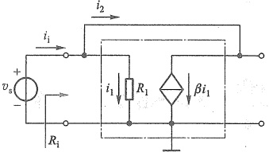

图题 1.5.5 电流放大电路
 

1.5.7 设一放大电路的通频带为 20 Hz~20 kHz, 通带电压增益  $ \left|A_{eM}\right|=40 $ dB, 最大不失真交流输出电压范围是 -3~+3 V。(1) 若输入一个  $ 10\sin\left(4\pi\times10^{3}t\right) $ mV 的正弦波信号, 输出波形是否会产生频率失真和非线性失真? 若不失真, 则输出电压的峰值是多大? (2) 若  $ v_{i}=40\sin\left(4\pi\times10^{4}t\right) $ mV, 重复回答 (1) 中的问题; (3) 若  $ v_{i}=10\sin\left(8\pi\times10^{4}t\right) $ mV, 输出波形是否会产生频率失真和非线性失真? 为什么?

##### 第1章部分习题答案

