# 02-第2章 运算放大器

[返回全书目录](../../README.md)

> PDF 页码：46–78

<!-- page: 46 -->

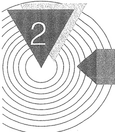

# 运算放大器

## 引言

前面简述了放大电路的基本概念、电路模型和主要性能指标，下面来讨论一种十分重要的标准器件——集成电路运算放大器（integrated circuit-operational amplifiers，IC-OPA），常简称集成运放或运放。自从20世纪60年代中期第一块集成运算放大器问世以后，由于其独特优势立刻受到广大电子工程师们的极大关注，在短短几年时间里，高性能、低价格的各种集成运放就应运而生，而且特性很快就接近理想。

正是因为集成运放具有近似理想的特性，设计实现各种应用电路简单方便，而且设计出的电路工作表现与理论预测得非常接近，所以集成运放已经成为模拟电路中应用极为广泛的一种器件，不仅用于信号的放大、运算、变换等线性电路，而且还可用于开关电路。

本章首先简要介绍集成运放内部的主要结构、电路模型、传输特性和几个重要指标。接着给出理想运放特性和电路模型。然后介绍用集成运放构成的线性应用电路，包括基本的同相放大电路和反相放大电路，求差（减法）、求和（加法）、积分、微分电路以及仪用放大器。希望读者学完本章后，就能用集成运放成功地设计出一些基本的应用电路。

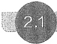

#### 集成电路运算放大器

### 1. 集成电路运算放大器简介

将制作在一小块硅片上的特定功能电路称为集成电路。该硅片上包含了电路需要的所有三极管、电阻、电容等元件以及它们的连线。集成电路具有功能强、体积小、功耗低、可靠性高、性价比高等优点。集成运放是目前应用最为广泛的一种模拟集成电路。由于还没有学习三极管电路，所以这里并不详细讨论集成运放内部电路，而是将它看作一个黑匣子，关注它的端口特性，其内部电路留待第7章介绍。

集成运放的种类很多，它们的内部电路也不尽相同，但绝大多数都可以划分为如图2.1.1a所示的输入级、中间级和输出级三个部分。输入级主要解决漂移的抑制和信号的有效放大问题；中间级的主要任务是极大地提高电压增益；输出级的主要任务是提高带负载能力。

电路有两个输入端：同相输入端 P（positive）和反相输入端 N（negative），分别用“+”和“-”表示；一个输出端 O（output）。它们对“地”的电压分别用  $ v_{P} $、 $ v_{N} $ 和  $ v_{0} $ 表示。当仅有 P 端

<!-- page: 47 -->

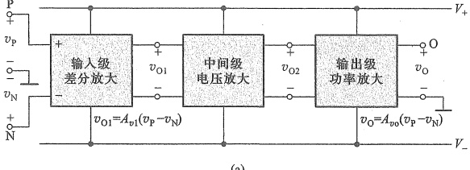

图 2.1.1 集成电路运算放大器
 

（a）内部结构框图 （b）一种双列直插封装的外形
 

加入电压信号  $ v_{P} $ 时  $ (v_{N}=0) $，输出电压  $ v_{0} $ 与  $ v_{P} $ 同相；而当仅在 N 端加入电压信号  $ v_{N} $ 时  $ (v_{P}=0) $， $ v_{0} $ 与  $ v_{N} $ 反相。 $ V_{+} $ 和  $ V_{-} $ 为供电电源接入端。

在图 2.1.1a 中，从信号放大的角度看，输入级放大的是 P、N 两输入端的电压差，即  $ v_{01}=A_{v1}(v_{P}-v_{N}) $， $ A_{v1} $ 是输入级的电压增益。 $ v_{01} $ 再经中间级和输出级放大后送至输出， $ v_{0}=A_{v0}(v_{P}-v_{N}) $， $ A_{v0} $ 是集成运放的总电压增益。由此看出，运放电路的功能是放大两个输入电压信号的差值。

图2.1.1b是集成运放的一种双列直插封装（dual in-line package，DIP）形式，此外还有许多其他封装形式，且引脚个数也不尽相同，这些在运放数据手册中都会给出描述。通常一个芯片内部会封装1、2或4个独立的运算放大器，但它们共用工作电源。

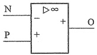

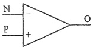

图 2.1.2 运算放大器的图形符号
 

两种常用的运算放大器图形符号如图

（a）国家标准规定的符号 （b）国内外常用符号
 

2.1.2 所示。其中▷表示信号从左(输入端)向右(输出端)传输的方向，两种符号均未画电源端。本书采用图2.1.2b所示的符号。

### 2. 运算放大器的电路简化模型

由第1章我们知道，在未知放大电路具体结构和参数情况下，可以通过建立电路的端口等效模型来研究放大电路，图2.1.3便是运算放大器的简化端口等效模型。运放的输入端口等效为一输入电阻 $ r_{i} $，输出端口则等效为输出电阻 $ r_{o} $与受控电压源 $ A_{vo}(v_{P}-v_{N}) $的串联，供电电源 $ V_{1} $和 $ V_{2} $分别为运放提供正、负工作电压。电源是运放工作的必备条件，为了简洁，电路原理图中通常省去供电电源电路，只在必要时才画出，但一定要注意它被隐含了。除非有特别说明，本书中所有运放电路均默认由对称的双电源供电。

由图2.1.3看出，受控源电压受同相端与反相端压差的控制，其中 $ A_{vo} $是负载开路时的电压增益（图2.1.1a中的总增益），也称为开环电压增益，并且 $ A_{vo}>0 $。集成运放的 $ A_{vo} $值较高，通常都超过 $ 10^{5} $；输入电阻 $ r_{i} $的值也较大，通常达 $ 10^{6}\Omega $或更高；相反，输出电阻 $ r_{o} $的值较小，常为几十欧或更低。 $ A_{vo} $、 $ r_{i} $和 $ r_{o} $的值取决于运放内部电路。

<!-- page: 48 -->

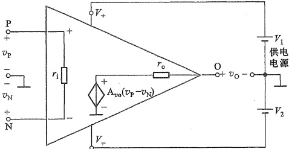

图 2.1.3 运算放大器的电路简化模型
 

### 3. 运算放大器的传输特性

图2.1.3中的输出电压 $ v_{0} $受正、负工作电源电压的限制 $ ^{①} $，即 $ V_{-}\leq v_{0}\leq V_{+} $。当 $ A_{vo}(v_{P}-v_{N}) $超出电源电压时， $ \left|v_{0}\right| $不再随 $ \left|v_{P}-v_{N}\right| $的增大而增加， $ v_{0} $只能保持在电源电压值 $ (V_{-} $或 $ V_{+}) $上，此时称运放进入饱和状态， $ v_{0}=A_{vo}(v_{P}-v_{N}) $的关系不再成立。

可以用电压传输特性曲线来描述  $ v_{0} $ 与  $ (v_{P}-v_{N}) $ 的关系。运放的电压传输特性曲线如图2.1.4所示。曲线可以分为三段，中间斜线部分 (ab段) 是线性工作区，此时输出与输入满足  $ v_{0}=A_{vo}(v_{P}-v_{N}) $，斜率就是电压增益  $ A_{vo} $。由此看出，输入压差只有在一定范围内，才能保证运放工作在线性区，而且增益越大，斜率越陡， $ (v_{P}-v_{N}) $ 的线性范围也越小。

随着  $ \left|v_{P}-v_{N}\right| $ 的增大，当  $ \left|v_{0}\right| $ 受电源电压限制不再增加时，特性曲线转为水平（上、下两条水平线），输出与输入不再呈线性关系，此时的  $ \left|v_{0}\right| $ 达到最大值，也称饱和值。水平线区域称为饱和区，也称为非线性区或限幅区。

图2.1.4中 $ v_{0} $的变化范围在正、负电源电压之间，这是一种理想情况。实际上，由于运放内部三极管会消耗一部分电压，所以最大输出电压通常会小于正电源电压，最小输出电压会大于负电源电压。当用 $ V_{om} $表示输出电压的最大值时，有 $ +V_{om}=V_{+}-\Delta V $或 $ -V_{om}=V_{-}+\Delta V $，其中 $ \Delta V $就是运放输出端的饱和压降 $ ^{②} $，且 $ \Delta V>0 $。

在忽略输出饱和压降情况下，可用下列表达式来描述运放的电压传输特性：

若  $ V_{-}<A_{v_{0}}(v_{P}-v_{N})<V_{+} $，则  $ v_{0}=A_{v_{0}}(v_{P}-v_{N}) $

当  $ A_{vo}(v_{p}-v_{N})\geqslant V_{+} $ 时， $ v_{0}=+V_{om}=V_{+} $

当  $  A_{vo}(v_{P}-v_{N}) \leqslant V_{-}  $ 时， $ v_{0} = -V_{om} = V_{-} $

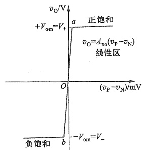

图 2.1.4 运算放大器的电压传输特性
 

例 2.1.1 电路如图 2.1.3 所示，运放的开环电压增

益  $ A_{vo}=2\times10^{5} $，输入电阻  $ r_{i}=0.1\ M\Omega $，输出饱和压降  $ \Delta V=1\ V $，电源电压  $ V_{+}=+12\ V $， $ V_{-}=-12\ V $

<!-- page: 49 -->

（1）求线性区输入压差 $ (v_{P}-v_{N}) $的范围，以及对应其极限值的输入电流 $ i_{1} $；（2）画出传输特性曲线 $ v_{0}=f(v_{P}-v_{N}) $。

解：（1）线性区输入压差的最大值

 $$ \left(\boldsymbol{v}_{\mathrm{p}}-\boldsymbol{v}_{\mathrm{N}}\right)_{\max}=+V_{\mathrm{om}}/A_{v o}=\left(\boldsymbol{V}_{+}-\Delta\boldsymbol{V}\right)/A_{v o}=11/\left(2\times10^{5}\right)\mathrm{V}=+55~\mu\mathrm{V} $$ 

线性区输入压差的最小值

 $$ \left(v_{\mathrm{P}}-v_{\mathrm{N}}\right)_{\mathrm{m i n}}=-V_{\mathrm{o m}}/A_{\mathrm{v o}}=\left(V_{-}+\Delta V\right)/A_{\mathrm{v o}}=-11/\left(2\times10^{5}\right)\mathrm{V}=-55~\mu\mathrm{V}. $$ 

对应的输入电流

 $$ i_{\mathrm{I}}=\left(v_{\mathrm{p}}-v_{\mathrm{N}}\right)/r_{\mathrm{i}}=\pm55~\mathrm{~\mu V/0.1~M\Omega}=\pm55~\mathrm{~\mu V/}\left(0.1\times10^{6}\right)\Omega=\pm550~\mathrm{p A}. $$ 

##### （2）画传输特性曲线

在以 $ (v_{\mathrm{p}}-v_{\mathrm{N}}) $为横轴， $ v_{0} $为纵轴的坐标系中，取 $ a $点 $ (+55\ \mu\mathrm{V},+11\ \mathrm{V}) $和 $ b $点 $ (-55\ \mu\mathrm{V},-11\ \mathrm{V}) $，连接 $ a $、 $ b $两点得 $ ab $线段，其斜率 $ A_{vo}=2\times10^{5} $。从 $ a $点开始向右侧画出水平线为正饱和区，以 $ b $点为起点，向左侧画出水平线为负饱和区。运放的电压传输特性如图2.1.5所示。当 $ \left|v_{\mathrm{p}}-v_{\mathrm{N}}\right|<55\ \mu\mathrm{V} $时，电路工作在线性区；否则，进入非线性区（限幅区）。

### 4. 运算放大器的输出端电流

集成运放除了输出电压是有限值外，输出端的电流也是有限的。当运放输出端接负载（如图2.1.6所示）且 $ v_{0}>0 $时，电流将从输出端流出再流

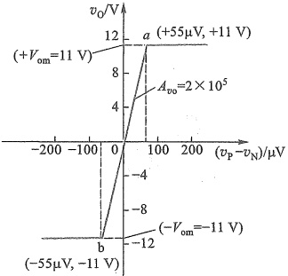

图 2.1.5 例 2.1.1 中运放的电压传输特性
 

经负载  $ R_L $；而当  $ v_0 < 0 $ 时，流经负载的电流将流入输出端。不论流入还是流出，集成运放输出端的电流都是有限的，一般通用型运放输出端最大电流的典型值约为  $ \pm 20\ mA $①。当负载阻值过小时，由于输出电流的限制， $ |v_0| $ 的最大值将减小。例如，当运放电源电压为  $ \pm 15\ V $，输出端最大电流为  $ \pm 20\ mA $，负载电阻阻值为  $ 200\ \Omega $ 时， $ v_0 $ 的变化范围将只有  $ \pm 20\ mA \times 200\ \Omega = \pm 4\ V $，不再像正常工作时那样接近电源电压。

### 5. 差模信号和共模信号

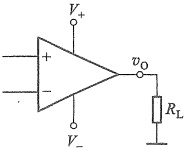

由图2.1.3看出，运放的输入电压 $ v_{P} $和 $ v_{N} $都是针对参考地而言的，它们可以表示成如图2.1.7a的形式。差模输入信号定义为两输入端信号的差值，那么，运放的差模输入电压 $ v_{id} $就表示为

图2.1.6 集成运放输出端接负载
 

$$  v_{id}=v_{p}-v_{N}   \tag*{(2.1.4)}$$

共模输入信号定义为两输入端信号的算术平均值，那么，运放的共模输入电压 $ v_{ie} $就表示为

$$  v_{ic}=\frac{v_{P}+v_{N}}{2}   \tag*{（2.1.5）}$$

<!-- page: 50 -->

当用差模电压和共模电压表示两输入端电压时，由式(2.1.4)和式(2.1.5)得

$$  v_{\mathrm{p}}=v_{\mathrm{i c}}+\frac{v_{\mathrm{i d}}}{2}   \tag*{(2.1.6)}$$

$$  v_{\mathrm{N}}=v_{\mathrm{i c}}-\frac{v_{\mathrm{i d}}}{2}   \tag*{(2.1.7)}$$

由式(2.1.6)和式(2.1.7)看出，两输入端的共模电压大小相等，极性相同，而两输入端的差模电压大小相等，但极性相反。这时，运放的输入电压可以等效为如图2.1.7b所示的形式。

当用叠加原理仅考虑差模输入信号的作用时，可以等效为图2.1.7c的形式，定义这时的输出电压与差模输入电压之比为差模电压增益，即

$$  A_{_{vd}}=\frac{v_{0}^{\prime}}{v_{id}}=\frac{v_{0}^{\prime}}{v_{P}-v_{N}}   \tag*{(2.1.8)}$$

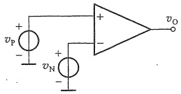

(a)
 

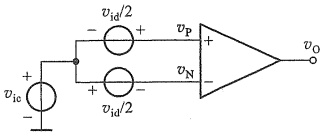

(b)
 

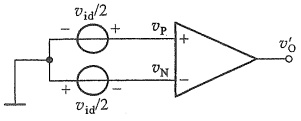

(c)
 

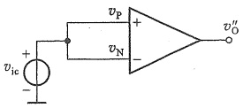

(d)
 

图 2.1.7 运算放大器的输入电压
 

和  $ v_{N} $ （c）仅差模输入时 （d）仅共模输入时
 

当仅考虑共模输入信号作用时，运放输入电压可等效为图2.1.7d的形式，定义此时的输出电压与共模输入电压之比为共模电压增益：

$$  A_{_{ve}}=\frac{v_{_{O}}^{\prime\prime}}{v_{_{ic}}}   \tag*{(2.1.9)}$$

当输入既有差模又有共模时，输出电压就是它们分别放大后的叠加，即根据式(2.1.8)和式(2.1.9)有

$$  v_{0}=v_{0}^{\prime}+v_{0}^{\prime\prime}=A_{_{\mathrm{s d}}}v_{\mathrm{i d}}+A_{_{\mathrm{v c}}}v_{\mathrm{i c}}   \tag*{(2.1.10)}$$

对比图 2.1.7c 和图 2.1.3，由式(2.1.8)和式(2.1.1)可以看出，之前的开环电压增益就是差模电压增益，即  $ A_{so} = A_{sd} $。而在图 2.1.7d 的情况下， $ v_{p} = v_{N} = v_{ic} \neq 0 $ 时，实际运放的输出  $ \left|v_{0}^{\prime\prime}\right| $ 非常小，与图 2.1.7c 情况下的输出相比完全可以忽略不计，即  $ \left|v_{0}^{\prime\prime}\right| < \left|v_{0}^{\prime}\right| $， $ v_{0} \approx v_{0}^{\prime} = A_{sd} v_{id} $。换言之，运放的共模电压增益非常小，理想情况为零，说明运放对共模信号有很强的抑制能力。为反映运算放大器放大差模信号与抑制共模信号的综合能力，定义差模增益与共模增益之比的绝对值为共模抑制比：

<!-- page: 51 -->

$$  K_{CMR}=\left|\frac{A_{vd}}{A_{vo}}\right| \textcircled{1}   \tag*{(2.1.11)}$$

理想情况下，共模电压增益为零，共模抑制比为无穷大，即  $ A_{sc}=0, K_{CMR}=\infty $ ，运算放大器只放大差模输入电压。

##### 复习思考题

2.1.1 集成运放的电压传输特性具有怎样的特点？输出电压的最大值与什么有关。

2.1.2 集成运放的三个重要参数：输入电阻  $ r_{i} $、输出电阻  $ r_{o} $ 和开环电压增益  $ A_{vo} $ 通常的量值约为多少？

2.1.3 为什么运放工作在线性区时输入端压差非常小？

2.1.4 设某运放的输出电阻为  $ 10 \, \Omega $，输出端最大电流为  $ \pm20 \, mA $，饱和压降为  $ 1 \, V $，电源电压为  $ \pm12 \, V $。当接  $ 1 \, k\Omega $ 负载时， $ v_0 = -10 \, V $，若将负载换为  $ 100 \, \Omega $，则  $ v_0 $ 约为多少伏？

2.1.5 差模输入电压和共模输入电压在运放的两个输入端分别表现出怎样的特征？

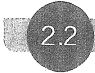

#### 理想运算放大器

将集成运放的各项性能指标理想化就得到了理想的运放模型，常称为理想运算放大器或理想运放。它具有如下特性：

① 输出电压  $ v_{0} $ 的正负饱和值等于运放的电源电压，即  $ +V_{om}=V_{+} $ 和  $ -V_{om}=V_{-} $ 。亦即输出电压只能在正、负电源电压范围内变化。

② 开环电压增益趋近于无穷大，即  $ A_{vo} \approx \infty $。当运放工作在线性区时，输出电压满足关系式  $ v_{0} = A_{vo}(v_{P} - v_{N}) $，但  $ v_{0} $ 为有限值，所以有  $ v_{P} - v_{N} = v_{0} / A_{vo} \approx 0 $，即  $ v_{P} \approx v_{N} $，说明运放两输入端电压近似相等，如同两输入端近似短路，这种现象称为虚假短路，简称“虚短”。

③ 输入电阻趋近于无穷大，所以运放两输入端没有电流，即  $ i_{P} \approx 0, i_{N} \approx 0 $

④ 输出电阻  $ r_{0} \approx 0 $

⑤ 共模电压增益为零，共模抑制比为无穷大，即  $ A_{ve} \approx 0 $， $ K_{CMR} \approx \infty $。

⑥ 开环带宽  $ BW \approx \infty $ (对所有频率的信号都有完全相同的  $ A_{vo} $)。

⑦ 输出端电流无限制。

由此，图2.1.3可等效为图2.2.1所示的理想运放模型。相应地，图2.1.4电压传输特性曲线的斜线ab部分将变为理想的垂线。

引入理想运放可以极大地简化运放电路的分析，而且实际运放的 $ A_{v_{0}} $、 $ r_{i} $、 $ r_{o} $、

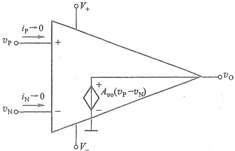

图 2.2.1 理想运放的电路模型
 

<!-- page: 52 -->

$ K_{CMR} $ 等参数很接近理想运放，所以多数情况下用理想模型分析运放电路所产生的误差很小，结论与实际基本相符。本章接下来的电路分析大多采用理想运放模型，除非有特别说明。但是需要注意，理想运放的开环带宽和输出端电流与实际相差甚远，所以它不适合用来分析实际电路的这两项指标。

在线性区由理想运放导出的特性  $ v_{p}-v_{N}\approx0 $ (虚短) 和  $ i_{p}\approx0,i_{N}\approx0 $ (虚断)，对分析和设计运放组成的各种线性应用电路非常重要，必须熟练掌握。

##### 复习思考题

2.2.1 理想运放的开环电压增益为无穷大，为什么在线性区输出电压可以是有限值？什么情况下输出电压等于零？

2.2.2 当理想运放两输入端真实短路时，输出  $ v_{0} $ 将为多少？

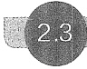

#### 基本线性运放电路

由于集成运放的开环增益极高，线性区 $ (v_{p}-v_{n}) $的值非常小，一般的信号幅值都远超这个值，直接将其作为 $ (v_{p}-v_{n}) $的值放大，无法保证运放工作在线性区。为此需要在电路中引入负反馈，来减小 $ (v_{p}-v_{n}) $的值（如图2.3.1所示），从而保证运放工作在线性区。本章接下来讨论的内容都是运放在线性区的应用。

本节讨论同相放大电路和反相放大电路，它们是两种最基本的运放线性应用电路。许多其他线性应用电路都由这两种电路演变而成。

##### 2.3.1 同相放大电路

### 1. 基本电路

我们知道，放大电路是一个双口网络，在图2.3.1所示电路中，运放的同相端与地之间构成输入端口，信号电压 $ v_{i} $由此端口输入，运放的输出端与地之间构成输出端口。输出电压 $ v_{o} $经 $ R_{2} $和 $ R_{1} $分压后送回到了反相输入端，这种将输出信号再送回到输入端的过程称为反馈。反相输入端的电压 $ v_{n}=R_{1}v_{o}/(R_{1}+R_{2}) $，与无反馈（无 $ R_{2} $、 $ R_{1} $支路，反相端接地， $ v_{n}=0 $）时相比，差模输入电压 $ (v_{p}-v_{n}) $大为减小，具有这种作用的反馈称为负反馈 $ ^{①} $。由于负反馈能极大地减小运放两输入端的压差，所以可以保证运放工作在线性区。本

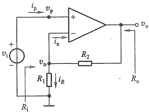

图 2.3.1 同相放大电路
 

章后续电路中均有连接运放输出端和它的反相输入端的负反馈通路。由于反馈通路使电路形成了闭合环路，所以这种电路也常称为闭环电路。

<!-- page: 53 -->

### 2. 放大电路指标

在保证运放工作在线性区的情况下，就可以利用虚短和虚断的理想特性，分析运放电路的指标了。

##### （1）闭环电压增益 $ A_{v} $

图 2.3.1 电路通过  $ R_{2} $ 形成了闭环，这时称输出电压  $ v_{0} $ 与输入电压  $ v_{i} $ 之比为闭环电压增益。对运放反相端节点应用 KCL：

$$  \frac{v_{\mathrm{o}}-v_{\mathrm{n}}}{R_{2}}=\frac{v_{\mathrm{n}}}{R_{1}}+i_{\mathrm{n}}   \tag*{(2.3.1)}$$

根据理想运放特性有  $ v_{n} \approx v_{p} = v_{i} $， $ i_{p} \approx i_{n} \approx 0 $，代入式(2.3.1)得  $ (v_{o} - v_{i}) / R_{2} = v_{i} / R_{1} $，所以闭环电压增益为

$$  A_{_{v}}=\frac{v_{_{o}}}{v_{_{i}}}=1+\frac{R_{_{2}}}{R_{_{1}}}   \tag*{(2.3.2)}$$

 $ A_{v} $ 为正值，表示  $ v_{0} $ 与  $ v_{i} $ 同相，所以称该电路为同相放大电路。同时，闭环电压增益  $ A_{v} $ 只取决于运放外部元件  $ R_{1} $ 和  $ R_{2} $，而与运放本身的  $ A_{vo} $、 $ r_{i} $ 和  $ r_{o} $ 无关，那是否意味着与运放本身无关了呢？答案是否定的，运放的作用已经体现在推导出结果的前提条件中了，就是  $ v_{n} \approx v_{p} $， $ i_{p} \approx i_{n} \approx 0 $。 $ A_{v} $ 的精度基本上取决于  $ R_{1} $ 和  $ R_{2} $ 的精度。

##### （2）输入电阻 $ R_{i} $

根据放大电路输入电阻的定义有

 $$ R_{i}=\frac{v_{i}}{i_{i}} $$ 

由于  $ i_{i} \approx i_{p} \approx 0 $ ，故从放大电路输入端口看进去的电阻为

$$  R_{i}=\frac{v_{i}}{i_{i}}\approx\infty   \tag*{(2.3.3)}$$

这里需要注意，放大电路的输入电阻与运放的输入电阻是两个不同端口的电阻，不要混淆。

##### （3）输出电阻 $ R_{0} $

从图2.3.1电路输出端口向左看进去的等效电阻就是输出电阻，这个端口内的电路包括理想运放和电阻网络 $ R_{1} $、 $ R_{2} $。由于运放输出端口是一个理想的受控电压源（见图2.2.1），端口电阻 $ r_{0}=0 $，而 $ R_{1} $、 $ R_{2} $支路与之并联，所以电路的输出电阻也为零，即

$$  R_{o}\approx0   \tag*{(2.3.4)}$$

例 2.3.1 同相放大电路如图 2.3.1 所示。设运放的最大输出电压为 10 V，即  $ \pm V_{om} = \pm 10 $ V，电阻  $ R_1 = 1 $ k $ \Omega $， $ R_2 = 9 $ k $ \Omega $。（1）求放大电路的闭环电压增益和工作在线性区时输入电压  $ v_i $ 的变化范围，画出电路的传输特性  $ v_o = f(v_i) $；（2）当  $ v_i = 0.5 $ V 时，求流过  $ R_1 $ 的电流和输出电压。

解：（1）在线性区时，根据式（2.3.2）得闭环电压增益

 $$ A_{v}=v_{o}/v_{i}=\left(1+R_{2}/R_{1}\right)=10 $$ 

对应  $ v_{0}=+V_{om} $ 和  $ v_{0}=-V_{om} $， $ v_{i} $ 的

 $$ v_{i}\leqslant+V_{im}=+V_{om}/A_{v}=+10\ V/10=+1\ V $$

<!-- page: 54 -->

$$ v_{\mathrm{i}}\geqslant-V_{\mathrm{im}}=-V_{\mathrm{om}}/A_{v}=-10\mathrm{~V}/10=-1\mathrm{~V} $$ 

由此，在  $ v_{i} $ 为横轴、 $ v_{0} $ 为纵轴的坐标系中确定两点： $ (+V_{im},+V_{om}) $ 和  $ (-V_{im},-V_{om}) $，即  $ a(1\ V,10\ V) $、 $ b(-1\ V,-10\ V) $ 两点，可画出电路的电压传输特性如图 2.3.2 所示。

（2）根据虚短有  $ v_{n} \approx v_{p} = v_{i} $ 。当  $ v_{i} = 0.5 \, V $ 时，求得流过  $ R_{1} $ 的电流

 $$ i_{_{R}}=v_{_{n}}/R_{_{1}}=v_{_{i}}/R_{_{1}}=0.5\mathrm{V}/1\mathrm{k}\Omega=0.5\mathrm{mA} $$ 

输出电压为

 $$ v_{_{o}}=A_{_{v}}v_{_{i}}=10\mathrm{\times}0.5\mathrm{~V}=5\mathrm{~V} $$ 

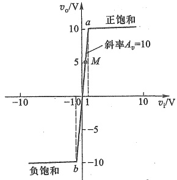

此时相当于传输特性曲线的  $ M(0.5\ V,5\ V) $ 点。

图 2.3.2 同相放大电路的电压传输特性
 

### 3. 电压跟随器

在图2.3.1所示同相放大电路中，令 $ R_{1}=\infty,R_{2}=0 $，则得到如图2.3.3所示电路。由于输出电压 $ v_{o} $就是反相端的输入电压 $ v_{n} $，利用虚短的概念，得到 $ v_{o}=v_{n}\approx v_{p}=v_{i} $，即

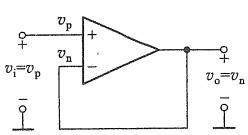

图 2.3.3 电压跟随器
 

$$  A_{_{v}}=\frac{v_{_{o}}}{v_{_{i}}}\approx1   \tag*{(2.3.5)}$$

可见，输出电压  $ v_{0} $ 与输入电压  $ v_{i} $ 大小相等，相位相同，因此，该电路称为电压跟随器。

 $ R_{\circ} \approx 0 $.

同样可以得到它的输入电阻  $ R_{i} \approx \infty $ 和输出电阻

电压跟随器的电压增益等于1，是否意味着它对电压增益没有任何贡献呢？下面看一个例子。当一个内阻为100 kΩ的电压信号源直接驱动1 kΩ的负载时（如图2.3.4a所示），它的输出电压（也就是负载上获得的电压） $ v_{0} $为

 $$ v_{\mathrm{o}}=\frac{R_{\mathrm{L}}}{R_{\mathrm{si}}+R_{\mathrm{L}}}v_{\mathrm{s}}=\frac{1}{100+1}v_{\mathrm{s}}\approx0.01v_{\mathrm{s}} $$ 

即负载从信号源获得的信号非常小。若在高内阻的信号源与低阻负载之间插入电压跟随器，如图2.3.4b所示。则因电压跟随器的输入电阻为无穷大，几乎不从信号源吸取电流，

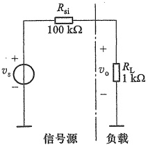

(a)
 

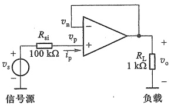

(b)
 

图 2.3.4 电压跟随器的应用
 

（a）高内阻的电压信号源驱动低阻负载 （b）接入电压跟随器后
 

<!-- page: 55 -->

$ i_{p}=0 $，故  $ v_{p}=v_{s} $；又因为它的输出电阻为零，负载接入时输出电压不会衰减，所以  $ v_{o}=v_{n}\approx v_{p}=v_{s} $，输出到负载上的电压大大增加了。可见，电压跟随器对电压增益是有贡献的。

由于电压跟随器具有几乎无穷大的输入电阻和无穷小的输出电阻，所以常将它看作阻抗变换器，用在高阻电压信号源和低阻负载之间，起到“隔离”或“缓冲”作用。故电压跟随器有时也称为缓冲器或隔离器。

另外还需注意，由于电压跟随器的 $ v_{n}\approx v_{p}=v_{i}\neq0 $，意味着运放有共模信号输入，但只要共模抑制比足够高，就可以忽略它的影响，理想运放便是如此。

例 2.3.2 同相放大电路如图 2.3.5a 所示，设对交流信号频率而言电容的阻抗很小，可视作短路。（1）试求电路的交流电压增益；（2）若输入为直流电压，则电压增益又为多少？（3）设电路中  $ R_1 = 10\ \text{k}\Omega $， $ R_2 = 100\ \text{k}\Omega $， $ C = 10\ \mu\text{F} $，运放采用  $ \mu\text{A}741 $，电源电压为  $ \pm15\ \text{V} $， $ v_i $ 是幅值为 100\ \text{mV}、频率为 1\ \text{kHz} 的正弦波。用 SPICE $ ^① $ 仿真，绘出  $ v_i $ 和  $ v_o $ 的波形，并求电压增益；当输入为 2\ \text{V} 直流电压时，再求输出的电压值。

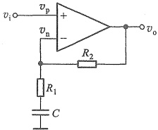

(a)
 

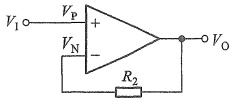

(b)
 

图 2.3.5 交流放大电路
 

（a）电路图 （b）直流情况的等效电路
 

解：（1）由于对交流信号而言电容相当于短路，电路就是标准的同相放大电路，所以电压增益就是

 $$ A_{v}=\frac{v_{o}}{v_{i}}=1+\frac{R_{2}}{R_{1}} $$ 

（2）当输入为直流电压时，电容相当于开路，电路可以等效为图2.3.5b的形式。这时虽然有电阻 $ R_{2} $存在，但是由于运放输入端无电流，所以 $ R_{2} $上没有压降，是等势体，仍有 $ V_{0}=V_{N}\approx V_{P}=V_{1} $，电路就是电压跟随器， $ A_{v}=1 $。

该电路的交流电压增益可以远大于直流增益，专门用于放大交流信号，所以也称为交流同相放大电路。

（3）仿真的  $ v_{i} $ 和  $ v_{o} $ 波形分别如图 2.3.6a 上、下所示。由图看出，输出波形的峰-峰值为 1.1063 V-(-1.0934 V)=2.1997 V，电压增益为 2.1997 V/200 mV≈11 倍，与理论计算相符。当  $ V_{1}=2 $ V 时， $ V_{1} $ 和  $ V_{0} $ 波形分别如图 2.3.6b 上、下所示。可见  $ V_{1} $ 和  $ V_{0} $ 均为 2 V，电路对于直流相当

<!-- page: 56 -->

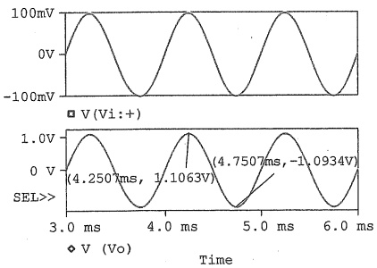

(a)
 

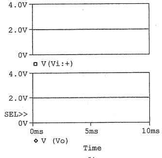

(b)
 

图 2.3.6 例 2.3.2 的仿真波形
 

(a)  $ v_{i} $ 为 1 kHz 正弦波时的波形 (b) 输入为直流时的波形
 

于电压跟随器。

##### 2.3.2 反相放大电路

### 1. 基本电路

电路如图2.3.7所示，输入电压 $ v_{i} $通过 $ R_{1} $作用于运放的反相端， $ R_{2} $将输出信号送回到反相端，构成负反馈，同相端接地。由虚短的概念可知， $ v_{n} \approx v_{p} = 0 $，因此反相输入端的电位接近于地电位，故称“虚地”。虚地的存在是反相放大电路在闭环工作状态下的重要特征。

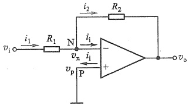

图 2.3.7 反相放大电路
 

### 2. 放大电路指标

##### （1）闭环电压增益

反相端为虚地点，即  $ v_{n} \approx v_{p} = 0 $，由  $ i_{p} \approx i_{n} \approx 0 $ 可知， $ i_{i} = 0, i_{1} = i_{2} $，故有

 $$ \frac{v_{i}-v_{n}}{R_{1}}=\frac{v_{n}-v_{o}}{R_{2}}\quad 或 \quad\frac{v_{i}}{R_{1}}=-\frac{v_{o}}{R_{2}} $$ 

由此得

$$  A_{v}=\frac{v_{o}}{v_{i}}=-\frac{R_{2}}{R_{1}}   \tag*{(2.3.6)}$$

与同相放大电路类似，该电路的闭环电压增益也只与电阻 $ R_{2} $和 $ R_{1} $有关，负号表明输出电压 $ v_{0} $与输入电压 $ v_{i} $相位相反，当 $ R_{2}=R_{1} $时，就是单纯的反相电路，即 $ v_{0}=-v_{i} $。

##### （2）输入电阻  $ R_{i} $ 和输出电阻  $ R_{0} $

输入电阻是从  $ v_{i} $ 输入的端口看进去的等效电阻，因  $ v_{n}=0 $，所以

$$  R_{i}=\frac{v_{i}}{i_{1}}=\frac{v_{i}}{v_{i}/R_{1}}=R_{1}   \tag*{(2.3.7)}$$

<!-- page: 57 -->

实际电路中过大的电阻会增大其热噪声 $ ^{①} $且容易引入干扰，所以 $ R_{1} $阻值会受到限制，意味着反相放大电路的输入电阻通常远小于同相放大电路的输入电阻。

与同相放大电路类似，反相放大电路的输出电阻也为零。

反相放大电路中  $ v_{p} \approx v_{n} = 0 $，所以运放无共模输入电压。而同相放大电路（图 2.3.1 所示）中，有  $ v_{p} \approx v_{n} \neq 0 $，表明运放的共模输入电压不为零，但当  $ K_{CMR} $ 接近理想值时，共模输出电压很小，可以忽略。换句话说，同相放大电路对运放的  $ K_{CMR} $ 有更高的要求。

例 2.3.3 将图 2.3.7 所示电路中的电阻  $ R_{2} $

用 T 形网络代替，可以作为话筒的前置放大电路，如图 2.3.8 所示。（1）求电路的闭环电压增益表达式  $ A_{v}=v_{0}/v_{i} $; （2）若选  $ R_{1}=51\ k\Omega $,  $ R_{2}=R_{3}=390\ k\Omega $，当  $ v_{0}=-100\ v_{i} $ 时，计算  $ R_{4} $ 的值；

（3）直接用  $ R_{2} $ 代替 T 形网络，当  $ R_{1}=51\ k\Omega $， $ A_{v}=-100 $ 时，求  $ R_{2} $ 的值。

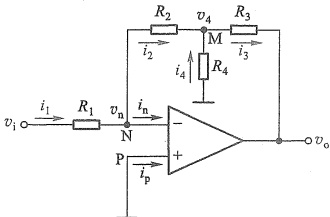

解：（1）利用理想运放特性有  $ v_{n} \approx 0 $ 和  $ i_{n} \approx i_{p} \approx 0 $，列出节点 N 和 M 的电流方程：

图 2.3.8 含有 T 形网络的反相放大电路
 

 $$ \left\{\begin{aligned}i_{1}&=i_{2}\\ i_{2}+i_{4}&=i_{3}\end{aligned}\right.\qquad 即 \qquad\left\{\begin{aligned}&\frac{v_{i}-0}{R_{1}}=\frac{0-v_{4}}{R_{2}}\\ &\frac{0-v_{4}}{R_{2}}+\frac{0-v_{4}}{R_{4}}=\frac{v_{4}-v_{o}}{R_{3}}\end{aligned}\right. $$ 

解上述方程组可得闭环电压增益

$$  A_{_{v}}=\frac{v_{_{0}}}{v_{_{i}}}=-\frac{R_{_{2}}+R_{_{3}}+\left(R_{_{2}}R_{_{3}}/R_{_{4}}\right)}{R_{_{1}}}=-\frac{R_{_{2}}}{R_{_{1}}}\left(1+\frac{R_{_{3}}}{R_{_{2}}}+\frac{R_{_{3}}}{R_{_{4}}}\right)   \tag*{(2.3.8)}$$

（2）将  $ R_{1} $、 $ R_{2} $、 $ R_{3} $ 和  $ A_{v} $ 的值代入式(2.3.8)，可求得  $ R_{4}=35.2\ k\Omega $ 。可用 50 kΩ 电位器作为  $ R_{4} $，将其调至 35.2 kΩ，使  $ A_{v}=-100 $ 。

（3）用  $ R_{2} $ 代替 T 形网络时， $ R_{2} $ 为

 $$ R_{2}=-\left(A_{v}R_{1}\right)=100{\times}51\mathrm{~k}\Omega=5~100\mathrm{~k}\Omega $$ 

 $ R_{2} $ 的阻值已达 5.1 MΩ，会带来较大噪声且容易引入干扰。而按比例减小  $ R_{2} $ 和  $ R_{1} $ 的值又不能满足电路对输入电阻  $ (R_{i}=R_{1}) $ 的要求。第(2)问中的 T 形网络则可以用低阻值电阻  $ (R_{2}, R_{3}, R_{4}) $ 得到高增益。

例 2.3.4 电流放大电路如图 2.3.9 所示。

负载电阻  $ R_{L} $ 跨接在输出端与 M 点之间，没有接地（也称负载浮地）。（1）求电流增益表达式  $ A_{i}=i_{o}/i_{s} $；（2）求电路的输入电阻。

解：（1）利用理想运放特性有  $ v_{n} \approx v_{p} = 0 $ 和  $ i_{n} \approx i_{p} \approx 0 $，则  $ i_{1} = i_{s} $，而且  $ R_{1} $ 和  $ R_{2} $ 相当于并联，

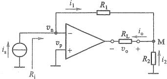

图 2.3.9 电流放大电路
 

<!-- page: 58 -->

所以  $ i_{1}R_{1}=i_{2}R_{2} $，即

 $$ i_{2}=\frac{R_{1}}{R_{2}}\cdot i_{1}=\frac{R_{1}}{R_{2}}\cdot i_{s} $$ 

故电流增益为

 $$ \dot{A}_{i}=\frac{i_{o}}{i_{s}}=\frac{i_{1}+i_{2}}{i_{s}}=\frac{i_{s}+\frac{R_{1}}{R_{2}}\cdot i_{s}}{i_{s}}=1+\frac{R_{1}}{R_{2}} $$ 

即

 $$ i_{_{o}}=\left(1+\frac{R_{_{1}}}{R_{_{2}}}\right)i_{_{s}} $$ 

可见输出电流  $ i_{0} $ 与负载  $ R_{L} $ 无关，改变  $ R_{L} $ 只会改变  $ v_{0}, i_{0} $ 相当于一个理想的受控电流源。另外还需注意，当改变输出电流  $ i_{0} $ 的参考方向时， $ A_{i} $ 和  $ i_{0} $ 的表达式将出现负号，表明实际的输入输出电流方向有固定的约束关系。

（2）电路的输入端口电压就是 $ v_{n} $，由于 $ v_{n}\approx0 $，所以输入电阻

 $$ R_{i}=\frac{v_{n}}{i_{s}}\approx0 $$ 

这时即使电流信号源是非理想的，其内阻也不会产生分流，所以这个电路是理想的电流放大电路。但是，在设计电路参数时要注意， $ (R_{2}i_{2}+R_{L}i_{0}) $ 的最大电压值不能超过运放输出电压的最大范围， $ i_{0} $ 的最大值也不能超过运放输出端的最大电流，否则电路将无法正常工作。

 $ ^{*} $例2.3.5 分析运放开环电压增益为有限值时，对图2.3.7所示反相放大电路闭环增益产生的影响。这里设 $ R_{1}=1\ k\Omega,R_{2}=20\ k\Omega $，当运放的开环电压增益分别为 $ 10^{3} $、 $ 10^{4} $和 $ 10^{5} $时（运放的其他参数仍为理想值），试计算对应的实际闭环电压增益，以及由理想运放求得的增益所产生的相对误差。

解: 分析运放开环电压增益  $ A_{vo} $ 的影响时, 就需要考虑输入端的差值电压, 虚短不再成立, 这时由  $ v_{o}=A_{vo}(v_{p}-v_{n}) $ 和  $ v_{p}=0 $ 得

$$  v_{\mathrm{n}}=-v_{\mathrm{o}}/A_{v\mathrm{o}}   \tag*{(2.3.9)}$$

又因为  $ i_{1}=0, i_{2}=i_{1} $，所以有

 $$ \frac{v_{\mathrm{i}}-v_{\mathrm{n}}}{R_{1}}=\frac{v_{\mathrm{n}}-v_{\mathrm{o}}}{R_{2}} $$ 

将式(2.3.9)代入上式整理后，得实际闭环电压增益：

$$  A_{_{v}}=\frac{v_{_{o}}}{v_{_{i}}}=-\frac{R_{_{2}}}{R_{_{1}}}\cdot\frac{1}{1+\left(1+R_{_{2}}/R_{_{1}}\right)/A_{_{vo}}}   \tag*{(2.3.10)}$$

根据式(2.3.6)可知，理想运放情况下的闭环电压增益为 $ -R_{2}/R_{1} $，所以相对误差为

$$  E_{r}=\frac{\left|A_{v}\right|-\left|-\dot{R}_{2}/R_{1}\right|}{\left|-R_{2}/R_{1}\right|}\times100\%   \tag*{（2.3.11）}$$

由式(2.3.10)看出，只要 $ A_{vo} $远大于 $ (1+R_{2}/R_{1}) $， $ A_{v} $就接近用理想运放求得的增益 $ -R_{2}/R_{1} $。将 $ R_{1} $、 $ R_{2} $和 $ A_{vo} $的值分别代入式(2.3.10)和式(2.3.11)中计算，得到实际闭环增益及对

<!-- page: 59 -->

应的理想运放闭环增益的相对误差如表2.3.1所示。由此看出，开环增益在 $ 10^{4} $以上时，相对误差已经小于3‰。而一般集成运放的 $ A_{vo} $都在 $ 10^{5} $以上，所以有限的开环增益带来的误差通常都可以忽略不计，因为电阻 $ R_{1} $、 $ R_{2} $的误差所产生的影响远大于 $ A_{vo} $。

表2.3.1 相对误差
 

<table border=1 style='margin: auto; word-wrap: break-word;'><tr><td style='text-align: center; word-wrap: break-word;'>$ A_{{ss}} $</td><td style='text-align: center; word-wrap: break-word;'>$ A_{{p}} $</td><td style='text-align: center; word-wrap: break-word;'>$ E_{{r}} $</td></tr><tr><td style='text-align: center; word-wrap: break-word;'>$ 10^{{3}} $</td><td style='text-align: center; word-wrap: break-word;'>-19.589</td><td style='text-align: center; word-wrap: break-word;'>-2.06%</td></tr><tr><td style='text-align: center; word-wrap: break-word;'>$ 10^{{4}} $</td><td style='text-align: center; word-wrap: break-word;'>-19.958</td><td style='text-align: center; word-wrap: break-word;'>-0.21%</td></tr><tr><td style='text-align: center; word-wrap: break-word;'>$ 10^{{5}} $</td><td style='text-align: center; word-wrap: break-word;'>-19.996</td><td style='text-align: center; word-wrap: break-word;'>-0.02%</td></tr></table>

前面介绍了两种最基本的运放线性应用电路，主要关注的是增益、输入输出电阻等指标和输入输出关系，然而运放也是一个实际的电子器件，工作时不仅有电压和电流，还会消耗功率，下面通过一个例子说明这种情况。

例 2.3.6 在图 2.3.7 所示反相放大电路中，设  $ R_{1}=10\ k\Omega $， $ R_{2}=30\ k\Omega $，当信号为零时电源引脚电流  $ I_{Q}=0.5\ mA $（也称为静态电流）。电路输出驱动一个  $ 2\ k\Omega $ 的负载  $ R_{L} $。（1） $ v_{i}=0\ V $ 时，求运放的输出电流、两电源引脚中的电流和运放的耗散功率；（2） $ v_{i}=3\ V $ 时，再求（1）中的问题。

解：（1）为便于分析，将补充了电源且标注了电流的电路重画于图2.3.10中。当 $ v_{i}=0\ V $时，由式（2.3.6）可知 $ v_{o}=0 $，此时 $ i_{1}=i_{2}=i_{L}=0 $，运放的输出电流 $ i_{0}=i_{L}+i_{2}=0 $。由于信号为零，所以只有静态电流流过运放电源引脚端，即 $ i_{V+}=i_{V-}=I_{Q}=0.5\ mA $。所以运放耗散功率 $ P_{A}=(V_{+}-V_{-})I_{Q}=30\ V\times0.5\ mA=15\ mW $。这时的功耗也称为静态功耗。

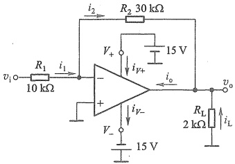

图 2.3.10 例 2.3.6 的电路
 

（2）当 $ v_{i}=3\ V $时，由式(2.3.6)得输出电压

 $$ v_{\mathrm{o}}=-\frac{R_{2}}{R_{1}}v_{\mathrm{i}}=-3\times3\mathrm{~V}=-9\mathrm{~V} $$ 

利用理想运放特性  $ v_{n} \approx 0 $ 和  $ i_{n} \approx i_{p} \approx 0 $，可求出各支路电流

 $$ i_{_{2}}=i_{_{1}}=\frac{v_{_{i}}-0}{R_{_{1}}}=\frac{3\mathrm{~V}}{10\mathrm{~k}\Omega}=0.3\mathrm{~m A} $$ 

 $$ i_{\mathrm{L}}=\frac{0-v_{\mathrm{o}}}{R_{\mathrm{L}}}=\frac{9\mathrm{~V}}{2\mathrm{~k}\Omega}=4.5\mathrm{~mA} $$ 

 $$ i_{o}=i_{L}+i_{2}=4.5\mathrm{~m A}+0.3\mathrm{~m A}=4.8\mathrm{~m A} $$ 

注意， $ i_{0} $ 由输出端流入运放，从 V 引脚流出，经负电源和负载形成回路。所以此时  $ i_{V+} $ 仍为 0.5 mA，但  $ i_{V-} $ 在原来基础上叠加了  $ i_{0} $，即

 $$ i_{V-}=I_{0}+i_{o}=0.5\mathrm{~m A}+4.8\mathrm{~m A}=5.3\mathrm{~m A} $$ 

在原静态功耗的基础上加上  $ v_{i}=3\ V $ 时新增的功耗，就可以得到当前运放的耗散功率。

<!-- page: 60 -->

由于同相端和反相端仍无电流，输出端电流流入后从负电源端流出，而输出端与负电源端的压差为 $ (v_{0}-V_{-}) $，所以运放的功耗

 $$ P_{\mathrm{~A}}=15~\mathrm{m W}+\left(v_{\mathrm{o}}-V_{-}\right)i_{\mathrm{o}}=15~\mathrm{m W}+6~\mathrm{~V}\times4.8~\mathrm{m A}=43.8~\mathrm{m W} $$ 

##### 复习思考题

2.3.1 虚地和虚短的概念有何不同？什么情况下会出现虚地？

2.3.2 同相放大电路和反相放大电路在结构上有何异同？在放大电路指标上有何异同？

2.3.3 电压跟随器在电路中起到“隔离”或“缓冲”作用的关键因素是什么？

2.3.4 同相放大电路和反相放大电路闭环电压增益产生误差的主要原因是什么？

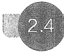

#### 同相输入和反相输入放大电路的其他应用

##### 2.4.1 求和电路

如果要将两个电压  $ v_{i1} $、 $ v_{i2} $ 相加，可以利用图2.4.1所示的求和电路来实现。两个输入电压均从运放的反相端输入。利用理想运放特性有虚地  $ v_{n} \approx 0 $ 和  $ i_{i} \approx 0 $，对反相输入端节点应用KCL：

 $$ \begin{aligned}&i_{1}+i_{2}=i_{3}\\ \frac{v_{i1}-v_{n}}{R_{1}}+\frac{v_{i2}-v_{n}}{R_{2}}=\frac{v_{n}-v_{o}}{R_{3}}\\ \end{aligned} $$ 

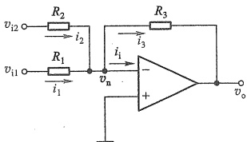

即

图2.4.1 求和电路
 

将 $ v_{n}\approx0 $代入式(2.4.1)得

 $$ \begin{aligned}&\frac{v_{\mathrm{i1}}}{R_{1}}+\frac{v_{\mathrm{i2}}}{R_{2}}=-\frac{v_{\mathrm{o}}}{R_{3}}\\&-v_{\mathrm{o}}=\frac{R_{3}}{R_{1}}v_{\mathrm{i1}}+\frac{R_{3}}{R_{2}}v_{\mathrm{i2}}\end{aligned} $$ 

整理得

即输出电压等于各输入电压按不同比例相加，式中负号是反相输入引起的。若  $ R_{1}=R_{2}=R_{3} $，则式(2.4.2)变为

$$  -v_{o}=v_{i1}+v_{i2}   \tag*{(2.4.3)}$$

若在图2.4.1的输出端再接一级反相电路，则可消去负号，实现完全符合常规的算术加法。

图 2.4.1 所示的电路可以扩展到更多的输入电压相加。也可以利用同相放大电路组成求和电路（见习题 2.4.2）。

例 2.4.1 某歌唱小组有一个领唱和两个伴唱，各自的歌声分别输入三个话筒，各话筒的内阻  $ R_{si}=500\ \Omega $，接入求和电路如图 2.4.2 所示。（1）求输出电压  $ v_{o} $ 的表达式；（2）当各话筒产生的电信号为  $ v_{s}=v_{s1}=v_{s2}=v_{s3}=10\ mV $（有效值）时， $ v_{o}=2\ V $（有效值），伴唱支路增益  $ A_{v1}=A_{v2} $，领唱支路增益  $ A_{s3}=2A_{v1} $，求各支路增益值；（3）选择电阻  $ R_{4} $、 $ R_{1} $、 $ R_{2} $ 和  $ R_{3} $ 的阻值（要求阻值小于 100 kΩ）。

<!-- page: 61 -->

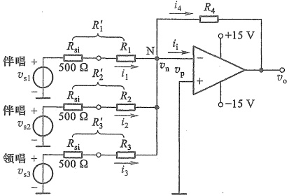

图 2.4.2 例 2.4.1 的电路
 

解：（1）利用理想运放特性有  $ v_{n}=0, i_{i}=0 $ ，则对节点 N 应用 KCL 有

 $$ i_{1}+i_{2}+i_{3}=i_{4}\quad 或 \quad\frac{v_{s1}}{R_{si}+R_{1}}+\frac{v_{s2}}{R_{si}+R_{2}}+\frac{v_{s3}}{R_{si}+R_{3}}=\frac{-v_{o}}{R_{4}} $$ 

由此得

$$  v_{\mathrm{o}}=-\frac{R_{4}}{R_{\mathrm{s i}}+R_{1}}v_{\mathrm{s}1}-\frac{R_{4}}{R_{\mathrm{s i}}+R_{2}}v_{\mathrm{s}2}-\frac{R_{4}}{R_{\mathrm{s i}}+R_{3}}v_{\mathrm{s}3}=A_{v1}v_{\mathrm{s}1}+A_{v2}v_{\mathrm{s}2}+A_{v3}v_{\mathrm{s}3}   \tag*{(2.4.4)}$$

（2）将  $ v_{s}=v_{s1}=v_{s2}=v_{s3}=10\ mV $,  $ v_{o}=2\ V $,  $ A_{v1}=A_{v2} $ 和  $ A_{v3}=2A_{v1} $ 代入式（2.4.4）计算得

 $$ A_{v2}=A_{v1}=-50\ ,\quad A_{v3}=2A_{v1}=-100 $$ 

（3）选择  $ R_{4}=100\ k\Omega $，由  $ A_{v1}=-\frac{R_{4}}{R_{si}+R_{1}} $，得  $ R_{si}+R_{1}=-\frac{R_{4}}{A_{v1}}=-\frac{100\ k\Omega}{-50}=2\ k\Omega $，则  $ R_{1}=(2-0.5)\ k\Omega=1.5\ k\Omega $。同样可求得  $ R_{2}=1.5\ k\Omega $。再由  $ A_{v3}=-\frac{R_{4}}{R_{si}+R_{3}} $，得  $ R_{si}+R_{3}=-\frac{R_{4}}{A_{v3}}=-\frac{100\ k\Omega}{-100}=1\ k\Omega $，则  $ R_{3}=(1-0.5)\ k\Omega=0.5\ k\Omega $。

##### 2.4.2 求差电路

图2.4.3a所示电路是用来实现两个电压 $ v_{i1} $、 $ v_{i2} $相减的求差电路，又称差分放大电路。从电路结构上来看，它是反相输入和同相输入相结合的放大电路。利用理想运放特性有 $ i_{n}\approx i_{p}\approx0 $，则节点N和P的电流方程为

$$  \left\{\begin{aligned}i_{1}&=i_{4}\\ i_{2}&=i_{3}\end{aligned}\right.\quad 即 \quad\left\{\begin{aligned}\frac{v_{i1}-v_{n}}{R_{1}}&=\frac{v_{n}-v_{o}}{R_{4}}\\ \frac{v_{i2}-v_{p}}{R_{2}}&=\frac{v_{p}}{R_{3}}\end{aligned}\right.   \tag*{(2.4.5)}$$

根据虚短有  $ v_{p} \approx v_{n} $，代入式(2.4.5)解得

$$  v_{\mathrm{o}}=\left(\frac{R_{1}+R_{4}}{R_{1}}\right)\left(\frac{R_{3}}{R_{2}+R_{3}}\right)v_{\mathrm{i}2}-\frac{R_{4}}{R_{1}}v_{\mathrm{i}1}=\left(1+\frac{R_{4}}{R_{1}}\right)\left(\frac{R_{3}/R_{2}}{1+R_{3}/R_{2}}\right)v_{\mathrm{i}2}-\frac{R_{4}}{R_{1}}v_{\mathrm{i}1}   \tag*{(2.4.6)}$$

<!-- page: 62 -->

如果选取阻值满足  $ R_{4}/R_{1}=R_{3}/R_{2} $ 则式(2.4.6)的输出电压可简化为

$$  v_{o}=\frac{R_{4}}{R_{1}}(\;v_{i2}-v_{i1})   \tag*{(2.4.7)}$$

实现了求差功能。

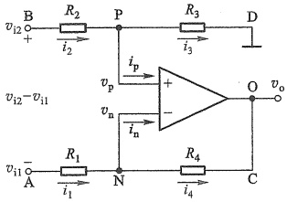

(a)
 

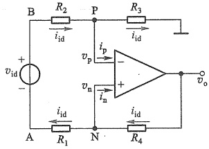

(b)
 

图 2.4.3 求差电路
 

（a）电路图 （b）求输入电阻的等效电路
 

同样可以将2.1节定义的差模信号和共模信号的概念应用于此。借助式(2.1.4)的定义，将式(2.4.7)中的 $ (v_{i2}-v_{i1}) $看作差模输入电压 $ v_{id} $，由此得本电路的差模电压增益

$$  A_{_{vd}}=\frac{v_{_{o}}}{v_{_{id}}}=\frac{v_{_{o}}}{v_{_{i2}}-v_{_{i1}}}=\frac{R_{4}}{R_{1}}   \tag*{(2.4.8)}$$

注意，如果交换表达式中  $ v_{i1} $ 和  $ v_{i2} $ 的位置，即用  $ v_{i1}-v_{i2} $ 作为差模输入电压，式(2.4.8)的结果会有一个负号。

由式(2.4.7)可知，求差电路的输出只与差模输入电压有关，即它只能放大 $ v_{i2} $和 $ v_{i1} $两输入端的压差，不能放大它们的共模电压。但当电阻误差导致 $ R_{4}/R_{1}\neq R_{3}/R_{2} $时，共模增益将不再为零，详见例2.4.2。

除了差模电压增益，求差电路也有输入电阻指标。从图2.4.3a电路的A、B两端之间看进去的电阻称为差模输入电阻，它是在差模输入信号作用下的端口等效电阻，可由图2.4.3b所示的等效形式求得。由于信号源 $ v_{id} $正端流出电流必定等于其负端流入电流，再利用 $ v_{p}\approx v_{n} $和 $ i_{p}\approx i_{n}\approx0 $得

 $$ v_{\mathrm{id}}=i_{\mathrm{id}}R_{1}+i_{\mathrm{id}}R_{2} $$ 

所以差模输入电阻为

$$  R_{id}=\frac{v_{id}}{\dot{i}_{id}}=R_{1}+R_{2}   \tag*{(2.4.9)}$$

由于  $ R_{1} $ 和  $ R_{2} $ 的阻值越大，增益越小，故它们不能无限制地增大，所以该电路的输入电阻通常不会很大。

当然，根据端口等效电阻的定义，也可以求出 B 端与地之间的输入电阻为  $ R_{2}+R_{3} $，A 端与地之间的输入电阻为  $ R_{1} $。实际上它们分别就是同相放大电路的输入电阻和反相放大电路的输入电阻。

受运放输出电阻 $ (r_{0}\approx0) $的影响，电路的输出电阻 $ R_{0}\approx0 $

<!-- page: 63 -->

例 2.4.2 在图 2.4.3a 所示的求差电路中，设  $ R_{1}=R_{2}=2\ k\Omega, R_{3}=R_{4}=200\ k\Omega $ ，(1) 求差模电压增益  $ A_{vd} $ ；(2) 如果电阻值有  $ \pm1\% $ 的误差，求最坏情况下的共模电压增益  $ A_{ve} $ 和共模抑制比  $ K_{CMR} $ 。

解：（1）由于有  $ R_{4}/R_{1}=R_{3}/R_{2} $，所以由式(2.4.8)得差模电压增益

 $$ A_{vd}=\frac{v_{o}}{v_{id}}=\frac{v_{o}}{v_{i2}-v_{i1}}=\frac{R_{4}}{R_{1}}=100 $$ 

（2）当输入共模电压时，图2.4.3a电路可等效为图2.4.4所示电路。利用 $ v_{p}\approx v_{n} $ 和 $ i_{p}\approx i_{n}\approx0 $ 列写电路方程有

 $$ \left\{\begin{aligned}v_{\mathrm{p}}=&\frac{R_{3}}{R_{2}+R_{3}}v_{\mathrm{ie}}\\ \frac{v_{\mathrm{ie}}-v_{\mathrm{n}}}{R_{1}}=&\frac{v_{\mathrm{n}}-v_{\mathrm{o}}}{R_{4}}\end{aligned}\right.\quad 或 \quad\left\{\begin{aligned}v_{\mathrm{p}}=&\frac{R_{3}}{R_{2}+R_{3}}v_{\mathrm{ie}}\\ \frac{v_{\mathrm{ie}}-v_{\mathrm{p}}}{R_{1}}=&\frac{v_{\mathrm{p}}-v_{\mathrm{o}}}{R_{4}}\end{aligned}\right. $$ 

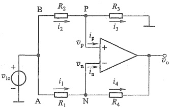

图 2.4.4 图 2.4.3a 输入共模电压时的等效电路
 

由此得到共模电压增益

$$  A_{_{ve}}=\frac{v_{_{o}}}{v_{_{ie}}}=\frac{R_{_{3}}}{R_{_{2}}+R_{_{3}}}\left(1-\frac{R_{_{2}}R_{_{4}}}{R_{_{1}}R_{_{3}}}\right)   \tag*{(2.4.11)}$$

如果  $ R_{4}/R_{1}=R_{3}/R_{2} $，且电阻值不存在误差，那么式(2.4.11)括号中将为0，使  $ A_{vc}=0 $，共模抑制比  $ K_{CMR}=\left|A_{vd}/A_{vc}\right|=\infty $。当电阻有  $ \pm1\% $ 误差时，最坏情况是指所有电阻的偏差方向正好导致式(2.4.11)的绝对值最大。此时

 $$ A_{_{vc}}=\frac{200\ k\Omega\times0.99}{2\ k\Omega\times1.01+200\ k\Omega\times0.99}\times\left(1-\frac{2\ k\Omega\times1.01\times200\ k\Omega\times1.01}{2\ k\Omega\times0.99\times200\ k\Omega\times0.99}\right)\approx-0.04 $$ 

共模抑制比

 $$ K_{\mathrm{CMR}}=\left|\frac{A_{vd}}{A_{vo}}\right|=2\ 500 $$ 

为提高运算精度，有制造商将4个电阻与运放一起集成在一个芯片中，生产了称为精密单位增益差分放大器的产品，如INA105。它的4个电阻取值为 $ R_{1}=R_{2}=R_{3}=R_{4}=25\ k\Omega $，且除了两个电源端外，还有5个引出端，如图2.4.3a中的A、B、C、D和O端。若将这些端子进行不同的组合连接，也可现实不同的电路功能，见复习思考题2.4.2。

##### 2.4.3 仪用放大器

仪用放大器电路如图2.4.5所示。 $ A_{1} $、 $ A_{2} $ 组成第一级放大电路， $ v_{1} $ 和  $ v_{2} $ 是它的输入， $ v_{3} $ 和  $ v_{4} $ 是它的输出。 $ A_{3} $ 组成的第二级就是求差电路。针对第一级，利用理想运放的虚短和  $ i_{p}=i_{n}=0 $，有  $ v_{n1}=v_{1} $， $ v_{n2}=v_{2} $，且流过  $ R_{1} $ 和两个  $ R_{2} $ 的电流相等，即  $ i_{R2}=i_{R1}=(v_{n1}-v_{n2})/R_{1}=(v_{1}-v_{2})/R_{1} $，故得

$$  v_{3}-v_{4}=i_{R1}R_{1}+2i_{R2}R_{2}=\left(1+\frac{2\bar{R}_{2}}{R_{1}}\right)(v_{1}-v_{2})   \tag*{(2.4.12)}$$

<!-- page: 64 -->

可见，第一级输出电压的差值就是输入电压差值的放大。

对比第二级与图2.4.3a的求差电路，以这里的 $ v_{3}-v_{4} $替换 $ v_{i1}-v_{i2} $、 $ R_{3} $替换 $ R_{1} $，代入式(2.4.7)可得

$$  v_{o}=-\frac{R_{4}}{R_{3}}(v_{3}-v_{4})=-\frac{R_{4}}{R_{3}}\left(1+\frac{2R_{2}}{R_{1}}\right)(v_{1}-v_{2})   \tag*{(2.4.13)}$$

于是电路的电压增益为

$$  A_{v}=\frac{v_{0}}{v_{1}-v_{2}}=-\frac{R_{4}}{R_{3}}\left(1+\frac{2R_{2}}{R_{1}}\right)   \tag*{(2.4.14)}$$

与求差电路类似，这个增益也是差模电压增益，而且当电阻值有误差时，电路的共模电压增益也不为零，共模抑制比也变为有限值。

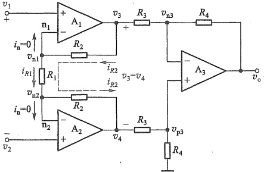

图 2.4.5 仪用放大器
 

目前有很多集成的仪用放大器供选用，芯片内通常包含了图2.4.5中除 $ R_{1} $以外的所有电路，使用时只需用户外接 $ R_{1} $，如INA128，其内部电阻 $ R_{2}=25\ k\Omega, R_{3}=R_{4}=40\ k\Omega $。当外接电阻 $ R_{1} $在50kΩ~5Ω范围内变化时，增益 $ A_{v} $可在2~10001范围内变化。 $ R_{1} $开路时， $ A_{v}=1 $。

由于  $ v_{1} $ 和  $ v_{2} $ 的输入端电流近似为零，所以输入电阻趋于无穷大。

当两输入端信号中含有共模电压  $ v_{i\mathrm{c}} $ 时，根据“虚短”有  $ v_{n1\mathrm{c}} $  $ ^{①}=v_{n2\mathrm{c}}=v_{i\mathrm{c}} $，那么共模电压在  $ R_{1} $ 上产生的电流  $ i_{R1\mathrm{c}}=(v_{n1\mathrm{c}}-v_{n2\mathrm{c}})/R_{1}=0 $，同时  $ i_{R2\mathrm{c}}=i_{R1\mathrm{c}}=0 $，使  $ v_{3\mathrm{c}}-v_{4\mathrm{c}}=i_{R1\mathrm{c}}R_{1}+2i_{R2\mathrm{c}}R_{2}=0 $，即  $ v_{3\mathrm{c}}=v_{4\mathrm{c}} $，表明  $ A_{1} $、 $ A_{2} $ 输出的共模电压相等，再经  $ A_{3} $ 的求差电路得  $ v_{oc}=0 $，说明仪用放大器有很强的抑制共模电压的能力。它在测量系统中得到广泛应用。

#####  $ ^{*} $ 应用实例——心电信号放大电路

人体心电信号放大电路是仪用放大器的一个典型应用。图2.4.6a是心电信号放大电路的简化原理示意图。心电信号由左臂电极LA和右臂电极RA取出后，以差模电压 $ (v_{la}-v_{ra}) $的形式送入仪用放大器INA128放大，其增益为

<!-- page: 65 -->

$$  A_{_{v}}=\frac{v_{_{o}}}{v_{la}-v_{ra}}=-\left(1+\frac{50\mathrm{~k}\Omega}{R_{1}}\right)   \tag*{(2.4.15)}$$

通过选取  $ R_{1} $ 的阻值，就可以设计具体增益值。

差模的心电信号幅度通常在毫伏量级。而人体也会感应环境的电磁干扰，特别是50 Hz 的工频干扰，那么电极电压  $ v_{la} $ 和  $ v_{ra} $ 中就都包含这个干扰，而且表现为共模电压，其幅度常常比心电信号高千倍以上。

尽管 INA128 有很高的共模抑制比（约 95 dB），但还是希望通过降低共模干扰来更好地放大心电信号。为此，增加一个右腿驱动电路，用它来提取  $ v_{la} $ 和  $ v_{ra} $ 中的共模干扰电压，然后反相放大，再通过右腿电极 RL 送回到人体，从而削减人体的共模干扰电压。图 2.4.6b 描述了这个电路的工作原理，所有放大器均用  $ \pm 15 $ V 电源供电。 $ v_{em} $ 是人体感应的等效共模干扰电压源， $ R_{si} $ 是其等效内阻 $ ^{①} $。在忽略人体电阻时，LA、RA、RL 三个电极相当于并接在共模信号源上，INA128 两输入端的共模干扰电压为  $ v_{ic} $。

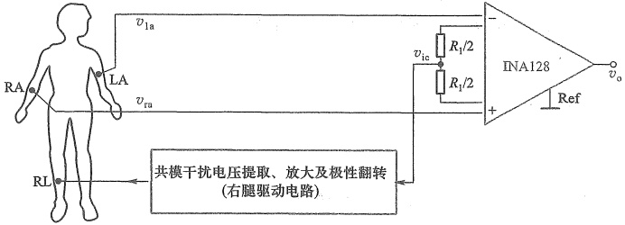

(a)
 

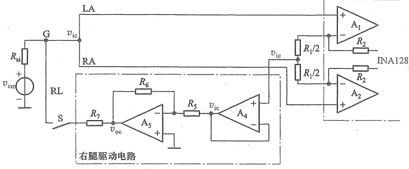

图 2.4.6 心电信号放大电路
 

（a）心电信号放大简化原理示意图 （b）等效共模信号及右腿驱动电路作用
 

<!-- page: 66 -->

当未采用右腿驱动电路时，即开关 S 断开，由于 INA128 内  $ A_{1} $、 $ A_{2} $ 输入端电流为零，所以  $ R_{si} $ 中无电流，也就没有压降，这时有

$$  v_{\mathrm{i c}}=v_{\mathrm{c m}}   \tag*{(2.4.16)}$$

可见，共模干扰电压  $ v_{om} $ 全部加到了仪用放大器输入端。再根据式(2.1.9)和式(2.1.11)，可以得到 INA128 输出端的共模干扰电压幅值

$$  v_{\mathrm{oc128}}=\mid A_{v\mathrm{c}}\mid v_{\mathrm{ic}}=\frac{\mid A_{v}\mid}{K_{\mathrm{CMR}}}\cdot v_{\mathrm{cm}}   \tag*{(2.4.17)}$$

其中  $ A_{v} $ 就是式(2.4.15) 的差模电压增益， $ K_{CMR} $ 为 INA128 的共模抑制比。当它们确定后，INA128 输出的共模干扰电压的大小就取决于共模干扰源  $ v_{cm} $ 的大小。

右腿驱动电路中  $ A_{4} $ 构成电压跟随器， $ A_{5} $、 $ R_{5} $ 和  $ R_{6} $ 构成反相放大电路。 $ R_{7} $ 是限流电阻，以免电流超过安全值对人体造成伤害。由于  $ v_{ie} $ 同时加到了  $ A_{1} $、 $ A_{2} $ 的同相端，根据运放虚短特性可知，它们的反相端电压也都等于  $ v_{ie} $。又因为  $ A_{4} $ 同相端无电流，所以两个  $ R_{1}/2 $ 中也无共模电流，是等势体，则  $ A_{4} $ 同相端电压就等于  $ v_{ie} $。

当接入右腿驱动电路后(S闭合)，对G点应用KCL

$$  \mathrm{\frac{v_{cm} - v_{ic}}{R_{si}}} = \frac{v_{ic} - v_{oc}}{R_{7}}   \tag*{(2.4.18)}$$

又因为  $ A_{5} $ 反相放大电路有

$$  v_{\mathrm{o c}}=-\frac{R_{6}}{R_{s}}v_{\mathrm{i c}}=-K v_{\mathrm{i c}}   \tag*{（2.4.19）}$$

其中  $ K=R_{6}/R_{5} $ 将式(2.4.19)代入式(2.4.18)得

$$  v_{\mathrm{i c}}=\frac{1}{\left(R_{\mathrm{s i}}/R_{7}\right)\left(1+K\right)+1}\mathrm{\;}\cdot\;v_{\mathrm{e m}}   \tag*{(2.4.20)}$$

可见，加到仪用放大器输入端的共模干扰电压 $ v_{ic} $明显小于 $ v_{em} $，而且K越大， $ v_{ic} $越小。将式(2.4.20)代入式(2.4.17)前半部分，便得到此时INA128输出端的共模干扰电压

$$  v_{\mathrm{oc128}}=\left|A_{_{vc}}\right|v_{\mathrm{ic}}=\frac{\left|A_{_{v}}\right|}{K_{\mathrm{CMR}}}\cdot\frac{1}{\left(R_{\mathrm{si}}/R_{7}\right)\left(1+K\right)+1}\cdot v_{\mathrm{cm}}   \tag*{(2.4.21)}$$

对照式(2.4.17)可以看出，共模干扰电压大大减小。

综上分析，右腿驱动电路从 INA128 输入端的信号中提取出共模电压，经反相放大后再通过右腿电极送回到人体，由于这个共模电压极性被翻转，所以叠加到人体上后可以抵消人体原来的共模干扰电压，从而减小了送到仪用放大器输入端的共模干扰电压，最终减小了INA128输出端的共模干扰。

将式(2.4.20)代入式(2.4.19)得

$$  v_{\mathrm{oc}}=-\frac{R_{7}}{R_{\mathrm{si}}}\cdot\frac{K}{1+K+R_{7}/R_{\mathrm{si}}}\cdot v_{\mathrm{em}}\xrightarrow{K\gg1+R_{7}/R_{\mathrm{si}}}v_{\mathrm{oc}}\approx-\frac{R_{7}}{R_{\mathrm{si}}}\cdot v_{\mathrm{em}}   \tag*{(2.4.22)}$$

由于共模干扰电压  $ v_{cm} $ 的幅值有可能超过运放的电源电压，所以由式(2.4.22)可知， $ R_{7} $ 的值通常要根据  $ v_{cm} $ 的幅值确定，使  $ v_{oc} $ 不超过  $ A_{5} $ 的线性工作范围。可以根据实际需要选择相关的元件参数。

实用的心电信号放大电路还需要考虑滤波等信号处理环节，这将在第10章介绍。

<!-- page: 67 -->

##### 2.4.4 积分电路和微分电路

### 1. 积分电路 $ ^{①} $

积分是一种常见的数学运算，这里所讨论的是模拟信号的积分。积分电路如图2.4.7所示。利用理想运放特性有 $ v_{N}\approx0,i_{1}=0 $，因此有 $ i_{1}=i_{2} $，电容C以电流 $ i_{1}=v_{1}/R $进行充电。假设电容C的初始电压 $ v_{C}(0)=0 $，则

 $$ v_{\mathrm{N}}-v_{0}=-\ v_{0}=\frac{1}{C}\int i_{1}\mathrm{d}t=\frac{1}{C}\int\frac{v_{1}}{R}\mathrm{d}t $$ 

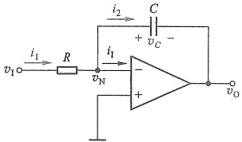

图2.4.7 积分电路
 

得

$$  v_{0}=-\frac{1}{RC}\int v_{1}\mathrm{d}t   \tag*{(2.4.23)}$$

即输出电压是输入电压对时间的积分，负号表示它们的极性相反，所以此电路又称为反相积分器。图中  $ v_{0}=-v_{C} $。

当输入信号  $ v_{1} $ 为图 2.4.8a 所示的阶跃电压时，在 t>0 后，电容器将以恒流方式充电，输出电压  $ v_{0} $ 与时间 t 呈线性关系，如图 2.4.8b 所示。即

$$  v_{0}=-\frac{V_{1}}{RC}t=-\frac{V_{1}}{\tau}t   \tag*{(2.4.24)}$$

式中积分时间常数  $ \tau = RC $。由图2.4.8b看出，当  $ t = \tau $ 时， $ v_0 = -V_1 $。当  $ t > \tau $ 后， $ \left|v_0\right| $ 继续增大，直到  $ v_0 = -V_{om} $，此时受电源电压限制， $ \left|v_0\right| $ 不再增大，运放进入饱和状态，电路停止积分。

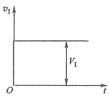

(a)
 

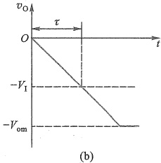

(b)
 

图 2.4.8 积分电路的阶跃响应
 

（a）输入电压波形 （b）输出电压波形
 

在实际的积分电路中，由于运放并非理想，即使 $ v_{1} $为零，运放输入端的直流误差（详见7.5节）也会始终对电容进行同一方向的充电，虽然电流很小，但只要时间足够长，就会导致运放入饱和状态而无法再对信号进行积分运算。为解决这个问题，常在电容C两端并联一个大电阻，构成直流负反馈，防止运放入饱和状态。

<!-- page: 68 -->

积分电路应用广泛，可用来构成三角波或锯齿波发生器、有源滤波器、数模转换器等。它也是自动控制系统中 PID $ ^{①} $ 调节器的重要组成部分（见图 2.4.13）。

例 2.4.3 电路如图 2.4.7 所示，设电源电压为  $ \pm15 $ V，R=10 k $ \Omega $，C=5 nF，输入电压  $ v_{1} $ 波形如图 2.4.9a 所示，在 t=0 时，电容 C 的初始电压  $ v_{c}(0)=0 $，试画出输出电压  $ v_{0} $ 的波形，并标出  $ v_{0} $ 的幅值。

解：在 t=0 时， $ v_{0}(0)=0 $，当  $ t_{1}=40\ \mu s $ 时

 $$ v_{0}(t_{1})=-\frac{V_{\mathrm{I I}}}{R C}t_{1}=-\frac{-10\times40\times10^{-6}}{10\times10^{3}\times5\times10^{-9}}\mathrm{~V}=8\mathrm{~V} $$ 

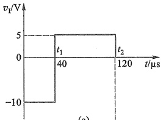

当  $ t_2 = 120\ \mu\text{s} $ 时

 $$ \begin{aligned}v_{0}(t_{2})&=v_{0}(t_{1})-\frac{V_{\mathrm{r}2}}{RC}(t_{2}-t_{1})\\&=\left[8-\frac{5\times(120-40)\times10^{-6}}{10\times10^{3}\times5\times10^{-9}}\right]\mathrm{~V}=0\mathrm{~V}\end{aligned} $$ 

(a)
 

输出电压  $ v_{0} $ 的波形如图 2.4.9b 所示。

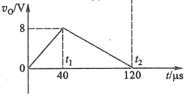

(b)
 

图2.4.9 例2.4.3 波形图
 

### 2. 微分电路

（a）输入电压波形 （b）输出电压波形
 

将图2.4.7所示积分电路中的电阻和电容元件对换

位置，便得到图2.4.10所示的微分电路。同样，利用 $ v_{N}\approx0 $和 $ i_{1}=0 $，有 $ i=i_{1} $设t=0时，C的初始电压 $ v_{c}(0)=0 $，当信号接入后，流过电容的电流为

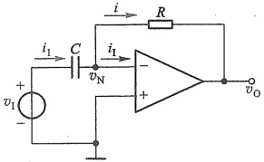

 $$ i_{1}=C\frac{\mathrm{d}v_{1}}{\mathrm{d}t} $$ 

考虑到 $ i=i_{1} $，则电阻上的压降

图 2.4.10 微分电路
 

 $$ v_{\mathrm{N}}-v_{0}=i R=i_{1}R=R C\frac{\mathrm{d}v_{1}}{\mathrm{d}t} $$ 

由于  $ v_{N} \approx 0 $ ，从而得

$$  v_{o}=-R C\frac{\mathrm{d}v_{I}}{\mathrm{d}t}   \tag*{(2.4.25)}$$

即输出电压  $ v_{0} $ 与输入电压  $ v_{1} $ 对时间的微商成比例，负号表示它们的相位相反。

当  $ v_{1} $ 为图 2.4.11a 所示的阶跃信号时，考虑到信号源总存在内阻且运放电源电压的限制，在 t=0 时，输出电压仍为一个有限值。随着电容器 C 的充电，输出电压  $ v_{0} $ 将逐渐衰减，最后趋近于零，如图 2.4.11b 所示，由信号源内阻和电容 C 构成的时间常数的大小影响回零时间。一般选用比较小的时间常数。

如果输入信号是正弦函数  $ v_i = \sin \omega t $，则输出信号  $ v_o = -RC\omega \cos \omega t $。表明  $ v_o $ 的输出幅度将随信号频率的增加而线性增加。因此微分电路对高频噪声和干扰特别敏感，以致输出噪声和干扰可能完全淹没微分信号，还可能使电路不稳定。一种改进型的微分电路见习题2.4.17，但也仅在有限的频率范围内使用。

<!-- page: 69 -->

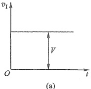

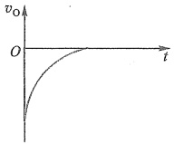

(b)
 

图 2.4.11 微分电路的电压波形   (a) 输入电压 (b) 输出电压
 

微分电路应用广泛，除了在线性系统中用于进行微分运算外，在数字电路中，常用来进行波形变换，例如将矩形波变换为尖顶脉冲波。

### 3. 归纳与推广

在以上分析的各种反相输入的运算电路中，可用通用阻抗  $ Z_{1} $ 和  $ Z_{2} $ 替换 R、C 元件，如图 2.4.12 所示。通常，阻抗可以由 R、L、C 的串联或并联组成（实际电路中必须保证运放反相输入端有直流回路）。应用拉氏变换，将  $ Z_{1} $ 和  $ Z_{2} $ 写成运算阻抗的形式  $ Z_{1}(s) $、 $ Z_{2}(s) $，其中 s 为复频率变量。这样，电流的表达式就成为  $ I(s)=V(s)/Z(s) $，原反相放大电路输出与输入的关系  $ v_{0}=-(R_{2}/R_{1})v_{1} $ 就可以表示为

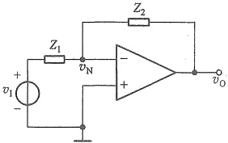

图 2.4.12 用通用阻抗表示的反相运算电路
 

$$  V_{_{0}}(s)=-\frac{\mathcal{Z}_{_{2}}(s)}{\mathcal{Z}_{_{1}}(s)}V_{_{i}}(s)   \tag*{(2.4.26)}$$

这是反相运算电路的一般数学表达式。改变  $ Z_{1}(s) $ 和  $ Z_{2}(s) $ 的形式，即可实现各种不同的数学运算。

例如，图2.4.13a所示是一种比较复杂的运算电路，它的频域传递函数为

$$  \mathrm{A}\left(\mathrm{s}\right)=\frac{V_{\mathrm{o}}\left(\mathrm{s}\right)}{V_{\mathrm{i}}\left(\mathrm{s}\right)}=-\frac{R_{2}+\frac{1}{sC_{2}}}{\frac{R_{1}}{sC_{1}}\left/\left(R_{1}+\frac{1}{sC_{1}}\right)\right.}=-\left(\frac{R_{2}}{R_{1}}+\frac{C_{1}}{C_{2}}+sR_{2}C_{1}+\frac{1}{sR_{1}C_{2}}\right)   \tag*{(2.4.27)}$$

式中右侧括号内第一、二两项表示比例运算；第三项表示微分运算，第四项表示积分运算 $ ^{①} $。即，该电路实现了比例-积分-微分(PID)运算。

需要特别注意，图2.4.13a电路在 $ v_{1} $为直流信号时，电容器相当于开路，此时运放处于开环状态，而当 $ v_{1} $的频率趋于无穷大时，电路的闭环增益也会趋于无穷大，这两种情况下，运放都会进入饱和状态。所以在实际电路中，为防止出现这种状态而使运算失效，常需要在图2.4.13a中的 $ C_{1} $支路串入一个电阻 $ R_{3} $，同时在 $ R_{2} $、 $ C_{2} $支路旁并联一个电阻 $ R_{4} $，如图2.4.13b

<!-- page: 70 -->

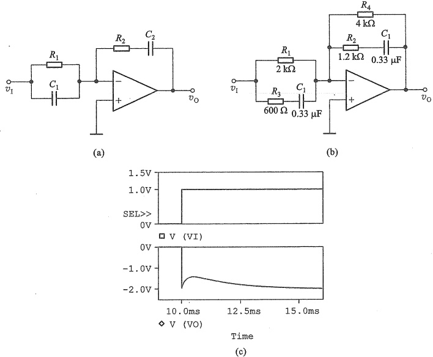

(b)
 

(c)
 

图 2.4.13 比例-积分-微分运算
 

（a）电路图 （b）补充电阻后的电路 （c）图 b 的阶跃响应仿真波形
 

仿真说明文档2.2: 图2.4.13b电路的仿真
 

所示。图2.4.13c是图b在阶跃信号作用下的SPICE仿真波形。

在自动控制系统中，比例-积分-微分运算经常用来组成 PID 调节器。在常规调节中，比例运算用作放大，积分运算用来提高调节精度，而微分运算则用来加速过渡过程。

在式(2.4.27)中，用  $ j\omega $ 代替 s 就可以得到实际频率的传递函数，由此可以分析在输入正弦信号的角频率  $ \omega $ 连续变化时，电路的稳态响应，包括幅频响应和相频响应。

##### 复习思考题

2.4.1 若输入到图2.4.3a中两输入端的电压信号源 $ v_{s1} $和 $ v_{s2} $的内阻分别为 $ R_{si1} $和 $ R_{si2} $，那么要使电路输出电压 $ v_{o} $完全是对 $ (v_{s1}-v_{s2}) $的放大，则电路中电阻必须满足怎样的关系？

2.4.2 试对求差电路芯片 INA105 的引出端（见图 2.4.3a 中的 A、B、C、D 和 O 端）进行不同的组合连接，分别实现  $ A_{vd}=v_{0}/(v_{i2}-v_{i1})=1 $， $ A_{v}=v_{0}/v_{i}=-1 $、+1、+2 和 1/2 的电路功能，画出各种情况下的电路图。

2.4.3 能否用同相输入方式构建求和电路？请给出电路例子并求输入输出关系。

2.4.4 在图2.4.5所示的仪用放大器中，若它的两个输入端电压分别为  $ v_{1} = (5 + 0.005 \sin \omega t) $ V,  $ v_{2} = (5 - 0.005 \sin \omega t) $ V，那么电路的差模输入电压和共模输入电压分别是多少？设电路中  $ R_{1} = 1 $ kΩ,  $ R_{2} = 0.5 $ MΩ,  $ R_{3} = R_{4} = 10 $ MΩ，求电路中  $ v_{3} $、 $ v_{4} $ 和  $ v_{0} $ 的值。

<!-- page: 71 -->

2.4.5 试画出实现下列关系的电路

（1） $ v_{0}=-3v_{i1}-v_{i2}-0.2v_{i3} $（设跨接在输出端和反相输入端之间的电阻  $ R_{2}=100\ k\Omega $）；

 $$ (2)\ v_{0}=-10\int_{0}^{t}v_{I1}(t)d t-2\int_{0}^{t}v_{I2}(t)d t( 给定 C_{1}=1\mu F,v_{0}(t)\mid_{t=0}=0)。 $$ 

#### 小结

集成运算放大器是一种高增益直接耦合放大器，是被广泛使用的基本电子器件，可用于信号的放大、运算（比例、求和、求差、积分和微分）、变换、产生等模拟电路中。

集成运放至少有5个端子：反相输入端、同相输入端、输出端以及2个接工作电源的端子。在线性区，输出电压等于开环电压增益与两输入端电压差的乘积，即 $ v_{0}=A_{so}(v_{p}-v_{N}) $。运放的输出电压不能无限制地增大，受电源电压限制，输出正、负电压的极限值接近正、负电源电压值。在饱和区，输出与输入不再遵循线性关系。

教学视频2.1：运算放大器小结

集成运放有很高的开环电压增益、很大的输入电阻和很小的输出电阻，将它们理想化 $ (A_{so}\approx\infty,r_{i}\approx\infty,r_{o}\approx0) $便得到运放的理想模型，也称为理想运放。“虚短” $ (v_{P}\approx v_{N}) $和输入端电流为零 $ (i_{P}\approx i_{N}\approx0 $，也常称作“虚断”)是理想运放的重要特性，它为分析运放组成的各种线性应用电路带来了极大方便。但要注意，只有运放工作在线性区“虚短”才成立。此外，还认为理想运放具有无穷大的共模抑制比、无穷大的带宽和无限制的输出端电流，实际上后两项与实际运放严重不符。

由于运放的增益极高，所以必须引入负反馈才能使其工作在线性区。通常，通过电阻、电容等元件连接运放的输出端与反相输入端来引入这个负反馈。

同相放大电路和反相放大电路是两种最基本的运放线性应用电路。由此可推广到求和、求差、积分和微分等电路。这些电路的输出与输入的关系只取决于运放外部的元件参数，而与运放自身的参数 $ (A_{vo}, r_{i}, r_{o}) $几乎无关。反相放大电路中的反相输入端具有“虚地”特征。

#### 习题

提示：习题的电路图中几乎所有运放都没画供电电源，均默认由对称的双电源供电。另外，在无特别说明时，均假设运放是理想的。

2.1 集成电路运算放大器

2.1.1 图题2.1.1所示电路中，假设 $ v_{1}=0 $时，有 $ v_{0}=0 $；而当 $ v_{1}=20\ mV $时，测得 $ v_{0}=4\ V $。求该运算放大器的开环电压增益 $ A_{vo} $。

2.1.2 电路如图 2.1.3 所示，运放的开环电压增益

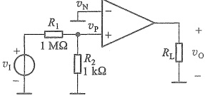

图2.1.1
 

<!-- page: 72 -->

$ A_{vo}=10^{6} $，输入电阻  $ r_{i}=10^{9}\Omega $，电源电压  $ V_{+}=+10V, V_{-}=-10V $。当运放输出电压的极限值为电源电压时，求线性区输入压差  $ (v_{\mathrm{p}}-v_{\mathrm{N}}) $ 的范围，以及对应其极限值的输入电流  $ i_{1} $。

2.1.3 设某集成运放开环差模电压增益  $ A_{sd}=10^{5} $，共模抑制比为 80 dB，电源电压  $ V_{+}=+15 $ V， $ V_{-}=-15 $ V，输出极限电压  $ \pm V_{om}=\pm14 $ V。现测得  $ v_{P}=6.025 $ mV， $ v_{N}=6.055 $ mV，求此时运放的输出电压。

#### 2.3 基本线性运放电路

2.3.1 同相放大电路如图题 2.3.1 所示。设  $ v_s = 1\ \text{V} $，(1) 求闭环电压增益  $ A_v = v_0 / v_S $、输出电压  $ v_0 $、各支路电流  $ i_1 $、 $ i_1 $、 $ i_2 $、 $ i_L $ 和  $ i_0 $；(2) 求电流增益  $ A_i = i_L / i_1 $ 和功率增益  $ A_p = P_L / P_1 $；(3) 在保持输入电压和闭环电压增益不变的情况下，要求流过  $ R_2 $ 的电流为  $ 100\ \mu\text{A} $，请再求  $ R_1 $、 $ R_2 $ 的值。

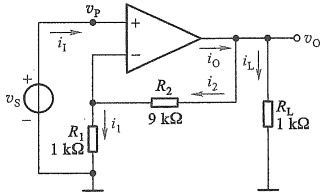

2.3.2 试分别求出图题2.3.2中各运放电路的 $ V_{0} $电压值。

图题2.3.1
 

(a)
 

(b)
 

(c)
 

(d)
 

图题2.3.2
 

2.3.3 同相放大电路如图题2.3.3所示，除输出端最大电流为±40 mA 外，运放其他特性如同理想运放。已知运放的电源电压为±15 V， $ v_i = 0.2\sin \omega t $ V。(1)当  $ R_L = 500 $ Ω时，求  $ v_0 $ 波形；(2)当  $ R_L = 100 $ Ω时，再求  $ v_0 $ 波形；(3)运放选用 μA741(输出端最大电流为±40 mA)， $ v_i $ 正弦波频率为100 Hz，用 SPICE 分别绘出(1)和(2)情况下的  $ v_i $ 和  $ v_0 $ 波形。

图题2.3.3
 

<!-- page: 73 -->

2.3.4 放大电路如图题2.3.4所示。(1)试求电路的电压增益  $ A_{v}=v_{o}/v_{i} $ 和输入电阻  $ R_{i} $; (2)若运放的饱和压降为2V,要求  $ v_{o} $ 能在-10~+10V范围内变化,那么电源电压应为多少? (3)在(2)的基础上,若运放输出端最大电流为 $ \pm20 $ mA,且已知输出最大电压时, $ R_{2} $ 中的电流为500 $ \mu $A,那么电路对负载阻值有何要求?

 $ ^{*} $2.3.5 若运放的开环差模电压增益为  $ A_{vo} $，共模抑制比为无穷大。(1) 求电压跟随器输出电压与输入电压的实际关系；(2) 若要求跟随误差不超过 0.01%， $ A_{vo} $ 至少要达到多少？

2.3.6 电流-电压转换电路如图题2.3.6所示。设 $ i_{s} $是光探测仪的输出电流, $ R_{si} $是其内阻。(1)试证明输出电压 $ v_{o}=-i_{s}R $;(2)当 $ i_{s}=0.5\ mA $, $ R_{si}=10\ k\Omega $, $ R=10\ k\Omega $时，求输出电压 $ v_{o} $和互阻增益 $ A_{r} $。

图题2.3.4
 

图题2.3.6
 

2.3.7 电路如图题 2.3.7 所示， $ v_{i}=0.5\sin\omega t V_{0} $

(1) 试求  $ v_{01} $、 $ v_{02} $ 和  $ v_{0} $; (2) 求电路的电压增益  $ A_{v}=v_{0}/v_{i} $ 和输入电阻  $ R_{i} $。

2.3.8 电路如图题2.3.8所示，三极管T电极b、e间的压差 $ V_{BE}=V_{B}-V_{E}=0.7\ V $。（1）求三极管电极c、b、e的电位；（2）若电压表的读数为200mV，试求三极管电流放大系数 $ \beta=I_{c}/I_{B} $的值。

2.3.9 图2.3.8所示电路作为麦克风电路的前置放大器，麦克风的输入电压有效值为12 mV，其内阻 $ R_{si}=1\ k\Omega $， $ R_{1}=R_{1}^{\prime}+R_{si}(R_{1}^{\prime} $为外接电阻）。要求输出电

图题2.3.7
 

压有效值为 1.2 V，求电路中各阻值，设计时该电路所有电阻小于 500 kΩ。

图题2.3.8
 

<!-- page: 74 -->

2.3.10 图题 2.3.10 所示电路可以将电压源  $ v_{s} $ 转换为电流源  $ i_{L} $，驱动线圈  $ Z_{L} $。为使  $ i_{L} $ 独立于  $ Z_{L} $，电路中设定  $ R_{2}/(R_{1}R_{3}) = 1/R_{4} $。试求  $ i_{L}/v_{s} $ 表达式。

2.3.11 电桥测量电路如图题2.3.11所示，试推导 $ v_{0} $与 $ \delta $的关系式，并说明电路特点。

图题2.3.10
 

图题2.3.11
 

2.3.12 电路如图题2.3.12所示，设运放的静态电流 $ I_{0}=1.5\ mA $。（1）当 $ v_{1}=2\ V $时，求输出电压 $ v_{0} $、各支路电流和运放的耗散功率；（2）当 $ v_{1}=-2\ V $时，再求输出电压 $ v_{0} $、各支路电流和运放的耗散功率。

#### 2.4 同相输入和反相输入放大电路的其他应用

2.4.1 设计一反相加法器，使其输出电压  $ v_{0} = -(7v_{i1} + 14v_{i2} + 3.5v_{i3} + 10v_{i4}) $，允许使用的最大电阻值为 280 kΩ，求各支路的电阻。

图题2.3.12
 

2.4.2 同相输入加法电路如图题2.4.2a、b所示。(1) 求图a中输出电压 $ v_{0} $的表达式。当 $ R_{1}=R_{2}=R_{3}=R_{4} $时， $ v_{0} $应为多少？(2) 求图b中输出电压 $ v_{0} $的表达式，当 $ R_{1}=R_{2}=R_{3} $时， $ v_{0} $应为多少？

图题2.4.2
 

2.4.3 差分放大电路如图 2.4.3a 所示。已知电路的  $ R_{4}/R_{1}=R_{3}/R_{2} $，差模电压增益  $ A_{vd}=10 $

(1) 若电路的差模输入电阻  $ R_{id}=20\ k\Omega $，且  $ R_{1}=R_{2} $，求  $ R_{1} $、 $ R_{2} $、 $ R_{3} $ 和  $ R_{4} $ 的阻值；(2)  $ v_{i2}=0 $ 时，求从  $ v_{i1} $ 输入端看进去的输入电阻  $ R_{i1} $; (3)  $ v_{i1}=0 $ 时，求从  $ v_{i2} $ 输入端看进去的输入电阻  $ R_{i2} $。

2.4.4 电桥信号放大电路如图题2.4.4所示。(1)试写出 $ v_{o}=f(\delta) $的表达式 $ (\delta=\Delta R/R) $;(2)当 $ v_{i}=7.5\ V,\delta=0.01 $时，求 $ v_{A} $、 $ v_{B} $、 $ v_{AB} $和 $ v_{o} $;(3)说明 $ A_{1} $、 $ A_{2} $电路的作用。

<!-- page: 75 -->

图题2.4.4
 

2.4.5 增益可调求差电路如图题2.4.5所示，试推导函数关系 $ v_{0}=f(v_{1},v_{2}) $。

图题2.4.5
 

2.4.6 图题2.4.6所示电路可将电压 $ v_{id} $转换为电流 $ i_{0} $，驱动负载 $ Z_{L} $，且 $ i_{0} $与 $ Z_{L} $无关，试求 $ i_{0} $与 $ v_{id} $的函数关系。

2.4.7 加减运算电路如图题2.4.7所示，求输出电压 $ v_{0} $的表达式。

图题2.4.6
 

图题2.4.7
 

2.4.8 仪用放大器电路如图 2.4.5 所示，设电路中  $ R_{4}=R_{3} $， $ R_{1} $ 为固定电阻  $ R_{1}^{\prime}=1\ k\Omega $ 和电位器  $ R_{p} $ 串联，若要求差模电压增益在 5~400 之间可调，求  $ R_{2} $ 和  $ R_{p} $ 的阻值，并选取  $ R_{2} $、 $ R_{3} $、 $ R_{4} $ 和  $ R_{p} $ 的标称阻值，要求电路中每个电阻值必须小于 250 kΩ。

2.4.9 INA128 型仪用放大器电路如图题 2.4.9 所示，其中  $ R_1 $ 是外接电阻。(1) 它的输入干扰电压  $ V_c = 1 $ V (直流)，输入信号  $ v_{ii} = v_{i2} = 0.04\sin\omega t $ V，当  $ R_1 = 1 $ kΩ 时，求出  $ v_3 $、 $ v_4 $、 $ v_3 - v_4 $ 和  $ v_0 $ 的电压值；(2) 当输入信号  $ v_{ii} = v_{i2} = 0.01\sin\omega t $ V，要求  $ v_0 = -6\sin\omega t $ V，求此时外接电阻  $ R_1 $ 的阻值。

<!-- page: 76 -->

图题2.4.9
 

2.4.10 在图2.4.5所示的仪用放大器中，已知  $ R_{1}=2\ k\Omega, R_{2}=50\ k\Omega, R_{3}=30\ k\Omega, R_{4}=90\ k\Omega $ (1) 求差模电压增益  $ A_{sd} $; (2) 如果  $ R_{3} $ 有  $ \pm5\% $ 的误差，求最大共模电压增益  $ \left|A_{sc}\right| $ 和共模抑制比  $ K_{CMR} $。

 $ ^{*} $2.4.11 在图2.4.6所示的心电信号放大电路中，设 $ R_{1}/2=1\ k\Omega,R_{si}=120\ k\Omega,v_{em} $ 的最大幅值为20V，所有运放的电源电压为 $ \pm15\ V $， $ A_{s} $的输出饱和压降为1V。(1)求心电信号的增益；(2)若要求加到INA128输入端的共模电压是 $ v_{em} $的1/800，求 $ R_{7} $的最大值和K的值。

2.4.12 图题2.4.12所示为一增益线性调节运放电路，试推导该电路的电压增益表达式 $ A_{v}=v_{o}/(v_{i1}-v_{i2}) $。

图题2.4.12
 

2.4.13 积分电路如图题 2.4.13a 所示。已知初始状态时  $ v_{c}(0)=0 $，试回答下列问题：

(1) 当  $ R=100\ k\Omega $、 $ C=2\ \mu F $ 时，若 t=0 时刻加入阶跃电压  $ v_{1}(t)=1\ V $，求  $ t=1\ s $ 时的  $ v_{0} $;

(2) 若  $ C=0.47\ \mu F $，输入电压波形如图题 2.4.13b 所示，试定量画出  $ v_{0} $ 的波形。

<!-- page: 77 -->

(a)
 

(b)
 

图2.4.13
 

2.4.14 电路如图题2.4.14所示。设电容的初始电压  $ v_{c}(0)=0 $ 。(1) 写出  $ v_{0} $ 与  $ v_{11} $、 $ v_{12} $ 和  $ v_{13} $ 之间的关系式；(2) 当电阻满足  $ R_{1}=R_{2}=R_{3}=R_{4}=R_{5}=R_{6}=R $ 时，写出输出电压  $ v_{0} $ 的表达式。

图题2.4.14
 

2.4.15 差分式积分运算电路如图题2.4.15所示。设两电容器上的初始电压为零，且  $ C_{1}=C_{2}=C, R_{1}=R_{2}=R $。(1)当  $ v_{11}=0 $ 时，推导  $ v_{0} $ 与  $ v_{12} $ 的关系；(2)当  $ v_{12}=0 $ 时，推导  $ v_{0} $ 与  $ v_{11} $ 的关系；(3)求  $ v_{0} $ 与  $ v_{11} $、 $ v_{12} $ 的关系式。

2.4.16 微分电路及其输入电压波形如图题 2.4.16 所示，设  $ R = 10\ \text{k}\Omega $,  $ C = 100\ \mu\text{F} $，试定量画出输出电压  $ v_0 $ 的波形。

图题2.4.15
 

(a)
 

(b)
 

图题2.4.16
 

（a）微分电路 （b） $ v_{1} $ 的波形

<!-- page: 78 -->

2.4.17 一实用微分电路如图题2.4.17所示，它具有衰减高频噪声的作用。(1)确定电路的传递函数 $ V_{o}(s)/V_{i}(s) $;(2)若 $ R_{1}=R_{2}=R $, $ C_{1}=C_{2}=C $,试问应当怎样限制 $ v_{1} $的频率，才能使电路不失去微分功能？

2.4.18 电路如图题 2.4.18a 所示。设电容器 C 上的初始电压为零。(1) 求  $ v_{01} $、 $ v_{02} $、 $ v_{0} $ 与输入电压的关系；(2) 当输入电压  $ v_{11} $、 $ v_{12} $ 如图题 2.4.18b 所示时，试定量画出  $ v_{0} $ 的波形。

图题2.4.17
 

(a)
 

图题2.4.18
 

第2章部分习题答案

(b)
 

