# 03-第3章 二极管及其基本电路

[返回全书目录](../../README.md)

> PDF 页码：79–116

<!-- page: 79 -->

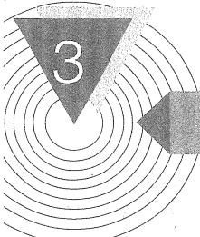

### 二极管及其基本电路

## 引言

上一章介绍了如何利用运算放大器优良的端口特性，分析和设计各种基本线性应用电路，它们并未涉及运算放大器的内部工作原理。这样做虽然可以解决一些信号处理问题，但是要想熟练运用和设计各种较复杂的电子电路，就必须掌握半导体基本器件及其基本电路的相关知识。本章开始将介绍这方面的知识。

半导体器件是现代电子技术的重要组成部分，由于它具有体积小、重量轻、使用寿命长、输入功率小和功率转换效率高等优点而得到广泛应用。

本章首先简单介绍半导体的基本知识，接着讨论半导体器件的基础——PN结，并重点讨论半导体二极管的物理结构、工作原理、特性曲线和主要参数，以及二极管基本电路及其分析方法与应用；在此基础上，对齐纳二极管、变容二极管和光电子器件等也作了简要的介绍。希望读者学完本章后，能正确表述PN结特性，会分析设计二极管基本电路，并能根据工程要求选择合适的二极管。

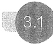

#### 半导体的基本知识

### 1. 半导体材料

多数现代电子器件是由性能介于导体与绝缘体之间的半导体材料制造而成的。为了理解这些器件在电路中呈现出的特性，首先必须从物理的角度了解它们是如何工作的。这里着重讨论半导体材料的特殊物理性质，以及这些性质对形成电子器件 I-V 特性的影响。在电子器件中，常用的半导体材料有：元素半导体，如硅（Si）、锗（Ge）等；化合物半导体，如砷化镓（GaAs）等。其中硅是目前最常用的一种半导体材料，砷化镓及其化合物一般用在较特殊的场合，如超高速器件和光电器件中。半导体除了在导电能力方面与导体和绝缘体不同外，它还具有不同于其他物质的特点，例如，当半导体受到外界光和热的激励时，其导电能力将发生显著变化。又如在纯净的半导体中加入微量的杂质，其导电能力也会有显著的提高。为了理解这些特点，必须先了解半导体的结构。

### 2. 半导体的共价键结构

下面以硅材料为例讨论其物理结构和导电机理。硅的简化玻尔（Bohr）原子模型如图3.1.1所示。我们知道硅是四价元素，原子的最外层轨道上有4个电子，称为价电子。中间带圆圈的+4表示正离子芯

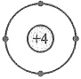

图3.1.1 硅的原子结构简化模型
 

<!-- page: 80 -->

（或正离子），以示原子呈电中性。半导体的导电性与价电子有关，因此，价电子是我们要研究的对象。

半导体与金属和许多绝缘体一样，均具有晶体结构，它们的原子在空间形成有序的排列，相邻原子之间由共价键连接，其平面示意图如图3.1.2所示。

### 3. 本征半导体、空穴及其导电作用

##### （1）本征半导体

本征半导体是一种完全纯净的、结构完整的半导体晶体。在绝对温度 T=0 K 和没有外界其他能量激发时，由于所有原子的最外层电子（价电子）被共价键束缚，不能自由移动，半导体是无法导电的。但是，半导体中共价键对电子的束缚并不像绝缘体中那样牢固，在室温（300 K）下，部分价电子会获得足够的随机热振动能量而挣脱共价键的束缚，成为自由电子，如图3.1.3所示。这种现象称为本征激发。

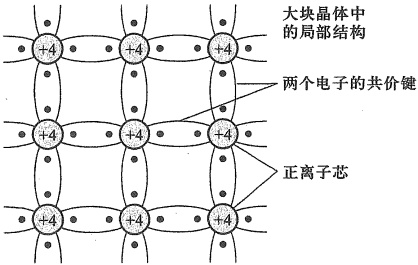

图 3.1.2 硅的二维晶格结构图
 

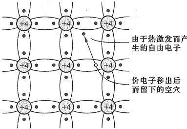

图 3.1.3 由于随机热振动致使共价键被打破而产生空穴-电子对
 

在外加电压作用下，这些自由电子将在本征硅晶体内形成电流。与良导体相比，本征硅晶体内的自由电子数量较少，因而它属于半导体。例如，在室温条件下，硅晶体本征激发的自由电子浓度  $ n_i \approx 1.45 \times 10^{10}/cm^3 $，而硅材料的原子密度约为  $ 5 \times 10^{22}/cm^3 $。表明在  $ 3.45 \times 10^{12} $ 个原子中只有一个价电子挣脱共价键的束缚，成为自由电子，显然，其导电能力并不强。

半导体中能够自由移动的带电粒子称为载流子。自由电子便是一种带负电荷的载流子。

##### （2）空穴

当电子挣脱共价键的束缚成为自由电子后，共价键中就留下一个空位，称为空穴。空穴的出现是半导体区别于导体的一个重要特征。

由于共价键中出现了空位，在外加电场或其他能量的作用下，邻近价电子就有可能填补这个空位，而这个价电子原来的位置又留下了新的空位，以后其他价电子又可以转移到这个新空位上。这一现象反映了共价键中的电荷迁移，常用空穴的移动反映这种电荷迁移。

图3.1.4 显示了在外电场 E 的作用下，共价键中空穴和电子在晶体中的移动过程。图中的圆圈表示空穴。由图可见，如果在  $ x_{1} $ 处存在一个空穴， $ x_{2} $ 处的价电子便可以填补这个空穴，从而使空穴由  $ x_{1} $ 移到  $ x_{2} $。如果接着  $ x_{3} $ 处的价电子又填补了  $ x_{2} $ 处的空穴，这样空穴又

<!-- page: 81 -->

由  $ x_{2} $ 移到了  $ x_{3} $ 处。此过程中，价电子的移动方向是  $ x_{3} \rightarrow x_{2} \rightarrow x_{1} $，空穴的移动方向与此相反，为  $ x_{1} \rightarrow x_{2} \rightarrow x_{3} $。

由以上分析可见，在本征半导体中，价电子在电场的作用下能够移动并形成电流的根本原因是，共价键中出现了空穴。即，当共价键中出现了空穴以后，价电子也能参与导电。若将空穴看成是一个带电量与电子相等、但电极性为正的粒子，就可以用空穴移动产生的电流来代表价电子移动产生的电流。

到此为止，我们看到半导体中的载流子既有自由电子又有价电子，而用空穴来描述价电子的导电更容易区别于自由电子的导电。这时，空穴也就成为半导体中的

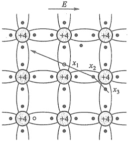

图 3.1.4 电子与空穴的移动
 

##### 一种载流子了。空穴越多，半导体中载流子的数目就越多，导电能力就越强。

在本征半导体内，自由电子和空穴总是成对出现的，因此在任何时候，本征半导体中的自由电子浓度和空穴浓度总是相等的，即

$$  n_{i}=p_{i}   \tag*{(3.1.1)}$$

##### （3）载流子的产生与复合

如前所述，在热能（或其他能量）的激励下，晶体中的共价键结构被打破、以一定的速率成对地产生自由电子和空穴。温度越高，其产生率越高。另一方面，当一个自由电子与一个空穴相遇，自由电子落入空穴中时，两者同时消失，这一现象称为自由电子与空穴的复合。实际上，半导体中一旦出现了一定浓度的自由电子和空穴后，复合现象是经常发生的。当载流子（自由电子和空穴）的复合率等于产生率时，便达到一种动态平衡，载流子的浓度便是一个定值。

当温度升高时，将产生更多的自由电子和空穴，意味着载流子的浓度升高，晶体的导电能力也会增强。

### 4. 杂质半导体

上述本征半导体中，载流子是由热激发产生的。在室温下，不仅其浓度远远达不到所期望导电能力的要求，而且，这种半导体的导电性与温度密切相关，这是电路工作时要极力避免的。实际的半导体器件，都是通过在本征半导体中加入一定浓度的杂质原子，来解决上述问题的。

在本征半导体中掺入微量的杂质，就会使半导体的导电性能发生显著改变。根据掺入杂质的性质不同，杂质半导体可分为P型半导体和N型半导体两大类。

##### （1）P型半导体

在硅晶体内掺入少量三价元素杂质，如硼等。硼原子只有3个价电子，在晶体中它与相邻4个硅原子组成共价键时，因缺少一个电子，而产生一个空位，即空穴。当相邻共价键中的电子填补这个空穴时，硼原子便成了不能移动的负离子，如图3.1.5所示。

因为硼原子在硅晶体中能接受电子，故称硼为受主杂质。受主杂质除硼外尚有铟和铝。由于掺入一个三价杂质原子，就可以产生一个空穴，所以通过控制掺入杂质的多少，可以方便地控制空穴浓度。

<!-- page: 82 -->

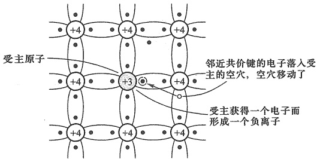

图 3.1.5 P 型半导体的共价键结构
 

值得注意的是，在加入杂质产生空穴的同时，并不产生新的自由电子，所以常温下本征激发出的自由电子数量小于半导体中空穴的数量。也就是说，在这种半导体中，空穴为多数载流子(简称多子)，自由电子为少数载流子(简称少子)，空穴是导电的主体，所以称它为P $ ^{①} $型半导体。

若用  $ N_{A} $ 表示受主原子的浓度, n 表示自由电子浓度, p 表示总空穴 (掺杂产生的空穴与本征激发出的空穴之和) 的浓度, 则有如下的浓度关系:

$$  N_{ 氵 }+n=p   \tag*{(3.1.2)}$$

这是因为掺入杂质的半导体材料仍是电中性的。或者说，离子化的受主原子的负电荷加上自由电子的负电荷必然等于空穴的正电荷。通常，掺杂浓度  $ N_{A} $ 远大于本征激发载流子（电子或空穴）的浓度。

##### （2）N型半导体

类似地，在硅晶体中掺入五价元素杂质，如磷等。这种杂质原子最外层有5个电子，在与4个相邻硅原子构成共价键时，会多出一个电子。该电子几乎不受约束而极易成为自由电子，当它移走后，磷原子因失去一个电子而成为不能移动的正离子，如图3.1.6所示。

因为磷原子能贡献一个电子，故称施主原子。典型的施主原子还有五价元素砷和锑。由于掺入施主杂质只增加自由电子，所以这种半导体中自由电子数量多于空穴数

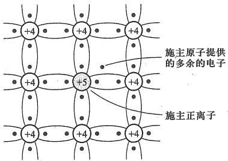

图 3.1.6 N 型半导体的共价键结构
 

量，故称之为 N $ ^{②} $ 型半导体。即，N 型半导体中，自由电子为多子，空穴为少子。

综上所述，半导体掺入杂质后，载流子的数目都有相当程度的增加。若每个受主杂质都

<!-- page: 83 -->

能产生一个空穴，或者每个施主杂质都能产生一个自由电子，则尽管杂质含量很少，但它们能显著提高半导体的导电能力。因而掺杂是提高半导体导电能力的最有效方法。

仿照前面的描述方法，若用  $ N_{D} $ 表示施主原子的浓度，n 表示总自由电子的浓度，p 表示空穴浓度，则有如下的浓度关系：

$$  n=p+N_{D}   \tag*{(3.1.3)}$$

即离子化的施主原子的正电荷与空穴的正电荷之和必定与自由电子的负电荷达到平衡，以保持材料的电中性。

应当注意，前述通过掺杂提高多子浓度的同时，也会增加自由电子与空穴的复合几率，从而降低相同温度下本征激发产生的少子浓度。在一定的温度条件下，半导体中自由电子-空穴对的本征激发产生与它们的复合始终是平衡的（也称为热平衡），其表现为空穴浓度与自由电子浓度的乘积为一常数，即

$$  p n=p_{i}n_{i}   \tag*{(3.1.4)}$$

式中  $ p_{i} $、 $ n_{i} $ 分别为本征材料中的空穴浓度和自由电子浓度，考虑式(3.1.1)中的关系，则有如下的等式：

$$  p n=n_{i}^{2}   \tag*{（3.1.5）}$$

即当掺杂使自由电子浓度 n 升高时，将相应地降低空穴的浓度 p，反之亦然。例如，在室温条件下，假设硅晶体本征激发的自由电子和空穴对的浓度均为  $ n_i \approx 1.45 \times 10^{10} / \text{cm}^3 $，若掺杂后 N 型半导体中自由电子浓度提高到  $ n = 5 \times 10^{16} / \text{cm}^3 $，则此时空穴的浓度变为  $ p = n_i^2 / n \approx 4.2 \times 10^3 / \text{cm}^3 $。可以看出，N 型半导体中自由电子浓度比空穴浓度高约  $ 10^{13} $ 倍，表明掺杂不仅能提高载流子浓度，还导致少子浓度远低于原本征激发的浓度，使杂质半导体的导电性与少数载流子几乎无关。

#### 3.2 PN 结的形成及特性

##### 3.2.1 载流子的漂移与扩散

### 1. 漂移

由于热能的激发，半导体内的载流子会随机无定向移动，它们在任意方向的平均速度为零。若有电场加到晶体上，则内部载流子将在电场力作用下定向移动。空穴的移动方向与电场方向相同，而自由电子则逆着电场的方向移动。

由于电场作用而导致载流子的运动称为漂移，其平均漂移速度与电场矢量 E 成比例。若用  $ V_{n} $ 和  $ V_{p} $ 分别表示自由电子和空穴的漂移速度矢量，则有

$$  V_{\mathrm{n}}=-\mu_{\mathrm{n}}E   \tag*{(3.2.1)}$$

和

$$  V_{\mathrm{p}}=\mu_{\mathrm{p}}E   \tag*{(3.2.2)}$$

式中  $ \mu_{n} $ 称为自由电子的迁移率，负号表明电子的漂移速度矢量与电场的方向相反。 $ \mu_{p} $ 为空穴的迁移率。迁移率反映了载流子的移动能力。在室温 (300 K) 情况下，硅材料内的  $ \mu_{n} $ 约

<!-- page: 84 -->

为  $ 1500\ \mathrm{cm}^2/(\mathrm{V} \cdot \mathrm{s}) $， $ \mu_p $ 约为  $ 475\ \mathrm{cm}^2/(\mathrm{V} \cdot \mathrm{s}) $。就是说，对于给定的电场，硅材料内自由电子移动的速度约为空穴移动速度的 3 倍。这是因为空穴代表了受共价键约束的电子的移动，所以在相同条件下比自由电子移动速度要慢。在数字电路或高频模拟电路中，电子导电器件优于空穴导电器件。

### 2. 扩散

在半导体内，由于制造工艺和运行机制等原因，会使不同区域的载流子浓度出现差异。基于载流子的浓度差异和随机热运动，载流子会从高浓度区域向低浓度区域扩散，从而形成扩散电流。如果没有外来的超量载流子的注入或电场的作用，晶体内的载流子浓度趋向于均匀直到扩散电流为零。

##### 3.2.2 PN 结的形成

如前所述，P型半导体中含有受主杂质，在室温下，其电离为带正电的空穴和带负电的受主离子。N型半导体中含有施主杂质，在室温下，它电离为带负电的自由电子和带正电的施主离子。此外，P型和N型半导体中还有少数受本征激发产生的自由电子和空穴，通常本征激发产生的载流子要比掺杂产生的载流子少得多。

在半导体两个不同的区域分别掺入三价和五价的杂质，便形成P型区和N型区。这样，在它们的交界处就出现了自由电子和空穴的浓度差异，N区内自由电子浓度很高，而P区内空穴浓度很高。它们都要向浓度低的区域扩散，如图3.2.1所示 $ ^{①} $。假设扩散过程中在交界处附近的大部分自由电子和空穴都复合了，由此打破了两区域交界处原来的电中性。P区一边失去空穴，留下了带负电的杂质离子（图3.2.1中用⊖表示）；N区一边失去电子，留下了带正电的杂质离子（图中用⊕表示）。这些不能移动的带电离子集中在交界面附近，形成了一个很薄的空间电荷区，这就是所谓的PN结。在这个区域内，多数载流子已大多复合掉了，或者说消耗尽了，因此空间电荷区有时又称为耗尽区。由于该区域缺少载流子，所以它的电阻率很高。PN结形成过程中的扩散越强，空间电荷区越宽。

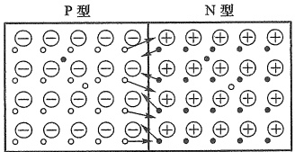

图 3.2.1 载流子的扩散
 

在出现了空间电荷区以后，就形成了一个电场，其方向是从带正电的N区指向带负电的P区。由于这个电场不是外加电压形成的，故称为内电场。显然，这个内电场会导致多子的扩散减弱。

另一方面，该电场反而会促进少子的漂移，即 N 区的空穴向 P 区漂移，P 区的自由电子

<!-- page: 85 -->

向 N 区漂移。从 N 区漂移到 P 区的空穴，补充了交界面附近 P 区原来失去的空穴，中和了部分负离子；而从 P 区漂移到 N 区的自由电子，则补充了交界面附近 N 区所失去的电子，中和了部分正离子，导致空间电荷区变窄。因此，漂移运动的作用正好与扩散运动相反。

由此可见，扩散运动和漂移运动是互相联系又互相对立的，扩散使空间电荷区加宽，电场增强，对多子扩散的阻力增大，但使少子的漂移增强；而漂移使空间电荷区变窄，电场减弱，又使扩散容易进行。当漂移运动和扩散运动相等时，空间电荷区便处于动态平衡状态，如图3.2.2所示。空间电荷区也称为势垒区，因为此时空穴从P区到N区必须越过一个能量高坡（图3.2.2中的势垒）；同样，自由电子从N区到P区也要越过此能量高坡。

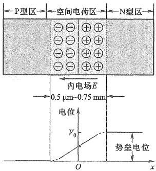

图 3.2.2 PN 结的形成
 

另外注意，如果 P 区和 N 区的掺杂浓度不同，两区域的杂质离子密度就不同，形成空间电荷区时，两侧的宽度就不对称了。

##### 3.2.3 PN 结的单向导电性

上面讨论的 PN 结无任何外加电压，处于动态平衡状态，称为平衡 PN 结。所谓单向导电性是指 PN 结外加不同极性电压时，其导电能力会表现出巨大反差。单向导电性是 PN 结的基本特性。

### 1. 外加正向电压

当 PN 结接入电路中，P 区电位高于 N 区电位时（如图 3.2.3a 所示），称所加电压为正向电压，也称 PN 结正向偏置 $ ^{①} $。此时，外加电压形成的外加电场  $ E_{F} $ 会打破 PN 结的平衡状态，使 P 区中的多子空穴和 N 区中的多子自由电子都向 PN 结移动。当 P 区空穴进入 PN 结后，会中和一部分原来的负离子，使 P 区的空间电荷量减少；同样，N 区的自由电子进入 PN 结后，也会中和部分正离子，减少 N 区的空间电荷量，结果 PN 结变窄，即耗尽区厚度变薄，其电阻率减小。由于半导体本身的体电阻与 PN 结的电阻相比阻值很小，所以大部分外加电压都降落在了 PN 结上。

换一个角度看，由于外加电场方向与 PN 结内电场方向相反，强制削弱了原内电场的作用，使 PN 结的电场由  $ E_{0} $ 减小到  $ E_{0}-E_{F} $，对多子扩散的阻碍作用变弱，使 N 区的自由电子和 P 区的空穴不断向对方区域扩散，并通过外部回路形成扩散电流（电源不断补充扩散失去的多子，形成一个流入 P 区的电流）。由于 PN 结电场减弱，所以少子的漂移减少，可以完全忽略它对回路电流的影响，回路电流基本上取决于扩散电流。此时的电流称为正向电流  $ I_{F} $。当外加电压  $ V_{F} $ 升高时，PN 结电场便进一步减弱，扩散电流随之增加。实验表明，在正常工作范围内，PN 结上外加电压只要稍有变化（如 0.1 V），便能引起电流的显著变化，因此电流  $ I_{F} $ 是随外加

<!-- page: 86 -->

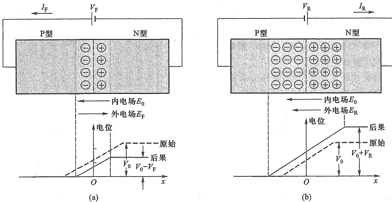

图 3.2.3 PN 结的单向导电性
 

（a）外加正向电压时的 PN 结 （b）外加反向电压时的 PN 结
 

电压急速上升的。这样，正向的 PN 结表现为一个阻值很小的电阻，此时也称 PN 结导通。

### 2. 外加反向电压

在图3.2.3b中，外加电压使N区电位高于P区电位，这种电压称为反向电压或反向偏置电压，PN结处于反向偏置状态。此时，在外加电压形成的外电场 $ E_{R} $作用下，P区中的空穴和N区中的电子都将进一步离开PN结，使耗尽区加宽。也即反向电压形成的外电场方向与PN结内电场方向相同，使PN结电场由 $ E_{0} $增加到 $ E_{0}+E_{R} $，打破了PN结原来的平衡状态，阻碍了多子的扩散运动，因此扩散电流趋近于零。但是，结电场的增强使N区和P区中的少子更容易产生漂移运动，因此，漂移电流在PN结内起决定作用。

漂移电流的方向与扩散电流相反，在外电路中表现为一个流入N区的反向电流 $ I_{R} $ 它是由少子漂移形成的。由于少子的浓度很低，数量很少，所以 $ I_{R} $是很微弱的，一般硅管为微安数量级。又因为少子是由本征激发产生的，当器件制成后，少子的浓度决定于温度。换言之，在一定温度T下，少子的数量是一定的，它几乎与外加电压 $ V_{R} $无关。所以当外加反向电压时，电流 $ I_{R} $的值将趋于恒定，如图3.2.4所示。这时的反向电流 $ I_{R} $就是反向饱和电流，用 $ I_{S} $表示。

由于  $ I_{s} $ 很小，所以 PN 结在反向偏置时，呈现出一个阻值很大的电阻，此时可认

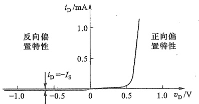

图 3.2.4 硅材料 PN 结的 I-V 特性
 

为它基本上是不导电的，称为 PN 结截止。但因  $ I_{s} $ 受温度的影响，在某些实际应用中，还必须予以考虑。

由此看来，PN 结加正向电压时，电阻值很小，PN 结导通；加反向电压时，电阻值很大，

<!-- page: 87 -->

PN 结截止，这就是 PN 结的单向导电性。

### 3. PN 结 I-V 特性的表达式

现以硅材料 PN 结为例，来说明它的 I-V 特性表达式。在硅 PN 结的两端施加电压时，流过 PN 结的电流如图 3.2.4 所示。根据半导体物理的理论分析，PN 结的 I-V 特性可表达为

$$  i_{\mathrm{D}}=I_{\mathrm{S}}(\mathrm{e}^{o_{\mathrm{D}}/(n V_{T})}-1)^{\mathrm{①}}   \tag*{(3.2.3)}$$

式中  $ i_D $ 为通过 PN 结的电流， $ v_D $ 为 PN 结两端的外加电压； $ n $ 为发射系数，它与 PN 结的尺寸、材料及通过的电流有关，其值在 1~2 之间； $ V_T $ 为温度的电压当量， $ V_T = kT/q $，其中  $ k $ 为玻耳兹曼常数（ $ 1.38 \times 10^{-23} \, \text{J/K} $）， $ T $ 为热力学温度，即绝对温度（单位为 K，0 K = -273 °C）， $ q $ 为电子电荷（ $ 1.6 \times 10^{-19} \, \text{C} $），常温（300 K）下， $ V_T = 0.026 \, \text{V} $； $ e $ 为自然对数的底； $ I_S $ 为反向饱和电流。对于分立器件，其典型值在  $ 10^{-8} \sim 10^{-14} \, \text{A} $ 的范围内。集成电路中 PN 结的  $ I_S $ 值更小。

##### 关于式(3.2.3)的讨论如下：

（1）当 PN 结两端加正向电压时，电压  $ v_{D} $ 为正值，当  $ v_{D} $ 比  $ V_{T} $ 大几倍时，式（3.2.3）中的  $ e^{v_{D}/V_{T}} $ 远大于 1，括号中的 1 可以忽略。这样，电流  $ i_{D} $ 与电压  $ v_{D} $ 呈指数关系，如图 3.2.4 中的正向特性部分所示。

（2）当 PN 结加反向电压时， $ v_{D} $ 为负值。若  $ \left|v_{D}\right| $ 比  $ V_{T} $ 大几倍时，指数项趋近于零，因此  $ i_{D}=-I_{s} $，如图 3.2.4 中的反向特性部分所示。可见当温度一定时，反向饱和电流是个常数，就等于  $ I_{s} $。

##### 3.2.4 PN 结的反向击穿

在测量 PN 结的 I-V 特性时，如果 PN 结两端的反向电压增大到一定数值时，反向电流突然增加，如图 3.2.5 所示。这个现象就称为 PN 结的反向击穿，也称为电击穿。发生击穿所需的反向电压  $ V_{BR} $ 称为反向击穿电压。PN 结电击穿后电流很大，易使 PN 结发热，并快速升温，从而烧毁 PN 结。反向击穿电压的大小与 PN 结制造参数有关。

产生 PN 结电击穿的原因是，当 PN 结反向电压增加时，空间电荷区中的电场随之增强。产生漂移运动的少数载流子通过空间电荷区时，在很强的电场作用下获得足够的动能，撞击出晶体原子共价键中的价电子，从而形成更多的自由电子-空穴对，这种现象称为碰撞电离。新产生的电

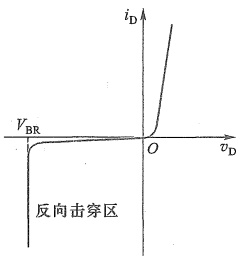

图 3.2.5 PN 结的反向击穿
 

子和空穴与原有的电子和空穴一样，在强电场作用下获得足够的能量，继续碰撞电离，再产生电子-空穴对，这就是载流子的倍增效应。当反向电压增大到某一数值后，载流子的倍增情况就像在陡峭的积雪山坡上发生雪崩一样，载流子增加得多而快，使反向电流急剧增大，于是PN结被击穿，这种击穿称为雪崩击穿。

PN 结击穿的另一个原因是，当反向电压产生的电场，强到可以直接从共价键中“推出”

<!-- page: 88 -->

价电子，产生电子-空穴对时，便使载流子数目增加，从而形成较大的反向电流，这种击穿现象称为齐纳击穿 $ ^{①} $。发生齐纳击穿需要的电场强度较高，约为  $ 2 \times 10^{5} $ V/cm 只有在高掺杂浓度的 PN 中才可能出现。因为杂质浓度越高，杂质离子密度就越大，在形成平衡 PN 结时，空间电荷区就更窄，相同外加电压下的电场强度就更高。

齐纳击穿的物理过程和雪崩击穿完全不同，它更容易被控制并加以利用，后面将要介绍的齐纳二极管就是例子。

上述两种电击穿都是可逆的，当反向电压降低后，PN结可以恢复原来的状态，但其前提是反向电流和反向电压的乘积不超过PN结容许的耗散功率，否则就会因为热量散不出去而使PN结过热烧毁，这就是热击穿了。虽然热击穿和电击穿是不同的，但多数PN结的电击穿与热击穿几乎是同时发生的，除非特殊的PN结，如利用电击穿的齐纳二极管。

##### 3.2.5 PN 结的电容效应

PN 结的电容效应直接影响半导体器件的高频特性和开关特性。

### 1. 扩散电容

PN 结也称为耗尽区。当 PN 结处于正向偏置时（如图 3.2.6 所示），多子将向对方区域扩散。实际上，它们并不会在耗尽区全部复合，穿过 PN 结未被复合的载流子称为剩余（或超量）载流子。例如，由 P 区穿过 PN 结到达 N 区的剩余空穴，在刚进入 N 区时浓度较高。随着空穴在 N 区中的继续移动，复合几率增加，浓度逐渐降低。所以剩余空穴在 N 区的浓度变化如曲线  $ p_{N} $ 所示。

这种在 N 区剩余的空穴，可视为在 PN 结 N 区一侧存储的电荷，仿佛平板电容器一侧的电极所充电荷。N 区的自由电子扩散到 P 区也有类似的效果，浓度变化如曲线  $ n_{p} $ 所示。当 P、N 两区域掺杂浓度不同时， $ p_{N} $ 和  $ n_{p} $ 是不对称的。

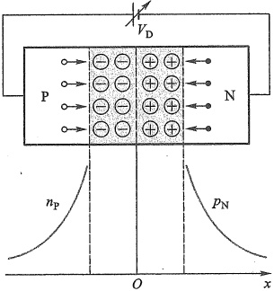

图 3.2.6 二极管的扩散电容
 

存储电荷量的多少，取决于 PN 结上所加正向电压值的大小。若外加正向电压有一增量  $ \Delta V $，则相应的剩余空穴（电子）产生一电荷增量  $ \Delta Q $，二者之比  $ \Delta Q/\Delta V $ 为扩散电容  $ C_{D} $。如果取微增量，则有

$$  C_{D}=\frac{\mathrm{d}Q}{\mathrm{d}v_{D}}\bigg|_{Q}=\frac{\tau_{i}I_{D}}{V_{T}}\quad F( 法 [ 拉 ])^{ \textcircled{2} }   \tag*{(3.2.4)}$$

式中  $ \tau_{t} $ 为剩余载流子的平均渡越时间或寿命，表示剩余载流子从进入对方区域到被复合所用的平均时间。 $ I_{D} $ 为 PN 结正向偏置电流， $ V_{T} $ 为温度电压当量。

PN 结在正向偏置时，剩余载流子随正向电压的增加而很快增加，扩散电容较大。反向

<!-- page: 89 -->

偏置时，因为载流子数目很少，所以扩散电容数值很小，一般可以忽略。

### 2. 势垒电容

接下来考虑 PN 结处于反向偏置的情况，如图 3.2.3b 所示。当 PN 结处于反向偏置时，外加电压的变化，会引起空间电荷区宽窄的变化。意味着 PN 结内存储的正、负离子电荷数的增减，类似于平行板电容器两极板上电荷的变化。此时 PN 结呈现出的电容效应称为势垒电容  $ C_{B} $。势垒电容是非线性的，可用微增量电容来定义，即

$$  C_{B}=\left|\frac{\mathrm{d}Q}{\mathrm{d}v_{D}}\right|   \tag*{(3.2.5)}$$

式中 dQ 为势垒区每侧存储电荷的微增量， $ dv_{D} $ 为作用于 PN 结上的电压微增量。最终  $ C_{B} $ 可表示为 $ ^{①} $

$$  C_{B}=\frac{C_{B0}}{(1-V_{D}/V_{0})^{m}}   \tag*{(3.2.6)}$$

式中  $ C_{B0} $ 为零偏置情况下的势垒电容， $ V_{D} $ 为 PN 结工作点上的电压（在反偏情况下为负值）。 $ V_{0} $ 为内建势垒电位（典型值为 1 V），m 为结的梯度系数，其值取决于 PN 结两侧的掺杂情况，当掺杂浓度差别不大时，m=1/3；而当差别很大时，m=1/2。

综上所述，PN 结的电容效应是扩散电容  $ C_{D} $ 和势垒电容  $ C_{B} $ 的综合反映，在高频运用时，必须考虑 PN 结电容的影响。PN 结电容的大小除了与本身结构和工艺有关外，还与外加电压有关。当 PN 结处于正向偏置时，结电容较大（主要决定于扩散电容  $ C_{D} $）；当 PN 结处于反向偏置时，结电容较小（主要决定于势垒电容  $ C_{B} $）。

##### 复习思考题

3.2.1 空间电荷区是由电子、空穴还是由施主离子、受主离子构成的？为什么空间电荷区又称为耗尽区或势垒区？

3.2.2 如需使 PN 结处于正向偏置，外接电压的极性如何确定？

3.2.3 与无偏置电压相比，PN 结外加反向偏置时，耗尽区的宽度是增加还是减少？为什么？

3.2.4 PN 结的单向导电性在什么外部条件下才能显现出来？

#### 3.3 二极管

实际上，半导体二极管与上一节介绍的PN结并无多大差别，可以将二极管看作是PN结的一个物化器件。因此，PN结具有的特性均可在半导体二极管上反映出来。当然，作为一个电子元器件，半导体二极管还具有一些与制作工艺和特殊用途相关的一些特性。如大、中、小不同功率的二极管；高、中、低不同工作频率的二极管等。

1. 二极管的结构

半导体二极管按其结构的不同大致可分为面接触型和点接触型两类。

面接触型或称面结型二极管的 PN 结是用合金法或扩散法做成的，其结构如图 3.3.1a 所示。由于这种二极管的 PN 结面积大，可承受较大的电流，但极间电容也大。这类器件适

<!-- page: 90 -->

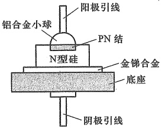

(a)
 

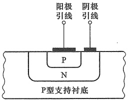

(b)
 

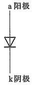

(c)
 

图 3.3.1 半导体二极管的结构及符号
 

（a）面接触型二极管 （b）集成电路中的平面型二极管 （c）代表符号
 

用于整流，而不宜用于高频电路中。如 2CP1 $ ^{①} $ 为面接触型硅二极管，最大整流电流为 400 mA，最高工作频率只有 3 kHz。

点接触型二极管的 PN 结面积很小，所以极间电容很小，适用于高频电路和数字电路。如 2AP1 是点接触型锗二极管，最大整流电流为 16 mA，最高工作频率为 150 MHz。但是这种类型的二极管不能承受高的反向电压和大的电流。

图 3.3.1b 是硅工艺平面型二极管的结构图，它是集成电路中常见的一种形式。二极管的代表符号如图 3.3.1c 所示。

### 2. 二极管的 I-V 特性

两个实际的二极管 I-V 特性如图 3.3.2 所示。其中图 a 硅二极管的 I-V 特性和图 3.2.4 硅 PN 结的 I-V 特性基本上是相同的。观察图 3.3.2a 硅二极管和图 b 锗二极管的 I-V 特性，两者在局部细节上还是有些差别的。

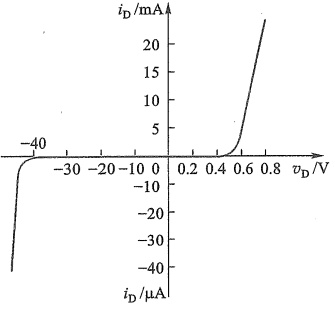

(a)
 

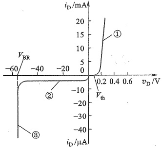

(b)
 

图 3.3.2 实际二极管的 I-V 特性
 

（a）硅二极管 2CP10 （b）锗二极管 2AP15
 

<!-- page: 91 -->

##### （1）正向特性

图 3.3.2b 的第①段为正向特性。在靠近原点的起始部分，由于正向电压较小，外电场还不足以影响 PN 结的内电场，因而这时的正向电流几乎为零，二极管呈现出一个大电阻，当正向电压超过一定值后，电流才开始明显增大，就好像有一个门坎。硅管的门坎电压  $ V_{th} $ （又称死区电压）约为 0.5 V，锗管的  $ V_{th} $ 约为 0.1 V，当正向电压大于  $ V_{th} $ 时，PN 结电场明显减弱，电流迅速增大，二极管正向导通。由于导通后，曲线较垂直陡峭，所以通常认为，硅管正向导通压降约为 0.7 V，锗管约为 0.2 V。此时二极管呈现的电阻很小。

##### （2）反向特性

半导体中的少子在反向电压作用下产生漂移运动，形成反向饱和电流。但由于少子的数目很少，所以反向电流很小，如图3.3.2b的第②段所示。而且少子是本征激发产生的，所以当温度升高时，少子数目增加，反向电流也将随之明显增加。

对比图3.3.2a和b的反向特性部分，可以看出，一般硅管的反向电流比锗管小得多。

##### （3）反向击穿特性

当反向电压增加到一定值 $ (V_{BR}) $时，反向电流将急剧增加，这便是二极管的反向击穿（实际上就是二极管中PN结的反向击穿），对应于图3.3.2b的第③段。

### 3. 二极管的主要参数

##### （1）最大整流电流 $ I_{F} $

指二极管长期运行时，允许通过的最大正向平均电流。因为电流通过 PN 结会发热，如果电流太大，发热量就会超过限度，烧毁 PN 结。例如 2AP1 最大整流电流为 16 mA。

##### （2）反向击穿电压  $ V_{BR} $

指二极管反向击穿时的电压值，通常标注为正值。击穿时，反向电流剧增，二极管的单向导电性被破坏，甚至因过热而烧坏。一般手册上给出的最高反向工作电压约为击穿电压的一半，以确保二极管安全运行。例如2AP1最高反向工作电压规定为20 V，而反向击穿电压实际上大于40 V。

##### （3）反向电流 $ I_{R} $

指二极管未击穿时的反向电流，其值越小，二极管的单向导电性越好。由于温度增加，反向电流会明显增加，所以在使用二极管时要注意温度的影响。

##### （4）极间电容 $ C_{d} $

在讨论 PN 结时已知，PN 结存在扩散电容  $ C_{D} $ 和势垒电容  $ C_{B} $，极间电容是反映二极管中 PN 结电容效应的参数， $ C_{d}=C_{D}+C_{B} $。利用二极管单向导电性在高频或开关状态工作时，必须考虑极间电容的影响。

##### （5）反向恢复时间  $ T_{RR} $

由于二极管中 PN 结存在电容效应，当二极管外加电压极性翻转时，其工作状态不能在瞬间改变。特别是外加电压从正向偏置变成反向偏置时，二极管中电流由正向变成反向，但其翻转后的反向电流很大，经过一定时间后反向电流才会变小。此过程的电流变化如图 3.3.3 所

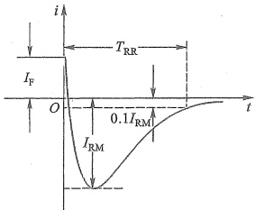

图3.3.3 二极管由正向导通到反向截止时电流的变化
 

<!-- page: 92 -->

示。其中  $ I_{F} $ 为正向电流， $ I_{RM} $ 为最大反向恢复电流， $ T_{RR} $ 为反向恢复时间。

存在反向恢复时间的主要原因是扩散电容  $ C_{D} $ 的影响。由于二极管加正向电压时，PN 结两侧堆积了剩余载流子，如图 3.2.6 中曲线  $ p_{N} $ 和  $ n_{p} $ 所描述的。由于剩余载流子的电极性与所在区域少子的带电极性相同，且数量较多，所以当二极管外加电压极性由正变负时，它们会像少子那样产生漂移运动，形成较大的反向电流。剩余载流子消散后，反向电流才减小到正常值。扩散电容越小，反向恢复时间越短，二极管的工作频率越高。二极管由反向截止到正向导通则不存在剩余载流子的消散过程，所以由反向到正向的转换时间较短。

二极管的参数是正确使用二极管的依据。应特别注意，使用时不要超过规定的最大整流电流、最高反向工作电压和最大耗散功率等极限指标，否则容易损坏二极管。数据手册中都会给出各管型的具体参数值。表3.3.1中列出了部分二极管参数。

表3.3.1 部分二极管参数
 

（1）检波、开关二极管
 

<table border=1 style='margin: auto; word-wrap: break-word;'><tr><td rowspan="2">型号</td><td colspan="8">参数</td></tr><tr><td style='text-align: center; word-wrap: break-word;'>最大整流电流/mA</td><td style='text-align: center; word-wrap: break-word;'>最高反向工作电压/V</td><td style='text-align: center; word-wrap: break-word;'>反向击穿电压/V</td><td style='text-align: center; word-wrap: break-word;'>正向电流/mA (正向电压为 1 V)</td><td style='text-align: center; word-wrap: break-word;'>反向电流/μA</td><td style='text-align: center; word-wrap: break-word;'>最高工作频率/MHz</td><td style='text-align: center; word-wrap: break-word;'>极间电容/pF</td><td style='text-align: center; word-wrap: break-word;'>反向恢复时间/ns</td></tr><tr><td style='text-align: center; word-wrap: break-word;'>2AP1</td><td style='text-align: center; word-wrap: break-word;'>16</td><td style='text-align: center; word-wrap: break-word;'>20</td><td style='text-align: center; word-wrap: break-word;'>≥40</td><td style='text-align: center; word-wrap: break-word;'>≥2.5</td><td style='text-align: center; word-wrap: break-word;'>≤250</td><td style='text-align: center; word-wrap: break-word;'>150</td><td style='text-align: center; word-wrap: break-word;'>≤1</td><td style='text-align: center; word-wrap: break-word;'>—</td></tr><tr><td style='text-align: center; word-wrap: break-word;'>2AP7</td><td style='text-align: center; word-wrap: break-word;'>12</td><td style='text-align: center; word-wrap: break-word;'>100</td><td style='text-align: center; word-wrap: break-word;'>≥150</td><td style='text-align: center; word-wrap: break-word;'>≥5.0</td><td style='text-align: center; word-wrap: break-word;'>≤250</td><td style='text-align: center; word-wrap: break-word;'>150</td><td style='text-align: center; word-wrap: break-word;'>≤1</td><td style='text-align: center; word-wrap: break-word;'>—</td></tr><tr><td style='text-align: center; word-wrap: break-word;'>1N60</td><td style='text-align: center; word-wrap: break-word;'>30</td><td style='text-align: center; word-wrap: break-word;'>40</td><td style='text-align: center; word-wrap: break-word;'>—</td><td style='text-align: center; word-wrap: break-word;'>—</td><td style='text-align: center; word-wrap: break-word;'>0.1</td><td style='text-align: center; word-wrap: break-word;'>—</td><td style='text-align: center; word-wrap: break-word;'>2</td><td style='text-align: center; word-wrap: break-word;'>1</td></tr><tr><td style='text-align: center; word-wrap: break-word;'>1N4148</td><td style='text-align: center; word-wrap: break-word;'>150</td><td style='text-align: center; word-wrap: break-word;'>75</td><td style='text-align: center; word-wrap: break-word;'>100</td><td style='text-align: center; word-wrap: break-word;'>—</td><td style='text-align: center; word-wrap: break-word;'>5</td><td style='text-align: center; word-wrap: break-word;'>—</td><td style='text-align: center; word-wrap: break-word;'>4</td><td style='text-align: center; word-wrap: break-word;'>4</td></tr></table>

（2）整流二极管参数
 

<table border=1 style='margin: auto; word-wrap: break-word;'><tr><td rowspan="2">型号</td><td rowspan="2">最大整流电流/A</td><td rowspan="2">最高反向工作电压（峰值）/V</td><td colspan="2">最高反向工作电压下的反向电流/μA</td><td rowspan="2">正向压降/V（平均值）（25 ℃）</td></tr><tr><td style='text-align: center; word-wrap: break-word;'>25 ℃</td><td style='text-align: center; word-wrap: break-word;'>125 ℃</td></tr><tr><td style='text-align: center; word-wrap: break-word;'>2CZ52A~X</td><td style='text-align: center; word-wrap: break-word;'>0.1</td><td rowspan="3">25,50,100,200,300,400,500,600,700,800,900,1000,1200,1400,1600,1800,2000,2200,2400,2600,2800,3000</td><td style='text-align: center; word-wrap: break-word;'>5</td><td style='text-align: center; word-wrap: break-word;'>100</td><td style='text-align: center; word-wrap: break-word;'>≤1</td></tr><tr><td style='text-align: center; word-wrap: break-word;'>2CZ54 A~X</td><td style='text-align: center; word-wrap: break-word;'>0.5</td><td style='text-align: center; word-wrap: break-word;'>10</td><td style='text-align: center; word-wrap: break-word;'>500</td><td style='text-align: center; word-wrap: break-word;'>≤1</td></tr><tr><td style='text-align: center; word-wrap: break-word;'>2CZ57 A~X</td><td style='text-align: center; word-wrap: break-word;'>5</td><td style='text-align: center; word-wrap: break-word;'>20</td><td style='text-align: center; word-wrap: break-word;'>1000</td><td style='text-align: center; word-wrap: break-word;'>≤0.8</td></tr><tr><td style='text-align: center; word-wrap: break-word;'>1N4001~1N4007</td><td style='text-align: center; word-wrap: break-word;'>1</td><td style='text-align: center; word-wrap: break-word;'>50,100,200,400,600,800,1000</td><td style='text-align: center; word-wrap: break-word;'>5</td><td style='text-align: center; word-wrap: break-word;'>50</td><td style='text-align: center; word-wrap: break-word;'>1</td></tr></table>

##### 复习思考题

3.3.1 为什么说在使用二极管时，应特别注意不要超过最大整流电流和最高反向工作电压？

3.3.2 如何用万用表的“Ω”挡来辨别一只二极管的阴、阳两极？（提示：模拟型万用表的黑表笔接表内直流电源的正端，而红表笔接负端，数字表则相反。）

3.3.3 比较硅、锗两种二极管的性能。在工程实践中，为什么硅二极管应用得较普遍？

<!-- page: 93 -->

3.3.4 在二极管电路中，其他条件不变，温度升高时，二极管的反向电流会有怎样的变化趋势？受温度影响更大的是硅二极管还是锗二极管？

3.3.5 二极管的极间电容主要影响它的什么工作特性？

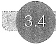

#### 二极管的基本电路及其分析方法

在电子技术中，利用二极管的单向导电性，可以构成许多二极管应用电路，如整流电路、限幅电路、开关电路等。由二极管的 I-V 特性可知，二极管是一种非线性器件，分析设计二极管电路时就会涉及非线性电路的分析，相对来说比较复杂。实际上经常采用图解法和简化模型法来分析设计二极管电路，从而避免复杂的非线性电路分析。

##### 3.4.1 简单二极管电路的图解分析方法

图解法无须理会线性与非线性问题，简单直观，但前提条件是已知二极管的 I-V 特性曲线。下面通过一个例子说明图解分析方法。

例 3.4.1 二极管电路如图 3.4.1a 所示，设二极管 I-V 特性曲线如图 3.4.1b 所示。已知电源  $ V_{DD} $ 和电阻  $ \bar{R} $，求二极管两端电压  $ v_D $ 和流过二极管的电流  $ i_D $。

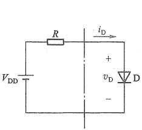

(a)
 

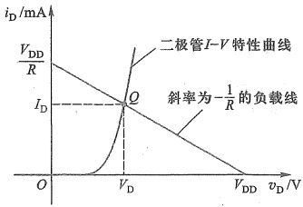

(b)
 

图 3.4.1 例 3.4.1 的二极管电路
 

(a) 电路图 (b) 图解分析
 

解：为便于作图，将图3.4.1a以虚线为界分为两部分，虚线的右侧仅有非线性器件二极管，虚线的左侧为线性电路。虚线右侧的端口电压和电流的关系满足二极管的特性曲线，而虚线左侧电路满足KVL方程

$$  v_{D}=V_{D D}-i_{D}R   \tag*{(3.4.1)}$$

可写成

$$  i_{\mathrm{D}}=-\frac{1}{R}v_{\mathrm{D}}+\frac{1}{R}V_{\mathrm{D D}}   \tag*{(3.4.2)}$$

式(3.4.2)在图3.4.1b的坐标系中是一条斜率为-1/R的直线，称为负载线（意指二极管所带负载形成的），画出这条直线。由于图3.4.1a中点画线分割出的端口电压 $ v_{D} $和电流 $ i_{D} $是两侧共用的，所以它们必定同时满足特性曲线关系和直线方程关系，意味着图3.4.1b中两线的交点Q即为所求，由Q点便可读出二极管的电压 $ V_{D} $和电流 $ I_{D} $。Q点也称为电路的工

<!-- page: 94 -->

作点。

图解法简单直观，但在实际应用中，往往不方便获得准确的二极管 I-V 曲线，而且当电路中有多个二极管时，图解法也会变得比较复杂。所以在工程上，图解法并不实用，但对理解电路的工作原理和工作点等相关概念却有很大帮助。

实际上，二极管的 I-V 特性有式(3.2.3)的关系，为方便阅读，将它重写如下（此处原式中的 n 取 1）

$$  i_{\mathrm{D}}=I_{\mathrm{S}}(\mathrm{e}^{v_{\mathrm{D}}/V_{T}}-1)   \tag*{(3.4.3)}$$

联立求解式(3.4.1)和式(3.4.3)，便可求出 $ v_{D} $和 $ i_{D} $。但其过程涉及指数方程的求解，往往要用复杂的迭代算法。特别是电路复杂后，迭代法将变得非常复杂。工程上更倾向于用简单的方法来有效地解决问题，显然，图解法和非线性电路分析法都不实用。

工程实际常用简化模型代替二极管非线性特性来分析二极管电路，这种方法简单、快速，而且实用。

##### 3.4.2 二极管电路的简化模型分析方法

简化模型法是将二极管的非线性关系近似为几段线性关系，也称分段线性化，从而获得二极管的简化模型，这样，就可以将二极管电路转化为线性电路来分析了。这里首先介绍二极管的几个常用简化模型，然后举例说明简化模型分析法的具体应用。

### 1. 二极管 I-V 特性的建模

##### （1）理想模型

图 3.4.2 为二极管的理想模型。其中图 a 是理想的 I-V 特性，二极管正向偏置时，是一条与纵轴正半轴重合的垂线，表明管压降为 0 V；而当二极管处于反向偏置时，是一条与横轴负半轴重合的水平线，认为此时的电阻为无穷大，电流为零。图中的虚线表示二极管的实际 I-V 特性。图 3.4.2b 为理想二极管的代表符号。图 3.4.2c 和 d 分别为二极管正向偏置和反向偏置时的电路模型。在实际电路中，当工作电压远超二极管的正向压降时，用此模型所带来的误差通常是可以忽略的。

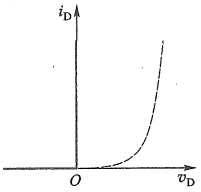

(a)
 

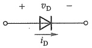

(b)
 

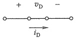

(c)
 

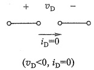

(d)
 

图 3.4.2 二极管理型模型
 

（a）I-V 特性 （b）代表符号 （c）正向偏置时的电路模型 （d）反向偏置时的电路模型
 

##### （2）恒压降模型

这个模型如图3.4.3所示，认为二极管导通后管压降是恒定的，即不随电流变化，在图3.4.3a中以垂线表示，其横轴对应的电压典型值为0.7 V（硅管）或0.2 V（锗管）。通常只有

<!-- page: 95 -->

在电流  $ i_{D} $ 大于等于 1 mA 时二极管才可工作在垂线上。图 3.4.3b 是二极管恒压降电路模型。该模型提供了合理的近似，精度高于理想模型，因此应用也较广。

##### （3）折线模型

为 J 史惟朔地描述—攸官的 I-V 特征，将恒压降模型的垂线改为倾斜的，以便尽可能与指数曲线重合，即认为二极管的正向管压降不是恒定的，而是随着流过二极管电流的增加而增加的，所以在模型中用一个电压源  $ V_{th} $ 和一个电阻  $ r_{D} $ 的串联来等效（参见图 3.4.4）。 $ V_{th} $ 选定为二极管的门坎电压，硅管约为 0.5 V，锗管约为 0.1 V。以硅管为例， $ r_{D} $ 的值可以这样确定：当二极管的导通电流为 1 mA 时，管压降为 0.7 V，于是  $ r_{D} $ 的值可计算如下：

 $$ r_{D}=\frac{0.7\ V-0.5\ V}{1\ mA}=200\ \Omega $$ 

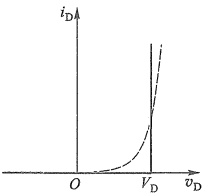

(a)
 

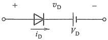

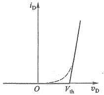

(b)
 

图 3.4.3 恒压降模型
 

(a)
 

(a) I-V 特性 (b) 电路模型
 

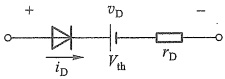

(b)
 

图 3.4.4 折线模型
 

(a) I-V 特性 (b) 电路模型
 

由于二极管特性的分散性， $ V_{th} $ 和  $ r_{D} $ 的值不是固定不变的。

以上3种模型都是将二极管I-V特性原本的指数关系近似为两段直线关系，这样，只要能够区分当前二极管工作于哪一段直线上，就可以将二极管电路转化成线性电路了。注意，上述3种模型均未描述反向击穿特性。

##### （4）小信号模型

以上 3 个模型反映了二极管正偏和反偏时的全部特性，可用来分析工作电压在较大范围变化时的情况，所以也称为大信号模型。然而，当工作电压在某一确定值附近波动时（如电路在一定的直流激励源作用下再叠加一个小的交流信号），当仅考虑电压（或电流）小幅波动时所建立的模型称为小信号模型。例如，在图 3.4.1a 中串联一个交流小信号源  $ v_a $，得到图 3.4.5a 的电路。当  $ v_a = 0 $ 时，电路中只有直流量，二极管两端电压和流过二极管的电流就是图 3.4.1b 中 Q 点的值。为便于分析，将图 3.4.1b 重画于图 3.4.5b 中。电路的直流工作状态也称静态，Q 点也称为静态工作点。当  $ v_a = V_m \sin \omega t $ 时  $ (V_m \leq V_{DD}) $，电路的负载线为

<!-- page: 96 -->

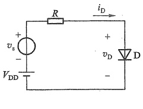

(a)
 

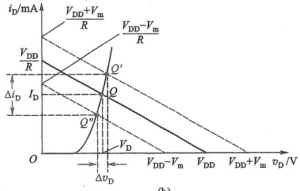

(b)
 

图3.4.5 直、交流电压源同时作用时的二极管电路   (a) 电路图 (b) 图解分析
 

 $$ i_{\mathrm{D}}=-\frac{1}{R}v_{\mathrm{D}}+\frac{1}{R}\left(V_{\mathrm{D D}}+v_{\mathrm{s}}\right) $$ 

根据  $ v_{s} $ 的正负峰值  $ +V_{m} $ 和  $ -V_{m} $ 图解可知，工作点将在  $ Q^{\prime} $ 和  $ Q^{\prime\prime} $ 之间移动，则二极管电压和电流变化量为  $ \Delta v_{D} $ 和  $ \Delta i_{D} $。

由此看出，在交流小信号  $ v_{s} $ 的作用下，工作点在 Q 点附近沿 I-V 特性曲线小范围变化，这时可把特性曲线近似为以 Q 点为切点的一条直线，其斜率的倒数就是小信号模型的微变电阻  $ r_{d} $，由此得到小信号模型如图 3.4.6 所示。

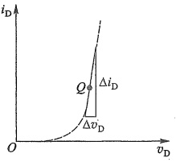

(a)
 

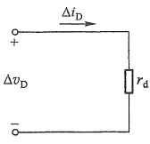

(b)
 

图 3.4.6 小信号模型
 

(a) I-V 特性 (b) 电路模型
 

微变电阻  $ r_{d} $ 可由式  $ r_{d}=\Delta v_{D}/\Delta i_{D} $ 求得，也可以从二极管 I-V 特性的指数模型式(3.4.3)导出，即取  $ i_{D} $ 对  $ v_{D} $ 的微分，可得微变电导

 $$ g_{\mathrm{d}}{=}\frac{\mathrm{d}i_{\mathrm{D}}}{\mathrm{d}v_{\mathrm{D}}}{=}\frac{\mathrm{d}}{\mathrm{d}v_{\mathrm{D}}}\left[\mathrm{\boldmath~I}_{\mathrm{S}}(\mathrm{~e}^{v_{\mathrm{D}}/V_{T}}-1)\right]{=}\frac{I_{\mathrm{S}}}{V_{T}}\mathrm{e}^{v_{\mathrm{D}}/V_{T}} $$ 

在 Q 点处  $ v_D \gg V_T = 26 \, \text{mV} $ 所以  $ i_D \approx I_S e^{v_D / V_T} $，则

 $$ g_{\mathrm{d}}=\frac{I_{\mathrm{S}}}{V_{T}}\mathrm{e}^{v_{\mathrm{D}}/V_{T}}\left|_{Q}\right|\approx\frac{i_{\mathrm{D}}}{V_{T}}\left|_{Q}\right|=\frac{I_{\mathrm{D}}}{V_{T}} $$ 

式中  $ I_{D} $ 是 Q 点处的电流。由此可得

<!-- page: 97 -->

$$  r_{d}=\frac{1}{g_{d}}=\frac{V_{T}}{I_{D}}=\frac{26\ mV}{I_{D}},\quad\left( 常温下 ,T=300\ K\right)   \tag*{(3.4.4)}$$

例如，当 Q 点上的  $ I_{D}=2\ mA $ 时， $ r_{d}=26\ mV/2\ mA=13\ \Omega $

要特别注意，小信号模型中的微变电阻  $ r_{d} $ 与静态工作点 Q 有关，Q 点位置不同， $ r_{d} $ 的值也不同。该模型主要用于二极管处于正向偏置，且  $ v_{D} \gg V_{T} $ 条件下。

另外，在高频或开关状态运用时，考虑到 PN 结电容的影响，可以用图 3.4.7a 所示的高频电路模型来等效二极管，其中  $ r_s $ 表示半导体电阻， $ r_d $ 表示结电阻， $ C_D $ 和  $ C_B $ 分别表示扩散电容和势垒电容。相比之下， $ r_s $ 通常很小，一般忽略不计，所以图 3.4.7b 所示电路模型更为常用。结电容  $ C_d $ 包括  $ C_D $ 和  $ C_B $ 的总效果。当二极管处于正向偏置时， $ r_d $ 为正向电阻，其值较小， $ C_d $ 主要取决于扩散电容  $ C_D $；二极管反向偏置时， $ r_d $ 为反向电阻，其值很大 [注意，这时  $ r_d $ 不能用式 (3.4.4) 计算]， $ C_d $ 主要取决于势垒电容  $ C_B $。

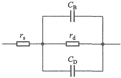

(a)
 

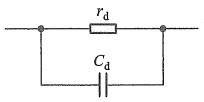

(b)
 

图 3.4.7 二极管的高频电路模型   (a) 完整模型 (b) 常用模型
 

### 2. 模型分析法应用举例

##### 1）整流电路

所谓整流通常是指将双极性电压（或电流）变为单极性电压（或电流）的处理过程。

例 3.4.2 二极管基本电路如图 3.4.8a 所示，已知  $ v_{s} $ 为正弦波，如图 3.4.8b 所示。试利用二极管理想模型，定性地绘出  $ v_{0} $ 的波形。

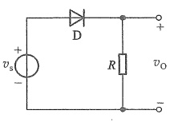

(a)
 

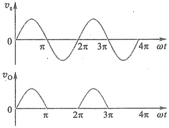

(b)
 

图 3.4.8 例 3.4.2 的电路
 

(a) 电路图 (b)  $ v_{s} $ 和  $ v_{0} $ 的波形
 

解:由于  $ v_{s} $ 的值有正有负, 当  $ v_{s} $ 为正半周时, 二极管正向偏置, 根据理想模型, 此时二极管导通, 且导通压降为 0 V, 所以  $ v_{0}=v_{s} $ 。

<!-- page: 98 -->

当  $ v_{s} $ 为负半周时，二极管因反向偏置而截止，电阻 R 中无电流流过， $ v_{0}=0 $。所以波形如图 3.4.8b 中的  $ v_{0} $ 所示。

该电路称为半波整流电路。

##### 2）静态工作情况分析

例 3.4.3 设硅二极管电路如图 3.4.9a 所示，已知  $ R = 10\ k\Omega $。对于下列两种情况，求电路的  $ I_D $ 和  $ V_D $: (1)  $ V_{DD} = 10\ V $; (2)  $ V_{DD} = 1\ V $。在每种情况下，应用理想模型、恒压降模型和折线模型求解。设折线模型中  $ r_D = 0.2\ k\Omega $。

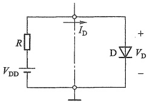

(a)
 

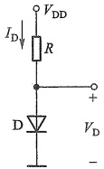

(b)
 

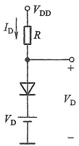

(c)
 

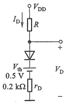

(d)
 

图 3.4.9 例 3.4.3 的电路
 

（a）简单二极管电路 （b）理想模型电路 （c）恒压降模型电路 （d）折线模型电路
 

解：图3.4.9a的电路中，点画线左边为线性部分，右边为非线性部分。符号“⊥”为参考电位点。现按题意，分别求解如下。

(1)  $ V_{DD}=10~V $

① 使用理想模型，等效电路如图 3.4.9b 所示，得

 $$ V_{\mathrm{D}}=0\mathrm{V},\quad I_{\mathrm{D}}=V_{\mathrm{DD}}/R=10\mathrm{V}/10\mathrm{k}\Omega=1\mathrm{mA} $$ 

② 使用恒压降模型，等效电路如图 3.4.9c 所示。

由于是硅管，所以  $ V_{D}=0.7\ V $，则

 $$ I_{D}=\frac{V_{DD}-V_{D}}{R}=\frac{(10-0.7)V}{10k\Omega}=0.93mA $$ 

③ 使用折线模型，等效电路如图 3.4.9d 所示，得

 $$ I_{D}=\frac{V_{DD}-V_{th}}{R+r_{D}}=\frac{(10-0.5)V}{(10+0.2)k\Omega}\approx0.931mA $$

<!-- page: 99 -->

$$ V_{\mathrm{D}}=0.5\mathrm{V}+I_{\mathrm{D}}r_{\mathrm{D}}=0.5\mathrm{V}+0.931\mathrm{mA}\times0.2\mathrm{k}\Omega\approx0.69\mathrm{V} $$ 

(2)  $ V_{DD}=1\ V $

① 使用理想模型得

 $$ V_{\mathrm{D}}=0\mathrm{~V},\quad I_{\mathrm{D}}=\frac{V_{\mathrm{DD}}}{R}=\frac{1\mathrm{~V}}{10\mathrm{~k}\Omega}=0.1\mathrm{~mA} $$ 

② 使用恒压降模型得

 $$ V_{D}=0.7\mathrm{~V},\quad I_{D}=\frac{V_{DD}-0.7\mathrm{~V}}{R}=\frac{(1-0.7)\mathrm{~V}}{10\mathrm{~k}\Omega}=0.03\mathrm{~mA} $$ 

③ 使用折线模型得

 $$ I_{\mathrm{d}}=0.049\mathrm{~m A},\quad V_{\mathrm{d}}=0.51\mathrm{~V} $$ 

以上说明，在电源电压远大于二极管管压降情况下，恒压降模型和折线模型结果非常接近，但恒压降模型更简单。当电源电压较低时，3个模型的结果相差较大，此时折线模型能提供更高的精度，但是它的复杂程度最高。尽管理想模型误差最大，但是在精度要求不高的场合，特别是更关注二极管的工作状态（导通或截止）时，理想模型是不错的选择。在满足精度要求的前提下，尽可能选择简单的模型，是一般原则。

##### 3）限幅与钳位电路

在电子电路中，常用限幅电路对各种信号的幅值进行限制。使信号在预置的电平范围内传输。限幅电路有时也称为削波电路。

例 3.4.4 一限幅电路如图 3.4.10a 所示，设  $ R = 1\ k\Omega $， $ V_{REF} = 3\ V $，二极管为硅二极管。分别用理想模型和恒压降模型求解：（1） $ v_1 $ 分别为 0 V、4 V、6 V 时，求相应的输出电压  $ v_0 $。（2）当  $ v_i = 6\sin\omega t $ V 时，绘出相应的  $ v_0 $ 波形。（3）二极管用  $ 1N4148 $， $ v_i = 6\sin(2\pi \times 1\ 000t) $ V，试用 SPICE 绘出  $ v_0 $ 的波形以及电压传输特性  $ v_0 = f(v_i) $。

解：（1）理想模型电路如图3.4.10b所示。

当  $ v_{1}=0 $ V 时，二极管截止，R 中无电流，所以  $ v_{0}=v_{1}=0 $

当  $ v_{1}=4\ V $ 时，大于  $ V_{REF} $，二极管导通，管压降为  $ 0\ V $， $ v_{0}=V_{REF}=3\ V $

当  $ v_{1}=6\ V $ 时，同理， $ v_{0}=V_{REF}=3\ V $

恒压降模型电路如图 3.4.10c 所示。硅二极管  $ V_{D}=0.7~V $ 。

当  $ v_{1}=0 $ V 时，二极管截止，所以  $ v_{0}=v_{1}=0 $

当  $ v_{1}=4\ V $ 时，大于  $ V_{REF}+V_{D} $，二极管导通， $ v_{0}=V_{REF}+V_{D}=(3+0.7)\ V=3.7\ V $

当  $ v_{I}=6\ V $ 时，同理， $ v_{0}=V_{REF}+V_{D}=3.7\ V $

（2）由于所加输入电压为振幅等于6 V的正弦电压，正半周有一段幅值大于 $ V_{REF} $

对于理想模型，当  $ v_I \leq V_{REF} $ 时，二极管截止， $ v_0 = v_I $；当  $ v_I > V_{REF} $ 时，二极管导通， $ v_0 = V_{REF} = 3\ V $， $ v_0 $ 波形如图 3.4.10d 实线所示， $ v_0 $ 被限制在 3 V 以内。

对于恒压降模型，当  $ v_I \leq (V_{REF} + V_D) $ 时，二极管截止， $ v_0 = v_I $；当  $ v_I > V_{REF} + V_D $ 时，二极管导通， $ v_0 = V_{REF} + V_D = 3.7\ V $， $ v_0 $ 波形如图 3.4.10e 实线所示， $ v_0 $ 被限制在 3.7 V 以内。

（3）分别设置瞬态分析和直流扫描分析，得到如图3.4.10f和g所示的结果。

图 f 输出波形的限幅值为 3.6458 V，与恒压降模型的分析结果 3.7 V 很接近。

由此看出，无论是采用理想模型还是恒压降模型，关键是先确定限幅电压，然后根据二极

<!-- page: 100 -->

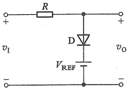

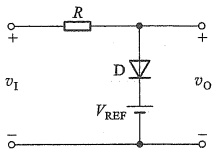

(a)
 

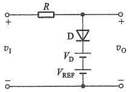

(b)
 

(c)
 

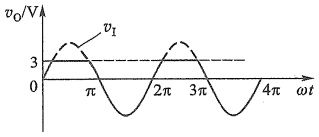

(d)
 

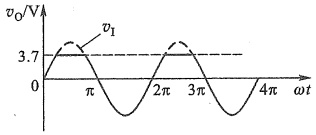

(e)
 

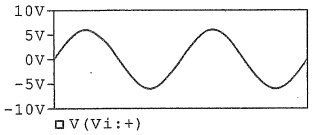

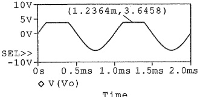

(f)
 

(g)
 

图 3.4.10 例 3.4.4 的电路
 

（a）限幅电路 （b）理想模型电路 （c）恒压降模型电路 （d）理想模型时的  $ v_{1} $ 和
 

和  $ v_{0} $ 波形 (f)  $ v_{1} $ 和  $ v_{0} $ 的 SPICE 仿真波形 (g) SPICE 仿真的电压传输特性
 

管的导通方向确定是高于限幅电压的波形被削掉，还是低于限幅电压的波形被削掉。本例中采用理想模型时的限幅电压为3 V，采用恒压降模型时的限幅电压为3.7 V，而且是高于限幅电压的部分被削掉。若对调图3.4.10a中二极管的两极（此时恒压降模型中的限幅电压为2.3 V），则 $ v_{0} $小于限幅电压时，二极管导通，输出波形中低于限幅电压的部分被削掉。以此类推，图3.4.10a中若再并联一条二极管和 $ V_{REF} $方向均相反的支路，可实现波形的双向限幅。

钳位电路可以在完整的信号波形中叠加一个直流电平，通常需要与电容器配合使用。

例 3.4.5 二极管钳位电路如图 3.4.11a 所示，设二极管导通压降  $ V_{D}=0.7\ V, v_{s}=V_{m}\sin\omega t\ V $，且  $ V_{m} \gg V_{D} $，试绘出稳态时  $ v_{0} $ 的波形。

解：根据电路中二极管的方向可知，只有在 $ v_{s} $ 的负半周，D才有可能导通，此时电容器充电，充电的最高电压为 $ V_{C}=V_{m}-V_{D}=V_{m}-0.7 $。

由于 D 导通时，整个回路的电阻非常小，所以电容器 C 上的电压可以快速充至最大值。

<!-- page: 101 -->

但是 C 并无放电回路，所以充电完毕后，C 上的电压  $ V_{c} $ 始终保持不变，此后电路进入稳态。这时输出电压为

$$  v_{0}=v_{\mathrm{s}}+V_{c}=v_{\mathrm{s}}+V_{\mathrm{m}}-0.7   \tag*{(3.4.5)}$$

 $ v_{s} $ 和  $ v_{0} $ 的波形如图 3.4.11b 所示。 $ v_{0} $ 相当于  $ v_{s} $ 在垂直方向平移了一个  $ V_{c} $。

(a)
 

(b)
 

图 3.4.11 例 3.4.5 的电路及波形
 

（a）二极管钳位电路 （b） $ v_{s} $ 和  $ v_{0} $ 波形
 

以上电路的作用可以看作是将输入波形的底部钳位在了-0.7 V的直流电平上。同理，若颠倒二极管的方向，输出波形相当于输入波形的顶部钳位在了+0.7 V的直流电平上。

需要指出的是，当图3.4.11a所示电路的输出端口接一负载电阻 $ R_{L} $时，电容器将有放电回路，但是只要放电回路的时间常数 $ R_{L}C $远大于 $ v_{s} $的周期，C的放电速度将远小于充电速度， $ V_{C} $电压就不会有明显的变化，钳位电路仍能正常工作。另外，如果在二极管支路串联一个直流电压源 $ V_{REF} $，还可以改变钳位的直流电平。相关的内容参见习题3.4.10和习题3.4.11。

这种二极管与电容联合应用的例子还出现在倍压整流电路（见11.1.3节）和电荷泵电路（一种升压电路）中。

##### 4）开关电路

利用二极管的单向导电性可以接通或断开电路。二极管的这种工作方式在开关电路中得到广泛应用。

例 3.4.6 二极管开关电路如图 3.4.12 所示。输入电压  $ v_{II} $ 和  $ v_{I2} $ 只有两种取值：0 V 和 5 V。利用二极管理型模型，求两输入电压取值的所有组合情况下，对应的  $ v_{0} $ 电压值。

(a)
 

(b)
 

图 3.4.12 开关电路
 

（a）习惯画法 （b）理想模型时开关电路
 

<!-- page: 102 -->

解：二极管为理想模型时的电路如图 3.4.12b 所示。先假设两二极管均截止（断开），4.7 kΩ 电阻中无电流流过，两二极管阳极电位为 5 V。当  $ v_{I1}=0\ V $、 $ v_{I2}=5\ V $ 时，得  $ v_{D1}=5\ V>0 $， $ v_{D2}=0 $，表明  $ D_{1} $ 的假设错误，实际上应为正向偏置，所以  $ D_{1} $ 导通； $ D_{2} $ 的偏置电压为 0 V，假设成立，即  $ D_{2} $ 截止。 $ D_{1} $ 导通时， $ v_{0}=0\ V $，此时  $ D_{2} $ 的阴极电位为 5 V，阳极为 0 V，仍为截止状态。

以此类推，将 $ v_{11} $和 $ v_{12} $的其余三种组合及 $ v_{0} $的输出电压列于表3.4.1中。

表3.4.1 例3.4.6 分析结果
 

<table border=1 style='margin: auto; word-wrap: break-word;'><tr><td rowspan="2">$ v_{11}/V $</td><td rowspan="2">$ v_{12}/V $</td><td colspan="2">二极管工作状态</td><td rowspan="2">$ v_0/V $</td></tr><tr><td style='text-align: center; word-wrap: break-word;'>$ D_1 $</td><td style='text-align: center; word-wrap: break-word;'>$ D_2 $</td></tr><tr><td style='text-align: center; word-wrap: break-word;'>0</td><td style='text-align: center; word-wrap: break-word;'>0</td><td style='text-align: center; word-wrap: break-word;'>导通</td><td style='text-align: center; word-wrap: break-word;'>导通</td><td style='text-align: center; word-wrap: break-word;'>0</td></tr><tr><td style='text-align: center; word-wrap: break-word;'>0</td><td style='text-align: center; word-wrap: break-word;'>5</td><td style='text-align: center; word-wrap: break-word;'>导通</td><td style='text-align: center; word-wrap: break-word;'>截止</td><td style='text-align: center; word-wrap: break-word;'>0</td></tr><tr><td style='text-align: center; word-wrap: break-word;'>5</td><td style='text-align: center; word-wrap: break-word;'>0</td><td style='text-align: center; word-wrap: break-word;'>截止</td><td style='text-align: center; word-wrap: break-word;'>导通</td><td style='text-align: center; word-wrap: break-word;'>0</td></tr><tr><td style='text-align: center; word-wrap: break-word;'>5</td><td style='text-align: center; word-wrap: break-word;'>5</td><td style='text-align: center; word-wrap: break-word;'>截止</td><td style='text-align: center; word-wrap: break-word;'>截止</td><td style='text-align: center; word-wrap: break-word;'>5</td></tr></table>

由表看出，在输入电压 $ v_{11} $和 $ v_{12} $中，只要有一个为0V，则输出为0V；只有当两个输入电压均为5V时，输出才为5V，这种关系在数字电路中称为与逻辑。

在分析开关电路时，通常假定二极管电压  $ v_{D} $ 的参考方向为二极管正偏时的方向；二极管电流  $ i_{D} $ 的参考方向是它正向导通时的电流方向。分析步骤是：（1）假设二极管处于截止状态（理想模型  $ v_{D}<0 $；恒压降模型  $ v_{D}<V_{D} $，均有  $ i_{D}=0 $），相当于开路；（2）求出  $ v_{D} $ 的值；（3）若  $ v_{D} \leq 0 $，则说明假设成立，二极管实际处于截止状态，所得结果即为所求，若  $ v_{D}>0 $，则表明假设错误，二极管实际处于导通状态，再根据导通状态重新求解电路。

也可以假设二极管导通 $ (i_{D}>0 $，理想模型 $ v_{D}=0 $；恒压降模型 $ v_{D}=V_{D} $，然后求出 $ i_{D} $的值，若 $ i_{D}>0 $，则说明假设成立，结果即为所求；否则表明假设错误，二极管实际处于截止状态，再根据截止状态重新求解电路。

##### 5）小信号工作情况分析

由于微变电阻  $ r_{d} $ 与静态工作点 Q 有关，所以在用小信号模型分析二极管电路时，需要先求电路的 Q 点，然后根据 Q 点算出微变电阻  $ r_{d} $，由此得到小信号模型的交流等效电路，再求出小信号作用下电路的交流响应，最后与静态值叠加，得到电路的总响应。

例 3.4.7 在图 3.4.13a 所示的二极管电路中，设  $ V_{DD}=5~V, R=5~k\Omega $，恒压降模型的  $ V_{D}=0.7~V $，信号源  $ v_{s}=0.1\sin\omega t~V $。（1）求输出电压  $ v_{0} $ 的交流量和总量；（2）绘出  $ v_{0} $ 的波形。

解：（1）先将  $ v_{s} $ 置零，只考虑  $ V_{DD} $ 的作用，等效电路如图 3.4.13b 所示。电路中只有直流分量，所以它也称为直流通路。由图可知，二极管是导通的，所以电路的静态工作点为

 $$ V_{_{D}}=0.7V $$ 

 $$ I_{\mathrm{D}}=\left(V_{\mathrm{DD}}-V_{\mathrm{D}}\right)/R=\left(5-0.7\right)\mathrm{~V/5~k\Omega}=0.86\mathrm{~mA} $$ 

输出电压的直流分量为

 $$ V_{o}=I_{D}R=0.86\ mA\times5\ k\Omega=4.3\ V\quad\left( 或 \ V_{o}=V_{DD}-V_{D}=\left(5-0.7\right)V=4.3\ V\right) $$ 

根据式(3.4.4)求得此时的微变电阻

<!-- page: 103 -->

$$ r_{d}=\frac{V_{r}}{I_{d}}=\frac{26\ mV}{0.86\ mA}\approx30\ \Omega=0.03\ k\Omega $$ 

接下来考虑在  $ v_{s} $ 作用下的情况。将  $ V_{DD} $ 置零，二极管用小信号模型  $ r_{d} $ 替代，就得到了图 3.4.13c 所示的小信号交流等效电路，也称为交流通路，电路中只有交流成分。注意，图 b 和图 c 两个等效电路中二极管的模型不同。

(a)
 

(b)
 

(c)
 

(d)
 

图 3.4.13 例 3.4.7 的电路
 

（a）原理电路 （b）恒压降模型的直流通路（静态）（c）小信号模型的交流通路（动态）（d） $ v_{0} $ 的波形

通过图3.4.13c的交流通路，求得输出电压的交流分量为

 $$ v_{_{0}}{=}\frac{R}{R+r_{_{d}}}\cdot v_{_{s}}{=}\frac{5\mathrm{~k}\Omega}{5\mathrm{~k}\Omega+0.03\mathrm{~k}\Omega}{\times}0.1\mathrm{s i n}\mathrm{~\omega}t\mathrm{~\nabla~}\approx0.099\mathrm{~4s i n}\mathrm{~\omega}t\mathrm{~\nabla~}\mathrm{V} $$ 

所以输出电压的总量为

 $$ v_{0}=V_{0}+v_{o}=\left(4.3+0.0994\sin\omega t\right)V $$ 

（2）根据上述结果，绘出输出电压  $ v_{0} $ 的波形如图 3.4.13d 所示，输出的交流量叠加在直流量上。

本例中提到的直流通路和交流通路的概念，以及将问题分解为静态和动态两种情况求解的方法非常重要，在放大电路的分析中会频繁用到，应引起足够重视。

##### 6）低电压稳压电路

电子电路中经常需要非常稳定的电压，在电源波动或负载变化时，电压值都能基本维持恒定，稳压电路就是提供这种电压的电路。利用二极管的正向导通特性，可以获得稳定性较好的低电压。二极管小信号模型可以用来分析这种电路的稳压特性。

例 3.4.8 设低电压稳压电路如图 3.4.14a 所示。已知  $ V_1 = 10\ V $,  $ R = 1\ k\Omega $,  $ D_1 $、 $ D_2 $ 为硅二极管，正向导通压降约为  $ 0.7\ V $,  $ R_L = 1\ k\Omega $。试分析：(1) 当电网电压波动使  $ V_1 $ 波动  $ \pm 1\ V $ ( $ \Delta V_1 = 2\ V $) 时，求负载开路情况下输出电压  $ V_0 $ 的波动范围；(2) 求负载电阻  $ R_L $ 接入时引起的输出

<!-- page: 104 -->

(a)
 

(b)
 

(c)
 

图 3.4.14 低电压稳压电路
 

（a）电路图 （b） $ V_{1} $产生波动后的电路 （c）接负载后的等效电路
 

电压变化量。

解：（1）分析  $ V_{1} $ 波动对电路产生的影响，要先求二极管小信号模型的微变电阻  $ r_{d} $ 。由于  $ V_{1}=10\ V $ ，所以两只二极管处于导通状态， $ V_{0}=2\times0.7\ V=1.4\ V $ 。此时流过二极管的静态电流为

 $$ I_{\mathrm{D}}=\left(V_{\mathrm{I}}-2\times0.7\mathrm{~V}\right)/R=\left(10-1.4\right)\mathrm{V}/1\mathrm{~k}\Omega=8.6\mathrm{~mA} $$ 

得微变电阻

 $$ r_{1}=r_{2}=r_{\mathrm{d}}=V_{T}/I_{\mathrm{D}}=26\mathrm{~m V}/8.6\mathrm{~m A}\approx3\Omega $$ 

由此可得图3.4.14b所示的小信号等效电路。据此可得输出电压变化

 $$ \Delta V_{\mathrm{o}}=\Delta V_{\mathrm{i}}\left[2r_{\mathrm{d}}/\left(2r_{\mathrm{d}}+R\right)\right]=2\mathrm{~V}\times\left[6\Omega/\left(6\Omega+1\mathrm{~k}\Omega\right)\right]\approx11.9\mathrm{~m V} $$ 

可以看出，输入变化±1 V时，相对变化量为±1 V/10 V=±10%；而输出仅变化±5.95 mV，相对变化量为±5.95 mV/1.4 V≈±0.43%，可见稳压效果非常明显。

（2）先求图3.4.14a从输出端口 $ V_{0} $向左侧看进去的戴维南等效电路。即端口开路电压为

 $$ V_{op}=2\times0.7\ V=1.4\ V $$ 

端口等效电阻为两二极管微变电阻串联后再与电阻 R 并联，即

 $$ R_{0}=\left(2r_{d}\right)\big/\left/R\right.{\approx}5.96~\Omega $$ 

接负载后的等效电路如图3.4.14c所示。此时

 $$ V_{0}=V_{0\mathrm{P}}\left[R_{\mathrm{L}}/\left(R_{0}+R_{\mathrm{L}}\right)\right]=1.4\mathrm{~V}\times\left[1\mathrm{~k}\Omega/\left(5.96\Omega+1\mathrm{~k}\Omega\right)\right]\approx1.392\mathrm{~V} $$ 

输出电压变化量  $ \Delta V_{0} = V_{OP} - V_{0} = 8\ mV $，相对变化量为  $ 8\ mV/1.4\ V \approx 0.57\% $，表明输出电压稳定性很高。

上述分析看出，当前电路中二极管的小信号等效电阻非常小（仅为  $ 3\ \Omega $），所以流过它的电流发生变化时，其电压变化很小。也就是说，I-V 特性曲线越陡，微变电阻  $ r_{d} $ 越小，稳压特性也越好。实际上，在精度要求不高的场合，也可以用二极管的恒压降模型来理解正向稳压特性。

要特别注意，二极管小信号模型仅用于分析电路的变化状态，不能用来分析电路的静态（直流）。

可以串联多个二极管获得更高的稳压值。如，当4个硅二极管串联时，可以获得约

<!-- page: 105 -->

2.8 V的稳定电压。但是随着串联二极管数量的增多，其等效电阻也变大，稳压性能会降低，所以这种电路更适合于低电压的稳压。在第9章将会看到这种电路的应用。

##### 复习思考题

3.4.1 在图3.4.1所示电路中，若将电阻R增大一倍，负载线将如何变化？若电阻R不变，将 $ V_{DD} $减小一半，负载线将如何变化？若将 $ V_{DD} $的正负极性颠倒，负载线又将如何变化？

3.4.2 为什么要建立二极管的简化模型？在二极管电路分析中，如何选用合适的模型？

3.4.3 静态工作点和工作点有何区别？

3.4.4 根据例3.4.7的分析结果,如何理解“二极管可以通交流”的现象? 如果翻转 $ V_{DD} $的极性,还有交流信号输出吗? 为什么?

#### 特殊二极管

除前面所讨论的普通二极管外，还有若干种特殊二极管，如齐纳二极管、变容二极管、肖特基二极管、光电器件（包括光电二极管、发光二极管、激光二极管和太阳能电池）等。

##### 3.5.1 齐纳二极管

由例3.4.8可知，利用二极管的正向导通特性可以构成低电压稳压电路。虽然可以通过串联多个二极管来提高电路的稳压值，但会降低稳压性能。实际上还有一种专门用于稳压的二极管——齐纳二极管，用一个齐纳二极管便可实现较高电压的稳压。

齐纳二极管又称稳压二极管，简称稳压管，是一种用特殊工艺制造的面结型硅半导体二极管，其代表符号如图3.5.1a所示。这种二极管的杂质浓度比较高，空间电荷区内的电荷密度也大，因而该区域很窄，容易形成强电场。当反向电压加到某一定值时，会产生反向击穿，特性如图3.5.1b所示。图中的 $ V_z $表示反向击穿电压，即稳压管的稳定电压，它是在特定的测试电流 $ I_{2T} $下得到的电压值。稳压管的稳压作用表现为电流在较大范围变化（ $ \Delta I_z $）时，电压变化（ $ \Delta V_z $）却很小。曲线越陡，动态电阻 $ r_z = \Delta V_z / \Delta I_z $越小，稳压性能越好。 $ -V_{20} $是过Q点（测试工作点）的切线与横轴的交点，切线的斜率为 $ 1/r_z $。 $ I_{2(\min)} $和 $ I_{2(\max)} $为稳压管工作在正常稳压状态的最小和最大工作电流。反向电流绝对值小于 $ I_{2(\min)} $时，稳压管进入反向特性的转弯段，稳压特性消失；反向电流绝对值大于 $ I_{2(\max)} $时，稳压管可能被烧毁。根据稳压管的反向击穿特性，得到如图3.5.1c所示的等效模型。由于稳压管正常工作时，都处于反向击穿状态，所以图3.5.1c中稳压管的电压、电流参考方向与普通二极管标法不同，反向击穿电压标注为正电压，反向电流也标注为正电流。由图3.5.1c有

$$  V_{z}=V_{z0}+r_{z}I_{z}   \tag*{(3.5.1)}$$

一般稳压值  $ V_{z} $ 较大时，可以忽略  $ r_{z} $ 的影响，即  $ r_{z}=0, V_{z} $ 为恒定值。

由于温度会影响半导体的导电性能，所以也将影响  $ V_{z} $ 的值。影响程度由温度系数衡量，一般不超过每度（℃） $ \pm10\times10^{-4} $ 的相对变化量。表3.5.1列出了几种典型稳压管的主要参数。

<!-- page: 106 -->

图 3.5.1 稳压管的代表符号与 I-V 特性
 

（a）代表符号 （b）I-V 特性 （c）反向击穿时的模型
 

表3.5.1 几种典型稳压管的主要参数
 

<table border=1 style='margin: auto; word-wrap: break-word;'><tr><td style='text-align: center; word-wrap: break-word;'>型号</td><td style='text-align: center; word-wrap: break-word;'>稳定电压 $ V_{{z}}/V $</td><td style='text-align: center; word-wrap: break-word;'>稳定电流 $ I_{{z}}/mA $</td><td style='text-align: center; word-wrap: break-word;'>最大稳定电流 $ I_{{2M}}/mA $</td><td style='text-align: center; word-wrap: break-word;'>耗散功率 $ P_{{M}}/W $</td><td style='text-align: center; word-wrap: break-word;'>动态电阻 $ r_{{Z}}/\Omega $</td><td style='text-align: center; word-wrap: break-word;'>温度系数 $ C_{{TV}}/(\%/\degree C) $</td></tr><tr><td style='text-align: center; word-wrap: break-word;'>2CW52</td><td style='text-align: center; word-wrap: break-word;'>3.2~4.5</td><td style='text-align: center; word-wrap: break-word;'>10</td><td style='text-align: center; word-wrap: break-word;'>55</td><td style='text-align: center; word-wrap: break-word;'>0.25</td><td style='text-align: center; word-wrap: break-word;'>&lt;70</td><td style='text-align: center; word-wrap: break-word;'>≥-0.08</td></tr><tr><td style='text-align: center; word-wrap: break-word;'>2CW107</td><td style='text-align: center; word-wrap: break-word;'>8.5~9.5</td><td style='text-align: center; word-wrap: break-word;'>5</td><td style='text-align: center; word-wrap: break-word;'>100</td><td style='text-align: center; word-wrap: break-word;'>1</td><td style='text-align: center; word-wrap: break-word;'></td><td style='text-align: center; word-wrap: break-word;'>0.08</td></tr><tr><td style='text-align: center; word-wrap: break-word;'>2DW232 $ ^{{*}} $</td><td style='text-align: center; word-wrap: break-word;'>6.0~6.5</td><td style='text-align: center; word-wrap: break-word;'>10</td><td style='text-align: center; word-wrap: break-word;'>30</td><td style='text-align: center; word-wrap: break-word;'>0.20</td><td style='text-align: center; word-wrap: break-word;'>≤10</td><td style='text-align: center; word-wrap: break-word;'>\pm 0.000 5</td></tr><tr><td style='text-align: center; word-wrap: break-word;'>1N4733</td><td style='text-align: center; word-wrap: break-word;'>5.1</td><td style='text-align: center; word-wrap: break-word;'>—</td><td style='text-align: center; word-wrap: break-word;'>178</td><td style='text-align: center; word-wrap: break-word;'>1</td><td style='text-align: center; word-wrap: break-word;'>7</td><td style='text-align: center; word-wrap: break-word;'>-0.03~+0.04</td></tr></table>

 $ ^{2} $DW232是具有温度补偿的稳压管。

稳压管常用于产生基准电压或做直流稳压电源。图3.5.2为一简单稳压电路， $ V_{1} $为待稳定的直流电源电压，一般是由整流滤波电路提供（见第11章）。 $ D_{z} $为稳压管，R为限流电阻，它的作用是将稳压管的工作电流限定在合适的范围内（ $ I_{Z(min)} < I_{Z} < I_{Z(max)} $）。负载 $ R_{L} $与稳压管并联，因而称为并联式稳压电路。当电源电压 $ V_{1} $产生波动或负载电阻 $ R_{L} $在一定范围内变化时，由于稳压管的稳压作用，负载上的电压 $ V_{0} $将基本保持不变，达到稳压目的。

在实际的工程应用中，常常忽略动态电阻 $ r_{z} $的影响。下面在忽略 $ r_{z} $情况下，给出了一个并联式稳压电路的设计例子。

例 3.5.1 设计一稳压管稳压电路，作为汽车用收音机的供电电源。已知收音机的直

流电源为9 V，音量最大时需供给的功率为0.5 W。汽车上的供电电源在12~13.6 V之间波动。要求选用合适的稳压管( $ I_{Z(min)} $、 $ I_{Z(max)} $、 $ V_{z} $、 $ P_{ZM} $)，以及合适的限流电阻（阻值、额定功率）。

解：依题意，稳压电路如图3.5.2所示， $ V_{L}=V_{Z} $。由于负载所消耗的功率 $ P_{L}=V_{L}I_{L} $，所

图 3.5.2 例 3.5.1 的电路
 

<!-- page: 107 -->

以负载电流的最大值

 $$ I_{\mathrm{L(max)}}=\frac{P_{\mathrm{L(max)}}}{V_{\mathrm{L}}}=\frac{0.5\mathrm{~W}}{9\mathrm{~V}}\approx56\mathrm{~mA} $$ 

选取限流电阻 R 时，必须保证稳压管工作在反向击穿状态。R 太大可能使  $ I_{z} $ 太小，无法使稳压管反向击穿；R 太小可能使  $ I_{z} $ 太大，烧毁稳压管。所以，在保证稳压管可靠击穿的情况下，尽可能选择较大的 R 值。

根据电路, 可得到限流电阻 R 的关系式

$$  R=\frac{V_{1}-V_{2}}{I_{2}+I_{L}}   \tag*{(3.5.2)}$$

考虑最坏情况，即当输入电压最小（为  $ V_{I(min)} $）负载电流最大（为  $ I_{L(max)} $）时，流过稳压管的电流最小。此时 R 的最大值必须保证稳压管中的电流大于  $ I_{Z(min)} $，即

 $$ \frac{V_{\mathrm{I(min)}}-V_{\mathrm{Z}}}{R_{(\mathrm{max})}}-I_{\mathrm{L(max)}}>I_{\mathrm{Z(min)}} $$ 

一般稳压管的  $ I_{Z(\min)} $ 为几毫安到十几毫安，比  $ I_{ZT} $ 略小。这里若取  $ I_{Z(\min)}=5\ mA $，则 R 的最大值为

$$  R_{(\mathrm{m a x})}=\frac{V_{\mathrm{I(m i n)}}-V_{\mathrm{Z}}}{I_{\mathrm{Z(m i n)}}+I_{\mathrm{L(m a x)}}}=\frac{(12-9)\mathrm{V}}{(5+56)\mathrm{m A}}\approx0.049\mathrm{k}\Omega=49\Omega   \tag*{(3.5.3)}$$

当取电阻标称值 R = 47 Ω 时，还要考虑另一种最坏情况：输入电压达到最大，即  $ V_{1} = V_{I(\max)} $，负载电流达到最小，即负载开路， $ I_{L} = 0 $。原本流过负载的电流将全部流经稳压管，此时  $ I_{Z} $ 的最大值为

$$  I_{z(\max)}=\frac{V_{l(\max)}-V_{z}}{R}-I_{L(\min)}=\frac{(13.6-9)\mathrm{V}}{47\Omega}-0\approx0.098\mathrm{A}=98\mathrm{mA}   \tag*{(3.5.4)}$$

已知收音机需要  $ 9 \, V $ 直流电压，即稳压管的稳压值  $ V_{z} = 9 \, V $，此时稳压管最大耗散功率为

 $$ P_{\mathrm{ZM}}=V_{\mathrm{Z}}I_{\mathrm{Z}(\mathrm{max})}=9\mathrm{~V}\times98\mathrm{~mA}=882\mathrm{~mW}=0.882\mathrm{~W} $$ 

当  $ V_{1}=V_{I(\max)} $ 时，R 上所消耗的功率为

 $$ P_{R}=V_{R}I_{R}=\left(V_{\mathrm{I(max)}}-V_{z}\right)\frac{V_{\mathrm{I(max)}}-V_{z}}{R}=\frac{\left(V_{\mathrm{I(max)}}-V_{z}\right)^{2}}{R}=\frac{\left(13.6\mathrm{~V}-9\mathrm{~V}\right)^{2}}{47\mathrm{~\Omega}}\approx0.45\mathrm{~W} $$ 

综上所述，对稳压管的参数要求是：稳压值等于9 V，最小电流小于等于5 mA，最大电流大于98 mA，最大耗散功率大于0.882 W。选用2CW107（参数见表3.5.1，国外型号1N4739）可满足要求。

电阻的选取为：阻值等于47 $ \Omega $，额定功率大于0.45W。为安全和可靠起见，限流电阻R选用47 $ \Omega $、1W的电阻为宜。

当用稳压管做精密稳压时，就需要考虑动态电阻 $ r_{z} $的影响。这时稳压管支路要用图3.5.1c的模型来等效，分析流过稳压管电流变化时，其两端电压的变化情况。

##### 3.5.2 变容二极管

前已讨论，二极管中 PN 结电容的大小除了与其结构尺寸和工艺有关外，还与外加电压

<!-- page: 108 -->

有关。由式(3.2.6)可知，结电容随反向电压的增加而减小，该特性突出的二极管称为变容二极管，如图3.5.3所示。变容二极管型号不同时，其电容最大值也不同，一般在5~300 pF之间，通常变容比（电容最大值与最小值之比）可达20以上。变容二极管的应用已相当广泛，特别是在高频技术中。例如，电视机采用的电子调谐器，就是通过控制直流电压来改变二极管的结电容量，从而改变谐振频率来选择不同的频道。

(a)
 

(b)
 

图 3.5.3 变容二极管
 

（a）符号 （b）结电容与电压的关系（纵坐标为对数刻度）
 

##### 3.5.3 肖特基二极管

肖特基二极管（Schottky barrier diode, SBD）是利用金属（如，金属铝、金、钼、镍和钛等）与N型半导体接触，在交界面形成势垒的二极管。因此，肖特基二极管也称为金属-半导体结二极管或表面势垒二极管。图3.5.4a是它的符号，阳极连接金属，阴极连接N型半导体。

肖特基二极管的 I-V 特性类似于普通 PN 结，同样满足式(3.2.3)的关系。但与一般二极管相比，肖特基二极管有两个重要特点：

(a)
 

图 3.5.4 肖特基二极管
 

（a）符号 （b）正向 I-V 特性
 

（1）由于制作原理不同，肖特基二极管不存在剩余载流子在PN结附近积累和消散的过程，所以电容效应非常小，工作速度非常快，特别适合于高频或开关状态应用；

（2）由于肖特基二极管的耗尽区只存在于N型半导体一侧（金属是良好导体，势垒区全部落在半导体一侧），相对较薄，故其正向导通门坎电压和正向压降都比硅PN结二极管低（约低0.2 V），如图3.5.4b所示。

且反向漏电流比 PN 结二极管大。

也正是由于它的耗尽区较薄，所以反向击穿电压比较低，大多不高于60 V，最高约为100 V，

##### 3.5.4 光电器件

光信号的传输和存储应用越来越广泛。例如，用光纤传输信号，用光盘存储声音、影像和数据资料等，甚至在船舶和飞机的导航装置中也有光电系统的应用。光电系统的突出优点是，抗干扰能力较强，可大量地传送信息，而且传输损耗小，工作可靠。它的主要缺点在于，光路比较复杂，光信号的操作与调制需要精心设计。

光电系统中既含有光信号的处理又含有电信号的处理。光信号和电信号的接口需要一些特殊的光电器件，下面做一简要介绍。

<!-- page: 109 -->

### 1. 光电二极管

顾名思义，光电二极管就是能将光转换为电的二极管。它的结构与 PN 结二极管类似，但它的 PN 结能够通过透明管壳接收外部光照。在反向偏置状态下，光电二极管的反向电流随光照强度的增加而增大，其原因是光照可以激发出耗尽区更多的载流子——电子-空穴对，从而增大了二极管的反向饱和电流。图 3.5.5a 是光电二极管的符号，图 b 是它的电路模型，而图 c 则是它的特性曲线。由此看出，它的反向电流与照度 E 成正比，灵敏度数量级的典型值为  $ 0.1\ \mu\mathrm{A/lx} $ $ ^{①} $。

(a)
 

(b)
 

(c)
 

图 3.5.5 光电二极管
 

（a）符号 （b）电路模型 （c）特性曲线
 

光电二极管可用于光强弱的测量，是将光信号转换为电信号的常用器件。

### 2. 发光二极管

发光二极管（light-emitting diode, LED）通常用元素周期表中Ⅲ、Ⅴ族元素的化合物制成，如砷化镓、磷化镓等。当二极管流过电流时会发光，它是电子与空穴复合时释放出的能量。其光谱范围通常较窄，波长取决于所使用的基本材料。图3.5.6表示LED的符号。几种常见材料的LED主要参数如表3.5.2所示。工作电流一般为几毫安到十几毫安之间。LED常用来作为显示器件，除单个使用外，也常作成七段式或矩阵式器件。例如，用矩阵式LED构成的大型显示屏等。

图3.5.6 LED 的符号
 

表3.5.2 LED 主要参数
 

<table border=1 style='margin: auto; word-wrap: break-word;'><tr><td style='text-align: center; word-wrap: break-word;'>颜色</td><td style='text-align: center; word-wrap: break-word;'>波长/ nm</td><td style='text-align: center; word-wrap: break-word;'>基本材料</td><td style='text-align: center; word-wrap: break-word;'>正向电压 (10 mA 时)/V</td><td style='text-align: center; word-wrap: break-word;'>光强 (10 mA 时, 张角 $ \pm45^{\circ} $)/ mcd $ ^{{*}} $</td><td style='text-align: center; word-wrap: break-word;'>光功率/μW</td></tr><tr><td style='text-align: center; word-wrap: break-word;'>红外</td><td style='text-align: center; word-wrap: break-word;'>900</td><td style='text-align: center; word-wrap: break-word;'>砷化镓</td><td style='text-align: center; word-wrap: break-word;'>1.3~1.5</td><td style='text-align: center; word-wrap: break-word;'></td><td style='text-align: center; word-wrap: break-word;'>100~500</td></tr><tr><td style='text-align: center; word-wrap: break-word;'>红</td><td style='text-align: center; word-wrap: break-word;'>655</td><td style='text-align: center; word-wrap: break-word;'>磷砷化镓</td><td style='text-align: center; word-wrap: break-word;'>1.6~1.8</td><td style='text-align: center; word-wrap: break-word;'>0.4~1</td><td style='text-align: center; word-wrap: break-word;'>1~2</td></tr><tr><td style='text-align: center; word-wrap: break-word;'>鲜红</td><td style='text-align: center; word-wrap: break-word;'>635</td><td style='text-align: center; word-wrap: break-word;'>磷砷化镓</td><td style='text-align: center; word-wrap: break-word;'>2.0~2.2</td><td style='text-align: center; word-wrap: break-word;'>2~4</td><td style='text-align: center; word-wrap: break-word;'>5~10</td></tr><tr><td style='text-align: center; word-wrap: break-word;'>黄</td><td style='text-align: center; word-wrap: break-word;'>583</td><td style='text-align: center; word-wrap: break-word;'>磷砷化镓</td><td style='text-align: center; word-wrap: break-word;'>2.0~2.2</td><td style='text-align: center; word-wrap: break-word;'>1~3</td><td style='text-align: center; word-wrap: break-word;'>3~8</td></tr><tr><td style='text-align: center; word-wrap: break-word;'>绿</td><td style='text-align: center; word-wrap: break-word;'>565</td><td style='text-align: center; word-wrap: break-word;'>磷化镓</td><td style='text-align: center; word-wrap: break-word;'>2.2~2.4</td><td style='text-align: center; word-wrap: break-word;'>0.5~3</td><td style='text-align: center; word-wrap: break-word;'>1.5~8</td></tr></table>

 $ ^{*} $ cd 即坎[德拉]为发光强度的单位。

<!-- page: 110 -->

LED 的另一种重要用途是信号变换。在以光缆为信号传输媒介的系统中，可以用 LED 将电信号变为光信号，通过光缆传输，然后用光电二极管接收，再现电信号。实现这一传输过程的例子如图 3.5.7 所示。在发送端一个 0~5 V 的脉冲信号通过 500 Ω 的电阻作用于 LED，这个驱动电路可使 LED 产生一数字光信号（LED 的亮和灭），并作用于光缆。在接收端，光缆中的光照射在光电二极管上，可以在接收电路的输出端复原出 0~5 V 电平的数字信号。

图 3.5.7 光电传输系统
 

目前在照明领域，LED也大显身手。如LED灯已成为家用照明的主要光源，也广泛用于路灯、车灯等其他照明场合中。

### 3. 激光二极管

激光二极管可以产生单色光信号。图3.5.8是它的物理结构示意图和符号。它是在发光二极管的结间安置一层具有光活性的半导体，其端面经过抛光后具有部分反射功能，因而形成一个光谱振腔。在正向偏置的情况下，LED结发射出光来并与光谱振腔相互作用，从而进一步激励从结上发射出单波长的光。同时，光在光谱振腔中产生振荡并被放大，形成激光。

根据材料的不同，激光二极管可产生不同波长的激光。它在小功率光电设备中得到广泛应用，如光盘驱动器、激光打印机中的打印头、条形码扫描仪、激光测距、激光医疗等。

图 3.5.8 激光二极管
 

（a）物理结构 （b）符号
 

<!-- page: 111 -->

### 4. 太阳能电池

太阳能电池是由一个特殊的PN结构成的，该PN结能将太阳能转换为电能。接负载时的太阳能电池PN结如图3.5.9所示。

当光照射在 PN 结的空间电荷区时，将激发出电子和空穴，它们在 PN 结的电场力作用下形成电流  $ I_{ph} $，该电流称为光电流（图中箭头方向为空穴流动方向）。 $ I_{ph} $ 流过负载  $ R_{L} $，并在负载两端产生一定的电压，意味着太阳能电池在向负载供电。为了尽可能增大光照的有效面积，P、N 两区域通

图 3.5.9 接负载时的太阳能电池示意图
 

常做得很薄，且采用透明电极。太阳能电池通常用硅、砷化镓或元素周期表中Ⅲ、Ⅴ族元素的其他化合物制成。

太阳能电池很早就用于人造卫星等航天器中，也作为一些计算器的供电电源。在当今节能减排的大趋势下，太阳能电池在各领域的应用也越来越受到关注。

##### 复习思考题

3.5.1 用稳压管做稳压电路时，应该注意哪些问题？当直流电源电压波动或负载电阻变动时，稳压电路的输出电压能否保持绝对稳定？为什么？

3.5.2 对于并联式稳压电路，限流电阻的选取原则是什么？

3.5.3 变容二极管的工作原理是怎样的？应用时，变容二极管应加什么极性的电压？

3.5.4 肖特基二极管与普通二极管有何差别？它主要应用在什么场合？

3.5.5 光电器件为什么在电子技术中得到越来越广泛的应用？试列举一二例。

#### 小结

在本征（纯净）半导体中掺入杂质，一方面可以显著提高半导体的导电性能，另一方面可以减小温度对半导体导电性能的影响。此时，半导体的导电能力主要取决于掺杂浓度。在纯净的半导体中掺入受主杂质或施主杂质，便可制成P型半导体和N型半导体。空穴导电是半导体不同于金属导体的重要特征。

PN结是构成半导体二极管和其他半导体器件的基础，它是由P型半导体和N型半导体相结合而形成的。当PN结外加正向电压（正向偏置）时，耗尽区变窄，有较大电流流过；而当外加反向电压（反向偏置）时，耗尽区变宽，没有电流流过或电流极小，这就是PN结的单向导电性，也是二极管最重要的特性。PN结还有两个重要特性：反向击穿特性和电容效应。

教学视频3.2：

二极管及其基本

由路小结

常用 I-V 特性来描述二极管的电流电压关系，其理论表达式为  $ i_{D} = I_{S}\left(e^{\frac{v_{D}}{(nV_{r})}}-1\right) $，常称为指数模型（通常 n=1）。该模型不包括 PN 结反向击穿时的电流电压关系。

二极管的主要参数有最大整流电流、最高反向工作电压和反向击穿电压等。在高频电路

<!-- page: 112 -->

中，还要注意它的结电容、反向恢复时间及最高工作频率。

由于二极管是非线性器件，所以通常采用二极管的简化模型来分析设计二极管电路。这些模型主要有理想模型、恒压降模型、折线模型、小信号模型等。在分析电路的静态或大信号情况时，根据输入信号的大小，选用不同的模型；只有当分析电压（或电流）在某一确定值附近波动时，才采用小信号模型。指数模型主要在计算机仿真模型中使用。

齐纳二极管是一种特殊二极管，利用它在反向击穿状态下的恒压特性来构成简单的稳压电路。要特别注意稳压电路限流电阻的选取。齐纳二极管的正向特性与普通二极管相近。

其他非线性二端器件，如变容二极管，肖特基二极管，光电、发光和激光二极管，以及太阳能电池等均具有非线性特性，其中光电器件在信号处理、存储、传输和新能源中得到广泛应用。

### 习题

#### 3.2 PN 结的形成及特性

3.2.1 在室温 (300 K) 情况下，若二极管的反向饱和电流为 1 nA，问它的正向电流为 0.5 mA 时应加多大的电压？设二极管的指数模型为  $ i_{p}=I_{s}(e^{\nu_{b}/(nV_{r})}-1) $，其中 n=1, V_{T}=26 mV。

3.2.2 在室温 (300 K) 情况下，若二极管加 0.7 V 正向电压时，产生的正向电流为 1 mA。(1) 求二极管的反向饱和电流；(2) 当二极管正向电流增加 10 倍时，其电压应为多少？设 n=1。

#### 3.4 二极管的基本电路及其分析方法

3.4.1 电路如图题 3.4.1 所示，电源  $ v_{s}=2\sin\omega t $ V，试分别使用二极管理想模型和恒压降模型 ( $ V_{D}=0.7 $ V) 分析，绘出负载  $ R_{L} $ 两端的电压波形，并标出幅值。

3.4.2 12 V 电池的简化充电电路如图题 3.4.2 所示，用二极管理想模型分析，若  $ v_{s} $ 是振幅为 24 V 的正弦波，则二极管流过的峰值电流和二极管两端的最大反向电压各是多少？

图题3.4.1
 

图题3.4.2
 

3.4.3 电路如图题3.4.3所示，电源 $ v_{s} $为正弦波电压。

(1)二极管采用理想模型，试绘出负载 $ R_{L} $两端的电压波形；

(2) 若  $ v_{s} $ 的有效值为 220 V，则二极管的最高反向工作电压值应为多少？

3.4.4 图题3.4.4是一高输入阻抗交流电压表电路，二极管用理想模型分析，被测电压 $ v_{i}=\sqrt{2}V_{i}\sin\omega t $。（1）当 $ v_{i} $瞬时极性为正时，标出流过表头M的电流方向，说明哪几个

图题3.4.3
 

二极管导通；（2）写出流过表头 M 的电流平均值的表达式；（3）设表头的满刻度平均电流为

<!-- page: 113 -->

100 μA，要求当  $ V_{i}=1 $ V 时，表头的指针为满刻度，试求满足此要求的 R 的阻值；（4）若将电压表改为 1 V 的直流电压表，表头指针为满刻度时，电路参数 R 应如何改变？

3.4.5 电路如图题 3.4.5 所示，设运放工作电源为  $ \pm10 $ V 二极管导通压降为 0.7 V。(1)  $ v_{a}=2 $ V 时， $ v_{A}=?v_{0}=? $(2)  $ v_{s}=-2 $ V 时， $ v_{A}=? $  $ v_{0}=? $(3) 当正弦波  $ v_{s} $ 的振幅分别为 2 V 和 0.5 V 时，绘出相应的  $ v_{A} $ 和  $ v_{0} $ 的波形，并标出幅值。(4) 若图题 3.4.1 中的  $ v_{s} $ 也是振幅为 0.5 V 的正弦波，二极管导通压降也为 0.7 V，那么  $ v_{L} $ 的电压波形是怎样的？据此说明与图题 3.4.1 所示电路相比，本题电路有什么优点？（提示： $ v_{s} $ 为正半周和负半周时，两二极管的工作状态不同。）

图题3.4.4
 

图题3.4.5
 

3.4.6 电路如图题 3.4.6 所示，设二极管的导通压降为  $ 0.7 \, V_0 $。（1）试证明  $ v_0 = |v_s| $，即该电路为绝对值运算电路（提示：分  $ v_s > 0 $ 和  $ v_s \leq 0 $ 两种情况推导出  $ v_0 $ 和  $ v_s $ 的关系式）；（2） $ v_s $ 是振幅为  $ 2 \, V $ 的正弦波时，绘出  $ v_{01} $ 和  $ v_0 $ 的波形，并标出幅值；（3） $ v_s $ 为正弦波时， $ v_0 $ 的波形与图题 3.4.3 中  $ v_L $ 波形相同，但与图题 3.4.3 所示电路相比，本题电路有什么优缺点？（4） $ \mathrm{A}_1 $、 $ \mathrm{A}_2 $ 采用  $ \mu\mathrm{A}741 $，工作电压为  $ \pm12 \, V $， $ \mathrm{D}_1 $、 $ \mathrm{D}_2 $ 用  $ 1N4148 $， $ R = 10 \, k\Omega $， $ v_s = \sin\left(2\pi \times 1000t\right) \, V $ 时，试用 SPICE 绘出  $ v'_{01} $、 $ v_0 $ 波形以及电压传输特性  $ v_0 = f(v_s) $。

3.4.7 电路如图题 3.4.7 所示， $ D_{1} $、 $ D_{2} $ 为硅二极管，(1) 当  $ v_{s}=6\sin\omega t $ V 时，试用恒压降模型分析电路，绘出  $ v_{0} $ 的波形；(2) 二极管用 1N4148， $ v_{s}=6\sin(2\pi\times100t) $ V，试用 SPICE 绘出  $ v_{0} $ 的波形以及电压传输特性  $ v_{0}=f(v_{s}) $。

图题3.4.6
 

图题3.4.7
 

3.4.8 二极管电路如图题 3.4.8a 所示，设输入电压  $ v_1(t) $ 波形如图题 3.4.8b 所示，在  $ 0 < t < 5 $ ms 的时间间隔内，(1) 试绘出  $ v_0(t) $ 的波形，设二极管是理想的；(2) 二极管用 1N4148， $ v_1 = 10\sin(2\pi \times 1000t) $ V，试用 SPICE 绘出  $ v_0(t) $ 的波形。

<!-- page: 114 -->

(a)
 

(b)
 

图题3.4.8
 

3.4.9 使用恒压降模型  $ V_{D}=0.7\ V $，重复题 3.4.8 第 (1) 问。

3.4.10 二极管钳位电路如图题 3.4.10 所示，已知 D 为硅二极管， $ v_{s}=6\sin\omega t\ V $，且  $ R_{L}C\geq(2\pi/\omega) $。试用恒压降模型分析电路，绘出输出电压  $ v_{0} $ 的稳态波形。

3.4.11 钳位电路如图题 3.4.11 所示，已知 D 为硅二极管。(1) 当  $ v_s = 4\sin\omega t $ V 时，试用恒压降模型分析电路，绘出输出电压  $ v_0 $ 的稳态波形；(2) 二极管用  $ 1N4148 $， $ v_s = 4\sin(2\pi\times1\ 000t) $ V， $ C = 10\ \mu F $，试用 SPICE 绘出  $ v_0(t) $ 的稳态波形。

图题3.4.10
 

图题3.4.11
 

3.4.12 二极管电路如图题3.4.12所示，试判断图中的二极管是导通还是截止，并求出AO两端电压 $ V_{AO} $。设二极管是理想的。

(a)
 

(b)
 

(c)
 

(d)
 

图题3.4.12
 

<!-- page: 115 -->

3.4.13 试判断图题 3.4.13 中二极管是导通还是截止，为什么？设二极管是理想的。

(a)
 

(b)
 

图题3.4.13
 

(c)
 

3.4.14 电路如图题3.4.14所示，D为硅二极管， $ V_{DD}=2\ V $， $ R=1\ k\Omega $，正弦信号 $ v_{s}=50\sin\left(2\pi\times50t\right)\mathrm{mV} $。(1)静态（即 $ v_{s}=0 $）时，求二极管中的静态电流和 $ v_{0} $的静态电压；(2)动态时，求二极管中的交流电流振幅和 $ v_{0} $的交流电压振幅；(3)求输出电压 $ v_{0} $的总量。

3.4.15 低压稳压电路如图题3.4.15所示。(1)利用硅二极管恒压降模型求电路的 $ I_{D} $和 $ V_{0}(V_{D}=0.7V) $;(2)在室温(300K)情况下，利用二极管的小信号模型求 $ V_{0} $的变化范围。

图题3.4.14
 

图题3.4.15
 

3.4.16 在图题 3.4.15 的基础上，输出端外接一负载电阻  $ R_{L}=1\ k\Omega $ 时，问输出电压的变化范围是多少？

3.4.17 低压稳压电路如图题 3.4.17 所示。已知  $ 5\ V \leqslant V_i \leqslant 10\ V $，保证二极管正向导通压降为  $ 0.7\ V $ 的最小电流  $ I_{D(min)} = 2\ mA $，二极管的最大整流电流  $ I_{D(max)} = 15\ mA $。利用恒压降模型，在保持  $ V_0 = 0.7\ V $ 时，讨论电阻  $ R $ 和  $ R_L $ 的取值范围。

#### 3.5 特殊二极管

3.5.1 电路如图题3.5.1所示，所有稳压管均为硅管，且稳定电压 $ V_{z}=8V $，设 $ v_{i}=15\sin\omega t V $，试绘出 $ v_{01} $和 $ v_{02} $的波形。

图题3.4.17
 

<!-- page: 116 -->

(a)
 

(b)
 

图题3.5.1
 

3.5.2 稳压电路如图题 3.5.2 所示。（1）试近似写出稳压管的耗散功率  $ P_z $ 的表达式，并说明输入  $ V_1 $ 和负载  $ R_L $ 在何种情况下， $ P_z $ 达到最大值或最小值；（2）写出负载吸收的功率表达式和限流电阻  $ R $ 消耗的功率表达式。（3）稳压管选用 1N4733（ $ V_z = 5.1 $ V， $ I_{Z(\max)} = 178 $ mA， $ I_{ZT} = 49 $ mA），若输入直流电压  $ V_i = 10 $ V， $ R = 30 $ Ω，输出稳压值  $ V_0 = 5.1 $ V，试用 SPICE 分析  $ V_0 $ 不小于 5 V 时，输出电流的范围。

图题3.5.2
 

3.5.3 稳压电路如图题 3.5.2 所示。若  $ V_{1}=10~V $，

 $ R=100\ \Omega $，稳压管的  $ V_{z}=5\ V $， $ I_{Z(min)}=5\ mA $， $ I_{Z(max)}=50\ mA $，问：(1)允许负载  $ R_{L} $ 的变化范围是多少？(2)稳压电路的最大输出功率  $ P_{OM} $ 是多少？(3)稳压管的最大耗散功率  $ P_{ZM} $ 和限流电阻 R 上的最大耗散功率  $ P_{RM} $ 是多少？

3.5.4 设计一稳压管并联式稳压电路，要求输出电压  $ V_{0}=4\ V $，输出电流  $ I_{0}=15\ mA $，若输入直流电压  $ V_{1}=6\ V $，且有10%的波动。试选用稳压管型号和合适的限流电阻值，并检验它们的功率定额。

第3章部分习题答案

