# 04-第4章 场效应三极管及其放大电路

[返回全书目录](../../README.md)

> PDF 页码：117–179

<!-- page: 117 -->

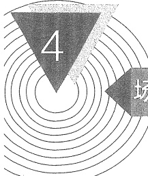

### 场效应三极管及其放大电路

## 引言

场效应三极管是一种利用电场效应来控制电流的三端放大器件。这种器件不仅具有体积小、重量轻、耗电省、寿命长等特点，而且还有输入阻抗高、噪声低、抗辐射能力强和制造工艺简单等优点，因而获得了广泛应用。

场效应二极管（field effect transistor，FET），简称场效应管或FET。它有两种主要类型：金属-氧化物-半导体场效应管（metal-oxide-semiconductor FET，MOSFET）和结型场效应管（junction FET，JFET）。其中MOSFET在大规模和超大规模集成电路中占有重要地位。结型FET中的结可以是普通的PN结，构成通常所说的JFET；也可是肖特基（Schottky）势垒栅结，构成金属-半导体场效应管（metal-semiconductor FET，MESFET）。MESFET更多地用在高速或高频电路中，例如微波放大电路。

本章先介绍 MOSFET 的结构和工作原理，然后以共源极放大电路为例，说明电路的组成及工作原理，接着介绍图解分析法和小信号模型分析法，然后再讨论另外两种组态的放大电路：共漏极和共栅极放大电路。

JFET 应用相对较少，因此将简要介绍。

另一种三极管——BJT将在第5章讨论。

学完本章后，希望读者会分析 MOS 管放大电路，并能根据要求设计基本 MOS 管放大电路。

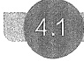

#### 4.1

#### 金属-氧化物-半导体场效应三极管

MOSFET 和 JFET 是两种最主要的场效应管。在 MOSFET 中，从导电载流子的带电极性来看，有 N 沟道 MOSFET 和 P 沟道 $ ^{①} $ MOSFET，常称为 NMOS 管和 PMOS 管；按照导电沟道形成机理不同，它们又各自分为增强型 E 型和耗尽型 D 型两种 $ ^{②} $。因此，MOS 管共有四种类型：增强型 NMOS 管、耗尽型 NMOS 管、增强型 PMOS 管、耗尽型 PMOS 管。

<!-- page: 118 -->

##### 4.1.1 N 沟道增强型 MOSFET

### 1. 结构及电路符号

增强型 NMOS 管的结构、简图和代表符号分别如图 4.1.1a、b 和 c 所示。它以一块掺杂浓度较低、电阻率较高的 P 型硅半导体薄片作为衬底，利用扩散的方法在 P 型硅中形成两个高掺杂的  $ N^{+} $区。然后在 P 型硅表面生长一层很薄的二氧化硅绝缘层，并在二氧化硅的表面及  $ N^{+} $区的表面上分别安置三个铝电极——栅极 g(gate)、源极 s(source) 和漏极 d(drain)，就制成了增强型 NMOS 管。

由于栅极与源极、栅极与漏极均无电接触，故称为绝缘栅型场效应管。图4.1.1c是增强型NMOS管的代表符号。箭头方向表示由P（衬底）指向N（沟道），漏极与源极间的垂直短划线代表沟道，该线是间断的，表示在未加适当栅极电压之前，漏极与源极之间无导电沟道。

图4.1.1a 中还标出了沟道长度  $ L $ 和宽度  $ W $，它们通常在纳米至微米之间，且长度尺寸小于宽度尺寸。而氧化物厚度  $ t_{ox} $ 的典型值在  $ 400\mathring{A} (0.4 \times 10^{-7} \text{m}) $ 数量级以内。

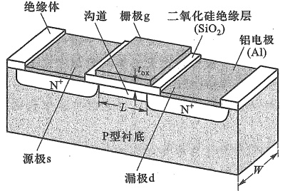

(a)
 

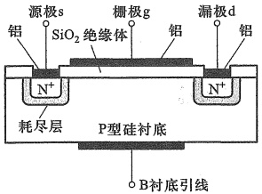

(b)
 

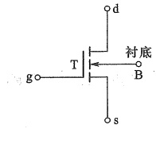

(c)
 

图4.1.1 N 沟道增强型 MOSFET 结构及符号 (a) 结构 (b) 简图（纵剖面图） (c) 代表符号
 

### 2. 工作原理

（1） $ v_{GS}=0 $，没有导电沟道

在图 4.1.2a 中，由于两 N 型区（源极区和漏极区）之间间隔了 P 型衬底，所以漏极和源极之间形成两个背靠背的 PN 结（二极管）如图 4.1.2c 所示。在断开衬底 B 与 s 极的连接

<!-- page: 119 -->

时，无论外加电压  $ v_{DS} $ 的极性如何，其中总有一个 PN 结是反偏的，d、s 之间无导电沟道。当短接 B、s（见图 4.1.2a）时，由于  $ v_{CS} = 0 $，d、s 间没有导电沟道，所以即使 d、s 间加了正向电压  $ V_{DD} $，漏极电流仍为零，如图 4.1.2d 所示。

##### （2） $ v_{GS} \geqslant V_{TN} $ 时，出现 N 型沟道

若  $ v_{GS}>0 $，如图 4.1.2b 所示，相当于在栅极与衬底之间加了正向电压，而栅极与衬底之间隔有二氧化硅绝缘层，不会产生栅极电流  $ i_c $，但会产生由栅极指向衬底的垂直电场。由于绝缘层很薄，即使  $ v_{GS} $ 只有几伏，也可产生高达  $ 10^5 \sim 10^6 $ V/cm 数量级的强电场。该电场力会排斥 P 型衬底中的多子空穴，使它们远离绝缘层，缺少了空穴的区域成为耗尽层。相反，该电场会吸引少子自由电子在绝缘层下方聚集，当  $ v_{GS} $ 达到一定数值时，绝缘层下方便会形成电子层，即 N 型层。相对于 P 型衬底，它也称为反型层。这个反型层就是 d 和 s 之间的 N 型导电沟道，它连通了两电极。

由于沟道是由栅源电压通过电场感应产生的，所以也称感生沟道，场效应管也因此而得名。显然， $ v_{GS} $ 的值越大，电场就越强，吸引到绝缘层下方的电子就越多，感生沟道就越厚，沟道电阻的阻值就越小。这种关系反映了栅源电压对沟道的控制作用。一般把能够使漏源之间开始导电的栅源电压称为阈值电压  $ V_{TN} $  $ ^{①} $(threshold voltage)。

这种在  $ v_{GS}=0 $ 时没有导电沟道，而必须依靠栅源电压的作用，才形成感生沟道的 FET 称为增强型 FET。图 4.1.1c 中的短划线就反映了在  $ v_{GS}=0 $ 时，增强型 MOS 管的沟道是断开的。

##### （3）可变电阻区和恒流区的形成机制

感生沟道出现后，若施加正的 $ v_{DS} $，沟道中的自由电子将从源极流向正极性的漏极，而电流 $ i_{D} $则流入漏极，经过沟道流出源极（见图4.1.2b）。注意，由于漏极的正电压使漏极与衬底之间的PN结处于反偏状态，所以 $ i_{D} $不会流经衬底。

当  $ v_{DS} $ 较小时， $ i_{D} $ 与  $ v_{DS} $ 为近似线性关系，如图 4.1.2e 所示。直线的斜率就是沟道电导，也就是 MOS 管 d、s 间电阻的倒数，d、s 间电阻称为沟道电阻。另外，由于  $ v_{GS} $ 不同时感生沟道厚度也不同，导致直线的斜率不同。表明  $ v_{GS} $ 可以控制沟道电阻的大小，所以称这个区域为可变电阻区。

当  $ v_{GS} $ 为固定电压  $ V_{GS} $，且  $ V_{GS} > V_{TN} $ 时，随着  $ v_{DS} $ 由 0 开始逐渐增大（参见图 4.1.3a）， $ i_D $ 将随之快速上升，对应于图 4.1.3c 所示曲线的 OA 段，其斜率较大。但随着  $ v_{DS} $ 增大，由于沟道电阻与沟道长度成正比，所以  $ i_D $ 在沟道长度方向不同位置产生的电压降也不同，从源极到漏极电位逐渐升高，但是，整个栅极电位是相同的，导致栅极与沟道间的电压差，从左至右逐渐减小，意味着垂直电场强度从左至右也逐渐减弱，使得沟道厚度从左至右逐渐变薄。这时沟道呈楔形分布，如图 4.1.3a 所示的沟道形状。

当  $ v_{DS} $ 增大到满足  $ v_{GD} = v_{GS} - v_{DS} = V_{TN} $，即栅漏压差正好等于阈值电压时，靠近漏端的反型层会消失，出现夹断点。若  $ v_{DS} $ 继续增加，夹断点将向源极方向移动，形成一夹断区（反型层

<!-- page: 120 -->

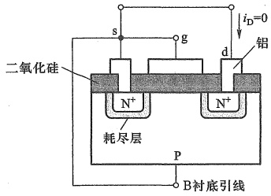

(a)
 

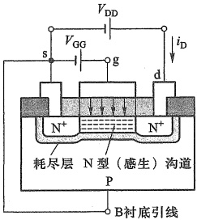

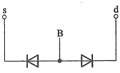

(b)
 

(c)
 

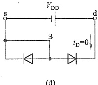

(d)
 

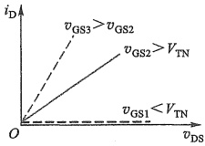

(e)
 

图 4.1.2 N 沟道增强型 MOSFET 的基本工作原理示意图 (a)  $ v_{GS}=0 $ 时，没有导电沟道 (b)  $ v_{GS} \geq V_{TN} $ 时，出现 N 型导电沟道
 

(c) 图 a 所示 MOSFET 截止时源极和漏极之间等价的背靠背二极管 (d)  $ v_{GS}=0 $ 时，即使漏源极加正电压时，也无漏极电流 (e)  $ v_{DS} $ 较小时，不同  $ v_{GS} $ 时的  $ i_{D} $ 随  $ v_{DS} $ 变化曲线可近似看成直线
 

教学视频4.1：MOSFET的工作原理
 

消失后的耗尽区)，如图4.1.3b所示。由于夹断区的电阻远大于沟道其余部分的电阻， $ v_{ds} $再增加的电压大都降在了夹断区上，沟道其余部分的电压并未增加，所以 $ i_{D} $不再增大，曲线转为水平，如图4.1.3c所示的AB段。

那么，沟道出现夹断后， $ i_{D} $ 是否会减小呢？答案是否定的。这是因为出现夹断区后虽然会增大 d、s 间的电阻，但  $ v_{DS} $ 再增加的电压绝大部分会降落在夹断区（耗尽区）上，在夹断区水平方向产生一个从漏极指向源极的电场，促使沟道中的自由电子穿过夹断区漂移到漏极区，形成漏极

电流。

以上看出， $ v_{DS} $ 对  $ i_{D} $ 的影响可以分成沟道夹断前、后两种情况（参见图 4.1.3c）。夹断前， $ i_{D} $ 随  $ v_{DS} $ 增加而快速增大，其斜率的倒数近似为电阻，且  $ v_{GS} $ 可以控制它的大小，该区域为可变电阻区；夹断后， $ i_{D} $ 不再随  $ v_{DS} $ 变化而保持恒定，该区域称为恒流区 $ ^{①} $。夹断点就是可变电阻区与恒流区的分界点。夹断点处有  $ v_{GD} = v_{GS} - v_{DS} = V_{TN} $ 或  $ v_{DS} = v_{GS} - V_{TN} $。

另外注意到，沟道中只有一种载流子——自由电子参与导电，所以这种器件称为单极型

<!-- page: 121 -->

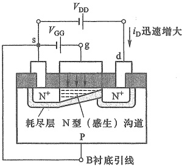

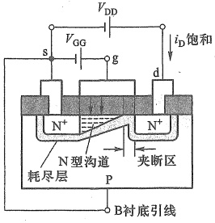 V_{TN} $，工作在可变电阻区 N 沟道增强型 MOSFET 工作示意图" width="25%" />

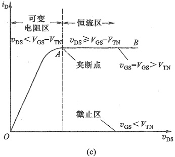 V_{TN} $，工作在恒流区的 N 沟道增强型 MOSFET 工作示意图 (c) 可变电阻区和恒流区的特性曲线" width="33%" />

图 4.1.3 可变电阻区和恒流区的形成机制
 

（a）当  $ v_{GS} > V_{TN} $，工作在可变电阻区 N 沟道增强型 MOSFET 工作示意图
 

(b) 当  $ v_{GS} > V_{TN} $，工作在恒流区的 N 沟道增强型 MOSFET 工作示意图 (c) 可变电阻区和恒流区的特性曲线
 

器件。

还需要注意,若翻转 d、s 间所加电压极性,那么漏极与衬底间的 PN 结将处于正偏,大部分  $ i_{p} $ 将经此 PN 结由衬底电极流出,不再流过沟道,也就不受  $ v_{GS} $ 控制,上述电压电流关系就不再成立,MOS 管不能正常工作。

### 3. I-V 特性曲线及特性方程

##### （1）输出特性及特性方程

放大电路是双口网络，而 MOS 管作为放大电路的核心器件，也应该以双口网络的形式工作。由于 MOS 管的  $ v_{GS} $ 可以控制  $ i_{D} $，所以可以将  $ v_{GS} $ 看作输入， $ i_{D} $ 看作输出，那么电极 g、s 就构成输入端口；而电极 d、s 则构成输出端口。输出特性是指在  $ v_{GS} $ 一定的情况下， $ i_{D} $ 与  $ v_{DS} $ 之间的关系，即

 $$ i_{_{D}}=f(\left.v_{DS}\right)\left|\right._{v_{GS}= 常数 } $$ 

图 4.1.4 所示为一增强型 NMOS 管完整的输出特性。因为  $ v_{DS} = v_{GS} - V_{TN} $ 是夹断点的条

<!-- page: 122 -->

件，据此可在输出特性上画出夹断点轨迹，如图4.1.4中左边的虚线所示。该虚线也是可变电阻区和恒流区的分界线。这里用 $ v_{DS_{pop}} $ $ ^{①} $表示夹断点轨迹上的 $ v_{DS} $以示区别。现分别对三个区域进行讨论。

①截止区

当  $ v_{GS} < V_{TN} $ 时，导电沟道尚未形成， $ i_{D} = 0 $，为截止工作状态。

##### ② 可变电阻区

在可变电阻区内

$$  v_{GS}\geq V_{TN}, 且 v_{DS}<(v_{GS}-V_{TN})   \tag*{(4.1.1)}$$

其 I-V 特性可近似表示为

$$  i_{\mathrm{D}}=K_{\mathrm{n}}\left[2\left(v_{\mathrm{G S}}-V_{\mathrm{T N}}\right)v_{\mathrm{D S}}-v_{\mathrm{D S}}^{2}\right]   \tag*{(4.1.2)}$$

其中

$$  K_{\mathrm{n}}=\frac{K_{\mathrm{n}}^{\prime}}{2}\cdot\frac{W}{L}=\frac{\mu_{\mathrm{n}}C_{\mathrm{ox}}}{2}\left(\frac{W}{L}\right)   \tag*{(4.1.3)}$$

式中本征导电因子  $ K'_{n} = \mu_{n} C_{ox} $ 通常情况下为常量， $ \mu_{n} $ 是反型层中电子迁移率， $ C_{ox} $ 为栅极（与衬底间）氧化层单位面积电容 $ ^{②} $，电导常数  $ K_{n} $ 的单位是 mA/V $ ^{2} $。

在特性曲线原点附近，因为  $ v_{DS} $ 很小，可以忽略  $ v_{DS}^{2} $ 的影响，式(4.1.2)可近似为

 $$ i_{\mathrm{D}}\approx2K_{\mathrm{n}}(v_{\mathrm{G S}}-V_{\mathrm{T N}})v_{\mathrm{D S}} $$ 

由此可以求出当  $ v_{GS} $ 一定时，在可变电阻区内原点附近的输出电阻  $ r_{dso} $ 为

 $$ r_{ds\mathrm{o}}=\frac{\mathrm{d}v_{DS}}{\mathrm{d}i_{D}}\bigg|_{v_{GS}= 常数 }=\frac{1}{2K_{n}(v_{GS}-V_{TN})} $$ 

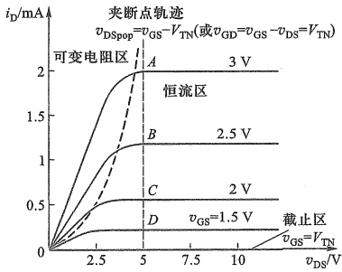

图 4.1.4 增强型 NMOS 管输出特性
 

表明  $ r_{dso} $ 是一个受  $ v_{GS} $ 控制的可变电阻。

③ 恒流区（又称放大区）

当  $ v_{GS} \geqslant V_{TN} $，且  $ v_{DS} \geqslant (v_{GS} - V_{TN}) $ 时，MOS 管工作在恒流区。

由于在恒流区内，可近似看成  $ i_{D} $ 不随  $ v_{DS} $ 变化。因此，将夹断点条件  $ v_{DS}=v_{GS}-V_{TN} $ 代入式(4.1.2)，便得到恒流区的 I-V 特性表达式

$$  i_{\mathrm{D}}=K_{\mathrm{n}}\left(v_{\mathrm{GS}}-V_{\mathrm{TN}}\right)^{2}=K_{\mathrm{n}}V_{\mathrm{TN}}^{2}\left(\frac{v_{\mathrm{GS}}}{V_{\mathrm{TN}}}-1\right)^{2}=I_{\mathrm{D}0}\left(\frac{v_{\mathrm{GS}}}{V_{\mathrm{TN}}}-1\right)^{2}   \tag*{(4.1.6)}$$

式中  $ I_{D0}=K_{n}V_{TN}^{2} $，它是  $ v_{GS}=2V_{TN} $ 时的  $ i_{D} $。由式(4.1.6)看出，给定一个  $ v_{GS} $ 就有一个对应的  $ i_{D} $ 此时，可将  $ i_{D} $ 视为  $ v_{GS} $ 控制的电流源。

MOS 管用于放大时都工作在恒流区。

<!-- page: 123 -->

##### （2）转移特性

转移特性描述了输入端口电压  $ v_{GS} $ 与输出端口电流  $ i_{D} $ 的关系 $ ^{①} $，即

 $$ i_{_{D}}=f(\left.v_{GS}\right)\mid_{v_{DS}= 常数 } $$ 

通常  $ v_{DS} $ 不同时转移特性也有所不同，但在恒流区  $ i_{D} $ 与  $ v_{DS} $ 几乎无关，转移特性近似为一条曲线。可以直接从输出特性曲线上用作图法求出转移特性。例如，在图 4.1.4 所示的输出特性恒流区，作  $ v_{DS} = 5 \, V $ 的一条垂线，它与各条输出特性曲线的交点分别为 A、B、C、D，根据这些点的  $ i_{D} $ 及  $ v_{GS} $ 的值，在  $ i_{D} - v_{GS} $ 的直角坐标系中，标出它们的位置，用曲线连接这些点，就可得到转移特性如图 4.1.5 所示。

此外，转移特性也可由式(4.1.6)画出，它是一条二次曲线。

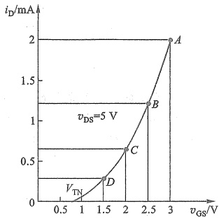

图4.1.5 由图4.1.4作出的恒流区转移特性
 

##### 4.1.2 N 沟道耗尽型 MOSFET

### 1. 结构和工作原理简述

前面详细讨论了增强型 NMOS 管，耗尽型 NMOS 管的结构与增强型基本相同，不同的只是制造时，在二氧化硅绝缘层中注入了大量的正离子。这样，在正离子产生的电场力作用下，感生沟道已经形成。表明耗尽型 NMOS 管在  $ v_{GS}=0 $ 时就存在导电沟道，如图 4.1.6a 所示。图 b 是其电路符号，与图 4.1.1c 所示增强型符号相比，差别仅在于表示 d、s 间沟道的竖线是连通的。

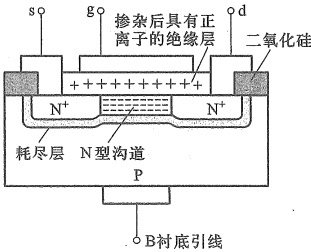

(a)
 

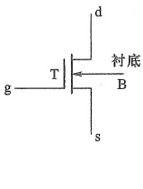

(b)
 

图 4.1.6 耗尽型 NMOS 管   (a) 结构图 (b) 电路符号
 

当  $ v_{GS} > 0 $ 时，沟道将变厚，在同样的  $ v_{DS} $ 作用下， $ i_{D} $ 将变大。

当  $ v_{GS} < 0 $ 时，则沟道变薄，同样  $ v_{DS} $ 下的  $ i_{D} $ 将减小。

<!-- page: 124 -->

当  $ v_{GS} < V_{TN} $ 时，感生沟道将消失， $ i_{D} = 0 $

显然，耗尽型 NMOS 管的阈值电压  $ V_{TN} < 0 $ 。所以，这类 MOS 管既可以在正的栅源电压下工作，也可以在负的栅源电压下工作。

由于耗尽型 MOS 管制造工艺较特殊，所以通常只在特殊场合应用，普遍应用的是增强型 MOS 管。

### 2. I-V 特性曲线及特性方程

耗尽型 NMOS 管的输出特性曲线和转移特性曲线分别如图 4.1.7a、b 所示。输出特性曲线同样可以分为截止区、可变电阻区和恒流区。与增强型不同的是耗尽型 NMOS 管的  $ V_{TN} $ 为负值。

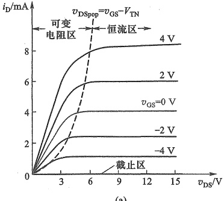

(a)
 

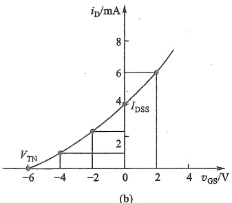

(b)
 

图 4.1.7 耗尽型 NMOS 管特性曲线
 

（a）输出特性曲线 （b） $ v_{DS}>(v_{GS}-V_{TN}) $ 时的转移特性曲线
 

耗尽型 NMOS 管的特性方程与式(4.1.2)、式(4.1.4)和式(4.1.6)相同。

在恒流区 $ (v_{DS} \geqslant v_{GS} - V_{TN}) $，当 $ v_{GS} = 0 $时，由式(4.1.6)可得

$$  i_{_{\mathrm{D}}}\approx K_{_{\mathrm{n}}}V_{\mathrm{T N}}^{2}=I_{_{\mathrm{D S S}}}   \tag*{(4.1.7)}$$

式中  $ I_{DSS} $ 为零栅压的漏极电流，称为饱和漏极电流，也就是转移特性曲线与纵轴交点处的  $ i_{D} $ （参见图 4.1.7b）。 $ I_{DSS} $ 下标中的第二个 S 表示栅-源极间短路的意思。此时恒流区的  $ i_{D} $ 可表示为

$$  i_{\mathrm{D}}\approx I_{\mathrm{DSS}}\left(1-\frac{v_{\mathrm{GS}}}{V_{\mathrm{TN}}}\right)^{2}   \tag*{（4.1.8）}$$

##### 4.1.3 P 沟道 MOSFET

与 NMOS 管相似，PMOS 管也有增强型和耗尽型两种，所不同的是衬底为 N 型，沟道为 P 型，意味着工作时电极所加电压极性也要翻转，而且实际的电流方向为流出漏极，也与 NMOS 管相反。它们的电路符号如图 4.1.8a、b 所示，除了代表衬底的 B 的箭头方向向外，其他部分均与 NMOS 管相同，此处不再赘述。

增强型 PMOS 管的输出特性曲线和转移特性曲线如图 4.1.9a、b 所示。此处  $ i_{D} $ 的参考方

<!-- page: 125 -->

向为流入漏极。由图可见，它的 $ v_{GS} $、阈值电压 $ V_{TP} $ $ ^{①} $、 $ i_{D} $等都是负值。

增强型 PMOS 管产生沟道的条件为

$$  v_{GS}\leq V_{TP}   \tag*{（4.1.9）}$$

可变电阻区与恒流区的界线为

$$  v_{\mathrm{D S}}=v_{\mathrm{G S}}-V_{\mathrm{T P}}   \tag*{（4.1.10）}$$

在可变电阻区， $ v_{GS} \leqslant V_{TP}, v_{DS} > v_{GS} - V_{TP} $， $ i_{D} $为

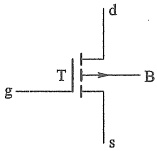

 $$ i_{\mathrm{D}}=-K_{\mathrm{p}}\left[2(\boldsymbol{v}_{\mathrm{G S}}-V_{\mathrm{T P}})\boldsymbol{v}_{\mathrm{D S}}-\boldsymbol{v}_{\mathrm{D S}}^{2}\right] $$ 

(a)
 

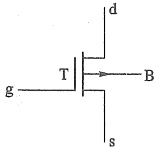

(b)
 

图 4.1.8 PMOS 管电路符号
 

（a）增强型电路符号
 

（b）耗尽型电路符号
 

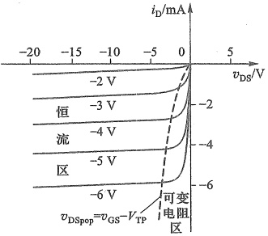

(a)
 

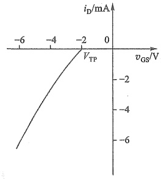

(b)
 

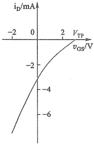

(c)
 

图 4.1.9 PMOS 管的 I-V 特性曲线
 

（a）增强型输出特性曲线 （b）增强型转移特性曲线 （c）耗尽型转移特性曲线
 

在恒流区内， $ v_{GS} \leqslant V_{TP}, v_{DS} \leqslant (v_{GS} - V_{TP}), i_{D} $ 为

$$  i_{\mathrm{D}}=-K_{\mathrm{p}}\left(v_{\mathrm{GS}}-V_{\mathrm{TP}}\right)^{2}=-I_{\mathrm{D0}}\left(\frac{v_{\mathrm{GS}}}{V_{\mathrm{TP}}}-1\right)^{2}   \tag*{(4.1.12)}$$

式中  $ I_{D0}=K_{p}V_{TP}^{2} $， $ K_{p} $ 是 P 沟道器件的电导常数，可表示为

$$  K_{\mathrm{p}}=\frac{W\mu_{\mathrm{p}}C_{\mathrm{ox}}}{2L}   \tag*{(4.1.13)}$$

W、L、 $ C_{ox} $ 分别是沟道宽度、沟道长度、栅极氧化物单位面积上电容。 $ \mu_{p} $ 是反型层中空穴的迁移率。在通常情况下，P 沟道中空穴的迁移率比 N 沟道中电子的迁移率要小， $ \mu_{p} $ 约为  $ \mu_{n}/2 $。

要特别注意，如果  $ i_{D} $ 的参考方向是流出漏极，那么要去掉式(4.1.11)～式(4.1.12)等号右边的负号。

耗尽型 PMOS 管的转移特性曲线如图 4.1.9c 所示。其阈值电压  $ V_{TP} $ 为正值，可与增强型共用特性方程。

<!-- page: 126 -->

##### 4.1.4 沟道长度调制等几种效应

实际上还有一些因素会影响 MOS 管特性，下面分别简要介绍。

### 1. 沟道长度调制效应

由图4.1.4输出特性曲线可看出，在恒流区 $ i_{D} $与 $ v_{DS} $无关，曲线是水平的，这是理想情况。实际MOS管在恒流区工作时， $ v_{DS} $会对沟道长度L产生调制作用。由图4.1.3b可知，当 $ v_{GS} $固定， $ v_{DS} $增加时，沟道夹断区会延伸，有效的沟道长度L会变短，导致 $ i_{D} $会有所增加，这种现象称为沟道长度调制效应。也就是说，恒流区输出特性曲线会向上倾斜，如图4.1.10所示。这时需要用沟道长度调制参数 $ \lambda $对恒流区特性方程进行修正。以增强型NMOS管为例，考虑沟道长度调制效应后，式(4.1.6)修正为

$$  i_{\mathrm{D}}=K_{\mathrm{n}}\left(v_{\mathrm{GS}}-V_{\mathrm{TN}}\right)^{2}\left(1+\lambda v_{\mathrm{DS}}\right)=I_{\mathrm{D0}}\left(\frac{v_{\mathrm{GS}}}{V_{\mathrm{TN}}}-1\right)^{2}\left(1+\lambda v_{\mathrm{DS}}\right)   \tag*{(4.1.14)}$$

当  $ i_{D}=0 $ 时，得  $ v_{DS}=-1/\lambda $ ，可见  $ \lambda $ 的单位为  $ V^{-1} $ 。令  $ V_{A}=1/\lambda $ 称为厄利 (Early) 电压，意味着沿输出特性曲线向左侧做延长线，它们会汇聚到横轴上  $ -V_{A} $ 处。

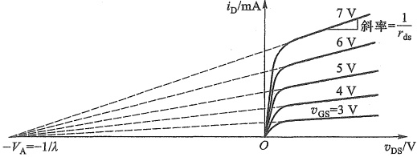

图 4.1.10 考虑沟道长度调制效应的增强型 NMOS 管输出特性曲线
 

### 2. 衬底调制效应（体效应）

在分立元件电路中，MOS 管的衬底通常与源极相连，即  $ v_{BS} = 0 $，但在集成电路中，MOS 管共用衬底，若再将源极与衬底相连，就相当于所有 MOS 管的源极并接在了一起，这是不现实的。这时可能有  $ v_{BS} \neq 0 $。为了保证导电沟道与衬底的隔离，就要求沟道与衬底之间的 PN 结始终处于反偏状态，即要求 NMOS 管的衬底接电路的最低电位（ $ v_{BS} \leq 0 $），而 PMOS 管的衬底接电路的最高电位（ $ v_{BS} \geq 0 $）。

设  $ V_{\mathrm{TN0}} $ 表示  $ v_{BS}=0 $ 的阈值电压。在 NMOS 管衬底为负偏压  $ (v_{BS}<0) $ 情况下，沟道与衬底间的耗尽层加厚，致使  $ v_{GS}=V_{TN0} $ 时，不能形成导电沟道，意味着这时的  $ V_{TN}>V_{TN0} $。 $ v_{BS} $ 对增强型 NMOS 管转移特性的影响如图 4.1.11 所示， $ \left|v_{BS}\right| $ 越大，则  $ V_{TN} $ 就越大。这种现象称为衬底调制效应。衬底 B 因此又称为背栅。

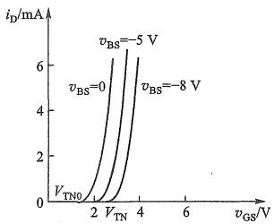

图 4.1.11 具有衬底调制效应的转移特性曲线示意图
 

<!-- page: 127 -->

### 3. 温度效应

 $ V_{TN} $ 和电导常数  $ K_{n} $ 是温度的函数，且都随着温度升高而下降。由于温度对  $ K_{n} $ 的影响强于对  $ V_{TN} $ 的影响，所以由式(4.1.2)可知，当温度升高时，对于给定的  $ V_{GS} $，总的效果是漏极电流要减小。这种负温度系数关系可以使 MOS 管电路在不采取其他措施情况下，就具有热稳定性。

##### 4.1.5 MOSFET 的主要参数

MOS 管参数是它的规格说明，也是分立 MOS 管的选管依据。下面以增强型和耗尽型 NMOS 管为例，介绍它们的主要参数。

## 一、直流参数

### 1. 阈值电压  $ V_{TN} $

 $ V_{TN} $ 是 NMOS 管的参数。它定义为当  $ v_{DS} $ 为某一固定值（例如 10 V），使  $ i_{D} $ 等于一微小电流（例如 50 μA）时的栅源电压。 $ v_{GS} > V_{TN} $ 时，d、s 间可导电。增强型的  $ V_{TN} > 0 $，耗尽型的  $ V_{TN} < 0 $。

（ $ V_{TP} $ 是 PMOS 管的阈值电压， $ v_{GS}<V_{TP} $ 时，漏源之间可导电。增强型的  $ V_{TP}<0 $，耗尽型的  $ V_{TP}>0 $。）

### 2. 饱和漏极电流  $ I_{DSS} $

 $ I_{DSS} $ 是耗尽型 MOS 管的参数。定义为 MOS 管工作在恒流区时，对应  $ v_{GS}=0 $ 时的漏极电流，也称为饱和漏极电流。通常在  $ \left|v_{DS}\right|=10\ V $ 时测得。

### 3. 直流输入电阻  $ R_{GS} $

在漏源之间短路的条件下，栅源之间加一定电压时的栅源直流电阻就是  $ R_{GS} $。MOS 管的  $ R_{GS} $ 可达  $ 10^9 \sim 10^{15} $ Ω。由于 MOS 管栅极绝缘层很薄 ( $ t_{ox} \approx 40 $ nm)，为防止栅极聚集的静电荷将其击穿，MOS 管内部常接有栅源过压保护齐纳二极管，这时  $ R_{GS} $ 会受齐纳二极管反向截止电阻的影响。

## 二、交流参数

### 1. 输出电阻  $ r_{ds} $

交流的输出电阻定义为输出端口的电压变化量与电流变化量之比，即

$$  r_{ds}=\frac{\partial v_{DS}}{\partial i_{D}}\Bigg|_{v_{GS}}   \tag*{（4.1.15）}$$

是输出特性曲线某一点上切线斜率的倒数，它反映了 $ v_{DS} $对 $ i_{D} $的影响。在恒流区，当 $ \lambda\neq0 $时，由式(4.1.14)和式(4.1.15)可导出

 $$ r_{\mathrm{d s}}=\left[\lambda K_{\mathrm{n}}\left(v_{\mathrm{G S}}-V_{\mathrm{T N}}\right)^{2}\right]^{-1} $$ 

而  $ i_{D} \approx K_{n} (v_{GS} - V_{TN})^{2} $，可进一步有

$$  r_{ds}\approx\frac{1}{\lambda i_{D}}   \tag*{（4.1.16）}$$

 $ r_{ds} $ 一般在几十千欧到几百千欧之间。当  $ \lambda=0 $ 时，有  $ r_{ds} \rightarrow \infty $ 。

### 2. 低频互导  $ g_{m} $

在  $ v_{DS} $ 等于常数时，输出端口漏极电流的微变量和引起这一变化的输入端口栅源电压的

<!-- page: 128 -->

微变量之比称为互导，即

$$  g_{_{\mathrm{m}}}=\frac{\partial i_{_{\mathrm{D}}}}{\partial v_{_{\mathrm{GS}}}}\left|_{v_{_{\mathrm{DS}}}}\right.   \tag*{(4.1.17)}$$

以增强型 NMOS 管为例，可利用式(4.1.6)和式(4.1.17)近似估算  $ g_{m} $ 值，即

$$  g_{\mathrm{\tiny~m}}=\frac{\partial i_{\mathrm{\tiny{D}}}}{\partial v_{\mathrm{G S}}}\Bigg\vert_{\nu_{\mathrm{D S}}}=\frac{\partial\left[K_{\mathrm{\tiny{n}}}\left(v_{\mathrm{G S}}-V_{\mathrm{T N}}\right)\right]^{2}}{\partial v_{\mathrm{G S}}}\Bigg\vert_{\nu_{\mathrm{D S}}}=2K_{\mathrm{\tiny{n}}}\left(v_{\mathrm{G S}}-V_{\mathrm{T N}}\right)   \tag*{(4.1.18)}$$

考虑到  $ i_{D}=K_{n}(v_{GS}-V_{TN})^{2} $ 和  $ I_{DO}=K_{n}V_{TN}^{2} $，式(4.1.18)又可改写为

$$  g_{_{\mathrm{m}}}=2\sqrt{K_{_{\mathrm{n}}}i_{_{\mathrm{D}}}}=\frac{2}{V_{_{\mathrm{TN}}}}\sqrt{I_{_{\mathrm{D0}}}i_{_{\mathrm{D}}}}   \tag*{(4.1.19)}$$

 $ g_{m} $ 表征  $ v_{GS} $ 对  $ i_{D} $ 的控制，也就是转移特性曲线的斜率，其值与 MOS 管的  $ K_{n} $ 值和工作点位置 ( $ i_{D} $) 有关，其单位为 mS 或  $ \mu S $。它是 MOS 管小信号建模的重要参数之一。数据手册中常给出在一定的  $ v_{DS} $ 和  $ i_{D} $ 下的  $ g_{m} $ 值（常标注为  $ g_{fe} $）。

## 三、极限参数

### 1. 最大漏极电流  $ I_{DM} $

 $ I_{DM} $ 是 MOS 管正常工作时漏极电流允许的上限值。有时也细分为最大连续工作电流和脉冲峰值电流。

### 2. 漏源击穿电压  $ V_{(BR)DS} $

指 MOS 管漏-源极之间发生击穿、 $ i_{D} $ 开始急剧上升时的  $ v_{DS} $ 值。

### 3. 栅源击穿电压  $ V_{(BR)GS} $ 和漏栅击穿电压  $ V_{(BR)DG} $

 $ V_{(BR)GS} $ 是指源极一侧绝缘层击穿时的栅源电压；而  $ V_{(BR)DG} $ 是指漏极一侧绝缘层击穿时的漏栅电压。如果 MOS 管内有保护齐纳二极管，击穿的是齐纳二极管而非绝缘层，此时击穿是可逆的。

### 4. 最大耗散功率  $ P_{DM} $

MOS 管的耗散功率等于  $ v_{DS} $ 和  $ i_{D} $ 的乘积，即  $ P_{DM}=v_{DS}i_{D} $，该功率转换为热量消散到环境

中。若热量不能及时消散，会导致器件温度升高直至烧毁。为此就要限制 MOS 管的耗散功率，使之不超过最大耗散功率  $ P_{DM} $。显然， $ P_{DM} $ 除与散热条件有关外，还与器件材料能承受的最高工作温度有关。

最大耗散功率曲线在输出特性坐标系中的描述，如图4.1.12中的 $ P_{DM} $所示。图中也同时标出了最大漏极电流 $ I_{DM} $和漏源击穿电压 $ V_{(BR)DS} $的位置。

除以上参数外，还有极间电容、开关时间等其他参数。选用 MOS 管时，需查阅相关器件数据手册。表4.1.1列出了几种 FET 的主要参数。

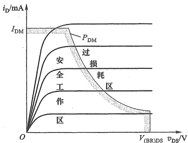

图 4.1.12 MOS 管的耗散功率曲线
 

<!-- page: 129 -->

表4.1.1 几种 FET 的主要参数
 

<table border=1 style='margin: auto; word-wrap: break-word;'><tr><td style='text-align: center; word-wrap: break-word;'>参数名称</td><td style='text-align: center; word-wrap: break-word;'>零栅压漏极电流</td><td style='text-align: center; word-wrap: break-word;'>阈值电压</td><td style='text-align: center; word-wrap: break-word;'>栅源漏电流 $ ^{(1)} $</td><td style='text-align: center; word-wrap: break-word;'>漏源导通电阻</td><td style='text-align: center; word-wrap: break-word;'>低频互导</td><td style='text-align: center; word-wrap: break-word;'>最大漏源电压</td><td style='text-align: center; word-wrap: break-word;'>最大栅源电压</td><td style='text-align: center; word-wrap: break-word;'>最大耗散功率</td><td style='text-align: center; word-wrap: break-word;'>最大漏源电流</td><td style='text-align: center; word-wrap: break-word;'>管型</td><td style='text-align: center; word-wrap: break-word;'>封装</td></tr><tr><td style='text-align: center; word-wrap: break-word;'>参数符号</td><td style='text-align: center; word-wrap: break-word;'>$ I_{DSS}/\mu A $</td><td style='text-align: center; word-wrap: break-word;'>$ V_{TN} $或 $ V_{TP}/V $</td><td style='text-align: center; word-wrap: break-word;'>$ I_{CSS}/\mu A $</td><td style='text-align: center; word-wrap: break-word;'>$ r_{DS(on)}/\Omega $</td><td style='text-align: center; word-wrap: break-word;'>$ g_m/S $</td><td style='text-align: center; word-wrap: break-word;'>$ V_{(BR)DS}/V $</td><td style='text-align: center; word-wrap: break-word;'>$ V_{(BR)GS}/V $</td><td style='text-align: center; word-wrap: break-word;'>$ P_{DM}/W $</td><td style='text-align: center; word-wrap: break-word;'>$ I_{DM}/A $</td><td style='text-align: center; word-wrap: break-word;'></td><td style='text-align: center; word-wrap: break-word;'></td></tr><tr><td style='text-align: center; word-wrap: break-word;'>2N7000</td><td style='text-align: center; word-wrap: break-word;'>&lt;1</td><td style='text-align: center; word-wrap: break-word;'>2.1</td><td style='text-align: center; word-wrap: break-word;'>&lt;0.01</td><td style='text-align: center; word-wrap: break-word;'>1.2</td><td style='text-align: center; word-wrap: break-word;'>320 m\n( $ I_D=200 mA $)</td><td style='text-align: center; word-wrap: break-word;'>60</td><td style='text-align: center; word-wrap: break-word;'>$ \pm 20 $</td><td style='text-align: center; word-wrap: break-word;'>0.4</td><td style='text-align: center; word-wrap: break-word;'>0.2</td><td style='text-align: center; word-wrap: break-word;'>E 型\nNMOS</td><td style='text-align: center; word-wrap: break-word;'>T092</td></tr><tr><td style='text-align: center; word-wrap: break-word;'>BS270</td><td style='text-align: center; word-wrap: break-word;'>&lt;1</td><td style='text-align: center; word-wrap: break-word;'>2.1</td><td style='text-align: center; word-wrap: break-word;'>&lt;0.01</td><td style='text-align: center; word-wrap: break-word;'>1.2</td><td style='text-align: center; word-wrap: break-word;'>320 m\n( $ I_D=200 mA $)</td><td style='text-align: center; word-wrap: break-word;'>60</td><td style='text-align: center; word-wrap: break-word;'>$ \pm 20 $</td><td style='text-align: center; word-wrap: break-word;'>0.625</td><td style='text-align: center; word-wrap: break-word;'>0.4</td><td style='text-align: center; word-wrap: break-word;'>E 型\nNMOS</td><td style='text-align: center; word-wrap: break-word;'>T092</td></tr><tr><td style='text-align: center; word-wrap: break-word;'>FQNL2N50B</td><td style='text-align: center; word-wrap: break-word;'>&lt;1</td><td style='text-align: center; word-wrap: break-word;'>3</td><td style='text-align: center; word-wrap: break-word;'>&lt;0.1</td><td style='text-align: center; word-wrap: break-word;'>4.2</td><td style='text-align: center; word-wrap: break-word;'>0.72\n( $ I_D=0.175 A $)</td><td style='text-align: center; word-wrap: break-word;'>500</td><td style='text-align: center; word-wrap: break-word;'>$ \pm 30 $</td><td style='text-align: center; word-wrap: break-word;'>1.5</td><td style='text-align: center; word-wrap: break-word;'>0.35</td><td style='text-align: center; word-wrap: break-word;'>E 型\nNMOS</td><td style='text-align: center; word-wrap: break-word;'>T092</td></tr><tr><td style='text-align: center; word-wrap: break-word;'>BSR202N</td><td style='text-align: center; word-wrap: break-word;'>&lt;1</td><td style='text-align: center; word-wrap: break-word;'>0.95</td><td style='text-align: center; word-wrap: break-word;'>&lt;0.1</td><td style='text-align: center; word-wrap: break-word;'>25m</td><td style='text-align: center; word-wrap: break-word;'>17\n( $ I_D=3.8 A $)</td><td style='text-align: center; word-wrap: break-word;'>20</td><td style='text-align: center; word-wrap: break-word;'>$ \pm 12 $</td><td style='text-align: center; word-wrap: break-word;'>0.5</td><td style='text-align: center; word-wrap: break-word;'>3.8</td><td style='text-align: center; word-wrap: break-word;'>E 型\nNMOS</td><td style='text-align: center; word-wrap: break-word;'>SC-59</td></tr><tr><td style='text-align: center; word-wrap: break-word;'>BSS83P</td><td style='text-align: center; word-wrap: break-word;'>-0.1</td><td style='text-align: center; word-wrap: break-word;'>-1.5</td><td style='text-align: center; word-wrap: break-word;'>-0.01</td><td style='text-align: center; word-wrap: break-word;'>2</td><td style='text-align: center; word-wrap: break-word;'>0.47\n( $ I_D=0.27 A $)</td><td style='text-align: center; word-wrap: break-word;'>-60</td><td style='text-align: center; word-wrap: break-word;'>$ \pm 20 $</td><td style='text-align: center; word-wrap: break-word;'>0.36</td><td style='text-align: center; word-wrap: break-word;'>-0.33</td><td style='text-align: center; word-wrap: break-word;'>E 型\nPMOS</td><td style='text-align: center; word-wrap: break-word;'>SOT23</td></tr><tr><td style='text-align: center; word-wrap: break-word;'>CEM2281</td><td style='text-align: center; word-wrap: break-word;'>-1</td><td style='text-align: center; word-wrap: break-word;'>-0.5~ -1.3</td><td style='text-align: center; word-wrap: break-word;'>&lt;0.1</td><td style='text-align: center; word-wrap: break-word;'>25m</td><td style='text-align: center; word-wrap: break-word;'>41\n( $ I_D=-7.2 A $)</td><td style='text-align: center; word-wrap: break-word;'>-20</td><td style='text-align: center; word-wrap: break-word;'>$ \pm 12 $</td><td style='text-align: center; word-wrap: break-word;'>2.5</td><td style='text-align: center; word-wrap: break-word;'>-7.2</td><td style='text-align: center; word-wrap: break-word;'>E 型\nPMOS</td><td style='text-align: center; word-wrap: break-word;'>SO-8</td></tr><tr><td style='text-align: center; word-wrap: break-word;'>CEK01N6G</td><td style='text-align: center; word-wrap: break-word;'>&lt;20</td><td style='text-align: center; word-wrap: break-word;'>2~4</td><td style='text-align: center; word-wrap: break-word;'>&lt;0.1</td><td style='text-align: center; word-wrap: break-word;'>7.3</td><td style='text-align: center; word-wrap: break-word;'>&lt;10\n( $ I_D=0.4 A $)</td><td style='text-align: center; word-wrap: break-word;'>600</td><td style='text-align: center; word-wrap: break-word;'>$ \pm 30 $</td><td style='text-align: center; word-wrap: break-word;'>3.1</td><td style='text-align: center; word-wrap: break-word;'>0.4</td><td style='text-align: center; word-wrap: break-word;'>E 型\nNMOS</td><td style='text-align: center; word-wrap: break-word;'>T092</td></tr><tr><td style='text-align: center; word-wrap: break-word;'>ELM23401CA-S</td><td style='text-align: center; word-wrap: break-word;'>-1</td><td style='text-align: center; word-wrap: break-word;'>-0.7</td><td style='text-align: center; word-wrap: break-word;'>&lt;0.1</td><td style='text-align: center; word-wrap: break-word;'>65m</td><td style='text-align: center; word-wrap: break-word;'>15\n( $ I_D=-5 A $)</td><td style='text-align: center; word-wrap: break-word;'>-30</td><td style='text-align: center; word-wrap: break-word;'>$ \pm 12 $</td><td style='text-align: center; word-wrap: break-word;'>1.2</td><td style='text-align: center; word-wrap: break-word;'>-4</td><td style='text-align: center; word-wrap: break-word;'>E 型\nPMOS</td><td style='text-align: center; word-wrap: break-word;'>SOT23</td></tr><tr><td style='text-align: center; word-wrap: break-word;'>ELM57412A-S</td><td style='text-align: center; word-wrap: break-word;'>&lt;1</td><td style='text-align: center; word-wrap: break-word;'>0.4~ 0.8</td><td style='text-align: center; word-wrap: break-word;'>&lt;0.1</td><td style='text-align: center; word-wrap: break-word;'>52m</td><td style='text-align: center; word-wrap: break-word;'>10\n( $ I_D=3.6 A $)</td><td style='text-align: center; word-wrap: break-word;'>20</td><td style='text-align: center; word-wrap: break-word;'>$ \pm 12 $</td><td style='text-align: center; word-wrap: break-word;'>0.35</td><td style='text-align: center; word-wrap: break-word;'>3.8</td><td style='text-align: center; word-wrap: break-word;'>E 型\nNMOS</td><td style='text-align: center; word-wrap: break-word;'>SC-70</td></tr><tr><td style='text-align: center; word-wrap: break-word;'>J111</td><td style='text-align: center; word-wrap: break-word;'>&gt;20 000</td><td style='text-align: center; word-wrap: break-word;'>-3 ~ -10</td><td style='text-align: center; word-wrap: break-word;'>-0.001</td><td style='text-align: center; word-wrap: break-word;'>&lt;20</td><td style='text-align: center; word-wrap: break-word;'></td><td style='text-align: center; word-wrap: break-word;'>-35</td><td style='text-align: center; word-wrap: break-word;'>-35</td><td style='text-align: center; word-wrap: break-word;'>0.35</td><td style='text-align: center; word-wrap: break-word;'></td><td style='text-align: center; word-wrap: break-word;'>N 沟道 JFET</td><td style='text-align: center; word-wrap: break-word;'>T092</td></tr><tr><td style='text-align: center; word-wrap: break-word;'>J175</td><td style='text-align: center; word-wrap: break-word;'>-7 000 ~ -60 000</td><td style='text-align: center; word-wrap: break-word;'>3</td><td style='text-align: center; word-wrap: break-word;'>0.001</td><td style='text-align: center; word-wrap: break-word;'>125</td><td style='text-align: center; word-wrap: break-word;'></td><td style='text-align: center; word-wrap: break-word;'>-30</td><td style='text-align: center; word-wrap: break-word;'>30</td><td style='text-align: center; word-wrap: break-word;'>0.35</td><td style='text-align: center; word-wrap: break-word;'></td><td style='text-align: center; word-wrap: break-word;'>P 沟道 JFET</td><td style='text-align: center; word-wrap: break-word;'>T092</td></tr></table>

①如果是 MOSFET，则是其输入保护管——齐纳二极管的反向漏电流。

##### 复习思考题

4.1.1 为什么 MOS 管的输入电阻很高？

4.1.2 何谓增强型 MOS 管？耗尽型 MOS 管与增强型 MOS 管有何不同？

4.1.3 何谓阈值电压？各种 MOS 管的阈值电压有何不同？

4.1.4 试分别画出增强型和耗尽型 NMOS 管、PMOS 管的图形符号。

4.1.5 试总结四种 MOS 管转移特性各自的特点。

<!-- page: 130 -->

#### MOSFET 基本共源极放大电路

##### 4.2.1 基本共源极放大电路的组成

放大电路在输入信号控制下，将工作电源能量转换为信号能量输出，从而实现信号放大，其中关键因素是控制。由于 MOS 管工作在恒流区时， $ v_{DS} $ 对  $ i_D $ 的影响很小常可忽略，所以通过  $ v_{GS} $ 对  $ i_D $ 的控制很容易实现信号的放大，因此恒流区也称为放大区。换言之，放大信号时必须让 MOS 管工作在恒流区，这意味着 MOS 管的  $ v_{GS} $ 和  $ v_{DS} $ 必须满足图 4.2.1a 中不等式的要求。为此就需要在 g、s 之间加一个大于  $ V_{TN} $ 的电压  $ V_{GG} $，如图 4.2.1b 所示。在 d、s 之间也需要施加一个电压  $ V_{DD} $，以满足  $ v_{DS} \geq v_{GS} - V_{TN} $。待放大的小信号  $ v_i $（时变电压）加在 g、s 间的输入回路中影响  $ v_{GS} $，从而控制  $ i_D $ 变化。但在很多时候，也希望能输出变化的电压，所以在漏极上串入电阻  $ R_d $，这样， $ v_{DS} = V_{DD} - i_D R_d $，漏源之间就可以输出变化电压了。当然，调整  $ R_d $ 也可以方便地改变  $ v_{DS} $。

由于 g、s 构成的输入回路和 d、s 构成的输出回路共用源极，所以图 4.2.1b 所示电路称为共源极放大电路。

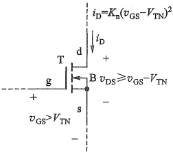

(a)
 

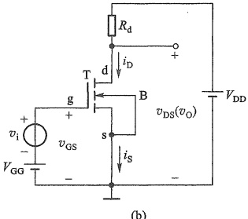

图 4.2.1 增强型 NMOS 管基本共源极放大电路
 

（a）处于恒流区的工作条件（b）电路结构
 

##### 4.2.2 基本共源极放大电路的工作原理

图4.2.1b中的直流电压源 $ V_{GG} $和 $ V_{DD} $是保证MOS管正常工作的工作电源，时变信号 $ v_{i} $则是待放大的信号源。若 $ v_{i} $为正弦波，即交流信号，那么放大电路中的电压或电流就是直流与交流的叠加。

### 1. 静态

当输入信号  $ v_{i}=0 $ 时，放大电路的工作状态称为静态或直流工作状态。此时电路中的电压、电流都是直流量。

静态时，MOS 管的漏极电流及各电极间的电压分别用  $ I_{D} $、 $ V_{GS} $、 $ V_{DS} $ 表示，当它们确定后，

<!-- page: 131 -->

就对应于特性曲线上的一个点，该点称为静态工作点 Q(quiescent)，因此常将上述三个量写成  $ I_{DQ} $、 $ V_{GSQ} $ 和  $ V_{DSQ} $。

设置静态工作点的目的是在信号放大过程中，保证 MOS 管始终工作在恒流区。亦即要求放大电路静态工作点必须设置在恒流区，对于增强型 NMOS 管必须满足： $ V_{GSQ} \geq V_{TN} $ 和  $ V_{DSQ} \geq V_{GSQ} - V_{TN} $。其他管型工作在恒流区的条件可参见表 4.9.1。

如果静态工作点设置不合适，就无法正常放大信号。例如，若图 4.2.1b 中  $ V_{GS} = V_{GC} < V_{TN} $，则 MOS 管处于截止状态，当加入微弱的输入信号  $ v_i $ 时，无法使 MOS 管导通，也就没有信号输出了。

可以通过直流通路分析放大电路的静态工作点。所谓直流通路就是只有直流电流能够流过的路径。下面通过一个例题来说明分析过程。

例 4.2.1 电路如图 4.2.1b 所示，设  $ V_{GSQ} = V_{GG} = 2 ~V $,  $ V_{DD} = 5 ~V $,  $ V_{TN} = 1 ~V $,  $ K_n = 0.2 ~mA/V^2 $,  $ R_d = 12 ~k\Omega $。试求电路的 Q 点。

解：（1）将信号置零，即令  $ v_{i}=0 $，画出放大电路的直流通路如图4.2.2所示，标出各电流、电压。

（2）由于  $ V_{GSQ}=V_{GG}=2\ V>V_{TN}=1\ V $，所以沟道已形成。

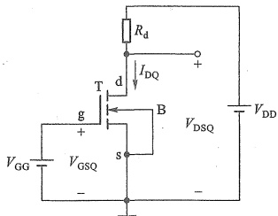

（3）假设 MOS 管工作于恒流区，则漏极电流为

 $$ I_{_{DQ}}=K_{_n}(V_{_{GSQ}}-V_{_{TN}})^{2} $$ 

图 4.2.2 图 4.2.1b 所示电路的直流通路
 

将已知参数代入，可得

 $$ I_{\mathrm{_{DQ}}}=K_{\mathrm{n}}\left(V_{\mathrm{GSQ}}-V_{\mathrm{TN}}\right)^{2}=0.2\mathrm{~mA}/\mathrm{V}^{2}\times\left(2\mathrm{~V}-1\mathrm{~V}\right)^{2}=0.2\mathrm{~mA} $$ 

漏源电压为

$$  V_{_{D S Q}}=V_{_{D D}}-I_{_{D Q}}R_{_{d}}   \tag*{(4.2.2)}$$

代入参数计算得

 $$ V_{\mathrm{D S Q}}=V_{\mathrm{D D}}-I_{\mathrm{D Q}}R_{\mathrm{d}}=5\mathrm{~V}-0.2\mathrm{~m A}\times12\mathrm{~k}\Omega=2.6\mathrm{~V} $$ 

以上结果有  $ V_{DSQ} > (V_{GSQ} - V_{TN}) $，说明 MOS 管的确工作在恒流区，假设成立，静态工作点  $ Q(I_{DQ} = 0.2\ mA, V_{GSQ} = 2\ V, V_{DSQ} = 2.6\ V) $ 即为所求。

根据以上求解过程，将 NMOS 管放大电路的静态分析步骤归纳如下：

① 设 MOS 管工作于恒流区，则有  $ V_{GSQ}>V_{TN} $， $ I_{DQ}>0 $， $ V_{DSQ}>V_{GSQ}-V_{TN} $。

② 利用恒流区特性方程  $ i_{D}=K_{n}(v_{GS}-V_{TN})^{2} $ 和直流通路的电路方程，求出静态工作点的电压、电流。由于是二次方程，要舍去不满足  $ V_{GSQ}>V_{TN} $ 的根。

③ 判断结果是否满足两个不等式，如果满足，说明假设成立，结果即为所求；如果出现  $ V_{GSQ}<V_{TN} $，则 MOS 管可能处于截止状态，要按照  $ I_{DQ}=0 $ 计算其他量；如果  $ V_{GSQ}>V_{TN} $，但  $ V_{DSQ}<V_{GSQ}-V_{TN} $，则 MOS 管可能工作在可变电阻区，需要用式（4.1.2）或式（4.1.4）的特性方程重新求解。

注意耗尽型 NMOS 管的  $ V_{TN} $ 为负值。P 沟道 MOS 管电路的分析与 N 沟道类似，但要注意其电源极性与电流方向不同，以及恒流区工作条件的两个不等式的差异。

<!-- page: 132 -->

### 2. 动态

图 4.2.1b 所示电路中，当  $ v_i \neq 0 $ 时，MOS 管各电极电流及电压都在静态值基础上随  $ v_i $ 变化，此时电路的工作状态称为动态。假设  $ v_i $ 是正弦波，那么  $ v_{GS} = V_{GSQ} + v_{gs} $，如图 4.2.3a 所示。这里  $ v_{gs} = v_i $ 是 g、s 间的交流电压。通过  $ v_{GS} $ 对  $ i_D $ 的控制， $ i_D $ 也在  $ I_{DQ} $ 基础上叠加一个近似正弦波。图 4.2.3a 中的  $ i_d $ 是漏极交流电流。因为输出电压  $ v_{DS} = V_{DD} - i_D R_d $，即  $ i_D $ 增大对应  $ v_{DS} $ 减小。又因为  $ v_{DS} = V_{DSQ} + v_{ds} $，所以  $ v_{ds} $ 与  $ i_d $ 反相。于是  $ v_{ds} $ 与  $ v_i $ 也反相。如果用适当方式只取出  $ v_{DS} $ 的交流量  $ v_{ds} $，它就是放大电路的输出电压信号  $ v_o $。只要电路参数选择适当，就可以使  $ v_{ds}(v_o) $ 的幅度大于  $ v_i $ 的幅度，从而实现电压放大。

由图4.2.3a可以看出，放大电路电压、电流包含两个分量：一个是静态工作情况决定的直流分量 $ V_{GSQ} $、 $ I_{DQ} $、 $ V_{DSQ} $；另一个是由输入信号引起的交流分量 $ v_{gs} $、 $ i_{d} $、 $ v_{ds}(v_{o}) $。虽然这些电流、电压总量的瞬时值是变化的，但它们的方向、极性始终是不变的。

实际上，因为  $ i_{D} $ 与  $ v_{GS} $ 是二次方的关系，所以  $ i_{d} $ 并不是标准的正弦波。但是，当信号幅值比较小时，可以通过互导  $ g_{m} $，将  $ \Delta i_{D} $ 与  $ \Delta v_{GS} $ 近似为线性关系，如图 4.2.3b 所示。

以上讨论看出，可以将 MOS 管放大电路划分成静态和动态两种情况分别讨论，这是将复杂问题简单化的有效方法，后续三极管电路的分析大都采用这种思路。但要注意，这里的动态只做了定性分析，定量分析将在 4.3 和 4.4 节介绍。

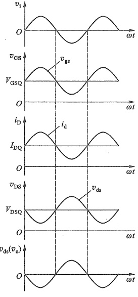

(a)
 

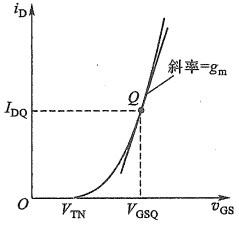

(b)
 

图 4.2.3 图 4.2.1b 所示电路中的电压、电流关系   (a) 时域波形 (b) 转移特性及互导
 

<!-- page: 133 -->

##### 4.2.3 放大电路的习惯画法

由图4.2.1b可看出，放大电路的输入端口、输出端口和直流电源都有连接到公共“地”（“⊥”）的端子，这种连接常称为“共地”。为简洁起见，三极管放大电路也常采用3.4节提到的电路习惯画法，即省去与地相连的电压源符号，而直接标出节点对地电压，这样图4.2.1b所示电路就画成图4.2.4所示的形式。

为讨论方便，电压的参考极性通常规定为所标节点为正，地点为负；电流的参考方向则以图中所标箭头为准。

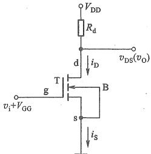

##### 复习思考题

4.2.1 在图4.2.1b所示放大电路中，为什么要接直流电源 $ V_{DD} $?

图4.2.4 图4.2.1b所示电路的习惯画法
 

4.2.2 在分析电路时，为什么要规定参考电位点和电流的参考方向？

4.2.3 在电子电路中放大的实质是什么？放大的对象是什么？负载上获得的能量来自何处？

4.2.4 如何计算共源极放大电路的静态工作点？

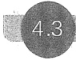

#### 图解分析法

图解分析法就是用作图的方式分析放大电路的静态及动态特性。它的前提是已知三极管的特性曲线。下面首先以图4.2.1b所示基本共源极放大电路为例，介绍图解分析法。

##### 4.3.1 用图解方法确定静态工作点 Q

为讨论方便，现将图 4.2.1b 改画成图 4.3.1，并用点画线把电路分成三部分：MOS 管 T、输入端口的管外电路、输出端口的管外电路。

确定静态工作点 Q，就是要在  $ v_{i}=0 $ 时，求出 MOS 管的  $ I_{DQ} $、 $ V_{GSQ} $ 和  $ V_{DSQ} $。此时由图 4.3.1 所示的输入端口管外电路可得

 $$ v_{GS}=V_{GSQ}=V_{GG} $$ 

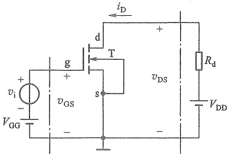

图 4.3.1 基本共源极放大电路
 

这样，在图4.3.2所示输出特性曲线上，就确定了对应 $ v_{GS}=V_{GSQ} $的那条曲线。

再看图4.3.1所示的输出回路，点画线左侧就是MOS管的输出端口，其电压和电流关系就是输出特性曲线。而点画线右侧可以列出回路方程 $ v_{DS}=V_{DD}-i_{D}R_{d} $，它在图4.3.2所示输出特性坐标系中就是一条直线。利用它与两坐标轴的交点，可以画出这条直线。由于图4.3.1输出回路点画线右侧可看作MOS管的负载，故该直线通常

<!-- page: 134 -->

称为负载线。又因为它是在直流通路下得到的直线方程，所以也称直流负载线。

由于  $ v_{DS} $ 和  $ i_{D} $ 既要满足直线方程，又要满足输出特性曲线电压电流关系，所以图 4.3.2 所示直流负载线与输出特性曲线  $ i_{D} = f(v_{DS}) \mid v_{GS} = V_{GSQ} $ 的交点，就是静态工作点 Q。由其横坐标和纵坐标就可以得到  $ V_{DSQ} $ 和  $ I_{DQ} $，这便是作图法得到的静态工作点。

由图4.3.2看出，负载线跨越了输出特性的三个区域，底部M点附近为截止区，夹断点与截止点之间为恒流区，夹断点左上方为可变电阻区。此处的夹断点也称为临界点。 $ V_{CSQ} $ 不同时，Q点在负载线上的位置也不同。放大信号时Q点必须设置在恒流区。

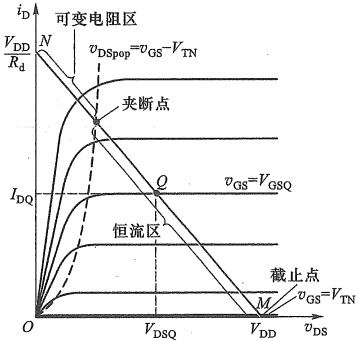

图 4.3.2 图 4.3.1 电路静态工作点的图解分析
 

##### 4.3.2 动态工作情况的图解分析

### 1. 正常放大信号时的工作情况

动态图解分析是在静态分析的基础上进行的。由图4.3.1可知，当 $ v_{i}=V_{im}\sin\omega t $时，则有 $ v_{GS}=V_{GSQ}+v_{i} $，那么，在图4.3.3所示特性曲线中，表现为输出特性曲线下移动。在 $ v_{i} $的一个周期中，特性曲线与负载线的交点，从Q点移动到 $ Q^{\prime} $点（对应 $ v_{i} $的波峰），再反方向移动到 $ Q^{\prime\prime} $点（对应 $ v_{i} $的波谷），最后回到Q点。对应Q点的移动，反映了 $ i_{D} $在 $ I_{DQ} $基础上的波

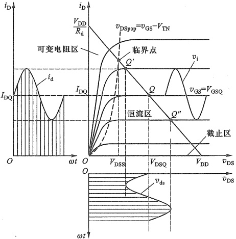

图 4.3.3 图 4.3.1 电路的图解分析
 

<!-- page: 135 -->

动， $ v_{DS} $ 也有类似的波动，如图 4.3.3 中的阴影线所示。 $ v_{DS} $ 的变化量  $ v_{ds} $，就是交流输出信号。在坐标中读出它的幅值，再除以  $ v_{i} $ 的幅值，就是电压放大倍数。

注意， $ v_{ds} $ 与  $ v_{i} $ 的相位相反，这是共源极放大电路的一个重要特点。

### 2. 静态工作点对波形失真的影响

当 Q 点过低，即  $ I_{DQ} $、 $ V_{GSQ} $ 过小，如图 4.3.4 所示，则在交流信号  $ v_{gs}=v_{i} $ 负半周峰值附近，工作点沿负载线进入截止区，使  $ i_{D} $、 $ v_{DS} $ 的波形明显失真，这种因工作点进入截止区而产生的失真称为截止失真。此时 Q"和 Q 分别对应的  $ v_{DS} $ 的差值电压，就决定了最大不失真输出电压的幅值  $ V_{om} $。如果负载线的斜率是  $ -\frac{1}{R_{d}} $，则

$$  \begin{array}{r}{V_{\mathrm{o m}}\approx V_{\mathrm{D D}}-V_{\mathrm{D S Q}}=I_{\mathrm{D Q}}R_{\mathrm{d}}}\end{array}   \tag*{(4.3.1)}$$

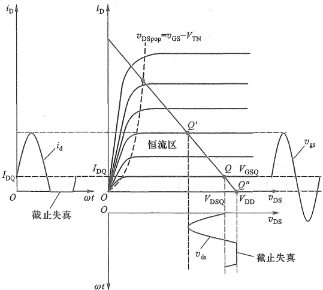

图 4.3.4 截止失真的图解分析
 

如果 Q 点过高，即  $ I_{DQ} $、 $ V_{GSQ} $ 过大，如图 4.3.5 所示。则在  $ v_{gs} $ 正半周峰值附近， $ Q' $ 进入可变电阻区后，就不再按恒流区的比例移动了，这时  $ i_{D} $ 和  $ v_{DS} $ 波形也会出现明显失真。由于  $ i_{D} $ 不能再随  $ v_{GS} $ 增大而按之前的比例升高，已经达到饱和值，所以这种失真称为饱和失真。此时 Q 和夹断点分别对应的  $ v_{DS} $ 的差值电压，就决定了最大不失真输出电压的幅值  $ V_{om} $，即

$$  V_{om}=V_{DSQ}-V_{DSS}   \tag*{(4.3.2)}$$

 $ V_{DSS} $ 为负载线与夹断点轨迹  $ v_{DS}=v_{GS}-V_{TN} $ 交点上的  $ v_{DS} $ 值，也经常用  $ V_{DSS}=V_{GSQ}-V_{TN} $ 近似估算。另外，即使 O 点设置合理，如果 v 幅值过大，v 也可能同时出现截止失真和饱和失真。

截止失真和饱和失真都是由于 MOS 管特性曲线的非线性引起的，因而又统称为非线性失真。

实际上，就是在恒流区， $ i_{D} $ 与  $ v_{GS} $ 也是非线性关系，只是在信号幅值较小时，非线性失真也比较小，可近似认为是线性放大。

<!-- page: 136 -->

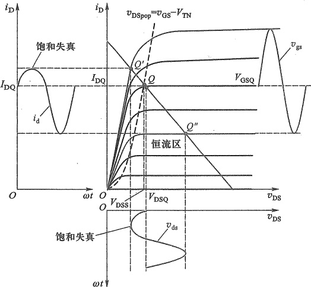

图 4.3.5 饱和失真的图解分析
 

### 3. 交流负载线及图解分析举例

在很多情况下，电子电路中的信号源、输入端口、输出端口和直流电源等常要求共地，而图4.3.1所示电路信号源没有共地，而且还需要两个独立的直流电源。若采用如图4.3.6a所示的共源极放大电路就既可以使信号源共地，又可以减少一个电源。图中用电阻 $ R_{g1} $和 $ R_{g2} $对 $ V_{DD} $分压获得所需要的 $ V_{GSQ} $。电容 $ C_{b1} $和 $ C_{b2} $称为隔直电容或耦合电容，它们在电路中的作用是“隔离直流，传送交流”。这种在信号传输路径上有耦合电容的放大电路称为阻容耦合放大电路，而像图4.2.1那样直接传输（无耦合电容）信号的放大电路称为直接耦合放大电路。

放大电路工作时，输出端总要接上一定的负载  $ R_{L} $，如图 4.3.6a 所示。下面通过例 4.3.1 来说明接入  $ R_{L} $ 后带来的影响。

例 4.3.1 已知电路和 MOS 管的输出特性分别如图 4.3.6a 和图 4.3.7 所示。电路参数为  $ R_{g1}=160\ k\Omega $、 $ R_{g2}=40\ k\Omega $、 $ R_{d}=10\ k\Omega $、 $ R_{L}=40\ k\Omega $、 $ V_{DD}=10\ V $。(1) 试用图解法确定静态工作点 Q；(2) 作出交流负载线；(3) 当  $ v_i=0.4\sin\omega t\ V $ 时，求出相应的  $ v_o $ 和电压增益。

解：（1）直流通路与交流通路

静态时 $ (v_{i}=0) $，由于 $ C_{b1} $、 $ C_{b2} $有隔离直流作用，即对直流相当于开路，因此， $ R_{L} $和 $ v_{i} $对电路的静态不产生影响。由此可画出直流通路如图4.3.6b所示。

动态时 $ (v_{i} \neq 0) $，信号是交流量，这时要由交流通路分析。所谓交流通路就是只有交流电流能够流过的路径。若 $ v_{i} $的频率足以使 $ C_{b1} $、 $ C_{b2} $呈现的阻抗小到可以忽略其上的压降，则 $ C_{b1} $和 $ C_{b2} $可视作短路。另外， $ V_{DD} $是理想直流电压源，其内阻为零，无交流压降，所以对交流信号也可视为短路。因此可画出如图4.3.6c所示的交流通路。图中的电压、电流都为交流量。

<!-- page: 137 -->

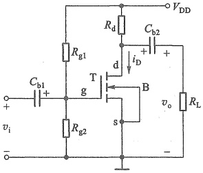

(a)
 

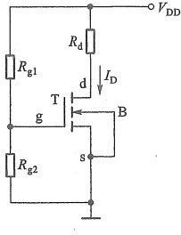

(b)
 

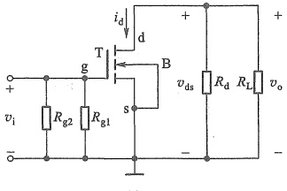

(c)
 

图 4.3.6 例 4.3.1 的电路
 

（a）完整的原理电路 （b）直流通路 （c）交流通路
 

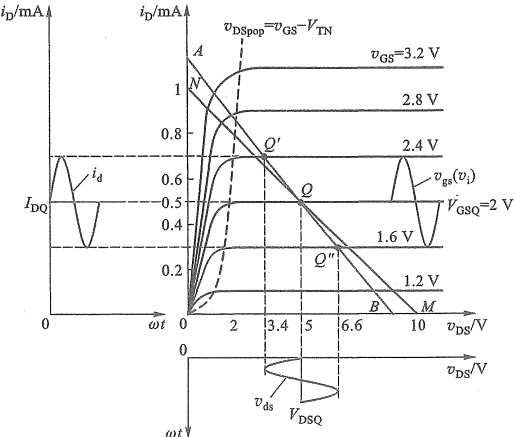

图 4.3.7 例 4.3.1 的图解分析
 

<!-- page: 138 -->

（2）用图解法确定静态工作点 Q

由图4.3.6b所示直流通路的输入回路求得

 $$ v_{GS}=V_{GSQ}=\frac{R_{g2}}{R_{g1}+R_{g2}}V_{DD}=\frac{40}{160+40}\times10\ V=2\ V $$ 

由输出回路写直流负载线方程

 $$ v_{\mathrm{D S}}=V_{\mathrm{D D}}-i_{\mathrm{D}}R_{\mathrm{d}}=10-10i_{\mathrm{D}} $$ 

很容易在图 4.3.7 所示输出特性上作出该直流负载线 NM，其斜率为  $ -1/R_{d} $。直流负载线与  $ v_{GS} = V_{GSQ} = 2 $ V 那条输出特性曲线的交点即为 Q 点，其纵坐标值  $ I_{DQ} = 0.5 $ mA，横坐标值  $ V_{DSQ} = 5 $ V。

##### （3）作交流负载线

由图4.3.6e所示交流通路可得

$$  v_{\mathrm{o}}=v_{\mathrm{d s}}=-i_{\mathrm{d}}(R_{\mathrm{d}}//R_{\mathrm{L}})=-i_{\mathrm{d}}R_{\mathrm{L}}^{\prime}   \tag*{(4.3.3)}$$

其中  $ R_{L}^{\prime}=R_{d}\parallel R_{L} $， $ i_{d} $ 和  $ v_{o} $ 都是交流量，而输出特性坐标轴电量都是总量，所以无法直接画出式(4.3.3)的直线。但是电路中的总量是静态值与交流量的叠加，所以有  $ v_{ds}=v_{DS}-V_{DSQ} $， $ i_{d}=i_{D}-I_{DQ} $。将它们代入式(4.3.3)并整理得

$$  i_{\mathrm{D}}=-\frac{1}{R_{\mathrm{L}}^{\prime}}v_{\mathrm{D S}}+\frac{1}{R_{\mathrm{L}}^{\prime}}V_{\mathrm{D S Q}}+I_{\mathrm{D Q}}   \tag*{(4.3.4)}$$

这就是输出特性坐标系中的一条直线（如图4.3.7中直线AB所示），其斜率为 $ -1/R'_{L} $。由于其来自交流通路，所以称之为交流负载线，是动态时工作点移动的轨迹。当 $ v_{i}=0 $时，它必过Q点。令 $ i_{D}=0 $，可求得它与横轴的交点 $ B(v_{DS}=V_{DSQ}+I_{DQ}R'_{L}=9\ V) $。

可以看出，接上  $ R_{L} $ 后，交流负载线与直流负载线的斜率是不同的，分别为  $ -1/R_{L}' $ 和  $ -1/R_{d} $。且  $ V_{DSQ} $ 到 B 点的距离小于到 M 点的距离，意味着  $ v_{DS} $ 向右侧的波动范围变小了。

（4）当  $ v_{i}=0.4\sin\omega t $ V 时，画出  $ v_{o} $ 波形，求出电压增益  $ A_{v} $

当  $ v_{i}=v_{gs}=0.4\sin\omega t $ V 时有  $ v_{GS}=V_{GSQ}+v_{gs}=(2+0.4\sin\omega t) $ V，在  $ v_{gs} $ 的正半周峰值顶端， $ v_{GS} $ 与交流负载线 AB 交于  $ Q^{\prime} $ 点，而在  $ v_{gs} $ 的负半周峰值顶端， $ v_{GS} $ 与交流负载线 AB 交于  $ Q^{\prime\prime} $ 点，据此可分别画出  $ i_{D} $、 $ i_{d} $、 $ v_{DS} $ 和  $ v_{ds} $ 的波形，如图 4.3.7 所示。由图可见

 $$ v_{o}=v_{ds}=1.6\sin\ \omega t\ \mathrm{V} $$ 

因此有  $ V_{om}=1.6\ V $ ，可求出电压增益为

 $$ A_{v}=\frac{v_{o}}{v_{i}}=-\frac{V_{om}}{V_{im}}=-\frac{1.6}{0.4}=-4 $$ 

式中负号表示共源放大电路的输出信号电压与输入信号电压的相位相反（相差 $ 180^{\circ} $）。

由以上分析可知，当输入信号  $ v_{gs}(v_{i}) $ 较大时，应把 Q 点设在恒流区内交流负载线（而非直流负载线）靠近中点的位置，这时输出电压可以有最大的动态范围。当  $ v_{gs}(v_{i}) $ 较小时，为了降低电路的功耗，在保证无截止失真前提下，可把 Q 点设得低一些。

图解法直观、形象，有助于建立和理解交、直流共存，静态和动态等重要概念。能全面地分析放大电路的静态和动态工作情况，有助于理解合理设置静态工作点的重要性，但因为并未考虑三极管内PN结电容的影响，所以图解法不能分析信号工作频率较高的情况，也不能用来求放大电路的输入电阻和输出电阻等动态指标。

<!-- page: 139 -->

##### 复习思考题

4.3.1 如何根据放大电路的原理电路画出直流通路和交流通路？

4.3.2 放大电路的直流负载线和交流负载线的概念有何不同？什么情况下这两条负载线是重合的？

4.3.3 何谓截止失真和饱和失真？如何设置 Q 点才能使动态范围最大？

#### 4.4

#### 小信号模型分析法

前面看到，图解法应用的前提是已知 MOS 管的定量特性曲线，通常情况下这一条件并不容易满足，所以图解法有很大的局限性。而通过电路方程和 MOS 管特性方程求解动态指标时，则会涉及复杂的非线性电路求解问题（静态的求解相对简单）。为此，工程上通过建立 MOS 管的线性小信号模型，来简化其电路分析。

在输入信号幅值比较小的条件下，可以把 MOS 管在静态工作点附近小范围内的特性曲线近似为直线，从而将 MOS 管组成的放大电路当作线性电路来处理，这就是小信号模型分析法。MOS 管的小信号模型就是特性曲线线性化的电路表达形式。

##### 4.4.1 MOSFET 的小信号模型

MOS 管用于信号放大时需要工作在恒流区，当忽略沟道长度调制效应 $ \lambda=0 $时，以增强型 NMOS 管为例，并考虑到总量、静态量和信号量的关系，其特性方程由式(4.1.6)可变形为

 $$ \begin{aligned}i_{\mathrm{D}}&=K_{\mathrm{n}}\left(v_{\mathrm{GS}}-V_{\mathrm{TN}}\right)^{2}\\&=K_{\mathrm{n}}\left(V_{\mathrm{GSQ}}+v_{\mathrm{gs}}-V_{\mathrm{TN}}\right)^{2}\\&=K_{\mathrm{n}}\left[\left(V_{\mathrm{GSQ}}-V_{\mathrm{TN}}\right)+v_{\mathrm{gs}}\right]^{2}\\&=K_{\mathrm{n}}\left(V_{\mathrm{GSQ}}-V_{\mathrm{TN}}\right)^{2}+2K_{\mathrm{n}}\left(V_{\mathrm{GSQ}}-V_{\mathrm{TN}}\right)v_{\mathrm{gs}}+K_{\mathrm{n}}v_{\mathrm{gs}}^{2}\\ \end{aligned} $$ 

式中第一项为静态工作电流  $ I_{DQ}=K_{n}(V_{GSQ}-V_{TN})^{2} $。第二项是漏极信号电流  $ i_{d}=2K_{n}(V_{GSQ}-V_{TN})v_{gs} $，它同  $ v_{gs} $ 是线性关系。考虑到在 Q 点处有  $ v_{GS}=V_{GSQ} $，则由式（4.1.18）得  $ g_{m}=2K_{n}(V_{GSQ}-V_{TN}) $，因此第二项可写为

 $$ i_{\mathrm{d}}=2K_{\mathrm{n}}(\mathrm{\boldmath~V}_{\mathrm{G S Q}}-V_{\mathrm{T N}})\mathrm{\boldmath~v}_{\mathrm{g a}}=g_{\mathrm{m}}\mathrm{\boldmath~v}_{\mathrm{g s}} $$ 

第三项与  $ v_{gs} $ 平方成正比。当  $ v_{gs}=v_{i} $ 时，平方项就是信号产生非线性失真的部分。如果式(4.4.1)中第三项远小于第二项，即

 $$ v_{gs}\ll2(V_{GSQ}-V_{TN}) $$ 

就可以忽略第三项，得

$$  \begin{aligned}\boldsymbol{i}_{\mathrm{D}}=&\boldsymbol{K}_{\mathrm{n}}(\boldsymbol{V}_{\mathrm{GSQ}}-\boldsymbol{V}_{\mathrm{TN}})^{2}+2\boldsymbol{K}_{\mathrm{n}}(\boldsymbol{V}_{\mathrm{GSQ}}-\boldsymbol{V}_{\mathrm{TN}})\boldsymbol{v}_{\mathrm{gs}}\\=&\boldsymbol{I}_{\mathrm{DQ}}+\boldsymbol{g}_{\mathrm{m}}\boldsymbol{v}_{\mathrm{gs}}=\boldsymbol{I}_{\mathrm{DQ}}+\boldsymbol{i}_{\mathrm{d}}\end{aligned}   \tag*{(4.4.4)}$$

在转移特性曲线上，这一线性化过程可看作用 Q 点的切线代替原本 Q 点附近一段曲线的过程，如图4.4.1所示。式(4.4.3)就是线性化的小信号条件。

式（4.4.2）反映了 MOS 管线性化后的小信号控制关系，可以用图 4.4.2b 的电路来描述

<!-- page: 140 -->

该控制关系，它就是图 4.4.2a 所示 MOS 管的小信号模型。注意，由于 MOS 管栅极是绝缘的，所以图 4.4.2b 中输入端口 g 极是开路状态。当考虑沟道长度调制效应 ( $ \lambda \neq 0 $) 时，输出端口 d、s 间的输出电阻  $ r_{ds} $ [参见式 (4.1.16)] 为有限值，小信号模型则如图 4.4.2c 所示（图中  $ i_{d} $、 $ v_{gs} $、 $ v_{ds} $ 也可用相量表示）。因为没有考虑 MOS 管内结电容和极间电容，所以这里的模型也称为低频小信号模型。

但要特别注意以下几点：

（1）MOS 管必须工作在恒流区，并且是小信号情况下，模型才可用。

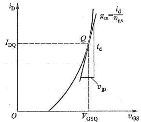

图 4.4.1 在转移特性上求  $ g_{m} $ 和
 

 $$ i_{d} $$ 

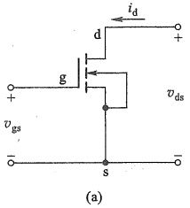

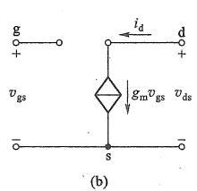

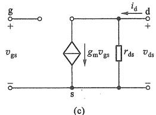

图 4.4.2 共源极 NMOS 管的低频小信号模型
 

（a）增强型 NMOS 管 （b） $ \lambda=0, r_{ds}=\infty $ 的低频小信号模型 （c） $ \lambda\neq0, r_{ds} $ 为有限值的低频小信号模型
 

（2）由于  $ g_{m} $、 $ r_{ds} $ 是交流参数或称微变参数，所以模型只适用于交流信号或变化量的分析。不能用来分析静态工作点。

（3）模型中的参数都与静态工作点位置有关。Q点不同，参数值也不同。

（4）受控源  $ g_{m}v_{gs} $ 的电流方向和控制电压  $ v_{gs} $ 的极性是关联的。即改变其中任何一个参考方向的标注方式，另一个也必须改变。

因为小信号模型反映的是特性曲线 Q 点切线上电压、电流变化量的关系，与总量电压极性和总量电流方向无关，所以其他类型 MOS 管的小信号模型与此完全相同 $ ^{①} $。

##### 4.4.2 用小信号模型分析共源极放大电路

用小信号模型分析放大电路的大致步骤是，先确定静态工作点及静态工作点附近的动态参数 $ (g_{m}, r_{ds} $等)，再画放大电路的小信号等效电路，然后按线性电路处理，求出 $ A_{v}, R_{i} $和 $ R_{o} $等。

<!-- page: 141 -->

下面通过例题来说明。

例 4.4.1 电路如图 4.4.3a 所示，设  $ V_{DD}=5V $， $ R_{d}=3.9\ k\Omega $， $ R_{g1}=60\ k\Omega $， $ R_{g2}=40\ k\Omega $。 $ C_{b1} $ 足够大对交流信号可视为短路。MOS 管参数为  $ V_{TN}=1\ V $， $ K_{n}=0.8\ mA/V^{2} $， $ \lambda=0.02\ V^{-1} $。试确定电路的静态工作点、小信号电压增益 A 和  $ R_{1} $、 $ R_{2} $。

解：（1）求静态值

 $$ V_{\mathrm{GS}}=V_{\mathrm{GSQ}}=\frac{R_{\mathrm{g}2}V_{\mathrm{DD}}}{R_{\mathrm{g}1}+R_{\mathrm{g}2}}=\frac{40}{40+60}\times5\mathrm{~V}=2\mathrm{~V} $$ 

 $$ I_{\mathrm{D Q}}\approx K_{\mathrm{n}}\left(V_{\mathrm{G S}}-V_{\mathrm{T N}}\right)^{2}=0.8\times\left(2-1\right)^{2}\mathrm{m A}=0.8\mathrm{m A} $$ 

 $$ V_{\mathrm{D S Q}}=V_{\mathrm{D D}}-I_{\mathrm{D Q}}R_{\mathrm{d}}=\left(5-0.8\times3.9\right)\mathrm{~V}=1.88\mathrm{~V} $$ 

满足  $ V_{DSQ}>V_{GSQ}-V_{TN} $，MOS 管的确工作于恒流区，能正常放大信号。

##### (2) 求  $ g_{m} $ 和  $ r_{ds} $

由式 $ （4.1.18 $）可求出

 $$ g_{\mathrm{m}}=2K_{\mathrm{n}}\left(V_{\mathrm{G S Q}}-V_{\mathrm{T N}}\right)=2\times0.8\times(2-1)\mathrm{m S}=1.6\mathrm{m S} $$ 

由式(4.1.16)得

 $$ r_{ds}=\frac{1}{\lambda I_{DQ}}=\frac{1}{0.02\times0.8}\ k\Omega=62.5\ k\Omega $$ 

##### （3）画出小信号等效电路

初学时，可以先画交流通路，再画小信号等效电路。画交流通路的原则是：①直流电压源视为短路，直流电流源视为开路；②容量足够大的电容视为短路。

根据上述原则，将  $ V_{DD} $ 短路，即接地；将  $ C_{b1} $ 短路，可画出图 4.4.3b 所示的交流通路。再用图 4.4.2c 所示模型替换图 4.4.3b 中的 MOS 管符号，便得到图 4.4.4 所示的小信号等效电路。

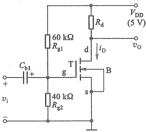

(a)
 

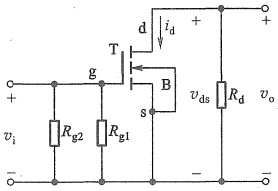

(b)
 

图 4.4.3 例 4.4.1 的电路
 

（a）原理图 （b）交流通路
 

（4）求电压增益 $ A_{v} $

由图4.4.4有

 $$ v_{\mathrm{o}}=-g_{\mathrm{m}}v_{\mathrm{g s}}(r_{\mathrm{d s}}//R_{\mathrm{d}}) $$

<!-- page: 142 -->

故电压增益为

 $$ A_{v}=\frac{v_{o}}{v_{i}}=\frac{v_{o}}{v_{gs}}=-g_{m}(r_{ds}//R_{d})=-5.87 $$ 

式中负号表示 $ v_{0} $与 $ v_{i} $反相。共源极电路属反相电压放大电路。

##### （5）求输入电阻 $ R_{i} $

由输入电阻定义，可求出图4.4.3所示电路的输入电阻

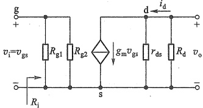

图4.4.4 图4.4.3 所示电路的小信号等效电路
 

 $$ R_{\mathrm{i}}=v_{\mathrm{i}}/i_{\mathrm{i}}=R_{\mathrm{g}1}\mathbin{//}R_{\mathrm{g}2}=\frac{60\times40}{60+40}\mathrm{~k}\Omega=24\mathrm{~k}\Omega $$ 

（6）求输出电阻 $ R_{0} $

利用外加测试电压的方法求输出电阻。电路如图4.4.5所示，负载开路，输出端口加测如图4.4.5所示，负载开路，输出端口加测试电压 $ v_{t} $，电路内部独立源 $ v_{i} $置零。根据 $ R_{0} $的定义，可得

图 4.4.5 求输出电阻的电路
 

 $$ R_{_{0}}=\frac{v_{_{t}}}{\dot{i}_{_{t}}}\left|\vphantom{\sum_{i=0,R_{L}=\infty}}\right|_{v_{i}=0,R_{L}=\infty} $$ 

由于  $ v_{i}=v_{gs}=0 $ ，所以  $ g_{m}v_{gs}=0 $ ，从而  $ i_{t}=v_{t}/ (r_{ds} // R_{d}) $ ，故

 $$ R_{\mathrm{o}}=v_{\mathrm{t}}/i_{\mathrm{t}}=r_{\mathrm{ds}}//R_{\mathrm{d}}=\frac{62.5\times3.9}{62.5+3.9}\mathrm{~k}\Omega=3.67\mathrm{~k}\Omega $$ 

##### 4.4.3 带源极电阻的共源极放大电路的分析

实际应用中，MOS 管老化、环境温度变化等，会引起静态工作点的不稳定，影响放大电路的正常工作。图 4.4.6a 所示电路具有稳定静态工作点的作用。对比图 4.4.3a，这里电路主要增加了源极电阻  $ R_{s} $，并采用双电源供电（也可不用负电源  $ -V_{ss} $，而是仍接地）。

(a)
 

(b)
 

图4.4.6 带源极电阻的共源极放大电路   (a) 原理电路 (b) 直流通路
 

<!-- page: 143 -->

### 1. 稳定静态工作点 Q 的原理

图 4.4.6a 电路的直流通路如图 b 所示。其栅极电压为

$$  V_{\mathrm{G}}=\frac{R_{\mathrm{g}2}}{R_{\mathrm{g}1}+R_{\mathrm{g}2}}\left(V_{\mathrm{DD}}+V_{\mathrm{SS}}\right)-V_{\mathrm{SS}}   \tag*{(4.4.5)}$$

可见  $ V_{G} $ 与 MOS 管无关，不受温度等因素影响，可以保持不变。

假设由于温度等因素影响，导致 MOS 管的  $ I_{DQ} $ 减小，则在其他参数不变情况下，会有如下调节过程：

 $$ \begin{array}{l}I_{DQ}\downarrow\longrightarrow V_{SQ}\downarrow\xrightarrow{V_{G} 不变 }V_{GSQ}\uparrow\\I_{DQ}\uparrow\xleftarrow{\quad}\quad\end{array} $$ 

结果使  $ I_{DQ} $ 基本维持不变，达到自动稳定静态工作点的目的。这种利用  $ I_{DQ} $ 的变化，通过电阻  $ R_{s} $ 取样反过来控制  $ V_{GSQ} $，使  $ I_{DQ} $ 基本保持不变的自动调节方式称为反馈控制。 $ R_{s} $ 越大，稳定效果越好。但  $ R_{s} $ 还会带来其他影响，要综合考虑其影响来取值。

### 2. 静态工作点及动态指标的计算

图4.4.6a电路中串入 $ R_{s} $后，源极并未接地，这给判断电路是否为共源极带来困难。实际上更有效的方法是根据信号的输入输出电极来判断。容易看出图4.4.6a电路的输入信号 $ v_{s} $由栅极输入，输出信号 $ v_{o} $由漏极输出（信号的另一端接地），剩下的另一个电极就是公共电极，所以它是共源极放大电路。下面通过实例来分析电路的静态和动态特性。

例 4.4.2 电路如图 4.4.6a 所示，设 MOS 管的参数为  $ V_{TN}=1\ V $， $ K_{n}=0.5\ mA/V^{2} $， $ \lambda=0 $。电路参数为  $ V_{DD}=V_{SS}=5\ V $， $ R_{d}=10\ k\Omega $， $ R_{s}=0.5\ k\Omega $， $ R_{si}=4\ k\Omega $， $ R_{gl}=150\ k\Omega $， $ R_{g2}=47\ k\Omega $。电容足够大对交流信号可视为短路。试确定静态工作点，求出电路的动态指标。

解: (1) 静态工作点计算

设 MOS 管工作于恒流区，则有

$$  I_{D}=K_{n}(\ V_{GS}-V_{TN}\ )^{2}   \tag*{(4.4.6)}$$

即

$$  I_{D}=0.5\left(V_{GS}-1\right)^{2}mA   \tag*{(4.4.7)}$$

由图4.4.6b有

$$  \begin{aligned}V_{\mathrm{GS}}&=V_{\mathrm{G}}-V_{\mathrm{S}}=\left[\frac{R_{\mathrm{g}2}}{R_{\mathrm{g}1}+R_{\mathrm{g}2}}(V_{\mathrm{DD}}+V_{\mathrm{SS}})-V_{\mathrm{SS}}\right]-\left(I_{\mathrm{D}}R_{\mathrm{s}}-V_{\mathrm{SS}}\right)\\&=2.39-0.5\ I_{\mathrm{D}}\end{aligned}   \tag*{(4.4.8)}$$

联合求解式（4.4.7）和式（4.4.8）得

 $$ I_{D}=\frac{7\pm6.71}{0.5}mA $$ 

其中

 $$ I_{D}=I_{DQ}=\frac{7-6.71}{0.5}\ mA=0.58\ mA $$ 

是合理的，另一值将使  $ V_{GSO} < V_{TN} $，不合理，舍去。

将 $ I_{DQ} $值代入式(4.4.8)可得

<!-- page: 144 -->

$$ V_{\mathrm{G S}}=V_{\mathrm{G S Q}}=2.39-0.5I_{\mathrm{D}}=2.1\mathrm{~V} $$ 

而漏源电压为

$$  \begin{aligned}V_{\mathrm{DS}}&=V_{\mathrm{DSQ}}=\left(V_{\mathrm{DD}}+V_{\mathrm{SS}}\right)-I_{\mathrm{D}}\left(R_{\mathrm{d}}+R_{\mathrm{s}}\right)\\&=\left[10-0.58\times\left(10+0.5\right)\right]\mathrm{V}=3.91\mathrm{~V}\end{aligned}   \tag*{(4.4.9)}$$

满足  $ V_{DSQ}>(V_{GSQ}-V_{TN}) $，即 MOS 管工作于恒流区，与假设一致，所求 Q 点正确。

##### （2）动态指标计算

由于信号由栅极输入漏极输出，所以是共源极放大电路。由  $ V_{gsQ}=2.1\ V $，得

 $$ g_{\mathrm{m}}=2K_{\mathrm{n}}\left(V_{\mathrm{GSQ}}-V_{\mathrm{TN}}\right)=2\times0.5\times(2.1-1)\mathrm{m S}=1.1\mathrm{m S} $$ 

由于  $ \lambda=0 $ ，故  $ r_{ds}=\infty $ 。

将 $ +V_{DD} $、 $ -V_{SS} $短路，即接地；将 $ C_{b1} $、 $ C_{b2} $短路，并用图4.4.2b的模型替换MOS管符号，可画出图4.4.6a所示电路的小信号等效电路如图4.4.7所示。

因为

 $$ v_{\mathrm{o}}=-g_{\mathrm{m}}v_{\mathrm{g s}}R_{\mathrm{d}} $$ 

图 4.4.7 图 4.4.6a 所示电路的小信号等效电路
 

而

 $$ v_{\mathrm{i}}=v_{\mathrm{g s}}+\left(g_{\mathrm{m}}v_{\mathrm{g s}}\right)R_{\mathrm{s}}=v_{\mathrm{g s}}\left(1+g_{\mathrm{m}}R_{\mathrm{s}}\right) $$ 

故电压增益

$$  A_{_{v}}=\frac{v_{_{o}}}{v_{_{i}}}=-\frac{g_{_{m}}R_{_{d}}}{1+g_{_{m}}R_{_{s}}}=-\frac{1.1\times10}{1+1.1\times0.5}\approx-7.1   \tag*{（4.4.10）}$$

如果  $ g_{m}R_{s}\gg1 $ ，则  $ A_{v}\approx-R_{d}/R_{s} $

输入电阻不能包含信号源的内阻，显然由图4.4.7输入端口向右看进去的输入电阻

 $$ R_i=R_{g1}//R_{g2}\approx35.79\mathrm{~k}\Omega $$ 

输出电压与信号源电压之比称为源电压增益，所以源电压增益为

$$  A_{_{vs}}=\frac{v_{_{o}}}{v_{_{s}}}=\frac{v_{_{o}}}{v_{_{i}}}\cdot\frac{v_{_{i}}}{v_{_{s}}}=A_{_{v}}\cdot\frac{R_{_{i}}}{R_{_{i}}+R_{_{ei}}}=-7.1\times\frac{35.79}{35.79+4}\approx-6.39   \tag*{(4.4.11)}$$

图 4.4.8 求图 4.4.6a 电路输出电阻的等效电路
 

去掉负载（本电路未带负载），将独立源置零并保留其内阻，在输出端口加测试电压，可画出如图4.4.8所示的求 $ R_{0} $的等效电路。由于不能确定受控源是否有电流（因为 $ g_{m}v_{gs} $和 $ v_{gs} $互为前提），所以这里考虑实际情况（ $ \lambda\neq0 $）补充了 $ r_{ds} $。先求出 $ R'_{0} $，再求 $ R_{0} $。

过 $ R_{s} $的电流为 $ i_{d} $，所以

由于流过  $ r_{ds} $ 的电流为  $ i_{d}-g_{m}v_{gs} $，而流

 $$ v_{\mathrm{t}}=\left(i_{\mathrm{d}}-g_{\mathrm{m}}v_{\mathrm{g s}}\right)r_{\mathrm{d s}}+i_{\mathrm{d}}R_{\mathrm{s}} $$ 

又因为  $ R_{si} $、 $ R_{g1} $ 和  $ R_{g2} $ 中无电流，所以  $ v_{gs} = -v_{s} = -i_{d}R_{s} $，代入上式并整理得

$$  R_{\mathrm{~o~}}^{\prime}{=}\frac{v_{\mathrm{t}}}{i_{\mathrm{d}}}=r_{\mathrm{d s}}\left(1+g_{\mathrm{m}}R_{\mathrm{s}}\right)+R_{\mathrm{s}}   \tag*{(4.4.12)}$$

<!-- page: 145 -->

显然  $ R_{0}^{\prime}>r_{ds} $

最终输出电阻为

 $$ R_{o}=\frac{v_{t}}{i_{t}}=R^{\prime}_{o}\mathbin{//}R_{d} $$ 

若  $ \lambda=0 $，则  $ r_{ds}=\infty $，有  $ R_{0}^{\prime}=\infty, R_{0}\approx R_{d} $。若  $ \lambda\neq0 $，由于  $ r_{ds} $ 通常为百千欧数量级，所以常有  $ R_{0}^{\prime}\gg R_{d} $，故

$$  R_{_{0}}\approx R_{_{d}}   \tag*{（4.4.13）}$$

如果  $ \lambda = 0.008\ V^{-1} $。将参数代入有  $ R_{0}^{\prime} \approx 335\ k\Omega $，可见  $ R_{0}^{\prime} \gg R_{d} = 10\ k\Omega $，所以

 $$ R_{o}=R_{d}=10\mathrm{~k}\Omega $$ 

由式(4.4.10)看出，接入源极电阻 $ R_{s} $，会降低电压增益 $ A_{v} $。实际上，在 $ R_{s} $旁并联一个容量较大的旁路电容 $ C_{s} $（分流了 $ R_{s} $的交流电流所以称为旁路电容），就可以消除 $ R_{s} $对增益的影响，同时保留稳定静态工作点的作用。

用电流源为 MOS 管设置静态工作点，也是一种常用方法，特别是在集成电路中最为常见。只要电流源有很高的温度稳定性，就可以稳定 MOS 管的 Q 点，图 4.4.9 所示就是这样一种电路。

例 4.4.3 电路如图 4.4.9 所示。设 NMOS 管的参数为  $ V_{TN} = 1\ \text{V} $,  $ K_n = 500\ \mu\text{A}/\text{V}^2 $ 和  $ \lambda = 0 $。电源电压  $ V_{DD} = V_{SS} = 5\ \text{V} $, 电流源  $ I = 0.25\ \text{mA} $,  $ V_{DQ} = 2.5\ \text{V} $,  $ C_s $ 足够大对交流信号可视为短路。(1) 判断 MOS 管工作在哪个区域；(2) 试求  $ R_d $ 和电路的动态指标；(3) 当  $ C_s = 47\ \mu\text{F} $,  $ v_i $ 采用幅值为 10 mV, 频率为 1 kHz 的正弦波。试用 SPICE 绘出  $ v_i $ 和  $ v_0 $ 波形。

解：（1）静态工作点计算

图 4.4.9 由电流源提供偏置的 NMOS 管共源极放大电路
 

令  $ v_{i}=0 $ ，将电容  $ C_{s} $ 开路，便得到直流通路。此时栅极相当于接地， $ R_{g} $ 上无电流通过。设 MOS 管工作于恒

流区，将已知参数代入特性方程  $ I_{DQ} = I = K_{n} (V_{GSQ} - V_{TN})^{2} $，有 0.25 = 0.5  $  (V_{GSQ} - 1)^{2} $，从而得（舍去不合理的值）

 $$ V_{\mathrm{g s q}}\approx1.71\mathrm{V} $$ 

源极电压

 $$ V_s=0-V_{gsQ}=-1.71\ \mathrm{V} $$ 

而漏源电压为

 $$ V_{_{DSQ}}=V_{_{DQ}}-V_{s}=\left[2.5-\left(-1.71\right)\right]V=4.21\mathrm{~V} $$ 

满足  $ V_{DSQ}>V_{GSQ}-V_{TN} $，假设成立，MOS 管工作在恒流区，上述分析结果正确。

(2) 求  $ R_{d} $

考虑到漏极电流  $ I_{DQ} = \left( V_{DD} - V_{DQ} \right) / R_{d} $，将已知参数代入得

 $$ R_{\mathrm{d}}=\frac{V_{\mathrm{DD}}-V_{\mathrm{DQ}}}{I_{\mathrm{DQ}}}=\frac{5-2.5}{0.25}\mathrm{~k}\Omega=10\mathrm{~k}\Omega $$ 

动态指标计算

<!-- page: 146 -->

将  $ C_{s} $ 短路，直流电流源开路，用小信号模型替换 MOS 符号，则得小信号等效电路如图 4.4.10 所示。其中互导

 $$ g_{\mathrm{m}}=2K_{\mathrm{n}}(V_{\mathrm{GSQ}}-V_{\mathrm{TN}})=2\times0.5\times(1.71-1)\mathrm{m S}=0.71\mathrm{~m S} $$ 

输出电压为  $ v_{o}=-g_{m}v_{gs}R_{d} $，而  $ v_{gs}=v_{i} $，所以电压增益为

 $$ A_{v}=\frac{v_{o}}{v_{i}}=-g_{m}R_{d}=-0.71\times10=-7.1 $$ 

图 4.4.10 图 4.4.9 所示电路的
 

小信号等效电路

输入电阻

 $$ R_{i}=R_{g}=100\mathrm{~k}\Omega $$ 

输出电阻

 $$ R_{_{0}}=R_{_{d}}=10\mathrm{~k}\Omega $$ 

##### （3）SPICE仿真

仿真的  $ v_{i} $ 和  $ v_{0} $ 波形分别如图 4.4.11 上、下所示。由图看出，输出波形在 2.5 V 直流电压处上下波动，且与输入波形反相。由两波形振幅值看出放大倍数约为 7 倍。

图 4.4.11 图 4.4.9 电路的输入输出仿真波形
 

#####  $ ^{4} $4.4.4 MOS 管做负载的共源极放大电路分析

在集成电路中，由于 MOS 管占用面积远小于电阻，所以常用它取代电阻来提高集成度，如用 MOS 管代替上述共源极放大电路中的  $ R_{d} $。由于  $ R_{d} $ 也可看作放大管漏极的负载，所以它改为 MOS 管后也称为有源负载（MOS 管属有源器件）。这里作为入门，仅介绍增强型 NMOS 管接成二极管形式做负载的情况。

<!-- page: 147 -->

### 1. 接成二极管的 MOS 管

当 MOS 管的漏极和栅极连接在一起成为二端器件时，就构成所谓的“接成二极管的三极管”，如图 4.4.12a 所示。这时有  $ v_{GS} = v_{DS} = v $。那么，只要  $ v > V_{TN} $，就有  $ v_{GS} > V_{TN} $ 和  $ v_{DS} > v_{GS} - V_{TN} $，即 MOS 管必定工作在恒流区。此时，由式 (4.1.14) 的 MOS 管特性方程得到这个二端器件的 i-v 关系为

 $$ i=K_{\mathrm{n}}(v-V_{\mathrm{T N}})^{2}(1+\lambda v) $$ 

(a)
 

(b)
 

那么，在静态工作点 $ Q(V_{Q},I_{Q}) $上，其微变电阻（交流电阻）为

图4.4.12 接成二极管的 MOS 管   (a) 原理图 (b) 小信号等效电路
 

$$  r=\frac{\partial v}{\partial i}\bigg|_{\mathrm{Q}}=\left(\frac{\partial i}{\partial v}\bigg|_{\mathrm{Q}}\right)^{-1}   \tag*{（4.4.15）}$$

将式(4.4.14)代入式(4.4.15)，并结合式(4.1.16)和式(4.1.18)得

$$  \begin{aligned}r&=\left[2K_{\mathrm{n}}(\boldsymbol{v}-K_{\mathrm{TN}})\left(1+\lambda\boldsymbol{v}\right)+K_{\mathrm{n}}(\boldsymbol{v}-K_{\mathrm{TN}})\right.\boldsymbol{^2\lambda\left|_\mathrm{Q}\right\rangle}^{-1}\\&=\left[2K_{\mathrm{n}}(\boldsymbol{V}_{\mathrm{Q}}-K_{\mathrm{TN}})\left(1+\lambda\boldsymbol{V}_{\mathrm{Q}}\right)+K_{\mathrm{n}}(\boldsymbol{V}_{\mathrm{Q}}-K_{\mathrm{TN}})\right.\boldsymbol{^2\lambda\left.\right]}^{-1}\\&\approx\left[2K_{\mathrm{n}}(\boldsymbol{V}_{\mathrm{Q}}-K_{\mathrm{TN}})+\boldsymbol{I}_{\mathrm{Q}}\boldsymbol{\lambda}\right]^{-1}\\&\approx\left(g_{\mathrm{m}}+\frac{1}{r_{\mathrm{ds}}}\right)^{-1}=\frac{1}{g_{\mathrm{m}}}\big/\boldsymbol{r}_{\mathrm{ds}}\end{aligned}   \tag*{(4.4.16)}$$

此时图4.4.12a的小信号模型就如图4.4.12b所示。通常 $ 1/g_{m}\ll r_{ds} $，式(4.4.16)还可以进一步简化成 $ r\approx1/g_{m} $。

而当图4.4.12a中的 $ v<V_{TN} $时，MOS管截止，i=0。

由此看出，三极管的这种连接之所以称为“二极管”，是因为一方面它看上去只有两个电极，另一方面，它也有单向导电性，而且其导通时也有一个与二极管类似的微变电阻。

### 2. 带有源负载的共源极放大电路

用接成二极管的 MOS 管做带有源负载的共源极放大电路如图 4.4.13a 所示。

静态时， $ v_{i}=0 $，由 MOS 管特性方程和电路的漏源支路有

$$  \left\{\begin{aligned}I_{\mathrm{DQ}1}&=K_{\mathrm{n}1}\left(V_{\mathrm{GSQ}1}-V_{\mathrm{TN}1}\right)^{2}\\ I_{\mathrm{DQ}2}&=K_{\mathrm{n}2}\left(V_{\mathrm{CSQ}2}-V_{\mathrm{TN}2}\right)^{2}\\ V_{\mathrm{DD}}&=V_{\mathrm{DSQ}1}+V_{\mathrm{DSQ}2}\end{aligned}\right.   \tag*{(4.4.17)}$$

又因为

$$  \left\{\begin{aligned}\dot{V}_{\mathrm{GSQ1}}&=V_{\mathrm{GG}}\\ V_{\mathrm{DSQ2}}&=V_{\mathrm{GSQ2}}\\ I_{\mathrm{DQ1}}&=I_{\mathrm{DQ2}}\end{aligned}\right.   \tag*{(4.4.18)}$$

在已知电源电压、两管的  $ K_{n} $ 和  $ V_{TN} $ 时，便可由式(4.4.17)和式(4.4.18)求得电路的静态工作点。据此便可求得互导

$$  g_{m1}=2\sqrt{K_{n1}I_{DQ1}}\quad 和 \quad g_{m2}=2\sqrt{K_{n2}I_{DQ2}}   \tag*{(4.4.19)}$$

<!-- page: 148 -->

动态时， $ v_{i} \neq 0 $，结合图4.4.12b，可以画出图4.4.13a所示电路的小信号等效电路，如图4.4.13b所示。于是输出电压

 $$ v_{\mathrm{o}}=-g_{\mathrm{m}1}v_{\mathrm{g s}1}\bigg(r_{\mathrm{d s}1}\mathord{\left/{\vphantom{r_{\mathrm{d s}1}\frac{1}{g_{\mathrm{m}2}}}\mathord{\left/{\vphantom{r_{\mathrm{d s}1}\frac{1}{g_{\mathrm{m}2}}}}\right.}{r_{\mathrm{d s}2}}}\right.}\frac{1}{g_{\mathrm{m}2}}\mathord{\left/{\vphantom{r_{\mathrm{d s}1}\frac{1}{g_{\mathrm{m}2}}}\frac{1}{r_{\mathrm{d s}2}}}}\right.}\bigg) $$ 

所以电压增益

$$  A_{_{v}}=\frac{v_{_{o}}}{v_{_{i}}}=\frac{v_{_{o}}}{v_{gs1}}=-\dot{g}_{_{m1}}\left(r_{ds1}\mathbin{//}\frac{1}{g_{_{m2}}}\mathbin{//}r_{ds2}\right)   \tag*{(4.4.20)}$$

(a)
 

(b)
 

图 4.4.13 带有源负载的共源放大电路
 

（a）原理图 （b）小信号等效电路
 

若已知两管沟道长度调制参数  $ \lambda_{1} $ 和  $ \lambda_{2} $，便可由式(4.1.16)求得  $ r_{ds1} $ 和  $ r_{ds2} $，代入上式就可算出电压增益。当  $ r_{ds1} $ 和  $ r_{ds2} $ 都远大于  $ 1/g_{m2} $ 时，式(4.4.20)可近似为

$$  A_{v}\approx-\frac{g_{\mathrm{m}1}}{g_{\mathrm{m}2}}   \tag*{(4.4.21)}$$

考虑到  $ I_{DQ1}=I_{DQ2} $，结合式(4.4.19)以及式(4.1.3)，且除了宽长比不同外，其他制造参数均相同时，则电压增益进一步表示为

$$  A_{v}\approx-\sqrt{\frac{K_{n1}}{K_{n2}}}=-\sqrt{\frac{\left(\overline{W/L}\right)_{1}}{\left(\overline{W}/L\right)_{2}}}   \tag*{(4.4.22)}$$

表明只要设计好该电路 MOS 管的几何制造尺寸，便可得到所需要的增益。

注意，在集成电路中衬底是公共的，即两 NMOS 管的衬底是连在一起的，而且要接电路的最低电位点，即图4.4.13a中的 $ B_{1} $和 $ B_{2} $均接地，这时必须考虑 $ T_{2} $的衬底调制效应。

##### 复习思考题

4.4.1 MOS 管的小信号模型是在什么条件之下建立的？其中  $ g_{m}v_{gs} $ 是什么性质的电流源？

4.4.2 试比较图解法和小信号模型分析法的特点及应用范围。

4.4.3 放大电路静态工作点不稳定的影响因素是什么？

4.4.4 小信号等效电路属于交流通路还是直流通路？画交流通路时，应该如何处理直

<!-- page: 149 -->

流电压源、直流电流源、耦合电容和旁路电容？

4.4.5 用外加电压法求放大电路输出电阻时，需要先对电路做哪些处理？

#### 4.5 共漏极和共栅极放大电路

除了已讨论的共源极放大电路外，还有共漏极和共栅极两种组态的放大电路。下面分别予以讨论。

##### 4.5.1 共漏极（源极跟随器）放大电路

共漏极放大电路如图4.5.1a所示，图b和图c分别是它的直流通路和交流通路。由交流通路可见，输入信号 $ v_{i} $由栅极输入，输出信号 $ v_{o} $由源极取出，所以漏极是公共电极，电路为共漏极放大电路。由于 $ v_{o} $从源极输出，所以共漏极电路又称为源极输出器。

### 1. 静态分析

设增强型 NMOS 管工作于恒流区，则由图 4.5.1b 所示的直流通路有（估算静态工作点时都忽略  $ \lambda $ 的影响）

$$  I_{_{DQ}}=K_{_n}(\ V_{_{GSQ}}-V_{_{TN}})^{2}   \tag*{(4.5.1)}$$

而栅源电压为

(a)
 

(b)
 

(c)
 

图 4.5.1 共漏极（源极跟随器）放大电路
 

（a）原理图 （b）直流通路 （c）交流通路
 

<!-- page: 150 -->

$$  V_{\mathrm{G S Q}}=V_{\mathrm{G}}-V_{\mathrm{s}}=\frac{R_{\mathrm{g}2}}{R_{\mathrm{g}1}+R_{\mathrm{g}2}}V_{\mathrm{D D}}-I_{\mathrm{D Q}}R_{\mathrm{s}}   \tag*{(4.5.2)}$$

联合求解式(4.5.1)和式(4.5.2)，便可得到 $ I_{DQ} $和 $ V_{GSQ} $。由

$$  V_{_{D S Q}}=V_{_{D D}}-I_{_{D Q}}R_{_{s}}   \tag*{(4.5.3)}$$

可求得漏源电压。然后校验假设是否成立，从而确定 Q 点。

### 2. 动态分析

用小信号模型取代图 4.5.1c 中 MOS 管符号，则可得到共漏极放大电路的小信号等效电路，如图 4.5.2 所示。

其中输出电压

$$  \dot{v}_{\mathrm{o}}=\left(g_{\mathrm{m}}\upsilon_{\mathrm{g s}}\right)\left(R_{\mathrm{s}}//r_{\mathrm{d s}}\right)   \tag*{(4.5.4)}$$

图 4.5.2 图 4.5.1c 所示电路的
 

输入电压

$$  v_{\mathrm{i}}=v_{\mathrm{g s}}+v_{\mathrm{o}}=v_{\mathrm{g s}}+\mathrm{~\left(~g_\mathrm{m}v_\mathrm{g s}~\right)~}(R_{\mathrm{s}}//r_{\mathrm{d s}})   \tag*{(4.5.5)}$$

小信号等效电路

因此电压增益为

$$  \mathbb{A}_{_{v}}=\frac{v_{_{o}}}{v_{_{i}}}=\frac{\left(g_{_{m}}\ v_{_{gs}}\right)\left(R_{_{s}}//r_{_{ds}}\right)}{v_{_{gs}}+g_{_{m}}\ v_{_{gs}}\left(R_{_{s}}//r_{_{ds}}\right)}=\frac{g_{_{m}}\left(R_{_{s}}//r_{_{ds}}\right)}{1+g_{_{m}}\left(R_{_{s}}//r_{_{ds}}\right)}=\frac{R_{_{s}}//r_{_{ds}}}{1\ \frac{g_{_{m}}+R_{_{s}}+//r_{_{ds}}}{g_{_{m}}}}   \tag*{(4.5.6)}$$

由图4.5.2还可看到

 $$ \begin{aligned}{R_{\mathrm{i}}=}&{{}R_{\mathrm{g}1}\mathbin{//}R_{\mathrm{g}2}}\\ {v_{\mathrm{i}}=}&{{}\frac{R_{\mathrm{i}}}{R_{\mathrm{s i}}+R_{\mathrm{i}}}v_{\mathrm{s}}}\\ \end{aligned} $$ 

所以源电压增益

$$  A_{_{vs}}=\frac{v_{_{o}}}{v_{_{s}}}=\frac{v_{_{o}}}{v_{_{i}}}\cdot\frac{v_{_{i}}}{v_{_{s}}}=\frac{R_{_{s}}\big/\big/r_{_{ds}}}{\frac{1}{g_{_{m}}}+R_{_{s}}\big/\big/r_{_{ds}}}\bigg(\frac{R_{_{i}}}{R_{_{i}}+R_{_{si}}}\bigg)   \tag*{(4.5.7)}$$

式(4.5.6)和式(4.5.7)表明，源极跟随器电压增益小于1但接近于1。输出电压与输入电压同相。

求输出电阻时，在图4.5.2中，令 $ v_{s}=0 $，

保留其内阻  $ R_{ii} $，然后在输出端加一测试电

压  $ v_{1} $ (若有  $ R_{L} $，应将  $ R_{L} $ 开路)，由此可画出求

输出电阻  $ R_{0} $ 的电路，如图 4.5.3 所示。

由 s 节点 KCL 有

 $$ i_{\mathrm{t}}=i_{R}+i_{r}-g_{\mathrm{m}}v_{\mathrm{gs}}=\frac{v_{\mathrm{t}}}{R_{\mathrm{s}}}+\frac{v_{\mathrm{t}}}{r_{\mathrm{ds}}}-g_{\mathrm{m}}v_{\mathrm{gs}} $$ 

图 4.5.3 求图 4.5.1a 电路输出电阻  $ R_{0} $ 的电路
 

而  $ v_{gs} = -v_{t} $，于是

 $$ i_{\mathrm{t}}=v_{\mathrm{t}}\left(\frac{1}{R_{\mathrm{s}}}+\frac{1}{r_{\mathrm{d s}}}+g_{\mathrm{m}}\right) $$ 

故

<!-- page: 151 -->

$$  R_{_{0}}=\frac{v_{_{t}}}{i_{_{t}}}=\frac{1}{\frac{1}{R_{_{s}}}+\frac{1}{r_{_{ds}}}+g_{_{m}}}=R_{_{s}}//r_{_{ds}}//\frac{1}{g_{_{m}}}   \tag*{(4.5.8)}$$

即源极跟随器的输出电阻  $ R_{0} $ 等于源极电阻  $ R_{s} $、MOS 管输出电阻  $ r_{ds} $ 和互导的倒数  $ 1/g_{m} $ 相并联，所以  $ R_{0} $ 较小。如果有  $ R_{s} \gg 1/g_{m} $ 和  $ r_{ds} \gg 1/g_{m} $，则  $ R_{0} \approx 1/g_{m} $。

##### 4.5.2 共栅极放大电路

电路如图4.5.4所示，输入信号 $ v_{i} $由源极输入，输出信号 $ v_{o} $由漏极输出，所以电路是共栅极放大电路。栅极通过 $ C_{g} $相当于交流接地。

### 1. 静态分析

断开耦合电容  $ C_{b1} $ 、 $ C_{b2} $ 和旁路电容  $ C_{g} $ ，容易得到直流通路（这里不再单独画出）。设 MOS 管工作在恒流区，则有

图 4.5.4 共栅极放大电路
 

$$  I=I_{_{DQ}}=K_{_{n}}\left(V_{_{GSQ}}-V_{_{TN}}\right)^{2}   \tag*{(4.5.9)}$$

若电流源 I 和  $ K_{n} $、 $ V_{TN} $ 已知，即可求出静态工作点的  $ V_{GSO} $ 值。而小信号互导

$$  g_{\mathrm{m}}=2K_{\mathrm{n}}(\ V_{\mathrm{G S Q}}-V_{\mathrm{T N}})   \tag*{（4.5.10）}$$

### 2. 动态分析

将电容  $ C_{b1} $、 $ C_{b2} $ 和  $ C_{g} $ 短路，将  $ +V_{DD} $ 和  $ -V_{SS} $ 短路（接地）、电流源 I 开路，并用小信号模型替换 MOS 管符号（设  $ \lambda=0 $），得小信号等效电路如图 4.5.5 所示。

##### （1）电压增益

由图4.5.5可知

$$  v_{\mathrm{o}}=-(\mathrm{~}g_{\mathrm{m}}\mathrm{v}_{\mathrm{g s}}\mathrm{~})\mathrm{~(~}R_{\mathrm{d}}//R_{\mathrm{L}~}{)~}   \tag*{(4.5.11)}$$

而输入回路有  $ v_{i}=-v_{gs} $，所以电压增益

$$  A_{_{v}}=\frac{v_{_{0}}}{v_{_{i}}}=g_{_{m}}(R_{_{d}}//R_{_{L}})   \tag*{（4.5.12）}$$

又因为

 $$ v_{\mathrm{s}}=i_{\mathrm{i}}R_{\mathrm{s i}}-v_{\mathrm{g s}} $$ 

式中  $ i_{i}=-g_{m}v_{gs} $，所以

$$  \boldsymbol{v}_{\mathrm{s}}=-g_{\mathrm{m}}\boldsymbol{v}_{\mathrm{g s}}R_{\mathrm{s i}}-\boldsymbol{v}_{\mathrm{g s}}   \tag*{（4.5.13）}$$

由式 $ （4.5.11） $和式 $ （4.5.13） $得源电压增益

$$  A_{_{vs}}=\frac{v_{_{o}}}{v_{_{s}}}=\frac{g_{_{m}}(R_{_{d}}//R_{_{L}})}{1+g_{_{m}}R_{_{si}}}   \tag*{（4.5.14）}$$

电压增益表达式无负号，说明 $ v_{0} $与 $ v_{s} $同相。

##### （2）电流增益

若输入信号为电流信号，即将图4.5.5中信号源等效为诺顿电路的电流信号源，如图4.5.6所示。由图有

$$  \dot{\iota}_{\mathrm{o}}=\left(\frac{R_{\mathrm{d}}}{R_{\mathrm{d}}+R_{\mathrm{L}}}\right)\mathrm{~(~}g_{\mathrm{m}}v_{\mathrm{gs}\mathrm{~})}   \tag*{（4.5.15）}$$

<!-- page: 152 -->

图 4.5.5 图 4.5.4 电路的小信号模型等效电路
 

图 4.5.6 信号为电流源时的小信号等效电路
 

对 s 点应用 KCL

$$  i_{\mathrm{s}}+g_{\mathrm{m}}v_{\mathrm{gs}}+\frac{v_{gs}}{R_{\mathrm{si}}}=0   \tag*{(4.5.16)}$$

得

$$  i_{\mathrm{s}}=-g_{\mathrm{m}}v_{\mathrm{g s}}-\frac{v_{\mathrm{g s}}}{R_{\mathrm{s i}}}   \tag*{(4.5.17)}$$

于是由式(4.5.15)和式(4.5.17)得源电流增益

$$  A_{_{is}}=\frac{i_{_{o}}}{i_{_{s}}}=\left(\frac{R_{_{d}}}{R_{_{d}}+R_{_{L}}}\right)\left(\frac{g_{_{m}}R_{_{si}}}{1+g_{_{m}}R_{_{si}}}\right)   \tag*{(4.5.18)}$$

上式说明，当  $ R_{d} \gg R_{L} $ 和  $ g_{m}R_{si} \gg 1 $ 时， $ A_{is} \approx 1 $，输出电流与输入电流基本相同，即共栅极电路有电流跟随作用。

##### （3）输入电阻和输出电阻

由图4.5.5有 $ i_{i}=-g_{m}v_{gs} $，故输入电阻

$$  R_{i}=\frac{v_{i}}{i_{i}}=\frac{-v_{gs}}{i_{i}}=\frac{1}{g_{m}}   \tag*{（4.5.19）}$$

表明，共栅极电路具有较低的输入电阻。当输入信号为电流时，低输入电阻有显著优点，它可以减小信号源内阻对电流的分流，使更多的信号电流流入放大电路。

当  $ r_{ds} \gg R_{d} $ 和  $ r_{ds} \gg R_{si} $ 时，由图 4.5.5（注意图中省略了  $ r_{ds} $）同样很快能求出其输出电阻近似为

$$  R_{o}\approx R_{d}   \tag*{(4.5.20)}$$

例 4.5.1 共栅极放大电路如图 4.5.7 所示。已知  $ V_{DD} = V_{SS} = 5 ~V $，MOS 管参数为  $ V_{TN} = 1 ~V $， $ K_{n} = 1 ~mA/V^{2} $， $ \lambda = 0 $。其他参数如图中所示。用 SPICE 仿真：（1）设输入电流为

图 4.5.7 例 4.5.1 的电路
 

<!-- page: 153 -->

100sin（2π×10³t）μA，求输出电压；（2）确定小信号电压增益、电流增益、输入电阻及输出电阻。

解：场效应管选用 IRF150 模型，根据要求修改其参数为：Kp = 50 μA/V²，W = 80 μm，L = 2 μm，Vto = 1 V。

（1）设置时域分析，输入电流和输出电压仿真波形如图4.5.8a所示。由波形幅值之比可得互阻增益约为2855Ω。

(a)
 

(b)
 

(c)
 

(d)
 

(e)
 

图 4.5.8 例 4.5.1 的分析结果
 

（a）输入电流及输出电压的波形 （b）电压传输特性曲线 （c）电流传输特性曲线   （d）输入端口伏安特性曲线 （e）输出端口伏安特性曲线
 

<!-- page: 154 -->

（2）设置时域分析（略微增大输入波形的幅值，如 300 μA，但要保证放大电路工作在线性区），将显示输出波形的横轴时间变量换为输入电压，得到图 4.5.8b 所示电压传输特性曲线，由其斜率得到电压增益为（150.65+198.96）mV/（28.571+32.967）mV≈5.68。类似地，将显示负载电流波形的横轴时间换成输入电流（C_bl 中的电流就是端口电流），得电流传输特性曲线如图 4.5.8c 所示，斜率即为电流增益，约为 0.29 倍（R_d 分流了 2/3 以上的电流）。输入端口的伏安特性曲线如图 4.5.8d 所示，其斜率就是输入电阻，约为 511 Ω。

去掉负载，在输出端加上测试电压源，且将输入电流信号源开路，保留其内阻  $ R_{si} $，仿真得输出端口的伏安特性曲线如图4.5.8e所示。由其斜率可得输出电阻约为4kΩ。

##### 4.5.3 MOSFET 放大电路三种组态的总结和比较

### 1. 三种组态的判别

如何判别组态？一般看输入信号加在哪个电极，输出信号从哪个电极取出，剩下的那个电极便是共同电极。如共源极放大电路，信号由栅极输入，漏极输出；共漏极放大电路，信号由栅极输入，源极输出；而共栅极放大电路，信号由源极输入，漏极输出。

### 2. 三种组态的特点及用途

共源极放大电路的电压增益绝对值通常都大于1，输入输出电压反相。输入电阻很高，输出电阻主要决定于 $ R_{d} $。共漏极放大电路电压增益小于1但接近于1，输入输出同相，有电压跟随作用。其输入电阻高，输出电阻低，可作阻抗变换用。共栅极放大电路电压增益一般也较高，电流增益小于1但接近于1，有电流跟随作用。其输入电阻小，输出电阻主要决定于 $ R_{d} $。共栅极放大电路的高频特性较好（见第6章），常用于高频或宽带低输入阻抗的场合。

现将 MOS 管放大电路三种组态的主要性能列于表 4.5.1 中，以做比较。

表 4.5.1 MOSFET 三种基本放大电路的比较
 

<table border=1 style='margin: auto; word-wrap: break-word;'><tr><td style='text-align: center; word-wrap: break-word;'>电路形式（原理电路）</td><td style='text-align: center; word-wrap: break-word;'>电压增益  $ A_p = v_o / v_i $</td><td style='text-align: center; word-wrap: break-word;'>输入电阻  $ R_i $</td><td style='text-align: center; word-wrap: break-word;'>输出电阻  $ R_o $</td><td style='text-align: center; word-wrap: break-word;'>基本特点</td></tr><tr><td style='text-align: center; word-wrap: break-word;'>D  共源极放大电路（反相电压放大器）</td><td style='text-align: center; word-wrap: break-word;'>$ A_s = -g_m (R_d // r_{ds}) $</td><td style='text-align: center; word-wrap: break-word;'>很高</td><td style='text-align: center; word-wrap: break-word;'>$ R_o = R_d // r_{ds} $</td><td style='text-align: center; word-wrap: break-word;'>电压增益高，输入输出电压反相，输入电阻大，输出电阻主要由  $ R_d $ 决定</td></tr></table>

<!-- page: 155 -->

续表

<table border=1 style='margin: auto; word-wrap: break-word;'><tr><td style='text-align: center; word-wrap: break-word;'>电路形式（原理电路）</td><td style='text-align: center; word-wrap: break-word;'>电压增益  $ A_v = v_o / v_i $</td><td style='text-align: center; word-wrap: break-word;'>输入电阻  $ R_1 $</td><td style='text-align: center; word-wrap: break-word;'>输出电阻  $ R_0 $</td><td style='text-align: center; word-wrap: break-word;'>基本特点</td></tr><tr><td style='text-align: center; word-wrap: break-word;'> 共漏极放大电路（电压跟随器）</td><td style='text-align: center; word-wrap: break-word;'>$ A_v = \frac{g_m(R_s // r_{ds})}{1 + g_m(R_s // r_{ds})} $</td><td style='text-align: center; word-wrap: break-word;'>很高</td><td style='text-align: center; word-wrap: break-word;'>$ R_o = \frac{1}{g_m} // R_s // r_{ds} $</td><td style='text-align: center; word-wrap: break-word;'>电压增益小于1但接近于1，输入输出电压同相，有电压跟随作用。输入电阻高，输出电阻低，可作阻抗变换用</td></tr><tr><td style='text-align: center; word-wrap: break-word;'> 共栅极放大电路（电流跟随器）</td><td style='text-align: center; word-wrap: break-word;'>$ A_v = \frac{(g_m + \frac{1}{r_{ds}} ) R_d}{1 + (R_d / r_{ds})} \approx g_m R_d $（当  $ r_{ds} \gg R_d $）</td><td style='text-align: center; word-wrap: break-word;'>$ R_1 \approx 1/g_m $</td><td style='text-align: center; word-wrap: break-word;'>$ R_o = R_d // r_{ds} $</td><td style='text-align: center; word-wrap: break-word;'>电压增益高，输入输出电压同相，电流增益小于1但接近1，有电流跟随作用。输入电阻小，输出电阻主要由 $ R_d $决定，常用于高频和宽带放大</td></tr></table>

##### 复习思考题

4.5.1 MOS 管放大电路有哪几种组态？如何判断？

4.5.2 三种组态的放大电路各有什么特点？

4.5.3 为什么可以称共漏极放大电路为电压跟随器？又为什么可以称共栅极放大电路为电流跟随器？

#### MOSFET 大信号工作及开关应用

前面重点讨论了 MOS 管用于小信号放大时的电路构成及分析方法，强调了电路在静态工作点基础上对信号线性放大的过程。本节则关注大信号作用下，使 MOS 管跨区工作时的情况分析。

##### 4.6.1 共源极电路的大信号工作分析

图 4.6.1a 所示为基本共源极电路。当  $ v_{1} $ 是与  $ V_{DD} $ 同等数量级的大信号时，可能会使 MOS 管跨越三个区域工作，输出电压  $ v_{0} $ 与输入电压  $ v_{1} $ 不再是简单的近似线性关系，这时常用电压传输特性来描述它们的关系。

<!-- page: 156 -->

如果已知 MOS 管的输出特性曲线如图 4.6.1b 所示（设  $ \lambda=0 $），便可用 4.3 节的图解法做出负载线  $ MN $。那么，负载线与特性曲线就有一系列交点  $ A $、 $ B $、 $ C $、 $ \cdots $。注意，P 点是负载线与夹断点轨迹的交点，有  $ v_{DSS}=v_{GS}-V_{TN} $，即  $ v_{GS}=v_{DSS}+V_{TN} $。因为  $ v_{I}=v_{GS} $， $ v_{O}=v_{DS} $，所以，根据图 4.6.1b 中每个交点对应的  $ v_{GS} $ 和  $ v_{DS} $，在以  $ v_{I} $ 为横轴  $ v_{O} $ 为纵轴的坐标系中，就可以标出 A、B、C、 $ \cdots $ 点的位置，如图 4.6.1c 所示，用曲线连接这些点，就得到了电压传输特性曲线。实际上，也可以由负载线方程和 MOS 管三个工作区的特性方程，求得电压传输特性。

由图4.6.1c看出，在 $ v_{I}<V_{TN} $时，MOS管截止，漏极电流为零（见图a、b），输出电压处于高电平状态，即 $ v_{0}=V_{DD} $。反映了共源极电路在输入低电平时，输出为高电平。

当输入电压增大到使输出电压小于夹断点 P 点的电压时（见图 c），即  $ v_{I}>V_{DSS}+V_{TN} $，MOS 管工作进入可变电阻区，漏极电流接近最大值（见图 a、b），所以也常称此时 MOS 管处于导通状态，输出电压进入低电平状态，即  $ v_{0}<V_{DSS} $。这时反映了输入高电平时，输出为低电平。

在数字电路中，具有上述输入-输出电平关系的电路称为逻辑反相器或者非门。

在 M 点和 P 点之间，MOS 管工作在恒流区， $ v_{0} $ 与  $ v_{1} $ 呈现近似线性关系，信号放大就工作在这个区域。

可见，图4.6.1c所示的电压传输特性曲线完整地反映了在输入大信号情况下 $ (0 \leqslant v_{I} \leqslant V_{DD}) v_{0} $与 $ v_{I} $的关系。

(a)
 

(b)
 

(c)
 

图 4.6.1 共源极电路大信号工作图解
 

（a）电路 （b）输出特性曲线和负载线 （c）电压传输特性曲线
 

##### 4.6.2 MOSFET 开关应用

当 MOS 管仅在截止和导通两种工作状态之间转换时，其特性表现为一个受控的电子开关，如图 4.6.2 所示。

（1）当  $ v_{I} $ 为低电平时  $ (v_{I}<V_{TN}) $，如  $ v_{I}=0\ V $，MOS 管截止， $ i_{D} $ 为零，相当于图 4.6.2b 中的开关断开。这时  $ v_{0}=5\ V $。

（2）当  $ v_{I} $ 为高电平时  $ (v_{I} > V_{DSS} + V_{TN}) $，如  $ v_{I} = 5\ V $，MOS 管导通，相当于图 4.6.2c 中的开

<!-- page: 157 -->

关闭合。需要注意，此时闭合的开关有一个不为零的导通电阻  $ r_{dso}^{①} $，如图 4.6.2d 所示，其阻值可由式(4.1.5)计算得到。这时的导通电流  $ i_{D}=5\ V/(R_{d}+r_{dso}) $，输出电压为

$$  v_{0}=\frac{r_{dso}}{R_{d}+r_{dso}}\times5\mathrm{~V}   \tag*{(4.6.1)}$$

只要电路设计满足  $ R_{d} \gg r_{dso} $，就可以使  $ v_{0} $ 为接近 0 V 的低电平。

(a)
 

(b)
 

(c)
 

图 4.6.2 MOS 管工作于开关状态
 

(d)
 

（a）电路 （b）输入低电平时的等效情况 （c）输入高电平时的等效情况 （d）MOS管导通时的等效电路
 

当 MOS 管工作在开关状态时，放大区（恒流区）只是其状态转换的过渡区域。

例 4.6.1 电路如图 4.6.2a 所示，已知  $ R_{d}=5.1\ k\Omega $， $ v_{1} $ 为 5 V 正方波，其周期为 1 ms，占空比为 50%。MOS 管参数为  $ V_{TN}=1\ V $， $ K_{n}=1\ mA/V^{2} $， $ \lambda=0 $。(1) 分别求  $ v_{0} $ 的高、低电平值；(2) 用 SPICE 绘出  $ v_{1} $ 和  $ v_{0} $ 的波形。

解：（1）当  $ v_{1}=0 $ V 时，MOS 管截止， $ i_{D}=0 $ ，此时输出高电平

 $$ v_{\mathrm{o}}=5\mathrm{~V}-i_{\mathrm{d}}R_{\mathrm{d}}=5\mathrm{~V} $$ 

当  $ v_{1}=5\ V $ 时，有  $ v_{GS}=v_{1}=5\ V $，MOS 管导通，由式(4.1.5)得

 $$ r_{\mathrm{d s o}}=\frac{1}{2K_{\mathrm{n}}(v_{\mathrm{G S}}-V_{\mathrm{T N}})}=\frac{1}{2\times1\mathrm{~m A/V^{2}\times(5-1)~V}}=0.125\mathrm{~k}\Omega $$ 

将参数代入式(4.6.1)得到输出低电平电压

 $$ v_{0}=\frac{0.125\mathrm{~k}\Omega}{5.1\mathrm{~k}\Omega+0.125\mathrm{~k}\Omega}\times5\mathrm{~V}\approx0.12\mathrm{~V} $$ 

（2） $ v_{1} $ 和  $ v_{0} $ 的仿真波形如图 4.6.3 所示。由此看出  $ v_{0} $ 与  $ v_{1} $ 反相， $ v_{0} $ 的高电平为 4.999 5 V，低电平约为 0.121 9 V，与(1)的结果基本一致。

目前，LED 广泛用于各种灯饰照明中，而 MOS 管常用来驱动 LED 的亮灭，如以下例题。

例 4.6.2 现有某增强型 NMOS 管一只，相关参数为：最大漏极电流 2 A，最大栅源电压 ±8 V，漏源击穿电压 20 V，最大耗散功率 0.5 W， $ V_{TN} = 0.55 $ V，导通电阻  $ r_{dso} = 0.05 $ Ω，截止时漏源之间漏电流 10 μA。试用其设计一个能控制 0.5 W LED 灯珠亮灭的驱动电路，当控制电压为高电平时，点亮 LED，否则 LED 熄灭。已知 LED 灯珠工作电流为 150 mA，正向压降为 3.2~3.5 V。（1）确定电路结构、电源电压和控制电压大小；（2）计算电路相关参数，并确

<!-- page: 158 -->

图 4.6.3 例 4.6.1 的输入输出仿真波形
 

定 MOS 管实际的耗散功率。

解：（1）根据控制关系，可采用如图4.6.4所示电路。由于LED的正向压降在3.5 V以内，所以选择5 V工作电源。串入电阻 $ R_{d} $用于限流。控制电压 $ v_{I} $选择0 V和5 V，可以让MOS管可靠截止和导通。

（2）当  $ v_1 = 0 $ V 时，MOS 管截止，LED 熄灭，忽略  $ 10\ \mu\text{A} $ 漏电流在  $ R_d $ 和 LED 上的压降，此时 MOS 管承受的压降  $ v_{DS} = 5\ \text{V} $，其耗散功率  $ P_{M(off)} = 5\ \text{V} \times 10\ \mu\text{A} = 0.05\ \text{mW} $。

当  $ v_{I}=5\ V $ 时，MOS 管导通，此时有

图 4.6.4 LED 灯驱动电路
 

 $$ i_{\mathrm{D}}(R_{\mathrm{d}}+r_{\mathrm{d s o}})+v_{\mathrm{D}}=5\mathrm{~V~} $$ 

所以限流电阻

$$  R_{_{\mathrm{d}}}=\frac{5\mathrm{~V}-v_{_{\mathrm{D}}}}{i_{_{\mathrm{D}}}}-r_{_{\mathrm{d s o}}}   \tag*{(4.6.2)}$$

将  $ i_{D}=150\ mA, v_{D}=3.2\sim3.5\ V $ 和  $ r_{dso}=0.05\ \Omega $ 代入式(4.6.2)计算得到

 $$ R_{d}\approx(10\sim12)\ \Omega $$ 

因  $ r_{dso} $ 很小，所以在式(4.6.2)中的影响基本上可以忽略。 $ R_{d} $ 的最大耗散功率

 $$ P_{_{Rd}}=i_{_{D}}^{2}R_{_{d}}=0.27\mathrm{~W} $$ 

MOS 管的导通压降

 $$ v_{\mathrm{D S}}=i_{\mathrm{D}}r_{\mathrm{d s o}}=7.5~\mathrm{m V} $$ 

MOS 管的耗散功率

 $$ P_{\mathrm{M(on)}}=i_{\mathrm{D}}^{2}r_{\mathrm{d s o}}=1.125\mathrm{m W} $$ 

以上看出，MOS 管的工作电压、电流及功耗均未超出极限值，可以安全工作。由  $ P_{M(\text{off})} $ 和  $ P_{M(\text{on})} $ 看出，无论导通还是截止，MOS 管的实际功耗都非常小，不到 2 mW。反而是限流电阻  $ R_{d} $ 的功耗较大，达到了 0.27 W，所以选取  $ R_{d} $ 时，不仅要注意阻值，还要注意额定功率不能小于 0.27 W。

<!-- page: 159 -->

另外需要注意， $ R_{d} $ 的阻值不宜过大，否则其功耗将明显增加。如果发现需要较大阻值的  $ R_{d} $ 时，可以考虑适当降低电源的工作电压。

若想增加灯的亮度，通常是串联多个LED，这时电流不变，但需要升高电源电压。

10.4 节和 11.3 节中将看到 MOS 管的开关应用。

##### 复习思考题

4.6.1 增强型 NMOS 管用作开关时，栅源控制电压应满足怎样的条件才能使其可靠导通或截止？增强型 PMOS 管又如何？

4.6.2 MOS 管用作开关时，应更加关注哪些参数？

#### 4.7

##### 多级放大电路

在实际应用中，单管 MOSFET 放大电路往往不能满足特定的增益、输入电阻、输出电阻的要求，为此，常用多个 MOS 管构成所谓的组合放大电路或多级放大电路，以获得更好的性能。集成运算放大器中的电路设计采用的便是这种思路。本节以两个组合放大电路为例，讨论多级放大电路的分析以及级与级之间的关系。

##### 4.7.1 共源-共漏放大电路

图 4.7.1 是共源-共漏放大电路，根据信号由输入传输到输出所经历的电极可知， $ T_{1} $ 组成共源组态， $ T_{2} $ 组成共漏组态。由于两管是串联的，故又称为串接放大电路。

下面通过一例题分析它的静态和动态。

例 4.7.1 电路如图 4.7.1 所示，设 MOS 管的参数为  $ K_{n1}=0.5\ mA/V^{2} $， $ K_{n2}=0.2\ mA/V^{2} $， $ V_{TN1}=V_{TN2}=1.2\ V $， $ \lambda_{1}=\lambda_{2}=0 $，且它们的衬底都与各自的源极相连。电路其他参数  $ R_{d1}=16\ k\Omega $， $ R_{s1}=3.9\ k\Omega $， $ R_{g1}=390\ k\Omega $， $ R_{g2}=140\ k\Omega $， $ R_{si}=5\ k\Omega $， $ R_{s2}=8.2\ k\Omega $， $ R_{L}=4\ k\Omega $，

图 4.7.1 共源-共漏放大电路
 

 $ V_{DD}=V_{SS}=5\ V $ 。试分析电路的静态工作点和动态指标。

解：（1）静态工作点计算

令  $ v_{s}=0 $，电路处于直流工作状态， $ C_{b1} $、 $ C_{s2} $、 $ C_{s1} $ 可看成开路。对  $ T_{1} $ 有

$$  \begin{aligned}V_{\mathrm{GS1Q}}&=V_{\mathrm{G1}}-V_{\mathrm{S1}}=\frac{R_{\mathrm{g2}}}{R_{\mathrm{g1}}+R_{\mathrm{g2}}}(V_{\mathrm{DD}}+V_{\mathrm{SS}})-I_{\mathrm{D1Q}}R_{\mathrm{s1}}\\&=\frac{140}{390+140}\times10-3.9I_{\mathrm{D1Q}}\approx2.64-3.9I_{\mathrm{D1Q}}\end{aligned}   \tag*{(4.7.1)}$$

设  $ T_{1} $ 工作在恒流区，则有

$$  I_{\mathrm{D1Q}}=K_{\mathrm{n1}}\left(V_{\mathrm{GS1Q}}-V_{\mathrm{TN1}}\right)^{2}=0.5\left(V_{\mathrm{GS1Q}}-1.2\right)^{2}   \tag*{(4.7.2)}$$

将式(4.7.2)代入式(4.7.1)，得

<!-- page: 160 -->

$$  V_{\mathrm{G S1Q}}=2.64-3.9\times0.5\mathrm{~(~}V_{\mathrm{G S1Q}}-1.2\mathrm{)~}^{2}\mathrm{~.}   \tag*{(4.7.3)}$$

整理后有

 $$ V_{GS1Q}=\frac{3.68\pm\sqrt{3.68^{2}-4\times1.95\times0.168}}{2\times1.95}\ V=\frac{3.68\pm3.497}{3.9}\ V $$ 

只有  $ V_{GS1Q}=\frac{3.68+3.497}{3.9} $ V≈1.84 V 合理，故

 $$ \begin{aligned}I_{\mathrm{D1Q}}&=0.5\left(V_{\mathrm{GS1Q}}-V_{\mathrm{TN1}}\right)^{2}=0.2\mathrm{~mA}\\V_{\mathrm{DS1Q}}&=V_{\mathrm{DD}}+V_{\mathrm{SS}}-I_{\mathrm{D1Q}}\left(R_{\mathrm{d1}}+R_{\mathrm{s1}}\right)=6.02\mathrm{~V}\end{aligned} $$ 

对于 $ T_{2} $，因为

 $$ V_{\mathrm{G}2}=V_{\mathrm{D}1}=V_{\mathrm{D D}}-I_{\mathrm{D1Q}}R_{\mathrm{d}1}=\left(5-0.2\times16\right)\mathrm{V}=1.8\mathrm{~V} $$ 

故有

$$  V_{\mathrm{G S2Q}}=V_{\mathrm{G2}}-V_{\mathrm{S2}}=1.8-I_{\mathrm{D2Q}}R_{\mathrm{s2}}+V_{\mathrm{S S}}   \tag*{(4.7.4)}$$

同样假设其工作在恒流区，有

$$  \begin{aligned}I_{\mathrm{D2Q}}&=K_{\mathrm{n2}}(\mathrm{~}V_{\mathrm{GS2Q}}-V_{\mathrm{TN2~}})^{2}\\&=0.2(\mathrm{~}1.8-I_{\mathrm{D2Q}}\times8.2+5-1.2\mathrm{~})^{\mathrm{2}}\\&=0.2(\mathrm{~}5.6-8.2\mathrm{~}I_{\mathrm{D2Q}}\mathrm{~})^{2}\\ \end{aligned}   \tag*{(4.7.5)}$$

经整理后得

 $$ I_{\mathrm{D2Q}}^{2}-1.44I_{\mathrm{D2Q}}+0.466=0 $$ 

所以

 $$ I_{D2Q}=\frac{1.44\pm\sqrt{1.44^{2}-4\times0.466}}{2}\mathrm{mA}=\frac{1.44\pm0.458}{2}\mathrm{mA} $$ 

只有  $ I_{D2Q}=(1.44-0.458)/2 $ mA≈0.49 mA 合理（因为另一值将使  $ V_{GS2Q}<V_{TN2} $，导致 MOS 管截止）。故由式（4.7.4）有

 $$ V_{GS2Q}=\left(1.8+5-0.49\times8.2\right)V\approx2.78V $$ 

 $$ V_{\mathrm{DS2Q}}=V_{\mathrm{DD}}+V_{\mathrm{SS}}-I_{\mathrm{D2Q}}R_{\mathrm{s2}}=\left(10-8.2\times0.49\right)\mathrm{V}\approx5.98\mathrm{~V} $$ 

以上结果均满足 MOS 管工作在恒流区的条件。

##### （2）动态指标计算

图 4.7.1 所示电路的小信号等效电路如图 4.7.2 所示。

图 4.7.2 图 4.7.1 所示电路的小信号等效电路
 

##### ① 电压增益

<!-- page: 161 -->

由图4.7.2可得输出电压

$$  v_=g_{m2}v_{gs2}(R_{s2}//R_L)   \tag*{(4.7.6)}$$

和

$$  \boldsymbol{v}_{\mathrm{g s2}}+\boldsymbol{v}_{\mathrm{o}}=-\boldsymbol{g}_{\mathrm{m1}}\boldsymbol{v}_{\mathrm{g s1}}\boldsymbol{R}_{\mathrm{d1}}   \tag*{(4.7.7)}$$

将式(4.7.7)代入式(4.7.6)，并整理可得

$$  v_{_\mathrm{o}}[\;1{+}g_{\mathrm{m}2}(R_{\mathrm{s}2}{/}/R_{\mathrm{L}})\;]=-g_{\mathrm{m}1}g_{\mathrm{m}2}R_{\mathrm{d}1}v_{\mathrm{g s}1}(R_{\mathrm{s}2}{/}/R_{\mathrm{L}})   \tag*{(4.7.8)}$$

则电压增益

$$  A_{v}=\frac{v_{o}}{v_{i}}=\frac{v_{o}}{v_{gs1}}=-\frac{g_{m1}g_{m2}R_{d1}(R_{s2}\parallel R_{L})}{1+g_{m2}(R_{s2}\parallel R_{L})}   \tag*{(4.7.9)}$$

② 输入电阻和输出电阻

多级放大电路的输入电阻就是第一级的输入电阻，由图4.7.2有

$$  R_{i}=R_{g1}\mathbin{//}R_{g2}=\frac{390\times140}{390+140}\mathrm{~k}\Omega\approx103.02\mathrm{~k}\Omega   \tag*{（4.7.10）}$$

而放大电路的输出电阻等于最后一级(输出级)的输出电阻，考虑到末级为共漏极放大电路，因此由图4.7.2并参考4.5.1节中的式(4.5.8)可得(注意此例 $ \lambda_{2}=0,r_{ds2}\rightarrow\infty $)

$$  R_{o}=R_{s2}\mathbin{//}r_{ds2}\mathbin{//}\frac{1}{g_{m2}}=R_{s2}\mathbin{//}\frac{1}{g_{m2}}   \tag*{(4.7.11)}$$

考虑到

 $$ \begin{aligned}&g_{\mathrm{m}1}=2K_{\mathrm{n}1}(\ V_{\mathrm{GS1Q}}-V_{\mathrm{TNI}})=2\times0.5\times(1.84-1.2)\ \mathrm{mS}=0.64\ \mathrm{mS}\\&g_{\mathrm{m}2}=2K_{\mathrm{n}2}(\ V_{\mathrm{GS2Q}}-V_{\mathrm{TN2}})=2\times0.2\times(2.78-1.2)\ \mathrm{mS}=0.632\ \mathrm{mS}\\ \end{aligned} $$ 

故

 $$ R_{o}=R_{s2}\mathord{\left/{\vphantom{g_{m2}}}\right.}{g_{m2}}=\frac{8.2\times1.58}{8.2+1.58}\mathrm{~k}\Omega\approx1.32\mathrm{~k}\Omega $$ 

③源电压增益

由式(4.7.9)有

$$  A_{v}=\frac{-g_{\mathrm{m1}}g_{\mathrm{m2}}R_{\mathrm{d1}}\left(R_{\mathrm{s2}}//R_{\mathrm{L}}\right)}{1+g_{\mathrm{m2}}\left(R_{\mathrm{s2}}//R_{\mathrm{L}}\right)}=\frac{-0.64\times0.632\times16\left(8.2\times4\right)/\left(8.2+4\right)}{1+0.632\left(8.2\times4\right)/\left(8.2+4\right)}\approx\frac{-17.4}{2.7}\approx-6.44   \tag*{（4.7.12）}$$

考虑到  $ v_{i}=v_{gs1}=\frac{R_{i}}{R_{i}+R_{si}}\cdot v_{s} $，故

$$  \begin{aligned}A_{vs}=&\frac{v_{o}}{v_{s}}=\frac{v_{o}}{v_{i}}\cdot\frac{v_{i}}{v_{s}}=A_{v}\cdot\frac{R_{i}}{R_{i}+R_{si}}\\=&-6.44\times\frac{103.02}{103.02\div5}\approx-6.14\end{aligned}   \tag*{(4.7.13)}$$

上述分析表明，由于共漏极放大电路的电压增益略小于1，所以共源-共漏放大电路的电压增益主要决定于第一级的电压增益。但共漏极放大电路的输出电阻较小，所以有较好的带电压负载能力。

<!-- page: 162 -->

##### 4.7.2 多级放大电路讨论

### 1. 静态分析

由例4.7.1看出，多级放大电路需要计算每个MOS管的静态工作点，由于 $ T_{1} $漏极和 $ T_{2} $栅极是直接连接（无隔直电容），所以它们的直流通路是联系在一起的，静态工作点也就相关了。即这种连接方式可能要联立求解两级（或以上）的电路方程，才可解出结果。反之，如果它们之间有隔直电容，则静态工作点是独立的，可以分别单独求解。但由于连接信号源和负载时都加了隔直电容，所以电路整体上还是阻容耦合放大电路。

### 2. 多级的贡献

如果去掉图4.7.1所示电路的第二级，直接将 $ C_{s2} $和负载 $ R_{L} $接到 $ T_{1} $的漏极，可求出此时电路的电压增益为

 $$ A_{v1}=-g_{m1}(R_{d1}\mathbin{//}R_{L})=-0.64\mathrm{~m S}\times\left(\frac{16\times4}{16+4}\right)\mathrm{k}\Omega\approx-2 $$ 

可见增益远低于式(4.7.12)两级的增益6.44。说明接入第二级后，增益明显提高。

### 3. 多级放大电路的增益计算

例 4.7.1 是通过完整的小信号等效电路，列写电路方程求解增益的。实际上，还可以直接用前面各组态单级放大电路增益的结论，快速估算出多级放大电路的增益。例如，对于图4.7.3所示的两级放大电路框图，总电压增益就是各单级增益的乘积，即

 $$ \begin{array}{c}A_{v1}=\displaystyle\frac{v_{o1}}{v_{i}}\quad ,\quad A_{v2}=\displaystyle\frac{v_{o}}{v_{o1}}\\ \\A_{v}=\displaystyle\frac{v_{o}}{v_{i}}=\displaystyle\frac{v_{o1}}{v_{i}}\quad \cdot\quad\displaystyle\frac{v_{o}}{v_{o1}}=A_{v1}\quad \cdot\quad A_{v2}\end{array} $$ 

图 4.7.3 两级放大电路框图
 

但要注意，必须将第二级的输入电阻作为第一级的负载，计算在第一级的增益内。

还是以例4.7.1为例，由图4.7.1看出，第二级的输入电阻就是 $ T_{2} $的栅极电阻，而栅极是绝缘的，所以 $ R_{i2}=\infty $，则利用共源极放大电路增益求出第一级增益

 $$ A_{v1}=-g_{m1}R_{d1}=-10.24 $$ 

再用共漏极放大电路增益求出第二级增益（参见表4.5.1）

 $$ A_{v2}=\frac{g_{m2}(R_{s2}\mathbin{//}R_{\mathrm{L}})}{1+g_{m2}(R_{s2}\mathbin{//}R_{\mathrm{L}})}\approx0.629 $$ 

则总电压增益

 $$ A_{v}=A_{v1}\cdot A_{v2}\approx-6.44 $$ 

与式(4.7.12)的结果完全一致。

<!-- page: 163 -->

##### 4.7.3 共源-共栅放大电路

### 1. cascode $ ^{①} $ 放大电路

在图 4.7.4a 所示电路中，信号  $ v_{i} $ 由  $ T_{1} $ 栅极输入，漏极输出，所以  $ T_{1} $ 构成共源极电路。接着信号再由  $ T_{2} $ 的源极输入漏极输出，所以  $ T_{2} $ 构成共栅极电路。该电路也称为 cascode 放大电路。直流电压  $ V_{G1} $ 和  $ V_{G2} $ 分别为  $ T_{1} $ 和  $ T_{2} $ 提供合适的 Q 点。 $ V_{G1} $ 和  $ V_{G2} $ 也相当于交流地。电流源 I 做  $ T_{2} $ 的有源负载，其内阻为无穷大。图 4.7.4b 是图 a 的小信号等效电路。

图 4.7.4 cascode 放大电路
 

（a）原理图 （b）小信号等效电路
 

由于输出开路，所以  $ i_{2}=0, R_{i2}=\infty $ ，则第一级共源电路的电压增益

$$  A_{_{v1}}=v_{_{o1}}/v_{_{i}}=-g_{_{m1}}(r_{_{\mathrm{d s1}}}/R_{_{i2}})=-g_{_{m1}}r_{_{\mathrm{d s1}}}   \tag*{(4.7.15)}$$

对于第二级，由于电流  $ g_{m2}v_{gs2} $ 仅在受控源和  $ r_{ds2} $ 构成的回路中流动，所以

 $$ v_{\mathrm{o}}=-v_{\mathrm{g s2}}-g_{\mathrm{m2}}v_{\mathrm{g s2}}r_{\mathrm{d s2}}=-v_{\mathrm{g s2}}(\mathrm{1+}g_{\mathrm{m2}}r_{\mathrm{d s2}}) $$ 

于是第二级电压增益

$$  A_{_{v2}}=\frac{v_{_{o}}}{v_{_{o1}}}=\frac{v_{_{o}}}{-v_{gs2}}=1+g_{_{m2}}r_{ds2}   \tag*{(4.7.16)}$$

则总电压增益

$$  A_{_{v}}=A_{_{v1}}\mathrm{\boldmath~\cdot~}A_{_{v2}}=-g_{\mathrm{m1}}r_{\mathrm{d s1}}\left(1+g_{\mathrm{m2}}r_{\mathrm{d s2}}\right)   \tag*{(4.7.17)}$$

若两 MOS 管参数完全相同，且  $ g_{m}r_{ds} \gg 1 $，则

$$  A_{v}=A_{v1}\cdot A_{v2}\approx-\left(g_{m}r_{ds}\right)^{2}   \tag*{（4.7.18）}$$

可见电路可以有很高的增益，若  $ g_{m}=2\ mS $， $ r_{ds}=200\ k\Omega $，则增益可达 104 dB。

### 2. 折叠式 cascode 放大电路

在低电压工作电源情况下，如果叠放过多的 MOS 管，就会使每个 MOS 管分得的工作电压过低，可能导致无法正常工作。为此，可以将图 4.7.4a 电路中的  $ T_{2} $ 改为 PMOS 管，并增加一个电流源  $ I_{2} $，得到如图 4.7.5 所示的折叠式 cascode 放大电路，其小信号等效电路与图 4.7.4b 完全

<!-- page: 164 -->

相同，所不同的是  $ T_{1} $ 输出的信号电流  $ i_{dl} $ 被反折流入  $ T_{2} $ 的源极，所以称该电路为折叠式 cascode 放大电路。这种由 N 沟道和 P 沟道互补型 MOS 管构成的放大电路也称为 CMOS (complementary MOS) 放大电路，折叠式 cascode 是 CMOS 放大电路中一种非常流行的结构。

##### 复习思考题

4.7.1 在多级放大电路中，输入、输出电阻分别决定于哪一级？

4.7.2 多级放大电路的增益与各单级的增益有怎样的关系？在计算多级放大电路中某一单级增益时需要注意什么？

图 4.7.5 折叠式 cascode 放大电路
 

4.7.3 在多级放大电路中，级与级之间的直接耦合和阻容耦合对电路分析带来的最大差异是什么？

### 4.8 结型场效应管（JFET）及其放大电路

与 MOS 管类似，结型场效应管 (JFET) 也是利用半导体内的电场效应进行工作的，不同的是 JFET 的栅极没有绝缘层，而是通过栅源间 PN 结所加反向电压形成的电场工作的。

##### 4.8.1 JFET 的结构和工作原理

### 1. 结构

JFET 的结构示意图如图 4.8.1a 和图 4.8.2a 所示。在图 4.8.1a 中，是在一块 N 型半导体材料两边扩散高浓度的 P 型区（用  $ P^{+} $ 表示），形成两个 PN 结。两边  $ P^{+} $ 型区引出两个电极并连在一起称为栅极 g，在 N 型半导体材料的两端各引出一个电极，构成源极 s 和漏极 d。两个 PN 结中间的 N 型区域就是导电沟道。这种结构称为 N 沟道 JFET。图 4.8.1b 是它的代表符号，其中箭头方向表示栅极与沟道间 PN 结正向偏置方向，由此可知，沟道是 N 型的。

按照类似的方法，可以制成 P 沟道 JFET，如图 4.8.2 所示。

(a)
 

图 4.8.1 N 沟道 JFET
 

(b)
 

（a）结构示意图 （b）代表符号
 

(a)
 

(b)
 

图 4.8.2 P 沟道 JFET
 

（a）结构示意图 （b）代表符号
 

<!-- page: 165 -->

### 2. 工作原理

下面以 N 沟道 JFET 为例，分析 JFET 的工作原理。

##### （1） $ v_{GS} $ 对导电沟道及  $ i_{D} $ 的控制作用

为了讨论方便，先假设  $ v_{DS} = 0 $。当  $ v_{GS} $ 由零往负向增大时，如图 4.8.3a、b 所示（由于 N 区掺杂浓度小于  $ P^{+} $区，即  $ P^{+} $区的耗尽层宽度较小，图中只画出了 N 区的耗尽层）。在反偏电压  $ v_{GS} $ 作用下，两个 PN 结的耗尽层将加宽，使导电沟道变窄，沟道电阻增大，当栅源电压小于阈值电压  $ (v_{GS} < V_{TN}) $ 时，两侧耗尽层合拢，沟道全部被夹断，如图 4.8.3c 所示。所以这里习惯上称阈值电压为夹断电压，并统一用  $ V_{P} $ 替换  $ V_{TN} $ 和  $ V_{TP} $。此时导电沟道消失，漏源极间的电阻将趋于无穷大，即使  $ v_{DS} \neq 0 $，也无漏极电流。

上述分析表明，改变  $ v_{GS} $ 的大小，可以有效地控制沟道电阻的大小。若在漏源极间加上固定的正向电压  $ v_{DS} $，则由漏极流向源极的电流  $ i_{D} $ 将受  $ v_{GS} $ 的控制， $ |v_{GS}| $ 增大时，沟道电阻增大， $ i_{D} $ 减小。

(a)
 

(b)
 

(c)
 

图 4.8.3  $ v_{DS}=0 $ 时，栅源电压  $ v_{GS} $ 改变对导电沟道的影响
 

 $$ v_{G S}=0 $$ 

 $$ V_{p}<v_{GS}<0 $$ 

 $$ v_{\mathrm{G S}}\leq V_{\mathrm{p}} $$ 

##### （2） $ v_{DS} $ 对  $ i_{D} $ 的影响

为简明起见，首先从  $ v_{GS}=0 $ 开始讨论。

当  $ v_{DS}=0 $ 时，沟道如图 4.8.3a 所示，并有  $ i_{D}=0 $，这是容易理解的。但随着  $ v_{DS} $ 的接入并逐渐增加，如图 4.8.4a 所示，一方面沟道电场强度加大，有利于  $ i_{D} $ 增加；另一方面，有了  $ v_{DS} $，就在由源极经沟道到漏极组成的 N 型半导体区域中，产生了一个沿沟道的电位梯度。若源极为零电位，漏极电位为  $ +v_{DS} $，沟道区的电位则从靠近源端的零电位逐渐升高到靠近漏端的  $ v_{DS} $。所以在从源端到漏端的不同位置上，栅极与沟道之间的电位差是不相等的，离源极越远，电位差越大，加到该处 PN 结的反向电压也越大，耗尽层也越向 N 型半导体中心扩展，使靠近漏极处的导电沟道比靠近源极的要窄，导电沟道呈楔形。在  $ v_{DS} $ 较小时，导电沟道虽有倾斜，但靠近漏端区域仍较宽，这时  $ i_{D} $ 随  $ v_{DS} $ 升高几乎成正比地增大，构成如图 4.8.5a 所示输出特性曲线的上升段。

当  $ v_{DS} $ 继续增加，使漏栅间的电位差加大，靠近漏端电位差最大，耗尽层也最宽。当两耗

<!-- page: 166 -->

图 4.8.4 改变  $ v_{DS} $ 时 JFET 导电沟道的变化
 

（a） $ v_{GS}=0 $， $ v_{DS}< $ |  $ V_{P} $ |时的情况 （b） $ v_{GS}=0 $， $ v_{DS}= $ |  $ V_{P} $ |时的情况 （c） $ v_{GS}=0 $， $ v_{DS}> $ |  $ V_{P} $ |时的情况

(a)
 

(b)
 

图 4.8.5 N 沟道 JFET 的输出特性 (a)  $ v_{GS}=0 $ 时 (b) 栅源电压  $ v_{GS} $ 改变时
 

尽层在 A 点相遇时（如图 4.8.4b），称为预夹断 $ ^{①} $，此时，A 点耗尽层两边的电位差用夹断电压  $ V_{P} $ 来描述。由于  $ v_{GS}=0 $，故有  $ v_{GD}=-v_{DS}=V_{P} $，对应于图 4.8.5a 中的预夹断点。

沟道一旦在 A 点预夹断后，随着  $ v_{DS} $ 上升，预夹断长度会有增加，亦即 A 点将向源极方向延伸，如图 4.8.4c。但此时预夹断区域由  $ v_{DS} $ 产生的垂直电场强度也增强，仍能将电子拉过预夹断区（即耗尽层），形成漏极电流，这与增强型 NMOS 管在漏端夹断时，仍能把沟道中的电子拉向漏极是相似的。 $ v_{DS} $ 再增加的电压主要降在了预夹断区上，预夹断区外的沟道电场基本上不随  $ v_{DS} $ 改变而变化。所以， $ i_{D} $ 基本上不随  $ v_{DS} $ 增加而上升，漏极电流趋于饱和，对应图 4.8.5a 中水平线段。

当  $ v_{GS} < 0 $ 时，沟道起始宽度变窄，在同样的  $ v_{DS} $ 变化下， $ i_{D} $ 将小于  $ v_{GS} = 0 $ 时的情况，因此，改变  $ v_{GS} $ 可得一族曲线，如图 4.8.5b 所示。

在预夹断临界点 A 处  $ V_{P} $ 与  $ v_{GS} $、 $ v_{DS} $ 之间有如下关系：

$$  v_{\mathrm{G D}}=v_{\mathrm{G S}}-v_{\mathrm{D S}}=V_{\mathrm{p}}   \tag*{（4.8.1）}$$

<!-- page: 167 -->

由此可知，预夹断临界点在输出特性上的轨迹如图4.8.5b中左边虚线所示。

综上分析，可得下述结论：

① JFET 正常工作时，栅极与沟道之间的 PN 结必须反向偏置，因此，其  $ i_{G} \approx 0 $，栅极电阻的阻值很高，在  $ 10^{7} $ Ω 以上。

② JFET 是电压控制电流器件， $ i_{D} $ 受  $ v_{GS} $ 控制。

③预夹断前，i_{D}与v_{DS}呈近似线性关系；预夹断后，i_{D}趋于饱和。

P 沟道 JFET 工作时，其电源极性与 N 沟道 JFET 的电源极性相反。

##### 4.8.2 JFET 的特性曲线

### 1. 输出特性

图 4.8.5b 所示为一 N 沟道 JFET 的输出特性。其工作情况仍可分为三个区域。

（1）Ⅰ区为截止区（夹断区）

此时， $ v_{GS}<V_{P},\quad i_{D}=0 $

（2）Ⅱ区为可变电阻区

当  $ V_{P} \leqslant v_{GS} \leqslant 0 $， $ v_{DS} \leqslant v_{GS} - V_{P} $ 时，则 N 沟道 JFET 工作在可变电阻区，其 I-V 特性可表示为

$$  i_{\mathrm{D}}=K_{\mathrm{n}}\left[2(\boldsymbol{v}_{\mathrm{G S}}-\boldsymbol{V}_{\mathrm{P}})\boldsymbol{v}_{\mathrm{D S}}-\boldsymbol{v}_{\mathrm{D S}}^{2}\right]   \tag*{(4.8.2)}$$

（3）Ⅲ区为恒流区（放大区）

当  $ V_{P} \leqslant v_{GS} \leqslant 0 $,  $ v_{DS} > v_{GS} - V_{P} $ 时，JFET 工作在恒流区，此时

$$  i_{\mathrm{D}}=K_{\mathrm{n}}\left(v_{\mathrm{GS}}-V_{\mathrm{P}}\right)^{2}=I_{\mathrm{DSS}}\left(1-\frac{v_{\mathrm{GS}}}{V_{\mathrm{P}}}\right)^{2}   \tag*{(4.8.3)}$$

式中  $ K_{n}=I_{DSS}/V_{P}^{2} $ 。如果考虑沟道长度调制效应（即  $ \lambda\neq0 $）。则式(4.8.3)应修正为

$$  i_{\mathrm{D}}=I_{\mathrm{DSS}}\left(1-\frac{v_{\mathrm{GS}}}{V_{\mathrm{p}}}\right)^{2}\left(1+\lambda v_{\mathrm{DS}}\right)   \tag*{(4.8.4)}$$

### 2. 转移特性

JFET 的转移特性同样可以直接从输出特性上用作图法求出。

图 4.8.6 所示为一族典型的转移特性曲线。由图可看出，当  $ v_{DS} $ 大于某一定的数值后（例如 5 V），不同  $ v_{DS} $ 的转移特性曲线是很接近的。实际上，恒流区的转移特性曲线常用一条曲线描述。

此外，只要已知  $ I_{DSS} $ 和  $ V_{P} $，恒流区转移特性曲线也可由式(4.8.3)绘出。

#### 4.8.3 JFET 放大电路的小信号模型分析法

图 4.8.6 N 沟道 JFET 转移特性
 

### 1. JFET 的小信号模型

在4.1节和4.4节中讨论了MOS管的互导 $ g_{m} $和输出电阻 $ r_{ds} $，并且导出了它的低频小信

<!-- page: 168 -->

号模型，如图4.4.2b、c所示。同样，也可导出JFET（如图4.8.7a所示）的小信号模型如图4.8.7b所示。由于JFET工作时栅源PN结是反偏的，因此模型中将栅源间近似看成开路。可以看出，图4.8.7b与图4.4.1c是完全一样的。

(a)
 

(b)
 

图 4.8.7 JFET 的小信号模型
 

（a）JFET 在共源接法时的双口网络 （b）低频模型
 

由式(4.8.3)可得互导

$$  g_{\mathrm{m}}=\frac{\partial i_{\mathrm{D}}}{\partial v_{\mathrm{GS}}}\Bigg|_{\mathrm{V}_{\mathrm{DS}}}=-\frac{2I_{\mathrm{DSS}}}{V_{\mathrm{P}}}\Bigg(1-\frac{V_{\mathrm{GS}}}{V_{\mathrm{P}}}\Bigg)\qquad(V_{\mathrm{P}}\leqslant V_{\mathrm{GS}}\leqslant0)   \tag*{(4.8.5)}$$

 $ r_{ds} $仍可由式(4.1.16)求得。

### 2. 应用小信号模型法分析 JFET 放大电路

共源极放大电路如图 4.8.8a 所示。其小信号等效电路如图 4.8.8b 所示，图中  $ r_{ds} $ 通常在几百千欧的数量级，一般负载电阻 ( $ R_{d} $ 和  $ R_{L} $) 比  $ r_{ds} $ 小很多，故此时可以近似认为  $ r_{ds} $ 开路。

(a)
 

(b)
 

图 4.8.8 共源极电路及其小信号等效电路
 

（a）电路图 （b）图4.8.8a所示电路的小信号等效电路
 

##### （1）电压增益

$$  \begin{aligned}{v_{\mathrm{i}}=}&{{}v_{\mathrm{g s}}+g_{\mathrm{m}}v_{\mathrm{g s}}R_{\mathrm{s}}=v_{\mathrm{g s}}\left(1+g_{\mathrm{m}}R_{\mathrm{s}}\right)}\\ {}&{{}\quad v_{\mathrm{o}}=-g_{\mathrm{m}}v_{\mathrm{g s}}R_{\mathrm{d}}}\\ {}&{{}\quad A_{v}=-\frac{g_{\mathrm{m}}R_{\mathrm{d}}}{1+g_{\mathrm{m}}R_{\mathrm{s}}}}\\ \end{aligned}   \tag*{(4.8.6)}$$

<!-- page: 169 -->

式中的负号表示  $ v_{0} $ 与  $ v_{i} $ 反相。

（2）输入电阻

$$  R_{i}\approx R_{g3}+R_{g2}//R_{g1}   \tag*{(4.8.7)}$$

由此可看出  $ R_{g3} $ 的接入并不影响静态工作点的设置，但能有效提高输入电阻。

（3）输出电阻

$$  R_{o}\approx R_{d}   \tag*{(4.8.8)}$$

例 4.8.1 电路如图 4.8.8a 所示，设  $ R_{g3}=10\ M\Omega $， $ R_{g1}=2\ M\Omega $， $ R_{g2}=47\ k\Omega $， $ R_{d}=30\ k\Omega $， $ R_{s}=2\ k\Omega $， $ V_{DD}=18\ V $，JFET 的  $ V_{p}=-1\ V $， $ I_{DSS}=0.5\ mA $，且  $ \lambda=0 $。试确定 Q 点。

解：由于  $ i_{G}=0 $，在静态时无电流流过  $ R_{g3} $、 $ V_{G} $ 的大小仅决定于  $ R_{g2} $、 $ R_{g1} $ 对  $ V_{DD} $ 的分压，而与  $ R_{g3} $ 无关。因此有

 $$ V_{\mathrm{GS}}=V_{\mathrm{G}}-V_{\mathrm{S}}=\frac{R_{\mathrm{g}2}}{R_{\mathrm{g}1}+R_{\mathrm{g}2}}V_{\mathrm{DD}}-I_{\mathrm{D}}R_{\mathrm{s}} $$ 

即

$$  V_{gs}=\frac{47\times18}{2\ 000+47}-2I_{d}   \tag*{(4.8.9)}$$

设 JFET 工作在恒流区，则由式(4.8.3)和式(4.8.9)解得  $ I_{D}=(0.95\pm0.64) $ mA，但是  $ I_{DSS}=0.5 $ mA，而  $ I_{D} $ 不应大于  $ I_{DSS} $，所以  $ I_{D}=0.31 $ mA， $ V_{GSQ}=0.4-2I_{DQ}=-0.22 $ V， $ V_{DSQ}=V_{DD}-I_{DQ} $ ( $ R_{d}+R_{s})=8.1 $ V。

结果满足  $ V_{DSQ}>(V_{GSQ}-V_{P}) $，JFET 的确工作在恒流区，与假设一致。因此前面的计算正确。与 MOS 管类似，JFET 也可以构成共漏极和共栅极放大电路，此处不再赘述。

##### 复习思考题

4.8.1 为什么 JFET 的栅极电阻比 MOSFET 的低？

4.8.2 JFET 用于信号放大时，其栅极与沟道间的 PN 结能正向偏置吗？耗尽型 MOS 管能加正的栅源电压吗？

4.8.3 图4.8.9所示符号各表示哪种沟道的JFET?

正常工作时，它们的  $ v_{GS} $ 各有何要求？

(a)
 

(b)
 

4.8.4 试分别画出 N 沟道和 P 沟道 JFET 的输出特性和转移特性示意图，并标出坐标变量以及相关变

图 4.8.9 复习思考题 4.8.3 图
 

量和关键参数，说明  $ v_{DS} $、 $ v_{GS} $ 和  $ V_{P} $ 在两种沟道 JFET 中的极性。

#### 各种 FET 的特性及使用注意事项

### 1. 各种 FET 的特性比较

前面讨论了 MOSFET 和 JFET，为帮助读者学习，现将各类 FET 的特性列于表4.9.1中。

值得指出的是 MOS 器件发展迅速。目前在分立器件方面，大功率 MOS 管已广泛使用。在集成运放（含 BiMOS 运放）及其他模拟集成电路中，MOS 电路也已成为主流，特别是数字电路已经是 MOS 器件的天下。

<!-- page: 170 -->

表4.9.1 各种场效应管的特性比较
 

<table border=1 style='margin: auto; word-wrap: break-word;'><tr><td style='text-align: center; word-wrap: break-word;'></td><td colspan="3">N 沟道</td><td colspan="3">P 沟道</td></tr><tr><td style='text-align: center; word-wrap: break-word;'></td><td style='text-align: center; word-wrap: break-word;'>增强型 MOSFET</td><td style='text-align: center; word-wrap: break-word;'>耗尽型 MOSFET</td><td style='text-align: center; word-wrap: break-word;'>耗尽型 JFET</td><td style='text-align: center; word-wrap: break-word;'>增强型 MOSFET</td><td style='text-align: center; word-wrap: break-word;'>耗尽型 MOSFET</td><td style='text-align: center; word-wrap: break-word;'>耗尽型 JFET</td></tr><tr><td style='text-align: center; word-wrap: break-word;'>电路符号</td><td style='text-align: center; word-wrap: break-word;'></td><td style='text-align: center; word-wrap: break-word;'></td><td style='text-align: center; word-wrap: break-word;'></td><td style='text-align: center; word-wrap: break-word;'></td><td style='text-align: center; word-wrap: break-word;'></td><td style='text-align: center; word-wrap: break-word;'></td></tr><tr><td style='text-align: center; word-wrap: break-word;'>$ V_{TN} $、 $ V_{TP} $或 $ V_p $</td><td style='text-align: center; word-wrap: break-word;'>+</td><td style='text-align: center; word-wrap: break-word;'>-</td><td style='text-align: center; word-wrap: break-word;'>-</td><td style='text-align: center; word-wrap: break-word;'>-</td><td style='text-align: center; word-wrap: break-word;'>+</td><td style='text-align: center; word-wrap: break-word;'>+</td></tr><tr><td style='text-align: center; word-wrap: break-word;'>$ K_n $ 或  $ K_p $</td><td style='text-align: center; word-wrap: break-word;'>$ K_n = \frac{1}{2} \mu_n C_{ox} (W/L) = \frac{1}{2} K_n&#x27;(W/L) $</td><td style='text-align: center; word-wrap: break-word;'>$ K_n = I_{DSS} / V_p^2 $</td><td style='text-align: center; word-wrap: break-word;'>$ K_n = I_{DSS} / V_p^2 $</td><td style='text-align: center; word-wrap: break-word;'>$ K_p = \frac{1}{2} \mu_p C_{ox} (W/L) = \frac{1}{2} K_n&#x27;(W/L) $</td><td style='text-align: center; word-wrap: break-word;'>$ K_p = I_{DSS} / V_p^2 $</td><td style='text-align: center; word-wrap: break-word;'>$ K_p = I_{DSS} / V_p^2 $</td></tr><tr><td style='text-align: center; word-wrap: break-word;'>输出特性 $ ^{①} $</td><td style='text-align: center; word-wrap: break-word;'>$  $</td><td style='text-align: center; word-wrap: break-word;'></td><td style='text-align: center; word-wrap: break-word;'>$  $</td><td style='text-align: center; word-wrap: break-word;'>$  $</td><td style='text-align: center; word-wrap: break-word;'></td><td style='text-align: center; word-wrap: break-word;'></td></tr><tr><td style='text-align: center; word-wrap: break-word;'>转移特性</td><td style='text-align: center; word-wrap: break-word;'></td><td style='text-align: center; word-wrap: break-word;'></td><td style='text-align: center; word-wrap: break-word;'></td><td style='text-align: center; word-wrap: break-word;'></td><td style='text-align: center; word-wrap: break-word;'></td><td style='text-align: center; word-wrap: break-word;'></td></tr><tr><td style='text-align: center; word-wrap: break-word;'>截止区</td><td colspan="3">$ v_{GS} &lt; V_{TO} $ $ i_D = 0 $</td><td colspan="3">$ v_{GS} &gt; V_{TO} $ $ i_D = 0 $</td></tr></table>

<!-- page: 171 -->

续表

<table border=1 style='margin: auto; word-wrap: break-word;'><tr><td style='text-align: center; word-wrap: break-word;'></td><td colspan="3">N 沟道</td><td colspan="3">P 沟道</td></tr><tr><td style='text-align: center; word-wrap: break-word;'></td><td style='text-align: center; word-wrap: break-word;'>增强型 MOSFET</td><td style='text-align: center; word-wrap: break-word;'>耗尽型 MOSFET</td><td style='text-align: center; word-wrap: break-word;'>耗尽型 JFET</td><td style='text-align: center; word-wrap: break-word;'>增强型 MOSFET</td><td style='text-align: center; word-wrap: break-word;'>耗尽型 MOSFET</td><td style='text-align: center; word-wrap: break-word;'>耗尽型 JFET</td></tr><tr><td style='text-align: center; word-wrap: break-word;'>可变电阻区</td><td colspan="3">$ v_{{GS}} \ge V_{{TO}}, 0 \le v_{{DS}} &lt; v_{{GS}} - V_{{TO}} $\n $ i_{{D}} = K_{{n}} \left[ 2(v_{{GS}} - V_{{TO}}) v_{{DS}} - v_{{DS}}^{2} \right] (1 + \lambda v_{{DS}}) $</td><td colspan="3">$ v_{{GS}} \le V_{{TO}}, 0 \ge v_{{DS}} &gt; v_{{GS}} - V_{{TO}} $\n $ i_{{D}} = K_{{p}} \left[ 2(v_{{GS}} - V_{{TO}}) v_{{DS}} - v_{{DS}}^{2} \right] (1 + \lambda v_{{DS}}) $</td></tr><tr><td style='text-align: center; word-wrap: break-word;'>恒流区</td><td colspan="3">$ v_{{GS}} \ge V_{{TO}}, v_{{DS}} \ge v_{{GS}} - V_{{TO}} $\n $ i_{{D}} = K_{{n}} (v_{{GS}} - V_{{TO}})^{2} (1 + \lambda v_{{DS}}) $</td><td colspan="3">$ v_{{GS}} \le V_{{TO}}, v_{{DS}} \le v_{{GS}} - V_{{TO}} $\n $ i_{{D}} = K_{{p}} (v_{{GS}} - V_{{TO}})^{2} (1 + \lambda v_{{DS}}) $</td></tr><tr><td style='text-align: center; word-wrap: break-word;'>$ \lambda $</td><td colspan="3">+</td><td colspan="3">-</td></tr><tr><td style='text-align: center; word-wrap: break-word;'>$ g_{{m}} $（假定工作在恒流区）</td><td colspan="2">$ g_{{m}} = 2\sqrt{K_{{n}} I_{{DQ}}} $\n $ g_{{m}} = \sqrt{2K_{{n}}&#x27; (W/L) I_{{DQ}}} $</td><td style='text-align: center; word-wrap: break-word;'>$ g_{{m}} = 2\sqrt{\frac{K_{{n}} I_{{DQ}}}{I_{{DS}} I_{{DQ}}}} $\n $ g_{{m}} = 2\frac{\sqrt{I_{{DS}} I_{{DQ}}}}{1 V_{{TO}} |} $</td><td style='text-align: center; word-wrap: break-word;'>$ g_{{m}} = 2\sqrt{\frac{K_{{n}} I_{{DQ}}}{I_{{DS}} I_{{DQ}}}} $\n $ g_{{m}} = \sqrt{2K_{{p}}&#x27; (W/L) I_{{DQ}}} $</td><td colspan="2">$ g_{{m}} = 2\sqrt{\frac{K_{{p}} I_{{DQ}}}{I_{{DS}} I_{{DQ}}}} $\n $ g_{{m}} = 2\frac{\sqrt{I_{{DS}} I_{{DQ}}}}{1 V_{{TO}} |} $</td></tr><tr><td style='text-align: center; word-wrap: break-word;'>SPICE 参数 $ ^{{③}} $</td><td colspan="2">$ V_{{TO}} = V_{{TO}} $\n $ K_{{p}} = \mu_{{n}} C_{{ex}} $\nL\nW\nLambda bda =  $ \lambda $</td><td style='text-align: center; word-wrap: break-word;'>$ V_{{TO}} = V_{{TO}} $\nBeta = K\nLambda bda =  $ \lambda $</td><td style='text-align: center; word-wrap: break-word;'>$ V_{{TO}} = V_{{TO}} $\n $ K_{{p}} = \mu_{{p}} C_{{ox}} $\nL\nW\nLambda bda = | $ \lambda $||</td><td colspan="2">$ V_{{TO}} = V_{{TO}} $\nBeta = K\nLambda bda = | $ \lambda $||</td></tr></table>

① 注意  $ i_{D} $ 的参考方向为：N 沟道为流进漏极，P 沟道为流出漏极，如表中的电路符号所示，这是实际的电流方向。

②  $ V_{TO} $ 为阈值电压。对于 NMOS 管， $ V_{TO}=V_{TN} $；对于 PMOS 管， $ V_{TO}=V_{TP} $；对于 JFET， $ V_{TO}=V_{p} $（夹断电压）。

③ SPICE 参数：对 N 沟道， $ K_{p}=K_{n}^{\prime} $，K=K_{n}；对 P 沟道， $ K_{p}=K_{p}^{\prime} $，K=K_{p}

<!-- page: 172 -->

JFET 具有低噪声特点，在低噪声放大电路方面得到了广泛应用。

### 2. 使用注意事项

（1）在 MOS 管中，有的产品引出了衬底电极（这种管子有四个管脚），使用者可根据需要灵活连接（通常 NMOS 管衬底电极接电路低电位，PMOS 管衬底电极接高电位）。最常用的方式是将源极与衬底连在一起。

（2）对于源极区和漏极区对称的 MOS 管，其漏极与源极可以互换使用，但有些产品出厂时已将源极与衬底连在一起，这时源极与漏极就不能互换了。JFET 只要源极区和漏极区对称，漏、源极就可以互换使用。

（3）焊接 MOS 管时，电烙铁必须有外接地线，以屏蔽交流电场，防止损坏管子。

教学视频4.2：场效应三极管及其放大电路小结

#### 小结

- FET 是电压控制电流器件，只依靠一种载流子导电，因而属于单极型器件。分析的方法是图解法和小信号模型分析法，前者无关线性或非线性，后者是当输入信号幅值较小且 FET 在恒流区工作时，将非线性特性局部线性化。用图解法可求工作点，而小信号模型分析法用于分析增益、输入电阻和输出电阻等动态指标。

在 FET 放大电路中， $ V_{DS} $ 的极性决定于沟道性质，N 沟道为正，P 沟道为负；不同类型的 FET 对偏置电压的极性有不同要求：增强型 MOSFET 的  $ V_{GS} $ 与  $ V_{DS} $ 同极性，耗尽型 MOSFET 的  $ V_{GS} $ 可正、可负或为零，JFET 的  $ V_{GS} $ 与  $ V_{DS} $ 极性相反。

· 当信号为零时，放大电路的工作状态称为静态或直流工作状态，此时 FET 的  $ I_{DQ} $、 $ V_{CSQ} $ 和  $ V_{DSQ} $ 可用输出特性曲线上一个确定点表示，称为静态工作点 Q。

一般通过直流通路分析放大电路的静态工作点。此时电路中的电容做开路处理（电感做短路处理），由电路方程结合FET特性方程可求出静态工作点，但需要对结果进行校验。

一般通过交流通路分析放大电路的交流参数。画交流通路的原则是：电路中的直流电压源（如 $ V_{DD} $等）可视为短路，电流源可视为开路。容量较大的耦合电容和旁路电容可视为短路。

小信号模型中的受控电流源  $ g_{m}v_{gs} $，反映  $ v_{gs} $ 对  $ i_{d} $ 的控制作用。小信号等效电路中所研究的电压、电流都是变化量，因此，不能用小信号等效电路来求静态工作点 Q，但小信号模型参数大小与 Q 点在 I-V 特性曲线上的位置有关。

· MOS 管在恒流区工作时可用于信号放大，而在截止区和可变电阻区之间转换时，可作为压控电子开关使用。常用传输特性分析大信号工作情况。

MOSFET 或 JFET 可以构成共源极放大电路、共漏极放大电路和共栅极放大电路。但依据输出量与输入量之间的大小与相位关系特征，又分别称为反相电压放大器、电压跟随器和电流跟随器。

<!-- page: 173 -->

### 习题

#### 4.1 金属-氧化物-半导体场效应三极管

4.1.1 图题4.1.1所示为MOS管的转移特性，请分别说明各属于何种类型的MOS管。指出它们的阈值电压各为多少？（图中 $ i_{D} $的参考方向为流进漏极。）

(a)
 

(b)
 

图题4.1.1
 

(c)
 

4.1.2 某增强型 NMOS 管在较低的  $ v_{DS} $ 电压下工作，以使 MOS 管工作在可变电阻区。已知  $ K'_{n} = 50\ \mu\mathrm{A}/\mathrm{V}^{2} $,  $ W = 10\ \mu\mathrm{m} $,  $ L = 1\ \mu\mathrm{m} $,  $ V_{TN} = 1\ \mathrm{V} $, 当  $ r_{d\infty} $ 在 500 Ω 到 20 kΩ 之间变化时，求  $ v_{GS} $ 的变化范围。

4.1.3 已知耗尽型 PMOS 管的参数为  $ K_{p}=0.2\ mA/V^{2} $,  $ V_{TP}=0.5\ V $,  $ i_{D}=-0.5\ mA $ (参考方向为流进漏极)。试求此时的夹断点栅源电压  $ v_{GS} $ 和漏源电压  $ v_{DS} $。

4.1.4 设增强型 NMOS 管的参数为  $ V_{TN}=1\ V $，

 $ W=100\ \mu m, L=5\ \mu m, \mu_{n}=650\ cm^{2}/(V\cdot s), C_{ox}=76.7\times $

 $ 10^{-9} $ F/cm $ ^{2} $。已知  $ V_{GS}=2V_{TN} $ 时，MOS 管工作在恒流

区，试计算此时的电流  $ I_{D} $ 。

4.1.5 接成“二极管”的 MOS 管如图题 4.1.5 所示。(1) 试分别说明在什么情况下它们的 i-v 关系为  $ i = K(v - |V_{T}|)^{2} $; (2) 为什么可以称它们为“二极管”? (注:  $ V_{T} $ 表示  $ V_{TN} $ 或  $ V_{TP} $, K 表示  $ K_{n} $ 或  $ K_{p} $)

(a)
 

(b)
 

图题4.1.5
 

4.2 MOSFET 基本共源极放大电路

4.2.1 试分析图题 4.2.1 所示各电路对交流信号有无放大作用，并简述理由（设各电路元件参数合适，电容对交流信号可视为短路）。

4.2.2 测量电路中 MOS 管的漏源电压、栅源电压值如下，它们的阈值电压也已知，试判断各管工作在什么区域（恒流区、可变电阻区、夹断点或截止区）。设 MOS 管的衬底电极均与源极并接在一起。

(1)  $ V_{DS} = 3 $ V,  $ V_{GS} = 2 $ V,  $ V_{TN} = 1 $ V

(2)  $ V_{DS} = 1 $ V,  $ V_{GS} = 2 $ V,  $ V_{TN} = 1 $ V

<!-- page: 174 -->

(a)
 

(b)
 

(c)
 

(d)
 

图题4.2.1
 

(e)
 

(3)  $ V_{ds}=3 $ V,  $ V_{gs}=1 $ V,  $ V_{TN}=1.5 $ V

 $$ V_{\mathrm{D S}}=3\mathrm{~V~},\mathrm{V}_{\mathrm{G S}}=-1\mathrm{~V~},\mathrm{V}_{\mathrm{T N}}=-2\mathrm{~V~} $$ 

(5)  $ V_{ds} = -3 $ V,  $ V_{gs} = -2 $ V,  $ V_{TP} = -1 $ V

(6)  $ V_{DS}=3 $ V,  $ V_{GS}=-2 $ V,  $ V_{TP}=-1 $ V

（7）

 $$ V_{\mathrm{D S}}=-3\mathrm{~V},V_{\mathrm{G S}}=-1\mathrm{~V},V_{\mathrm{T P}}=-1.5\mathrm{~V} $$ 

4.2.3 电路如图 4.3.6b 所示，设  $ R_{g1} = 90\ k\Omega $， $ R_{g2} = 60\ k\Omega $， $ R_{d} = 30\ k\Omega $， $ V_{DD} = 5\ V $， $ V_{TN} = 1\ V $， $ K_n = 0.1\ mA/V^2 $。试计算电路的  $ V_{GS} $ 和  $ V_{DS} $。

4.2.4 电路如图题 4.2.4 所示，已知 MOS 管的  $ K_p = 4\ mA/V^2 $， $ \lambda = 0 $， $ V_{TP} = -1.5\ V $，电源电压  $ V_{DD} = 18\ V $，现要求 MOS 管工作在恒流区，静态时， $ I_{DQ} = 1\ mA $， $ V_{DSQ} = -9\ V $， $ R_{g1} $、 $ R_{g2} $ 支路电流为  $ 2\ \mu A $。(1) 试确定  $ R_d $、 $ R_{g1} $、 $ R_{g2} $ 的阻值；(2) 若要保证静态工作点在恒流区内， $ R_d $ 的最大值为多少？

4.2.5 求图题 4.2.5 所示每个电路所标节点的电压。

已知所有 MOS 管的  $ K_{n}=0.25\ mA/V^{2} $， $ \lambda=0 $， $ V_{TN}=0.8\ V $。

图题4.2.4
 

<!-- page: 175 -->

(a)
 

(b)
 

(c)
 

图题4.2.5
 

(d)
 

#### 4.3 图解分析法

4.3.1 已知电路如图 4.3.6a 所示，MOS 管的输出特性如图题 4.3.1 所示。电路参数为： $ R_{g1} $ = 180 kΩ， $ R_{g2} $ = 60 kΩ， $ R_{d} $ = 10 kΩ， $ R_{L} $ = 20 kΩ， $ V_{DD} $ = 10 V。（1）试用图解法作出直流负载线，确定静态工作点 Q 值；（2）作交流负载线；（3）当  $ v_{i} $ = 0.5sin ωt V 时求出相应的  $ v_{o} $ 波形和电压增益。

4.3.2 在题4.3.1所给电路参数条件下，最大不失真输出电压的幅值 $ V_{om} $约为多少？

4.3.3 已知电路如图 4.3.6a 所示，该电路的交、直流负载线绘于图题 4.3.3 中，已知  $ R_{g1} = 200\ k\Omega $。试求：(1)  $ V_{GSQ} $、 $ I_{DQ} $ 和  $ V_{DSQ} $; (2)  $ R_{g2} $; (3)  $ R_{d} $、 $ R_{L} $; (4) 最大不失真输出电压幅值  $ V_{om} $（设  $ v_{i} $ 为正弦信号）。

图题4.3.1
 

图题4.3.3
 

#### 4.4 小信号模型分析法

4.4.1 电路如图4.4.6a所示。已知 $ R_{d}=10\ k\Omega,R_{si}=R_{s}=0.5\ k\Omega,R_{gl}=165\ k\Omega,R_{g2}=35\ k\Omega $ MOS管参数 $ V_{TN}=0.8\ V,K_{n}=1\ mA/V^{2},\lambda=0 $。电路静态工作点处 $ V_{GS}=1.5\ V $。试求电压增益 $ A_{v}=v_{o}/v_{i} $、源电压增益 $ A_{vs}=v_{o}/v_{s} $、输入电阻 $ R_{i} $和输出电阻 $ R_{o} $。

4.4.2 电路如图题 4.4.2 所示，设所有电容对信号而言可视为短路。已知 MOS 管的  $ V_{TP} = -0.4\ V $,  $ K_p = 0.8\ mA/V^2 $,  $ \lambda = 0.02\ V^{-1} $。试求 (1)  $ I_{no} $ 和  $ V_{no}  $; (2) 电压增益  $ A_c = v_c / v_o $。

4.4.3 已知电路参数如图题 4.4.3 所示，MOS 管工作点上的互导  $ g_{m} = 1\ mS $，设  $ r_{ds} \gg R_{d} $。(1) 画出电路的小信号等效电路；(2) 求电压增益  $ A_{v} $；(3) 求电路的输入电阻  $ R_{i} $ 和输出电阻  $ R_{o} $。

<!-- page: 176 -->

(4) 设输入信号  $ v_i $ 为正弦波，其频率为 1 kHz、幅值为 10 mV，MOS 管参数设置为  $ K_p = 110\ \mu\text{A}/\text{V}^2 $，W = 40 μm，L = 2 μm，Vto = 1.7 V，试用 SPICE 观测  $ v_i $、 $ v_o $ 波形。

图题4.4.2
 

图题4.4.3
 

4.4.4 设电路中各电容对交流信号均可视为短路。试分别画出图题4.4.4所示电路的小信号等效电路。

(a)
 

(b)
 

图题4.4.4
 

(c)
 

4.4.5 电路如图题 4.4.5 所示，设所有电容对信号而言可视为短路。已知电路参数  $ V_{DD} = V_{SS} = 12\ V $,  $ R_g = 1\ M\Omega $,  $ R_d = 10\ k\Omega $,  $ R_s = 1\ k\Omega $,  $ R_{si} = 100\ k\Omega $,  $ R_L = 30\ k\Omega $。MOS 管参数  $ V_{TN} = 1\ V $,  $ K_n = 1\ mA/V^2 $,  $ \lambda = 0 $。试求电压增益  $ A_v = v_o/v_i $、源电压增益  $ A_{vs} = v_o/v_s $、输入电阻  $ R_i $ 和输出电阻  $ R_o $。

#### 4.5 共漏极和共栅极放大电路

4.5.1 电路如图 4.5.1a 所示，设电路参数为  $ V_{DD}=12\ V $， $ R_{g1}=150\ k\Omega $， $ R_{g2}=450\ k\Omega $， $ R_{s}=1\ k\Omega $， $ R_{si}=10\ k\Omega $。MOS 管参数为  $ V_{TN}=1.5\ V $， $ K_{n}=2\ mA/V^{2} $， $ \lambda=0 $。试求（1）静态工作点 Q；（2）电压增益  $ A_{v} $ 和源电压增益  $ A_{vs} $；（3）输入电阻  $ R_{i} $ 和输出电阻  $ R_{o} $。

4.5.2 源极跟随器电路如图题 4.5.2 所示，MOS 管参数为  $ K_{n}=1\ mA/V^{2}, V_{TN}=1.2\ V, \lambda=0 $ 电路参数为  $ V_{DD}=V_{SS}=5\ V, R_{g}=500\ k\Omega, R_{L}=4\ k\Omega $ 。若电流源 I=1 mA，试求小信号电压增益  $ A_{v}=v_{o}/v_{i} $ 和输出电阻  $ R_{o} $ 。

<!-- page: 177 -->

图题4.4.5
 

图题4.5.2
 

4.5.3 源极跟随器电路如图题 4.5.3 所示。 $ V_{DD} = V_{SS} = 5\ V $。电流源  $ I = 5\ mA $， $ R_g = 200\ k\Omega $， $ R_L = 1\ k\Omega $，MOS 管参数为  $ V_{TP} = -2\ V $， $ K_P = 5\ mA/V^2 $， $ \lambda = 0 $。试求：(1) 电路的输出电阻和输入电阻；(2) 小信号电压增益。

4.5.4 电路如图4.5.4所示。电路参数为  $ I=1\ mA $,  $ V_{DD}=V_{SS}=12\ V $,  $ R_{g}=100\ k\Omega $,  $ R_{d}=10\ k\Omega $,  $ R_{L}=1\ k\Omega $,  $ R_{si}=1\ k\Omega $。MOS管参数为  $ V_{TN}=1\ V $,  $ K_{n}=1\ mA/V^{2} $,  $ \lambda=0 $。试求(1)输入电阻  $ R_{i} $ 和输出电阻  $ R_{o} $; (2)电压增益  $ A_{v}=v_{o}/v_{i} $ 和电流增益  $ A_{i}=i_{o}/i_{i} $。

4.5.5 共栅极放大电路如图题 4.5.5 所示。电路参数为  $ V_{DD} = V_{SS} = 5\ V $,  $ R_s = 10\ k\Omega $,  $ R_d = 5\ k\Omega $,  $ R_L = 5\ k\Omega $。MOS 管参数  $ K_n = 3\ mA/V^2 $,  $ V_{TN} = 1\ V $,  $ \lambda = 0 $。(1) 计算静态工作点  $ Q $; (2) 求  $ g_m $; (3) 求  $ A_v = v_o/v_i $。

图题4.5.3
 

图题4.5.5
 

#### 4.6 MOSFET 大信号工作及开关应用

4.6.1 电路如图题 4.6.1 所示，已知 MOS 管参数  $ V_{TN}=0.4\ V $， $ K'_{n}=120\ \mu A/V^{2} $， $ \lambda=0 $。当  $ v_{1}=2.6\ V $ 时，要求  $ v_{0}=0.08\ V $，试求 MOS 管的宽长比  $ W/L_{0} $

4.6.2 试用 MOS 管设计一个能控制 LED 灯珠亮灭的驱动电路。已知灯珠由 2 个 LED 串联构成，当控制电压为高电平时，点亮灯珠，否则灯珠熄灭。已知 LED 工作电流为 150 mA，正向压降为 3.2~3.5 V，设 MOS

图题4.6.1
 

管的  $ V_{TN}=1.7\ V $， $ K_{n}=30\ mA/V^{2} $。（1）确定电路结构、电源电压和控制电压大小；（2）计算电路相关参数，并确定 MOS 管的极限参数。

<!-- page: 178 -->

#### 4.7 多级放大电路

4.7.1 电路如图 4.7.1 所示。电路参数为  $ R_{L}=5\ k\Omega $,  $ R_{d1}=3.3\ k\Omega $,  $ R_{si}=20\ k\Omega $,  $ R_{s2}=5\ k\Omega $,  $ R_{g1}=500\ k\Omega $,  $ R_{g2}=300\ k\Omega $，设 MOS 管工作在恒流区且  $ V_{GS1Q}=V_{GS2Q}=3\ V $。MOS 管参数  $ K_{a1}=K_{a2}=1\ mA/V^{2} $,  $ V_{TN1}=V_{TN2}=1.5\ V $,  $ \lambda_{1}=\lambda_{2}=0 $，且它们的衬底都与各自的源极相连。试求 (1) 输入和输出电阻; (2) 源电压增益  $ A_{es} $。

4.7.2 电路如图 4.7.1 所示，电路参数为  $ V_{DD} = V_{SS} = 10\ V $， $ R_L = 4\ k\Omega $， $ R_{s1} = 1.7\ k\Omega $， $ R_{s2} = 5\ k\Omega $， $ R_{si} = 10\ k\Omega $， $ R_{d1} = 3.3\ k\Omega $， $ R_{g1} = 560\ k\Omega $， $ R_{g2} = 300\ k\Omega $。MOS 管参数为  $ K_{n2} = K_{n1} = 1\ mA/V^2 $， $ V_{TN1} = V_{TN2} = 2\ V $， $ \lambda_1 = \lambda_2 = 0 $，且它们的衬底都与各自的源相相连。试求 (1) 静态工作点；(2) 输入电阻和输出电阻；(3) 源电压增益。

4.7.3 电路如图 4.7.4a 所示。设 MOS 管工作在恒流区且  $ V_{GS1Q}=V_{GS2Q}=2.8\ V $。MOS 管参数为  $ K_{n1}=K_{n2}=1.2\ mA/V^{2} $， $ V_{TN1}=V_{TN2}=1.9\ V $， $ \lambda_{1}=\lambda_{2}=0.01\ V^{-1} $。试求该电路的电压增益。

4.7.4 有以下三种放大电路备用。(1) 高输入电阻型:  $ R_{i1}=1\ M\Omega $,  $ A_{vo1}=10 $,  $ R_{o1}=10\ k\Omega $ (2) 高增益型:  $ R_{i2}=10\ k\Omega $,  $ A_{vo2}=100 $,  $ R_{o2}=1\ k\Omega $ (3) 低输出电阻型:  $ R_{i3}=10\ k\Omega $,  $ A_{vo3}=1 $,  $ R_{o3}=20\ \Omega $ 。用这三种放大电路组合，设计一个能在 100 $ \Omega $ 负载电阻上提供至少 0.5 W 功率的放大器。已知信号源开路电压为 30 mV (有效值)，内阻为  $ R_{si}=0.5\ M\Omega $ 。

#### 4.8 结型场效应管（JFET）及其放大电路

4.8.1 四个 FET 的转移特性分别如图题 4.8.1a、b、c、d 所示，其中漏极电流  $ i_{D} $ 的参考方向是它的实际方向。试问它们各是哪种类型的 FET?

(a)
 

(b)
 

(c)
 

(d)
 

图题4.8.1
 

4.8.2 已知电路如图题 4.8.2a 所示，图 b 是 JFET 的输出的特性。电路参数为  $ R_{d}=25\ k\Omega $， $ R_{s}=1.5\ k\Omega $， $ R_{g}=5\ M\Omega $， $ V_{DD}=15\ V $。试用图解法和估算法求静态工作点 Q。

(a)
 

(b)
 

图题4.8.2
 

<!-- page: 179 -->

4.8.3 在图题4.8.3所示JFET放大电路中，已知 $ V_{DD}=20\ V $， $ V_{GS}=-2\ V $，JFET参数 $ I_{DSS}=4\ mA $， $ V_{p}=-4\ V $。设 $ C_{1} $、 $ C_{2} $在交流通路中可视为短路。（1）求电阻 $ R_{1} $和静态电流 $ I_{DQ} $；（2）若要求 $ V_{DS}=6\ V $，求 $ R_{2} $的值；（3）设 $ r_{ds} $可忽略，在上述条件下计算 $ A_{v} $和 $ R_{v} $。

图题4.8.3
 

4.8.4 源极输出器电路如图题4.8.4所示。已知JFET工作点上的互导 $ g_{m}=0.9\ mS $，其他参数如图中所示。求电压增益 $ A_{v} $、输入电阻 $ R_{i} $和输出电阻 $ R_{o} $。

图题4.8.4
 

