# 05-第5章 双极结型三极管（BJT）及其放大电路

[返回全书目录](../../README.md)

> PDF 页码：180–215

<!-- page: 180 -->

## 双极结型三极管（BJT 及其放大电路

## 引言

双极结型三极管（bipolar junction transistor, BJT） $ ^{①} $又称半导体三极管，是继场效应三极管之外的另一种重要的三端电子器件。在它问世后的30多年里，BJT一直是电子电路设计中的首选器件，如今，MOSFET则成为应用最为广泛的电子器件。然而，BJT在某些应用领域仍然具有一定的优势。在集成技术中也常把BJT和MOSFET相结合，充分发挥它们各自的优势，构成BiMOS、BiFET电路及IGBT器件。

本章将首先介绍 BJT 的物理结构、工作原理、I-V 特性曲线和主要参数。接着介绍由 BJT 构成的基本放大电路，并用图解法和小信号模型法分析 BJT 放大电路。然后对 FET 和 BJT 基本放大电路的性能进行了对比。最后也介绍由 BJT、BJT 与 MOS 管组成的多级放大电路。希望读者学完后，会分析 BJT 基本放大电路，清楚 MOSFET 和 BJT 两种放大电路各自的特点。

##### 5.1.1 BJT 的结构简介

BJT 的结构示意图如图 5.1.1a、b 所示。在一个硅片上生成三个杂质半导体区域：一个 P 区夹在两个 N 区中间，或者一个 N 区夹在两个 P 区中间。因此，BJT 有两种类型：NPN 型和 PNP 型。从三个杂质半导体区域各自引出一个电极，分别称为发射极 e、集电极 c、基极 b，它们对应的杂质半导体区域分别称为发射区、集电区和基区。三个区域之间形成了两个 PN 结，发射区与基区间的 PN 结称为发射结，集电区与基区间的 PN 结称为集电结。

三个区域的特点：

（1）基区宽度很薄（微米数量级），而且掺杂浓度很低；

（2）发射区的掺杂浓度最高；

（3）集电区的掺杂浓度远低于发射区；集电结面积大于发射结面积，因此发射区和集电区并不是对称的。

BJT 的外特性与这三个区域的特点密切相关。

<!-- page: 181 -->

图 5.1.1c、d 分别是 NPN 型和 PNP 型 BJT 的电路符号，其中发射极上的箭头表示发射结外加正偏电压时，发射极电流的实际方向。

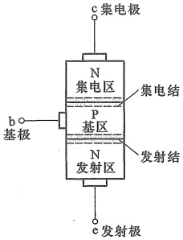

(a)
 

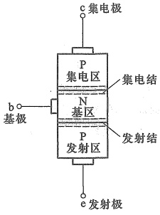

(b)
 

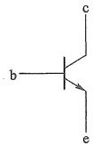

(c)
 

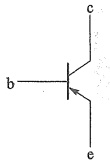

(d)
 

图 5.1.1 两种类型 BJT 的结构示意图及其电路符号 (a) NPN 型管结构示意图 (b) PNP 型管结构示意图 (c) NPN 型管的电路符号 (d) PNP 型管的电路符号
 

图5.1.2是集成电路中典型的NPN型BJT的截面图。周围的P $ ^{+} $型区和P型衬底与N型的集电区形成PN结，且将P型衬底接至电路中的最低电位点，使这些PN结始终处于反向偏置状态，从而达到与其他BJT隔离的目的。为了减小集电区的电阻，集电区在连接电极前增加了高掺杂的 $ N^{++} $型区。 $ N^{++} $的埋层可以减小集电区与衬底之间PN结的厚度，以免影响集电区工作。

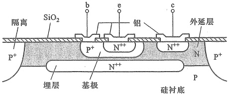

图 5.1.2 集成电路中典型 NPN 型 BJT 的截面图
 

<!-- page: 182 -->

##### 5.1.2 放大状态下 BJT 的工作原理

BJT 内部含有两个背靠背的 PN 结。当这两个 PN 结的偏置条件（正偏或反偏）不同时，BJT 将呈现不同的特性，对应四种可能的偏置组合，有四种工作状态：放大、饱和、截止与倒置。在发射结正偏、集电结反偏条件下，BJT 处于放大状态。

与 MOS 管类似，BJT 也是通过其控制作用实现信号放大的。下面以 NPN 管为例，分析两个 PN 结在上述偏置条件下实现控制关系的原理。

### 1. BJT 内部载流子的传输过程

在图 5.1.1a 中，当基极断开时，集电极和发射极之间相当于两个背靠背的 PN 结二极管如图 5.1.3 所示。这时无论 c、e 间加什么极性的电压，总有一个 PN 结是反偏的，c、e 间都不能导通。

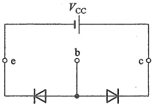

图 5.1.3 基极断开时的情况
 

##### （1）仅有集电结反偏电压时

当在如图 5.1.4a 所示集电极和基极之间外加电压  $ V_{CC} $ 时（电阻  $ R_{e} $ 起限流作用），集电结处于反向偏置，阻止多子扩散，但有利于少子的漂移，即基区的少子——电子和集电区的少子——空穴在回路中产生漂移电流  $ I_{CBO} $，这个电流也称为集电结反向饱和电流。这时集电结的电压和电流关系，就是 PN 结反向截止状态时的电压电流关系，相当于图 5.1.5a 所示的二极管反向截止时的特性曲线。如果以流入集电极的电流  $ i_{C} $ 为纵轴，电压  $ v_{CB} $ 为横轴，那么，由于  $ i_{C} = -i_{D}, v_{CB} = -v_{D} $，所以在  $ i_{C}, v_{CB} $ 构成的坐标系中就相当于曲线旋转了  $ 180^{\circ} $，如图 5.1.5b 中贴近横轴的那条曲线。

由于此时发射结没有偏置电压，所以发射极电流为零，即  $ I_{E}=0 $

##### （2）发射结再加正偏电压时

如图 5.1.4b 所示在基极和发射极之间外加电压  $ V_{EE} $，发射结处于正偏，有利于多子的扩散。这时，高掺杂浓度的发射区向基区注入带负电荷的自由电子，形成发射极电流  $ I_{E} $。注入基区的载流子的带电极性与基区的少子——电子一样，所以在集电结电场力作用下很容易漂移到集电区，形成电流  $ I_{CN} $（电流方向与电子流方向相反）。 $ I_{CN} $ 和  $ I_{CB0} $ 一起构成集电极电流  $ I_{C} $，即

$$  I_{c}=I_{CN}+I_{CBO}   \tag*{（5.1.1）}$$

这时集电极电流明显增大，而且电流的大小主要取决于发射区注入载流子的多少，也就是 $ I_{E} $的大小。增大发射结正偏电压 $ v_{BE} $，导致 $ I_{E} $增加，集电极电流也会增加，这时 $ i_{C} $与 $ v_{CB} $的关系就如图5.1.5b中不断上移的曲线。至此，可以看出发射极电流对集电极电流的控制作用。

<!-- page: 183 -->

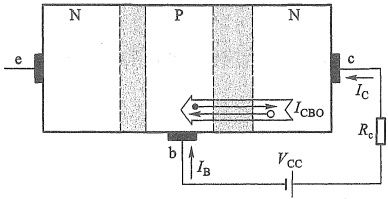

(a)
 

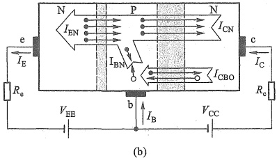

(b)
 

图 5.1.4 BJT 外加偏置电压时载流子的传输过程 (a) 仅有集电结反偏电压 (b) 同时有集电结反偏和发射结正偏
 

另外，发射极电流  $ i_{E} $ 与发射结正偏电压  $ v_{BE} $ 的关系就是 PN 结正偏时的电压电流关系，如图 5.1.5c 所示。由 3.2 节知识可知，它们满足

$$  i_{_{\mathrm{E}}}=I_{_{\mathrm{E S}}}(\mathrm{e}^{v_{_{\mathrm{B E}}}/V_{T}}-1)\approx I_{_{\mathrm{E S}}}\mathrm{e}^{v_{_{\mathrm{B E}}}/V_{T}}\quad(\mathrm{}v_{_{\mathrm{B E}}}\gg V_{T})   \tag*{(5.1.2)}$$

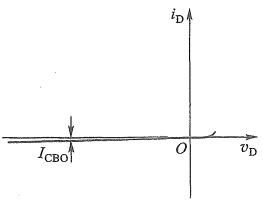

(a)
 

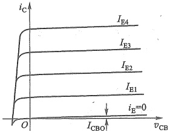

(b)
 

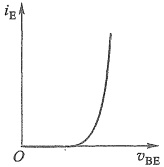

(c)
 

图 5.1.5 BJT 控制关系曲线
 

（a）二极管反向截止区曲线 （b）不同 $ i_{E} $下的 $ i_{C} $与 $ v_{CB} $的关系 （c） $ i_{E} $与 $ v_{BE} $的关系

<!-- page: 184 -->

其中  $ I_{ES} $ 是发射结反向饱和电流，其值很小，一般为  $ 10^{-12} \sim 10^{-15} $ A。

由此看出，改变发射结正偏电压就可以改变发射极电流，从而改变集电极电流，这就是BJT中的控制关系。显然，它也是非线性的，而且所需工作条件是：发射结正偏，集电结反偏。

以上过程还需注意几个细节：

① 发射区注入基区的自由电子，除了被集电区收集外，还有一部分与基区的多子——空穴复合，形成基区复合电流 $ I_{BN} $，它与 $ I_{CB0} $一起形成基极电流 $ I_{B} $

$$  I_{B}=I_{BN}-I_{CBO}   \tag*{（5.1.3）}$$

但是由于基区很薄，掺杂浓度又低，所以来自发射区的载流子，在基区被复合掉的只是一小部分，更多的是形成了集电极电流，所以 $ I_{c} $远大于 $ I_{B} $。

②发射区注入基区的载流子看上去与基区少子一样，都是自由电子，但实际上它们有本质的差别，因为来自发射区的自由电子绝大部分是由掺杂引起的、而非本征激发产生，所以受温度影响小，但是集电结电场对它们产生的作用是相同的。

③当发射结正向偏置时，基区的多子——空穴也会向发射区扩散，但是因为基区掺杂浓度远远低于发射区，所以通常忽略它们的影响。发射极电流 $ I_{E} $就近似等于发射区注入基区的载流子形成的电流 $ I_{EN} $。

实际上，当集电结零偏压时，PN结的内电场仍然存在，也能收集发射区注入基区的载流子，只要外部回路条件成立，就能形成集电极电流。当然，集电结在正偏电压作用下，其内电场被削弱，无法收集载流子，就不能形成集电极电流了。

由图 5.1.4b 看出，BJT 三个电极的电流关系满足

$$  I_{E}=I_{B}+I_{C}   \tag*{(5.1.4)}$$

以上看出，BJT 中两种带电极性的载流子——自由电子和空穴均参与了导电，这有别于单极型的 FET，所以称为双极型器件，BJT 因此而得名。

### 2. BJT 放大状态下的控制关系

（1） $ I_{E} $ 对  $ I_{c} $ 的控制

为了突出发射结电压对集电极电流的控制，就希望在相同的  $ I_{E} $ 下产生更大的  $ I_{C} $，亦即尽可能减少载流子在基区的复合比例。这样，就需要基区掺杂浓度远低于发射区，并且基区尽可能薄，使发射区注入的载流子很快到达集电结附近，被集电区收集。换言之，基区掺杂浓度与发射区掺杂浓度的差异和基区尺寸决定了载流子在基区的复合比例。BJT一旦制成，这个比例也就确定了，且不受外加电压的影响。通常定义  $ \alpha $ 来描述这个比例，即

$$  \overline{\alpha}=\frac{ 传输到集电极的电流 }{ 发射极注入电流 }=\frac{I_{CN}}{I_{E}}   \tag*{（5.1.5）}$$

将式（5.1.1）代入式（5.1.5）得

$$  \overline{\alpha}=\frac{I_{\mathrm{C}}-I_{\mathrm{CBO}}}{I_{\mathrm{E}}}\quad 或 \quad I_{\mathrm{C}}=\overline{\alpha}I_{\mathrm{E}}+I_{\mathrm{CBO}}.   \tag*{(5.1.6a)}$$

通常  $ I_{c} \gg I_{CB0} $，则

$$  I_{\mathrm{c}}\approx\overline{\alpha}I_{\mathrm{E}}   \tag*{(5.1.6b)}$$

由控制关系可知，集电极电流是受控量，常作为双口网络的输出电流，发射极电流作为

<!-- page: 185 -->

输入电流，所以， $ \overline{\alpha} $ 也称为电流放大系数。 $ \overline{\alpha} $ 越大，载流子在基区的复合比例越低。显然， $ \overline{\alpha} $ 小于 1，但通常都接近 1，一般在 0.98 以上。式(5.1.6b)体现了 BJT 的  $ I_{E} $ 对  $ I_{C} $ 的控制。

##### （2） $ I_{B} $ 对  $ I_{C} $ 的控制

还有一个更常用的电流放大系数 $ \beta $，定义为

$$  \overline{\beta}=\frac{I_{CN}}{I_{BN}}   \tag*{(5.1.7)}$$

将式(5.1.1)和式(5.1.3)代入式(5.1.7)得

$$  \overline{\beta}=\frac{I_{\mathrm{C}}-I_{\mathrm{CBO}}}{I_{\mathrm{B}}+I_{\mathrm{CBO}}}\quad 或 \quad I_{\mathrm{C}}=\overline{\beta}I_{\mathrm{B}}+\left(1+\overline{\beta}\right)I_{\mathrm{CBO}}   \tag*{(5.1.8a)}$$

当 $ \beta I_{B}\gg(1+\beta)I_{CB0} $时，有

$$  I_{\mathrm{c}}\approx\overline{\beta}I_{\mathrm{B}}   \tag*{(5.1.8b)}$$

 $ \beta $ 与  $ \alpha $ 有同样的性质，它是从另一个角度反映载流子在基区的复合比例。 $ \beta $ 越大，复合比例越低。显然，BJT 一旦制成， $ \beta $ 也就确定了。 $ \beta $ 一般远大于 1，通常在几十到几百之间。式(5.1.8b)可以看作是  $ I_{B} $ 对  $ I_{C} $ 的控制。

##### (3)  $ \beta $ 与  $ \overline{\alpha} $ 的关系

将式(5.1.4)代入式(5.1.6a)并整理得

$$  \bar{I}_{\mathrm{c}}=\frac{\overline{\alpha}}{1-\overline{\alpha}}\;I_{\mathrm{B}}+\frac{1}{1-\overline{\alpha}}I_{\mathrm{CB0}}   \tag*{(5.1.9)}$$

对比式(5.1.8a)和式(5.1.9)可以得到 $ \beta $与 $ \overline{\alpha} $的关系：

$$  \overline{\beta}=\frac{\overline{\alpha}}{1-\overline{\alpha}}   \tag*{(5.1.10)}$$

（4）关于 $ I_{CB0} $和 $ I_{CEO} $

将式(5.1.8b)代入式(5.1.4)得到发射极电流与基极电流的关系：

$$  I_{\mathrm{E}}=I_{\mathrm{B}}+I_{\mathrm{C}}=\left(1+\overline{\beta}\right)I_{\mathrm{B}}   \tag*{(5.1.11)}$$

另外，式 $  (5.1.8a)  $可继续表示为

$$  I_{\mathrm{c}}=\overline{\beta}I_{\mathrm{B}}+\left(1+\overline{\beta}\right)I_{\mathrm{CBO}}=\overline{\beta}I_{\mathrm{B}}+I_{\mathrm{CEO}}   \tag*{（5.1.12）}$$

其中

$$  I_{_{CEO}}=\left(1+\overline{\beta}\right)I_{_{CBO}}   \tag*{（5.1.13）}$$

是集电极与发射极之间的反向饱和电流，常称为穿透电流。对比式(5.1.11)和式(5.1.13)看出， $ I_{CEO} $ 相当于  $ I_{CB0} $ 在基区通过  $ I_{B} $ 对  $ I_{E} $ 的控制关系产生的发射极电流。尽管  $ I_{CB0} $ 被放大了  $ (1+\beta) $ 倍，但在放大区，它还是远小于  $ \overline{\beta}I_{B} $，一般可以忽略。

要注意，电流  $ I_{CBO} $ 不是发射区载流子形成的电流（参见图 5.1.4），不受发射结电压控制，因而对放大没有贡献。而且它与温度密切相关，所以会影响 BJT 的温度稳定性。

### 3. BJT 放大信号时的三种连接方式

与 MOS 管相似，BJT 用作信号放大时也是构成双口网络，也有三种组态，即共基极组态、共发射极（简称共射极）组态和共集电极组态，如图 5.1.6 所示。要特别注意，集电极始终不能做输入端子，基极始终不能做输出端子，这是由 BJT 内部载流子的控制关系决定的。

无论哪种连接方式，要使 BJT 有放大作用，都必须保证发射结正偏、集电结反偏，其内部

<!-- page: 186 -->

载流子的传输过程是相同的，电极间电流控制关系也是相同的。

由式(5.1.6b)和式(5.1.8b)可知， $ i_{c} $ 与  $ i_{E} $ 或  $ i_{B} $ 的控制关系是线性的，但  $ i_{E} $ 或  $ i_{B} $ 与  $ v_{BE} $ 是指数关系，而且  $ \overline{\alpha} $ 就是共基极的电流放大系数， $ \overline{\beta} $ 就是共射极的电流放大系数。由式(5.1.11)可知， $ i_{B} $ 也可以控制  $ i_{E} $，所以  $ i_{E} $ 也可作为输出电流（参见图5.1.6c）。

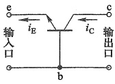

(a)
 

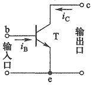

(b)
 

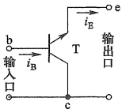

(c)
 

图 5.1.6 BJT 的三种连接方式
 

(a) 共基极 (b) 共发射极 (c) 共集电极
 

##### 5.1.3 BJT 的 I-V 特性曲线

对于图5.1.6所示的连接方式，都可以用BJT的端口特性曲线定量描述它的电压电流关系。与MOS管不同，BJT三个电极都是有电流的，所以工程上常用的是输入特性和输出特性，而非转移特性。输入特性曲线用来描述输入端口电压和电流之间的关系，而输出特性曲线则描述输出端口电压和电流的关系。

### 1. 共基极连接时的 I-V 特性曲线

BJT 共基极连接时，端口电流和电压如图 5.1.7 所示。注意，这里为了与发射结正偏电压极性一致，输入端口电压极性标注以 b 极为正。

##### （1）输入特性

当  $ v_{CB} $ 为某一常数时，输入端口的  $ i_{E} $ 与  $ v_{BE} $ 之间的关系曲线称为共基极输入特性曲线，用函数表示为

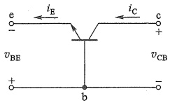

图 5.1.7 共基极连接
 

 $$ i_{E}=f(\left.v_{BE}\right.)\left|\right._{v_{CB}}= 常数 $$ 

对比图5.1.7和图5.1.4b，它们的连接相同，所以输入特性曲线如图5.1.5c所示。

##### （2）输出特性

当  $ i_{E} $ 为某一常数时，输出端口的  $ i_{C} $ 与  $ v_{CB} $ 间的关系曲线称为共基极输出特性曲线，用函数表示为

 $$ i_{c}=f(\left.v_{CB}\right.)\left|\right._{i_{E}= 常数 } $$ 

同样，图 5.1.5b 所示为输出特性曲线。

### 2. 共射极连接时的 I-V 特性曲线

共射极连接形式如图 5.1.8 所示。

##### （1）输入特性

共射极连接时的输入特性曲线描述了当输出电压  $ v_{CE} $ 为某一常数时，输入端口的  $ i_{B} $ 与  $ v_{BE} $ 之间的关系，用函数表示为

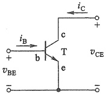

图 5.1.8 共射极连接
 

<!-- page: 187 -->

$$ i_{B}=f(\left.v_{BE}\right.)\left|\right._{\left.v_{CE}\right.= 常数 } $$ 

由于  $ i_{B} $ 是流过发射结电流的一部分，所以它与  $ v_{BE} $ 也呈指数关系，在发射结正偏时，输入特性曲线就是 PN 结的正向 I-V 特性曲线。图 5.1.9 是 NPN 型硅 BJT 共射极连接时的输入特性曲线。图中绘出了对应  $ v_{CE} $ 三种不同值时的情况。

 $ v_{CE} $对曲线产生影响的原因解释如下：共射极连接时，集电结反偏电压  $ v_{CB} = v_{CE} - v_{BE} $。在  $ v_{BE} $ 不变的情况下，当  $ v_{CE} $ 较小时，集电结可能处于正偏或反偏电压很小，集电区收集载流子的能力较弱，载流子在基区停留时间变长，复合机率增大， $ i_{B} $ 较大。随着  $ v_{CE} $ 的增加，集电结反偏电压  $ v_{CB} $ 也增大，收集载流子能力增强，发射区注入基区的载流子在基区停留时间变短；与此同时，反偏电压也使集电结空间电荷区变宽，从而使基区的有效宽度减小（参见图5.1.4b），这两种变化都使载流子在基区的复合机会减少，结果使  $ i_{B} $ 减小。意味着在同样的  $ v_{BE} $ 下  $ i_{B} $ 减小，特性曲线右移。通常将  $ v_{CE} $ 变化引起基区有效宽度变化，致使基极电流  $ i_{B} $ 变化的效应称为基区宽度调制效应。

实际上，当  $ v_{CE} > 1 $ V 以后，其影响已经很小。因为这时集电结的电场已足够强，几乎能收集到所有可收集的载流子，以至于  $ v_{CE} $ 再增加时， $ i_{B} $ 也不再明显减小，常用一条曲线代替。

由图5.1.9看出，硅发射结正向导通时，其压降与硅二极管正向压降相同，约为0.7 V。

##### （2）输出特性

共射极连接时的输出特性曲线描述了当输入电流  $ i_{B} $ 为某一常数时，输出端口的  $ i_{C} $ 与  $ v_{CE} $ 间的关系，用函数表示为

 $$ i_{C}=f(\left.v_{CE}\right.)\left|\right._{i_{B}= 常数 } $$ 

这个曲线可以从共基极输出特性曲线推出。由于  $ v_{CB} = v_{CE} - v_{BE} $，对于硅管， $ v_{BE} $ 约为 0.7 V，即  $ v_{CB} \approx v_{CE} - 0.7 $ V，即横轴由  $ v_{CB} $ 变换成  $ v_{CE} $ 时，相当于纵轴向左平移约 0.7 V，即由图 5.1.5b 变换到了图 5.1.10。同时，不同的曲线，对应不同的  $ i_{B} $ 而非  $ i_{E} $。

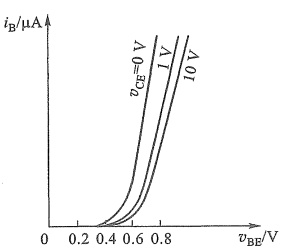

图 5.1.9 NPN 型硅 BJT 共射极连接时的输入特性曲线
 

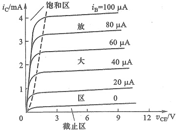

图 5.1.10 NPN 型硅 BJT 共射极连接时的输出特性曲线
 

当  $ v_{CE} $ 等于零时， $ v_{CB} $ 约为 -0.7 V，集电结正偏，没有收集载流子的能力。所以集电极电流为零。

可以看出，BJT 的输出特性曲线与 MOS 管的输出特性曲线形状相似，只是控制关系不

<!-- page: 188 -->

同，但同样可分为三个工作区域：放大区、饱和区和截止区（图中的截止区范围有所夸大，实际上对硅管而言， $ i_{B}=0 $ 的那条曲线几乎与横轴重合）。

##### ① 放大区

 $ i_{B}=0 $ 上方特性曲线基本水平的区域是放大区。BJT 工作在放大区时，发射结正偏电压大于开启电压，而集电结反偏。 $ i_{C} $ 主要受  $ i_{B} $ 控制，有  $ i_{C}=\beta i_{B} $

实际上曲线随着  $ v_{CE} $ 的增加略微上倾，反映了  $ v_{CE} $ 对  $ i_{C} $ 略有影响，这便是基区宽度调制效应带来的影响，类似于 MOS 管的沟道长度调制效应（参见图 4.1.10）。BJT 也有一个与 MOS 管类似的厄利电压  $ V_{A} $。

##### ②饱和区

横轴上方左侧特性曲线快速上升的区域是饱和区。在该区域内， $ v_{CE} $ 较小，集电结收集载流子的能力较弱，这时即使  $ i_{B} $ 增加， $ i_{C} $ 也增加不多，或者基本不变，有  $ i_{C}<\beta i_{B} $。但  $ i_{C} $ 随  $ v_{CE} $ 的增加而迅速上升。

在饱和区，发射结正偏，集电结正偏，即  $ v_{CE} \leq v_{BE} $。对于小功率管，认为当  $ v_{CE} = v_{BE} $（即集电结零偏）时，BJT 处于饱和区与放大区的临界点，也称临界饱和（或临界放大），对应于图 5.1.10 中的虚线位置。但在实际应用中，当集电结零偏或正偏电压较小（硅管小于 0.4 V，锗管小于 0.1 V）时，集电结内电场仍有收集载流子的能力，电流的控制关系和放大状态接近。

##### ③ 截止区

在该区域，发射结偏置电压小于 PN 结的开启电压，BJT 无法导通， $ i_{B}=0 $ 。此时，虽有  $ i_{C}=I_{CEO} $，但小功率管的  $ I_{CEO} $ 通常很小，可以忽略不计，即  $ i_{C}\approx0 $ 。

以上结论对 PNP 型 BJT 同样适用，只是两者所需的偏置电压极性相反，产生的电流方向也相反。

##### 5.1.4 BJT 的主要参数

### 1. 电流放大系数

##### （1）直流电流放大系数 $ \beta $

$$  \overline{\beta}=\left(I_{\mathrm{c}}-I_{\mathrm{CEO}}\right)/I_{\mathrm{B}}   \tag*{(5.1.14a)}$$

当  $ I_{c} \gg I_{CEO} $ 时， $ \beta $ 可近似表示为

$$  \overline{\beta}\approx I_{\mathrm{c}}/I_{\mathrm{b}}   \tag*{(5.1.14b)}$$

在数据手册中， $ \beta $ 通常被标注为  $ h_{fe} $。在理想情况下，对于给定的 BJT， $ \beta $ 是个常数。实际上它仅在  $ i_{c} $ 的一定范围内基本不变，超出范围后会明显下降。

##### （2）交流电流放大系数 $ \beta $

 $ \beta $ 定义为集电极电流变化量与基极电流变化量之比，即

$$  \beta=\frac{\Delta i_{C}}{\Delta i_{B}}\Bigg|_{v_{CE}= 常数 }   \tag*{（5.1.15）}$$

 $ \beta $ 反映动态（交流工作状态）时的电流放大特性。在绝大部分情况下认为  $ \beta \approx \beta $ ，即两者可混用。无特别说明时，本书后面均将两者混用。

由于元器件参数具有分散性，所以数据手册通常将 $ \beta $标注为一个范围。分立元件BJT

<!-- page: 189 -->

的  $ \beta $ 一般为几十到几百，集成电路中 BJT 的  $ \beta $ 值差异很大，可小到低于 10，如横向 PNP 型管，大到数千，如超  $ \beta $ 管。

另一个电流放大系数  $ \alpha $ 可以通过  $ \beta $ 由式(5.1.10)求得。

### 2. 极间反向电流

##### （1）集电极-基极反向饱和电流 $ I_{CB0} $

 $ I_{CB0} $ 是发射极开路时，由少子形成的集电结反向饱和电流。它受温度影响较大，小功率硅管的  $ I_{CB0} $ 一般小于  $ 1\ \mu A $，小功率锗管约为  $ 10\ \mu A $。

##### （2）集电极-发射极反向饱和电流 $ I_{CEO} $

 $ I_{CEO} $ 是基极开路时，由集电区穿过基区流向发射区的反向饱和电流，也常称为穿透电流。其值越小性能越好，温度稳定性越高。

### 3. 极限参数

##### （1）集电极最大允许电流 $ I_{CM} $

 $ \beta $ 值下降到一定值时的  $ i_{c} $ 即为  $ I_{cM} $ 。当工作电流  $ I_{c} $ 大于  $ I_{cM} $ 时，BJT 不一定会烧坏，但  $ \beta $ 值将过小，放大能力下降。

##### （2）集电极最大允许耗散功率 $ P_{CM} $

虽然 BJT 内的两个 PN 结上都会消耗功率，但一般情况下，集电结上的电压降远大于发射结上的电压降，因此与发射结相比，集电结上耗散的功率  $ P_{c} $ 要大得多，其值近似为  $ P_{c} \approx i_{c} v_{CE} $ 。BJT 工作时不得超过最大允许耗散功率  $ P_{CM} $ 值，否则器件将烧毁。 $ P_{CM} $ 的大小与最高结温和环境温度及 BJT 的散热条件有关。

##### （3）反向击穿电压

①  $  V_{(BR)EBO}  $

指集电极开路时，发射极-基极间的反向击穿电压。在正常放大状态时，发射结是正偏的。而在某些场合，例如工作在大信号或者开关状态时，发射结上就有可能出现较大的反向电压，所以要考虑发射结反向击穿电压的大小。小功率管的 $ V_{(BR)EBO} $一般为几伏。

②  $ V_{(BR)CBO} $

指发射极开路时集电极-基极间的反向击穿电压，其值较高，通常为几十伏，有些BJT可达几百伏。

③  $ V_{(BR)CEO} $

指基极开路时集电极-发射极间的击穿电压。这个电压的大小与穿透电流 $ I_{CEO} $直接相关，当 $ V_{CE} $增加使 $ I_{CEO} $明显增大时，表明集电结出现雪崩击穿。

与 MOS 管类似，大部分极限参数也可以反映在输出特性坐标系中，如图 5.1.11 所示。

表5.1.1列出了几种BJT的主要参数。

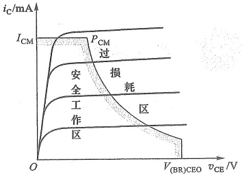

图 5.1.11 BJT 的功率极限损耗线
 

<!-- page: 190 -->

表 5.1.1 几种 BJT 的主要参数
 

<table border=1 style='margin: auto; word-wrap: break-word;'><tr><td style='text-align: center; word-wrap: break-word;'>参数名称</td><td style='text-align: center; word-wrap: break-word;'>最大集电极-基极电压</td><td style='text-align: center; word-wrap: break-word;'>最大集电极-发射极电压</td><td style='text-align: center; word-wrap: break-word;'>最大发射极-基极电压</td><td style='text-align: center; word-wrap: break-word;'>最大集极电流</td><td style='text-align: center; word-wrap: break-word;'>最大耗散功率</td><td style='text-align: center; word-wrap: break-word;'>电流放大系数</td><td style='text-align: center; word-wrap: break-word;'>集电极-发射极饱和压降</td><td style='text-align: center; word-wrap: break-word;'>集电极-基极反向饱和电流</td><td style='text-align: center; word-wrap: break-word;'>截止穿透电流</td><td style='text-align: center; word-wrap: break-word;'>管型</td></tr><tr><td style='text-align: center; word-wrap: break-word;'>参数符号</td><td style='text-align: center; word-wrap: break-word;'>$ V_{(BR)CBO} / V $</td><td style='text-align: center; word-wrap: break-word;'>$ V_{(BR)CEO} / V $</td><td style='text-align: center; word-wrap: break-word;'>$ V_{(BR)EBO} / V $</td><td style='text-align: center; word-wrap: break-word;'>$ I_{DM} / mA $</td><td style='text-align: center; word-wrap: break-word;'>$ P_{DM} / W $</td><td style='text-align: center; word-wrap: break-word;'>$ h_{fe} $</td><td style='text-align: center; word-wrap: break-word;'>$ V_{CES} / V $</td><td style='text-align: center; word-wrap: break-word;'>$ I_{CBO} / nA $</td><td style='text-align: center; word-wrap: break-word;'>$ I_{CEO} / nA $</td><td style='text-align: center; word-wrap: break-word;'></td></tr><tr><td style='text-align: center; word-wrap: break-word;'>2N3904</td><td style='text-align: center; word-wrap: break-word;'>60</td><td style='text-align: center; word-wrap: break-word;'>40</td><td style='text-align: center; word-wrap: break-word;'>6</td><td style='text-align: center; word-wrap: break-word;'>200</td><td style='text-align: center; word-wrap: break-word;'>1.5</td><td style='text-align: center; word-wrap: break-word;'>100~400</td><td style='text-align: center; word-wrap: break-word;'>&lt;0.3\n( $ I_C = 50 $ mA)</td><td style='text-align: center; word-wrap: break-word;'></td><td style='text-align: center; word-wrap: break-word;'>&lt;50</td><td style='text-align: center; word-wrap: break-word;'>硅 NPN</td></tr><tr><td style='text-align: center; word-wrap: break-word;'>2N3906</td><td style='text-align: center; word-wrap: break-word;'>-40</td><td style='text-align: center; word-wrap: break-word;'>-40</td><td style='text-align: center; word-wrap: break-word;'>-6</td><td style='text-align: center; word-wrap: break-word;'>-200</td><td style='text-align: center; word-wrap: break-word;'>0.5</td><td style='text-align: center; word-wrap: break-word;'>100~300</td><td style='text-align: center; word-wrap: break-word;'>$ |V_{CES}| &lt; 0.2 $\n( $ I_C = -50 $ mA)</td><td style='text-align: center; word-wrap: break-word;'>$ |I_{CBO}| &lt; 50 $</td><td style='text-align: center; word-wrap: break-word;'></td><td style='text-align: center; word-wrap: break-word;'>硅 PNP</td></tr><tr><td style='text-align: center; word-wrap: break-word;'>$ 9013^{{①}} $</td><td style='text-align: center; word-wrap: break-word;'>45</td><td style='text-align: center; word-wrap: break-word;'>25</td><td style='text-align: center; word-wrap: break-word;'>5</td><td style='text-align: center; word-wrap: break-word;'>500</td><td style='text-align: center; word-wrap: break-word;'>0.625</td><td style='text-align: center; word-wrap: break-word;'>64~300</td><td style='text-align: center; word-wrap: break-word;'>&lt;0.6\n( $ I_C = 500 $ mA)</td><td style='text-align: center; word-wrap: break-word;'></td><td style='text-align: center; word-wrap: break-word;'>&lt;100</td><td style='text-align: center; word-wrap: break-word;'>硅 NPN</td></tr><tr><td style='text-align: center; word-wrap: break-word;'>9015</td><td style='text-align: center; word-wrap: break-word;'>-50</td><td style='text-align: center; word-wrap: break-word;'>-45</td><td style='text-align: center; word-wrap: break-word;'>-5</td><td style='text-align: center; word-wrap: break-word;'>-100</td><td style='text-align: center; word-wrap: break-word;'>0.45</td><td style='text-align: center; word-wrap: break-word;'>60~600</td><td style='text-align: center; word-wrap: break-word;'>$ |V_{CES}| &lt; 0.7 $\n( $ I_C = -100 $ mA)</td><td style='text-align: center; word-wrap: break-word;'>$ |I_{CBO}| &lt; 50 $</td><td style='text-align: center; word-wrap: break-word;'></td><td style='text-align: center; word-wrap: break-word;'>硅 PNP</td></tr><tr><td style='text-align: center; word-wrap: break-word;'>9018</td><td style='text-align: center; word-wrap: break-word;'>30</td><td style='text-align: center; word-wrap: break-word;'>15</td><td style='text-align: center; word-wrap: break-word;'>5</td><td style='text-align: center; word-wrap: break-word;'>50</td><td style='text-align: center; word-wrap: break-word;'>0.4</td><td style='text-align: center; word-wrap: break-word;'>28~198</td><td style='text-align: center; word-wrap: break-word;'>&lt;0.5\n( $ I_C = 10 $ mA)</td><td style='text-align: center; word-wrap: break-word;'></td><td style='text-align: center; word-wrap: break-word;'>&lt;50</td><td style='text-align: center; word-wrap: break-word;'>硅 NPN</td></tr></table>

① 9013 的  $ V_{(BR)CBO} $、 $ V_{(BR)CEO} $ 和  $ V_{(BR)EBO} $ 的值是击穿电压值。

##### 复习思考题

5.1.1 能否将 BJT 的发射极 e、集电极 c 交换使用？为什么？

5.1.2  $ v_{BE} $ 和  $ v_{CE} $ 要各加什么极性的电压，才能使 PNP 型 BJT 工作在放大区？使其处于截止及饱和状态时的条件分别是什么？

5.1.3 BJT 是通过什么方式来控制集电极电流的？试说明集电极电流和基极电流的组成部分。

5.1.4 BJT 的电流放大系数  $ \alpha $、 $ \beta $ 是如何定义的，能否从共射极输出特性曲线上求得  $ \beta $ 值，并算出  $ \alpha $ 值？

5.1.5 用哪几个参数可以确定 BJT 的安全工作区？

#### 5.2 BJT放大电路

##### 5.2.1 基本共射极放大电路

基本共射极放大电路如图 5.2.1 所示。直流电源  $ V_{BB} $ 通过电阻  $ R_{b} $ 给 BJT 的发射结提供正偏电压，并产生基极直流电流  $ I_{B} $（常称为偏流）。直流电源  $ V_{CC} $ 通过电阻  $ R_{c} $，并与  $ V_{BB} $ 和  $ R_{b} $ 配合，给集电结提供反偏电压，使 BJT 工作于放大状态。电阻  $ R_{c} $ 的另一个作用是将集电极电流  $ i_{c} $ 的变化转换为电压的变化，再送到放大电路的输出端。 $ v_{s} $ 是待放大的时变

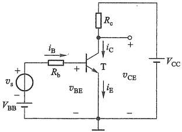

图 5.2.1 基本共射极放大电路
 

<!-- page: 191 -->

输入信号，加在基极与发射极之间的输入回路中，输出信号从集电极-发射极间取出，发射极是输入回路与输出回路的共同端，所以称为共射极放大电路。

电路中也是交流量、直流量共存，交流量叠加在直流量上。分析或设计 BJT 放大电路时，也是要先确定直流量，后分析交流性能。

令  $ v_{s}=0 $ (短路  $ v_{s} $)，通过直流通路可以求得电路的静态工作点  $ Q(I_{BQ},I_{CQ},V_{CEQ}) $。

由基极-发射极回路有

$$  I_{BQ}=\frac{V_{BB}-V_{BEQ}}{R_{b}}   \tag*{(5.2.1)}$$

式中， $ V_{BEQ} $ 常被认为是已知量（发射结处于正向偏置，可用二极管恒压降模型分析），硅管的  $ V_{BEQ} $ 为 0.6~0.7 V，锗管的  $ V_{BEQ} $ 为 0.2~0.3 V。

由 BJT 放大区的控制关系求得

$$  I_{c q}=\beta I_{b q}   \tag*{(5.2.2)}$$

由集电极-发射极回路有

$$  V_{\mathrm{C E Q}}=V_{\mathrm{C C}}-I_{\mathrm{C Q}}R_{\mathrm{e}}   \tag*{（5.2.3）}$$

以上计算均假设 BJT 工作于放大区，如果参数不合适，结果可能不满足工作在放大区时两个 PN 结的偏置条件。

当  $ v_s \neq 0 $ 时，BJT 各电极电流及电压都在 Q 点的基础上随输入信号作相应的变化。 $ v_{BE} = V_{BEQ} + v_{be} $， $ v_{be} $ 是  $ v_s $ 在发射结上产生的交流电压 ( $ v_{be} \ll V_{BEQ} $)。 $ v_{BE} $ 的变化必然导致  $ i_B $、 $ i_C $ 产生相应变化，即  $ i_B = I_{BQ} + i_b $， $ i_c = I_{CQ} + i_e $，其中  $ i_c = \beta i_b $ 是交流电流。同时有  $ v_{CE} = V_{CC} - i_C R_c = V_{CEQ} + v_{ce} $。将  $ v_{ce} $ 用适当方式取出就得到该放大电路的输出电压  $ v_c $。

##### 5.2.2 BJT 放大电路的图解分析

与 FET 放大电路类似，BJT 放大电路也可以用图解分析。

### 1. 静态工作点的图解分析

将图5.2.1所示电路改画成图5.2.2的形式，并用点画线把电路分成三部分。

令  $ v_{s}=0 $，可列出输入回路中点画线左侧的回路直线方程  $ v_{BE}=V_{BB}-i_{B}R_{b} $。在输入特性坐标系中作出该直线如图5.2.3a所示。它与输入特性曲线的交点就是电路的静态工作点 Q，由此得到  $ V_{BEQ} $ 和  $ I_{BQ} $。图中的直线也称为输入直流负载线。

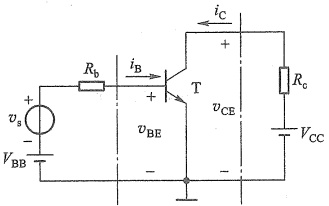

图 5.2.2 基本共射极放大电路原理图
 

列出输出回路中点画线右侧的负载线方程

 $ v_{CE}=V_{CC}-i_{c}R_{c} $。在输出特性坐标系中作出该直线如图5.2.3b所示，其斜率为 $ -1/R_{c} $。它与 $ I_{BQ} $对应的那条特性曲线的交点便是Q点，由此得到 $ V_{CEQ} $和 $ I_{CQ} $。

### 2. 动态工作情况的图解分析

当  $ v_{s}=V_{sm}\sin\omega t $ 时，有  $ v_{BE}=V_{BB}+v_{s}-i_{B}R_{b} $，相应的输入负载线是一组斜率为  $ -1/R_{b} $，且随  $ v_{s} $ 变化而平行移动的直线，如图 5.2.4a 所示。根据负载线与输入特性曲线交点的移动过程，可画出  $ v_{BE} $ 和  $ i_{B} $ 的波形。

<!-- page: 192 -->

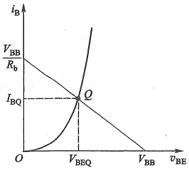

(a)
 

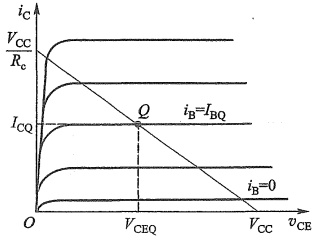

(b)
 

图 5.2.3 静态工作点的图解分析
 

（a）输入回路的图解分析 （b）输出回路的图解分析
 

图 5.2.4a 中， $ i_{B1} $ 在  $ i_{B2} $ 和  $ i_{B3} $ 之间的变化，将引起图 b 中输出特性曲线与负载线的交点 Q 在  $ Q' $ 和  $ Q'' $ 之间变化，由此便可画出  $ i_{C} $ 及  $ v_{CE} $ 的波形，如图 5.2.4b 所示。 $ v_{ee} $ 就是输出电压  $ v_{e} $，它是与  $ v_{s} $ 同频率的正弦波，但二者的相位相反。用  $ v_{ee} $ 的幅值除以  $ v_{s} $ 的幅值就是电路的电压放大倍数。

图 5.2.4b 中的  $ V_{CES} $ 是 BJT 集电极-发射极饱和压降， $ V_{CES} $ 的典型值约为 0.2 V。

显然，Q 点过高，Q' 点容易进入饱和区而使输出波形出现饱和失真；Q 点过低，容易使 Q'' 点进入截止区而产生截止失真。表明要使 BJT 放大电路不失真地放大输入信号，必须设置合适的静态工作点 Q。

##### 5.2.3 BJT 的小信号模型

与 FET 类似，BJT 也是一个非线性器件，在输入为低频小信号的情况下，也可以用线性化的小信号模型代替 BJT，从而将 BJT 放大电路当作线性电路来分析。

BJT 有多种小信号模型，这里仅介绍使用最广泛的混合(hybrid, H)参数模型，常称为 H 参数小信号模型。

### 1. BJT 的 H 参数的引出

在图 5.2.5a 所示的双口网络中，分别用  $ v_{BE} $、 $ i_{B} $ 和  $ v_{CE} $、 $ i_{C} $ 表示输入端口和输出端口的电压及电流。若以  $ i_{B} $、 $ v_{CE} $ 作自变量， $ v_{BE} $、 $ i_{C} $ 作因变量，由 BJT 的输入、输出特性曲线可写出以下两个方程式：

$$  v_{_{\mathrm{B E}}}=f_{1}(i_{_{\mathrm{B}}},v_{_{\mathrm{C E}}})   \tag*{(5.2.4)}$$

$$  i_{\mathrm{c}}=f_{2}(i_{\mathrm{B}},v_{\mathrm{C E}})   \tag*{(5.2.5)}$$

式中  $ i_{B} $、 $ i_{C} $、 $ v_{BE} $、 $ v_{CE} $ 均为总量瞬时值，而小信号模型是指 BJT 在交流低频小信号工作状态下的模型，这时要考虑的是电压、电流间的微变关系。为此，对上两式取全微分，即

$$  \mathrm{d}v_{\mathrm{BE}}=\frac{\partial v_{\mathrm{BE}}}{\partial i_{\mathrm{B}}}\left|\begin{array}{c}\mathrm{d}i_{\mathrm{B}}+\frac{\partial v_{\mathrm{BE}}}{\partial v_{\mathrm{CE}}}\\\nu_{\mathrm{CEQ}}\end{array}\right|_{I_{\mathrm{BQ}}}\mathrm{d}v_{\mathrm{CE}}   \tag*{(5.2.6)}$$

$$  \mathrm{d}i_{\mathrm{c}}=\frac{\partial i_{\mathrm{c}}}{\partial i_{\mathrm{B}}}\left|\begin{array}{c}\mathrm{d}i_{\mathrm{B}}+\frac{\partial i_{\mathrm{c}}}{\partial v_{\mathrm{CE}}}\end{array}\right|_{I_{\mathrm{BQ}}}\mathrm{d}v_{\mathrm{CE}}   \tag*{(5.2.7)}$$

<!-- page: 193 -->

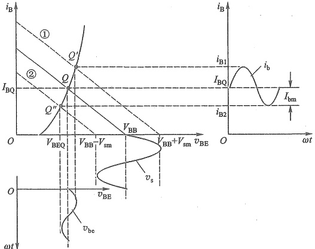

(a)
 

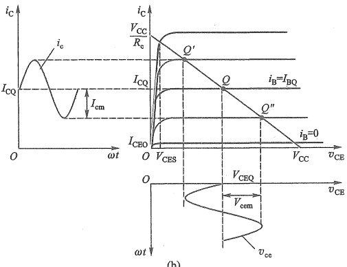

图 5.2.4 动态工作情况的图解分析
 

（a）由  $ v_{s} $ 在输入特性曲线上画  $ v_{BE} $ 及  $ i_{B} $ 的波形 （b）由  $ i_{B} $ 在输出特性曲线上画  $ i_{C} $ 及  $ v_{CE} $ 的波形

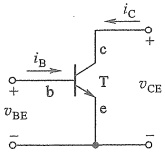

(a)
 

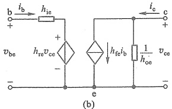

图 5.2.5 BJT 的双口网络及 H 参数小信号模型
 

（a）BJT 在共射极连接时的双口网络 （b）H 参数小信号模型

<!-- page: 194 -->

式中， $ \mathrm{d}v_{BE} $ 表示  $ v_{BE} $ 中的变化量，若输入为低频小幅值的正弦波信号，则  $ \mathrm{d}v_{BE} $ 可用  $ v_{be} $ （发射结电压中的交流分量）表示。同理， $ \mathrm{d}v_{CE} $、 $ \mathrm{d}i_{B} $、 $ \mathrm{d}i_{C} $ 可分别用  $ v_{ee} $、 $ i_{b} $、 $ i_{e} $ 表示。于是，可将式 (5.2.6)、式 (5.2.7) 写成下列形式：

 $$ v_{\mathrm{b e}}=h_{\mathrm{i e}}i_{\mathrm{b}}+h_{\mathrm{r e}}v_{\mathrm{c e}} $$ 

$$  i_{\mathrm{e}}=h_{\mathrm{f e}}i_{\mathrm{b}}+h_{\mathrm{o e}}v_{\mathrm{c e}}   \tag*{(5.2.8)}$$

式中， $ h_{ie} $、 $ h_{re} $、 $ h_{fe} $、 $ h_{oe} $ 称为 BJT 共射极连接时的 H 参数 $ ^{①} $。其中

 $ h_{ie}=\frac{\partial v_{BE}}{\partial i_{B}}\bigg|_{v_{CEQ}} $ 是 BJT 输出端交流短路（即  $ v_{ce}=0 $， $ v_{CE}=V_{CEQ} $）时的输入电阻，即小信号作用下 b-e 极间的交流电阻，单位为  $ \Omega $（欧[姆]），也常用  $ r_{h} $ 表示。

 $ h_{fe}=\frac{\partial i_{C}}{\partial i_{B}}\bigg|_{V_{CEQ}} $ 是 BJT 输出端交流短路时的正向电流传输比，或电流放大系数（量纲为 1），即  $ \beta $。

 $ h_{re}=\frac{\partial v_{BE}}{\partial v_{CE}}\bigg|_{I_{BQ}} $ 是 BJT 输入端交流开路（即  $ i_{b}=0, i_{B}=I_{BQ} $）时的反向电压传输比（量纲为 1）。它反映了 BJT 输出回路电压  $ v_{CE} $ 对输入回路电压  $ v_{BE} $ 的影响程度。

 $ h_{oe}=\frac{\partial i_{C}}{\partial v_{CE}}\bigg|_{I_{BQ}} $ 是 BJT 输入端交流开路时的输出电导，单位为 S（西[门子]），也可用  $ 1/r_{ce} $ ②表示。它就是放大区输出特性曲线倾斜的斜率，反映了电压  $ v_{CE} $ 对电流  $ i_{C} $ 的影响程度。

由于这四个参数的量纲各不相同，故称为混合参数。

### 2. BJT 的 H 参数小信号模型

式(5.2.8)表明，在 BJT 的输入回路中， $ v_{be} $ 等于两个电压相加，其中一个是  $ h_{ie}i_{b} $，表示输入电流  $ i_{b} $ 在  $ h_{ie} $ 上产生的电压降；另一个是  $ h_{re}v_{ee} $，表示输出电压  $ v_{ee} $ 对输入回路的反作用，可以用一个受控电压源来表示。式(5.2.9)表明，在输出回路中， $ i_{c} $ 由两个并联支路的电流相加组成，一个是受基极电流  $ i_{b} $ 控制的  $ h_{fe}i_{b} $，可以用受控电流源表示；另一个是由于输出电压  $ v_{ee} $ 加在输出电阻  $ 1/h_{ee} $ 上引起的电流  $ h_{ee}v_{ee} $。由此可以画出 BJT 的 H 参数小信号模型，如图 5.2.5b 所示。要特别注意以下几点：

① BJT 必须工作在放大区，并且是小信号情况下，模型才是可用的。

② 模型只适用于交流信号或变化量的分析，不能用来分析静态工作点。

③ H 参数的数值大小与 Q 点的位置有关，它们都是在 Q 点上求得的。

④ 受控源  $ h_{fe}i_{b} $ 的电流方向和控制电流  $ i_{b} $ 的方向是关联的。也就是说，改变其中任何一个参考方向的标注方式，另一个也必须改变。

### 3. 小信号模型的简化

BJT 在共射极连接时，其 H 参数的数量级一般为

<!-- page: 195 -->

$$ h_{\mathrm{e}}=\left[\begin{matrix}{h_{\mathrm{i e}}}&{h_{\mathrm{r e}}}\\ {h_{\mathrm{f e}}}&{h_{\mathrm{o e}}}\\ \end{matrix}\right]=\left[\begin{matrix}{10^{3}~\Omega}&{10^{-3}\sim10^{-4}}\\ {10^{2}}&{10^{-5}~\mathrm{S}}\\ \end{matrix}\right] $$ 

可见  $ h_{re} $ 和  $ h_{oe} $ 都很小，所以可以忽略它们的影响，即将受控电压源  $ h_{re}v_{ce} $ 作短路处理，输出电阻  $ 1/h_{ee} $ 作开路处理。于是，可得到 BJT 的简化小信号模型，如图 5.2.6 所示。

应当注意，如果 BJT 输出回路所接的负载电阻  $ R_{c} $ 或  $ R_{L} $ 与  $ \frac{1}{h_{oe}} $（即  $ r_{ee} $）接近时，则应考虑  $ \frac{1}{h_{oe}} $ 的影响。

### 4. H 参数值的确定

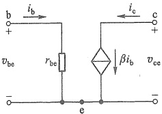

当用 H 参数小信号模型替代 BJT 进行交流分析时，必须首先求出 BJT 在静态工作点处的 H 参数值。它们可以

图 5.2.6 BJT 的简化小信号模型
 

从 BJT 的特性曲线上求得，也可用 H 参数测试仪或晶体管特性图示仪测得。此外， $ r_{be} $（即  $ h_{ie} $）可由下式求得：

$$  r_{\mathrm{b e}}=r_{\mathrm{b b^{\prime}}}+(1+\beta)\left(r_{\mathrm{e}}+r_{\mathrm{e}}^{\prime}\right)   \tag*{(5.2.10a)}$$

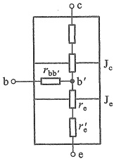

式中， $ r_{bb'} $ 为 BJT 基区的体电阻，如图 5.2.7 所示， $ r_e' $ 是发射区的体电阻。 $ r_{bb'} $ 和  $ r_e' $ 仅与掺杂浓度及制造工艺有关，基区掺杂浓度比发射区掺杂浓度低，所以  $ r_{bb'} $ 比  $ r_e' $ 大得多，对于小功率的 BJT， $ r_{bb'} $ 为几十至几百欧，而  $ r_e' $ 仅为几欧或更小，可以忽略。 $ r_e $ 为发射结电阻，根据 PN 结的电流方程，可以推导出  $ r_e = V_T / I_{EQ} $。常温下  $ r_e = 26\ mV / I_{EQ} $，所以常温下，式 (5.2.10a) 可写成

图 5.2.7 BJT 内部交流（动态）电阻示意图
 

$$  r_{be}=r_{bb^{\prime}}+(1+\beta)\frac{26\ mV}{I_{EQ}}\approx200\ \Omega+(1+\beta)\frac{26\ mV}{I_{EQ}}   \tag*{(5.2.10b)}$$

特别需要指出的是：

基极回路的等效电阻。

 $$ r_{bb^{\prime}} $$ 

 $$ \bar{\iota}_{b} $$ 

 $$ \boldsymbol{r}_{e} $$ 

 $$ i_{e},(1+\beta)r_{e} $$ 

 $$ \tau_{e} $$ 

② $ r_{be} $ 是交流（动态）电阻，只能用来计算 BJT 放大电路的交流性能指标，不能用来求静态工作点 Q 的值，但它的大小与静态电流  $ I_{E0} $ 的大小有关。

③式(5.2.10b)的适用范围为0.1 mA<I_{eq}<5 mA，超出此范围时，将会产生较大误差。

与 NPN 型 BJT 相比，PNP 型 BJT 只是偏置电压极性相反，电极实际电流方向也相反，但去掉静态，只考虑交流时并无差别，所以它们的小信号模型是相同的。

#### 5.2.4 共射极放大电路

在图 5.2.8a 所示电路中，信号由基极输入、集电极输出，所以它是共射极放大电路。与图 5.2.1 所示的基本共射极放大电路不同，这里信号源、输出信号和工作电源均“共地”。可以看出，由  $ V_{CC} $ 出发，经  $ R_{b1} $、发射结、 $ R_{e} $ 到地形成的通路，可以为发射结提供正向偏置。通过设置合适的  $ R_{b1} $、 $ R_{b2} $ 的分压和  $ R_{e} $ 的压降，也可以使集电结处于反偏，所以该电路称为基极分压式射极偏置共射极放大电路。

### 1. 静态分析

断开耦合电容  $ C_{b1} $、 $ C_{b2} $ 支路，得到直流通路如图 5.2.9a 所示。BJT 的基极电流会对分压

<!-- page: 196 -->

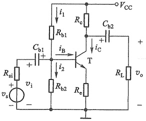

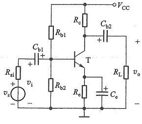

(b)
 

图 5.2.8 基极分压式射极偏置共射极放大电路   (a) 无射极旁路电容 (b) 有射极旁路电容
 

支路产生分流。为此，可以先求出由M、N两端向左侧看进去的戴维南等效的直流通路如图5.2.9b所示，其中

$$  V_{\mathrm{TH}}=\frac{R_{\mathrm{b}2}}{R_{\mathrm{b}1}+R_{\mathrm{b}2}}\cdot V_{\mathrm{cc}}   \tag*{(5.2.11)}$$

是M、N两端的开路电压，而

$$  R_{TH}=R_{b1}\quad//\quad R_{b2}   \tag*{（5.2.12）}$$

是端口等效电阻。此时，根据 KVL 由图 5.2.9b 所示的基极-发射极回路方程为

 $$ V_{\mathrm{T H}}=I_{\mathrm{B Q}}R_{\mathrm{T H}}+V_{\mathrm{B E Q}}+I_{\mathrm{E Q}}R_{\mathrm{e}} $$ 

和电流关系  $ I_{EQ}=(1+\beta)I_{BQ} $，可求得基极电流

$$  I_{\mathrm{BQ}}=\frac{V_{\mathrm{TH}}-V_{\mathrm{BEQ}}}{R_{\mathrm{TH}}+\left(1+\beta\right)R_{\circ}}   \tag*{(5.2.13)}$$

则集电极电流

 $$ I_{cQ}=\beta I_{BQ} $$ 

再由输出回路求得

$$  V_{\mathrm{C E Q}}=V_{\mathrm{C C}}-I_{\mathrm{C Q}}R_{\mathrm{e}}-I_{\mathrm{E Q}}R_{\mathrm{e}}\approx V_{\mathrm{C C}}-I_{\mathrm{C Q}}\left(R_{\mathrm{e}}+R_{\mathrm{e}}\right)   \tag*{(5.2.14)}$$

图 5.2.9a 所示电路具有稳定静态工作点的作用，其原理是：当温度升高时，半导体内载流子浓度会升高，导致  $ I_{CQ} $ 增大，则在其他参数不变情况下，会有如下调节过程：

\[\begin{aligned}&I_{CQ}\uparrow\longrightarrow V_{EQ}\uparrow\xrightarrow{V_{BQ} 不变 }V_{BEQ}\downarrow\longrightarrow I_{BQ}\downarrow\\&I_{CQ}\downarrow\xleftarrow{}\quad\

结果使  $ I_{CQ} $ 基本维持不变，达到自动稳定静态工作点的目的。但要求  $ V_{BQ} $ 不受  $ I_{BQ} $ 分流的影响而保持稳定。当电路参数设计满足  $ I_{1} \gg I_{BQ} $ 时，便可忽略  $ I_{BQ} $ 的分流，有

$$  V_{\mathrm{BQ}}\approx\frac{R_{\mathrm{b2}}}{R_{\mathrm{b1}}+R_{\mathrm{b2}}}\cdot V_{\mathrm{cc}}   \tag*{（5.2.15）}$$

对比式(5.2.15)和式(5.2.11)，相当于 $ V_{BQ}\approx V_{TH} $，意味着图5.2.9b所示电路中 $ R_{TH} $上的压降

<!-- page: 197 -->

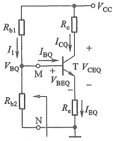

(a)
 

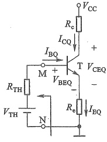

(b)
 

图 5.2.9 基极分压射极偏置电路
 

（a）直流通路 （b）戴维南等效直流通路
 

可以忽略不计，即要求  $ R_{TH}\ll(1+\beta)R_{e} $。但是  $ R_{TH}=R_{b1}\parallel R_{b2} $ 的阻值过小，会增大电路功耗，所以工程上一般选择

$$  R_{\mathrm{TH}}\approx0.1\left(1+\beta\right)R_{e}   \tag*{(5.2.16)}$$

这时可用  $ V_{BQ} $ 替换  $ V_{TH} $，式(5.2.13)可近似为

 $$ \bar{I}_{\mathrm{B Q}}\approx\frac{V_{\mathrm{B Q}}-V_{\mathrm{B E Q}}}{\left(1+\beta\right)R_{\mathrm{e}}} $$ 

通常  $ \beta \gg 1 $ ，所以

$$  I_{\mathrm{CQ}}=\beta I_{\mathrm{BQ}}\approx\frac{\beta\left(V_{\mathrm{BQ}}-V_{\mathrm{BEQ}}\right)}{\left(1+\beta\right)R_{\mathrm{e}}}\approx\frac{V_{\mathrm{BQ}}-V_{\mathrm{BEQ}}}{R_{\mathrm{e}}}   \tag*{(5.2.17)}$$

### 2. 动态分析

假设所有电容对信号而言都可视作短路，将直流电压源置零（接地），并用小信号模型替换BJT，则得到图5.2.8a所示电路的小信号等效电路如图5.2.10所示。由式(5.2.10b)可求出 $ r_{be} $。

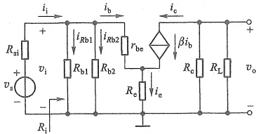

##### （1）电压增益 $ A_{v} $

图 5.2.10 图 5.2.8a 所示电路的小信号等效电路
 

因为有

 $$ \begin{aligned}\boldsymbol{v}_{\mathrm{e}}&=-\beta\boldsymbol{i}_{\mathrm{b}}\boldsymbol{R}_{\mathrm{L}}^{\prime}\quad\left( 式中 R_{\mathrm{L}}^{\prime}=R_{\mathrm{e}}\big/\big/\boldsymbol{R}_{\mathrm{L}}\right)\\\boldsymbol{v}_{\mathrm{i}}&=\boldsymbol{i}_{\mathrm{b}}\boldsymbol{r}_{\mathrm{be}}+\boldsymbol{i}_{\mathrm{e}}\boldsymbol{R}_{\mathrm{e}}=\boldsymbol{i}_{\mathrm{b}}\boldsymbol{r}_{\mathrm{be}}+\left(1+\beta\right)\boldsymbol{i}_{\mathrm{b}}\boldsymbol{R}_{\mathrm{e}}\end{aligned} $$ 

所以

$$  A_{_{v}}=\frac{v_{_{o}}}{v_{_{i}}}=-\frac{\beta R_{L}^{\prime}}{r_{be}+\left(1+\beta\right)R_{e}}   \tag*{(5.2.18)}$$

式中负号表示 $ v_{0} $与 $ v_{i} $反相。

##### （2）输入电阻 $ R_{i} $

根据图 5.2.10，由  $ v_{i}=i_{b}[r_{be}+(1+\beta)R_{e}] $ 和  $ i_{i}=i_{b}+i_{Rb1}+i_{Rb2}=\frac{v_{i}}{r_{be}+(1+\beta)R_{e}}+\frac{v_{i}}{R_{b1}}+\frac{v_{i}}{R_{b2}} $ 得

<!-- page: 198 -->

$$  R_{\mathrm{i}}=\frac{v_{\mathrm{i}}}{i_{\mathrm{i}}}=\frac{1}{\frac{1}{r_{\mathrm{b e}}+\left(1+\beta\right)R_{\mathrm{e}}}+\frac{1}{R_{\mathrm{b1}}}+\frac{1}{R_{\mathrm{b2}}}}=R_{\mathrm{b1}}//R_{\mathrm{b2}}//\left[r_{\mathrm{b e}}+\left(1+\beta\right)R_{\mathrm{e}}\right]   \tag*{(5.2.19)}$$

此时的源电压增益为

 $$ \begin{aligned}\dot{A}_{_{vs}}=&\frac{v_{\mathrm{o}}}{v_{\mathrm{s}}}=\frac{v_{\mathrm{o}}}{v_{\mathrm{i}}}\cdot\frac{v_{\mathrm{i}}}{v_{\mathrm{s}}}=-\frac{\beta R_{\mathrm{L}}^{\prime}}{r_{_{\mathrm{be}}}+\left(1+\beta\right)R_{\mathrm{e}}}\cdot\frac{R_{\mathrm{i}}}{R_{_{\mathrm{si}}}+R_{\mathrm{i}}}\\=&-\frac{\beta R_{\mathrm{L}}^{\prime}}{r_{_{\mathrm{be}}}+\left(1+\beta\right)R_{\mathrm{e}}}\cdot\frac{R_{_{\mathrm{b1}}}\big/\big/R_{_{\mathrm{b2}}}\big/\big/\big[r_{_{\mathrm{be}}}+\left(1+\beta\right)R_{\mathrm{e}}\big]}{R_{_{\mathrm{si}}}+R_{_{\mathrm{b1}}}\big/\big/R_{_{\mathrm{b2}}}\big/\big/\big[r_{_{\mathrm{be}}}+\left(1+\beta\right)R_{\mathrm{e}}\big]}\end{aligned} $$ 

由式(5.2.18)可看出，接入 $ R_{e} $后，提高了静态工作点的稳定性，但电压增益也下降了， $ R_{e} $越大， $ A_{v} $下降越多。在 $ R_{e} $两端并联一只大容量的旁路电容 $ C_{e} $（如图5.2.8b所示），可以解决这一问题。它将 $ R_{e} $交流短路，式(5.2.18)分母中不再有 $ (1+\beta)R_{e} $项，电压增益变成

$$  A_{v}=-\frac{\beta R_{L}^{\prime}}{r_{be}}   \tag*{(5.2.20)}$$

增加  $ C_{e} $ 后，输入电阻变成  $ R_{i}=R_{b1}\parallel R_{b2}\parallel r_{be} $，此时的源电压增益为

 $$ A_{_{vs}}=\frac{v_{_{o}}}{v_{_{s}}}=-\frac{\beta R_{_{L}}^{\prime}}{r_{_{be}}}\cdot\frac{R_{_{i}}}{R_{_{si}}+R_{_{i}}}=-\frac{\beta R_{_{L}}^{\prime}}{r_{_{be}}}\cdot\frac{R_{_{b1}}\big/\big/R_{_{b2}}\big/\big/r_{_{be}}}{R_{_{si}}+R_{_{b1}}\big/\big/R_{_{b2}}\big/\big/r_{_{be}}} $$ 

（3）输出电阻 $ R_{0} $

如果把 BJT 的输出电阻  $ r_{ce} $ 考虑进去，根据在输出端口加入测试电压求输出电阻的方法（去掉负载，独立源置零并保留其内阻），可画出求图 5.2.8a 所示电路输出电阻为  $ R_{o} $ 时的等效电路，如图 5.2.11 所示，其中  $ R_{b}=R_{b1}\parallel R_{b2} $。先求出  $ R_{o}' $，然后再与  $ R_{o} $ 并联，即可求得  $ R_{o} $。

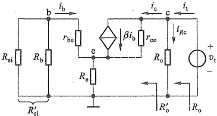

由于流过  $ R_{e} $ 的电流为  $ i_{b}+i_{c} $，所以基极回路方程为

图 5.2.11 求图 5.2.8a 所示电路输出电阻为  $ R_{0} $ 时的等效电路
 

 $$ i_{\mathrm{b}}(\boldsymbol{r}_{\mathrm{b e}}+\boldsymbol{R}_{\mathrm{s i}}^{\prime})+\left(i_{\mathrm{b}}+i_{\mathrm{c}}\right)\boldsymbol{R}_{\mathrm{e}}=0 $$ 

而流过  $ r_{ee} $ 的电流为  $ i_{c}-\beta i_{b} $，所以集电极回路方程为

 $$ v_{\mathrm{t}}-\left(i_{\mathrm{c}}-\beta i_{\mathrm{b}}\right)r_{\mathrm{ee}}-\left(i_{\mathrm{b}}+i_{\mathrm{e}}\right)R_{\mathrm{e}}=0 $$ 

由以上两式可解得

 $$ v_{\mathrm{t}}=i_{\mathrm{c}}\left[r_{\mathrm{c e}}+R_{\mathrm{e}}+\frac{R_{\mathrm{e}}}{r_{\mathrm{b e}}+R_{\mathrm{s i}}^{\prime}+R_{\mathrm{e}}}(\beta r_{\mathrm{c e}}-R_{\mathrm{e}})\right] $$ 

考虑到实际情况下  $ r_{ee} \gg R_{e} $，故有

$$  R_{\mathrm{o}}^{^{\prime}}=\frac{v_{\mathrm{t}}}{i_{\mathrm{c}}}\approx r_{\mathrm{ce}}\left(1+\frac{\beta\;R_{\mathrm{e}}}{r_{\mathrm{be}}+R_{\mathrm{si}}^{\prime}+R_{\mathrm{e}}}\right)   \tag*{(5.2.21)}$$

于是

由式(5.2.21)看出 $ R_{0}^{\prime}>r_{ce} $，且通常 $ R_{0}^{\prime}\gg R_{0} $，故有

<!-- page: 199 -->

$$  R_{o}\approx R_{c}   \tag*{(5.2.22)}$$

例 5.2.1 含电流源偏置的共射极放大电路如图 5.2.12 所示。设电路中的  $ V_{CC} = V_{EE} = 10\ V $，电流源的电流  $ I_0 = 1\ mA $， $ R_b = 100\ k\Omega $， $ R_o = R_L = 8\ k\Omega $， $ R_{si} = 1\ k\Omega $，所有电容对信号而言都可视作短路，BJT 的  $ \beta = 100 $， $ V_{BEQ} = 0.7\ V $。试求：（1） $ I_{BQ} $、 $ I_{CQ} $、 $ V_{BQ} $、 $ V_{EQ} $、 $ V_{CEQ} $；（2）电路的  $ A_v(=v_o/v_i) $、 $ R_i $、 $ A_{vs}(=v_o/v_s) $ 和  $ R_o $。

解：（1）将图5.2.12中的电容 $ C_{b1} $、 $ C_{e} $断开，即可得该电路的直流通路如图5.2.13a所示。从电流源入手，有

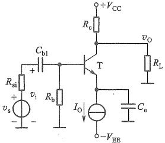

图 5.2.12 例 5.2.1 的电路
 

 $$ I_{_{BQ}}=\frac{I_{_{EQ}}}{1+\beta}=\frac{I_{_{0}}}{1+\beta}=\frac{1\ mA}{1+100}\approx0.01\ mA $$ 

 $$ I_{CQ}\approx I_{EQ}=I_{0}=1\mathrm{~mA} $$ 

 $$ V_{\mathrm{B Q}}=-I_{\mathrm{B Q}}R_{\mathrm{b}}=-0.01\mathrm{m A}\times100\mathrm{k}\Omega=-1\mathrm{V} $$ 

 $$ V_{\mathrm{E Q}}=V_{\mathrm{B Q}}-V_{\mathrm{B E Q}}=(-1-0.7)\mathrm{V}=-1.7\mathrm{V} $$ 

对集电极节点应用 KCL

 $$ \frac{V_{\mathrm{cc}}-V_{\mathrm{cQ}}}{R_{\mathrm{e}}}=I_{\mathrm{cQ}}+\frac{V_{\mathrm{cQ}}}{R_{\mathrm{L}}} $$ 

由此得

 $$ V_{\mathrm{c}Q}=\frac{\left(V_{\mathrm{cc}}-I_{\mathrm{c}Q}R_{\mathrm{e}}\right)R_{\mathrm{L}}}{R_{\mathrm{e}}+R_{\mathrm{L}}}=\frac{\left(10-1\times8\right)\mathrm{V}\times8\mathrm{~k}\Omega}{\left(8+8\right)\mathrm{~k}\Omega}=1\mathrm{~V} $$ 

则

 $$ V_{_{CEQ}}=V_{_{CQ}}-V_{_{EQ}}=\left(1+1.7\right)\mathrm{V}=2.7\mathrm{~V} $$ 

（2）将图5.2.12中的耦合电容和旁路电容短路，将直流电压源+ $ V_{cc} $和 $ -V_{EE} $对地短路，直流电流源 $ I_{0} $开路，可画出放大电路的小信号等效电路如图5.2.13b所示。动态指标求解如下：

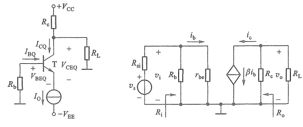

(a)
 

(b)
 

图 5.2.13 图 5.2.12 的等效电路
 

（a）直流通路 （b）小信号等效电路
 

<!-- page: 200 -->

$$ r_{be}=r_{bb^{\prime}}+\left(1+\beta\right)\frac{V_{T}}{I_{EQ}}=200\ \Omega+\left(1+100\right)\frac{26\ mV}{1\ mA}\approx2.8\ k\Omega $$ 

 $$ A_{_{v}}=\frac{v_{_{o}}}{v_{_{i}}}=-\frac{\beta i_{_{b}}R_{_{L}}^{\prime}}{i_{_{b}}r_{_{be}}}=-\frac{\beta R_{_{L}}^{\prime}}{r_{_{be}}}=-\frac{100\times\frac{8\times8}{8+8}\mathrm{~k}\Omega}{2.8\mathrm{~k}\Omega}\approx-142.9 $$ 

 $$ R_{\mathrm{i}}=R_{\mathrm{b}}//r_{\mathrm{be}}=\frac{100\times2.8}{100+2.8}\mathrm{k}\Omega\approx2.7\mathrm{k}\Omega $$ 

对信号源电压的增益需要考虑信号源内阻的损耗，即

 $$ A_{vs}=\frac{v_{o}}{v_{s}}=\frac{v_{o}}{v_{i}}\cdot\frac{v_{i}}{v_{s}}=A_{v}\frac{R_{i}}{R_{i}+R_{si}}=-142.9\times\frac{2.7\mathrm{~k}\Omega}{2.7\mathrm{~k}\Omega+1\mathrm{~k}\Omega}\approx-104.3 $$ 

 $$ R_{\mathrm{o}}\approx R_{\mathrm{e}}=8\mathrm{~k}\Omega $$ 

##### 5.2.5 共集电极和共基极放大电路

除了上面讨论的共射极放大电路外，还有共集电极和共基极两种 BJT 放大电路，虽然它们的性能指标有差异，但它们的静态、动态分析方法相同。下面做简要讨论。

### 1. 共集电极放大电路

图 5.2.14a 是共集电极放大电路的原理图，图 5.2.14b、c 分别是它的直流通路和交流通路。由交流通路可见，信号由基极输入、发射极输出，所以该电路为共集电极电路，也称为射极输出器。

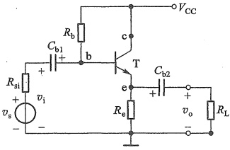

(a)
 

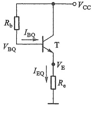

(b)
 

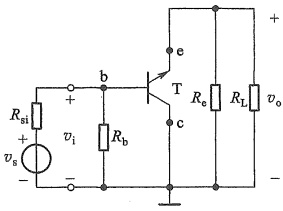

(c)
 

图 5.2.14 共集电极放大电路
 

（a）原理图 （b）直流通路 （c）交流通路
 

##### （1）静态分析

由图5.2.14b的直流通路可求得

$$  I_{_{BQ}}=\frac{V_{_{CC}}-V_{_{BEQ}}}{R_{_{b}}+\left(1+\beta\right)R_{_{e}}}\quad 或 \quad I_{_{EQ}}=\frac{V_{_{CC}}-V_{_{BEQ}}}{\frac{R_{_{b}}}{1+\beta}+R_{_{e}}}   \tag*{(5.2.23)}$$

$$  I_{\mathrm{c q}}=\beta I_{\mathrm{B Q}}\approx I_{\mathrm{E Q}}   \tag*{(5.2.24)}$$

$$  V_{\mathrm{C E Q}}=V_{\mathrm{C C}}-I_{\mathrm{E Q}}R_{\mathrm{e}}   \tag*{（5.2.25）}$$

<!-- page: 201 -->

##### （2）动态分析

用 BJT 的 H 参数简化小信号模型取代图5.2.14c 中的 BJT，即可得到共集电极放大电路的小信号等效电路，如图5.2.15所示。

由图5.2.15可分别写出 $ v_{0} $、 $ v_{i} $的表达式

 $$ \begin{aligned}\boldsymbol{v}_{\mathrm{o}}=&\left(\boldsymbol{i}_{\mathrm{b}}+\beta\boldsymbol{i}_{\mathrm{b}}\right)\left(\boldsymbol{R}_{\mathrm{e}}\big/\boldsymbol{R}_{\mathrm{L}}\right)=\left(1+\beta\right)\boldsymbol{i}_{\mathrm{b}}\boldsymbol{R}_{\mathrm{L}}^{\prime}\\\boldsymbol{v}_{\mathrm{i}}=&\boldsymbol{i}_{\mathrm{b}}\boldsymbol{r}_{\mathrm{be}}+\boldsymbol{v}_{\mathrm{o}}=\boldsymbol{i}_{\mathrm{b}}\left[\boldsymbol{r}_{\mathrm{be}}+\left(1+\beta\right)\boldsymbol{R}_{\mathrm{L}}^{\prime}\right]\end{aligned} $$ 

则电压增益

 $$ \boldsymbol{A}_{_{v}}=\frac{v_{_{o}}}{v_{_{i}}}=\frac{\left(1+\beta\right)i_{_{b}}R_{_{L}}^{\prime}}{i_{_{b}}\left[r_{_{be}}+\left(1+\beta\right)R_{_{L}}^{\prime}\right]}=\frac{\left(1+\beta\right)R_{_{L}}^{\prime}}{r_{_{be}}+\left(1+\beta\right)R_{_{L}}^{\prime}} $$ 

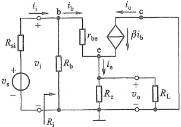

图 5.2.15 共集电极放大电路的 小信号等效电路
 

式中  $ R_{L}^{\prime}=R_{e}\parallel R_{L} $。式(5.2.26)表明  $ A_{v}<1 $，且  $ v_{o} $ 与  $ v_{i} $ 同相。通常有  $ (1+\beta)R_{L}^{\prime}\gg r_{be} $，所以  $ A_{v}\approx1 $，即输出电压  $ v_{o} $ 约等于输入电压  $ v_{i} $，因此共集电极放大电路又称为电压跟随器。

根据输入电阻定义求得

$$  R_{\mathrm{i}}=\frac{v_{\mathrm{i}}}{\dot{i}_{\mathrm{i}}}=\frac{v_{\mathrm{i}}}{\frac{v_{\mathrm{i}}}{R_{\mathrm{b}}}+\frac{v_{\mathrm{i}}}{r_{\mathrm{be}}+\left(1+\beta\right)R_{\mathrm{L}}^{\prime}}}=R_{\mathrm{b}}//\left[r_{\mathrm{be}}+\left(1+\beta\right)R_{\mathrm{L}}^{\prime}\right]   \tag*{(5.2.27)}$$

可见，负载会影响输入电阻。

令  $ v_{s}=0 $，保留其内阻  $ R_{si} $，将  $ R_{L} $ 开路，然后在输出端加一测试电压  $ v_{t} $，由此可画出求  $ R_{0} $ 的等效电路如图 5.2.16 所示。

由图有

 $$ i_{\mathrm{t}}=i_{\mathrm{b}}+\beta i_{\mathrm{b}}+i_{\mathrm{R e}}=v_{\mathrm{t}}\left(\frac{1}{R_{\mathrm{s i}}^{\prime}+r_{\mathrm{b e}}}+\beta\frac{1}{R_{\mathrm{s i}}^{\prime}+r_{\mathrm{b e}}}+\frac{1}{R_{\mathrm{e}}}\right) $$ 

式中  $ R_{si}^{\prime}=R_{si}\parallel R_{b} $。由此得输出电阻

$$  R_{o}=R_{e}\mathord{/}\mathord{/}\frac{R_{si}^{\prime}+r_{be}}{1+\beta}   \tag*{(5.2.28a)}$$

通常有  $ R_{e} \gg \frac{R'_{si} + r_{be}}{1 + \beta} $，所以

$$  R_{o}\approx\frac{R_{si}^{\prime}+r_{be}}{1+\beta}   \tag*{(5.2.28b)}$$

如果把信号改到发射极输入、集电极输出，基极交流接地，就构成共基极放大电路。图5.2.17便是一种共基极放大电路。图5.2.18a是它的直流通路。显然，它就是基极分压式射极偏置电路，由5.2.4节的方法就可求得其Q点。图5.2.18b是图5.2.17的小信号等效电路。通过列写电路方程，同样可以求

### 2. 共基极放大电路

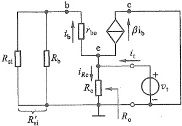

图 5.2.16 计算共集电极放大电路  $ R_{0} $ 的等效电路
 

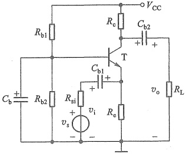

图 5.2.17 共基极放大电路
 

<!-- page: 202 -->

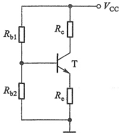

(a)
 

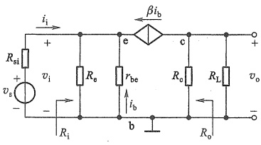

(b)
 

图 5.2.18 共基极放大电路的等效电路
 

（a）直流通路 （b）小信号等效电路
 

得共基极放大电路的各项动态指标；此处留待读者自行分析。

### 3. BJT 放大电路三种组态的比较

共发射极放大电路既有电压放大作用又有电流放大作用，输出电压和输入电压相位相反；输入电阻在三种组态中居中，输出电阻较大，适用于低频情况下，作多级放大电路的中间级。共集电极放大电路的电压增益小于1而接近于1，输出电压和输入电压相位相同，只有电压跟随作用，但有电流放大作用。在三种组态中，共集电极放大电路的输入电阻最高，输出电阻最小，可作多级放大电路的输入级、输出级或缓冲级。共基极放大电路有电压放大作用，且输入电压和输出电压的相位相同，有电流跟随作用，在三种组态中，共基极放大电路输入电阻最小，输出电阻较大；常用于高频或宽频带低输入阻抗的场合。三种组态的频率响应也有差别，将在第6章讨论。

为便于比较，表5.2.1列出了BJT放大电路三种组态的主要性能。

表5.2.1 BJT放大电路三种组态的主要性能
 

<table border=1 style='margin: auto; word-wrap: break-word;'><tr><td style='text-align: center; word-wrap: break-word;'></td><td style='text-align: center; word-wrap: break-word;'>共射极放大电路</td><td style='text-align: center; word-wrap: break-word;'>共集电极放大电路</td><td style='text-align: center; word-wrap: break-word;'>共基极放大电路</td></tr><tr><td style='text-align: center; word-wrap: break-word;'>电路图</td><td style='text-align: center; word-wrap: break-word;'>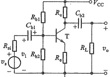</td><td style='text-align: center; word-wrap: break-word;'>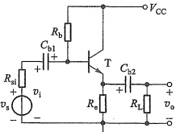</td><td style='text-align: center; word-wrap: break-word;'>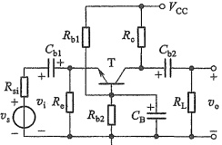</td></tr><tr><td style='text-align: center; word-wrap: break-word;'>电压增益  $ A_v $</td><td style='text-align: center; word-wrap: break-word;'>$ A_v = -\frac{\beta R_L&#x27;}{r_{be} + (1 + \beta) R_e} $\n $ (R_L&#x27; = R_e \parallel R_L) $</td><td style='text-align: center; word-wrap: break-word;'>$ A_v = \frac{(1 + \beta) R_L&#x27;}{r_{be} + (1 + \beta) R_L&#x27;} $\n $ (R_L&#x27; = R_e \parallel R_L) $</td><td style='text-align: center; word-wrap: break-word;'>$ A_v = \frac{\beta R_L&#x27;}{r_{be}} $\n $ (R_L&#x27; = R_e \parallel R_L) $</td></tr><tr><td style='text-align: center; word-wrap: break-word;'>$ v_o $与 $ v_i $的相位关系</td><td style='text-align: center; word-wrap: break-word;'>反相</td><td style='text-align: center; word-wrap: break-word;'>同相</td><td style='text-align: center; word-wrap: break-word;'>同相</td></tr><tr><td style='text-align: center; word-wrap: break-word;'>最大电流增益  $ A_i $</td><td style='text-align: center; word-wrap: break-word;'>$ A_i \approx \beta $</td><td style='text-align: center; word-wrap: break-word;'>$ A_i \approx 1 + \beta $</td><td style='text-align: center; word-wrap: break-word;'>$ A_i \approx \alpha $</td></tr></table>

<!-- page: 203 -->

续表
 

<table border=1 style='margin: auto; word-wrap: break-word;'><tr><td style='text-align: center; word-wrap: break-word;'></td><td style='text-align: center; word-wrap: break-word;'>共射极放大电路</td><td style='text-align: center; word-wrap: break-word;'>共集电极放大电路</td><td style='text-align: center; word-wrap: break-word;'>共基极放大电路</td></tr><tr><td style='text-align: center; word-wrap: break-word;'>输入电阻</td><td style='text-align: center; word-wrap: break-word;'>$ R_1 = R_{b1} // R_{b2} // [r_{be} + (1 + \beta) R_e] $</td><td style='text-align: center; word-wrap: break-word;'>$ R_1 = R_b // [r_{be} + (1 + \beta) R&#x27;_L] $</td><td style='text-align: center; word-wrap: break-word;'>$ R_1 = R_e // \frac{r_{be}}{1 + \beta} $</td></tr><tr><td style='text-align: center; word-wrap: break-word;'>输出电阻</td><td style='text-align: center; word-wrap: break-word;'>$ R_o \approx R_e $</td><td style='text-align: center; word-wrap: break-word;'>$ R_o = \frac{r_{be} + R&#x27;_{e1}}{1 + \beta} // R_e $\n( $ R&#x27;_{e1} = R_{e1} // R_b $)</td><td style='text-align: center; word-wrap: break-word;'>$ R_o \approx R_e $</td></tr><tr><td style='text-align: center; word-wrap: break-word;'>用途</td><td style='text-align: center; word-wrap: break-word;'>多级放大电路的中间级</td><td style='text-align: center; word-wrap: break-word;'>输入级、输出级、缓冲级</td><td style='text-align: center; word-wrap: break-word;'>高频或宽频带电路</td></tr></table>

##### 复习思考题

5.2.1 BJT 的小信号模型是在什么条件下建立的？

5.2.2 若用万用表的“Ω”挡测量 b、e 两极之间的电阻，测量结果是否为  $ r_{be} $?

5.2.3 图5.2.12所示的放大电路中能否不加 $ C_{e} $？为什么？

5.2.4 BJT 放大电路有哪几种组态？判断组态的基本方法是什么？

5.2.5 BJT 三种组态的放大电路各有什么特点？

5.2.6 为什么可以称共集电极放大电路为电压跟随器？

### 5.3 FET 和 BJT 及其基本放大电路性能的比较

前面介绍了 FET 和 BJT 这两类器件及其基本放大电路，本节将对它们的性能加以比较，以便于读者进一步了解这两类器件及其基本放大电路之间的相似与差异之处。

#### 5.3.1 FET 和 BJT 重要特性的比较

FET 和 BJT 这两类器件是当今电子学应用的基础，它们在特定的应用中发挥着各自的优势。

增强型 MOS 管是目前使用最为广泛的场效应管。表 5.3.1 中列出了增强型 NMOS 管和 NPN 型 BJT 的比较（PMOS 管和 PNP 型管也可以作类似的比较）。

表5.3.1 增强型 NMOS 管和 NPN 型 BJT 的比较
 

<table border=1 style='margin: auto; word-wrap: break-word;'><tr><td style='text-align: center; word-wrap: break-word;'></td><td style='text-align: center; word-wrap: break-word;'>增强型 NMOS 管</td><td style='text-align: center; word-wrap: break-word;'>NPN 型 BJT</td></tr><tr><td style='text-align: center; word-wrap: break-word;'>电路符号</td><td style='text-align: center; word-wrap: break-word;'>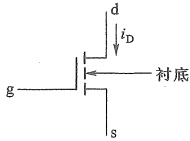</td><td style='text-align: center; word-wrap: break-word;'>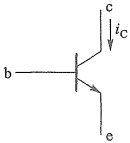</td></tr><tr><td style='text-align: center; word-wrap: break-word;'>工作在放大区的两个条件</td><td style='text-align: center; word-wrap: break-word;'>(1) 生成沟道  $ v_{GS} \ge V_{TN} (=0.3 \sim 0.5 \text{ V} $, 现代工艺可达到的数值)\n(2) 沟道出现夹断  $ v_{DS} \ge v_{GS} - V_{TN} $</td><td style='text-align: center; word-wrap: break-word;'>(1) 发射结正偏  $ v_{BE} \ge V_{th} (=0.5 \text{ V}) $\n(2) 集电结反偏  $ v_{BC} \le 0 $</td></tr></table>

<!-- page: 204 -->

5 双极结型三极管（BJT）及其放大电路
 

续表

<table border=1 style='margin: auto; word-wrap: break-word;'><tr><td style='text-align: center; word-wrap: break-word;'></td><td style='text-align: center; word-wrap: break-word;'>增强型 NMOS 管</td><td style='text-align: center; word-wrap: break-word;'>NPN 型 BJT</td></tr><tr><td style='text-align: center; word-wrap: break-word;'>放大区的电流电压关系</td><td style='text-align: center; word-wrap: break-word;'>$ i_D = \frac{{\mu_n C_{ox}}}{2} \cdot \frac{{W}}{L} (v_{GS} - V_{TN})^2 (1 + \lambda v_{DS}) $\n=  $ K_n (v_{GS} - V_{TN})^2 (1 + \lambda v_{DS}) $\n $ i_G = 0 $</td><td style='text-align: center; word-wrap: break-word;'>$ i_E \approx I_{ES} e^{v_{BE}/V_T} $\n $ i_C = \alpha i_E $\n $ i_B = i_C / \beta $</td></tr><tr><td style='text-align: center; word-wrap: break-word;'>简化的低频小信号模型\n(共源、共射)</td><td style='text-align: center; word-wrap: break-word;'></td><td style='text-align: center; word-wrap: break-word;'></td></tr><tr><td style='text-align: center; word-wrap: break-word;'>互导(或跨导) $ g_m $</td><td style='text-align: center; word-wrap: break-word;'>$ g_m = 2K_n (V_{GSQ} - V_{TN}) = 2\sqrt{K_n I_{DQ}} $</td><td style='text-align: center; word-wrap: break-word;'>BJT 也有  $ g_m $ 这个参数,详见第 6 章</td></tr><tr><td style='text-align: center; word-wrap: break-word;'>共源、共射连接时的输入电阻</td><td style='text-align: center; word-wrap: break-word;'>$ r_{gs} = \infty $</td><td style='text-align: center; word-wrap: break-word;'>$ r_{be} = r_{bb&#x27;} + (1 + \beta) \frac{{26 mV}}{{I_{EQ}}} \approx \frac{{\beta}}{{g_m}} $</td></tr><tr><td style='text-align: center; word-wrap: break-word;'>输出电阻</td><td style='text-align: center; word-wrap: break-word;'>$ r_{ds} = [\lambda K_n (v_{GS} - V_{TN})^2]^{-1} \approx \frac{{1}}{\lambda I_{DQ}} = \frac{{V_A}}{{I_{DQ}}} $</td><td style='text-align: center; word-wrap: break-word;'>$ r_{oe} \approx \frac{{V_A}}{{I_{CQ}}} $</td></tr></table>

（1）MOS 管和 BJT 内部都含有两个 PN 结，外部都有 3 个电极。MOS 管的栅极 g、源极 s、漏极 d 对应于 BJT 的基极 b、发射极 e、集电极 c。但这两类器件的工作原理并不相同。

（2）增强型 NMOS 管和 NPN 型 BJT 工作在放大区的条件类似，在现代制造工艺中两者的阈值电压（开启电压）几乎相等。

（3）这两类器件都可以利用两个输入电极之间的电压控制流过第三个电极的电流来实现一个受控电流源。MOS 管利用  $ v_{GS} $ 控制  $ i_{D} $，BJT 利用  $ v_{BE} $ 控制  $ i_{C} $。但在放大区内，MOS 管的  $ i_{D} $ 与  $ v_{GS} $ 之间是平方关系，而 BJT 的  $ i_{C} $ 与  $ v_{BE} $ 之间是指数关系。显然，指数关系更加敏感。另外，因 MOS 管的  $ i_{C}=0 $，而 BJT 的  $ i_{B}\neq0 $，且  $ v_{BE} $ 首先影响  $ i_{B} $（或  $ i_{E} $），然后通过  $ i_{B} $（或  $ i_{E} $）实现对  $ i_{C} $ 的控制，故常将 BJT 称为电流控制器件，MOS 管称为电压控制器件，以示两者之差别。

（4）这两类器件的低频小信号模型相似，只是 MOS 管的栅极电流为零，因而从栅极看进去的输入电阻为无穷大，而 BJT 的基极电流不为零，所以从基极看进去的输入电阻为有限值。

（5）这两类器件的输出电阻都等于厄利电压  $ V_{A} $ 与静态电流 ( $ I_{DQ} $ 或  $ I_{CQ} $) 的比值。BJT 的  $ V_{A} $ 比 MOS 管的  $ V_{A} $ 大。

（6）MOS 管的  $ K_{n} $ 与 BJT 的  $ \beta $ 或  $ \alpha $ 具有类似的性质，即它们主要取决于 MOS 管与 BJT 的固有参数（如尺寸、掺杂浓度、载流子迁移率等），而与它们所在的电路无关。

<!-- page: 205 -->

##### 5.3.2 FET 和 BJT 放大电路性能的比较

第4章中已经讨论过，FET放大电路有三种组态，即共源极（CS）、共漏极（CD）和共栅极（CG）。与之对应的BJT也有三种组态，即共射极（CE）、共集电极（CC）和共基极（CB）。依据输出电量与输入电量间关系特征，这两种器件的六种组态可归纳为三种通用的组态，即反相电压放大电路（含CS、CE）、电压跟随器（含CD、CC）和电流跟随器（含CG、CB）。现将它们的一般电路示意图、主要特征、电路名称及用途列于表5.3.2中。

表5.3.2 FET 和 BJT 放大电路的重要性能的比较
 

<table border=1 style='margin: auto; word-wrap: break-word;'><tr><td style='text-align: center; word-wrap: break-word;'></td><td style='text-align: center; word-wrap: break-word;'>反相电压放大电路</td><td style='text-align: center; word-wrap: break-word;'>电压跟随器</td><td style='text-align: center; word-wrap: break-word;'>电流跟随器</td><td style='text-align: center; word-wrap: break-word;'>备注</td></tr><tr><td style='text-align: center; word-wrap: break-word;'>通用组态电路示意图</td><td style='text-align: center; word-wrap: break-word;'></td><td style='text-align: center; word-wrap: break-word;'>负载元件</td><td style='text-align: center; word-wrap: break-word;'></td><td style='text-align: center; word-wrap: break-word;'>v0</td></tr><tr><td style='text-align: center; word-wrap: break-word;'>组态命名依据的主要特征</td><td style='text-align: center; word-wrap: break-word;'>不仅有 $ v_0 $与 $ v_1 $反相，而且一般有 $ |A_v| &gt; 1 $</td><td style='text-align: center; word-wrap: break-word;'>$ v_0 \approx v_1, A_v \approx 1 $，即 $ v_0 $与 $ v_1 $大小接近相等，相位相同。</td><td style='text-align: center; word-wrap: break-word;'>$ i_0 \approx i_1 $对于BJT有 $ i_e \approx i_e $对于FET有 $ i_d = i_e $</td><td style='text-align: center; word-wrap: break-word;'>其他特点见表4.5.1和表5.2.1</td></tr><tr><td style='text-align: center; word-wrap: break-word;'>电路名称</td><td style='text-align: center; word-wrap: break-word;'>共源极电路共射极电路</td><td style='text-align: center; word-wrap: break-word;'>共漏极电路共集电极电路</td><td style='text-align: center; word-wrap: break-word;'>共栅极电路共基极电路</td><td style='text-align: center; word-wrap: break-word;'></td></tr><tr><td style='text-align: center; word-wrap: break-word;'>用途</td><td style='text-align: center; word-wrap: break-word;'>电压增益高，输入电阻和输入电容均较大，适用于多级放大电路的中间级</td><td style='text-align: center; word-wrap: break-word;'>输入电阻高、输出电阻低，可作阻抗变换，用于输入级、输出级或缓冲级</td><td style='text-align: center; word-wrap: break-word;'>输入电阻小，输入电容小，适用于高频、宽带电路</td><td style='text-align: center; word-wrap: break-word;'></td></tr></table>

实际应用中，可根据技术指标的要求，将上述电路适当组合，取长补短，构成性能更优的放大电路。

##### 复习思考题

5.3.1 为什么称 FET 为单极型器件，而称 BJT 为双极型器件？

5.3.2 MOS管有哪些特性优于BJT？BJT有哪些特性优于MOS管？

5.3.3 BJT 的基区宽度调制效应与 MOS 管的什么效应相对应?

5.3.4 为什么说 MOS 管放大电路的输入电阻通常可以高于 BJT 放大电路的输入电阻？

#### 5.4 多级放大电路

在实际应用中，特别是在集成电路中，常需要构成多级放大电路，以满足增益等指标要求。

<!-- page: 206 -->

##### 5.4.1 共源—共基放大电路

图 5.4.1 是共源-共基组合放大电路，其中 MOS 管  $ T_{1} $ 构成共源组态作输入级，以提高输入电阻；BJT 管  $ T_{2} $ 构成共基组态，以发挥 BJT 高  $ \beta $ 值优势提高增益。下面通过例 5.4.1 来分析它的交流性能。

例 5.4.1 设图 5.4.1 中  $ T_{1} $ 的互导  $ g_{m1}=18\ mS $,  $ T_{2} $ 的  $ \beta=100 $, 其他电路元件参数如图中所示, 电路有合适的静态工作点。试求该电路的  $ A_{v} $、 $ R_{i} $、 $ R_{o} $ 和源电压增益  $ A_{vs} $。

解：图5.4.2是图5.4.1所示电路的小信号等效电路，其中 $ R_{L}^{\prime}=R_{c}\parallel R_{L} $。由图5.4.2可得

 $$ g_{\mathrm{m l}}v_{\mathrm{g s}}=i_{\mathrm{b}}+\beta i_{\mathrm{b}}\approx\beta i_{\mathrm{b}} $$ 

 $$ v_{\mathrm{o}}=-\beta i_{\mathrm{b}}R_{\mathrm{L}}^{\prime}\approx-g_{\mathrm{m}1}v_{\mathrm{g s}}R_{\mathrm{L}}^{\prime} $$ 

 $$ v_{i}=v_{g s} $$ 

所以

 $$ A_{v}=\frac{v_{o}}{v_{i}}=\frac{-g_{m1}v_{gs}R_{L}^{\prime}}{v_{gs}}=-g_{m1}R_{L}^{\prime}=-18\mathrm{~mS}\times\frac{20\times20}{20+20}\mathrm{~k}\Omega=-180 $$ 

可见，该增益表达式与单级共源电路增益相同，似乎增加的共基电路没有任何贡献，实际上它展宽了放大电路的频带，这将在6.4.1节中看到。

图 5.4.1 共源-共基放大电路
 

图 5.4.2 图 5.4.1 的小信号等效电路
 

以上是通过完整小信号等效电路求解增益的。实际上，还可以直接用前面各组态单级放大电路增益的结论，快速估算出多级放大电路的增益。这时要特别注意，后级的输入电阻要作为前级的负载，代入前级增益表达式中。

输入电阻和输出电阻分别为

 $$ \begin{aligned}R_{\mathrm{i}}&=R_{\mathrm{i1}}\approx R_{\mathrm{g}}=5.1\mathrm{~M}\Omega\\&R_{\mathrm{o}}\approx R_{\mathrm{e}}=20\mathrm{~k}\Omega\end{aligned} $$ 

该电路的源电压增益

 $$ A_{v s}=\frac{v_{o}}{v_{s}}=\frac{v_{o}}{v_{i}}\cdot\frac{v_{i}}{v_{s}}=A_{v}\cdot\frac{R_{g}}{R_{g}+R_{s i}} $$

<!-- page: 207 -->

由于  $ R_{g} \gg R_{si} $，所以  $ A_{vs} \approx A_{v} = -180 $

#### 5.4.2 共集-共集放大电路

图 5.4.3a 所示电路中  $ T_{1} $ 和  $ T_{2} $ 都是共集组态。图 5.4.3b 是它的交流通路。实际上  $ T_{1} $、 $ T_{2} $ 两管的这种结构可以等效为一只三极管，称为复合管 $ ^{①} $。等效为一只三极管后，电路便可作为单管放大电路来分析了。

(a)
 

(b)
 

图5.4.3 共集-共集放大电路   (a) 原理图 (b) 交流通路
 

### 1. 复合管的主要特性

##### （1）复合管的组成及类型

复合管的组成原则是: ① 同类型(NPN 型或 PNP 型)的 BJT 构成复合管时, 应将  $ T_{1} $ 的发射极接至  $ T_{2} $ 的基极; 不同类型(NPN 型与 PNP 型)的 BJT 构成复合管时, 应将  $ T_{1} $ 的集电极接至  $ T_{2} $ 的基极, 以实现两次电流放大作用。② 必须保证两只 BJT 均工作在放大状态。图 5.4.4a~d 即是按上述原则构成的复合管原理图。其中图 a 和图 b 为同类型的两只 BJT 组成的复合管, 而图 c 和图 d 是不同类型的两只 BJT 组成的复合管。由各图中所标电流的实际方向可以确定, 两管复合后可等效为一只 BJT, 其类型与  $ T_{1} $ 相同。需要时还可以用两个以上的 BJT 组成复合管, 如图 5.4.4e 所示。

##### （2）复合管的主要参数

##### ① 电流放大系数  $ \beta $

以图5.4.4a为例，由图可知，复合管的集电极电流为

 $$ i_{\mathrm{C}}=i_{\mathrm{C1}}+i_{\mathrm{C2}}=\beta_{1}i_{\mathrm{B1}}+\beta_{2}i_{\mathrm{B2}}=\beta_{1}i_{\mathrm{B}}+\beta_{2}(\mathrm{~1}+\beta_{1})i_{\mathrm{B}} $$ 

所以复合管的电流放大系数

 $$ \boldsymbol{\beta}=\boldsymbol{\beta}_{1}+\boldsymbol{\beta}_{2}+\boldsymbol{\beta}_{1}\boldsymbol{\beta}_{2} $$ 

一般有  $ \beta_{1}\gg1,\beta_{2}\gg1,\beta_{1}\beta_{2}\gg\beta_{1}+\beta_{2} $，所以

$$  \boldsymbol{\beta}\approx\boldsymbol{\beta}_{1}\boldsymbol{\beta}_{2}   \tag*{(5.4.1)}$$

<!-- page: 208 -->

即复合管的电流放大系数近似等于各组成管电流放大系数的乘积。这个结论同样适合于其他类型的复合管。

② 输入电阻  $ r_{be} $

对于同类型的两只 BJT 构成的复合管而言（参见图 5.4.4a、b），其输入电阻为

$$  r_{\mathrm{b e}}=r_{\mathrm{b e1}}+\left(1+\beta_{1}\right)r_{\mathrm{b e2}}   \tag*{(5.4.2a)}$$

由图 5.4.4c、d 可见，对于由不同类型的两只 BJT 构成的复合管，其输入电阻为

$$  r_{\mathrm{b e}}=r_{\mathrm{b e1}}   \tag*{(5.4.2b)}$$

式 $  (5.4.2a)  $、式 $  (5.4.2b)  $说明，复合管的输入电阻与 $ T_{1} $、 $ T_{2} $管的接法有关。

(a)
 

(b)
 

(c)
 

(d)
 

(e)
 

(f)
 

图 5.4.4 复合管
 

（a）两只NPN型BJT组成的复合管 （b）两只PNP型BJT组成的复合管
 

（c）NPN型与PNP型BJT组成的复合管 （d）PNP型与NPN型BJT组成的复合管 （e）三只BJT组成的复合管 （f）MOS管与BJT组成的复合管
 

<!-- page: 209 -->

综上所述，BJT 复合管具有很高的电流放大系数。若用同类型的 BJT 构成复合管时，其输入电阻会增加。因而，与单管共集电极放大电路相比，图 5.4.3 所示共集-共集放大电路的动态性能会更好。

在现代集成电路中还常用 MOS 管和 BJT 一起组成复合管，称为 BiMOS 复合管，如图 5.4.4f 所示，BiMOS 复合管的类型与  $ T_1 $ 管相同，其互导  $ g_m = (1 + \beta) g_{m1} / (1 + g_{m1} r_{be}) $。另外，与 BJT 复合管相比，其输入电阻为无穷大。

2. 共集-共集放大电路的  $ A_{v} $、 $ R_{i} $、 $ R_{o} $

对于图 5.4.3a 所示电路，利用单管共集电极放大电路的结论得

$$  A_{_{v}}=\frac{v_{_{o}}}{v_{_{i}}}=\frac{\left(1+\beta\right)R_{L}^{\prime}}{r_{be}+\left(1+\beta\right)R_{L}^{\prime}}   \tag*{(5.4.3)}$$

式中  $ \beta\approx\beta_{1}\beta_{2},r_{be}=r_{be1}+(1+\beta_{1})r_{be2},R_{L}^{\prime}=R_{e}\parallel R_{L} $

$$  R_{\mathrm{i}}=R_{\mathrm{b}}//\left[r_{\mathrm{b e}}+\left(1+\beta\right)R_{\mathrm{L}}^{\prime}\right]   \tag*{(5.4.4)}$$

$$  R_{o}=R_{e}\parallel\frac{R_{si}\parallel R_{b}+r_{be}}{1+\beta}   \tag*{（5.4.5）}$$

由于复合管的  $ \beta $ 远大于单管的  $ \beta $，所以由式(5.4.3)～式(5.4.5)看出，共集-共集放大电路比单管共集电极放大电路的电压跟随特性更好，即  $ A_{v} $ 更接近于 1，输入电阻  $ R_{i} $ 更高，而输出电阻  $ R_{v} $ 更小。

##### 复习思考题

5.4.1 用 BJT 组成复合管时应遵循什么原则？

5.4.2 由 MOS 管和 BJT 组成的 BiMOS 复合管有什么特点？组成 BiMOS 复合管时，能把 BJT 放在 MOS 管的前面吗？为什么？

#### 5.5 光电三极管

光电三极管是能将光转换为电的三极管，也称为光敏三极管，大多由硅材料制成 NPN 型。其内部结构与普通三极管类似，也有三个区域两个 PN 结，但多数情况下基区没有引出电极。图 5.5.1 描述了光电三极管的工作原理。与普通三极管类似，正常工作时，外加电压使集电结反偏，发射结正偏。光电三极管的集电结面积较大，作为受光结，类似于光电二极管。当光线通过管壳上的通光窗口照射到集电结的耗尽区时，可以激发出更多的少数载流子——电子-空穴对，电子和空穴在电场力作用下分别向集电区和基区漂移，形成光生电流  $ I_{phN} $ 和  $ I_{phP} $。构成  $ I_{phP} $ 的空穴在基区与发射区扩散到基区的电子复合，形成相当于普通三极管中的基极电流。若三极管的电流放大系数为  $ \beta $，则有  $ I_{E}=I_{EN}=I_{CN}+I_{BN}=\beta I_{phP}+I_{phP}=(\beta+1)\cdot I_{phP} $ 和  $ I_{C}=I_{CN}+I_{phN}=I_{CN}+I_{phP}=(\beta+1)I_{phP}=I_{E} $。

由于受光结的光电转换作用相当于光电二极管，其产生的电流  $ I_{phP} $ 相当于基极电流，所以光电三极管可以等效为图 5.5.2a 所示的电路，图 b 是它的符号，图 c 为它的输出特性曲线。与普通三极管相比，这里基极电流换作光照度，其他是相同的。

无光照情况下的集电极电流称为暗电流，有光照情况下的集电极电流称为光电流。由于三极管的放大作用，同等光照度下，光电三极管的光电流远大于光电二极管的光电流，可

<!-- page: 210 -->

图 5.5.1 光电三极管工作原理示意图
 

(a)
 

(b)
 

图 5.5.2 光电三极管
 

（a）等效电路 （b）符号 （c）输出特性曲线
 

以达到毫安数量级，即灵敏度远高于二极管，但其缺点是线性度比二极管差。所以光电三极管多用来作光电开关，工作状态在饱和区和截止区之间转换。例如，在第3章图3.5.9示意的光电传输系统中，可以将接收端的光电二极管换成光电三极管，并选取合适的电阻，从而提高光信号检测的灵敏度。

光电三极管有光窗，一般情况下，只引出集电极和发射极，有的也有基极引出线，此时可以通过引出的基极设置一个静态偏置，以满足特殊应用的需要。

光电三极管除了上述特性外，还有光谱特性和类似普通三极管的其他特性参数，使用时必须参阅相关型号的数据手册。

目前，光电三极管除了广泛用于光信号检测外，还有一种典型的应用是光电隔离器。光电隔离器是由发光二极管和光电三极管构成的一种电子器件，它的内部结构如图5.5.3所示。

由于输入与输出之间没有电的直接联系，信号是通过光进行耦合的，所以称为光电隔离器或光电耦合器。用它很容易实现核心控制电路与外围电路的隔离，避免外围电路的干扰。在信息传输和控制系统中光电隔离器获得了广泛应用。

图 5.5.3 光电隔离器
 

<!-- page: 211 -->

# 小结

• BJT 是由三层杂质半导体区域、两个 PN 结组成的三端有源器件，有 NPN 和 PNP 两种类型。它的三个电极分别称为发射极 e、基极 b 和集电极 c。它有两种载流子参与导电，因而称为双极型器件。

在 BJT 的两个 PN 结上外加不同极性的偏置电压时，BJT 可有四种不同的工作模式，即放大、饱和、截止、倒置。本章主要讨论 BJT 的放大作用，故偏置电压应使发射结正偏、集电结反偏。

• BJT 的输入特性反映了输入电流 ( $ i_{B} $ 或  $ i_{E} $) 与发射结正偏电压  $ v_{BE} $ 间的指数关系；输出特性则反映了  $ i_{C} $ 与  $ i_{B} $ 或  $ i_{E} $ 间的近似线性关系。 $ \beta $ 是 BJT 的重要参数。另外，在使用 BJT 时还需保证其工作电流、电压和耗散功率不能超过它的极限参数规定的值。

教学视频5.2：

双极结型三极管

及其放大电路小结

· BJT 用于信号放大时，必须使发射结正偏，集电结反偏。静态工作点不合适容易出现饱和失真或截止失真。

· BJT 放大电路有共射极、共集电极和共基极三种组态，它们的性能指标各有特点，分别适用于不同场合。根据三种组态电路的输出量与输入量之间的大小和相位关系，又可分别将它们称为反相电压放大器、电压跟随器和电流跟随器。

同 FET 放大电路一样，分析 BJT 放大电路也是采用图解法和小信号模型分析法。

#### 习题

#### 5.1 BJT

5.1.1 测得某放大电路中处于放大状态的 BJT 的三个电极 A、B、C 的对地电位分别为  $ V_{A} = -9\ V $,  $ V_{B} = -6\ V $,  $ V_{C} = -6.2\ V $, 试分析 A、B、C 中哪个是基极 b、发射极 e、集电极 c，并说明此 BJT 是 NPN 型管还是 PNP 型管。

5.1.2 某 BJT 的极限参数  $ I_{c_M} = 100\ mA $,  $ P_{c_M} = 150\ mW $,  $ V_{BR\ CEO} = 30\ V $, 若它的工作电压  $ V_{CE} = 10\ V $, 则工作电流  $ I_c $ 不得超过多大？若工作电流  $ I_c = 1\ mA $, 则工作电压的极限值应为多少？

5.1.3 设某 BJT 处于放大状态。(1) 若基极电流  $ i_{B}=6\ \mu A $，集电极电流  $ i_{C}=510\ \mu A $，试求  $ \beta $、 $ \alpha $ 及  $ i_{E} $; (2) 如果  $ i_{B}=50\ \mu A $,  $ i_{C}=2.65\ mA $，试求  $ \beta $、 $ \alpha $ 及  $ i_{E} $。

#### 5.2 BJT 放大电路

5.2.1 试分析图题 5.2.1 所示各电路对正弦交流信号有无放大作用，并简述理由（设各电容对正弦交流信号可视作短路，电路参数合适）。

(a)
 

(b)
 

<!-- page: 212 -->

2.7
 

(b)
 

 $ \beta=60 $。(1)用估算法求Q点；(2)求BJT的输；(4)电路其他参数不变，如果要使 $ V_{CEQ}=4\ V $，

号源内阻  $ R_{si}=600\ \Omega $，BJT 的  $ \beta=50 $， $ \left|v_{BE}\right|=0.7\ V $。

输入电阻  $ R_{i} $ 和输出电阻  $ R_{o} $；(3) 当  $ v_{s}=15\ \sin\omega t\ mV $

型号为 2N3906， $ \beta=80 $， $ r_{bb'}(r_{b})=100\ \Omega $，耦合

电路的电压增益、输入电阻和输出电阻。

图题5.2.9
 

 $$ C_{b1} $$ 

 $$  m A $$ 

 $$ R_{。} $$ 

 $$ V_{_{EE}}= $$ 

图题5.2.10
 

(d)
 

页5.2.1
 

=80,  $ V_{BE}=0.6 $ V,  

通 A、B、C 三位置  

并求出相应的集

弦交流信号有无

信号可视作短路，

12 V,  $ R_{c}=4 $ k $ \Omega $,

估算 Q 点; (2) 求

图题5.2.2
 

(b)
 

(c)
 

(e)
 

页5.2.3
 

<!-- page: 213 -->

忽略不计。(1) 求  $ I_{BQ} $、 $ I_{CQ} $、负载电流  $ I_{L} $、 $ I_{Re} $ 及  $ V_{CEQ} $; (2) 画出该电路的小信号等效电路; (3) 求电压增益  $ A_{v} $、输入电阻  $ R_{i} $ 和输出电阻  $ R_{o} $。

5.2.12 共基极电路如图题 5.2.12 所示。射极回路里接入一个恒流源，设  $ \beta=100, R_{si}=0, R_{L}=\infty $ 。试确定电路的电压增益  $ A_{v} $ 、输入电阻  $ R_{i} $ 和输出电阻  $ R_{o} $ 。

图题5.2.11
 

图题5.2.12
 

5.2.13 电路如图题 5.2.13 所示，设 BJT 的  $ \beta = 100 $， $ V_{BEQ} = 0.7 \, V $。(1) 求各电极的静态电压值  $ V_{BQ} $、 $ V_{EQ} $ 及  $ V_{CQ} $；(2) 求  $ r_{be} $ 的值；(3) 若 Z 端接地，X 端接信号源且  $ R_{si} = 10 \, k\Omega $，Y 端接一个 10 kΩ 的负载电阻，求  $ A_{ss} (v_Y/v_s) $；(4) 若 X 端接地，Z 端接一个  $ R_{si} = 200 \, \Omega $ 的信号电压  $ v_s $，Y 端接一个 10 kΩ 的负载电阻，求  $ A_{ss} (v_Y/v_s) $；(5) 若 Y 端接地，X 端接一个内阻  $ R_{si} $ 为 100 Ω 的信号电压  $ v_s $，Z 端接一个负载电阻 1 kΩ，求  $ A_{ss} (v_Z/v_s) $。电路中容抗可忽略。

图题5.2.13
 

5.3 FET 和 BJT 及其基本放大电路性能的比较

5.3.1 设图题 5.3.1 所示各电路均设置了合适的静态工作点。已知 BJT 的  $ \beta = 50 $,  $ r_{be} = 1.53 $ k $ \Omega $, MOS 管的  $ g_m = 1 $ mS。比较三个电路，试回答下列问题：(1) 输入电阻最大的是哪个电路？最小的是哪个电路？(2) 输出电阻最大的是哪个电路？最小的是哪个电路？(3) 电压增益绝对值最大的是哪个电路？最小的是哪个电路？(4) 输出电压与输入电压相位相反的是哪个电路？

#### 5.4 多级放大电路

5.4.1 电路如图题 5.4.1 所示。设两管的  $ \beta=100, V_{BE0}=0.7\ V $，试求： $ (1) I_{C1Q}, V_{CE1Q}, I_{C2Q} $

<!-- page: 214 -->

(a)
 

(b)
 

(c)
 

图题5.3.1
 

 $ V_{CE2Q} $; (2)  $ T_{1} $、 $ T_{2} $ 各组成何种组态？(3)  $ A_{v1} $、 $ A_{v2} $、 $ A_{v} $、 $ R_{i} $ 和  $ R_{o} $

5.4.2 电路如图题5.4.2所示。设两管的特性一致， $ \beta_{1}=\beta_{2}=50 $， $ V_{BE1Q}=V_{BE2Q}=0.7\ V $。（1）试画出该电路的交流通路，说明 $ T_{1} $、 $ T_{2} $各为何种组态；（2）估算 $ I_{C1Q} $、 $ V_{CE1Q} $、 $ I_{C2Q} $、 $ V_{CE2Q} $（提示：因 $ V_{BE1Q}=V_{BE2Q} $，故有 $ I_{B1Q}=I_{B2Q} $）；（3）求 $ A_{v} $、 $ R_{i} $和 $ R_{o} $。

图题5.4.1
 

图题5.4.2
 

<!-- page: 215 -->

5.4.3 电路如图题 5.4.3 所示，其中  $ V_{DD}=+5\ V $,  $ R_{si}=100\ k\Omega $,  $ R_{gl}=R_{g2}=10\ M\Omega $,  $ R_{s}=6.8\ k\Omega $,  $ R_{e}=3\ k\Omega $,  $ R_{L}=1\ k\Omega $, BJT 的  $ V_{BEQ}=0.7\ V $,  $ \beta=200 $, MOS 管的  $ V_{TN}=1\ V $,  $ K_{n}=1\ mA/V^{2} $。对交流信号，电容  $ C_{bl} $、 $ C_{b2} $、 $ C_{b3} $ 均可视为短路。（1）分别求解两管的静态电流，即  $ T_{1} $ 管的  $ I_{DQ} $、 $ T_{2} $ 管的  $ I_{CQ} $。（2）画出该电路的交流通路。（3）求该电路的电压增益  $ A_{v} $，输入电阻  $ R_{i} $ 和输出电阻  $ R_{o} $。

图题5.4.3
 

5.4.4 设图题 5.4.4 所示电路处于正常放大状态，试说明  $ T_{1} $、 $ T_{2} $ 管各构成何种组态，并写出该电路  $ A_{v} $、 $ R_{i} $、 $ R_{o} $ 的表达式。设各电容对交流均可视为短路。

图题5.4.4
 

第5章部分习题答案

