# 06-第6章 频率响应

[返回全书目录](../../README.md)

> PDF 页码：216–253

<!-- page: 216 -->

### 频率响应

## 引言

1.5 节介绍放大电路的主要性能指标时已经指出，由于电抗元件的存在，放大电路对于不同频率的正弦波输入信号呈现不同的放大能力，即增益的大小和相移都是频率的函数。本章将讨论由电路中电容和三极管内部电容所引起的放大电路增益的频率响应，介绍频率响应的分析方法、带宽的确定及其影响因素，以期为设计满足要求的放大电路打下基础。

前两章分析放大电路的性能指标时，是假设对信号频率而言，电路中所有耦合电容和旁路

电容都可视为短路，三极管(FET或BJT)的极间电容、电路中的负载电容及分布电容均可视为开路。实际上，当信号频率较低或较高时，上述电容的容抗将会明显影响电路的增益，此时放大电路的增益是输入信号频率的函数。这种函数关系称为放大电路的频率响应或频率特性。图6.0.1是某阻容耦合单级共源放大电路的频率响应曲线，其中图a是幅频响应曲线，图b是相频响应曲线。

在中频区 $ (f_{L}\sim f_{H} $之间的通频带内)，电路中所有电容的影响均可忽略不计，电路中无电抗元件，所以频率响应曲线在该区域基本上为水平线，也称该区域为通频带。在 $ f<f_{L} $的低频区，耦合电容和旁路电容的容抗增大，不能再视为短路，导致增益（幅值和相位）随频率变化；而在 $ f>f_{H} $的高频区，三极管的极间电容和电路中的负

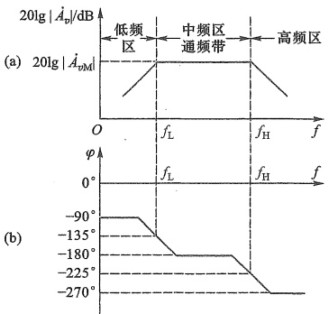

图 6.0.1 阻容耦合单级共源放大电路的频率响应
 

（a）幅频响应曲线 （b）相频响应曲线
 

载电容及分布电容等小电容的容抗减小，不能再视为开路，也导致增益随频率变化。

由于多数信号都涵盖一定的频率范围（信号带宽），如广播电视中语言及音乐信号的频率范围为  $ 20\ Hz \sim 20\ kHz $，卫星电视信号的频率范围为  $ 3.7 \sim 4.2\ GHz $ 等。所以为避免频率失真，就要求放大电路的带宽能够满足信号带宽要求。这也是讨论放大电路频率响应的意义所在。

<!-- page: 217 -->

#### 6.1 单时间常数 RC 电路的频率响应

单时间常数 RC 电路是指由一个电阻和一个电容组成或者最终可以简化成一个电阻和一个电容组成的电路，它构成双口网络时有两种类型，即 RC 高通电路和 RC 低通电路。它们的频率响应可分别用来模拟放大电路的低频响应和高频响应。

##### 6.1.1 RC 高通电路的频率响应

图 6.1.1 所示电路为单时间常数 RC 高通电路。设其电压增益为  $ A_{vL} $，由图可得

$$  \dot{A}_{v L}=\frac{\dot{V}_{o}}{\dot{V}_{i}}=\frac{R}{R+\frac{1}{j\omega C}}=\frac{1}{1+\frac{1}{j\omega R C}}   \tag*{(6.1.1)}$$

式中  $ \omega $ 为输入信号的角频率，与频率 f 的关系是  $ \omega = 2\pi f $。令

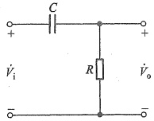

 $$ f_{L}=\frac{1}{2\pi R C}=\frac{1}{2\pi\tau_{L}} $$ 

图 6.1.1 RC 高通电路
 

其中时间常数  $ \tau_{L}=RC $ 。则式(6.1.1)变为

$$  \dot{A}_{v L}=\frac{\dot{V}_{o}}{\dot{V}_{i}}=\frac{1}{1-j(f_{L}/f)}   \tag*{（6.1.3）}$$

将 $ \dot{A}_{vL} $分别表示为幅值（模）和相角

$$  \mid\dot{A}_{vL}\mid=\frac{1}{\sqrt{1+\left(f_{L}/f\right)^{2}}}   \tag*{（6.1.4）}$$

$$  \varphi_{L}=\arctan\left(f_{L}/f\right)   \tag*{（6.1.5）}$$

式(6.1.4)称为幅频响应，描述了电压增益的幅值随频率的变化。式(6.1.5)称为相频响应，表明输出信号与输入信号间的相位差随频率的变化。用描点法可以画出这两条曲线，但工程上常用更简单的作图方法。

### 1. 幅频响应

由式(6.1.4)按下列步骤可画出图6.1.1所示电路的幅频响应曲线。

（1）当 $ f\gg f_{L} $时， $ \left(f_{L}/f\right)^{2}\ll1 $，得

 $$ \left|\dot{A}_{v L}\right|=\frac{1}{\sqrt{1+\left(f_{L}/f\right)^{2}}}\approx1 $$ 

用分贝(dB)表示则有

 $$ 20\mathrm{lg}\mid\dot{A}_{vL}\mid\approx20\mathrm{lg}1=0\mathrm{dB} $$ 

这是一条与横轴平行的零分贝线。

(2) 当  $ f \ll f_{L} $ 时， $ (f_{L}/f)^{2} \gg 1 $

 $$ \mid\dot{A}_{v L}\mid=\frac{1}{\sqrt{1+\left(f_{L}/f\right)^{2}}}\approx\frac{f}{f_{L}} $$

<!-- page: 218 -->

用分贝表示，则有

 $$ 20\mathrm{l g}\mid\dot{A}_{v\mathrm{L}}\mid\approx20\mathrm{l g}\frac{f}{f_{\mathrm{L}}} $$ 

当  $ f = 0.01 f_L $ 时， $ 20 \lg |A_{vL}| = -40 $ dB；当  $ f = 0.1 f_L $ 时， $ 20 \lg |A_{vL}| = -20 $ dB。所以这是一条斜率为 20 dB/十倍频的直线，与零分贝线在  $ f = f_L $ 处相交。由以上两条直线构成的折线，就是近似的幅频响应曲线，如图 6.1.2a 所示（注意，横轴未画在纵轴 0 dB 的位置上）。 $ f_L $ 对应于两条直线的交点，所以  $ f_L $ 称为转折频率。由式 (6.1.4) 可知，当  $ f = f_L $ 时， $ |\dot{A}_{vL}| = 1/\sqrt{2} \approx 0.707 $，即当频率降为  $ f_L $ 时，电压增益下降为中频值的 0.707 倍，用分贝表示时，下降了 3 dB，所以  $ f_L $ 又称为下限截止频率或下限转折频率，简称为下限频率，也称下限 3 dB 截止频率。

这种用折线近似描述实际响应曲线(图6.1.2a中的虚线所示)的方法简便实用，会有一定的误差，当 $ f=f_{L} $时误差最大，为3 dB。

### 2. 相频响应

根据式(6.1.5)可作出相频响应曲线，它可用三条直线来近似描述：

（1）当 $ f\gg f_{L} $时， $ \varphi_{L}\rightarrow0^{\circ} $，得到一条 $ \varphi_{L}=0^{\circ} $的水平线；

(2) 当  $ f \ll f_L $ 时， $ \varphi_L \to +90^\circ $，得到一条  $ \varphi_L = +90^\circ $ 的水平线；

（3）当 $ f=f_{L} $时， $ \varphi_{L}=+45^{\circ} $

由于当 $ f/f_{L}=0.1 $和 $ f/f_{L}=10 $时， $ \varphi_{L} $分别接近 $ +90^{\circ} $和 $ 0^{\circ} $，故在 $ 0.1f_{L} $和 $ 10f_{L} $之间，可用一条斜率为 $ -45^{\circ} $/十倍频的直线来表示，于是可画出相频响应曲线如图6.1.2b所示。图中亦用虚线画出了实际的相频响应曲线。同样它们之间也存在误差，最大相位误差为 $ 5.7^{\circ} $，发生在 $ f=0.1f_{L} $和 $ f=10f_{L} $处。这种用折线绘制出的频率响应曲线称为波特图 $ ^{①} $。

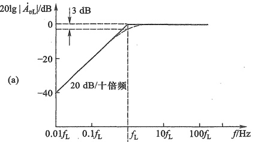

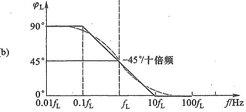

图 6.1.2 RC 高通电路的波特图 (a) 幅频响应 (b) 相频响应
 

<!-- page: 219 -->

由上述分析可知，当输入信号的频率高于  $ f_{L} $ 时，电压增益最大，而且与频率无关，始终为  $ 1(0\ dB) $，即高频信号通过 RC 电路不会衰减，也不产生明显的相移（ $ 0^{\circ} $），所以称该电路为 RC 高通电路。当  $ f = f_{L} $ 时，增益下降 3 dB，且产生 +45° 相移（这里的正号表示输出电压相位超前于输入电压）。当信号频率低于  $ f_{L} $ 后，随着频率的降低，增益按一定的规律衰减，且相移增大，最终趋于 +90°。可见，RC 高通电路主要用来分析电路低频区的响应。换言之，RC 高通电路会导致低频信号的衰减。

#### 6.1.2 RC 低通电路的频率响应

图 6.1.3 所示为单时间常数 RC 低通电路。设其电压增益为  $ \dot{A}_{vH} $，由图可得

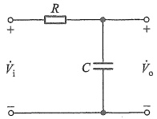

 $$ \dot{A}_{_{v H}}=\frac{\dot{V}_{_{o}}}{\dot{V}_{_{i}}}=\frac{\frac{1}{j\omega C}}{R+\frac{1}{j\omega C}}=\frac{1}{1+j\omega R C} $$ 

图 6.1.3 RC 低通电路
 

令

$$  f_{\mathrm{H}}{=}\frac{1}{2\pi R C}\ =2\pi\tau_{\mathrm{H}}   \tag*{(6.1.7)}$$

其中时间常数  $ \tau_{H}=RC $ 。则式(6.1.6)变为

$$  \dot{A}_{_{v H}}=\frac{1}{1+\mathrm{j}\left(f/f_{\mathrm{H}}\right)}   \tag*{(6.1.8)}$$

其幅频响应和相频响应分别为

$$  \left|\dot{A}_{_{e H}}\right|=\frac{1}{\sqrt{1+\left(f/f_{H}\right)^{2}}}   \tag*{(6.1.9)}$$

$$  \varphi_{\mathrm{H}}=-\arctan\left(f/f_{\mathrm{H}}\right)   \tag*{（6.1.10）}$$

式中  $ f_{H} $ 是 RC 低通电路的上限截止频率或上限转折频率，简称为上限频率，也称上限 3 dB 截止频率。

仿照 RC 高通电路波特图的绘制方法，由式(6.1.9)和式(6.1.10)可画出 RC 低通电路的波特图，如图 6.1.4 所示。

由此波特图可知，当输入信号的频率低于  $ f_{H} $ 时，电压增益最大，且不随信号频率变化始终为  $ 1(0\text{ dB}) $，即低频信号通过 RC 电路不会衰减，也不产生明显的相移  $ (0^\circ) $，所以称该电路为 RC 低通电路。当  $ f = f_H $ 时，增益下降 3 dB，且产生  $ -45^\circ $ 相移（这里的负号表示输出电压相位滞后于输入电压）。当信号频率高于  $ f_H $ 后，随着频率的升高，增益按  $ -20\ \text{dB/十倍} $ 频率衰减，且产生明显相移，最终趋于  $ -90^\circ $。可见，RC 低通电路主要用来分析电路高频区的响应。换言之，RC 低通电路会导致高频信号的衰减。

通过对单时间常数 RC 高通和低通电路频率响应的分析，可以得到下列具有普遍意义的结论：

（1）分析电路的频率响应时，先要画出该电路的等效RC电路；

（2）写出其增益的频率响应（幅频响应和相频响应）表达式；

<!-- page: 220 -->

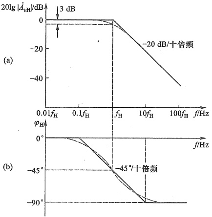

图 6.1.4 RC 低通电路的波特图 (a) 幅频响应 (b) 相频响应
 

（3）电路的截止频率决定于相关电容所在回路的时间常数 $ \tau=RC^{\textcircled{1}} $，见式(6.1.2)和式(6.1.7)；

（4）当输入信号的频率等于上限频率 $ f_{H} $或下限频率 $ f_{L} $时，电路的增益比通带增益下降3 dB，或下降为通带增益的0.707倍，且在通带相移的基础上产生 $ -45^{\circ} $或 $ +45^{\circ} $的相移；

（5）工程上常用折线化的波特图表示电路的频率响应。

复习思考题

6.1.1 为什么要研究放大电路的频率响应？

6.1.2 影响放大电路频率响应的主要因素是什么？

6.1.3 为什么要研究 RC 高、低通电路的频率特性？

6.1.4 如何画出 RC 高、低通电路的波特图？

6.1.5 RC 高、低通电路各有什么特点？

#### 6.2 单管放大电路的低频响应

上一节以单时间常数 RC 高、低通电路为例，介绍了频率响应的分析方法，本节以共源和共射放大电路为例，分析耦合电容和旁路电容对放大电路低频特性的影响。

6.2.1 共源放大电路的低频响应

单级共源放大电路如图 6.2.1a 所示，在中频区，耦合电容  $ C_{b1} $ 和  $ C_{b2} $，旁路电容  $ C_{s} $ 等这些

<!-- page: 221 -->

大电容的容抗很小，都视作短路，从而可求得与频率无关的中频增益，这在4.4.3节已给出分析。但在低频范围内， $ C_{b1} $、 $ C_{b2} $和 $ C_{s} $的容抗增大，不能再视为短路，此时可画出该电路的低频小信号等效电路，如图6.2.1b所示（设 $ \lambda=0 $）。图中 $ R_{g}=R_{g1}\parallel R_{g2} $。为简化分析，假设旁路电容 $ C_{s} $的值足够大，以至在低频范围内，它的容抗 $ X_{C_{s}} $远小于 $ R_{s} $的值，即

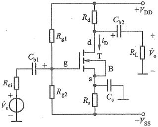

(a)
 

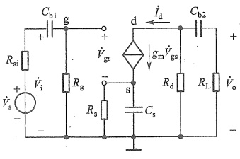

(b)
 

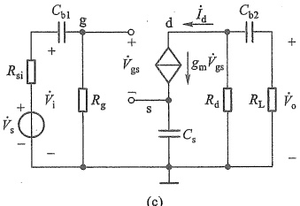

(c)
 

图 6.2.1 共源放大电路及其低频小信号等效电路
 

（a）原理图 （b）图 a 的低频小信号等效电路 （c）简化的等效电路
 

$$  \frac{1}{\omega C_{s}}<<R_{s}\quad 或 \quad\omega C_{s}R_{s}>>1   \tag*{(6.2.1)}$$

可将  $ R_{a} $ 视为开路，于是得到图 6.2.1c 所示的简化等效电路。由此可得栅极电压与信号源关系

 $$ \dot{V}_{\mathrm{g}}=\frac{R_{\mathrm{g}}}{R_{\mathrm{si}}+R_{\mathrm{g}}+\frac{1}{\mathrm{j}\omega C_{\mathrm{b}1}}}\dot{V}_{\mathrm{s}} $$ 

又因为 $ \dot{V}_{g}=\dot{V}_{gs}+g_{m}\dot{V}_{gs}\cdot\frac{1}{j\omega C_{s}} $，则

$$  \dot{V}_{gs}=\frac{\dot{V}_{g}}{1+\frac{g_{m}}{j\omega C_{s}}}\quad=\frac{1}{1+\frac{g_{m}}{j\omega C_{s}}}\quad\cdot\quad\frac{R_{g}}{R_{si}+R_{g}+\frac{1}{j\omega C_{b1}}}\dot{V}_{s}   \tag*{(6.2.2)}$$

在输出回路， $ R_{L} $ 和  $ C_{b2} $ 的串联支路与  $ R_{d} $ 支路并联分流，得到负载中的电流  $ I_{L} $，则输出电

<!-- page: 222 -->

压为

 $$ \dot{V}_{\mathrm{o}}=-\dot{I}_{\mathrm{L}}R_{\mathrm{L}}=-g_{\mathrm{m}}\dot{V}_{\mathrm{gs}}\frac{R_{\mathrm{d}}}{R_{\mathrm{d}}+R_{\mathrm{L}}+\frac{1}{\mathrm{j}\omega C_{\mathrm{b}2}}}R_{\mathrm{L}} $$ 

将式(6.2.2)代入上式得

 $$ \dot{V}_{\mathrm{o}}=-g_{\mathrm{m}}\frac{1}{1+\frac{g_{\mathrm{m}}}{\mathrm{j}\omega C_{\mathrm{s}}}}\cdot\frac{R_{\mathrm{g}}}{R_{\mathrm{s i}}+R_{\mathrm{g}}+\frac{1}{\mathrm{j}\omega C_{\mathrm{b1}}}}\dot{V}_{\mathrm{s}}\frac{R_{\mathrm{d}}R_{\mathrm{L}}}{R_{\mathrm{d}}+R_{\mathrm{L}}+\frac{1}{\mathrm{j}\omega C_{\mathrm{b2}}}} $$ 

则源电压增益为

$$  \begin{aligned}\dot{A}_{vsL}=&\frac{\dot{V}_{o}}{\dot{V}_{s}}=-g_{m}\cdot\frac{1}{1+\frac{g_{m}}{\mathrm{j}\omega C_{s}}}\cdot\frac{R_{g}}{R_{si}+R_{g}+\frac{1}{\mathrm{j}\omega C_{b1}}}\cdot\frac{R_{d}R_{L}}{R_{d}+R_{L}+\frac{1}{\mathrm{j}\omega C_{b2}}}\\=&-g_{m}\cdot\frac{1}{1+\frac{g_{m}}{\mathrm{j}\omega C_{s}}}\cdot\frac{R_{g}/\left(R_{si}+R_{g}\right)}{1+\frac{1}{\mathrm{j}\omega\left(R_{si}+R_{g}\right)C_{b1}}}\cdot\frac{R_{d}//R_{L}}{1+\frac{1}{\mathrm{j}\omega\left(R_{d}+R_{L}\right)C_{b2}}}\\=&-g_{m}\left(R_{d}//R_{L}\right)\cdot\frac{R_{g}}{R_{si}+R_{g}}\cdot\frac{1}{1+\frac{g_{m}}{\mathrm{j}\omega C_{s}}}\cdot\frac{1}{1+\frac{1}{\mathrm{j}\omega\left(R_{si}+R_{g}\right)C_{b1}}}\cdot\frac{1}{1+\frac{1}{\mathrm{j}\omega\left(R_{d}+R_{L}\right)C_{b2}}}\\=&\dot{A}_{vsM}\cdot\frac{1}{1-\mathrm{j}\frac{f_{L1}}{f}}\cdot\frac{1}{1-\mathrm{j}\frac{f_{L2}}{f}}\cdot\frac{1}{1-\mathrm{j}\frac{f_{L3}}{f}}\end{aligned}   \tag*{(6.2.3)}$$

式中 $ A_{vsM} $是中频源电压增益， $ f_{L1} $、 $ f_{L2} $和 $ f_{L3} $是分别由3个RC高通电路构成的3个转折频率，即

$$  \dot{A}_{_{\mathrm{v s M}}}=-g_{\mathrm{m}}(R_{\mathrm{d}}//R_{\mathrm{L}})\frac{R_{\mathrm{g}}}{R_{\mathrm{s i}}+R_{\mathrm{g}}}   \tag*{(6.2.4)}$$

$$  f_{\mathrm{L}1}=\frac{1}{2\pi C_{\mathrm{b}1}(R_{\mathrm{si}}+R_{\mathrm{g}})}   \tag*{（6.2.5）}$$

$$  f_{L2}=\frac{g_{m}}{2\pi C_{s}}   \tag*{(6.2.6)}$$

$$  f_{\mathrm{L3}}=\frac{1}{2\pi C_{\mathrm{b2}}(R_{\mathrm{d}}+R_{\mathrm{L}})}   \tag*{(6.2.7)}$$

由式(6.2.3)可见，图6.2.1a所示阻容耦合共源放大电路在满足式(6.2.1)的条件下，其低频响应具有 $ f_{L1} $、 $ f_{L2} $和 $ f_{L3} $三个转折频率。通常 $ (1/g_{m}) $的阻值小于 $ (R_{si}+R_{g}) $和 $ (R_{d}+R_{L}) $，而 $ C_{b1} $、 $ C_{b2} $、 $ C_{s} $相差不大，因此 $ f_{L2} $通常要大于 $ f_{L1} $和 $ f_{L3} $。如果 $ f_{L2} $与 $ f_{L1} $或 $ f_{L3} $相差4倍以上，则取 $ f_{L2} $作为共源放大电路源电压增益的下限频率 $ f_{L} $。如果 $ f_{L1} $、 $ f_{L3} $很小，可只考虑 $ C_{s} $对低频响应的影响时，式(6.2.3)可简化为

<!-- page: 223 -->

$$  \dot{A}_{v s L}=\dot{A}_{v s M}\cdot\frac{1}{1-\mathrm{j}\frac{f_{L2}}{f}}   \tag*{（6.2.8）}$$

其对数幅频响应和相频响应的表达式为

$$  20\mathrm{lg}\mid\dot{A}_{vsL}\mid=20\mathrm{lg}\mid\dot{A}_{vsM}\mid-20\mathrm{lg}\sqrt{1+\left(f_{L2}/f\right)^{2}}   \tag*{(6.2.9a)}$$

$$  \varphi=-180^{\circ}-\arctan\left(-f_{\mathrm{L}2}/f\right)=-180^{\circ}+\arctan\left(f_{\mathrm{L}2}/f\right)   \tag*{(6.2.9b)}$$

由式(6.2.9)可画出只考虑电容 $ C_{s} $影响时的低频响应波特图，如图6.2.2所示。

如果不满足式(6.2.1)的条件，则实际的下限截止频率与 $ f_{L2} $将存在较大误差。更精确的分析可以通过SPICE仿真获得。

以上分析可知，为了获得更低的下限频率，需要加大耦合电容、旁路电容及其相应回路的等效电阻，以增大回路的时间常数，从而降低下限频率。但这种改善是很有限的，因此在信号频率很低的应用场合，可考虑用直接耦合方式。

例 6.2.1 电路如图 6.2.3 所示。已知  $ R_{si}=100\ k\Omega $,  $ R_g=10\ M\Omega $,  $ R_d=R_L=10\ k\Omega $,  $ g_m=2\ mS $,  $ C_{b1}=C_{b2}=C_s=1\ \mu F $。试求该电路的中频源电压增益  $ \dot{A}_{vsM} $,  $ f_{L1} $,  $ f_{L2} $,  $ f_{L3} $ 和下限频率  $ f_L $，并用 SPICE 再求  $ \left|\dot{A}_{vsM}\right| $ 和  $ f_L $。

解:图6.2.3所示电路的低频小信号等效电路与图6.2.1c的形式相同。由式(6.2.4)求得中频源电压增益为

 $$ \dot{A}_{v s M}=-g_{m}(R_{d}/R_{L})\frac{R_{g}}{R_{s i}+R_{g}}=-2\times10^{-3}\times\frac{10\times10}{10+10}\times10^{3}\times\frac{10\times10^{3}}{100+10\times10^{3}}\approx-9.9 $$ 

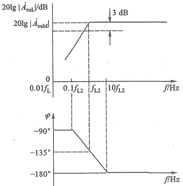

图 6.2.2 只考虑  $ C_{s} $ 影响时，图 6.2.1a 所示电路的低频响应波特图
 

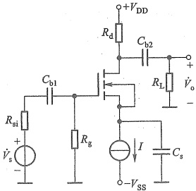

图 6.2.3 例 6.2.1 的电路图
 

由式(6.2.5)求得

 $$ f_{\mathrm{L1}}=1/\left[2\pi C_{\mathrm{b1}}(R_{\mathrm{si}}+R_{\mathrm{g}})\right]=\frac{1}{2\times3.14\times1\times10^{-6}(0.1+10)\times10^{6}}\mathrm{Hz}\approx0.016\mathrm{Hz} $$

<!-- page: 224 -->

由式(6.2.6)求得

 $$ f_{\mathrm{L2}}=\frac{g_{\mathrm{m}}}{2\pi C_{\mathrm{s}}}=\frac{2\times10^{-3}}{2\times3.14\times1\times10^{-6}}\mathrm{Hz}\approx318.47\mathrm{~Hz} $$ 

由式(6.2.7)求得

 $$ f_{\mathrm{L3}}=1/\left[2\pi C_{\mathrm{b2}}\left(R_{\mathrm{d}}+R_{\mathrm{L}}\right)\right]=\frac{1}{2\times3.14\times1\times10^{-6}\times\left(10+10\right)\times10^{3}}\mathrm{Hz}\approx7.96\mathrm{Hz} $$ 

因有  $ f_{L2} \gg f_{L1} $ 和  $ f_{L2} \gg f_{L3} $，所以该电路的下限频率  $ f_{L} \approx f_{L2} \approx 318.47 \, Hz $

SPICE 仿真时设  $ V_{DD} = V_{SS} = 8\ V $,  $ I = 0.5\ mA $, MOS 管参数为  $ K'_{n} = 0.1\ mA/V^{2} $,  $ W = 80\ \mu m $,  $ L = 2\ \mu m $,  $ V_{TN} = 0.8\ V $, 此时有  $ g_{m} = 2\ mS $, 求得  $ \left|\dot{A}_{vSM}\right| \approx 9.7 $,  $ f_{L} \approx 308.8\ Hz $, 与上述计算很接近。

#### 6.2.2 共射放大电路的低频响应

除了上述通过直接推导含电抗元件的增益表达式来分析电路的频率响应外，还可以通过时间常数法简单快速估算截止频率。

若电路中有耦合电容和旁路电容  $ C_{1} $、 $ C_{2} $、 $ C_{3} $ ……可以求出每个电容单独作用时的时间常数  $ \tau_{1}=R_{1}C_{1} $、 $ \tau_{2}=R_{2}C_{2} $、 $ \tau_{3}=R_{3}C_{3} $ ……那么下限频率就近似为 $ ^{①} $

$$  f_{\mathrm{L}}\approx\frac{1}{2\pi}\sum_{i=1}^{n}\frac{1}{\tau_{\mathrm{i}}}   \tag*{(6.2.10)}$$

其中 n 是电容总数。虽然应用该方法的前提是基于其中一个时间常数远小于其他时间常数的假设，但即使不满足该假设条件，由式(6.2.10)估算出的下限频率误差也并不大。由于在求某一个电容单独作用时的时间常数时，需要将其他电容短路处理（等效为通带内的状态），所以该方法也称为短路时间常数法。下面用这种方法分析共射极放大电路的低频响应。

图 6.2.4b 是图 6.2.4a 所示电路的低频小信号等效电路，其中  $ R_{b}=R_{b1}\parallel R_{b2} $

##### （1）仅考虑 $ C_{b1} $作用时的时间常数

将图 6.2.4b 中的  $ C_{e} $ 和  $ C_{b2} $ 短路，信号源置零，且保留信号源内阻，得到求  $ C_{b1} $ 构成的时间常数等效电路如图 6.2.4c 所示。从  $ C_{b1} $ 两端看出去的等效电阻为  $ R_{si} + R_{b} \parallel r_{be} $，所以

$$  \tau_{1}=\left(R_{\mathrm{s i}}+R_{\mathrm{b}}//r_{\mathrm{b e}}\right)C_{\mathrm{b l}}   \tag*{(6.2.11a)}$$

（2）仅考虑  $ C_{c} $ 作用时的时间常数

将图 6.2.4b 中的  $ C_{b1} $ 和  $ C_{b2} $ 短路，信号源置零且保留其内阻，得到等效电路如图 6.2.4d 所示。用外加电压 ( $ \dot{V}_{t} $) 法求  $ C_{e} $ 两端等效电阻的电路如图 6.2.4e 所示。对节点 e 应用 KCL

 $$ \dot{I}_{\mathrm{t}}=\dot{I}_{\mathrm{b}}+\beta\dot{I}_{\mathrm{b}}+\frac{\dot{V}_{\mathrm{t}}}{R_{\mathrm{e}}}=\left(1+\beta\right)\frac{\dot{V}_{\mathrm{t}}}{R_{\mathrm{s i}}//R_{\mathrm{b}}+r_{\mathrm{b e}}}+\frac{\dot{V}_{\mathrm{t}}}{R_{\mathrm{e}}} $$ 

得等效电阻

 $$ R_{2}=\frac{\dot{V}_{\mathrm{t}}}{\dot{I}_{\mathrm{t}}}=\frac{R_{\mathrm{si}}\big/\big/R_{\mathrm{b}}+r_{\mathrm{be}}}{1+\beta}\big/\big/R_{\mathrm{e}} $$

<!-- page: 225 -->

所以

$$  \tau_{2}=\left(\frac{R_{\mathrm{si}}//R_{\mathrm{b}}+r_{\mathrm{be}}}{1+\beta}\right)/R_{\mathrm{e}}   \tag*{(6.2.11b)}$$

（3）仅考虑 $ C_{b2} $作用时的时间常数

类似地，将图6.2.4b中的 $ C_{b1} $和 $ C_{e} $短路，信号源置零且保留内阻，可得到时间常数

$$  \tau_{_{3}}=\left(R_{e}+R_{L}\right)C_{b2}   \tag*{(6.2.11c)}$$

最后，由式(6.2.10)得图6.2.4a所示电路的下限频率

$$  f_{L}\approx\frac{1}{2\pi}\bigg(\frac{1}{\tau_{1}}+\frac{1}{\tau_{2}}+\frac{1}{\tau_{3}}\bigg)   \tag*{(6.2.12)}$$

在5.2.4节已分析过电路的中频源电压增益为 $ \dot{A}_{vsM}=-\frac{\beta R_{L}^{\prime}}{r_{be}}\cdot\frac{R_{b}\parallel r_{be}}{R_{si}+R_{b}\parallel r_{be}} $，则低频区的源电压增益为

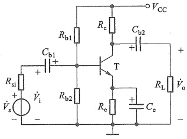

(a)
 

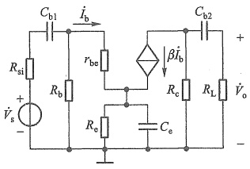

(b)
 

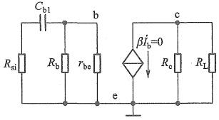

(c)
 

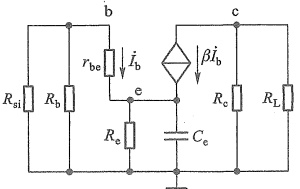

(d)
 

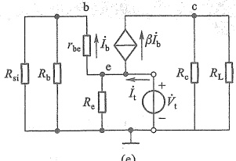

(e)
 

图 6.2.4 共射放大电路及其低频小信号等效电路 (a) 原理图 (b). 完全等效电路 (c) 求  $ C_{b1} $ 构成的时间常数 (d) 求  $ C_{e} $ 构成的时间常数 (e) 求  $ C_{e} $ 两端的等效电阻
 

<!-- page: 226 -->

$$  \dot{A}_{_{v s L}}=\frac{\dot{V}_{_{o}}}{\dot{V}_{_{s}}}=\dot{A}_{_{v s M}}\cdot\frac{1}{1-\mathrm{j}\left(f_{L}/f\right)}   \tag*{(6.2.13)}$$

其对数幅频响应和相频响应分别为

$$  20\lg\left|\dot{A}_{vsL}\right|=20\lg\left|\dot{A}_{vsM}\right|-20\lg\sqrt{1+\left(f_{L}/f\right)^{2}}   \tag*{(6.2.14a)}$$

$$  \varphi=-180^{\circ}-\arctan\left(-f_{\mathrm{L}}/f\right)=-180^{\circ}+\arctan\left(f_{\mathrm{L}}/f\right)   \tag*{(6.2.14b)}$$

由此可画出图6.2.4a所示电路的低频响应波特图，其形式与图6.2.2相似。

例 6.2.2 在图 6.2.4a 所示电路中，设 BJT 的  $ \beta=80 $， $ r_{be}\approx1.5\ k\Omega $， $ V_{CC}=15\ V $， $ R_{si}=50\ \Omega $， $ R_{b1}=110\ k\Omega $， $ R_{b2}=33\ k\Omega $， $ R_{c}=4\ k\Omega $， $ R_{L}=2.7\ k\Omega $， $ R_{e}=1.8\ k\Omega $， $ C_{b1}=30\ \mu F $， $ C_{b2}=1\ \mu F $， $ C_{e}=50\ \mu F $，试估算该电路源电压增益的下限频率，并用 SPICE 再求  $ f_{L} $。

解：根据已知参数，由式(6.2.11a)～式(6.2.11c)求得3个时间常数

 $$ \begin{aligned}\tau_{1}=\left(R_{\mathrm{si}}+R_{\mathrm{b}}\parallel r_{\mathrm{be}}\right)C_{\mathrm{b}1}=\left(R_{\mathrm{si}}+R_{\mathrm{b}1}\parallel R_{\mathrm{b}2}\parallel r_{\mathrm{be}}\right)C_{\mathrm{b}1}&\approx44.1\mathrm{~ms}\\\tau_{2}=\left(\frac{R_{\mathrm{si}}\parallel R_{\mathrm{b}}+r_{\mathrm{be}}}{1+\beta}\parallel R_{\mathrm{e}}\right)C_{\mathrm{e}}&\approx0.95\mathrm{~ms}\\\tau_{3}=\left(R_{\mathrm{e}}+R_{\mathrm{L}}\right)C_{\mathrm{b}2}&=6.7\mathrm{~ms}\end{aligned} $$ 

则电路源电压增益的下限频率

 $$ f_{\mathrm{L}}\approx\frac{1}{2\pi}\bigg(\frac{1}{\tau_{1}}+\frac{1}{\tau_{2}}+\frac{1}{\tau_{3}}\bigg)\approx195~\mathrm{H z} $$ 

SPICE 仿真求得  $ f_{L} \approx 153.7 \, Hz $，与上述结果有一定误差，但上述方法作为工程估算还是可行的。

同样，也可以用短路时间常数法分析三极管其他组态放大电路的低频响应，此处不再赘述。

##### 复习思考题

6.2.1 影响放大电路低频响应的原因是什么？

6.2.2 通常情况下，对共源电路低频特性影响更大的是耦合电容还是源极旁路电容？

6.2.3 通常情况下，对共射电路低频特性影响更大的是耦合电容还是射极旁路电容？

6.2.4 直接耦合式放大电路的下限频率 $ f_{L} $等于多少?

#### 6.3 单管放大电路的高频响应

由于影响放大电路高频响应的主要因素是三极管的极间电容，因此本节先分别介绍MOS管和BJT的高频小信号模型，然后利用它们分析共源和共射放大电路的高频响应。

##### 6.3.1 三极管的高频小信号模型

### 1. MOS 管的高频小信号模型

在 4.1 节介绍 MOS 管结构（为便于讨论将 NMOS 管结构重画于图 6.3.1a 中）及工作原理时就已指出，MOS 管的栅极与沟道组成一个以氧化物为介质的平板电容器，称为栅极电容。此外，在 MOS 管的源极与衬底、漏极与衬底间还存在两个 PN 结电容。于是在 MOS 管

<!-- page: 227 -->

的4个电极（g、s、d和B）之间共有4个电容，即栅-源电容 $ C_{gs} $，栅-漏电容 $ C_{gd} $，源-衬电容 $ C_{sb} $，漏-衬电容 $ C_{db} $。在分立元件电路中，MOS管的源极和衬底多数情况下是连在一起的，这时 $ C_{ab} $被短接，而 $ C_{db} $变为 $ C_{ds} $。此时在图4.4.2c所示模型基础上，补充上述电容便可得到MOS管的高频小信号模型如图6.3.1b所示。其中电容的容量与器件尺寸直接相关，集成电路中一般在零点几到几皮法，分立小功率MOS管通常在几十至几百皮法。依据电容对频率响应的影响程度，为简化分析，常忽略 $ C_{ds} $，得到图6.3.1c所示常用简化高频小信号模型。

由于在集成电路中，MOS 管的源极与衬底是断开的，所以模型有所不同，在此不做讨论。

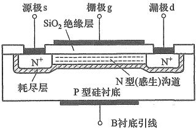

(a)
 

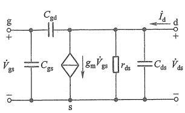

(b)
 

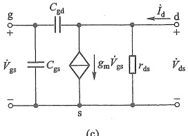

(c)
 

图 6.3.1 MOSFET 的结构与模型
 

（a）结构剖面图 （b）高频小信号模型 （c）简化高频小信号模型
 

##### （1）模型

### 2. BJT 的高频小信号模型

在高频情况下，考虑 BJT 发射结电容和集结电容影响时，其高频小信号模型如图 6.3.2a 所示。图中  $ b' $ 是为分析方便而在基区内虚拟出的一个节点， $ r_{bb'} $ 和  $ r_{b'e} = (1 + \beta) r_e $ 在式 (5.2.10a) 中已给出说明。 $ C_{b'e} $ 是发射结电容，小功率管的  $ C_{b'e} $ 一般在几十至几百皮法范围内。 $ r_{b'e} $ 是集结反偏电阻，一般在 100 kΩ ~ 10 MΩ 范围内。 $ C_{b'e} $ 是集结反偏时的电容，其值较小，一般为几个皮法，可用器件手册中的  $ C_{ob} $ 代替。

由于在高频区  $ r_{b'c} $ 远大于  $ C_{b'c} $ 的容抗  $ 1/(\omega C_{b'c}) $，所以  $ r_{b'c} $ 可视为开路；另外，BJT 的输出电阻  $ r_{ce} $ 和与它并接的外部电阻相比，一般远大于外接电阻，因此  $ r_{ce} $ 也可视为开路，这样便可得到简化模型如图 6.3.2b 所示。因其形状像  $ \pi $，各元件参数具有不同的量纲，故又称之为 BJT 的高频小信号混合  $ \pi $ 模型。

需要注意,为了消除结电容对受控电流源的影响,将原 H 参数小信号模型中的  $ \beta I_{b} $

<!-- page: 228 -->

换成了  $ g_{m}\dot{V}_{b^{\prime}e} $。这里的互导  $ g_{m} $ 表明发射结电压对受控电流  $ \dot{I}_{c} $ 的控制能力，定义为

 $$ g_{_\mathrm{m}}=\frac{\partial i_{_{C}}}{\partial v_{_\mathrm{B^{\prime}\mathrm{E}}}}\left|_{v_{_\mathrm{CE}}}=\frac{\Delta~i_{_{C}}}{\Delta~v_{_\mathrm{B^{\prime}\mathrm{E}}}}\right|_{v_{_\mathrm{CE}}} $$ 

在中频区(通带内)，图6.3.2b模型中的结电容可视为开路，成为图6.3.3a的形式，它与图6.3.3b所示的H参数小信号模型是等价的，所以由 $ r_{be}=r_{bb'}+r_{b'e} $、 $ \dot{V}_{b'e}=\dot{I}_{b}r_{b'e} $、 $ r_{b'e}=(1+\beta_{0})\cdot\frac{V_{T}}{I_{E0}} $和 $ g_{m}\dot{V}_{b'e}=\beta_{0}\dot{I}_{b} $可得

$$  g_{_\mathrm{m}}=\frac{\beta_{0}}{r_{_\mathrm{b^{\prime}e}}}=\frac{\beta_{0}}{\left(1+\beta_{0}\right)V_{T}/I_{_\mathrm{EQ}}}\approx\frac{I_{_\mathrm{EQ}}}{V_{T}}   \tag*{(6.3.1)}$$

可见  $ g_{m} $ 与信号的频率无关。此处用  $ \beta_{0} $ 表示 BJT 在中频区和低频区的电流放大系数，以示与高频区  $ \beta $ 的区别。同时也看到  $ r_{b'e} $ 和  $ g_{m} $ 是与静态工作点有关的参数。

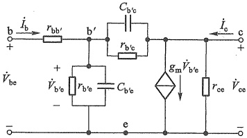

(a)
 

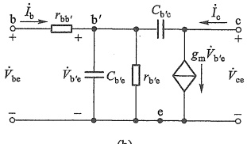

(b)
 

图 6.3.2 BJT 的高频小信号模型   (a) 实际模型 (b) 简化模型
 

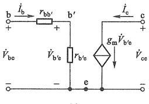

(a)
 

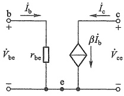

(b)
 

图 6.3.3 BJT 两种模型在低频时的比较
 

（a）简化混合 $ \pi $形模型在低频时的形式 （b）BJT的H参数低频小信号简化模型

<!-- page: 229 -->

(2)  $ \dot{\beta} $ 的频率响应

根据5.2.3节 $ \beta $的定义

 $$ h_{_{\mathrm{fe}}}=\frac{\partial i_{_{\mathrm{c}}}}{\partial i_{_{\mathrm{B}}}}\bigg|_{\nu_{_{\mathrm{CEQ}}}}\quad 或 \quad\dot{\beta}=\frac{\dot{I}_{_{\mathrm{c}}}}{\dot{I}_{_{\mathrm{b}}}}\bigg|_{\dot{\nu}_{_{\mathrm{ce}}}=0} $$ 

式中  $ \dot{V}_{ee}=0 $ 意味着在小信号模型中 c、e 之间短路，则得到图 6.3.4 所示的等效电路。由此可见，集电极短路电流为

$$  \dot{I}_{\mathrm{e}}=\left(g_{\mathrm{m}}-\mathrm{j}\omega C_{\mathrm{b}^{\prime}\mathrm{e}}\right)\dot{V}_{\mathrm{b}^{\prime}\mathrm{e}}   \tag*{(6.3.2)}$$

基极电流

$$  \dot{I}_{\mathrm{b}}=\frac{\dot{V}_{\mathrm{b}^{\prime}\mathrm{e}}}{r_{\mathrm{b}^{\prime}\mathrm{e}}}+\mathrm{j}\omega C_{\mathrm{b}^{\prime}\mathrm{e}}\dot{V}_{\mathrm{b}^{\prime}\mathrm{e}}+\mathrm{j}\omega C_{\mathrm{b}^{\prime}\mathrm{e}}\dot{V}_{\mathrm{b}^{\prime}\mathrm{e}}=\left(\frac{1}{r_{\mathrm{b}^{\prime}\mathrm{e}}}+\mathrm{j}\omega C_{\mathrm{b}^{\prime}\mathrm{e}}+\mathrm{j}\omega C_{\mathrm{b}^{\prime}\mathrm{e}}\right)\dot{V}_{\mathrm{b}^{\prime}\mathrm{e}}   \tag*{(6.3.3)}$$

由式(6.3.2)和式(6.3.3)可得 $ \beta $的表达式

 $$ \dot{\beta}=\frac{\dot{I}_{\mathrm{c}}}{\dot{I}_{\mathrm{b}}}=\frac{g_{\mathrm{m}}-\mathrm{j}\omega C_{\mathrm{b}^{\prime}\mathrm{c}}}{r_{\mathrm{b}^{\prime}\mathrm{e}}}+\mathrm{j}\omega(C_{\mathrm{b}^{\prime}\mathrm{e}}+C_{\mathrm{b}^{\prime}\mathrm{c}}) $$ 

可见，BJT 的  $ \beta $ 是频率的函数。在图6.3.4所示模型的有效频率范围内通常有 $ g_{m} \gg \omega C_{b'c} $，因而

 $$ \dot{\beta}\approx\frac{g_{\mathrm{m}}r_{\mathrm{b}^{\prime}\mathrm{e}}}{1+\mathrm{j}\omega\left(C_{\mathrm{b}^{\prime}\mathrm{e}}+C_{\mathrm{b}^{\prime}\mathrm{e}}\right)r_{\mathrm{b}^{\prime}\mathrm{e}}} $$ 

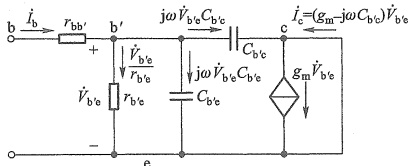

图 6.3.4 计算  $ \dot{\beta} = \dot{I}_{c} / \dot{I}_{b} $ 的模型
 

由式(6.3.1)中  $ g_{m}r_{b^{\prime}e}=\beta_{0} $ 的关系，得

 $$ \dot{\beta}=\frac{\beta_{0}}{1+\mathrm{j}\omega\left(C_{\mathrm{b}^{\prime}\mathrm{e}}+C_{\mathrm{b}^{\prime}\mathrm{c}}\right)r_{\mathrm{b}^{\prime}\mathrm{e}}}=\frac{\beta_{0}}{1+\mathrm{j}\frac{f}{f_{\beta}}} $$ 

其幅频响应和相频响应的表达式为

$$  \mid\dot{\beta}\mid=\frac{\beta_{0}}{\sqrt{1+\left(f/f_{\beta}\right)^{2}}}   \tag*{(6.3.4a)}$$

$$  \varphi=-\arctan\frac{f}{f_{\beta}}   \tag*{(6.3.4b)}$$

式中

$$  f_{\beta}=\frac{1}{2\pi\left(\begin{array}{l}C_{\text{b}^{\prime}\text{e}}+C_{\text{b}^{\prime}\text{e}}\end{array}\right)r_{\text{b}^{\prime}\text{e}}}   \tag*{（6.3.5）}$$

 $ f_{\beta} $ 称为  $ \dot{\beta} $ 的截止频率，即  $ \left|\dot{\beta}\right| $ 下降到  $ 0.707\beta_{0} $ 时的信号频率，其值主要决定于 BJT 的结构。

由式(6.3.4)很容易绘出 $ \beta $的波特图如图6.3.5所示。图中 $ f_{T} $称为BJT的特征频率，是使 $ |\beta| $下降到1（即0 dB）时的信号频率。 $ f_{T} $与BJT的制造工艺有关，器件手册中会给出该值，目前可高达几吉赫。

<!-- page: 230 -->

令式(6.3.4a)等于1，则可得

$$  f_{T}\approx\beta_{0}f_{\beta}   \tag*{(6.3.6a)}$$

将  $ \beta_{0}=g_{m}r_{b^{\prime}e} $ 及式(6.3.5)代入式(6.3.6a)，则

$$  f_{\mathrm{T}}\approx\frac{\mathcal{E}_{\mathrm{m}}}{2\pi\left(C_{\mathrm{b}^{\prime}\mathrm{e}}+C_{\mathrm{b}^{\prime}\mathrm{e}}\right)}   \tag*{(6.3.6b)}$$

一般有 $ C_{b^{\prime}e}\gg C_{b^{\prime}e} $，故

 $$ f_{\mathrm{T}}\approx\frac{g_{\mathrm{m}}}{2\pi C_{\mathrm{b^{\prime}e}}} $$ 

 $ f_{T} $越高，表明BJT的高频性能越好，由它构成的放大电路的上限频率就越高。

需要说明的是，由于忽略了一些参数的影响，图6.3.2b所示的BJT高频小信号模型只能在小于 $ f_{T}/3 $的频率范围内适用，频率更高时，分析结果的误差会增大。

几种 MOS 管和 BJT 的高频相关参数分别如表 6.3.1 和表 6.3.2 所示。

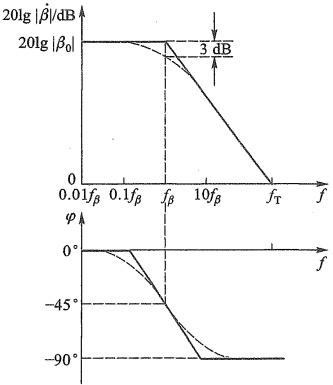

图6.3.5  $ \beta $的波特图
 

表6.3.1 几种 MOS 管的高频相关参数
 

<table border=1 style='margin: auto; word-wrap: break-word;'><tr><td style='text-align: center; word-wrap: break-word;'>参数名称</td><td style='text-align: center; word-wrap: break-word;'>栅漏电容</td><td style='text-align: center; word-wrap: break-word;'>输出电容①</td><td style='text-align: center; word-wrap: break-word;'>输入电容②</td><td style='text-align: center; word-wrap: break-word;'>导通时间</td><td style='text-align: center; word-wrap: break-word;'>上升时间</td><td style='text-align: center; word-wrap: break-word;'>关断时间</td><td style='text-align: center; word-wrap: break-word;'>下降时间</td></tr><tr><td style='text-align: center; word-wrap: break-word;'>参数符号</td><td style='text-align: center; word-wrap: break-word;'>$ C_{gd}/pF $</td><td style='text-align: center; word-wrap: break-word;'>$ C_{oss}/pF $</td><td style='text-align: center; word-wrap: break-word;'>$ C_{iss}/pF $</td><td style='text-align: center; word-wrap: break-word;'>$ t_{on}/ns $</td><td style='text-align: center; word-wrap: break-word;'>$ t_{r}/ns $</td><td style='text-align: center; word-wrap: break-word;'>$ t_{off}/ns $</td><td style='text-align: center; word-wrap: break-word;'>$ t_{f}/ns $</td></tr><tr><td style='text-align: center; word-wrap: break-word;'>2N7000</td><td style='text-align: center; word-wrap: break-word;'>4</td><td style='text-align: center; word-wrap: break-word;'>11</td><td style='text-align: center; word-wrap: break-word;'>20</td><td style='text-align: center; word-wrap: break-word;'>&lt;10</td><td style='text-align: center; word-wrap: break-word;'></td><td style='text-align: center; word-wrap: break-word;'>&lt;10</td><td style='text-align: center; word-wrap: break-word;'></td></tr><tr><td style='text-align: center; word-wrap: break-word;'>BS270</td><td style='text-align: center; word-wrap: break-word;'>4</td><td style='text-align: center; word-wrap: break-word;'>11</td><td style='text-align: center; word-wrap: break-word;'>20</td><td style='text-align: center; word-wrap: break-word;'>&lt;10</td><td style='text-align: center; word-wrap: break-word;'></td><td style='text-align: center; word-wrap: break-word;'>&lt;10</td><td style='text-align: center; word-wrap: break-word;'></td></tr><tr><td style='text-align: center; word-wrap: break-word;'>FQNL2N50B</td><td style='text-align: center; word-wrap: break-word;'>4</td><td style='text-align: center; word-wrap: break-word;'>30</td><td style='text-align: center; word-wrap: break-word;'>180</td><td style='text-align: center; word-wrap: break-word;'>6</td><td style='text-align: center; word-wrap: break-word;'>25</td><td style='text-align: center; word-wrap: break-word;'>10</td><td style='text-align: center; word-wrap: break-word;'>20</td></tr><tr><td style='text-align: center; word-wrap: break-word;'>BSR202N</td><td style='text-align: center; word-wrap: break-word;'>40</td><td style='text-align: center; word-wrap: break-word;'>278</td><td style='text-align: center; word-wrap: break-word;'>863</td><td style='text-align: center; word-wrap: break-word;'>8.8</td><td style='text-align: center; word-wrap: break-word;'>16.7</td><td style='text-align: center; word-wrap: break-word;'>19</td><td style='text-align: center; word-wrap: break-word;'>3.7</td></tr><tr><td style='text-align: center; word-wrap: break-word;'>BSS83P</td><td style='text-align: center; word-wrap: break-word;'>7</td><td style='text-align: center; word-wrap: break-word;'>19</td><td style='text-align: center; word-wrap: break-word;'>62</td><td style='text-align: center; word-wrap: break-word;'>23</td><td style='text-align: center; word-wrap: break-word;'>71</td><td style='text-align: center; word-wrap: break-word;'>56</td><td style='text-align: center; word-wrap: break-word;'>61</td></tr><tr><td style='text-align: center; word-wrap: break-word;'>CEM2281</td><td style='text-align: center; word-wrap: break-word;'>200</td><td style='text-align: center; word-wrap: break-word;'>295</td><td style='text-align: center; word-wrap: break-word;'>2 035</td><td style='text-align: center; word-wrap: break-word;'>11</td><td style='text-align: center; word-wrap: break-word;'>10</td><td style='text-align: center; word-wrap: break-word;'>356</td><td style='text-align: center; word-wrap: break-word;'>110</td></tr><tr><td style='text-align: center; word-wrap: break-word;'>CEK01N6G</td><td style='text-align: center; word-wrap: break-word;'>25</td><td style='text-align: center; word-wrap: break-word;'>55</td><td style='text-align: center; word-wrap: break-word;'>210</td><td style='text-align: center; word-wrap: break-word;'>19</td><td style='text-align: center; word-wrap: break-word;'>10</td><td style='text-align: center; word-wrap: break-word;'>31</td><td style='text-align: center; word-wrap: break-word;'>37</td></tr><tr><td style='text-align: center; word-wrap: break-word;'>ELM23401CA-S</td><td style='text-align: center; word-wrap: break-word;'>50</td><td style='text-align: center; word-wrap: break-word;'>60</td><td style='text-align: center; word-wrap: break-word;'>830</td><td style='text-align: center; word-wrap: break-word;'>5.4</td><td style='text-align: center; word-wrap: break-word;'>19.4</td><td style='text-align: center; word-wrap: break-word;'>45.9</td><td style='text-align: center; word-wrap: break-word;'>12.4</td></tr><tr><td style='text-align: center; word-wrap: break-word;'>ELM57412A-S</td><td style='text-align: center; word-wrap: break-word;'>60</td><td style='text-align: center; word-wrap: break-word;'>120</td><td style='text-align: center; word-wrap: break-word;'>850</td><td style='text-align: center; word-wrap: break-word;'>10</td><td style='text-align: center; word-wrap: break-word;'>16</td><td style='text-align: center; word-wrap: break-word;'>31</td><td style='text-align: center; word-wrap: break-word;'>10</td></tr></table>

①② 漏源电容  $ C_{ds}=C_{oss}-C_{gd} $，栅源电容  $ C_{gs}=C_{iss}-C_{gd} $

<!-- page: 231 -->

表6.3.2 几种 BJT 的高频相关参数
 

<table border=1 style='margin: auto; word-wrap: break-word;'><tr><td style='text-align: center; word-wrap: break-word;'>参数名称</td><td style='text-align: center; word-wrap: break-word;'>特征频率</td><td style='text-align: center; word-wrap: break-word;'>集电结电容</td><td style='text-align: center; word-wrap: break-word;'>发射结电容</td><td style='text-align: center; word-wrap: break-word;'>导通时间</td><td style='text-align: center; word-wrap: break-word;'>延迟时间</td><td style='text-align: center; word-wrap: break-word;'>上升时间</td><td style='text-align: center; word-wrap: break-word;'>关断时间</td><td style='text-align: center; word-wrap: break-word;'>存储时间</td><td style='text-align: center; word-wrap: break-word;'>下降时间</td></tr><tr><td style='text-align: center; word-wrap: break-word;'>参数符号</td><td style='text-align: center; word-wrap: break-word;'>$ f_T/MHz $</td><td style='text-align: center; word-wrap: break-word;'>$ C_{b/c} $或 $ C_c/pF $</td><td style='text-align: center; word-wrap: break-word;'>$ C_{b/c} $或 $ C_c/pF $</td><td style='text-align: center; word-wrap: break-word;'>$ t_{on}/ns $</td><td style='text-align: center; word-wrap: break-word;'>$ t_d/ns $</td><td style='text-align: center; word-wrap: break-word;'>$ t_r/ns $</td><td style='text-align: center; word-wrap: break-word;'>$ t_{off}/ns $</td><td style='text-align: center; word-wrap: break-word;'>$ t_s/ns $</td><td style='text-align: center; word-wrap: break-word;'>$ t_f/ns $</td></tr><tr><td style='text-align: center; word-wrap: break-word;'>2N3904</td><td style='text-align: center; word-wrap: break-word;'>300</td><td style='text-align: center; word-wrap: break-word;'>4</td><td style='text-align: center; word-wrap: break-word;'>8</td><td style='text-align: center; word-wrap: break-word;'></td><td style='text-align: center; word-wrap: break-word;'>&lt;35</td><td style='text-align: center; word-wrap: break-word;'>&lt;35</td><td style='text-align: center; word-wrap: break-word;'></td><td style='text-align: center; word-wrap: break-word;'>&lt;200</td><td style='text-align: center; word-wrap: break-word;'>&lt;50</td></tr><tr><td style='text-align: center; word-wrap: break-word;'>2N3906</td><td style='text-align: center; word-wrap: break-word;'>&gt;250</td><td style='text-align: center; word-wrap: break-word;'>4.5</td><td style='text-align: center; word-wrap: break-word;'>10</td><td style='text-align: center; word-wrap: break-word;'>&lt;60</td><td style='text-align: center; word-wrap: break-word;'>&lt;35</td><td style='text-align: center; word-wrap: break-word;'>&lt;35</td><td style='text-align: center; word-wrap: break-word;'>&lt;300</td><td style='text-align: center; word-wrap: break-word;'>&lt;225</td><td style='text-align: center; word-wrap: break-word;'>&lt;75</td></tr><tr><td style='text-align: center; word-wrap: break-word;'>9013</td><td style='text-align: center; word-wrap: break-word;'>&gt;150</td><td style='text-align: center; word-wrap: break-word;'></td><td style='text-align: center; word-wrap: break-word;'></td><td style='text-align: center; word-wrap: break-word;'></td><td style='text-align: center; word-wrap: break-word;'></td><td style='text-align: center; word-wrap: break-word;'></td><td style='text-align: center; word-wrap: break-word;'></td><td style='text-align: center; word-wrap: break-word;'></td><td style='text-align: center; word-wrap: break-word;'></td></tr><tr><td style='text-align: center; word-wrap: break-word;'>9015</td><td style='text-align: center; word-wrap: break-word;'>190</td><td style='text-align: center; word-wrap: break-word;'>4.5</td><td style='text-align: center; word-wrap: break-word;'></td><td style='text-align: center; word-wrap: break-word;'></td><td style='text-align: center; word-wrap: break-word;'></td><td style='text-align: center; word-wrap: break-word;'></td><td style='text-align: center; word-wrap: break-word;'></td><td style='text-align: center; word-wrap: break-word;'></td><td style='text-align: center; word-wrap: break-word;'></td></tr><tr><td style='text-align: center; word-wrap: break-word;'>9018</td><td style='text-align: center; word-wrap: break-word;'>1 100</td><td style='text-align: center; word-wrap: break-word;'>1.3</td><td style='text-align: center; word-wrap: break-word;'></td><td style='text-align: center; word-wrap: break-word;'></td><td style='text-align: center; word-wrap: break-word;'></td><td style='text-align: center; word-wrap: break-word;'></td><td style='text-align: center; word-wrap: break-word;'></td><td style='text-align: center; word-wrap: break-word;'></td><td style='text-align: center; word-wrap: break-word;'></td></tr></table>

##### 6.3.2 共源放大电路的高频响应

### 1. 高频响应

现仍以图 6.2.1a 所示共源放大电路为例，分析其高频响应。为便于分析重画于图 6.3.6a中。在高频区，电路中的耦合电容  $ C_{b1} $、 $ C_{b2} $ 和旁路电容  $ C_{s} $ 的容抗都很小，可视为短路，于是画出其高频小信号等效电路，如图 6.3.6b 所示。其中  $ R_{g}=R_{g1}/R_{g2} $， $ R_{L}^{\prime}=R_{d}/R_{L} $。可以通过列写方程求得增益表达式，从而分析其频率响应，但为了便于从电路原理层面理解，此处通过电路等效变换，求得等效的 RC 电路来分析频率响应。

求图 6.3.6b 中  $ C_{gs} $ 左侧端口的戴维南等效电路。同时考虑到输出回路，通常有  $ r_{ds} \gg R'_{L} $，故可将  $ r_{ds} $ 开路；电容  $ C_{ds} $ 很小，在所分析的频率范围内，其容抗远大于  $ R'_{L} $，也可以忽略  $ C_{ds} $ 的影响，将其开路，由此得简化电路如图 6.3.6c 所示。其中

$$  \dot{V}_{\mathrm{s}}^{\prime}=\frac{R_{\mathrm{g}}}{R_{\mathrm{s i}}+R_{\mathrm{g}}}\mathrm{~.~}\dot{V}_{\mathrm{s}}   \tag*{(6.3.7a)}$$

$$  R^{\prime}_{si}=R_{si}\big/\big/R_{g}   \tag*{(6.3.7b)}$$

接下来，可以将图c中跨接在输入和输出回路之间的电容 $ C_{gd} $，分别等效到输入回路和输出回路，即求出阻抗 $ Z_{1} $和 $ Z_{2} $。变换过程如下：

在图 6.3.6c 中，设  $ \dot{A}_{v}^{\prime} = V_{0} / V_{gs} $，则由 g 点流入电容  $ C_{gd} $ 的电流为

 $$ \dot{I}_{C_{\mathrm{g d}}}=\frac{\dot{V}_{_{\mathrm{g s}}}-\dot{V}_{_{\mathrm{o}}}}{\frac{1}{\mathrm{j}\omega C_{_{\mathrm{g d}}}}}=(\mathrm{1-\dot{A}_{_{v}}^{\prime}})\dot{V}_{_{\mathrm{g s}}}\mathrm{j}\omega\dot{C}_{_{\mathrm{g d}}} $$ 

求得阻抗  $ Z_{1} $

 $$ Z_{1}=\frac{\dot{V}_{gs}}{\dot{I}_{Cgd}}=\frac{1}{j\omega C_{gd}(1-\dot{A}_{v}^{\prime})} $$ 

显然 $ Z_{1} $是一个电容，该电容为

$$  C_{_{\mathrm{M}1}}=\left(1-A_{v}^{\prime}\right)C_{_{\mathrm{gd}}}   \tag*{(6.3.8)}$$

<!-- page: 232 -->

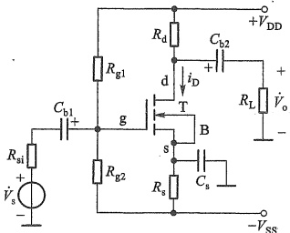

(a)
 

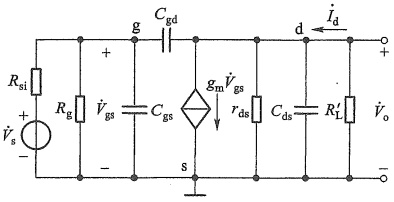

(b)
 

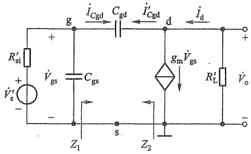

(c)
 

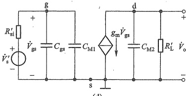

(d)
 

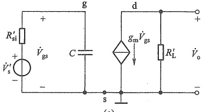

(e)
 

图 6.3.6 单级共源电路及其高频小信号等效电路
 

（a）原理图 （b）图 a 的高频小信号等效电路 （c）图 b 的简化电路 （d）图 c 的密勒等效电路 （e）图 d 的简化电路
 

所以输入回路可以等效为图 6.3.6d 的形式。

同理，在图6.3.6c的输出回路中，由d点流入 $ C_{gd} $的电流为

 $$ \dot{I}_{C_{\mathrm{g d}}}^{\prime}=\frac{\dot{V}_{\mathrm{o}}-\dot{V}_{\mathrm{g s}}}{\frac{1}{\mathrm{j}\omega C_{\mathrm{g d}}}}=\dot{V}_{\mathrm{o}}\left(1-\frac{1}{\dot{A}_{\mathrm{v}}^{\prime}}\right)\mathrm{j}\omega C_{\mathrm{g d}} $$ 

则阻抗  $ Z_{2} $ 为

 $$ Z_{2}=\frac{\dot{V}_{o}}{\dot{I}_{C_{gd}}^{\prime}}=\frac{1}{\mathrm{j}\omega C_{gd}(1-1/\dot{A}_{v}^{\prime})} $$ 

 $ Z_{2} $ 同样也是一个电容，该电容为

<!-- page: 233 -->

$$  C_{\mathrm{M}2}=\left(1-1/\dot{A}_{\nu}^{\prime}\right)C_{\mathrm{g d}}   \tag*{(6.3.9)}$$

所以输出回路可以等效为图 6.3.6d 的形式。

上述各式中的 $ A'_v $是图6.3.6c所示电路的 $ \dot{V}_o $对 $ \dot{V}_{gs} $的增益，一般有 $ |\dot{A}'_v| \gg 1 $。由图6.3.6c可求得 $ \dot{A}'_v $的表达式：

 $$ \dot{A}_{s}^{\prime}=\frac{\dot{V}_{o}}{\dot{V}_{gs}}=\frac{-(\dot{g}_{m}\dot{V}_{gs}-\dot{I}_{C_{gd}})R_{L}^{\prime}}{\dot{V}_{gs}}=\frac{-\left[\dot{g}_{m}\dot{V}_{gs}-\mathrm{j}\omega C_{gd}(1-\dot{A}_{v}^{\prime})\dot{V}_{gs}\right]R_{L}^{\prime}}{\dot{V}_{gs}}\approx-\dot{g}_{m}R_{L}^{\prime}-\mathrm{j}\omega C_{gd}\dot{A}_{v}^{\prime}R_{L}^{\prime} $$ 

即

 $$ \dot{A}_{v}^{\prime}=\frac{-g_{m}R_{L}^{\prime}}{1+\mathrm{j}\omega C_{gd}R_{L}^{\prime}} $$ 

因为  $ C_{gd} $ 很小，通常有  $ R_{L}^{\prime} \ll \frac{1}{\omega C_{gd}} $，所以得

$$  \dot{A}_{\mathrm{~v~}}^{\prime}\approx-g_{\mathrm{m}}R_{\mathrm{~L~}}^{\prime}   \tag*{(6.3.10a)}$$

将式(6.3.10a)代入式(6.3.8)和式(6.3.9)，可得  $ C_{gd} $ 等效到输入回路的电容  $ C_{M1} = (1 + g_{m}R'_{L})C_{gd} $ 和等效到输出回路的电容  $ C_{M2} = [1 + 1/(g_{m}R'_{L})]C_{gd} $。由于可以由密勒定理 $ ^{①} $求得这两个电容，所以也称它们为密勒电容。当  $ g_{m}R'_{L} \gg 1 $ 时，有

$$  C_{M1}>>C_{\mathrm{g d}},\quad C_{M2}\approx C_{\mathrm{g d}}   \tag*{(6.3.10b)}$$

即等效到输出回路的电容远小于等效到输入回路的电容，上限频率取决于大时间常数的输入回路，所以可以忽略  $ C_{M2} $ 的影响，于是图 6.3.6d 可简化为图 e 的形式，其中

$$  C=C_{\mathrm{g s}}+C_{\mathrm{M I}}=C_{\mathrm{g s}}+\left(1+g_{\mathrm{m}}R_{\mathrm{L}}^{\prime}\right)C_{\mathrm{g d}}   \tag*{(6.3.10c)}$$

可以看出，最后的等效电路只有一个RC电路，当以 $ V_{s}^{\prime} $为输入、 $ V_{gs} $为输出时，该RC电路就是与图6.1.3一样的低通电路。由图6.3.6e和式(6.3.7a)，可得图6.3.6a所示放大电路在高频区源电压增益的表达式

$$  \begin{align*}\dot{A}_{_{vsH}}=&\frac{\dot{V}_{o}}{\dot{V}_{s}}=\frac{\dot{V}_{o}}{\dot{V}_{gs}}\cdot\frac{\dot{V}_{gs}}{\dot{V}_{s}^{\prime}}\cdot\frac{\dot{V}_{s}^{\prime}}{\dot{V}_{s}}=-g_{m}R_{L}^{\prime}\cdot\frac{1}{1+\mathrm{j}\omega R_{si}^{\prime}C}\cdot\frac{R_{g}}{R_{si}+R_{g}}\\\approx&\dot{A}_{_{vsM}}\cdot\frac{1}{1+\mathrm{j}\omega R_{si}^{\prime}C}=\frac{\dot{A}_{_{vsM}}}{1+\mathrm{j}\frac{f}{f_{H}}}\end{align*}   \tag*{(6.3.11)}$$

式中 $ \dot{A}_{v\leq M} $为中频（即通带）源电压增益，即

$$  \dot{A}_{_{\mathrm{v s M}}}=-g_{\mathrm{m}}R_{\mathrm{L}}^{\prime}\mathrm{~\boldmath~\cdot~}\frac{R_{\mathrm{g}}}{R_{\mathrm{s i}}+R_{\mathrm{g}}}   \tag*{（6.3.12）}$$

 $ f_{H} $ 是源电压增益的上限频率

$$  f_{\mathrm{H}}=\frac{1}{2\pi R_{\mathrm{si}}^{\prime}C}   \tag*{（6.3.13）}$$

<!-- page: 234 -->

式中  $ C=C_{gs}+(1+g_{m}R_{L}^{\prime})C_{gd},R_{si}^{\prime}=R_{si}\parallel R_{g} $，而  $ R_{g}=R_{g1}\parallel R_{g2} $。可以看出，等效时间常数  $ R_{si}^{\prime}C $ 决定了放大电路的上限频率。

 $ A_{vsH} $的对数幅频响应和相频响应的表达式分别为

$$  20\mathrm{lg}\left|\dot{A}_{vsH}\right|=20\mathrm{lg}\left|\dot{A}_{vsM}\right|-20\mathrm{lg}\sqrt{1+\left(f/f_{H}\right)^{2}}   \tag*{(6.3.14a)}$$

$$  \varphi=-180^{\circ}-\arctan\left(f/f_{\mathrm{H}}\right)   \tag*{(6.3.14b)}$$

由式(6.3.14)可画出图6.3.6a所示共源放大电路的高频响应波特图，如图6.3.7所示。

仿真说明文档6.1：图6.3.6a电路增益的频率响应仿真

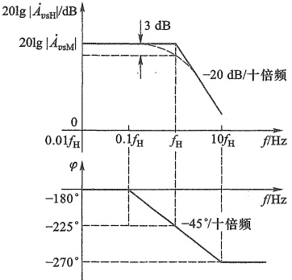

图 6.3.7 图 6.3.6a 所示电路的高频响应波特图
 

由式(6.3.13)看出，要提高 $ f_{H} $，就要减小 $ R'_{si} $和 $ C $。通常信号源内阻 $ R_{si} $远小于偏置电阻 $ R_{g} $，所以 $ R'_{si}=R_{si}\parallel R_{g}\approx R_{si} $。可见选用内阻 $ R_{si} $小的信号源有利于提高 $ f_{H} $。另外， $ C=C_{gs}+(1+g_{m}R'_{L})C_{gd} $，所以选用 $ C_{gs},C_{gd} $小的MOS管也有利于提高 $ f_{H} $。而且由于密勒电容的存在，使 $ C_{gd} $的影响效果增大了 $ (1+g_{m}R'_{L}) $倍，对 $ f_{H} $影响最为严重。因此选择 $ C_{gd} $小的MOS管，可以明显提高共源极放大电路的上限频率。注意，只有跨接在输入输出端口（非接地端）之间的电容才有密勒效应。

将图6.3.7与图6.2.2组合在一起即可得图6.3.6a所示共源电路的完整的频率响应波特图，其形式与图6.0.1相似。

例 6.3.1 电路如图 6.3.8a 所示。已知  $ R_{si}=100\ k\Omega, R_g=4.7\ M\Omega, R_d=R_L=15\ k\Omega, g_m=1\ mS $, MOS 管的  $ C_{gs}=1\ pF, C_{gd}=0.4\ pF $。（1）试求该电路的中频源电压增益  $ \dot{A}_{vsM} $ 和源电压增益的上限频率  $ f_H $;（2）若信号源内阻  $ R_{si} $ 减小为  $ 10\ k\Omega $，再求此时的  $ \dot{A}_{vsM} $ 和  $ f_H $。

解:(1) 图6.3.8b是图6.3.8a所示电路的高频小信号等效电路。 $ \underset{\cdot}{由} $式(6.3.7b)和式(6.3.10c)得

 $$ \begin{aligned}R_{\mathrm{si}}^{\prime}=R_{\mathrm{si}}\mathbin{//}R_{\mathrm{g}}=&\frac{100\times4\ 700}{100+4\ 700}\mathrm{~k}\Omega\approx97.92\mathrm{~k}\Omega\\C=C_{\mathrm{gs}}+\left(1+g_{\mathrm{m}}R_{\mathrm{L}}^{\prime}\right)C_{\mathrm{gd}}=&C_{\mathrm{gs}}+\left[1+g_{\mathrm{m}}\left(R_{\mathrm{d}}\mathbin{//}R_{\mathrm{L}}\right)\right]C_{\mathrm{gd}}\\=\left[1+\left(1+1\times7.5\right)\times0.4\right]\mathrm{pF}=4.4\mathrm{~pF}\end{aligned} $$

<!-- page: 235 -->

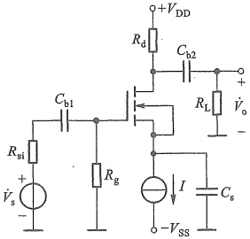

(a)
 

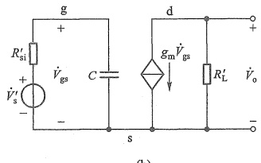

(b)
 

图 6.3.8 例 6.3.1 的电路图
 

（a）原理图 （b）高频小信号等效电路
 

由式(6.3.12)求得中频源电压增益为

 $$ \begin{aligned}\dot{A}_{_{vsM}}&=-g_{_{m}}R_{_{L}}^{\prime}\cdot\frac{R_{_{g}}}{R_{_{si}}+R_{_{g}}}=-g_{_{m}}(R_{_{d}}\big/\big/R_{_{L}})\cdot\frac{R_{_{g}}}{R_{_{si}}+R_{_{g}}}\\&=-1\times10^{-3}\times\frac{15\times15}{15+15}\times10^{3}\times\frac{4\ 700}{100+4\ 700}\approx-7.34\end{aligned} $$ 

由式 $ （6.3.13） $求得上限截止频率为

 $$ f_{\mathrm{H}}=\frac{1}{2\pi R_{\mathrm{si}}^{\prime}C}=\frac{1}{2\times3.14\times97.92\times10^{3}\times4.4\times10^{-12}}\mathrm{Hz}\approx369.59\mathrm{kHz} $$ 

（2） $ R_{si} $减小为10kΩ时， $ R_{si}^{\prime}=R_{si}\parallel R_{g}=\frac{10\times4\ 700}{10+4\ 700}\ k\Omega\approx9.98\ k\Omega $

中频源电压增益为

 $$ \dot{A}_{_{vsM}}=-g_{_{m}}(R_{_{d}}/R_{_{L}})\mathrm{\;}\cdot\;\frac{R_{_{g}}}{R_{_{si}}+R_{_{g}}}=-1\times10^{-3}\times\frac{15\times15}{15+15}\times10^{3}\times\frac{4\ 700}{10+4\ 700}\approx-7.48 $$ 

上限截止频率为

 $$ f_{\mathrm{H}}=\frac{1}{2\pi R_{\mathrm{si}}^{\prime}C}=\frac{1}{2\times3.14\times9.98\times10^{3}\times4.4\times10^{-12}}\mathrm{Hz}\approx3.63\mathrm{MHz} $$ 

### 2. 增益-带宽积

上述分析看出，密勒等效电容  $ C_{M1} = (1 + g_{m}R'_{L})C_{gd} $ 对高频响应的影响极为显著，可以通过减小  $ g_{m}R'_{L} $ 来减小  $ C_{M1} $ 从而提高  $ f_{H} $，但这是以牺牲电压增益为代价的（参见式(6.3.12)）。由此可见，提高  $ f_{H} $ 与增大  $ \left|\dot{A}_{esM}\right| $ 是相互矛盾的。对于大多数放大电路而言，都有  $ f_{H} \gg f_{L} $，即通频带  $ BW = f_{H} - f_{L} \approx f_{H} $，因此可以说带宽与增益是互相制约的。为综合考虑这两方面的性能，引入增益-带宽积这一参数，定义为中频增益与带宽乘积的绝对值。对于图 6.3.6a 所示电路，由式(6.3.12)和式(6.3.13)可得其增益-带宽积

 $$ \left|\dot{A}_{_{\mathrm{v s M}}}\cdot f_{\mathrm{H}}\right|=g_{\mathrm{m}}R_{\mathrm{L}}^{\prime}\cdot\frac{R_{\mathrm{g}}}{R_{\mathrm{s i}}+R_{\mathrm{g}}}\cdot\frac{1}{2\pi R_{\mathrm{s i}}^{\prime}C}=g_{\mathrm{m}}R_{\mathrm{L}}^{\prime}\cdot\frac{R_{\mathrm{g}}}{R_{\mathrm{s i}}+R_{\mathrm{g}}}\cdot\frac{1}{2\pi\left(R_{\mathrm{s i}}//R_{\mathrm{g}}\right)\left[C_{\mathrm{g s}}+\left(1+g_{\mathrm{m}}R_{\mathrm{L}}^{\prime}\right)C_{\mathrm{g d}}\right]} $$

<!-- page: 236 -->

通常有  $ R_{g} \gg R_{si}, g_{m}R_{L}^{\prime} \gg 1, (1 + g_{m}R_{L}^{\prime})C_{gd} \gg C_{gs} $，则

$$  \left|\dot{A}_{\mathrm{v s M}}\cdot f_{\mathrm{H}}\right|\approx\frac{g_{\mathrm{m}}R_{\mathrm{L}}^{\prime}}{2\pi R_{\mathrm{s i}}\left[C_{\mathrm{g s}}+\left(1+g_{\mathrm{m}}R_{\mathrm{L}}^{\prime}\right)C_{\mathrm{g d}}\right]}\approx\frac{1}{2\pi R_{\mathrm{s i}}C_{\mathrm{g d}}}   \tag*{（6.3.15）}$$

式(6.3.15)说明，在 MOS 管及信号源确定后，增益-带宽积近似为常数，即提高通带增益，带宽将变窄，反之亦然。因此选择电路参数时，必须兼顾  $ \left| \dot{A}_{\mathrm{SM}} \right| $ 和  $ f_{H} $ 的要求。

密勒效应使共源放大电路具有较大的等效输入电容 C，从而导致上限频率  $ f_{H} $ 较低。

##### 6.3.3 共射放大电路的高频响应

与分析下限截止频率的短路时间常数法类似，在分析放大电路上限截止频率时也可以采用开路时间常数法。若电路中有三极管极间电容  $ C_{1} $、 $ C_{2} $、 $ C_{3} $ ……可以求出每个电容单独作用时的时间常数  $ \tau_{1}=R_{1}C_{1} $、 $ \tau_{2}=R_{2}C_{2} $、 $ \tau_{3}=R_{3}C_{3} $ ……那么 $ ^{①} $

$$  \tau_{\mathrm{H}}=\sum_{i=1}^{n}\tau_{i}   \tag*{(6.3.16)}$$

其中 n 是电容总数。上限频率就近似为

$$  f_{\mathrm{H}}\approx\frac{1}{2\pi\tau_{\mathrm{H}}}   \tag*{(6.3.17)}$$

由于在求某一个电容单独作用时的时间常数，需要将其他电容开路处理（等效为通带内的状态），所以该方法称为开路时间常数法。下面用这种方法分析共射极放大电路的高频响应。

仍以图 6.2.4a 所示电路为例。为便于分析将其重画于图 6.3.9a 中。在高频区，电路中的  $ C_{b1} $、 $ C_{b2} $ 和  $ C_e $ 等容量较大的电容都可视为短路，于是该电路的高频小信号等效电路如图 6.3.9b 所示，其中  $ R_b = R_{b1} \parallel R_{b2} $， $ R'_L = R_e \parallel R_L $。注意，BJT 用图 6.3.2b 的混合  $ \pi $ 模型替换。

##### （1）仅考虑 $ C_{b^{\prime}a} $作用时的时间常数

将图 6.3.9b 中的  $ C_{b^{\prime}c} $ 开路，信号源置零，且保留信号源内阻，得到求  $ C_{b^{\prime}c} $ 构成的时间常数等效电路如图 6.3.9c 所示。所以

$$  R_{1}=\left(R_{\mathrm{s i}}/\left/R_{\mathrm{b}}+r_{\mathrm{b b}^{\prime}}\right.\right)\left/\left/r_{\mathrm{b}^{\prime}\mathrm{e}}\right.\right.   \tag*{（6.3.18）}$$

$$  \tau_{1}=R_{1}C_{\mathrm{b^{\prime}e}}   \tag*{（6.3.19）}$$

（2）仅考虑 $ C_{b'c} $作用时的时间常数

将图 6.3.9b 中的  $ C_{b'e} $ 开路，其余与上述过程类似，得到等效电路如图 6.3.9d 所示。用外加电压法求  $ C_{b'e} $ 两端等效电阻的电路如图 6.3.9e 所示。考虑 c 点的 KCL，可列出回路方程

 $$ \dot{V}_{\mathrm{t}}=\dot{V}_{\mathrm{b}^{\prime}\mathrm{e}}+\left(\dot{I}_{\mathrm{t}}+g_{\mathrm{m}}\dot{V}_{\mathrm{b}^{\prime}\mathrm{e}}\right)R_{\mathrm{L}}^{\prime} $$ 

将  $ \dot{V}_{b'e} = \left[ (R_{si} // R_{b} + r_{bb'} ) \right] / r_{b'e} $ 代入上式，并结合式(6.3.18)整理得

 $$ R_{2}=\frac{\dot{V}_{\mathrm{t}}}{\dot{I}_{\mathrm{t}}}=\left(1+g_{\mathrm{m}}R_{\mathrm{L}}^{\prime}\right)R_{1}+R_{\mathrm{L}}^{\prime} $$ 

所以

<!-- page: 237 -->

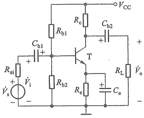

(a)
 

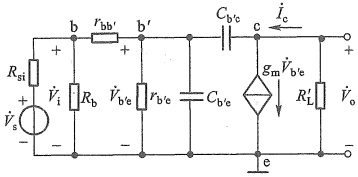

(b)
 

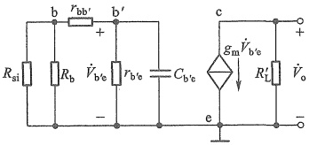

(c)
 

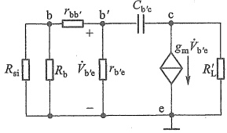

(d)
 

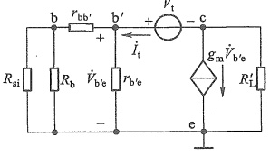

(e)
 

图 6.3.9 共射电路及其高频小信号等效电路
 

(a) 共射电路原理图 (b) 图 a 的高频小信号等效电路 (c) 求  $ C_{b'c} $ 构成的时间常数 (d) 求  $ C_{b'c} $ 构成的时间常数 (e) 求  $ C_{b'c} $ 两端的等效电阻
 

$$  \tau_{2}=R_{2}C_{\mathrm{b}^{\prime}\mathrm{c}}=\left[\left(1+g_{\mathrm{m}}R_{\mathrm{L}}^{\prime}\right)R_{1}+R_{\mathrm{L}}^{\prime}\right]C_{\mathrm{b}^{\prime}\mathrm{c}}   \tag*{（6.3.20）}$$

由此得

 $$ \tau_{H}=\tau_{1}+\tau_{2} $$ 

利用式 $ （6.3.17） $便可估算出电路的上限频率。

在5.2.4节已分析过电路的中频增益为

$$  \dot{A}_{_{vsM}}=-\frac{\beta R_{L}^{\prime}}{r_{be}}\circ\frac{R_{b}\big/\big/r_{be}}{R_{si}+R_{b}\big/\big/r_{be}}   \tag*{(6.3.21)}$$

则高频区的源电压增益为

$$  \dot{A}_{_{vsH}}=\frac{\dot{V}_{_{0}}}{\dot{V}_{_{s}}}=\dot{A}_{_{vsM}}\cdot\frac{1}{1+\mathrm{j}\left(f/f_{H}\right)}   \tag*{（6.3.22）}$$

其幅频和相频响应波特图与图6.3.7相似。

由开路时间常数法得到的上限频率虽有误差，但作为手工快速近似估算，它不失为一种有效方法。当然，这里采用分析共源放大电路的方法同样可行。

<!-- page: 238 -->

共射放大电路输入回路也有密勒等效电容

$$  C_{\mathrm{M}1}=\left(1+g_{\mathrm{m}}R_{\mathrm{L}}^{\prime}\right)C_{\mathrm{b}^{\prime}\mathrm{c}}   \tag*{（6.3.23）}$$

PN 结电容是影响  $ f_{H} $ 的主要因素，选用  $ f_{T} $ 高 [参见式(6.3.6b)] 的 BJT 是提高  $ f_{H} $ 最有效的方法。BJT 放大电路也遵循增益-带宽积近似为常数的规律。

##### 6.3.4 共栅和共基放大电路的高频响应

由于密勒效应的影响，共源和共射放大电路的上限频率较低，因而带宽较窄。下面我们再看看其他几种组态的情况。

### 1. 共栅电路

共栅放大电路如图6.3.10a所示。在高频区，电路中的耦合电容和旁路电容均可视为短路，而需要考虑三极管极间电容的影响，于是可画出它的高频小信号等效电路，如图6.3.10b所示。图中电容 $ C_{gs} $、 $ C_{gd} $分别在输入回路和输出回路，且都有一端接地，所以不存在密勒倍增效应。

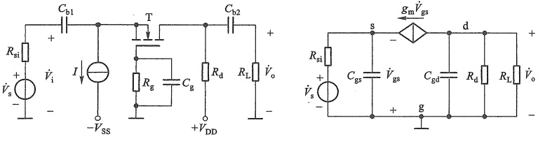

(a)
 

(b)
 

图 6.3.10 共栅放大电路
 

（a）原理图 （b）图 a 的高频小信号等效电路
 

用开路时间常数法分析图 6.3.10b 所示电路, 考虑到式(4.5.19)共栅极电路的输入电阻, 所以  $ C_{gs} $ 构成的时间常数为

 $$ \tau_{1}=\left(R_{\mathrm{s i}}//\frac{1}{g_{\mathrm{m}}}\right)C_{\mathrm{g s}} $$ 

 $ C_{gd} $ 左侧端口等效电阻类似于式(4.4.12)，其阻值通常远大于  $ R_{d} $，可视作开路，所以  $ C_{gd} $ 构成的时间常数为

 $$ \tau_{2}\approx\left(R_{\mathrm{d}}//R_{\mathrm{L}}\right)C_{\mathrm{g d}}=R_{\mathrm{L}}^{\prime}C_{\mathrm{g d}} $$ 

可见  $ \tau_{1} $ 和  $ \tau_{2} $ 均明显小于式(6.3.13)中的时间常数  $ R'_{si}C $。意味着共栅放大电路的上限频率

 $$ f_{\mathrm{H}}\approx\frac{1}{2\pi\tau_{\mathrm{H}}}=\frac{1}{2\pi\left(\tau_{1}+\tau_{2}\right)} $$ 

高于共源放大电路的上限频率[参见式(6.3.13)]。

将图 6.3.10b 中的  $ C_{gs} $ 和  $ C_{gd} $ 开路，很容易求得共栅电路的中频源电压增益

$$  \dot{A}_{_{\nu\mathrm{s M}}}=g_{\mathrm{m}}R_{\mathrm{L}}^{\prime}\cdot\frac{R_{\mathrm{i}}}{R_{\mathrm{s i}}+R_{\mathrm{i}}}=g_{\mathrm{m}}R_{\mathrm{L}}^{\prime}\cdot\frac{1/g_{\mathrm{m}}}{R_{\mathrm{s i}}+1/g_{\mathrm{m}}}   \tag*{(6.3.24)}$$

对比式(6.3.24)与共源放大电路的中频源电压增益式(6.3.12)，由于通常有 $ 1/g_{m}<R_{g} $

<!-- page: 239 -->

所以共栅电路的通带源电压增益的倍数（ $ \left|A_{vaM}\right| $）小于共源电路，主要原因是共栅电路的输入电阻 $ R_{i}=1/g_{m} $小于共源电路的输入电阻 $ R_{i}=R_{g} $。

### 2. 共基电路

共基放大电路如图 6.3.11a 所示。由于在很宽的频率范围内  $ I_{b} $ 比  $ I_{c} $ 及  $ I_{e} $ 小得多，而且  $ r_{bb'} $ 的数值很小，因此  $ r_{bb'} $ 上的压降可以忽略，即  $ \dot{V}_{b'} \approx 0 $，此时可得高频小信号简化等效电路如图 6.3.11b 所示。 $ C_{b'e} $ 和  $ C_{b'c} $ 不存在密勒倍增效应。

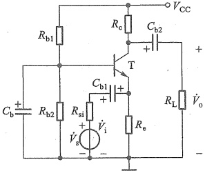

(a)
 

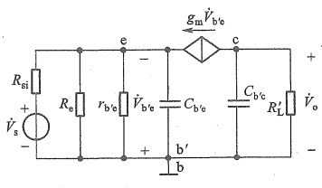

(b)
 

图 6.3.11 共基放大电路
 

（a）原理图 （b）图 a 的高频小信号简化等效电路
 

两开路时间常数为

$$  \tau_{1}=\left(R_{\mathrm{s i}}/\left/R_{\mathrm{e}}\right/\right/r_{\mathrm{b}^{\prime}\mathrm{e}}\left/\right/\frac{1}{g_{\mathrm{m}}}\right)C_{\mathrm{b}^{\prime}\mathrm{e}}   \tag*{(6.3.25)}$$

$$  \tau_{2}\approx R_{\mathrm{L}}^{\prime}C_{\mathrm{b}^{\prime}\mathrm{o}}   \tag*{(6.3.26)}$$

考虑到  $ g_{m}=\beta_{0}/r_{b^{\prime}e} $，所以式(6.3.25)可写为

$$  \tau_{_{1}}=\left(R_{_{si}}//R_{_{e}}//\frac{r_{_{b^{\prime}e}}}{1+\beta_{_{0}}}\right)C_{_{b^{\prime}e}}   \tag*{(6.3.27)}$$

对比式(6.3.27)和式(6.3.19)、式(6.3.26)和式(6.3.20)看出，共基放大电路的时间常数远小于共射电路的时间常数，意味着共基放大电路的上限频率大大高于共射电路的上限频率。

对增益进行分析，同样也可以得到共基电路通带源电压增益小于共射电路通带源电压增益的结论。

例 6.3.2 设图 6.3.10 所示共栅电路中元器件参数的值均与例 6.3.1 相同，试求该电路的中频源电压增益及上限频率。

解：图6.3.10所示电路的中频源电压增益

 $$ \dot{A}_{_{\mathrm{s s M}}}=g_{_{\mathrm{m}}}R_{_{\mathrm{L}}}^{\prime}\cdot\frac{1/g_{_{\mathrm{m}}}}{R_{_{\mathrm{s i}}}+1/g_{_{\mathrm{m}}}}=\frac{g_{_{\mathrm{m}}}R_{_{\mathrm{L}}}^{\prime}}{1+g_{_{\mathrm{m}}}R_{_{\mathrm{s i}}}}=\frac{1\times\frac{15\times15}{15+15}}{1+1\times100}\approx0.07 $$ 

两个时间常数

<!-- page: 240 -->

$$ \tau_{1}=\left(R_{\mathrm{s i}}/\frac{1}{g_{\mathrm{m}}}\right)C_{\mathrm{g s}}=\left(100\mathrm{~k}\Omega/\frac{1}{1\mathrm{~m S}}\right)\times1\mathrm{~p F}\approx10^{-9}\mathrm{~s} $$ 

 $$ \tau_{2}\approx\left(R_{\mathrm{d}}//R_{\mathrm{L}}\right)C_{\mathrm{g d}}=\left(15\mathrm{~k}\Omega//15\mathrm{~k}\Omega\right)\times0.4\mathrm{p F}=3\times10^{-9}\mathrm{~s} $$ 

电路的上限频率

 $$ f_{\mathrm{H}}\approx\frac{1}{2\pi\left(\tau_{1}+\tau_{2}\right)}=\frac{1}{2\times3.14\times\left(1\times10^{-9}\mathrm{~s}+3\times10^{-9}\mathrm{~s}\right)}\approx39.8\mathrm{~M H z} $$ 

增益带宽积

 $$ \left|\dot{A}_{\mathrm{v s M}}f_{\mathrm{H}}\right|=\left|0.07\times39.8\mathrm{M H z}\right|\approx2.79\mathrm{M H z} $$ 

与例 6.3.1 中求得的  $ f_{\mathrm{H}} \approx 369.59\ \mathrm{kHz} $、 $ |A_{vsM}| \approx 7.34 $ 相比，说明在相同工作条件下共栅电路的上限频率远高于共源电路的上限频率，而中频源电压增益下降了不少，但是它们的增益带宽积基本相等（共源电路的增益-带宽积  $ \left|7.34 \times 369.59\ \mathrm{kHz}\right| \approx 2.71\ \mathrm{MHz} $）。

上述结果表明，由于共栅和共基电路中不存在密勒电容效应，而且两种电路的输入电阻都很小，所以它们的等效RC低通电路的时间常数也很小，上限频率大大提高。因此共栅和共基放大电路有较宽的频带。但由于它们的输入电阻较小，电压信号源的内阻损耗增大，导致源电压增益小于共源和共射电路。

可以用同样的方法分析共漏和共集放大电路的高频响应，这里不再赘述。

#### 6.3.5 三极管基本放大电路通频带比较

在表5.3.2中曾将FET和BJT两种器件的六种组态归纳为三种通用的组态，这里同样以这种形式，将它们的频率响应特点归纳于表6.3.3中。

表6.3.3 FET 和 BJT 基本放大电路的频率响应特点
 

<table border=1 style='margin: auto; word-wrap: break-word;'><tr><td style='text-align: center; word-wrap: break-word;'></td><td style='text-align: center; word-wrap: break-word;'>反相电压放大电路</td><td style='text-align: center; word-wrap: break-word;'>电流跟随器</td><td style='text-align: center; word-wrap: break-word;'>电压跟随器</td></tr><tr><td style='text-align: center; word-wrap: break-word;'>通用组态电路示意图</td><td style='text-align: center; word-wrap: break-word;'>[F3]</td><td style='text-align: center; word-wrap: break-word;'>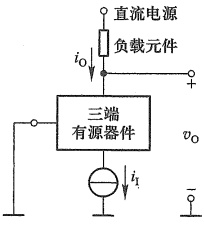</td><td style='text-align: center; word-wrap: break-word;'>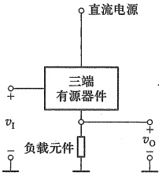</td></tr><tr><td style='text-align: center; word-wrap: break-word;'>电路名称</td><td style='text-align: center; word-wrap: break-word;'>共源极电路\n共射极电路</td><td style='text-align: center; word-wrap: break-word;'>共栅极电路\n共基极电路</td><td style='text-align: center; word-wrap: break-word;'>共漏极电路\n共集电极电路</td></tr><tr><td style='text-align: center; word-wrap: break-word;'>特点</td><td style='text-align: center; word-wrap: break-word;'>密勒等效电容较大，上限频率较低，通带源电压增益最高</td><td style='text-align: center; word-wrap: break-word;'>基本上不存在密勒等效电容，上限频率较高，通带源电压增益小于反相电压放大电路</td><td style='text-align: center; word-wrap: break-word;'>通带源电压增益最低，密勒效应很小，上限频率最高</td></tr></table>

（1）由于存在密勒电容效应，反相电压放大电路（共源和共射电路）源电压增益的上限频率 $ f_{H} $较低。

<!-- page: 241 -->

（2）由于电流跟随器（共栅和共基电路）中不存在密勒电容效应，因此其源电压增益的上限频率 $ f_{H} $高于反相电压放大电路。不过由于它的输入阻抗较低，所以对于同样的信号源，其通带源电压增益要低于反相电压放大电路。这也符合增益-带宽积近似为常数的规律。

（3）由于电压跟随器（共漏和共集电路）的增益约为1，所以密勒倍增效应很小。而且根据增益-带宽积约为常数的规律，在相同信号源和负载条件下，电压跟随器的带宽通常都大于另外两种组态的带宽，但其通带源电压增益也是最低的。但是如果前两种电路增益绝对值降低到远小于1，带宽也会大于电压跟随器的带宽。

（4）不管是哪种类型的放大电路，下限频率都与耦合电容和旁路电容密切相关。在相同的耦合电容和旁路电容条件下，不同类型的电路，差别主要体现在等效 RC 高通电路的 R 上。

实际应用中可根据要求，通过这些电路的适当组合，构成增益和带宽俱佳的放大电路。

上述分析过程虽然做了不少近似处理，所得结果存在误差，但它们对实际放大电路频带设计仍有重要的指导意义。在实际工程中，常用 SPICE 等计算机仿真软件进行更精确的计算，但电路设计方案选择和参数修改方向仍需要人工来抉择。

##### 复习思考题

6.3.1 影响放大电路高频响应的原因是什么？

6.3.2 MOS 管和 BJT 内部各含有哪些极间电容？

6.3.3 在 BJT 的高频小信号模型中为什么要改用  $ g_{m}V_{b^{\prime}e} $ 表示受控电流源，而不用  $ \beta $

6.3.4 在共源、共射电路的高频等效电路中分别是哪个电容引入了密勒效应？

6.3.5 当共源放大电路的静态电流增大时，MOS管栅-源极间的密勒等效电容如何变化？为什么？

6.3.6 为提高共源、共射电路的上限频率，可分别采取哪些措施？

6.3.7 共栅和共漏电路的带宽为什么通常比共源电路的宽？

6.3.8 共基和共集电路的带宽为什么通常比共射电路的宽？

#### 6.4 扩展放大电路通频带的方法

扩展放大电路的通频带是指降低下限频率和提高上限频率，而它们都取决于等效RC电路的时间常数。采用直接耦合方式可以将下限频率降至零，而提高上限频率通常有三种方法，即将不同组态的放大电路级联组合、外接补偿元件、采用负反馈（见8.3.5节）。本节只讨论第一种方法。

通过级联扩展频带本质上是通过前后级的相互影响，减小等效 RC 电路的时间常数，从而提高上限频率。下面举例简要说明。

##### 6.4.1 共源-共基电路

在6.3.2节中介绍过，共源电路中 $ C_{gd} $的密勒电容 $ C_{M1}=(1+g_{m}R'_{L})C_{gd} $是制约上限频率的主要因素。在MOS管已选定的情况下，减小 $ R'_{L} $可以减小 $ C_{M1} $，从而提高上限频率，但 $ R'_{L} $的减小又会使中频源电压增益下降。共射电路也有类似的情况。若在共源（或共射）电路与负

<!-- page: 242 -->

载电阻  $ R_{L} $ 之间接入共栅（或共基）电路，利用共栅（或共基）电路输入电阻低、电流跟随能力强、高频特性好的特点，可提高共源（或共射）电路的上限频率，而且这一类组合电路的中频电压增益与单级共源（或共射）电路基本相同。

图 6.4.1a 就是图 5.4.1 的共源-共基组合电路，其高频小信号等效电路如图 6.4.1b 所示，其中  $ R'_{L}=R_{c}\parallel R_{L} $。由于  $ R_{g}\gg R_{si} $，可将  $ R_{g} $ 看作开路。又因为  $ r_{bb} $ 很小，可视为短路。再将  $ T_{1} $ 的  $ C_{gd} $ 分别等效到它的输入输出回路（参见式(6.3.10b)和式(6.3.10c)），则得到图 6.4.1c，其中

$$  C_{2}=C_{\mathrm{b}^{\prime}\mathrm{e}}+C_{\mathrm{M}2}\approx C_{\mathrm{b}^{\prime}\mathrm{e}}+C_{\mathrm{g d}}   \tag*{(6.4.1)}$$

$$  C_{\mathrm{1}}=C_{\mathrm{g s}}+\ C_{\mathrm{M1}}=C_{\mathrm{g s}}+\left(\mathrm{1}{+}g_{\mathrm{m1}}R_{\mathrm{L I}}^{\prime}\right)C_{\mathrm{g d}}   \tag*{(6.4.2)}$$

这里  $ R'_{L1} $ 就是第二级共基电路通带内的输入电阻  $ R_{i2} $，对图 6.4.1b 节点 e 应用 KCL（断开  $ C_{b'e} $）： $ i_{e}=v_{b'e}/r_{b'e}+g_{m2}v_{b'e} $ 和  $ g_{m2}=\beta_{0}/r_{b'e} $ 求得  $ R'_{L1}=R_{i2}=v_{b'e}/i_{e}=r_{b'e}/(1+\beta_{0}) $。于是式 (6.4.2) 中共源电路的密勒电容

 $$ C_{\mathrm{M}1}=\left[1+g_{\mathrm{m}1}r_{\mathrm{b}^{\prime}\mathrm{e}}/\left(1+\beta\right)\right]C_{\mathrm{g d}} $$ 

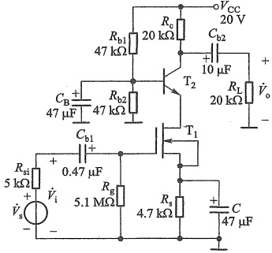

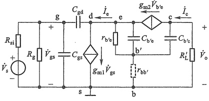

(a)
 

(b)
 

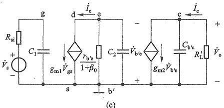

(c)
 

图 6.4.1 共源-共基放大电路
 

（a）原理图 （b）高频小信号等效电路 （c）简化的高频小信号等效电路
 

由于共基电路的输入电阻 $ [r_{b,e}/(1+\beta)] $很小，因而减小了 $ C_{gd} $的密勒效应，从而提高了共源电路的上限频率，其增益的损失通过第二级共基电路得到补偿。而共基电路的上限频率通常又比较高，故共源-共基组合电路的上限频率比具有相同负载、相同静态工作点的单级共源电路的上限频率要高。共源（或共射）电路与共基（或共栅）电路构成的这一类组合电路

<!-- page: 243 -->

特别适用于负载较大的应用场合。

例 6.4.1 共源-共基组合电路如图 6.4.1a 所示。设  $ T_1 $ 的参数为  $ K'_a = 1.2\,\text{mA}/\text{V}^2 $,  $ W = 320\,\mu\text{m} $,  $ L = 2\,\mu\text{m} $,  $ V_{TN} = -2\,\text{V} $,  $ \lambda = 0.01\,\text{V}^{-1} $,  $ C_{gs} = 4\,\text{pF} $,  $ C_{gd} = 3.7\,\text{pF} $,  $ T_2 $ 选用 Q2N2222 模型。试用 SPICE 求其上限频率，并与第一级单级共源电路直接带负载时的上限频率进行比较。

解：通过交流分析，由幅频响应曲线可以得到组合电路的上限频率约为2.7 MHz。当第一级单独直接带负载时（单级共源）的上限频率约为186 kHz，它们的增益均为42 dB，但组合电路的带宽明显展宽了。

仿真说明文档6.2：例6.4.1的仿真
 

##### 6.4.2 共集-共射电路

由式(6.3.13)可知，除了减小密勒电容外，还可以通过减小信号源内阻 $ R_{si} $来减小时间常数，从而提高共源（或共射）电路的上限频率。当信号源内阻不够小时，可在信号源与共源（或共射）电路之间接入共漏或共集电路，利用其输入电阻大输出电阻小的特点实现阻抗变换，相当于减小了信号源内阻 $ R_{si} $，从而提高共源（或共射）电路的上限频率。而共漏或共集电路的上限频率原本就比较高，所以电路总的上限频率将明显提高。减小 $ R_{si} $不会降低共源电路的增益，所以这种组合电路的中频电压增益与单级共源电路基本相同。

图 6.4.2a 是一个共集-共射组合电路，图 6.4.2b 是它的交流通路，其中  $ R_{b}=R_{b1}\parallel R_{b2} $， $ R_{L}^{\prime}=R_{c2}\parallel R_{L} $。由于共集电路的输出电阻（即第二级的信号源内阻）较小，所以第二级共射电路的上限频率得以提高，而且由于共集电路输入电阻大于共射电路的输入电阻，减小了信号源电压的衰减，所以该组合电路的中频电压增益也有所提高。

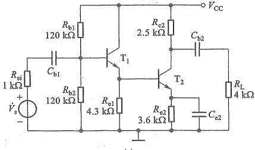

(a)
 

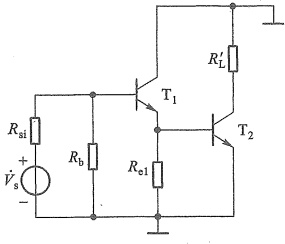

(b)
 

图 6.4.2 共集-共射组合电路
 

(a) 原理图 (b) 图 a 的交流通路
 

##### 复习思考题

6.4.1 扩展放大电路通频带的思路是什么？

6.4.2 共射-共基组合电路能扩展通频带吗？为什么？

6.4.3 共漏-共源组合电路能扩展通频带的原因是什么？

6.4.4 共源-共漏组合电路能扩展通频带吗？

<!-- page: 244 -->

#### 6.5 多级放大电路的频率响应

本节仅从定性角度讨论多级放大电路的频带与构成它的各单级电路频带的关系，归纳出一般性规律。

由4.7节的分析已知，多级放大电路的电压增益为各级电压增益的乘积（考虑了后级作为负载对前级增益的影响）。而各级的电压增益是信号频率的函数，因而，多级放大电路的电压增益 $ A_{v} $也必然是信号频率的函数。为了简明起见，假设有一个两级放大电路，由两个电压增益和通频带均相同的单管放大电路构成，图6.5.1a是两级示意图，级间采用阻容耦合方式。

设每级的通带电压增益为  $ A_{vM1} $，则每级的上限频率  $ f_{H1} $ 和下限频率  $ f_{L1} $ 处对应的电压增益为  $ 0.707 A_{vM1} $，两级放大电路的通带电压增益为  $ A_{vM1}^{2} $，如图 6.5.1b 所示。显然，这个两级放大电路的上、下限频率不可能是  $ f_{H1} $ 和  $ f_{L1} $，因为对应于这两个频率的电压增益是  $ (0.707 A_{vM1})^{2} = 0.5 A_{vM1}^{2} $。根据通频带的定义，电压增益为  $ 0.707 A_{vM1}^{2} $ 对应的低端频率为下限频率  $ f_{L} $，高端频率为上限频率  $ f_{H} $。

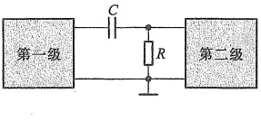

(a)
 

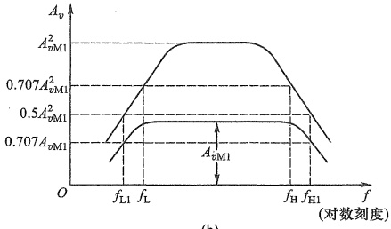

(b)
 

图 6.5.1 两级放大电路
 

（a）两级放大电路的结构示意图 （b）单级和两级放大电路的幅频响应
 

显然， $ f_{L}>f_{L1} $， $ f_{H}<f_{H1} $，即两级放大电路的通频带变窄了。由此可推知， $ \uwave{\text{多级放大电路的通频带一定小于等于构成它的任何一级}} $，级数越多，则 $ f_{L} $可能越高、 $ f_{H} $可能越低，通频带越窄。亦即，串联若干级放大电路，总电压增益虽然提高了，但通频带会变窄，这是多级放大电路的一个重要规律。

##### 复习思考题

6.5.1 共射-共基组合电路的通频带比其中共射电路的通频带窄吗？为什么？

#### 6.6 单级放大电路的瞬态响应

根据电路理论知识，对电路的研究有两种不同的方法，即稳态分析法和瞬态分析法。稳态分析法也就是前面讨论过的频率响应分析法。它的优点是分析简单，实际测试时

<!-- page: 245 -->

并不需要很特殊的设备，缺点是用幅频响应和相频响应不能直观地确定放大电路的波形失真，因此也难于用这种方法选择使波形失真最小的电路参数。

瞬态分析法是以单位阶跃信号为放大电路的输入信号，研究放大电路的输出波形随时间变化的情况，称为放大电路的阶跃响应，也称为时域响应，常以上升时间和平顶降落大小作为衡量波形失真的指标。瞬态分析法的优点在于，从瞬态响应上可以直观地判断放大电路放大阶跃信号的波形失真情况，并可利用脉冲示波器直接观测放大电路的瞬态响应。它的缺点是分析比较复杂，在分析复杂电路和多级放大电路时这一点更为突出。

在工程实际运用中，这两种方法可以互相结合，取长补短。

### 1. 阶跃电压作为放大电路的基本信号

图 6.6.1 所示为一个阶跃电压波形，它表示为

$$  v\left(t\right)=\left\{\begin{aligned}&0&,&t<0\\ &V&,&t\geqslant0\end{aligned}\right.   \tag*{(6.6.1)}$$

可见阶跃电压既有变化速度很快的上升部分，又有变化速度很慢的平顶部分。把这样的信号加到放大电路的输入端，如果放大电路对阶跃信号的上升沿能很好地响应，即输出电压的上升沿也很陡的话，那么放大电路就能够很好地放大变化极快的信号。另一方面，如果放大电路对阶跃

图 6.6.1 · 阶跃电压
 

信号的平顶部分也能很好地响应，即输出电压的顶部也很平，那么，放大电路就能很好地放大变化缓慢的信号。因此把阶跃电压作为基本信号，可判断放大电路放大其他信号时产生失真的程度。

### 2. 单级放大电路的阶跃响应

分析单级共源放大电路阶跃响应时，可采用小信号等效电路，而且可以根据不同的情况进行简化。因为阶跃电压可分为上升阶段和平顶阶段，故可按照这两个时间段的特点对电路进行简化。

放大电路的阶跃响应主要由上升时间  $ t_{r} $ 和平顶降落  $ \delta $ 来表示，下面分析的目的是求出这两个参数，并与稳态分析中的通频带相联系。

##### （1）上升时间  $ t_{r} $

阶跃电压上升较快的部分，与稳态分析中的高频区相对应，所以可用 RC 低通电路来模拟，如图 6.6.2a 所示。由图可知

$$  v_{0}=V_{s}(1-\mathrm{e}^{-\frac{t}{RC}})^{\textcircled{1}}   \tag*{(6.6.2)}$$

式中  $ V_{s} $ 是阶跃信号平顶电压值。式(6.6.2)表示在上升阶段时输出电压  $ v_{0} $ 随时间变化的关系。 $ v_{0}/V_{s} $ 与时间的关系如图 6.6.2b 所示。

输入电压  $ V_{s} $ 在 t=0 时是突然上升到最终值的，而输出电压则按指数规律上升，经过一定时间才能达到终值，这种现象称为前沿失真。

一般用输出电压从最终值的10%上升至90%所需的时间 $ t_{r} $来表示前沿失真。 $ t_{r} $称为上

<!-- page: 246 -->

(a)
 

(b)
 

图 6.6.2 单级放大电路的上升时间
 

（a）简化等效电路 （b） $ v_{0}/V_{s} $ 的时间响应
 

升时间，其值与 RC 有关。

由图6.6.2b可见，当 $ t=t_{1} $时

 $$ v_{0}(t_{1})/V_{\mathrm{s}}=1-\mathrm{e}^{-t_{1}/(R C)}=0.1 $$ 

则

 $$ \mathrm{e}^{-t_{1}/(R C)}=0.9 $$ 

同理，当 $ t=t_{2} $时

 $$ v_{0}(t_{2})/V_{\mathrm{s}}=1-\mathrm{e}^{-t_{2}/(R C)}=0.9 $$ 

则

 $$ \mathrm{e}^{-t_{2}/(R C)}=0.1 $$ 

由此可得

 $$ \frac{\mathrm{e}^{-t_{1}/(RC)}}{\mathrm{e}^{-t_{2}/(RC)}}=\frac{0.9}{0.1}=9 $$ 

两边取对数，整理后得

 $$ t_{r}=t_{2}-t_{1}=\left(\ln9\right)R C $$ 

将 $ f_{H}=\frac{1}{2\pi RC} $代入可得

$$  t_{r}=\frac{0.35}{f_{H}}\quad 或 \quad t_{r}f_{H}=0.35   \tag*{(6.6.3)}$$

因此，上升时间  $ t_r $ 与上限频率  $ f_H $ 成反比， $ f_H $ 越高，则上升时间越短，前沿失真越小。从物理意义上讲，如果放大电路对阶跃电压的上升沿响应很好，即很陡直，那么，就说明放大电路能真实地放大变化很快的电压，因为实际上频率很高的正弦波正是一种变化很快的信号。例如，当某放大电路的通频带为 1 MHz 时，其前沿上升时间  $ t_L = 0.35 $ μs。

(2) 平顶降落  $ \delta $

阶跃电压的平顶阶段与稳态分析中的低频区相对应，所以可用 RC 高通电路来模拟，如图 6.6.3a 所示。由图可得

$$  v_{0}=V_{s}\mathrm{e}^{-\iota/(RC)}   \tag*{(6.6.4)}$$

 $ v_{0} $ 与时间 t 的关系如图 6.6.3b 中降落的曲线所示。在  $ t_{p} $ 内，虽然输入电压维持不变，但

<!-- page: 247 -->

(a)
 

(b)
 

图 6.6.3 单级放大电路的平顶降落 (a) 简化等效电路 (b)  $ v_{0} $ 的时间响应
 

由于电容 C 的影响，输出电压却是按指数规律下降的，下降速度决定于时间常数 RC，这种现象称为平顶降落。

下面计算在  $ t_{p} $ 时间内的平顶降落值  $ \delta $。

在平顶阶段，时间常数  $ RC \gg t_{p} $，可得

$$  v_{0}\approx V_s\left(1-\frac{t_p}{RC}\right)^{\textcircled{1}}   \tag*{(6.6.5)}$$

考虑到 $ f_{L}=1/(2\pi RC) $，可得

$$  \delta=V_{\mathrm{s}}-v_{0}=\frac{t_{\mathrm{p}}V_{\mathrm{s}}}{RC}=2\pi f_{\mathrm{L}}t_{\mathrm{p}}V_{\mathrm{s}}   \tag*{(6.6.6)}$$

由此可见，平顶降落  $ \delta $ 与下限频率  $ f_{L} $ 成正比， $ f_{L} $ 越低，平顶降落  $ \delta $ 越小。在物理意义上，如果放大电路对阶跃电压的平顶部分响应很好，即很平，那么，就说明放大电路能很好地放大变化很慢的电压，实际上频率很低的正弦波电压正是一种变化很慢的电压。

如果输入电压是一个方波信号，则 $ t_{p} $代表方波的半个

周期， $ V_{s} $代表输入方波信号的峰值，如图6.6.4所示。以 $ V_{s} $的百分数来表示平顶降落，有

 $ \delta=\frac{V_{s}-V_{1}^{\prime}}{V_{s}}\times100\%=\frac{t_{p}}{RC}\times100\% $ [注意，式中  $ \delta $ 的量纲与

式(6.6.6)中 $ \delta $的量纲不同]

因  $ t_{p}=\frac{T}{2} $，而  $ f=\frac{1}{T} $，以及  $ f_{L}=\frac{1}{2\pi RC} $，则有

 $$ \delta=\frac{\pi f_{L}}{f}\times100\% $$ 

图 6.6.4 方波信号的平顶降落
 

式(6.6.7)说明  $ \delta $ 与  $ f_{L} $ 成正比。如要求 50 Hz 的方波通过时平顶降落不超过 10%，则  $ f_{L} $ 不能高于 1.6 Hz。

以上分析看出，瞬态分析法和稳态分析法虽然是两种不同的方法，但它们是有内在联系的。当放大电路的输入信号为阶跃电压时，在阶跃电压的上升阶段，放大电路的瞬态响应

<!-- page: 248 -->

（上升时间）决定于放大电路的高频响应 $ (f_{H}) $；而在阶跃电压的平顶阶段，放大电路的瞬态响应（平顶降落）又决定于放大电路的低频响应 $ (f_{L}) $。因此，一个频带很宽的放大电路，同时也是一个很好的方波信号放大电路。

需要注意的是，这里是假设放大电路可以等效为单时间常数的 RC 电路，而实际电路常常是多时间常数的高阶电路，这时的瞬态响应就要求解高阶微分方程，阶跃响应结果也不再是简单的上升后接着平顶降落，常常伴随着振荡衰减过程。

因此，稳态分析法在放大电路的分析中仍占主导地位，这是因为：①任何周期性的信号都可分解为一系列的正弦波，因此考察放大电路对正弦波的响应仍是重点，放大电路的技术指标之一也用频率响应来给定，例如频带宽度；②在频域中，电路的分析和综合比在时域中要成熟得多，所以电路的设计常常在频率响应的基础上进行；③在瞬态计算极其复杂时，往往可根据稳态响应的结果，来间接地了解电路瞬态响应的定性结论；④在反馈放大电路中，消除自激的补偿电路设计也是以频率响应为基础的（见8.6.2节）。

复习思考题

6.6.1 当一个阶跃信号加入放大电路的输入端时，若其响应信号的上升时间很短，意味着该放大电路的高频响应好，这种说法科学吗？

6.6.2 同前题，若输出信号的平顶降落很小，表示放大电路的低频响应好，试从电路的工作原理来理解。

#### 小结

教学视频6.1：频率响应小结

放大电路的频率响应用来衡量电路对不同频率信号的放大能力。如果放大电路的频带不能涵盖信号的频带，输出信号会出现频率失真。表征频率响应的三个参数是中频（通带）增益、下限截止频率和上限截止频率。FET或BJT的极间电容及电路中的分布电容、负载电容使放大电路的高频增益下降，且产生滞后的相移。电路中的耦合电容和旁路电容使放大电路的低频增益下降，且产生超前的相移。

在中频区，小信号等效电路中不包含任何电抗元件，放大电路的增益与频率无关。在高频区或低频区，放大电路的高、低频响应可分别用 RC 低

通和高通电路的频率响应来模拟。直接耦合放大电路因无耦合电容和旁路电容，所以其增益在低频段不会衰减。

研究放大电路的高频响应时，要用到 FET 或 BJT 的高频小信号模型。共源和共射电路受密勒电容效应的影响最大，所以在同样的信号源和三极管条件下，这两种电路的带宽最窄。

通过级联扩展频带，实质上是通过前后级的相互影响，减小等效RC电路的时间常数，从而提高上限频率。共源或共射电路与共栅或共基电路组合后，利用共栅或共基电路输入电阻小的特点，可以减小共源或共射电路中密勒电容的影响，提高上限频率，而损失的增益由共栅或共基电路补偿；共漏或共集电路与共源或共射电路组合后，利用共漏或共集电路输入电阻大输出电阻小的特点，可以减小信号源内阻对共源或共射电路频率特性的影响，提高上限

<!-- page: 249 -->

频率。

多级放大电路的通频带一定比它的任何一级都窄，级数越多，则 $ f_{L} $越高而 $ f_{H} $越低，通频带越窄，附加相移也越大。

- 瞬态响应和稳态响应是分析放大电路时域响应和频域响应的两种方法，二者存在内在的联系，互相补充。工程上以频域分析用得较普遍。

放大电路频率响应的精确计算可借助计算机辅助分析工具完成，如 SPICE 仿真工具等。

#### 习题

#### 6.1 单时间常数 RC 电路的频率响应

6.1.1 电路如图题 6.1.1 所示，设其中  $ R_{1}=1\ k\Omega, R_{2}=10\ k\Omega, C=1\ \mu F $。（1）该电路是高通电路还是低通电路？（2）求电压增益表达式及其最大值；（3）求转折频率。

6.1.2 设图题 6.1.1 所示电路中的  $ R_{1}=R_{2}=4\ k\Omega $，转折频率  $ f_{L}=20\ Hz $，试求电容 C 的值。

6.1.3 电路如图题 6.1.3 所示，设  $ R_{1}=1\ k\Omega $， $ R_{2}=10\ k\Omega $，C=3 pF。(1) 该电路是高通电路还是低通电路？(2) 求电压增益表达式及其最大值；(3) 求转折频率。

图题6.1.1
 

图题6.1.3
 

6.1.4 设图题 6.1.3 所示电路中的  $ R_{1}=R_{2}=10\ k\Omega $，转折频率  $ f_{H}=500\ kHz $，试求电容 C 的值。

6.1.5 某放大电路中 $ \dot{A}_{v} $的幅频响应如图题6.1.5所示。(1)试求该电路的中频电压增益 $ \left|\dot{A}_{vM}\right| $，上限频率 $ f_{H} $，下限频率 $ f_{L} $；(2)当输入信号的频率 $ f=f_{H} $或 $ f=f_{L} $时，该电路实际增益是多少分贝？

图题6.1.5
 

<!-- page: 250 -->

6.1.6 已知某放大电路电压增益表达式为

 $$ \dot{A}_{v}=\frac{100\mathrm{j}\frac{f}{10}}{\left(1+\mathrm{j}\frac{f}{10}\right)\left(1+\mathrm{j}\frac{f}{10^{5}}\right)}\quad( 式中 f 的单位为 \mathrm{Hz}) $$ 

试求该电路的上、下限频率，中频电压增益的分贝数，输出电压与输入电压在中频区的相位差。

#### 6.2 单管放大电路的低频响应

6.2.1 电路如图题 6.2.1 所示，其中  $ V_{DD}=5\ V, R_{si}=1\ k\Omega, R_{gl}=15\ k\Omega, R_{g2}=10\ k\Omega, R_{d}=4\ k\Omega, g_{m}=0.8\ mS, \lambda=0, C_{b1}=1\ \mu F $ 。试估算源电压增益的下限频率  $ f_{L} $ 和中频源电压增益  $ \dot{A}_{vSM} $

6.2.2 电路如图题 6.2.2 所示，已知静态偏置使 MOS 管的  $ g_{m}=2\ mS $，且设  $ \lambda=0 $。（1）要求中频源电源增益为 -20，试确定  $ R_{d} $ 的值；（2）要求下限频率低于 100 Hz，试确定  $ C_{s} $ 的值。

图题6.2.1
 

图题6.2.2
 

6.2.3 电路如图题 6.2.3 所示，已知 BJT 的  $ \beta=50 $， $ r_{be}=0.72\ k\Omega $，且  $ (R_{b1} // R_{b2}) \gg r_{be} \circ $ (1) 试估算该电路源电压增益的下限频率；(2)  $ \left|\dot{V}_{im}\right|=10\ mV $，且  $ f=f_{L} $，求  $ \left|\dot{V}_{om}\right| $， $ \dot{V}_{o} $ 与  $ \dot{V}_{i} $ 间的相位差是多少？

图题6.2.3
 

6.2.4 设图题 6.2.4 所示放大电路中的  $ R_{si}=5\ k\Omega $,  $ R_{b1}=60\ k\Omega $,  $ R_{b2}=40\ k\Omega $,  $ R_{e}=3.9\ k\Omega $,  $ R_{c}=4.7\ k\Omega $,  $ R_{L}=5.1\ k\Omega $,  $ C_{b1}=C_{b2}=1\ \mu F $,  $ C_{e}=10\ \mu F $,  $ V_{cc}=5\ V $, BJT 的  $ \beta=120 $。试求该电路源电压增益的下限频率  $ f_{L} $，并用 SPICE 再求  $ f_{L} $。

<!-- page: 251 -->

图题6.2.4
 

6.2.5 共射放大电路如图题 6.2.5 所示。已知 BJT 的  $ \beta=100 $，要求电路的  $ f_{L}=100 $ Hz，试用短路时间常数法确定电容  $ C_{e} $、 $ C_{b1} $ 和  $ C_{b2} $ 的值。其中它们构成的时间常数对  $ f_{L} $ 的影响程度占比分别是： $ C_{e} $ 占 80%， $ C_{b1} $ 和  $ C_{b2} $ 各占 10%。

#### 6.3 单管放大电路的高频响应

6.3.1 在一个共源放大电路中，已知中频电压增益  $ \dot{A}'_v = -g_m R'_L = -27 $，MOS 管的  $ C_{gs} = 0.3\ pF $， $ C_{gd} = 0.1\ pF $。(1) 试求该电路输入回路的总电容；(2) 若要求源电压增益的上限频率  $ f_H > 10\ MHz $，试求信号源内阻  $ R_{si} $ 的取值范围。设该电路的输入电阻 ( $ \approx R_g $) 很大，其影响可以忽略。

6.3.2 电路如图题 6.3.2 所示，其中  $ V_{DD} = 5\ V $,  $ R_{si} = 2\ k\Omega $,  $ R_{g1} = 75\ k\Omega $,  $ R_{g2} = 39\ k\Omega $,  $ R_{d} = R_{L} = 5.1\ k\Omega $, MOS 管参数为  $ K_{n} = 0.8\ mA/V^{2} $,  $ V_{TN} = 1\ V $,  $ \lambda = 0 $,  $ C_{gs} = 1\ pF $,  $ C_{gd} = 0.4\ pF $。试求该电路的中频源电压增益  $ \dot{A}_{ssM} $ 和上限频率  $ f_{H} $。

图题6.2.5
 

图题6.3.2
 

6.3.3 — 高频 BJT，在  $ I_{CQ} = 1.5\ mA $ 时，测出其低频 H 参数为： $ r_{be} = 1.1\ k\Omega, \beta_0 = 50 $，特征频率  $ f_T = 100\ MHz, C_{b'c} = 3\ pF $，试求混合  $ \pi $ 形参数  $ g_m, r_{b'e}, r_{bb'}、C_{b'e} $ 和  $ f_\beta $。

6.3.4 电路如图题 6.2.3 所示，BJT 的  $ \beta = 40 $， $ C_{b'e} = 3 $ pF， $ C_{b'e} = 100 $ pF， $ r_{bb'} = 100 $  $ \Omega $， $ r_{b'e} = 418 $  $ \Omega $，且  $ (R_{b1} // R_{b2}) \gg r_{be} $。(1)画出高频小信号等效电路，求源电压增益的上限频率  $ f_H $；(2)如  $ R_L $ 提高 10 倍，问中频源电压增益、上限频率及增益-带宽积各变化多少倍？

<!-- page: 252 -->

6.3.5 在图题 6.2.4 所示电路中，设  $ R_{si} = 5\ \text{k}\Omega $， $ R_{b1} = 33\ \text{k}\Omega $， $ R_{b2} = 22\ \text{k}\Omega $， $ R_e = 3.9\ \text{k}\Omega $， $ R_c = 4.7\ \text{k}\Omega $， $ R_L = 5.1\ \text{k}\Omega $， $ C_e = 50\ \mu\text{F} $， $ V_{CC} = 5\ \text{V} $， $ \beta_0 = 120 $， $ r_{ee} = 300\ \text{k}\Omega $， $ r_{bb'} = 50\ \Omega $， $ f_T = 700\ \text{MHz} $ 及  $ C_{b'c} = 1\ \text{pF} $。求：(1) 中频区电压增益  $ \dot{A}_{vM} $ 及源电压增益  $ \dot{A}_{vM} $；(2) 源电压增益的上限频率  $ f_H $；(3) 用 SPICE 再分别求 (1) 和 (2)。

6.3.6 图题 6.3.6 所示电路中， $ R_{si}=10\ k\Omega $， $ R_{g}=100\ k\Omega $，I=1 mA， $ R_{d}=4\ k\Omega $， $ R_{L}=2\ k\Omega $。MOS 管的  $ V_{TN}=1\ V $， $ K_{n}=1\ mA/V^{2} $， $ \lambda=0 $， $ C_{gs}=5\ pF $， $ C_{gd}=0.4\ pF $。试求该电路的中频源电压增益  $ \dot{A}_{saM} $ 和上限频率  $ f_{H} $。

图题6.3.6
 

6.3.7 共基电路的交流通路如图题 6.3.7 所示，其中  $ R_{si}=1\ k\Omega, R_{e}=2\ k\Omega, R_{L}=2.5\ k\Omega $。BJT 的  $ \beta_{0}=80, r_{ee}=100\ k\Omega, r_{bb^{\prime}}=50\ \Omega, r_{e}=26\ \Omega, f_{T}=300\ MHz $ 及  $ C_{b^{\prime}e}=4pF $。试求该电路源电压增益的上限频率  $ f_{H} $。

图题6.3.7
 

#### 6.4 扩展放大电路通频带的方法

6.4.1 已知图题 6.4.1 所示电路中的  $ +V_{CC}=10\ V $,  $ -V_{EE}=-10\ V $,  $ R_{si}=0.1\ k\Omega $,  $ R_{1}=28.3\ k\Omega $,  $ R_{2}=20.5\ k\Omega $,  $ R_{3}=42.5\ k\Omega $,  $ R_{e}=5.4\ k\Omega $,  $ R_{e}=5\ k\Omega $,  $ R_{L}=10\ k\Omega $。BJT 的  $ \beta=150 $,  $ V_{BE}=0.7\ V $,  $ r_{bb'}=30\ \Omega $,  $ C_{b'e}=35\ pF $,  $ C_{b'e}=4\ pF $。(1)试求该电路的中频源电压增益和上限频率；(2)去掉第二级的  $ T_{2} $,  $ T_{1} $ 的集电极接  $ R_{e} $ 和  $ C_{4} $，通过微调  $ R_{3} $ 以保持  $ T_{1} $ 集电极电流不变，电路其他部分均未改变，再求中频源电压增益和上限频率。

#####  $ ^{*} $6.6 单级放大电路的瞬态响应

6.6.1 若将一宽度为  $ 1 \, \mu s $ 的理想脉冲信号加到一单级共源放大电路（假设只有一个时间常数）的输入端，画出下列三种情况下的输出波形。设  $ V_{m} $ 为输出电压最大值：（1）频带为  $ 80 \, MHz $；（2）频带为  $ 10 \, MHz $；（3）频带为  $ 1 \, MHz $。（假设  $ f_{L} = 0 $）。

6.6.2 电路如图题 6.6.2 所示。(1) 当输入方波电流的频率 200 Hz 时，计算输出电压的平顶降落；(2) 当平顶降落小于 2% 时，输入方波的最低频率为多少？

<!-- page: 253 -->

图题6.4.1
 

第6章部分习题答案
 

图题6.6.2
 

