# 07-第7章 模拟集成电路

[返回全书目录](../../README.md)

> PDF 页码：254–327

<!-- page: 254 -->

### 模拟集成电路

## 引言

集成电路按其处理信号类型来分，有数字集成电路和模拟集成电路。而模拟集成电路也种类繁多，其中以运算放大器最为典型，第2章已经介绍了它的几个重要特性以及由它构成的一些线性应用电路，但其特性的由来和内部电路构成并未阐述，本章将对此进行讨论，以便有的放矢地用好集成运算放大器。

本章首先介绍模拟集成电路中普遍使用的电流源电路， $ \underset{\cdot}{其}\underset{\cdot}{次}\underset{\cdot}{讨} $论重要的单元电路——差分式放大电路，接着简要介绍集成运算放大器的几种典型电路，最后给出集成运放的主要参数描述，并讨论它们对应用所造成的影响。

除了运算放大器，模拟集成电路还有乘法器、锁相环、稳压器等其他功能的模拟器件。本章仅简要介绍其中的变跨导模拟乘法器及其应用，最后也对放大电路中的噪声和干扰的来源及其抑制措施作了简述。希望读者学习本章后，会分析集成运放内部基本电路，会正确选择合适的运算放大器设计满足要求的电路，包括单电源工作的电路。

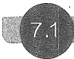

#### 模拟集成电路中的直流偏置技术

在第4和第5章讨论的分立元件三极管放大电路中，一般是利用电阻分压、限流来设置静态工作点的。但在集成电路中制造一个三极管比制造一个电阻所占用的面积更小，因而采用三极管构成直流电流源，为放大电路提供静态偏置成为首选。

电流源具有恒流特性，即接不同负载时，流过负载的电流保持不变。那么，三极管是如何实现恒流的呢？实际上，无论是FET还是BJT，它们在放大区的输出特性曲线都近似为水平线，也就是当控制量 $ v_{GS} $（或 $ i_{B} $）不变时，受控的电流 $ i_{D} $（或 $ i_{C} $）便可保持恒定，从而构成电流源。下面分别讨论由FET和BJT构成的电流源。

##### 7.1.1 FET 电流源电路

### 1. MOSFET 镜像电流源

电路如图 7.1.1a 所示， $ T_{1} $、 $ T_{2} $ 是增强型 NMOS 对管，两管参数完全相同。由于  $ T_{1} $ 的漏、栅两极相连，接成了二极管形式（参见 4.4.4 节），使得  $ V_{DS1} = V_{GS} $，所以只要保证  $ V_{GS} > V_{TN} $，就有  $ V_{DS1} > V_{GS} - V_{TN} $，即  $ T_{1} $ 必然工作在恒流区。只要负载接入能保证  $ T_{2} $ 也工作在恒流区，那么由

<!-- page: 255 -->

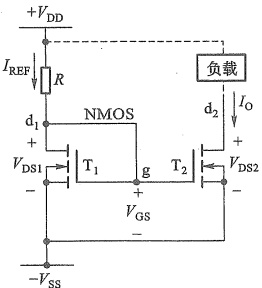

(a)
 

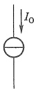

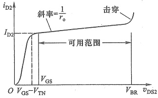

(b)
 

(c)
 

图 7.1.1 MOSFET 镜像电流源
 

（a）基本的镜像电流源电路 （b）代表符号 （c）输出特性
 

于两管参数完全相同且有共同的  $ V_{GS} $，所以  $ T_{2} $ 的漏极电流亦即负载中的电流  $ I_{0} $，就等于  $ T_{1} $ 的漏极电流  $ I_{REF} $。当电路参数和 MOS 管参数确定后，便可根据

$$  I_{\mathrm{o}}=I_{\mathrm{REF}}=\frac{V_{\mathrm{DD}}+V_{\mathrm{SS}}-V_{\mathrm{GS}}}{R}   \tag*{(7.1.1)}$$

和 MOS 管恒流区特性方程

$$  I_{\mathrm{REF}}=I_{\mathrm{D1}}=K_{\mathrm{n}}\left(V_{\mathrm{GS}}-V_{\mathrm{TN}}\right)^{2}   \tag*{（7.1.2）}$$

求得电流  $ I_{0} $ 。显然  $ I_{0} $ 与负载无关。当负载在一定范围内变化时（保证  $ V_{DS2} > V_{GS} - V_{TN} $）， $ I_{0} $ 的值将保持不变，表现出恒流特性。

由于  $ I_{0}=I_{REF} $，即可以将  $ I_{0} $ 看作  $ I_{REF} $ 的镜像，所以称图 7.1.1a 电路为镜像电流源，图 b 是它的代表符号。当  $ T_{2} $ 的  $ \lambda\neq0 $ 时，其输出特性如图 7.1.1c 所示，恒流区曲线并非水平，意味着电流源的输出电阻不是无穷大，由式(4.1.16)可知

$$  r_{o}=r_{ds2}=\frac{1}{\lambda I_{D2}}   \tag*{(7.1.3)}$$

 $ r_{0} $越大，恒流特性越好，当 $ r_{0} $为无穷大 $ \left(\lambda=0\right) $时，是理想电流源特性。在图7.1.1b中 $ r_{0} $与电流源并联（图中未画出）。要特别注意，这个电阻是动态电阻（交流参数），不用于静态分析（开路）。

教学视频7.1：MOS 适用于放大信号和用于电流源的差别

当  $ T_{1} $、 $ T_{2} $ 只是宽长比不同，且忽略它们的沟道长度调制效应时，根据

$$  I_{\mathrm{REF}}=I_{\mathrm{D1}}=\frac{1}{2}K_{\mathrm{n}}^{\prime}\left(\frac{\overline{W}}{L}\right)_{1}\left(V_{\mathrm{GS}}-V_{\mathrm{TN}}\right)^{2}   \tag*{(7.1.4a)}$$

$$  I_{0}=I_{\mathrm{D}2}=\frac{1}{2}K_{\mathrm{n}}^{\prime}\left(\frac{\mathcal{W}}{L}\right)_{2}\left(V_{\mathrm{G S}}-V_{\mathrm{T N}}\right)^{2}.   \tag*{(7.1.4b)}$$

可得

$$  \frac{I_{0}}{I_{\mathrm{REF}}}=\frac{\left(\mathrm{~W}/L\right)_{2}}{\left(\mathrm{~W}/L\right)_{1}}=m   \tag*{(7.1.5)}$$

m称为电流传输比。式(7.1.5)说明此时 $ I_{0} $与 $ I_{REF} $的关系可由两MOS管的几何尺寸（宽长

<!-- page: 256 -->

比)决定。

用其他方法也可以构成电流源，但是由于  $ T_{1} $ 和  $ T_{2} $ 有相同的温度特性，所以  $ T_{1} $ 对  $ T_{2} $ 具有温度补偿作用，因而镜像电流源具有更高的温度稳定性。但要注意，电源电压变化会影响电流的稳定性。

如果用  $ T_{3} $ 代替 R，便可得到如图 7.1.2 所示的占用芯片面积更小的镜像电流源。若  $ T_{1} $ 和  $ T_{3} $ 特性完全相同，则有  $ V_{GS3} = V_{GS} = \frac{1}{2}(V_{DD} + V_{SS}) $，只要  $ V_{GS} > V_{TN} $， $ T_{1} $、 $ T_{3} $ 必定工作在恒流区。当所有 MOS 管的  $ K'_{n} $ 相同且  $ \lambda = 0 $ 时，只要保证负载接入时  $ T_{2} $ 也工作在恒流区，则输出电流为

$$  I_{0}=I_{\mathrm{D}2}=\frac{1}{2}\left(\mathrm{~W/}L\right)_{2}K_{\mathrm{n}2}^{\prime}\left(\mathrm{~V}_{\mathrm{G S}2}-V_{\mathrm{T N}2}\right)^{2}=K_{\mathrm{n}2}\left(\mathrm{~V}_{\mathrm{G S}}-V_{\mathrm{T N}2}\right)^{2}   \tag*{(7.1.6)}$$

当  $ T_{1} $ 与  $ T_{2} $ 仅宽长比不同时， $ I_{0} $ 与  $ I_{REF} $ 的关系取决于它们的宽长比。

仿真说明文档7.1：镜像电流源与电阻偏置电流源温度稳定性对比仿真

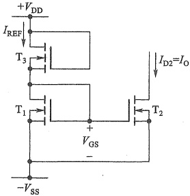

图 7.1.2 常用的镜像电流源
 

### 2. 多路电流源

集成运放内的电路通常都是多级的，这就需要多路电流源提供静态偏置。在实际电路中往往使用一个基准电流  $ I_{REF} $ 获得多路电流  $ I_2 $、 $ I_5 $（如图 7.1.3 所示），为各级放大电路提供不同的静态偏置电流。图中  $ T_0 \sim T_3 $ 为 NMOS 管， $ T_4 $ 和  $ T_5 $ 为 PMOS 管。

由  $ V_{GS0} + V_{GS1} = V_{DD} + V_{SS} $ 和  $ T_{1} $、 $ T_{2} $ 的恒流区特性方程，可以求出基准电流  $ I_{REF} $。 $ T_{1} $ 和  $ T_{2} $、 $ T_{1} $ 和  $ T_{3} $ 构成两组镜像电流源。而  $ T_{4} $ 和  $ T_{5} $ 也构成镜像电流源，它们的电流与  $ I_{3} $ 有关。注意，NMOS 管的电流是流入漏极的，而 PMOS 管的电流则流出漏极。

假设电路中  $ T_{1} \sim T_{3} $ 的  $ K'_{n}, V_{TN}, \lambda $ 皆相同，那么各管漏极电流仅与宽长比有关，即

$$  I_{2}{=}\frac{\left({\mathrm{\boldmath~W~}}/L\right)_{2}}{\left({\mathrm{\boldmath~W~}}/L\right)_{1}}I_{\mathrm{R E F}}\;,\quad I_{3}{=}\frac{\left({\mathrm{\boldmath~W~}}/L\right)_{3}}{\left({\mathrm{\boldmath~W~}}/L\right)_{1}}I_{\mathrm{R E F}}   \tag*{(7.1.7a)}$$

当  $ T_{4} $、 $ T_{5} $ 的  $ K_{p}^{\prime} $、 $ V_{TP} $、 $ \lambda $ 也相同时，则有

$$  I_{5}=\frac{\left(\begin{array}{c}\mathrm{W}/L\end{array}\right)_{5}}{\left(\begin{array}{c}\mathrm{W}/L\end{array}\right)_{4}}I_{4}=\frac{\left(\begin{array}{c}\mathrm{W}/L\end{array}\right)_{5}}{\left(\begin{array}{c}\mathrm{W}/L\end{array}\right)_{4}}I_{3}=\frac{\left(\begin{array}{c}\mathrm{W}/L\end{array}\right)_{5}\left(\begin{array}{c}\mathrm{W}/L\end{array}\right)_{3}}{\left(\begin{array}{c}\mathrm{W}/L\end{array}\right)_{4}\left(\begin{array}{c}\mathrm{W}/L\end{array}\right)_{1}}I_{\mathrm{REF}}   \tag*{(7.1.7b)}$$

应当指出，电路中的  $ T_{0} \sim T_{5} $ 都必须工作在恒流区。

<!-- page: 257 -->

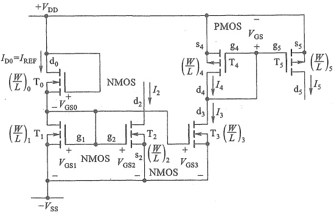

图 7.1.3 多路电流源电路
 

### 3. JFET 电流源

如将 N 沟道 JFET 的栅极直接与源极相连，便可得到简单的电流源，如图 7.1.4 所示。此时有  $ v_{GS}=0 $，只要  $ v_{DS}>v_{GS}-V_{P}=-V_{P} $，JFET 就工作在恒流区。电流源的电流为

$$  i_{\mathrm{D}}=I_{\mathrm{O}}=I_{\mathrm{DSS}}(1+\lambda v_{\mathrm{DS}})   \tag*{(7.1.8)}$$

 $ I_{DSS} $ 是  $ v_{GS}=0 $ 时的漏极饱和电流。可以在源极支路串入阻值不同的电阻来改变电流。耗尽型 MOS 管也可用类似的方法构成电流源。

##### 7.1.2 BJT 电流源电路

### 1. 镜像电流源

电路如图 7.1.5 所示，其结构与 MOS 管镜像电流源（图 7.1.1a）类似，但有两点不同：一是 BJT 的基极电流不为零；二是电流传输比 m 的影响因素不同，BJT 镜像电流源  $ T_{1} $ 和  $ T_{2} $ 的电流传输比由它们的相对面积决定。

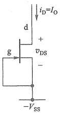

图 7.1.4 JFET 电流源
 

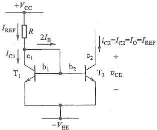

图 7.1.5 BJT 镜像电流源电路
 

设  $ T_{1}, T_{2} $ 的参数全相同，由于  $ V_{BE1} = V_{BE2} $，所以有  $ I_{E1} = I_{E2}, I_{C1} = I_{C2} $ 。电路的基准电流

$$  I_{\mathrm{REF}}=\frac{V_{\mathrm{CC}}-V_{\mathrm{BE}}-(-V_{\mathrm{EE}})}{R}   \tag*{(7.1.9)}$$

<!-- page: 258 -->

又因为

$$  I_{\mathrm{REF}}=I_{\mathrm{C1}}+2I_{\mathrm{B}}=I_{\mathrm{C2}}+2I_{\mathrm{C2}}/\beta=I_{0}+2I_{0}/\beta=I_{0}\left(1+2/\beta\right)   \tag*{(7.1.10)}$$

所以

$$  I_{0}=I_{c2}=\frac{I_{REF}}{1+2/\beta}   \tag*{(7.1.11)}$$

当 BJT 的  $ \beta $ 较大时，可以忽略基极分流，此时  $ I_{C2} $ 近似等于  $ I_{REF} $，即

$$  I_{\mathrm{o}}=I_{\mathrm{c2}}\approx I_{\mathrm{REF}}=\frac{V_{\mathrm{CC}}-V_{\mathrm{BE}}-(-V_{\mathrm{EE}})}{R}\approx\frac{V_{\mathrm{CC}}+V_{\mathrm{EE}}}{R}   \tag*{(7.1.12a)}$$

由此看出，当电路参数确定后，输出电流  $ I_{0} $ 就确定了，它与负载大小无关。可将  $ I_{c2} $ 看作是  $ I_{REF} $ 的镜像。当  $ T_{1} $、 $ T_{2} $ 发射结的相对面积  $ ^{①}A_{1} $、 $ A_{2} $ 不同时，输出电流为

$$  I_{0}{=}\frac{A_{2}}{A_{1}}I_{\mathrm{R E F}}{=}m I_{\mathrm{R E F}}   \tag*{(7.1.12b)}$$

应当指出，要使上述关系成立， $ T_{2} $ 必须工作在放大区  $ (V_{CE2}>0.3\ V) $。

与 FET 电流源类似，图 7.1.5 所示电路的输出电阻为

$$  r_{\mathrm{o}}=\left(\frac{\partial v_{\mathrm{CE}2}}{\partial i_{\mathrm{C}2}}\right)\begin{vmatrix}\\ &\\&I_{\mathrm{B}2}\\ &\end{vmatrix}=r_{\mathrm{ce}2}=\frac{1}{\lambda I_{\mathrm{C}2}}   \tag*{(7.1.13)}$$

镜像电流源的电流通常在毫安数量级。若需减少 $ I_{C2} $的值（例如微安级），必须要求R的值很大，这在集成电路中难以实现，这时常采用微电流源。

### 2. 微电流源 $ ^{②} $

图7.1.6是模拟集成电路中常用的一种电流源。与图7.1.5相比，在 $ T_{2} $的射极电路接入电阻 $ R_{e2} $。当基准电流 $ I_{REF} $一定时， $ I_{C2} $可确定如下：

因为

 $$ V_{\mathrm{BE1}}-V_{\mathrm{BE2}}=\Delta V_{\mathrm{BE}}=I_{\mathrm{E2}}R_{\mathrm{e2}} $$ 

所以

$$  I_{0}=I_{\mathrm{C}2}\approx I_{\mathrm{E}2}=\frac{\Delta V_{\mathrm{BE}}}{R_{\mathrm{e}2}}   \tag*{(7.1.14a)}$$

利用  $ I_{REF}=I_{C1}=I_{S}e^{V_{BE1}/V_{T}} $ 和  $ I_{0}=I_{C2}=I_{S}e^{V_{BE2}/V_{T}} $ 的关系得

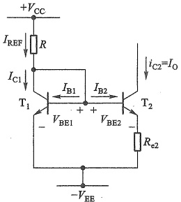

图 7.1.6 BJT 微电流源
 

 $$ \Delta V_{_{\mathrm{BE}}}=V_{_{\mathrm{BE1}}}-V_{_{\mathrm{BE2}}}=V_{_{T}}\ln\left(\frac{I_{_{\mathrm{REF}}}}{I_{_{0}}}\right) $$ 

故

$$  R_{e2}I_{0}=V_{T}\ln\left(\frac{I_{REF}}{I_{0}}\right)   \tag*{(7.1.14b)}$$

当  $ R_{e2} $、 $ I_{REF} $ 已知，可用累试法求出  $ I_{0} $

由式(7.1.14a)可知，利用两管基-射极电压差 $ \Delta V_{BE} $（几十毫伏）可以控制输出电流 $ I_{C2} $

<!-- page: 259 -->

由于  $ \Delta V_{BE} $ 的值很小，故用阻值不大的  $ R_{e2} $ 即可获得微小的工作电流，称为微电流源。仿照式 (5.2.21)  $ R_{o}^{\prime} $ 的求解可得电路的输出电阻  $ r_{o} \approx r_{ee2}\left(1 + \frac{\beta R_{e2}}{r_{be2} + R_{e2}}\right) $，因  $ r_{o} $ 很大，所以  $ I_{0} $ 的恒流特性非常好。

例7.1.1 图7.1.7是BJT的多路电流源电路，设 $ T_{1}\sim T_{6} $的参数完全相同，且 $ V_{BE(N)}=-V_{BE(P)}=0.6\ V $。电路中其他参数 $ V_{CC}=V_{EE}=15\ V, R_{1}=39\ k\Omega $。（1）求电路的基准电流 $ I_{REF} $；（2）电路有几种类型的电流源？

解：（1）图7.1.7中由 $ T_{4} $、 $ R_{1} $和 $ T_{1} $组成主偏置电路，可求得基准电流

 $$ \begin{aligned}I_{REF}&=\frac{+V_{CC}-V_{BE4}-V_{BE1}-(-V_{EE})}{R_{1}}\\&=\frac{(15+15-2\times0.6)\ V}{39\ k\Omega}=0.74\ mA\end{aligned} $$ 

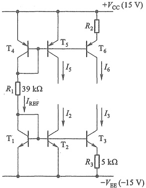

（2） $ T_{1} $ 和  $ T_{2} $、 $ T_{4} $ 和  $ T_{5} $ 构成镜像电流源，而  $ T_{1} $ 和  $ T_{3} $、 $ T_{4} $ 和  $ T_{6} $ 则构成微电流源。

图 7.1.7 BJT 多路电流源
 

实际上还有其他恒流特性更好、输出电阻更高的

改进型电流源，如 Cascode 镜像电流源、威尔逊（Wilson）电流源等，限于篇幅此处不再介绍。

##### 复习思考题

7.1.1 三极管用作电流源与用作放大电路有什么不同？

7.1.2 电流源电路有什么特点？在模拟集成电路中，为什么要采用电流源来实现直流偏置？

7.1.3 为什么要设计多路电流源？

#### 7.2 差分式放大电路

放大电路中的耦合电容和旁路电容都是大电容，而电容的容量与面积成正比，因此在集成电路有限的面积中制作这些大电容是不现实的，所以集成电路中的多级放大电路基本上采用直接耦合方式。但在直接耦合的多级放大电路中，由温度变化、电源电压波动等因素导致第1级静态工作点的漂移，会传递到下一级并被逐级放大，这个漂移会严重影响信号的放大。而选用差分式放大电路作为第1级是解决漂移问题的有效方法。

差分式放大电路中的相关概念和指标，如差模信号、共模信号、差模增益、共模增益和共模抑制比等可参照2.1节介绍的式(2.1.4)~式(2.1.11)。

##### 7.2.1 FET 差分式放大电路

1. MOSFET 源极耦合差分式放大电路

##### （1）基本电路

<!-- page: 260 -->

图 7.2.1a 所示电路是第 4 章介绍的电流源偏置的共源极放大电路，其中的电流源就可以用 7.1 节的电路实现。该电路的信号传输路径上没有耦合电容，是直接耦合电路 $ ^{①} $，但是它只有一个信号输入端，无法构成差分式输入。如果再增加一个完全相同的 MOS 管和相同的  $ R_{d} $ 电阻，便可构成如图 7.2.1b 所示的差分式放大电路 $ ^{②} $。由于源极支路是公共的，所以这个电路也称为源极耦合差分式放大电路。电路由  $ +V_{DD} $ 和  $ -V_{SS} $ 双电源供电，有两个输入端  $ v_{i1} $ 和  $ v_{i2} $、两个输出端  $ v_{01} $ 和  $ v_{02} $。可以仿照图 2.1.7a、b 的方法，将两输入端的信号等效为差模信号  $ v_{id}/2 $ 和共模信号  $ v_{ie} $ 的叠加，如图 7.2.1c 所示。

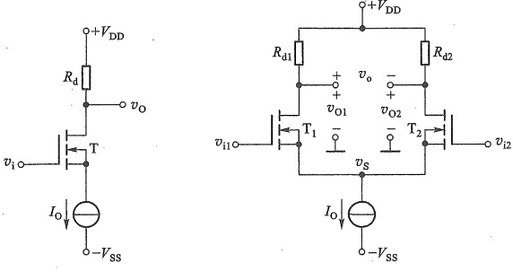

(a)
 

(b)
 

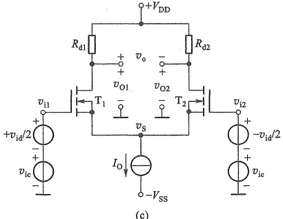

(c)
 

图 7.2.1 源极耦合差分式放大电路
 

(a) 共源极放电路 (b) 差分式放大电路 (c) 输入端的信号等效
 

##### （2）静态分析

静态时，输入信号为零，即  $ v_{i1}=v_{i2}=0 $，由此得到图7.2.1b所示电路的直流通路如图7.2.2所示。静态工作点的求解类似于图7.2.1a电路。由于电路完全对称， $ R_{d1}=R_{d2}=R_{d} $，所以

<!-- page: 261 -->

$$  I_{\mathrm{D1Q}}=I_{\mathrm{D2Q}}=I_{\mathrm{D Q}}=I_{0}/2   \tag*{(7.2.1)}$$

漏极电压

$$  V_{\mathrm{D1Q}}=V_{\mathrm{D2Q}}=V_{\mathrm{DQ}}=V_{\mathrm{DD}}-I_{\mathrm{DQ}}R_{\mathrm{d}}   \tag*{(7.2.2)}$$

假设  $ T_{1} $ 和  $ T_{2} $ 工作在恒流区，若已知 MOS 管的参数  $ K_{n} $ 和  $ V_{TN} $，根据

 $$ I_{_{DQ}}=K_{_n}(V_{_{GSQ}}-V_{_{TN}})^{2} $$ 

和式(7.2.1)便可求得 $ V_{GSQ} $。由此得源极电压

$$  V_{sq}=0-V_{csq}=-V_{csq}   \tag*{(7.2.3)}$$

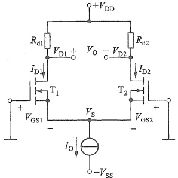

由式 $ （7.2.2 $）和式 $ （7.2.3 $）可得漏源电压

 $$ V_{\mathrm{DS1Q}}=V_{\mathrm{DS2Q}}=V_{\mathrm{DSQ}}=V_{\mathrm{DQ}}-V_{\mathrm{SQ}}=V_{\mathrm{DD}}-I_{\mathrm{DQ}}R_{\mathrm{d}}+V_{\mathrm{GSQ}} $$ 

图 7.2.2 图 7.2.1b 的直流通路
 

当然，最后还需要校验是否满足工作在恒流区的条件。

需要注意，静态时有  $ V_{D1Q}=V_{D2Q} $，所以静态时双端输出的电压也为零，即

 $$ V_{0}=V_{_{\mathrm{D1Q}}}-V_{_{\mathrm{D2Q}}}=0 $$ 

##### （3）动态小信号分析

##### ① 差模电压增益

根据式(2.1.4)和式(2.1.8)的定义，差模电压增益是仅有差模输入信号时的输出电压与输入电压之比。为此令图7.2.1c中的 $ v_{ie}=0 $，仅保留差模电压信号 $ v_{id} $，即 $ v_{i1}=-v_{i2}=v_{id}/2 $。此时称为双端输入方式。再根据画交流通路的方法，将直流电压源对地短路，直流电流源开路但保留其动态电阻 $ r_{o} $，便得到如图7.2.3a所示的交流通路。

假设电路完全对称，在差模电压作用下， $ v_{i1} $ 和  $ v_{i2} $ 的大小相等，相位相反。亦即  $ v_{gs1} $ 和  $ v_{gs2} $ 的大小也相等，相位相反。而  $ i_{d1} = g_m v_{gs1} $ 和  $ i_{d2} = g_m v_{gs2} $（设  $ \lambda_1 = \lambda_2 = 0 $），所以  $ i_{s1} = i_{d1} = -i_{d2} = -i_{s2} $，由节点 s 的 KCL 可知， $ r_o $ 中的电流为零，即  $ v_s = 0 $，相当于 s 点交流接地，如图 7.2.3b 所示。为简化分析，以下均假设  $ r_{ds} \gg R_d $，即可忽略  $ r_{ds} $。

##### a. 双端输入、单端输出时

利用共源放大电路电压增益的结论， $ T_{1} $ 漏极输出时有

$$  A_{_{v1}}=\frac{v_{_{o1}}}{v_{_{i1}}}=-g_{_{m}}R_{_{d1}}   \tag*{(7.2.4a)}$$

而差模电压增益应该是  $ v_{o1} $ 与  $ v_{id} $ 之比，又因为  $ v_{i1}=v_{id}/2 $，所以  $ T_{1} $ 漏极单端输出时的差模电压增益为

$$  A_{_{vd1}}=\frac{v_{_{o1}}}{v_{_{id}}}=\frac{v_{_{o1}}}{2v_{_{il}}}=\frac{1}{2}A_{_{vl}}=-\frac{1}{2}g_{_{m}}R_{_{d1}}   \tag*{(7.2.4b)}$$

式中  $ g_{m}=2\sqrt{K_{n}I_{DQ}}=2K_{n}(V_{GSQ}-V_{TN}) $。

如果从  $ T_{2} $ 的漏极输出，考虑到  $ v_{i2} = -v_{id}/2 $，则增益为

$$  A_{_{sd2}}=\frac{v_{_{o2}}}{v_{_{id}}}=\frac{v_{_{o2}}}{-2v_{_{i2}}}=\frac{1}{2}g_{_{m}}R_{_{d2}}   \tag*{(7.2.4c)}$$

可见两者仅在相位上不同。实际上，观察图7.2.3b可以看出，差模信号在两个输入端产生了大小相等、相位相反的电压信号，所以导致两个输出电压大小相等、相位相反。

<!-- page: 262 -->

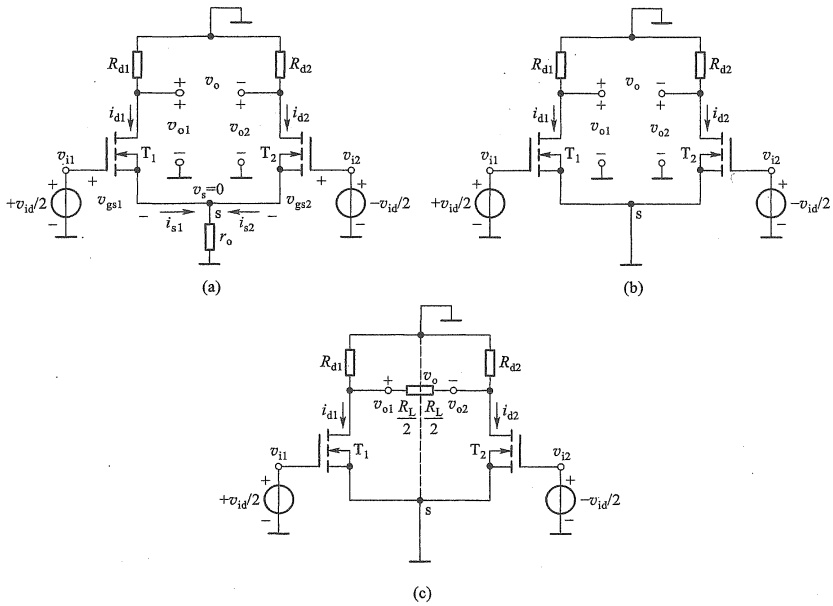

图 7.2.3 差模信号输入时的源极耦合差分式放大电路
 

（a）交流通路 （b）源极公共支路等效后的交流通路 （c）双端输出带负载时
 

如果  $ T_{1} $ 或  $ T_{2} $ 漏极单端输出到地之间带了负载  $ R_{L} $ （此时会改变漏极静态电压），则式 (7.2.4b) 或式 (7.2.4c) 中的漏极电阻再并联  $ R_{L} $ 即可。

##### b. 双端输入、双端输出时

由图7.2.3b可知，因 $ v_{i1}=-v_{i2} $，故 $ v_{o1}=-v_{o2} $，那么双端输出差模电压增益就为

$$  A_{v\mathrm{d}}=\frac{v_{\mathrm{o}}}{v_{\mathrm{id}}}=\frac{v_{\mathrm{o}1}-v_{\mathrm{o}2}}{v_{\mathrm{i}1}-v_{\mathrm{i}2}}=\frac{2v_{\mathrm{o}1}}{2v_{\mathrm{i}1}}=\frac{v_{\mathrm{o}1}}{v_{\mathrm{i}1}}=-g_{\mathrm{m}}R_{\mathrm{d}}   \tag*{(7.2.5)}$$

其中  $ R_{d}=R_{d1}=R_{d2} $。与式(7.2.4b)比较可以看出，双端输出的差模电压增益是单端输出的2倍，但它与单管共源放大电路的电压增益相同[参见式(7.2.4a)]。也就是说，增加了近一倍的元器件，并未提高信号的电压增益。实际上提高的是抑制漂移能力和抗共模干扰能力，这在接下来的讨论中将会看到。

当双端输出带负载  $ R_{L} $ 时，负载是跨接在  $ T_{1} $ 和  $ T_{2} $ 两漏极之间的，如图 7.2.3c 所示。由于在差模信号作用下， $ v_{o1} $ 和  $ v_{o2} $ 总是大小相等相位相反，导致  $ R_{L} $ 的中点电位始终不变，相当于交流地电位，所以单边负载等效为  $ R_{L}/2 $，此时的差模电压增益为

$$  A_{_{\mathrm{v d}}}=\frac{v_{\mathrm{o}}}{v_{\mathrm{i d}}}=\frac{v_{\mathrm{o1}}}{v_{\mathrm{i1}}}=-g_{\mathrm{m}}\left(R_{\mathrm{d}}\mathord{//}\frac{R_{\mathrm{L}}}{2}\right)   \tag*{(7.2.6)}$$

<!-- page: 263 -->

##### c. 单端输入时

在实际系统中，常常要求放大电路的输入端口有一端接地，即  $ v_{i1} = v_{id} $， $ v_{i2} = 0 $，那么图7.2.1b所示电路便成为图7.2.4a的形式，这时称为单端输入或非对称输入，差模输入电压仍然是  $ v_{id}(v_{i1} - v_{i2} = v_{id}) $。可将单端输入信号等效为图7.2.4b的形式，其中  $ v_{i_o} $ 为共模信号，意味着信号的这种不对称输入必然伴随着共模信号的输入。当仅考虑差模输入信号时，将两个  $ v_{i_o} $ 置零后，其交流通路与图7.2.3完全相同。由此得到结论：单端输入时的差模情况等效于双端输入，所以差模增益指标的计算与双端输入时相同。

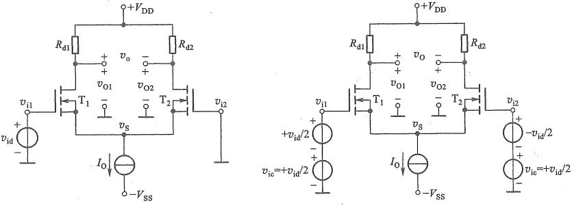

(a)
 

(b)
 

图 7.2.4 单端输入时的差分式放大电路
 

（a）原理电路 （b）等效的输入形式

##### ② 共模电压增益

将图7.2.1c中的差模信号源置零，即 $ v_{id}=0 $，再根据画交流通路的方法，得到只有共模输入信号的交流通路如图7.2.5a所示，其中 $ r_{0} $是电流源的动态电阻。

假设电路完全对称，在共模电压作用下， $ v_{i1} $ 和  $ v_{i2} $ 的大小相等，相位相同，使  $ v_{gs1} = v_{gs2} $，于是有  $ i_{d1} = i_{d2} $ 和  $ i_{s1} = i_{s2} $。由节点 s 的 KCL 可知，此时  $ r_{o} $ 中的电流  $ i_{s} = i_{s1} + i_{s2} = 2i_{s1} $，表明流过源极公共支路的电流不再为零，源极电压  $ v_{s} = 2i_{s1}r_{o} \neq 0 $， $ r_{o} $ 不能再像差模输入时那样被视作交流短路。在保持  $ v_{s} $ 不变情况下，可以将  $ r_{o} $ 分别等效到  $ T_{1} $ 和  $ T_{2} $ 各自的源极支路上，便得到图 7.2.5b 所示的等效电路。

##### a. 单端输出时

图7.2.5b可看作两个独立的共源放大电路，无论从哪个漏极输出，增益都是相同的。但要注意，源极上的电阻 $ 2r_{0} $，会出现在共源电路电压增益表达式的分母中。根据式（4.4.10），可得差分式放大电路单端输出的共模电压增益

$$  A_{_{oc1}}=\frac{v_{oc1}}{v_{ic}}=\frac{v_{oc2}}{v_{ic}}=-\frac{g_{_{m}}R_{_{d}}}{1+g_{_{m}}(2r_{_{o}})}   \tag*{(7.2.7)}$$

由于通常有  $ g_{m}(2r_{0}) \gg 1 $ ，所以对比式（7.2.7）与式（7.2.4b）可以看出，共模电压增益远小于差模电压增益。此时式（7.2.7）可简化为

$$  A_{_{vcl}}=-\frac{g_{_{m}}R_{_{d}}}{1+g_{_{m}}(2r_{_{o}})}\approx-\frac{R_{_{d}}}{2r_{_{o}}}   \tag*{(7.2.8)}$$

<!-- page: 264 -->

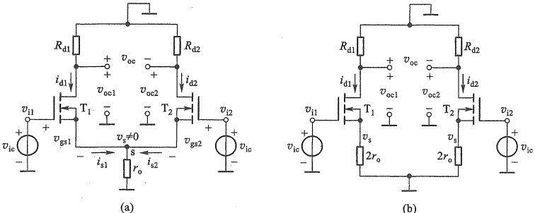

图 7.2.5 共模信号输入时的源极耦合差分式放大电路 (a) 交流通路 (b) 源极公共支路等效后的交流通路
 

由此看出，源极公共支路的电流源越理想， $ r_{0} $ 就越大，共模增益  $ A_{vcl} $ 就越小，抑制共模电压的能力也就越强。

需要指出，由于共模电压在两输入端表现为大小、相位均相同，所以无论由哪个漏极输出，共模的输出与输入总是反相的。

##### b. 双端输出时

由于两边的共模电压增益相同，所以

 $$ v_{oo}=v_{oo1}-v_{oo2}=0 $$ 

则双端输出时的共模电压增益为

$$  A_{_{v c}}=\frac{v_{_{o c}}}{v_{_{i c}}}=\frac{v_{_{o c1}}-v_{_{o c2}}}{v_{_{i c}}}=0   \tag*{(7.2.9)}$$

表明差分式放大电路双端输出时，可以将共模电压衰减为零，但实际电路不可能完全对称，所以这个结果是理想的。

在图7.2.1c中，如果温度变化或电源电压波动，都将引起 $ T_{1} $和 $ T_{2} $漏极电流以及漏极电压产生相同的变化，其效果相当于在两个输入端加入了共模电压 $ v_{ie} $。而以上分析已经看到，差分式放大电路，无论是双端输出还是单端输出，其共模增益都非常小（绝对值远小于1），也就是说对共模信号有很强的抑制能力，因此也就抑制了零点漂移。

所谓零点漂移是指当放大电路在输入信号为零时，输出端还有缓慢变化的电压产生，即输出电压偏离原来的起始点而上下漂动，简称零漂。温度变化或电源电压波动是产生零漂的主要原因，它们都可以等效为共模输入电压。为了表示由于温度变化引起的漂移，常把温度每升高 1°C 时产生的输出漂移电压  $ \Delta V_o / ^{\circ}\mathrm{C} $，除以放大电路的电压增益  $ A_v $，折算为等效输入漂移电压  $ \Delta V_i = \Delta V_o / A_v / ^{\circ}\mathrm{C} $ 作为温漂指标。

对比图7.2.3b和图7.2.5b可以看出，源极公共支路的电阻，是导致共模电压增益小于差模电压增益的根本原因。因此尽可能提高该支路电流源的动态电阻是提高抑制零点漂移的最有效方法。另外，差分式放大电路的对称性也会对抑制共模信号的能力产生重要影响。

由于共模信号是指两输入端完全相同的信号，所以不再区分双端输入和单端输入。

<!-- page: 265 -->

##### ③ 共模抑制比

共模抑制比是衡量差分式放大电路放大差模信号能力和抑制共模信号能力的综合指标。根据式(2.1.11)的定义，如果电路是理想对称的，双端输出的共模电压增益 $ A_{ee}=0 $，则共模抑制比为无穷大。单端输出时，根据式(7.2.4b)和式(7.2.7)可得共模抑制比为

$$  K_{\mathrm{CMR1}}=\left|\frac{A_{v\mathrm{d}1}}{A_{v\mathrm{c}1}}\right|\approx\frac{1+2g_{\mathrm{m}}r_{\mathrm{o}}}{2}\approx g_{\mathrm{m}}r_{\mathrm{o}}   \tag*{(7.2.10)}$$

可见，源极公共支路电流源的恒流特性越好， $ r_{a} $ 越大， $ K_{CMR} $ 也越大，意味着差模信号增益与共模信号增益的差别就越大，在同样差模增益下抑制共模信号的能力就越强。

单端输出时，由式(2.1.10)（其中 $ A_{vd}=A_{vd1},A_{ve}=A_{ve1} $）和式(7.2.10)得总的输出电压为

$$  v_{\mathrm{o}1}=A_{_{\mathrm{v d}1}}v_{\mathrm{i d}}\left(1\pm\frac{v_{\mathrm{i c}}}{K_{\mathrm{C M R}1}v_{\mathrm{i d}}}\right)   \tag*{(7.2.11)}$$

式中的正负号表示共模信号对输出产生的两种可能的影响。

由式(7.2.11)可知，在设计放大电路时，为了放大差模信号，抑制共模信号，要尽可能使括号中的第二项共模的贡献远小于1，即  $ K_{\mathrm{CMR1}} \gg |v_{\mathrm{ie}}/v_{\mathrm{id}}| $，否则输出中的信号分量  $ (v_{\mathrm{id}} $ 引起的输出）将有可能被漂移等干扰淹没。例如，设  $ K_{\mathrm{CMR1}} = 1\ 000 $， $ v_{\mathrm{ie}} = 1\ \mathrm{V} $， $ v_{\mathrm{id}} = 1\ \mathrm{mV} $，则式(7.2.11)中的第二项与第一项相等，此时信号  $ v_{\mathrm{id}} $ 产生的输出电压与干扰  $ v_{\mathrm{ie}} $ 产生的输出电压相等，信号被“淹没”了。如果将  $ K_{\mathrm{CMR1}} $ 值增至10 000，则式(7.2.11)中的第二项只有第一项的1/10，输出电压中的信号比干扰大10倍，再一次说明共模抑制比越高，抑制共模信号能力越强。

有时也用分贝(dB)数来表示 $ K_{CMR} $，即

$$  K_{\mathrm{CMR}}=20\lg\left|\frac{A_{vd}}{A_{vc}}\right|\mathrm{~dB}   \tag*{(7.2.12)}$$

##### ④ 输入电阻

对于图7.2.1c所示的差分式放大电路，由于MOS管的栅极是绝缘的，所以无论是差模信号的放大还是共模信号的放大，它们的输入电阻都约等于无穷大。即差模输入电阻

$$  R_{id}\approx\infty   \tag*{(7.2.13)}$$

和共模输入电阻

$$  R_{i e}\approx\infty   \tag*{(7.2.14)}$$

##### ⑤ 输出电阻

无论是差模情况还是共模情况，图7.2.1b所示电路都可以等效为左右对称的共源放大电路，所以输出电阻也与共源放大电路类似。单端输出时的输出电阻就等于共源电路的输出电阻，即

 $$ R_{o}=R_{d} $$ 

双端输出时，是由  $ T_{1} $、 $ T_{2} $ 两个漏极之间看进去的等效电阻，此时  $ R_{d1} $ 和  $ R_{d2} $ 形成串联结构（见图 7.2.3b 和图 7.2.5b，设  $ r_{ds1} = r_{ds2} \approx \infty $）。所以双端输出时的输出电阻约为

$$  R_{o}=R_{d1}+R_{d2}=2R_{d}   \tag*{(7.2.16)}$$

##### ⑥ 频率响应

差分式放大电路的幅频响应要考虑 $ A_{vd} $、 $ A_{vc} $、 $ K_{CMR} $随频率的变化。由于源极耦合差分式

<!-- page: 266 -->

放大电路最后可以等效为共源电路，所以差模电压增益在高频区的幅频响应  $ \left|A_{vd}\right| $ 与共源放大电路类似，但因为是直接耦合电路，所以在低频区增益不会衰减，如图 7.2.6a 所示， $ f_{H} $ 为差模电压增益的上限频率。单端输出与双端输出差模电压增益在带宽上的差异遵循增益带宽积近似为常数的规律。

由于单端输出共模电压增益与源极公共支路电流源的动态电阻成反比，而电流源也是由 MOS 管构成的，因此源极 s 到地之间也会存在三极管极间等效电容  $ C_{o} $，它与  $ r_{o} $ 并联构成阻抗  $ Z_{o} $，代替共模电压增益表达式(7.2.8)中的  $ r_{o} $，即

 $$ Z_{。}=r_{。}\mathbin{//}\frac{1}{\mathrm{j}2\pi f C_{。}} $$ 

和

 $$ \dot{A}_{v o2}=\frac{R_{\mathrm{d}}}{2Z_{\mathrm{o}}}=\frac{R_{\mathrm{d}}}{2r_{\mathrm{o}}}\left(1+\mathrm{j}2\pi f C_{\mathrm{o}}r_{\mathrm{o}}\right) $$ 

 $$ f_{\mathrm{h c}}=\frac{1}{2\pi r_{\circ}C_{\circ}} $$ 

则共模电压增益幅频响应的转折频率为

当信号频率大于  $ f_{HC} $ 后，阻抗  $ Z_0 $ 将减小，共模增益将随频率升高逐渐增大，如图 7.2.6b 所示。取分贝数 (dB) 的共模抑制比  $ 20\lg K_{CMR} = 20\lg |\dot{A}_{vd}| - 20\lg |\dot{A}_{vo}| $，其波特图如图 7.2.6c 所示。 $ \dot{K}_{CMR} $ 的带宽通常比  $ |\dot{A}_{vd}| $ 的带宽要窄 ( $ f_{HC} < f_H $)。

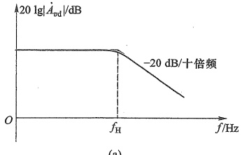

(a)
 

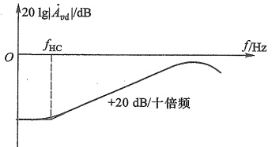

(b)
 

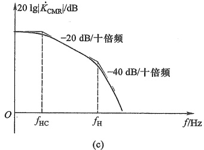

(c)
 

图 7.2.6 差分式放大电路的幅频响应
 

（a）差模增益 （b）共模增益 （c）共模抑制比
 

<!-- page: 267 -->

综上分析，源极耦合差分式放大电路有以下结论：

◆ 电路参数确定后，电压增益、共模抑制比等指标与输出方式有关，而与输入方式无关。

双端输出、负载开路的情况下，图7.2.3b电路的差模电压增益与单边共源电路的增益相等；单端输出时的差模电压增益则是单边共源电路增益的一半，可见增加了几乎成倍的元器件并没有提高增益，而是换取了抑制共模信号的能力。

◆ 放大差模信号时，源极公共支路相当于短路，对于共模信号，源极公共支路电阻相当于单边源极支路电阻的两倍。这是差模增益与共模增益出现差别的根本原因。

♦ 源极公共支路电阻越大，共模抑制比越高，抑制零点漂移能力越强。该电阻通常是直流偏置电流源的动态电阻。

由于 MOS 管栅极是绝缘的，因此以栅极做输入端的输入电阻都趋于无穷大。

例 7.2.1 电路如图 7.2.7 所示，MOS 管  $ T_1 \sim T_4 $ 的  $ K_n = 0.75\ mA/V^2 $， $ T_1 $ 和  $ T_2 $ 的  $ \lambda_1 = \lambda_2 = 0.001\ V^{-1} $， $ V_{TN1} = V_{TN2} = 1.2\ V $， $ T_3 $ 和  $ T_4 $ 的  $ \lambda_3 = \lambda_4 = 0.01\ V^{-1} $， $ V_{TN3} = V_{TN4} = 1\ V $，基准电流  $ I_{REF} = I_0 = 1.4\ mA $， $ V_{DD} = V_{SS} = 5\ V $， $ R_d = 5\ k\Omega $。试求：（1）电路的静态工作点；（2）双端输入、双端输出的差模电压增益  $ A_{vd} $、差模输入电阻  $ R_{id} $ 和输出电阻  $ R_o $；（3） $ T_1 $ 漏极单端输出的差模电压增益  $ A_{od1} $、共模电压增益  $ A_{ve1} $ 和共模抑制比  $ K_{CMR1} $；（4）保证  $ T_1 $、 $ T_2 $ 工作在恒流区时，求允许的共模输入电压  $ v_{ic} $ 的范围（ $ V_{i\min} \sim V_{i\max} $）和差模输入电压  $ v_{id} $ 的范围。

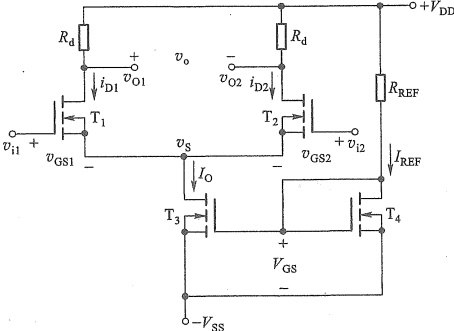

图 7.2.7 例 7.2.1 的电路
 

解：（1）静态工作点

静态时  $ v_{i1}=v_{i2}=0 $ 。由于  $ I_{0}=1.4\ mA $ ，差分对管的漏极电流和电压分别为

 $$ I_{_{D1Q}}=I_{_{D2Q}}=I_{_{DQ}}=\frac{1}{2}I_{0}=0.7\mathrm{~mA} $$ 

 $$ V_{\mathrm{D1Q}}=V_{\mathrm{D2Q}}=V_{\mathrm{DD}}-I_{\mathrm{DQ}}R_{\mathrm{d}}=\left(5-0.7\times5\right)\mathrm{V}=1.5\mathrm{~V} $$ 

假设  $ T_{1} $ 和  $ T_{2} $ 工作在恒流区，由  $ I_{D1Q}=K_{n}(V_{GS1Q}-V_{TN1})^{2} $ 得

 $$ V_{cs1q}\approx2.17V $$ 

而  $ V_{G1Q}=0 $，所以  $ V_{S1Q}=V_{G1Q}-V_{GS1Q}=-2.17\ V $，则

<!-- page: 268 -->

$$ V_{\mathrm{DS1Q}}=V_{\mathrm{DS2Q}}=V_{\mathrm{D1Q}}-V_{\mathrm{S1Q}}=\left(1.5+2.17\right)\mathrm{V}=3.67\mathrm{~V} $$ 

满足  $ V_{DS} > V_{GS} - V_{TN} $ 的条件，假设成立。

（2）双端输入-双端输出的 $ A_{vd} $、 $ R_{id} $和 $ R_{0} $

 $$ r_{\mathrm{ds}1}=r_{\mathrm{ds}2}=1/\left(\lambda_{1}I_{\mathrm{D}}\right)=\frac{1}{0.001\mathrm{~V}^{-1}\times0.7\mathrm{~mA}}=1.43\mathrm{~M}\Omega\gg R_{\mathrm{d}} $$ 

 $$ g_{\mathrm{m}}=2\sqrt{K_{\mathrm{n}}I_{\mathrm{D Q}}}=2\sqrt{0.75\mathrm{~m A/V^{2}\times0.7~m A}}\approx1.449\mathrm{m S} $$ 

 $$ A_{\mathrm{v d}}=-g_{\mathrm{m}}(R_{\mathrm{d}}//r_{\mathrm{d s}})\approx-g_{\mathrm{m}}R_{\mathrm{d}}=-1.449\mathrm{m S}\times5\mathrm{k}\Omega=-7.25 $$ 

 $$ R_{\mathrm{i d}}=\infty $$ 

 $$ R_{。}=2R_{。}=2\times5\ k\Omega=10\ k\Omega $$ 

（3） $ T_{1} $ 漏极单端输出的差模电压增益

 $$ A_{vd1}=\frac{1}{2}A_{vd}=-3.625 $$ 

 $$ r_{ds3}=r_{o3}=\frac{1}{\lambda_{3}I_{0}}=\frac{1}{0.01\mathrm{~V}^{-1}\times1.4\mathrm{~mA}}=71.429\mathrm{~k}\Omega $$ 

共模电压增益

 $$ A_{_{ve1}}=-\frac{g_{_{m}}R_{_{d}}}{1+2\ g_{_{m1}}r_{_{e3}}}=-\frac{7.25}{1+2\times1.449\times71.429}=-0.034\ 9 $$ 

共模抑制比

 $$ K_{\mathrm{CMR1}}=\left|\frac{A_{vd1}}{A_{vo1}}\right|=\left|\frac{-3.625}{-0.034\ 9}\right|=103.9 $$ 

（4） $ v_{ic} $ 和  $ v_{id} $ 的范围

##### ① 共模输入电压范围

由于共模信号对差分对管的影响相同，且不改变电流源  $ I_{0} $，所以两边电流也保持  $ I_{D1Q} $ 和  $ I_{D2Q} $ 不变， $ v_{GS1} $、 $ v_{GS2} $ 也保持在  $ V_{GS1Q} $、 $ V_{GS2Q} $ 不变，漏极电压  $ V_{D1Q} $、 $ V_{D2Q} $ 也不变，所以共模输入只会引起  $ v_{S} $ 变化，导致的漏源电压变化仅考虑单边即可。

共模输入时  $ v_{i1}=v_{i2}=v_{ie} $，此时  $ v_{S}=v_{ie}-V_{GS1Q} $， $ v_{ie} $ 增加  $ v_{S} $ 也跟随增加，使  $ v_{DS1} $ 减小，直至  $ T_{1} $ 工作点进入夹断点轨迹时（恒流区的边界点），可求得  $ V_{iemax} $。此时根据夹断点轨迹  $ V_{DS1pop}=V_{GS1Q}-V_{TN1} $ 和  $ V_{DS1pop}=V_{D1Q}-V_{S}=V_{D1Q}-(V_{iemax}-V_{GS1Q}) $ 得到

 $$ V_{icmax}=V_{D1Q}+V_{TN1}=\left(1.5+1.2\right)\mathrm{V}=2.7\mathrm{V} $$ 

当  $ v_{io} $ 减小时， $ v_{S} $ 也减小，导致  $ v_{DS3} $ 减小，致使  $ T_{3} $ 工作点进入夹断点轨迹  $ (v_{DS3}=V_{DS3_{pop}}) $，由此确定  $ V_{icmin} $ 即根据  $ I_{0}=I_{D3}=K_{n}(V_{GS3Q}-V_{TN3})^{2} $ 得

 $$ V_{\mathrm{GS3Q}}=\sqrt{\frac{I_{0}}{K_{\mathrm{n}}}}+V_{\mathrm{TN3}}=\sqrt{\frac{1.4\mathrm{~mA}}{0.75\mathrm{~mA}/\mathrm{V}^{2}}}+1\mathrm{~V}=2.37\mathrm{~V} $$ 

因为要求  $ V_{GS3Q} > V_{TN3} $，所以开根号时取正值。

由夹断点轨迹得

 $$ V_{DS3pop}=V_{GS3Q}-V_{TN3}=1.37\mathrm{~V} $$ 

又因为  $ V_{DS3pop}=V_{S}-(-V_{SS})=V_{icmin}-V_{GS1Q}-(-V_{SS}) $，所以

<!-- page: 269 -->

$$ V_{\mathrm{i e m i n}}=V_{\mathrm{D S3p o p}}+V_{\mathrm{G S1Q}}-V_{\mathrm{S S}}=\left(1.37+2.17-5\right)\mathrm{V}=-1.46\mathrm{~V} $$ 

故允许  $ v_{ie} $ 的变化范围为  $ (-1.46 \sim 2.7) $ V。

##### ② 差模输入电压变化范围

差模输入电压  $ v_{id}=v_{il}-v_{i2}=v_{GS1}-v_{GS2} $，当差模电压达到最大值时，即  $ v_{id}=V_{idmax} $，会使  $ T_{2} $ 截止， $ I_{0} $ 全部流过  $ T_{1} $，即

 $$ I_{\mathrm{D1max}}=I_{0},\quad I_{\mathrm{D2min}}=0,\quad V_{\mathrm{idmax}}=V_{\mathrm{GS1max}}-V_{\mathrm{GS2min}} $$ 

 $$ V_{\mathrm{GS2min}}=V_{\mathrm{TN2}},V_{\mathrm{GS1max}}=\sqrt{\frac{I_{\mathrm{D1max}}}{K_{\mathrm{n}}}}+V_{\mathrm{TN1}}=\sqrt{\frac{I_{0}}{K_{\mathrm{n}}}}+V_{\mathrm{TN1}} $$ 

因为  $ V_{TN1}=V_{TN2} $，所以

 $$ V_{idmax}=\sqrt{\frac{I_{0}}{K_{n}}}+V_{TN1}-V_{TN2}=\sqrt{\frac{I_{0}}{K_{n}}}=\sqrt{\frac{1.4mA}{0.75mA/V^{2}}}\approx1.37V $$ 

同理， $ v_{id} $ 达到最小值（实际上是上述情况极性的翻转）时，即  $ v_{id}=v_{idmin} $，使  $ T_{1} $ 截止， $ I_{0} $ 全部流过  $ T_{2} $，即

 $$ v_{idmin}=V_{GS1min}-V_{GS2max}=-\sqrt{\frac{I_{0}}{K_{n}}}\approx-1.37\mathrm{~V} $$ 

故允许  $ v_{id} $ 的变化范围是  $ -\sqrt{\frac{I_{0}}{K_{n}}} \leqslant v_{id} \leqslant +\sqrt{\frac{I_{0}}{K_{n}}} $，即  $ (-1.37 \sim +1.37) $ V。

### 2. JFET 差分式放大电路

N 沟道的 JFET 差分式放大电路如图 7.2.8 所示，其中  $ T_{3} $ 构成电流源，为  $ T_{1} $、 $ T_{2} $ 提供静态偏置， $ I_{D1}=I_{D2}=I_{0}/2 $， $ I_{0} $ 的动态电阻  $ r_{0}=1/(\lambda I_{DSS}) $ 很大，可以很好地抑制共模信号。

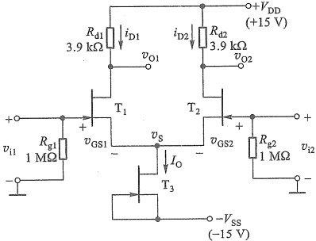

图 7.2.8 JFET 差分式放大电路
 

与 MOS 管差分式放大电路分析类似，同样可以得到双端输出的差模电压增益

$$  A_{_{vd}}=\frac{v_{01}-v_{02}}{v_{id}}=-g_{_{m}}R_{_{d}}   \tag*{(7.2.17)}$$

##### 单端输出的差模电压增益

<!-- page: 270 -->

$$  \dot{A}_{v d1}=\frac{v_{o1}}{v_{i d}}=-\frac{1}{2}g_{m}R_{d}\quad 或 \quad A_{v d2}=+\frac{1}{2}g_{m}R_{d}   \tag*{(7.2.18)}$$

式中  $ g_{m} $ 为  $ T_{1} $、 $ T_{2} $ 的互导， $ R_{d}=R_{d1}=R_{d2} $。共模电压增益等其他指标与 MOS 管差分式放大电路基本相同，不再赘述。

由于 JFET 的栅极是 PN 结反偏时的电极，所以其电阻比 MOS 管的略小。JFET 差分式放大电路的输入电阻约为  $ 10^{12} $ Ω，而 MOS 管的输入电阻则可达  $ 10^{15} $ Ω。

##### 7.2.2 BJT 差分式放大电路

### 1. 基本电路

用两只 BJT 替换图 7.2.1c 中的  $ T_{1} $ 和  $ T_{2} $，就得到如图 7.2.9a 所示的射极耦合差分式放大电路。

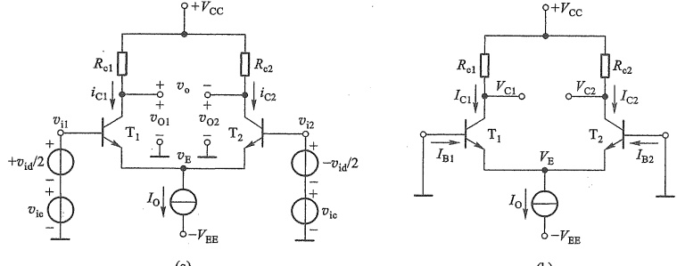

(a)
 

(b)
 

图 7.2.9 射极耦合差分式放大电路
 

（a）原理图 （b）直流通路
 

### 2. 静态分析

静态时, $ v_{i1}=v_{i2}=0 $,得到直流通路如图7.2.9b所示。假设电路完全对称, $ R_{e1}=R_{e2}=R_{e} $,所以

 $$ I_{\mathrm{c1q}}=I_{\mathrm{c2q}}=I_{\mathrm{cQ}}=I_{0}/2 $$ 

集电极电压

 $$ V_{\mathrm{c}1\mathrm{Q}}=V_{\mathrm{c}2\mathrm{Q}}=V_{\mathrm{c}\mathrm{Q}}=V_{\mathrm{c}\mathrm{c}}-I_{\mathrm{c}\mathrm{Q}}R_{\mathrm{c}} $$ 

发射极电压

 $$ V_{EQ}=0-V_{BEQ}=-V_{BEQ} $$ 

若 BJT 为硅管，则  $ V_{BEQ} \approx 0.7V $ 。所以集电极-射极压差

 $$ V_{\mathrm{C E1Q}}=V_{\mathrm{C E2Q}}=V_{\mathrm{C E Q}}=V_{\mathrm{C Q}}^{\cdot}-V_{\mathrm{E Q}}=V_{\mathrm{C C}}-I_{\mathrm{C Q}}R_{\mathrm{e}}+V_{\mathrm{B E Q}} $$ 

若已知 BJT 的  $ \beta $，则基极电流

 $$ I_{\mathrm{B1Q}}=I_{\mathrm{B2Q}}=I_{\mathrm{BQ}}=I_{\mathrm{CQ}}/\beta $$ 

### 3. 动态分析

##### （1）差模电压增益

在图 7.2.9a 所示的电路中仅有差模输入电压时，即  $ v_{i_{c}}=0, v_{i1}=-v_{i2}=v_{id}/2 $，则与 MOS 管

<!-- page: 271 -->

差分式放大电路类似，发射极公共支路的交流电压也为零，故交流通路如图7.2.10所示，其左右两边就是对称的共射电路，利用第5章共射极放大电路的结论，很容易求得该电路的动态指标。为简单起见，以下分析均假设 $ r_{ee} \gg R_{e} $，即忽略 $ r_{ee} $。

##### ① 双端输入、单端输出时

从图7.2.10电路的 $ v_{01} $输出且不带负载 $ R_{L} $时，差模电压增益为

 $$ A_{_{v d1}}=\frac{v_{_{o1}}}{v_{_{i d}}}=\frac{v_{_{o1}}}{2v_{_{i1}}}=-\frac{\beta R_{_{c}}}{2r_{_{b e}}} $$ 

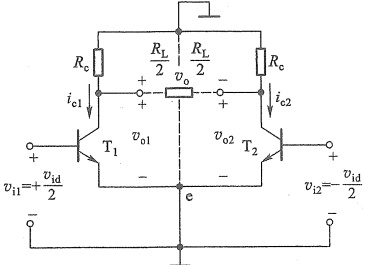

图 7.2.10 输入差模信号时的射极耦合 差分式放大电路的交流通路
 

当从  $ v_{02} $ 输出时，由于有  $ v_{i2} = -v_{id}/2 $，则

$$  A_{_{vd2}}=\frac{v_{_{o2}}}{v_{_{id}}}=\frac{v_{_{o2}}}{-2v_{_{i2}}}=+\frac{\beta R_{_{e}}}{2r_{_{be}}}   \tag*{(7.2.19b)}$$

②双端输入、双端输出时

若从图7.2.10电路的 $ v_{0} $输出且未接 $ R_{L} $时，差模电压增益是单端输出的2倍，即

$$  A_{_{vd}}=\frac{v_{_{o}}}{v_{id}}=2A_{_{vd1}}=-\frac{\beta R_{_{o}}}{r_{_{be}}}   \tag*{(7.2.20)}$$

当接入负载电阻  $ R_{L} $ 时

$$  A^{\prime}_{v\mathrm{d}}=-\frac{\beta R^{\prime}_{\mathrm{L}}}{r_{b\mathrm{e}}}   \tag*{(7.2.21)}$$

其中  $ R_{L}^{\prime}=R_{c}\parallel\frac{R_{L}}{2} $

##### ③ 单端输入时

单端输入时，与 MOS 管差分式放大电路有相同的结论：单端输入时的差模情况等效于双端输入，差模增益指标的计算与双端输入时相同。当然，这种不对称输入形式一定伴随了共模信号的输入。

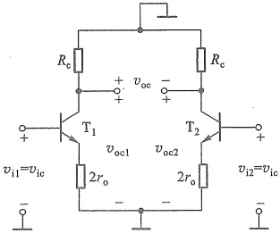

图 7.2.11 共模输入时的射极耦合差分式放大电路的交流通路
 

##### （2）共模电压增益

① 双端输出的共模电压增益

将图7.2.9a所示电路的差模信号置零 $ (v_{id}=0) $，仅保留 $ v_{ie} $时，其交流通路如图7.2.11所示，其中 $ r_{0} $是电流源的动态电阻（其等效过程与图7.2.5电路类似）。

当从两管集电极输出时，输出电压为  $ v_{oc}=v_{oc1}-v_{oc2}\approx0 $，其双端输出的共模电压增益为

$$  A_{_{vc}}=\frac{v_{_{oc}}}{v_{_{ic}}}=\frac{v_{_{oc1}}-v_{_{oc2}}}{v_{_{ic}}}\approx0   \tag*{(7.2.22)}$$

② 单端输出的共模电压增益

<!-- page: 272 -->

由  $ v_{oc1} $ 或  $ v_{oc2} $ 输出时，共模电压增益

$$  A_{_{sc1}}=\frac{v_{_{oc1}}}{v_{_{ic}}}=\frac{v_{_{oc2}}}{v_{_{ic}}}=\frac{-\beta R_{_{o}}}{r_{_{be}}+\left(1+\beta\right)2r_{_{o}}}   \tag*{(7.2.23)}$$

一般情况下，有 $ (1+\beta)2r_{o}\gg r_{be},\beta\gg1 $，故式(7.2.23)可简化为

$$  A_{_{sc1}}\approx-\frac{R_{c}}{2r_{o}}   \tag*{(7.2.24)}$$

由此看出，射极公共支路电流源的动态电阻 $ r_{0} $是决定共模增益的关键因素， $ r_{0} $越大，抑制共模信号的能力越强，与MOS管电路的结论一致。

共模输入没有单端输入、双端输入之分。

##### （3）共模抑制比 $ K_{CMR} $

若电路完全对称，双端输出时由于共模电压增益  $ A_{ve}=0 $，所以其共模抑制比  $ K_{CMR} $ 为无穷大。如果单端输出，则根据式(7.2.19a)和式(7.2.24)可得

$$  K_{\mathrm{CMR}}=\left|\frac{A_{vd1}}{A_{ve1}}\right|\approx\frac{\beta r_{o}}{r_{be}}   \tag*{(7.2.25)}$$

同样， $ r_{0} $ 越大， $ K_{CMR} $ 越高。

##### （4）输入电阻

差模输入电阻等于差模输入电压与端口电流之比，可将图7.2.10电路等效为图7.2.12a所示的输入端口形式。此时由 $ v_{id} $向右侧看进去的端口电阻就是差模输入电阻，它相当于两个共射电路输入电阻的串联，即

$$  R_{\mathrm{id}}=\frac{v_{\mathrm{id}}}{\dot{\iota}_{\mathrm{id}}}=r_{\mathrm{be1}}+r_{\mathrm{be2}}=2r_{\mathrm{be}}   \tag*{(7.2.26)}$$

类似地，可将图7.2.11电路等效为图7.2.12b所示的输入端口形式。此时由 $ v_{ie} $向右看进去的端口电阻就是共模输入电阻，它相当于两个共射电路输入电阻的并联，但射极上接有电阻 $ 2r_{0} $，即

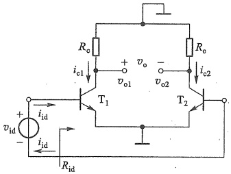

(a)
 

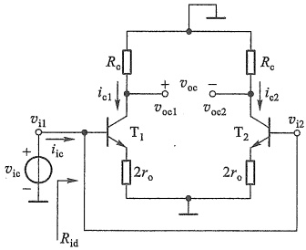

(b)
 

图 7.2.12 求输入电阻的端口等效形式
 

（a）差模输入电阻 （b）共模输入电阻
 

<!-- page: 273 -->

$$  R_{_{ic}}=\frac{v_{_{ic}}}{i_{_{ic}}}=\frac{1}{2}\left[r_{_{be}}+\left(1+\beta\right)\left(2r_{_{o}}\right)\right]   \tag*{(7.2.27)}$$

##### （5）输出电阻

由图7.2.12看出，单端输出时的输出电阻与单边共射电路相同，即

$$  R_{\mathrm{。}}=R_{\mathrm{。}}   \tag*{(7.2.28)}$$

双端输出时，是由  $ T_{1} $、 $ T_{2} $ 两个集电极之间看进去的等效电阻，相当于两个  $ R_{c} $ 的串联（忽略  $ r_{ds} $ 的影响），即

$$  R_{e}=R_{e}+R_{e}=2R_{e}   \tag*{(7.2.29)}$$

BJT 射极耦合差分式放大电路的频率响应有与 MOS 管电路类似的结论。

例 7.2.2 电路如图 7.2.9a 所示，设  $ T_1 $、 $ T_2 $ 的  $ \beta = 200 $， $ V_{BE} = 0.7\ V $， $ I_0 = 1\ mA $， $ R_{e1} = R_{e2} = R_e = 10\ k\Omega $， $ V_{CC} = V_{EE} = 10\ V $。试求：(1) 电路的静态工作点；(2) 双端输出的差模电压增益  $ A_{vd} $、差模输入电阻  $ R_{id} $ 和输出电阻  $ R_o $；(3) 当电流源的  $ r_o = 83\ k\Omega $ 时， $ T_1 $ 集电极单端输出的  $ A_{vd1} $、 $ A_{ve1} $ 和  $ K_{CMR1} $；(4) 当  $ v_{id} = 0 $， $ v_{ie} $ 分别为 -5 V 和 +5 V 时，对应的两管  $ V_{CE} $ 的值各为多少？保证 BJT 工作在放大区时共模输入电压的范围为多少？

解：（1）静态时， $ v_{i1}=v_{i2}=0 $， $ V_{EQ}=0-V_{BE}=-0.7\ V $

由于 $ I_{0}=1\ mA $，差分对管的集电极电流和电压分别为

 $$ I_{c0}=I_{c10}=I_{c20}=\frac{1}{2}I_{0}=0.5\ mA $$ 

 $$ V_{c1q}=V_{c2q}=V_{cc}-I_{cQ}R_{e}=\left(10-0.5\times10\right)V=5\mathrm{~V} $$ 

所以

 $$ \begin{aligned}V_{CE1Q}=V_{CE2Q}&=V_{CQ}-V_{EQ}=\left[\begin{array}{l}5-(-0.7)\end{array}\right]V=5.7\mathrm{~V}\\I_{BQ}&=I_{CQ}/\beta=2.5\mathrm{~\mu A}\end{aligned} $$ 

（2）双端输出的 $ A_{vd} $、 $ R_{id} $和 $ R_{c} $

 $$ \begin{aligned}r_{be}=200\ \Omega\ +(1+\beta)\frac{26}{I_{CQ}}=&\left[200+(1+200)\times\frac{26}{0.5}\right]\ \Omega=10.7\ k\Omega\\A_{sd}=&-\frac{\beta R_{e}}{r_{be}}=-\frac{200\times10\ k\Omega}{10.7\ k\Omega}=-187\\R_{id}&=2r_{be}=21.4\ k\Omega\\R_{c}&=2R_{c}=20\ k\Omega\end{aligned} $$ 

##### （3）单端输出时

 $$ A_{vd1}=+\frac{1}{2}A_{vd}=-93.5 $$ 

 $$ A_{_{ve1}}\approx-\frac{R_{_{c}}}{2r_{_{o}}}=-\frac{10\ k\Omega}{2\times83\ k\Omega}=-0.06 $$ 

 $$ K_{\mathrm{CMR}1}=\left|\frac{A_{vd1}}{A_{ve1}}\right|=\frac{93.5}{0.06}=1\ 558 $$ 

（4）共模输入时，两管电压变化相同，所以只需计算一边即可。

当  $ v_{ie} = -5\ \text{V}, V_{E} = (-5 - 0.7)\ \text{V} = -5.7\ \text{V}, I_{C1} = 0.5\ \text{mA}, V_{C1} = V_{CC} - I_{C1} R_{C} = 5\ \text{V} $。所以

<!-- page: 274 -->

$$ V_{\mathrm{CE}}=V_{\mathrm{CE2}}=V_{\mathrm{CE1}}=V_{\mathrm{C1}}-V_{\mathrm{E}}=\left[5-\left(-5.7\right)\right]\mathrm{V}=10.7\mathrm{~V} $$ 

当  $ v_{io}=+5\ V $,  $ V_{E}=(5-0.7)\ V=4.3\ V $,  $ V_{c1}=5\ V $ 。所以

 $$ V_{CE}=V_{CE2}=V_{CE1}=V_{C1}-V_{E}=\left(5-4.3\right)\mathrm{V}=0.7\mathrm{V} $$ 

以上分析可知，当共模电压  $ v_{ie} $ 变化时，电流源  $ I_{0} $ 和  $ I_{C1} $、 $ I_{C2} $ 不变，但  $ V_{CE} $ 变了，这意味着工作点变了，当  $ v_{ie} $ 增大时，可能使  $ T_{1} $、 $ T_{2} $ 进入饱和区，这说明对输入的共模电压要限制在一定的范围内，才能保证  $ T_{1} $ 和  $ T_{2} $ 工作在放大区。设  $ V_{CE} $ 的临界饱和电压为 0.3 V，那么根据

 $$ V_{CE1}=V_{C1}-V_{E}=V_{C1}-\left(V_{icmax}-0.7V\right)\geqslant0.3V $$ 

共模电压的最大值为

 $$ V_{icmax}\leq V_{c1}+\left(0.7-0.3\right)\mathrm{V}=V_{cc}-I_{c1}R_{c}+0.4\mathrm{V} $$ 

共模电压的最小值取决于电流源的工作状态，如果用图7.1.5所示的镜像电流源，相当于使 $ T_{2} $进入饱和区时的共模输入电压，即

 $$ V_{\mathrm{i e m i n}}-V_{\mathrm{B E1}}-(-V_{\mathrm{E E}})\geqslant0.3\mathrm{V} $$ 

 $$ V_{\mathrm{i o m i n}}\geqslant(0.3+0.7)\mathrm{V}-V_{\mathrm{E E}}=-V_{\mathrm{E E}}+1\mathrm{V} $$ 

##### 7.2.3 差分式放大电路的传输特性

前面讨论了差分式放大电路在小信号线性工作状态下的放大作用，传输特性则可以反映电路在大信号作用下输入输出关系的全貌。

### 1. MOSFET 差分式放大电路的传输特性

通常用漏极电流与差模输入电压之间的关系来描述 MOS 管差分式放大电路的传输特性。在图 7.2.1b 中，利用  $ i_{D1} = K_{n}(v_{GS1} - V_{TN})^{2}, i_{D2} = K_{n}(v_{GS2} - V_{TN})^{2}, v_{id} = v_{i1} - v_{i2} = v_{GS1} - v_{GS2} $ 和  $ i_{D1} + i_{D2} = I_{0} $ 的基本关系，可求出  $ i_{D1}, i_{D2} = f(v_{id}) $ 的关系式

$$  i_{\mathrm{D1}}=\frac{I_{0}}{2}+\sqrt{2K_{\mathrm{n}}I_{0}}\left(\frac{v_{\mathrm{id}}}{2}\right)\sqrt{1-\frac{\left(v_{\mathrm{id}}/2\right)^{2}}{I_{0}/\left(2K_{\mathrm{n}}\right)}}\quad\left(\mid v_{\mathrm{id}}\mid\leqslant\sqrt{\frac{I_{0}}{K_{\mathrm{n}}}}\right)\textcircled{1}   \tag*{(7.2.30a)}$$

$$  i_{\mathrm{D}2}=\frac{I_{0}}{2}-\sqrt{2K_{\mathrm{n}}I_{0}}\left(\frac{v_{\mathrm{id}}}{2}\right)\sqrt{1-\frac{\left(v_{\mathrm{id}}/2\right)^{2}}{I_{0}/\left(2K_{\mathrm{n}}\right)}}\qquad\left(\mid v_{\mathrm{id}}\mid\leqslant\sqrt{\frac{I_{0}}{K_{\mathrm{n}}}}\right)   \tag*{(7.2.30b)}$$

由式(7.2.30a)和式(7.2.30b)可画出 $ i_{D1}/I_{0} $、 $ i_{D2}/I_{0} $对 $ v_{id} $的传输特性曲线如图7.2.13中实线所示。因为式(7.2.30)中含有 $ v_{id}^{2} $项，所以传输特性是非线性的，它具有以下特点。

（1）静态：当  $ v_{i1}=v_{i2}=0 $ ，即  $ v_{id}=v_{i1}-v_{i2}=0 $ 时， $ i_{D1}/I_{0}=i_{D2}/I_{0}=0.5 $ ，Q点即为电路的静态工作点。

（2）线性区：当 $ \frac{(v_{id}/2)^{2}}{I_{0}/(2K_{n})} \ll 1 $时，式(7.2.30)可近似为 $ i_{D1}=\frac{I_{0}}{2}+\sqrt{2K_{n}I_{0}}\left(\frac{v_{id}}{2}\right) $和 $ i_{D2}=\frac{I_{0}}{2}-\sqrt{2K_{n}I_{0}}\left(\frac{v_{id}}{2}\right) $，电路工作在线性区。一般取 $ \frac{(v_{id}/2)^{2}}{I_{0}/(2K_{n})} \leq 0.1 $，即 $ v_{id} $线性区范围（图中灰色区

<!-- page: 275 -->

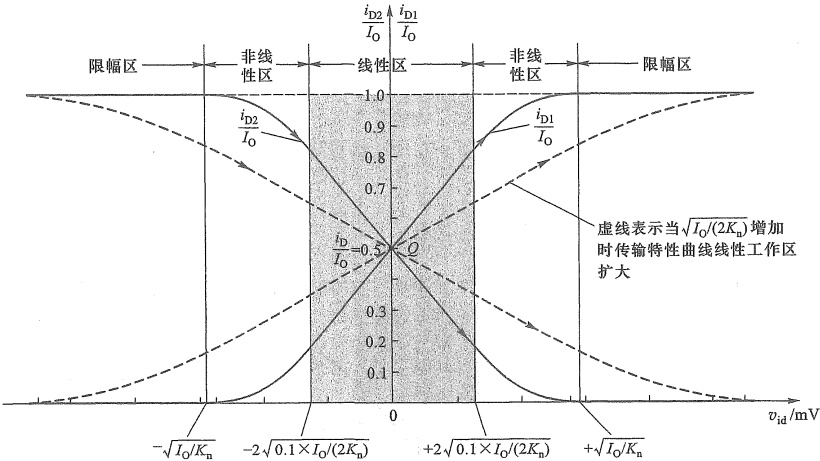

图 7.2.13  $ i_{D1}/I_{0} $ 和  $ i_{D2}/I_{0} $ 与  $ v_{id} $ 关系的归一化传输特性
 

域)为

$$  |v_{id}|\leqslant2\sqrt{0.1\times I_{0}/(2K_{n})}   \tag*{(7.2.31)}$$

实际上条件 $ \frac{(v_{id}/2)^{2}}{I_{0}/(2K_{n})}=\frac{(v_{id}/2)^{2}}{(V_{GSQ}-K_{TN})^{2}}\ll1 $，即 $ \left|v_{id}/2\right|\ll\left|v_{GSQ}-K_{TN}\right| $就是小信号模型的前提条件[参见式(4.4.3)]。

（3）非线性区：当  $ v_{id} $ 满足  $ 2\sqrt{0.1\times I_{0}/(2K_{n})} < |v_{id}| < \sqrt{I_{0}/K_{n}} $ 时， $ i_{D1}/I_{0}, i_{D2}/I_{0} $ 与  $ v_{id} $ 呈明显非线性关系，电路工作于非线性区。

（4）限幅区：当 $ v_{id} $满足

$$  \mid v_{\mathrm{id}}\mid\geqslant\sqrt{I_{0}/K_{\mathrm{n}}}   \tag*{(7.2.32)}$$

时，电路工作在限幅区，曲线趋于平坦。

这里忽略了沟道长度调制效应。

要想扩大线性范围，就要增加  $ I_{0}/(2K_{n}) $ 的值，如图7.2.13的虚线所示。一般情况是  $ I_{0} $ 保持不变，减小  $ K_{n} $ 的值。而  $ K_{n}=\frac{K_{n}^{\prime}}{2}\left(\frac{W}{L}\right) $，所以可以减小宽长比  $ \left(\frac{W}{L}\right) $ 扩大线性范围。但减小  $ \left(\frac{W}{L}\right) $ 也会减小  $ g_{m} $ 和  $ A_{sd} $；如果  $ K_{n} $ 不变，通过增加  $ I_{0} $ 来扩大线性范围，就会使  $ g_{m} $ 和  $ A_{sd} $ 增加，但代价是电路功耗增加，这在集成电路中是严格限制的。

### 2. BJT 差分式放大电路的传输特性

通常用集电极电流与差模输入电压之间的关系来描述 BJT 差分式放大电路的传输特性。在图 7.2.9a 中，利用 BJT 发射结电压电流关系： $ i_{C2} \approx i_{E2} \approx I_{ES} \cdot e^{v_{BE2}/V_T} $， $ i_{C1} \approx i_{E1} \approx I_{ES} e^{v_{BE1}/V_T} $，以及  $ v_{id} = v_{i1} - v_{i2} = (v_{BE1} + v_E) - (v_{BE2} + v_E) = v_{BE1} - v_{BE2} $ 和  $ i_{C1} + i_{C2} = I_0 $，可求得

<!-- page: 276 -->

$$  i_{\mathrm{c}1}=\frac{I_{0}}{1+\mathrm{e}^{-v_{id}/V_{T}}}   \tag*{(7.2.33a)}$$

$$  i_{c2}=\frac{I_{0}}{1+e^{v_{id}/V_{T}}}   \tag*{(7.2.33b)}$$

由此可画出归一化传输特性曲线  $ i_{c1}/I_{0} $、 $ i_{c2}/I_{0}=f(v_{id}) $ 如图7.2.14中的实线所示。可看出以下特点。

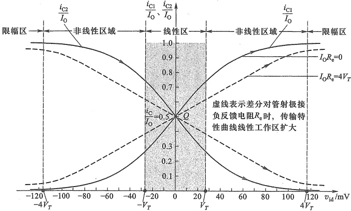

 $ i_{C1}/I_{0} $ 和  $ i_{C2}/I_{0} $ 与  $ v_{id} $ 关系的传输特性
 

（1）当  $ v_{i1}=v_{i2}=0 $ ，即  $ v_{id}=0 $ 时， $ i_{C1}/I_{0}=i_{C2}/I_{0}=0.5 $ ，电路处于静态，即工作点在曲线的 Q 点。

（2）当 $ \left|v_{id}\right|<V_{T} $时， $ i_{C1}/I_{0} $、 $ i_{C2}/I_{0} $与 $ v_{id} $间呈近似线性关系，放大电路工作在放大区，如图7.2.14中的灰色区域。

（3）当 $ V_{T}<|v_{id}|<4V_{T} $时， $ i_{C1}/I_{0} $、 $ i_{C2}/I_{0} $与 $ v_{id} $间呈现明显非线性关系。

（4）当 $ \left|v_{id}\right|>4V_{T} $时，曲线趋于平坦， $ T_{1} $和 $ T_{2} $一个饱和一个截止，工作点进入限幅区。

可以通过在两管各自发射极串入电阻 $ (R_{e1}=R_{e2}=R_{e}) $降低差模增益来扩大线性工作范围。当 $ I_{0}R_{e}=4V_{T} $时，传输特性曲线如图7.2.14中的虚线所示。

必须指出，最大差模输入电压的幅值会受到 BJT 发射结反向击穿电压的限制。

对比图7.2.13和图7.2.14的线性范围可以看出，MOS管电路传输特性的线性范围更大，一般MOS管的 $ v_{idmax}=2\sqrt{0.1\times I_{0}/(2K_{n})} $的值比BJT的 $ v_{idmax}=V_{T} $的值要大6~8倍，但在 $ I_{0} $相同的条件下，MOS管的 $ g_{m} $和 $ A_{vd} $远小于BJT的 $ g_{m} $和 $ A_{vd} $。

##### 复习思考题

7.2.1 共模信号的主要来源是什么？试举例说明。

7.2.2 差分式放大电路源极（或射极）公共支路电流源的动态电阻 $ r_{0} $在差模交流通路

<!-- page: 277 -->

和共模交流通路中应分别如何处理？

7.2.3 为什么差分式放大电路要追求尽可能高的共模抑制比？它与差分式放大电路的哪些参数有关？

7.2.4 比较 FET 差分式放大电路和 BJT 差分式放大电路的输入电阻，它们的数量级各为多少？

7.2.5 差分式放大电路的幅频响应与共源（或共射）放大电路的幅频响应有什么不同？

7.2.6 在图7.2.13和图7.2.14的两个传输特性曲线中，线性区曲线的斜率各表示什么？它们与电路的差模电压增益 $ A_{vd} $有什么关系？

#### 7.3 带有源负载的差分式放大电路

在集成电路中为节省面积，常用三极管代替电阻。当用电流源代替差分式放大电路中的电阻  $ R_{d} $ 或  $ R_{c} $ 时，就构成了所谓的带有源负载的差分式放大电路。

##### 7.3.1 带有源负载的源极耦合差分式放大电路

将图 7.2.1b 所示电路中的电阻  $ R_{d1} $ 和  $ R_{d2} $ 用电流源替换，就构成带有源负载的差分式放大电路如图 7.3.1 所示。两只 PMOS 管  $ T_{3} $ 和  $ T_{4} $ 组成镜像电流源，代替原来的漏极电阻，作为  $ T_{1} $、 $ T_{2} $ 的漏极负载，所以称为有源负载。由于  $ T_{1} $、 $ T_{2} $ 是 NMOS 管， $ T_{3} $、 $ T_{4} $ 是 PMOS 管，所以电路也称为 CMOS 差分式放大电路。该电路通常仅用于单端输出。

##### （1）静态分析

由于电路对称，即 $ T_{1} $与 $ T_{2} $参数相同， $ T_{3} $与 $ T_{4} $参数相同，且栅极不取电流，所以 $ I_{D1Q}=I_{D2Q}=I_{D3Q}=I_{D4Q}=I_{0}/2 $。再根据 $ I_{D1Q}=K_{ni}\left(V_{GS1Q}-V_{TN1}\right)^{2} $和 $ I_{D3Q}=K_{p3}\left(V_{GS3Q}-V_{TP3}\right)^{2} $可求出 $ V_{GS1Q} $和 $ V_{GS3Q} $。

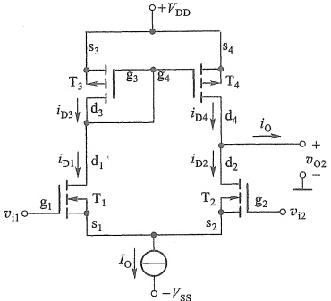

图 7.3.1 带有源负载的源极耦合差分式放大电路
 

同时，由于  $ T_{3} $ 的栅极与漏极相连，所以  $ V_{D1Q}=V_{D3Q}=V_{DD}+V_{GS3Q} $。又因为静态时， $ v_{i1}=v_{i2}=0 $，所以  $ V_{S1Q}=0-V_{GS1Q} $。由此可求得  $ V_{DS1Q}=V_{D1Q}-V_{S1Q} $。

基于差分式电路的左右对称性，有  $ V_{DS2Q}=V_{DS1Q} $， $ V_{GS2Q}=V_{GS1Q} $， $ V_{GS4Q}=V_{GS3Q} $ 和  $ V_{DS4Q}=V_{DS3Q} $。

##### （2）动态分析

首先做简单的定性分析。当输入差模电压  $ v_{id} $ 时， $ v_{ii}=v_{id}/2 $ 使  $ T_{1} $ 的漏极电流增加  $ \Delta i_{D} $，由于  $ T_{1} $ 和  $ T_{3} $ 串联， $ T_{3} $ 和  $ T_{4} $ 又是镜像电流源，所以  $ T_{4} $ 的漏极电流也增加  $ \Delta i_{D} $；而  $ v_{i2}=-v_{id}/2 $ 使  $ T_{2} $ 的漏极电流减小  $ \Delta i_{D} $，所以  $ T_{2} $ 和  $ T_{4} $ 相连的输出端电流变化量为  $ i_{0}=i_{D4}-i_{D2}=2\Delta i_{D} $（输出构成回路后），意味着差模信号在左右两边引起的变化均反映到了单边输出上，表明这种电路单端输出的差模信号等效于双端输出。

<!-- page: 278 -->

当输入共模电压  $ v_{ie} $ 时， $ v_{i1}=v_{i2}=v_{ie} $。若  $ I_{0} $ 特性理想，则  $ v_{ie} $ 不会改变电路两边电流，即  $ i_{0}=0 $，说明单端输出的共模信号也与双端输出相同（理想情况下共模信号双端输出为零）。由此看出，无论是差模输入还是共模输入，带有源负载的差分式放大电路的单端输出都等效于双端输出。

Γ 叫做定重分析。当输出端按阻值为无穷大的负载（如 MOS 管的栅极）时，在差模输入电压作用下，图 7.3.1 电路的交流通路如图 7.3.2a 所示。为简单起见，设电路中  $ T_{1} \sim T_{4} $ 的  $ g_{m} $ 相同。当它们的  $ r_{ds} $ 足够大时，有  $ i_{d1} \approx g_{m}(v_{id}/2) $， $ i_{d3} \approx g_{m}v_{gs3} $， $ i_{d4} \approx g_{m}v_{gs4} $，而  $ i_{d2} \approx g_{m}(-v_{id}/2) = -i_{d1} $。由于  $ i_{d4} = i_{d3} = i_{d1} $，所以  $ v_{gs4} = v_{gs3} \approx v_{id}/2 $。此时  $ T_{2} $ 和  $ T_{4} $ 漏极回路的小信号等效电路如图 7.3.2b 所示，对节点  $ d_{2}(d_{4}) $ 应用 KCL

 $$ g_{\mathrm{m}}\biggl(\frac{v_{\mathrm{id}}}{2}\biggr)~-g_{\mathrm{m}}\biggl(-\frac{v_{\mathrm{id}}}{2}\biggr)~-\frac{v_{\mathrm{o2}}}{r_{\mathrm{ds2}}}-\frac{v_{\mathrm{o2}}}{r_{\mathrm{ds4}}}=0 $$ 

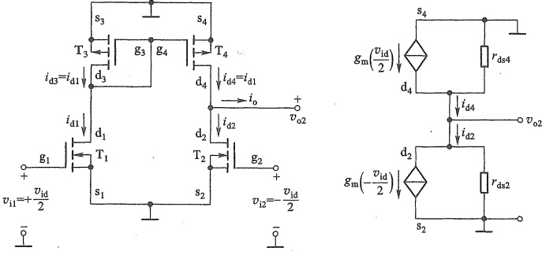

(a)
 

(b)
 

图 7.3.2 图 7.3.1 电路在差模信号作用下的情况
 

（a）交流通路 （b） $ T_{2} $ 和  $ T_{4} $ 漏极回路的小信号等效电路
 

由此求得  $ v_{02} $ 单端输出的差模电压增益

$$  A_{_{v d2}}=\frac{v_{_{o2}}}{v_{_{i d}}}=g_{_{m}}(r_{_{d s2}}//r_{_{d s4}})   \tag*{（7.3.1）}$$

由此看出，式中没有前述基本差分式放大电路单端输出时的1/2，而是与双端输出的形式相同。

图 7.3.1 电路共模电压增益求解
 

前面定性分析已经得到共模输出近似为零的结论，但由于 $ T_{3} $和 $ T_{4} $的连接方式并不相同，所以电路不完全对称，共模电压增益并不真的为零，可以用小信号模型分析。有兴趣可扫码阅读。

电路的输入电阻与基本差分式放大电路相同，但输出电阻不同。由图7.3.2b看出，差模情况下的输出电阻 $ R_{od}=r_{ds2}\parallel r_{ds4} $（电路中独立源置零，即 $ v_{id}=0 $）；而在共模输入情况下，根据式（4.4.12），当 $ T_{2} $源极电阻为 $ 2r_{o} $时，有 $ r_{o2}\gg r_{ds4} $，所以共模输出电阻 $ R_{oc}=r_{o2}\parallel r_{ds4}\approx r_{ds4}\circ $

<!-- page: 279 -->

以上看出，带有源负载的差分式放大电路提高了差模增益，降低了共模增益，有很高的共模抑制比，而且还可以节省芯片面积，所以在集成电路中得到广泛应用。另外它还可以将双端输入转换为单端输出。

例 7.3.1 电路如图 7.3.3 所示，假设 NMOS 管的  $ V_{TN}=0.65\ V $， $ K_{n5}=K_{n6}=K_{n7}=K_{n8}=0.1\ mA/V^{2} $，忽略  $ T_{5}\sim T_{8} $ 的沟道长度调制效应， $ T_{1}\sim T_{4} $ 的  $ K_{n1}=K_{n2}=K_{p3}=K_{p4}=1\ mA/V^{2} $， $ \lambda=0.02\ V^{-1} $。试求（1）偏置电流  $ I_{0} $；（2）差模电压增益  $ A_{vd} $ 和差模输出电阻  $ R_{e,d} $；（3）理想情况下的共模抑制比  $ K_{CMR} $。

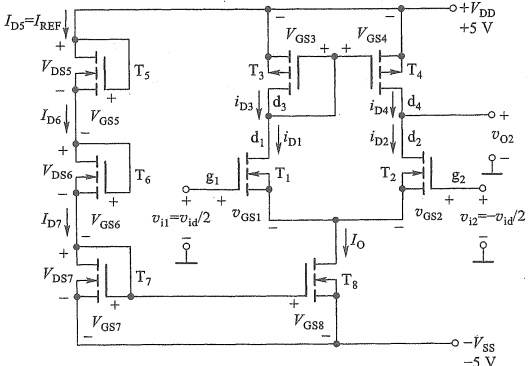

图 7.3.3 例 7.3.1 的电路
 

解：（1）实际上图7.3.3与图7.3.1并无差别，只是画出了电流源 $ I_{0} $的具体电路 $ \left(\mathrm{T}_{5}\sim\mathrm{T}_{8}\right) $组成的电路)，其中 $ T_{5} $、 $ T_{6} $和 $ T_{7} $支路用来建立基准电流 $ I_{REF} $。由于 $ T_{5}\sim T_{8} $的 $ K_{n} $和 $ V_{TN} $相同，所以 $ V_{GS7}=V_{GS6}=V_{GS5} $，因此有

 $$ V_{GS7Q}=\left(V_{DD}+V_{SS}\right)/3=10/3V $$ 

故

 $$ I_{0}=I_{REF}=K_{n7}(V_{GS7Q}-V_{TN})^{2}=\left(0.1\mathrm{~mA/V^{2}}\right)\times\left(10/3\mathrm{~V}-0.65\mathrm{~V}\right)^{2}\approx0.72\mathrm{~mA} $$ 

静态时有

 $$ I_{\mathrm{D1Q}}=I_{\mathrm{D2Q}}=I_{\mathrm{D3Q}}=I_{\mathrm{D4Q}}=I_{\mathrm{DQ}}=I_{0}/2=0.36\mathrm{~mA} $$ 

(2) $ T_{1}\sim T_{4} $的 $ g_{m} $

 $$ g_{m}=2\sqrt{K_{n1}I_{DQ}}=2\sqrt{1\ mA/V^{2}\times0.36\ mA}=1.2\ mS $$ 

 $ T_{2} $、 $ T_{4} $ 的  $ r_{ds} $

 $$ r_{ds2}=r_{ds4}=\frac{1}{\lambda I_{DQ}}=\frac{1}{0.02\ V^{2}\times0.36\ mA}\approx138.9\ k\Omega $$ 

由式 $ （7.3.1） $得差模电压增益 $ A_{vd2} $

 $$ A_{_{vd2}}=\frac{v_{_{o2}}}{v_{_{id}}}=g_{_{m}}(r_{_{ds2}}//r_{_{ds4}})=1.2\mathrm{~mS}\times(138.9\mathrm{~k}\Omega//138.9\mathrm{~k}\Omega)\approx83.3 $$

<!-- page: 280 -->

差模输出电阻

 $$ R_{\mathrm{o d}}=r_{\mathrm{d s2}}//r_{\mathrm{d s4}}\approx69.5\mathrm{k}\Omega $$ 

（3）由于单端输出近似于双端输出，所以理想情况下，共模电压增益 $ A_{ve}\approx0 $，则共模抑制比为

 $$ K_{\mathrm{C M R}}\approx\infty $$ 

之前提到  $ T_{3} $ 与  $ T_{4} $ 的连接方式有差异，电路并非完全对称，因此上述  $ A_{ve} $ 和  $ K_{CMR} $ 的结果仅是简单近似。

##### 7.3.2 带有源负载的射极耦合差分式放大电路

用镜像电流源  $ T_{3} $、 $ T_{4} $ 代替图 7.2.9a 中的集电极电阻  $ K_{c1} $ 和  $ K_{c2} $，便可得到图 7.3.4 所示的带有源负载的 BJT 差分式放大电路。 $ T_{5} $、 $ T_{6} $ 和  $ R $、 $ R_{e6} $、 $ R_{e5} $ 构成射极公共支路的直流偏置电流源。

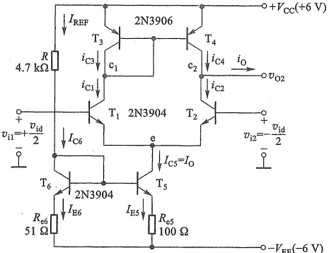

图 7.3.4 带有源负载的射极耦合差分式放大电路
 

根据 7.1.2 节知识，可求出基准电流

仿真说明文档7.2: 图7.3.4电路的仿真

 $$ I_{\mathrm{E6}}\approx I_{\mathrm{REF}}=\frac{V_{\mathrm{CC}}+V_{\mathrm{EE}}-V_{\mathrm{BE6}}}{R+R_{\mathrm{e6}}} $$ 

当  $ T_{5} $ 和  $ T_{6} $ 的  $ V_{BE} $ 近似为恒压降模型时，有  $ I_{E5}R_{e5}=I_{E6}R_{e6} $，则得到电流源电流

 $$ I_{0}=I_{\mathrm{E5}}=I_{\mathrm{E6}}\frac{R_{\mathrm{e6}}}{R_{\mathrm{e5}}} $$ 

当  $ T_{3} $、 $ T_{4} $ 的  $ \beta $ 足够大时，可忽略它们基极的分流，那么在电路对称情况下，电路的静态电流  $ I_{C1Q}=I_{C2Q}\approx I_{C3Q}=I_{C4Q}=I_{0}/2 $， $ I_{B1Q}=I_{B2Q}=I_{C1Q}/\beta_{1}=I_{0}/2\beta_{1} $。

仿照图7.3.1所示电路的分析过程，可以得到类似的结果，即差模电压增益为

$$  A_{_{\mathrm{s d}2}}=\frac{v_{_{\mathrm{o}2}}}{v_{_{\mathrm{i d}}}}=\frac{\beta\left(r_{_{\mathrm{c e}2}}//r_{_{\mathrm{c e}4}}\right)}{r_{_{\mathrm{b e}}}}   \tag*{(7.3.2)}$$

<!-- page: 281 -->

这里假设了  $ T_{1} \sim T_{4} $ 的  $ \beta $ 和  $ r_{be} $ 相同，且  $ \beta = 1 $。

综上分析，无论是 MOS 管还是 BJT 构成的带有源负载的差分式放大电路，均有单端输出近似于双端输出的效果，有很高的差模电压增益，非常小的共模电压增益，从而能获得很高的共模抑制比。

##### 复习思考题

7.3.2 若想输出电压信号并保持高增益，带有源负载的差分式放大电路对负载阻值有何要求？

7.3.1 带有源负载的差分式放大电路与基本差分式放大电路相比有哪些优点？

#### 7.4 集成运算放大器电路简介

在介绍了典型单元电路后，本节接下来介绍集成运算放大器的几种典型电路，以便了解它们具备良好特性的原因。

##### 7.4.1 两级 CMOS 运算放大器

### 1. 电路结构

一种典型的 CMOS 运放电路结构如图 7.4.1a 所示。该电路仅由两级构成，其中 PMOS 管  $ T_{1} $ 和  $ T_{2} $ 组成源极耦合差分式放大电路作为输入级，NMOS 管  $ T_{3} $ 和  $ T_{4} $ 作为  $ T_{1} $、 $ T_{2} $ 的有源负载。输出级是 NMOS 管  $ T_{7} $ 构成的共源放大电路， $ C_{c} $ 是频率补偿电容，用以保证引入负反馈时电路能稳定工作 $ ^{①} $。PMOS 管  $ T_{5} $ 和  $ T_{6} $ 以及  $ T_{5} $ 和  $ T_{8} $ 构成两组镜像电流源，其中  $ T_{6} $ 为输入级提供偏置电流； $ T_{8} $ 为输出级提供偏置电流，并作为  $ T_{7} $ 的有源负载。信号由  $ v_{P} $、 $ v_{N} $ 输入，经输入级放大后，由  $ T_{2} $ 的漏极输出送至  $ T_{7} $ 的栅极，再经  $ T_{7} $ 放大后由漏极输出。

### 2. 电路性能指标

##### （1）差模电压增益

实际上，输入级与图7.3.3电路结构基本相同，只是管型不同。由于图7.4.1a电路中 $ T_{7} $的输入电阻为无穷大，它是前级的负载，所以由7.3.1节的结论可知输入级的差模电压增益为

 $$ A_{v d2}=\frac{v_{02}}{v_{i d}}=-g_{m1}(r_{d s2}\mathord{\left/{\vphantom{v_{02}r_{d s2}}}\right.}{r_{d s4}}) $$ 

在通带内  $ C_{c} $ 可视为开路，输出级共源电路的电压增益为

$$  A_{_{v2}}=\frac{v_{0}}{v_{02}}=-g_{_{m7}}(r_{_{ds7}}//r_{_{ds8}})   \tag*{(7.4.2)}$$

因此，得总差模电压增益

$$  A_{v\mathrm{d}}=A_{v\mathrm{d}2}\mathrm{\Phi}\cdot A_{v2}=g_{\mathrm{m}1}(\mathrm{r_{d s2}}\mathrm{//}r_{d s4})\mathrm{\Phi}\cdot g_{\mathrm{m}7}(\mathrm{r_{d s7}}\mathrm{//}r_{d s8})   \tag*{(7.4.3)}$$

如果  $ T_1 \sim T_B $ 的  $ V_{TN} = |V_{TP}| = 0.5\ V $,  $ \lambda = 0.014\ V^{-1} $，各管的电导常数如表 7.4.1 所示，当用电阻  $ R_{REF} = 225\ k\Omega $ 替换电流源  $ I_{REF} $ 后，则可求出图 7.4.1a 电路的差模电压增益为 40 804，约为 92.2 dB，具有运算放大器高增益的特点。

<!-- page: 282 -->

表7.4.1  $ T_{1}\sim T_{8} $ 各管的参数
 

<table border=1 style='margin: auto; word-wrap: break-word;'><tr><td style='text-align: center; word-wrap: break-word;'></td><td style='text-align: center; word-wrap: break-word;'>$ T_{1} $</td><td style='text-align: center; word-wrap: break-word;'>$ T_{2} $</td><td style='text-align: center; word-wrap: break-word;'>$ T_{3} $</td><td style='text-align: center; word-wrap: break-word;'>$ T_{4} $</td><td style='text-align: center; word-wrap: break-word;'>$ T_{5} $</td><td style='text-align: center; word-wrap: break-word;'>$ T_{6} $</td><td style='text-align: center; word-wrap: break-word;'>$ T_{7} $</td><td style='text-align: center; word-wrap: break-word;'>$ T_{8} $</td></tr><tr><td style='text-align: center; word-wrap: break-word;'>$ K_{p} $或 $ K_{n}/(\mu A \cdot V^{-2}) $</td><td style='text-align: center; word-wrap: break-word;'>160</td><td style='text-align: center; word-wrap: break-word;'>160</td><td style='text-align: center; word-wrap: break-word;'>160</td><td style='text-align: center; word-wrap: break-word;'>160</td><td style='text-align: center; word-wrap: break-word;'>160</td><td style='text-align: center; word-wrap: break-word;'>160</td><td style='text-align: center; word-wrap: break-word;'>320</td><td style='text-align: center; word-wrap: break-word;'>160</td></tr></table>

由于  $ v_{P} $ 与  $ v_{02} $ 反相，而  $ v_{02} $ 又与  $ v_{0} $ 反相（共源电路的相位关系），所以  $ v_{P} $ 是同相输入端， $ v_{N} $ 是反相输入端。用运放电路符号表示如图 7.4.1b 所示。

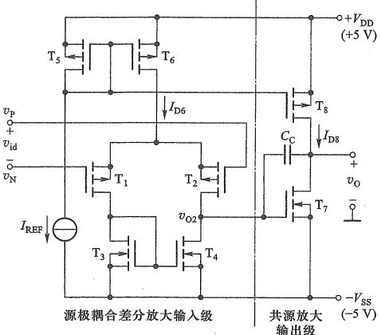

(a)
 

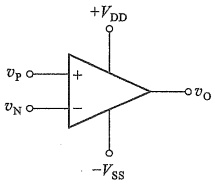

图 7.4.1 两级 CMOS 运算放大器
 

(b)
 

（a）原理图 （b）运算放大器符号
 

##### （2）共模抑制比

电路的共模抑制比取决于输入级差分式放大电路的共模抑制比。由于电路无法做到完全对称，所以共模抑制比并非无穷大，但通常都可以达到80 dB以上。

##### （3）输入输出电阻

由于输入端栅极是绝缘的，所以无论是差模还是共模的输入电阻均为无穷大。输出电阻就是  $ T_{7} $ 和  $ T_{8} $ 两管输出电阻的并联，即

$$  R_{\mathrm{o}}=r_{\mathrm{d s7}}//r_{\mathrm{d s8}}   \tag*{(7.4.4)}$$

显然输出电阻很大，不适合用来驱动低阻负载。然而，它很适合驱动其他CMOS电路，所以这种简洁高效的电路已成为一种经典电路，广泛用于超大规模集成电路中。

##### （4）输入失调电压

根据运放输入输出关系，当  $ v_{P}=v_{N}=0 $ 时，电路应该有  $ v_{0}=0 $。然而，实际电路存在的失配（取决于电路的对称程度和电位配合情况）导致输出不为零，即  $ v_{0}\neq0 $。这时需要在输入端加入一个校正电压  $ V_{IO} $，使  $ v_{0}=0 $。 $ V_{IO} $ 就称为失调电压，温度也会影响  $ V_{IO} $，它是导致运放电路零点漂移的重要原因。

<!-- page: 283 -->

##### （5）输入偏置电流和失调电流

为了防止静电和过压损坏 MOS 管的绝缘栅极，大多数 CMOS 运算放大器在输入端都增加了保护二极管，如图 7.4.2a 中的  $ D_{1} \sim D_{4} $。当  $ v_{P} = v_{N} = 0 $ 时，由于二极管的漏电流不完全相等，从而使两输入端有电流  $ I_{BP} $ 和  $ I_{BN} $。偏置电流定义为

 $$ I_{\mathrm{IB}}=\left(I_{\mathrm{BP}}+I_{\mathrm{BN}}\right)/2 $$ 

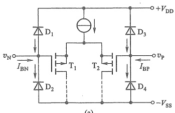

(a)
 

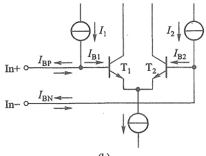

(b)
 

图 7.4.2 运放的输入偏置电流和失调电流
 

（a）CMOS运放的输入端 （b）BJT运放有偏置电流消除电路的输入端
 

失调电流定义为

$$  I_{I0}=\left|I_{BP}-I_{BN}\right|   \tag*{(7.4.6)}$$

 $ I_{IB} $ 和  $ I_{IO} $ 通常在 pA 数量级，它们也是运放电路产生零点漂移的原因之一。需要注意， $ I_{IB} $ 和  $ I_{IO} $ 会受温度影响。

这里有一问题需要引起注意，输入信号为零时，相当于  $ v_{P} $ 和  $ v_{N} $ 接地，这时运放内部电路有合适的静态工作点（参见图 7.4.1a）。但是如果运放构成如图 7.4.3a 的交流同相放大电路时，由于电容 C 的存在，运放同相输入端的直流通路是断开的，同相端内 MOS 管  $ T_{2} $ 的栅极没有直流电压（见图 7.4.1a），运放内部电路无法建立合适的静态工作点，所以也就无法正常放大信号了。可见，运放的两个输入端必须有直流回路，否则运放内的三极管可能没有合适的静态工作点，运放无法正常工作。

解决图7.4.3a电路问题的最简单方法，是在同相端到地之间接一个电阻 $ R_{2} $，如图7.4.3b所示。此时，电路的输入电阻从原来的近似于无穷大下降为 $ R_{2} $了。

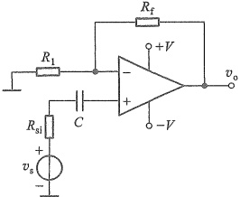

(a)
 

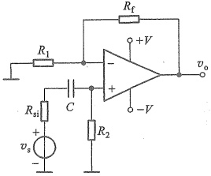

(b)
 

图 7.4.3 交流同相放大电路
 

（a）不能正常工作的电路 （b）修改后的电路

<!-- page: 284 -->

对于有些内部输入级设置了偏置电流消除电路的 BJT 型运放（如图 7.4.2b 所示），由于输入端内部已有直流偏置，所以图 7.4.3a 电路是可用的。这种运放的  $ I_{IB} $ 和  $ I_{IO} $ 大小基本相同，据此可以判断所用运放是否为该类运放。

在直接耦合放大电路中，通常不会出现上述问题。

##### （6）共模输入电压范围

由第2章知识可知，运放在线性应用时“虚短”总是成立的，即 $ v_{p}\approx v_{N} $。当 $ v_{p}\approx v_{N}\neq0 $时，就有共模输入电压

$$  v_{\mathrm{i e}}=\left(v_{\mathrm{p}}+v_{\mathrm{N}}\right)/2\approx v_{\mathrm{p}}\approx v_{\mathrm{N}}   \tag*{(7.4.7)}$$

图 7.4.1a 的输入级正常工作时，所有 MOS 管须工作在恒流区。当  $ v_{i\mathrm{c}} $ 增大 ( $ v_{P} \approx v_{N} $ 同时增大)，使  $ T_1 $、 $ T_2 $ 的源极电压升高（电流不会变）， $ |v_{DS6}| $ 减小，导致  $ T_6 $ 工作点进入夹断点轨迹时 ( $ |v_{DS6\min}| = |V_{DS6\mathrm{pop}}| = |V_{GS6Q} - V_{TP6}| $， $ v_{i\mathrm{c}} $ 达到最大值，即

$$  V_{\mathrm{i e m a x}}=V_{\mathrm{D D}}-\left|v_{\mathrm{D S6m i n}}\right|-\left|V_{\mathrm{G S1Q}}\right|=V_{\mathrm{D D}}-\left|V_{\mathrm{G S6Q}}-V_{\mathrm{T P6}}\right|-\left|V_{\mathrm{G S1Q}}\right|   \tag*{(7.4.8)}$$

只要静态工作点已知，就可以由式(7.4.8)求出共模输入电压的最大值。

由于共模电压对差分电路两边影响相同，且不改变电流，所以接下来只考虑单侧即可。当  $ v_{ic} $ 减小，使  $ T_{1} $、 $ T_{2} $ 的源极电压降低， $ \left|v_{DS1}\right| $ 减小，导致  $ T_{1} $ 工作点进入夹断点轨迹时， $ v_{ic} $ 达到最小值。此时的  $ T_{1} $ 有  $ V_{DS1pop}=V_{GS1Q}-V_{TP1} $，则

$$  V_{GD1min}=V_{GS1Q}-V_{DS1pop}=V_{TP1}   \tag*{(7.4.9)}$$

另外由于  $ i_{D3}=I_{D3Q} $ 不变，所以  $ v_{DS3}=V_{DS3Q}=V_{GS3Q} $ 也不变，结合式(7.4.9)得到共模输入电压的最小值

$$  V_{\mathrm{i o m i n}}=-V_{\mathrm{S S}}+V_{\mathrm{D S3Q}}+V_{\mathrm{G D1m i n}}=-V_{\mathrm{S S}}+V_{\mathrm{G S3Q}}+V_{\mathrm{T P1}}   \tag*{(7.4.10)}$$

共模输入电压范围限制了运放用作电压跟随器时输入电压的范围。

##### （7）输出电压摆幅

输出电压摆幅也就是  $ v_{0} $ 的波动范围。 $ T_{7} $ 和  $ T_{8} $ 的饱和压降（夹断点轨迹上的漏源电压）决定了输出电压的摆幅，即

$$  \begin{array}{r}{V_{\mathrm{o m a x}}=V_{\mathrm{D D}}-\left|\begin{array}{c|c}{V_{\mathrm{D S8p o p}}}&{}\end{array}\right.}\\ {\approx V_{\mathrm{D D}}-\left|\begin{array}{c|c}{V_{\mathrm{G S8Q}}-V_{\mathrm{T P8}}}&{}\end{array}\right.}\end{array}   \tag*{(7.4.11a)}$$

和

$$  \mathrm{V_{o m i n}}=-V_{S S}+V_{D S7p o p}\approx-V_{S S}+~V_{G S7Q}-V_{T N7}   \tag*{(7.4.11b)}$$

仿真说明文档7.3: 图7.4.1a电路增益的幅频响应仿真

##### （8）频率响应

由第6章知识可知，图7.4.1a电路中跨接在栅-漏极之间的电容 $ C_{C} $会在共源电路中产生较大的密勒等效电容，由此产生的大时间常数决定了电路开环电压增益的带宽。由于是直接耦合电路，所以低频区的增益不会衰减，可以放大直流信号。

当取  $ C_{c}=30\ pF $，并用电阻  $ R_{REF}=225\ k\Omega $ 替换电流源  $ I_{REF} $，经 SPICE 仿真可得电路带宽约为 17.37 Hz。

将图 7.4.1a 所示电路中的电流源  $ I_{REF} $ 替换为用户外接的电阻  $ R_{REF} $，就是 Motorola 公司的早期产品 MC14573。

以上两级 CMOS 运放电路的输出电阻很大，不适合用来驱动低阻负载。为了减小输出电阻，提高带负载能力，常常在第二级之后再增加一特殊的输出级，构成三级 CMOS 电路。

<!-- page: 285 -->

第9章将介绍这种输出级。目前，运算放大器产品内部大都采用三级结构。

##### 7.4.2 全差分运算放大器

差模信号具有的高抗干扰能力使它在高速系统中得到越来越广泛的应用，这促进了全差分运算放大器的应用。与标准运算放大器 $ ^{①} $相比（除非特别说明，本书所说运放均指标准运放），全差分运算放大器有两个输出端，可以直接输出放大后的差模信号，为差模信号的传输和处理提供了极大方便。

### 1. 两级全差分 CMOS 运算放大器

一种全差分 CMOS 运放简化电路如图 7.4.4a 所示，它是在图 7.4.1a 电路基础上改进而来的。为简洁起见，图中省略了  $ V_{G34} $、 $ V_{G810} $ 和  $ V_{G1112} $ 等电压的产生电路。

在图 7.4.1a 电路基础上，断开  $ T_{3} $ 漏极与栅极的连接，由  $ V_{G34} $ 提供偏置，使  $ T_{3} $ 和  $ T_{4} $ 构成两个完全对称的电流源。同时，在  $ T_{1} $、 $ T_{3} $ 的漏极也输出信号，送至新扩展的第二级  $ T_{9} $ 和  $ T_{10} $（见图 7.4.4a）。可以看出，左侧电路  $ T_{1} $、 $ T_{3} $、 $ T_{9} $ 和  $ T_{10} $ 与右侧电路  $ T_{2} $、 $ T_{4} $、 $ T_{7} $ 和  $ T_{8} $ 是完全对称的。放大后的差模信号可以从两个输出端  $ v_{OP} $ 和  $ v_{ON} $ 之间输出。

由于电路有两个输出端，所以输出信号也有与输入信号类似的定义，即差模输出电压

$$  v_{\mathrm{O D}}=v_{\mathrm{O P}}-v_{\mathrm{O N}}   \tag*{(7.4.12a)}$$

和共模输出电压

$$  v_{\mathrm{O C}}=\left(v_{\mathrm{O P}}+v_{\mathrm{O N}}\right)/2   \tag*{(7.4.12b)}$$

为了能方便调整共模输出电压，图7.4.4a中还增加了 $ T_{11}\sim T_{16} $电路，可以通过外部电压 $ V_{OC(set)} $控制共模输出电压 $ v_{OC} $，工作原理如下：

（1）假设电路参数完全对称。当  $ v_{P}=v_{N} $ 时，有  $ v_{OP}=v_{ON} $，即  $ v_{G13}=v_{G16} $，此时  $ T_{11} $ 漏极负载 ( $ T_{13} $ 和  $ T_{14} $) 和  $ T_{12} $ 漏极负载 ( $ T_{15} $ 和  $ T_{16} $) 是平衡的。又因为  $ I_{D11}=I_{D12} $，所以  $ V_{D11}=V_{D12} $，即  $ T_{13}\sim T_{16} $ 的源极电压相等，因此有  $ I_{D14}=I_{D15} $， $ I_{D13}=I_{D16} $，加之  $ I_{D11}=I_{D12} $，可得  $ T_{13}\sim T_{16} $ 的漏极电流相等，所以它们的  $ V_{GS} $ 相等，栅极电压也就相等了，结果有  $ v_{OP}=v_{ON}=V_{OC(set)} $。

（2）若因某种原因（包括输入共模电压）使  $ v_{OP}=v_{ON}>V_{OC(set)} $ 时，使  $ T_{13} $ 和  $ T_{16} $ 的漏极电流增大（由于  $ I_{D11} $ 和  $ I_{D12} $ 不变，所以  $ T_{14} $ 和  $ T_{15} $ 的漏极电流会减小），导致  $ T_{5} $ 的电流  $ I_{D5}=I_{D13}+I_{D16} $ 也增大，通过镜像电流关系使  $ T_{6} $ 的电流增大，即  $ T_{1} $ 和  $ T_{2} $ 的电流也增大，它们的  $ |V_{DS}| $ 减小，拉高了  $ T_{7} $ 和  $ T_{9} $ 的栅极电压，迫使  $ v_{OP} $ 和  $ v_{ON} $ 降回到  $ V_{OC(set)} $。反之，如果  $ v_{OP} $ 和  $ v_{ON} $ 低于  $ V_{OC(set)} $，通过上述过程会使  $ v_{OP} $ 和  $ v_{ON} $ 升回到  $ V_{OC(set)} $。

（3）当有差模信号输入时，两输出端产生对称的摆幅  $ v_{OP} = V_{OC(set)} + v_{OD}/2 $ 和  $ v_{ON} = V_{OC(set)} - v_{OD}/2 $。它们使  $ T_{13} $ 的电流增大而  $ T_{16} $ 的电流等量减小，所以  $ T_{13} $、 $ T_{16} $ 的电流之和不变，即  $ T_{5} $ 的电流不变，不会改变共模输出电压。

实际上  $ T_{11} \sim T_{16} $ 引入了共模负反馈，从而保证了共模输出电压  $ v_{OC} \approx V_{OC(set)} $

全差分运算放大器的常用符号如图7.4.4b所示，输出端的小圈表示该输出与同相输入端是反相的。

<!-- page: 286 -->

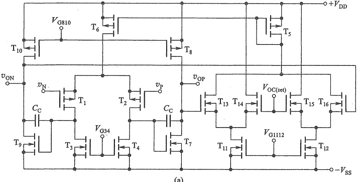

(a)
 

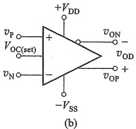

(b)
 

图 7.4.4 全差分运算放大器
 

（a）两级 CMOS 简化原理图 （b）常用符号
 

### 2. 全差分运算放大器的基本应用电路

与标准运算放大器应用最大的不同是，全差分运算放大器需要两条完全对称的反馈通路。单端信号转差分信号的典型电路如图7.4.5a所示，利用 $ v_{P}\approx v_{N} $和 $ v_{od}=v_{OP}-v_{ON} $，很容易得到

$$  v_{od}=\frac{R_{2}}{R_{1}}v_{i}   \tag*{(7.4.13)}$$

电路的共模输出电压为零， $ v_{OP} $ 和  $ v_{ON} $ 以 0 V 为基准，在时变信号  $ v_{i} $ 作用下产生互逆的变化。

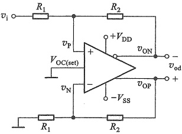

(a)
 

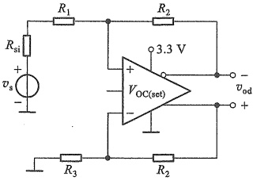

(b)
 

图 7.4.5 全差分运算放大器的基本应用电路
 

（a）单端转差分 （b）单电源工作电路
 

<!-- page: 287 -->

全差分运放也可以在单电源下工作，如图7.4.5b所示。由于信号源有内阻 $ R_{si} $，所以为保持电路对称，必须使 $ R_{3}=R_{1}+R_{si} $。

有些全差分运放的内部电路预设了  $ V_{OC(set)} $。使用这种运放时， $ V_{OC(set)} $ 引脚可不接任何外部电压，数据手册会给出它的相关信息。假设图 7.4.5b 电路中的运放内部将  $ V_{OC(set)} $ 预设在了正负电源电压的中间值上，其单电源工作时  $ V_{OC(set)} $ 引脚悬空（实际应用时经常在该引脚到地之间接入一个电容以消除噪声干扰），相当于将共模输出电压设置在了电源电压的二分之一处，即  $ V_{OC}=V_{OC(set)}=3.3\ V/2=1.65\ V $。

全差分运放还广泛用于差分高速模数转换器的驱动、差分有源滤波器、差分传输线驱动器等。

##### 7.4.3 BJT 型 LM741 集成运算放大器

作为 BJT 型运算放大器的典型例子，本节介绍一种通用型集成运算放大器 741 $ ^{①} $，其原理电路如图 7.4.6 所示。

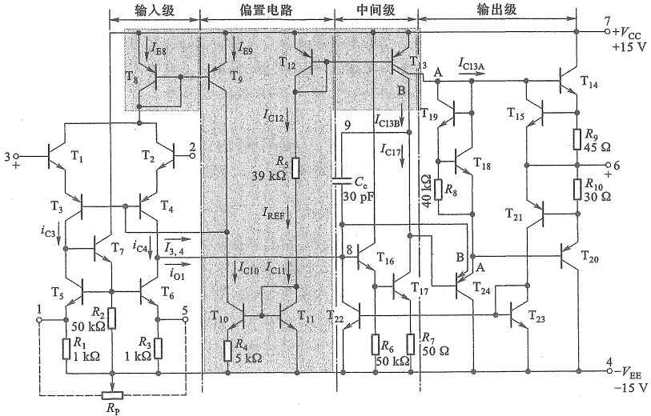

图 7.4.6 741 型集成运算放大器的原理电路
 

### 1. 偏置电路

741型集成运放由24个BJT、10个电阻和1个电容所组成。为了降低功耗，电路采用了几组微电流源进行静态偏置。

<!-- page: 288 -->

741 的偏置电路如图 7.4.6 阴影部分所示，它是一种组合电流源。上部的  $ T_{8} $、 $ T_{9} $、 $ T_{12} $、 $ T_{13} $ 为 PNP 管，下部的  $ T_{10} $、 $ T_{11} $ 为 NPN 管。由  $ +V_{CC} \rightarrow T_{12} \rightarrow R_{5} \rightarrow T_{11} \rightarrow -V_{EE} $ 构成主偏置支路，决定偏置电路的基准电流  $ I_{REF} $。 $ T_{11} $ 和  $ T_{10} $ 组成微电流源， $ I_{C10} $ 远小于  $ I_{REF} $，是微安级电流。

T_{8} 和 T_{9} 组成镜像电流源， $ I_{E8}=I_{E9}=I_{C10}-I_{3,4}\approx I_{C10} $，为输入级  $ T_{1}\sim T_{7} $ 提供工作电流。

 $ T_{12} $ 和  $ T_{13} $ 构成另一组镜像电流源， $ T_{13} $ 是双集电极 BJT，它内部的两个集结彼此并联。其中  $ T_{13} $ 集电极的 B 支路为中间级  $ T_{17} $ 提供偏置电流，并作为它的有源负载； $ T_{13} $ 集电极的 A 支路为输出极提供偏置电流。

 $ T_{18} $、 $ T_{19} $ 可简单看作两个二极管，它们的导通压降  $ 2V_{BE} $ 在  $ T_{14} $ 和  $ T_{20} $ 两基极间建立起一个固定压差，为  $ T_{14} $ 和  $ T_{20} $ 的两个发射结提供正向偏置电压。

电路设计时已考虑输入端（2、3号引脚）接地时输出也为零。另外，741还设计了调零电路，在 $ T_{5} $、 $ T_{6} $发射极两端（1、5号引脚）外接一电位器 $ R_{p} $（图中虚线部分），中间滑动触头接负电源。调节 $ R_{p} $可以改变输入级电路的左右对称性，从而将静态时的输出电压调为零值。

### 2. 保护电路

为了防止输入级信号过大或输出短路而造成的芯片损坏，741设有过流保护电路。当输出电流过大时，流过 $ T_{14} $发射极和 $ R_{9} $的电流过大， $ R_{9} $两端的压差会使 $ T_{15} $由截止转为导通，分流了 $ T_{14} $的基极电流，从而限制了 $ T_{14} $的发射极电流。在灌入电流过大时，流过 $ T_{20} $发射极和 $ R_{10} $的电流过大， $ R_{10} $两端电压会使 $ T_{21} $由截止变为导通，同时 $ T_{23} $和 $ T_{22} $也导通（ $ T_{23} $和 $ T_{22} $构成镜像电流源），减小了 $ T_{16} $和 $ T_{17} $的基极电流，使 $ T_{17} $的集电极电压和 $ T_{24} $的发射极电压升高，从而限制了 $ T_{20} $的导通程度，达到保护的目的。

在输入信号过大导致  $ T_{16} $ 基极电压过高时， $ T_{24} $ 发射极的 B 支路导通，分流了  $ T_{16} $ 的基极电流，以免  $ T_{16} $ 的电流过大超出额定耗散功率（其电压  $ V_{CE16} \approx 30V $）而烧毁。

正常工作时， $ T_{15} $、 $ T_{21} $、 $ T_{22} $ 和  $ T_{23} $ 均不导通。

### 3. 输入级

将图 7.4.6 中电流源电路用电流源符号代替，并去掉保护电路，得到图 7.4.7 所示的简化电路。输入级是由  $ T_1 \sim T_7 $ 组成的差分式放大电路，其中  $ T_1 $、 $ T_3 $ 和  $ T_2 $、 $ T_4 $ 组成共集-共基复合差分式电路。 $ T_1 $、 $ T_2 $ 的共集组态可以提高输入阻抗，共集-共基电路可扩大最大差模输入电压范围 ( $ V_{idm} = \pm 30\ V $) 和共模输入电压范围 ( $ V_{izm} \approx \pm 13\ V $)，同时也可以提高带宽。 $ T_5 $、 $ T_6 $、 $ T_7 $ 组成输入级的有源负载，有利于提高电压增益和共模抑制比。由于  $ T_7 $ 的电流放大作用，减小了  $ T_5 $、 $ T_6 $ 基极电流对  $ T_3 $ 集电极电流的分流，使  $ I_{c5} $ 与  $ I_{c3} $ 的误差更小，左右对称性更好。信号由  $ T_4 $ 的集电极单端输出。

当  $ v_{i}>0 $ 时， $ T_{3} $、 $ T_{5} $ 和  $ T_{6} $ 的电流增加， $ i_{C3}=i_{C5}=i_{C6}=I_{C}+i_{c} $，而  $ T_{4} $ 的电流减小， $ i_{C4}=I_{C}-i_{c} $，所以，输出电流  $ i_{01}=i_{C4}-i_{C6}=-2i_{c} $，可见单端输出有双端输出的效果。

当输入为共模信号时， $ i_{C3} $ 和  $ i_{C4} $ 相等， $ i_{01}=0 $，抑制了共模信号。

### 4. 中间电压放大级

该级由  $ T_{16} $、 $ T_{17} $ 组成。 $ T_{16} $ 为共集电路，构成缓冲级，它有很高的输入电阻， $ T_{17} $ 为共射电路，它的集电极负载为电流源  $ T_{13} $ 的 B 支路，其动态电阻很大，故本级可以获得很高的电压增益。 $ R_{7} $ 提高了  $ T_{17} $ 的输入电阻。

电容  $ C_{c} $ (参见图7.4.6) 的作用与图7.4.1a中的电容相同，用作频率补偿。

<!-- page: 289 -->

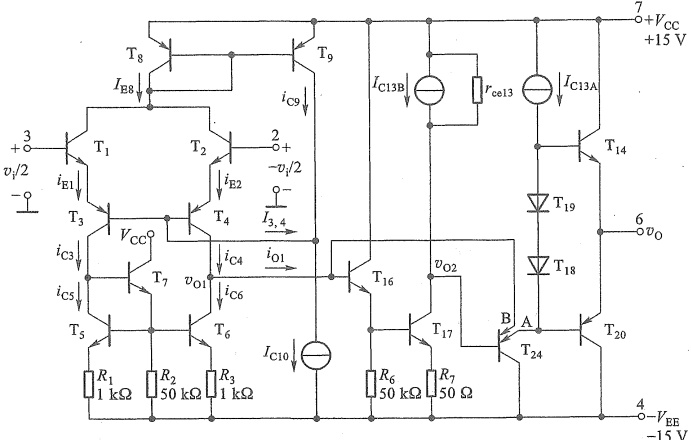

图 7.4.7 741 集成运算放大器的简化电路
 

### 5. 输出级

输出级由  $ T_{24A} $ 和  $ T_{14} $、 $ T_{20} $ 两级组成，其中  $ T_{24A} $ 接成共集电路以提高本级输入电阻，减小对中间级增益的影响； $ T_{14} $ 和  $ T_{20} $ 构成互补对称电路 $ ^{①} $。

假设某时刻， $ v_{i} $ 使输入端  $ v_{i1} $ (3 端) 为信号正半周 ( + ) 、 $ v_{i2} $ (2 端) 为信号负半周 (-) 时，电路中信号传输路径上各点信号情况为

 $$ v_{i}\underbrace{\stackrel{\rightarrow}{v}_{il}(3)^{(+)}}_{v_{01}}( 即 v_{C4})^{(-)}\rightarrow v_{02}(v_{C17})^{(+)}\rightarrow v_{C24A}^{(+)}\rightarrow v_{0}^{(+)} $$ 

说明  $ v_{0} $ 与  $ v_{i1} $ (3端) 同相，与  $ v_{i2} $ (2端) 反相，即  $ v_{i1} $ (3端) 为同相输入端， $ v_{i2} $ (2端) 为反相输入端。741的主要参数见表7.5.1。

##### 7.4.4 电流反馈运算放大器

标准运算放大器两输入端都呈现高阻状态，电流反馈运放则不同，它的反相输入端呈现低阻特性，由该输入端的电流控制输出电压。

### 1. 电路结构及模型

一种典型的电流反馈运放简化原理图如图7.4.8所示。其中 $ T_{3} $和 $ T_{4} $的发射极作为反相输入端，输入电阻较小，不再具有虚断特征。另外，由于 $ T_{1} $和 $ T_{3} $发射结压降相互抵消（ $ T_{2} $和 $ T_{4} $也一样），所以同相输入端和反相输入端之间的电压差为零，即 $ v_{P}=v_{N} $，说明它不像标准运放那样，需要依靠外部负反馈来使 $ v_{P}\approx v_{N} $。同时还注意到，从同相端 $ T_{1} $、 $ T_{2} $的基极输入到

<!-- page: 290 -->

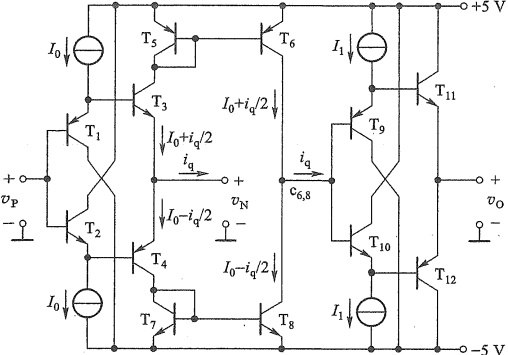

图 7.4.8 互补对称电流反馈型运放简化原理图
 

T_{3}、T_{4}的射极输出就是互补型(NPN管和PNP管组合的)电压跟随器。输出级T_{9}~T_{12}与输入级T_{1}~T_{4}结构相同，也是电压跟随器。

若在输入信号作用下，反相端产生电流  $ i_{q} $，那么  $ T_{3} $ 和  $ T_{4} $ 的电流一个增加  $ i_{q}/2 $，一个减少  $ i_{q}/2 $，它们通过两个镜像电流源  $ T_{5} $、 $ T_{6} $ 和  $ T_{7} $、 $ T_{8} $ 传递到输出级。如果  $ T_{6} $、 $ T_{8} $ 集电极节点  $ c_{6,8} $ 对地的等效电阻为  $ r_{eq} $，则该节点电压为  $ i_{q}r_{eq} $，经  $ T_{9} \sim T_{12} $ 电压跟随器得输出电压

$$  v_{0}=i_{q}r_{e q}   \tag*{（7.4.14）}$$

 $ r_{eq} $ 通常为兆欧数量级。从增益的角度看有互阻增益

$$  A_{r}=\frac{v_{0}}{i_{\mathrm{q}}}=r_{\mathrm{eq}}   \tag*{(7.4.15)}$$

因此这类运放也称为互阻型运算放大器， $ r_{eq} $ 也称为开环互阻，数据手册中通常会给出该值。

由式(7.4.14)看出，电流反馈运放在反相输入端电流 $ i_{q} $控制下产生输出电压的，而不像标准运放那样在输入端压差 $ (v_{p}-v_{N}) $控制下产生输出电压。意味着反馈信号最终是通过控制输入端电流来影响输出的，故该运放因而得名。与此相对应，标准运放也常称为电压反馈运放。

可以用图7.4.9a所示电路模型来等效图7.4.8的运放，其中 $ r_{in} $表示反相端的等效电阻，通常为几欧到几十欧，小三角形表示电压跟随器。

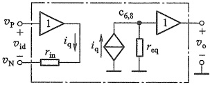

(a)
 

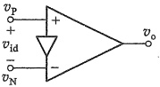

(b)
 

图 7.4.9 电流反馈运放的模型和符号   (a) 简化模型 (b) 符号
 

<!-- page: 291 -->

有时也用图 7.4.9b 所示符号表示电流反馈运放，其中小三角形可理解为电压跟随器（缓冲器），表示同相端为高阻，反相端则是低阻的。

### 2. 特点及应用

电流反馈运放也可以像标准运放那样构成同相放大电路和反相放大电路，如图 7.4.10 所示，但是对  $ R_1 $ 和  $ R_f $ 会有一些约束。只有在满足  $ r_{in} \ll R_1 \parallel R_f $ 和  $ R_f \ll r_{eq} $ 时，才有图 7.4.10 中电压增益的结果。另外，在确定的增益下， $ R_f $ 有一个最佳值，以保证增益的幅频响应尽可能平坦，即使用作电压跟随器时（如图 7.4.10c 所示）， $ R_f $ 也不能减小到零。数据手册中会给出  $ R_f $ 的建议值。

相比标准运放，电流反馈运放的独特优势是不受增益带宽积的掣肘，即改变电路增益可以不影响带宽（将在8.3.5节讨论），而且动态响应速度快。所以电流反馈运放特别适合高频、宽带信号的放大。

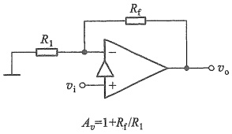

(a)
 

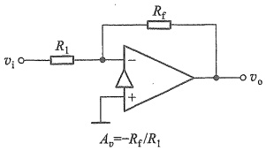

(b)
 

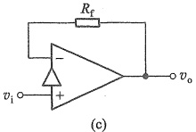

图 7.4.10 基本应用电路
 

（a）同相放大电路 （b）反相放大电路 （c）电压跟随器
 

以上简要介绍了几种不同类型的运算放大器。按制造工艺划分，集成运放除了有CMOS型和BJT型外，还有混合型BiMOS（或BiFET），这种运放充分发挥了FET和BJT各自的优点，具有更好的性能。

##### 复习思考题

7.4.1 通用型运放电路的第一级通常采用什么电路？有什么优点？

7.4.2 全差分运算放大器在使用时与标准运放有哪些不同？

7.4.3 BJT 型运放 LM741 是如何提高输入电阻的？

7.4.4 电流反馈运算放大器有什么特点？

### 5 实际运算放大器的主要参数和相关应用问题

评价运放性能的参数很多，一般可分为输入直流误差特性、差模特性、共模特性、大信号特性和电源特性等，它们对应用电路会产生或多或少的影响，知晓这些影响对用好运算放大器具有重要意义。

<!-- page: 292 -->

##### 7.5.1 输入直流误差特性（输入失调特性）

1. 输入失调电压  $ V_{10} $ 及其温漂  $ \Delta V_{10}/\Delta T $ ①

### 2. 输入偏置电流  $ I_{IB} $

3. 输入失调电流  $ I_{10} $ 及其温漂  $ \Delta I_{10}/\Delta T $

 $ V_{10} $、 $ I_{IB} $ 和  $ I_{10} $ 的含义可参见 7.4.1 节，它们都是导致运放输出零点漂移的原因。 $ \Delta V_{10}/\Delta T $ 是指在规定温度范围内  $ V_{10} $ 的温度系数，而  $ \Delta I_{10}/\Delta T $ 是指  $ I_{10} $ 的温度系数。

不同运放的  $ V_{10} $ 会有较大的差异，小至几  $ \mu $V，大至几 mV。目前也有所谓零漂移的运算放大器（自稳零型和斩波型），可实现 nV 级失调电压和极低的温度漂移。在对零漂要求非常高的应用电路设计中可以考虑选用零漂移运放。

下面看看  $ V_{10} $ 、 $ I_{IB} $ 和  $ I_{10} $ 是如何引起输出误差电压的。

图7.5.1a、b所示的同相和反相放大电路是运放最基本的线性应用电路。当输入信号为零时，它们都变成图c的形式，理想情况下此时输出应该为零，但实际上 $ V_{IO} $、 $ I_{IB} $和 $ I_{IO} $会使 $ V_{0}\neq0 $。

(b)
 

图 7.5.1 运放基本应用电路
 

(c)
 

（a）同相放大电路 （b）反相放大电路 （c）输入信号为零时的电路
 

当考虑  $ V_{10} $、 $ I_{IB} $ 和  $ I_{10} $ 的作用时，可以将图 7.5.1c 电路等效为图 7.5.2 所示电路，其中嵌套在内部右侧的小三角形符号表示理想运放。可以写出理想运放同相端电压

$$  V_{\mathrm{P}}=\left(\frac{I_{\mathrm{I O}}}{2}-I_{\mathrm{I B}}\right)R_{2}   \tag*{（7.5.1）}$$

和反相端电压

$$  V_{\mathrm{N}}=V_{0}\ \frac{R_{1}}{R_{1}+R_{\mathrm{f}}}-V_{\mathrm{I0}}-\left(I_{\mathrm{IB}}+\frac{I_{\mathrm{I0}}}{2}\right)\ (R_{1}\mathbin{//}R_{\mathrm{f}})   \tag*{（7.5.2）}$$

又因为  $ V_{P}=V_{N} $，解得

$$  V_{0}=\left(1+R_{\mathrm{f}}/R_{1}\right)\left[V_{\mathrm{I0}}+I_{\mathrm{IB}}\left(R_{1}\parallel R_{\mathrm{f}}-R_{2}\right)+\frac{1}{2}I_{\mathrm{I0}}\left(R_{1}\parallel R_{\mathrm{f}}+R_{2}\right)\right]   \tag*{(7.5.3)}$$

可见， $ V_{10} $、 $ I_{IB} $ 和  $ I_{10} $ 都会产生输出误差电压，而且它们的值越小，引起的  $ V_{0} $ 也越小。另外，当取  $ R_{2}=R_{1}\parallel R_{f} $ 时，可以消除  $ I_{IB} $ 引起的误差，式(7.5.3) 可简化为

<!-- page: 293 -->

 $ V_{10} $ 和  $ I_{10} $、 $ I_{1B} $ 不为零时图 7.5.1c 电路的等效
 

$$  V_{0}=\left(1+R_{\mathrm{f}}/R_{1}\right)\left[V_{10}+I_{10}\left(R_{1}\big/\left/R_{\mathrm{f}}\right.\right)\right]=\left(1+R_{\mathrm{f}}/R_{1}\right)V_{10}+I_{10}R_{\mathrm{f}}   \tag*{(7.5.4)}$$

可见，接入  $ R_{2} $ 是为了消除  $ I_{IB} $ 带来的影响。有时也称  $ R_{2} $ 为运放输入端的平衡电阻。

在实际电路设计中，需要根据所选运放的具体参数，核算和比较  $ R_{2}=0 $ 时式(7.5.3)括号中三项的大小。如果  $ I_{IB}(R_{1}\parallel R_{f}) $ 所占比例无足轻重，就无须添加  $ R_{2} $，否则反而会引入更多的噪声。

通常 FET 输入级运放的  $ I_{IB} $ 和  $ I_{10} $ 都较小（pA 量级），BJT 输入级的运放一般在 nA 至  $ \mu $A 数量级。有些精密低噪声 BJT 型运放内部设有输入偏置电流消除电路（参见图 7.4.2b），可以大大降低  $ I_{IB} $，但可能导致两输入端偏置电流不对称或有不同的极性，这时添加  $ R_{2} $ 不会带来任何好处。选用 FET 输入级的运放通常也不需要  $ R_{2} $。

当用作积分运算时，式(7.5.4)中用 $ 1/(sC) $代替 $ R_{t} $，输出误差电压为

 $$ V_{o}(s)=\left[1+1/\left(s C R_{1}\right)\right]V_{10}+I_{10}/\left(s C\right) $$ 

在时域中有

$$  v_{_{0}}(t)=V_{_{10}}+\frac{1}{R_{_{1}}C}\int V_{_{10}}\mathrm{d}t+\frac{1}{C}\int I_{_{10}}\mathrm{d}t=V_{_{10}}^{}\;+\frac{V_{_{10}}}{R_{_{1}}C}t\;+\frac{I_{_{10}}}{C}t   \tag*{(7.5.5)}$$

由此看出，随着时间推移，输出电压会不断增大（也可能是负向的），直至最大值，使运放进入饱和状态，导致积分运算失效。为避免出现这种情况，常常在电容两端并联一个较大的电阻  $ R_{f} $ 如图 7.5.3 所示。如果运放最大输出电压为  $ V_{omax} $，信号最大值为  $ V_{imax} $，那么  $ R_{f} $ 的阻值在满足不等式  $ \left|(-R_{f}/R_{1})V_{imax}\right|\leq V_{omax} $ 前提下尽可能取大一些，以减少对积分运算的影响。

为消除输出直流误差电压，除信号正常放大电路外，可以在输入端增加调零电路，如图7.5.4a所示，通过调节电位器 $ R_{p} $将输出调为零。

图 7.5.3 实际积分电路
 

许多早期运放产品设有专门的调零端，只要外接一个调零电位器，就可以方便地调零。例如741的调零如图7.5.4b所示。

<!-- page: 294 -->

(a)
 

(b)
 

图 7.5.4 运算放大器的调零
 

（a）反相端加入补偿电路 （b）直接调零电路
 

但是上述的调零方法无法消除因温度变化由  $ \Delta V_{10}/\Delta T $ 和  $ \Delta I_{10}/\Delta T $ 引起的输出误差。因此，减小零点漂移最简单而有效的方法是选择  $ V_{10}, I_{1B} $ 和  $ I_{10} $ 尽可能小的运放，这种运放的  $ \Delta V_{10}/\Delta T $ 和  $ \Delta I_{10}/\Delta T $ 也小。高精度运放就属于这类运放。

这里还要注意，并不是所有电路对零点漂移都有很高要求，如放大高频交流信号时，零漂则是无关紧要的指标。

##### 7.5.2 差模特性

### 1. 开环差模电压增益  $ A_{vo} $ 和带宽 BW

##### （1）开环差模电压增益 $ A_{v0} $

是指集成运放工作在线性区，在标称电源电压下，接规定的负载，无负反馈情况下的直流差模电压增益。也就是7.4.1节所说的差模电压增益。由第6章知识可知， $ A_{vo} $是频率的函数，图7.5.5表示741型运放 $ A_{vo} $的幅频响应。一般运放通带内的 $ A_{vo} $为60~130 dB。通用型运放 $ A_{vo} $的典型值为100~140 dB。而超高增益运放如LTC1150的 $ A_{vo} \geq 180 $ dB。

图 7.5.5 741 型运放  $ A_{v_{0}} $ 的幅频响应
 

##### （2）开环带宽  $ BW(f_{H}) $

指运放  $ A_{vo} $ 的带宽，也就是运放差模电压增益的带宽。由图 7.5.5 看出，运放 741 的开环带宽约为 7 Hz。带宽很窄的原因是其内部电路中补偿电容  $ C_{c} $ 产生的影响。

<!-- page: 295 -->

##### （3）单位增益带宽  $ BW_{G}(f_{T}) $

指频率升高到使  $ \left|A_{vo}\right| $ 降为  $ 1(0\ dB) $ 时对应的频率，常用  $ f_{T} $ 表示。它是集成运放的重要参数。 $ f_{T} $ 越大，运放构成电路的带宽也越宽。目前高速运放的  $ f_{T} $ 可达几个 GHz。

观察图 7.5.5 所示幅频响应曲线，斜线上任何一点对应的增益（倍数）与带宽（频率）的乘积为常数，就等于  $ f_{T} $。说明随频率升高，增益下降时带宽也加宽。标准运放电路遵循增益带宽积为常数的规律（将在 8.3.5 节介绍）。在选用运算放大器时，要核算运放的  $ f_{T} $ 是否大于所设计电路的增益带宽积，如果不是，则所选运放不可用。

另外需要注意，电流反馈运放不遵循增益带宽积为常数的规律。

当运放的开环差模电压增益是有限值时，会产生运算误差，它的影响程度分析参见第2章例2.3.5和习题2.3.5。

### 2. 差模输入电阻  $ r_{id} $ 和输出电阻  $ r_{o} $

以 BJT 为输入级的运放， $ r_{id} $ 一般在几百千欧到数兆欧；MOSFET 为输入级的运放  $ r_{id} > 10^{12} $ Ω，而超高输入电阻运放如 AD549， $ r_{id} > 10^{13} $ Ω、 $ I_{IB} \leq 0.04 $ pA。一般运放的  $ r_{o} < 200 $ Ω，而超高速 AD9610 的  $ r_{o} = 0.05 $ Ω。

### 3. 最大差模输入电压  $ V_{idmax} $

指运放两输入端之间所能承受的最大电压差。超过这个电压值，BJT运放输入级某侧的发射结被反向击穿。而CMOS运放输入级大都有保护二极管，所以最大差模输入电压通常超出电源电压零点几V。

### 4. 最大输出电压  $ V_{omax} $

也称输出电压摆幅。主要受限于运放输出级三极管的饱和压降[参见式(7.4.11)]。为适应低电压应用场合，目前很多运放的输出电压摆幅可接近电源电压，称为轨到轨输出（rail-to-rail output，RRO）特性，将正负工作电源电压看作两个电源轨。这种运放的输出电压摆幅最高仅低于正电源电压0.2 V，最低也只高于负电源电压0.2 V。有些运放的输出电压甚至可以距离电源几mV，这时要注意对负载阻值大小的要求。

### 5. 最大输出电流  $ I_{omax} $

指在保证一定输出电压下的输出端最大电流，包括拉电流和灌电流，常用正负号区别。因为  $ I_{omax} $ 与输出电压有关，所以很多数据手册中用输出短路电流  $ I_{sc} $ 代替。一般运放的  $ I_{sc} $ 在几十至上百 mA。

在电路设计时要关注运放的驱动能力，否则电路可能达不到期望的输出电压值（参见2.1节第4点）。

##### 7.5.3 共模特性

1. 共模抑制比  $ K_{CMR} $ 和共模输入电阻  $ r_{ic} $

一般通用型运放  $ K_{CMR} $ 为 80~120 dB，高精度运放可达 140 dB， $ r_{ie} \geqslant 100 $ MΩ。数据手册中也常用 CMRR (common-mode rejection ratio) 表示共模抑制比。 $ K_{CMR} $ 越大，运放的运算精度也越高。作为例子，下面分析了  $ K_{CMR} $ 对电压跟随器的影响。设图 7.5.6 所示电路中运放的开环差模电压增益为  $ A_{vo}(A_{vo}>0) $，共模抑制比为  $ K_{CMR} $。电路的差模输入电压和共模输入

<!-- page: 296 -->

电压分别为  $ v_{ID}=v_{P}-v_{N}=v_{I}-v_{0} $， $ v_{IC}=\left(v_{P}+v_{N}\right)/2=\left(v_{I}+v_{0}\right)/2 $。再根据  $ K_{CMR}=\left|A_{vo}\right|/\left|A_{vo}\right| $ 和  $ v_{0}=A_{vo}v_{ID}+A_{vo}v_{IC} $，可得

$$  v_{0}=A_{_{v0}}(v_{1}-v_{0})\pm\frac{A_{_{v0}}}{K_{\mathrm{C M R}}}\cdot\frac{v_{1}+v_{0}}{2}   \tag*{(7.5.6)}$$

整理得电压增益

$$  A_{_{v}}=\frac{v_{_{0}}}{v_{_{I}}}=\frac{A_{_{vo}}\left(1\pm\frac{1}{2K_{CMR}}\right)}{1+A_{_{vo}}\left(1\mp\frac{1}{2K_{CMR}}\right)}   \tag*{(7.5.7)}$$

考虑到  $ A_{vo} \gg 1 $ 和  $ K_{CMR} \gg 1 $，则电压跟随器的输出误差约为

$$  E_{_{\mathrm{r}}}=1-A_{_{v}}=\frac{1\mp\frac{A_{_{vo}}}{K_{\mathrm{CMR}}}}{1+A_{_{vo}}\left(1\mp\frac{1}{2K_{\mathrm{CMR}}}\right)}\approx\frac{1}{A_{_{vo}}}\mp\frac{1}{K_{\mathrm{CMR}}}   \tag*{(7.5.8)}$$

式中第1项是运放开环差模电压增益产生的误差，第2项是共模抑制比产生的误差，当它们为无穷大时误差为零。当 $ E_{r} $为负值时，说明输出电压大于输入电压。

### 2. 最大共模输入电压  $ V_{icmax} $

运放应用中常伴有共模输入电压，图 7.5.6 所示电路的共模输入电压就等于输入电压  $ v_1 $。式 (7.4.8) 和式 (7.4.10) 描述了图 7.4.1a 电路影响最大共模输入电压范围的原因。经过特殊设计的输入级可以使共模输入电压范围超出电源电压 0.1 V 或更多。如果用这种运放构成图 7.5.6 所示的电路， $ v_1 $ 的范围就可以是 -0.1 ~ +3.4 V。这种特性称为轨到轨输入 (rail-to-rail input, RRI) 特性。

图 7.5.6 电压跟随器
 

实际上，要使图7.5.6电路的输出在0~3.3 V范围内都能正常跟随输入，运放还要具有RRO特性。两种特性合并称作RRIO特性。

##### 7.5.4 大信号动态特性

1. 转换速率  $ S_{R} $ (Slew Rate)

转换速率也称为“压摆率”。一般规定运放构成单位电压增益电路（如图7.5.7所示，其中 $ R_{1}=R_{3} $，用单位时间内输出电压变化的最大值（取绝对值），来标定转换速率，即

$$  S_{R}=\left|\frac{\mathrm{d}v_{o}(t)}{\mathrm{d}t}\right|_{\max}   \tag*{(7.5.9)}$$

影响转换速率的主要因素是运放内部的补偿电容，此外还有其中各三极管的极间电容、杂散电容等也是影响因素。在大信号情况下，只有在这些电容被充电后，输出电压才随输入电压作线性变化。所以用转换速率来衡量运放在大信号情况下的工作速度。

在实际应用中，要求运放的  $ S_{R} $ 大于理论上信号输出电压最大变化速率的绝对值，否则由于运放的转换速率跟不上，输出波形会出现变形而失真，如图7.5.8所示。

<!-- page: 297 -->

图 7.5.7 转换速率的标定
 

例如，图7.5.7所示电路的输入信号为 $ v_{i}(t)=V_{im}\sin\omega t $，经电路反相放大后的输出信号为 $ v_{o}(t)=-V_{om}\sin\omega t $。由此可以求出输出电压的最大变化速率

$$  \frac{\mathrm{d}v_{o}(t)}{\mathrm{d}t}=\frac{\mathrm{d}v_{o}(t)}{\mathrm{d}t}\bigg|_{t=0}=-V_{om}\omega\cos\omega t\big|_{t=0}=-2\pi fV_{om}   \tag*{(7.5.10)}$$

这时，在输出波形不失真情况下，要求所选运放的 $ S_{R} $应满足

理想的输出

图 7.5.8 受转换速率限制出现的波形失真
 

$$  S_{_{\mathrm{R}}}\geqslant|-2\pi f V_{_{\mathrm{om}}}|=2\pi fV_{_{\mathrm{om}}}   \tag*{(7.5.11)}$$

2. 全功率带宽  $ BW_{p} $

式（7.5.11）取临界值时，可以得到信号最高频率与运放转换速率的关系

$$  f_{\mathrm{m a x}}=\frac{S_{\mathrm{R}}}{2\pi V_{\mathrm{o m}}}   \tag*{(7.5.12)}$$

可以看出，当运放的  $ S_{R} $ 一定时，增大信号的输出幅度  $ V_{om} $，电路所能放大信号的最高频率  $ f_{max} $ 也将下降。

全功率带宽  $ BW_{p} $ 就是指运放输出最大不失真正弦电压幅值时允许的最高频率，即

$$  B W_{p}=f_{max}=\frac{S_{R}}{2\pi V_{om}}   \tag*{(7.5.13)}$$

在电路设计中,不仅要根据电路增益带宽积大于 $ f_{T} $的要求选择运放,而且还要根据电路全功率带宽 $ BW_{p} $和最大输出电压 $ V_{om} $要求,核算所选运放的 $ S_{R} $是否满足 $ S_{R}>2\pi V_{om}\cdot BW_{p} $。

在放大方波信号时， $ S_{R} $ 直接决定了输出方波电压跳变沿的斜率。

$S_{\mathrm{R}}$ 和 $BW_{\mathrm{P}}$ 是运放在大信号情况下工作时的重要指标。一般通用型运放的 $S_{\mathrm{R}}$ 在 1 V/μs 以下，而高速运放要求 $S_{\mathrm{R}}>30$ V/μs。目前超高速的运放如 OPA2694 的 $S_{\mathrm{R}} \geqslant 17\,000$ V/μs，$f_{\mathrm{T}}=800\ \mathrm{MHz}$。

##### 7.5.5 电源特性

1. 电源电压抑制比  $ K_{SVR} $ $ ^{①} $

 $ K_{SVR} $ 是用来衡量电源电压波动对输出电压的影响，通常定义为

<!-- page: 298 -->

$$  K_{\mathrm{SVR}}=\frac{\Delta V_{\mathrm{IO}}}{\Delta\left(V_{\mathrm{CC}}+V_{\mathrm{EE}}\right)}   \tag*{(7.5.14)}$$

式中  $ \Delta V_{IO} $ 表示电源电压变化  $ \Delta(V_{CC}+V_{EE}) $ 时，引起输出电压变化  $ \Delta V_{0} $ 折合到输入端的失调电压  $ \Delta V_{IO} = \Delta V_{0} / A_{vd} $。 $ K_{SVR} $ 的典型值一般为  $ 1\ \mu V/V $，有时也用 dB 描述 $ ^{①} $。

### 2. 静态功耗  $ P_{v} $

当输入信号为零时，运放消耗的总功率，即

$$  P_{\mathrm{v}}=V_{\mathrm{C C}}I_{\mathrm{C O}}+V_{\mathrm{E E}}I_{\mathrm{E O}}   \tag*{(7.5.15)}$$

电源特性还有电源电压范围  $ V_{CC}+V_{EE} $ 、电源电流等。此外，还有运放允许的最大耗散功率  $ P_{CO} $ 和噪声特性等。这里不再赘述。

##### 7.5.6 运放在单电源下工作

随着电池供电的便携式设备大量普及，在低电压单电源供电方式下工作的运放应用越来越多。本节最后再简单介绍运放在单电源下工作的基本原理以及注意事项。

运放在正负对称的双电源（如±15 V）下工作时的情况如图 7.5.9a 所示。无 RRO 特性运放的输出电压摆幅要小于电源电压 1~2 V。因为运放没有接地端，所以当把两个电源加在一起供电时（如图 7.5.9b 所示），运放本身并不会感知这个变化，说明它可以在非对称的单电源下工作。当然，此时输入电压和输出电压的基准线不再是 0 V，而是向正电压方向移动了 15 V。因此静态时，输出电压应设定在 15 V 上。

图 7.5.9 工作电压对输出电压摆幅的影响
 

（a）对称的双电源工作 （b）非对称的单电源工作
 

由此可知，运放单电源工作时，关键是将输出端的静态电压设置为电源电压的一半。而且在接入信号后，也不能影响输出的静态电压。这样，输入信号的正、负半周使输出电压围绕1/2的电源电压波动。

图 7.5.10a 所示为单电源交流反相放大电路，它的交流通路和直流通路分别如图 7.5.10b 和 c 所示。由图 b 看出，它是典型的反相放大电路，电压增益为  $ A_{v}=v_{0}/v_{i}=-R_{f}/R_{1} $。

图 7.5.10c 直流通路中的  $ R_{f} $ 无电流，电路就是电压跟随器，所以静态输出电压  $ V_{0Q}=V_{P}=V_{DD}/2 $

<!-- page: 299 -->

图 7.5.10 单电源阻容耦合反相放大电路   (a) 原理电路 (b) 交流通路 (c) 直流通路
 

如果将  $ v_{i} $ 通过电容接至  $ v_{p} $ 节点，原  $ v_{i} $ 端接地，就可以构成单电源交流同相放大电路。

可以求出输出电压

$$  v_{0}=\left(1+\frac{R_{\mathrm{f}}}{R_{1}}\right)v_{\mathrm{p}}-\frac{R_{\mathrm{f}}}{R_{1}}v_{1}   \tag*{(7.5.16)}$$

当  $ v_{I}=0 $ V 时，需要使  $ v_{0}=V_{DD}/2 $ ，所以

 $$ \frac{V_{\mathrm{DD}}}{2}=\left(1+\frac{R_{\mathrm{f}}}{R_{\mathrm{l}}}\right)v_{\mathrm{p}} $$ 

图 7.5.11 单电源直接耦合反相放大电路
 

根据  $ R_{2} $ 和  $ R_{3} $ 的分压有  $ v_{P}=V_{DD}R_{2}/(R_{2}+R_{3}) $，代入式(7.5.17)可得电阻约束关系：

$$  \frac{R_{2}}{R_{2}+R_{3}}=\frac{1}{2}\cdot\frac{R_{1}}{R_{1}+R_{1}}   \tag*{（7.5.18）}$$

由此看出，分压电阻不再是简单的相等关系。此时将式(7.5.17)代入式(7.5.16)得

$$  v_{0}=\frac{1}{2}V_{\mathrm{D D}}-\frac{R_{\mathrm{f}}}{R_{1}}v_{1}   \tag*{(7.5.19)}$$

当  $ v_{I} $ 为正弦波时， $ v_{0} $ 以  $ V_{DD}/2 $ 为基准上下波动，且与  $ v_{I} $ 反相。但要注意，接入信号源时，会有直流电流流过信号源，信号源内阻也会影响电路的静态偏置。

在图 7.5.10a 和图 7.5.11 所示电路中，用电阻分压提供静态偏置的方法有个缺点：运放电源电压抑制比特性将不再起作用， $ V_{DD} $ 的波动很容易通过  $ v_{p} $ 的波动，导致  $ v_{0} $ 波动。可以用其他方法提供更加稳定的  $ v_{p} $，如齐纳二极管、基准电压源等。

如果  $ v_{1} $ 是单极性的，则不需要将  $ v_{0} $ 的静态设置在  $ V_{DD}/2 $，可以用图 7.5.12 所示的简单电路放大  $ v_{1} $。但要注意，当  $ v_{1}=0 $ 时，两电路的输入输出都为零，等于电源的下轨电压（地），所以必须选用具有 RRIO 特性的运放，且最低电压能基本等于电源下轨电压。

还有一种更简单的方法可以实现运放单电源工作，即将信号源的地和负载的地统一升至电源电压的中点，可以看作在电路中又设置了另一个“地”，称为“浮动地”（简称“浮地”），如图7.5.13所示。该电路通过齐纳二极管 $ D_{z} $和 $ R_{2} $设置了“浮地”，这样 $ v_{i} $和 $ v_{o} $仍有相同的“地”（共同的参考电位）。利用虚短和虚断，由电路可列出方程 $ v_{i}/R_{1}=(v_{o}-v_{i})/R_{f} $，所以

<!-- page: 300 -->

(a)
 

(b)
 

图 7.5.12  $ v_{1} $ 为单极性时的单电源放大电路
 

（a）同相放大电路 （b）反相放大电路
 

图 7.5.13 设置“浮地”的单电源放大电路
 

 $$ A_{v}=\frac{v_{o}}{v_{i}}=1+\frac{R_{f}}{R_{1}} $$ 

可见，电路就是标准的同相放大电路。

需要注意，当  $ v_{0} $ 达到最大值时，要满足  $ i_{R} + i_{L} + i_{F} \leq i_{Zmax} $；而当  $ v_{0} $ 达到最小值（负值）时，要满足  $ i_{R} + i_{L} + i_{F} \geq i_{Zmin} $（此时  $ i_{L} $ 和  $ i_{F} $ 均为负值）。设计电路参数时要保证这两个不等式成立，否则“浮地”将不能稳定。

还可以用其他方法设置“浮地”（见习题7.5.6）。另外还要注意以下几点：

（1）对信号的极性没有限制，这是“浮地”工作方式的优点。

（2）信号源和负载与供电电源不能“真实共地”。有共地要求的应用不能采用这种工作方式。

（3）要求“浮地”与电源地之间呈现低阻抗特性（对信号而言可视为短路），否则电路工作可能不稳定，有振荡的风险。

本节简要介绍了运放的主要参数以及对应用电路的影响。实际上，各项指标均达到完美的运算放大器是不存在的。各种指标比较均衡，适用于一般工程要求的运放常称为通用型运放；可以满足某些特殊要求的、部分指标非常出色的运放称为专用型运放。如高精度、低噪声、高速、宽带、低功耗等。使用者可以根据电路设计要求选用最适合的运放，以获得较好的性价比。为便于比较，现将几种不同类型运放的参数列于表7.5.1中。

<!-- page: 301 -->

表7.5.1 典型集成电路运算放大器参数表(工作电压为 $ \pm15 $ V（除非特别说明）、T=25℃)
 

<table border=1 style='margin: auto; word-wrap: break-word;'><tr><td style='text-align: center; word-wrap: break-word;'>参数名称\n符号\n型号</td><td style='text-align: center; word-wrap: break-word;'>总电源电压  $ V_a $(V_max)/V\n $ min  $ max</td><td style='text-align: center; word-wrap: break-word;'>电源电流  $ I_{oc}/mA $\ntTP max</td><td style='text-align: center; word-wrap: break-word;'>最大输出电压  $ V_{max}/V $</td><td style='text-align: center; word-wrap: break-word;'>最大差值输入电压  $ V_{dmax}/V $</td><td style='text-align: center; word-wrap: break-word;'>最大共模输入电压  $ V_{dmax}/V $</td><td style='text-align: center; word-wrap: break-word;'>最大输出电流  $ I_{max}/mA $</td><td style='text-align: center; word-wrap: break-word;'>输入电阻  $ r_{a}/k\Omega $</td><td style='text-align: center; word-wrap: break-word;'>输出电阻  $ \tau_s/\Omega $</td><td style='text-align: center; word-wrap: break-word;'>开环差模电压增益  $ A_{op}/dB $ min  $ t/p $</td><td style='text-align: center; word-wrap: break-word;'>共模抑制比  $ K_{can}/dB $ min  $ t/p $</td><td style='text-align: center; word-wrap: break-word;'>电源电压抑制比  $ K_{sys}/dB $ min  $ t/p $</td></tr><tr><td style='text-align: center; word-wrap: break-word;'>LM741</td><td style='text-align: center; word-wrap: break-word;'>$ \pm 10 \pm 22 $</td><td style='text-align: center; word-wrap: break-word;'>1.7 2.8</td><td style='text-align: center; word-wrap: break-word;'>$ \pm 14 $</td><td style='text-align: center; word-wrap: break-word;'>$ \pm 30 $</td><td style='text-align: center; word-wrap: break-word;'>$ \pm 13 $</td><td style='text-align: center; word-wrap: break-word;'>25</td><td style='text-align: center; word-wrap: break-word;'>$ 2 \times 10^{3} $</td><td style='text-align: center; word-wrap: break-word;'></td><td style='text-align: center; word-wrap: break-word;'>94 106</td><td style='text-align: center; word-wrap: break-word;'>80 95</td><td style='text-align: center; word-wrap: break-word;'>86 96</td></tr><tr><td style='text-align: center; word-wrap: break-word;'>OPA177F</td><td style='text-align: center; word-wrap: break-word;'>$ \pm 22 $</td><td style='text-align: center; word-wrap: break-word;'>1.3 2</td><td style='text-align: center; word-wrap: break-word;'>$ \pm 14 $</td><td style='text-align: center; word-wrap: break-word;'>$ \pm 30 $</td><td style='text-align: center; word-wrap: break-word;'>$ \pm 14 $</td><td style='text-align: center; word-wrap: break-word;'></td><td style='text-align: center; word-wrap: break-word;'>$ 45 \times 10^{3} $</td><td style='text-align: center; word-wrap: break-word;'>60</td><td style='text-align: center; word-wrap: break-word;'>134 141</td><td style='text-align: center; word-wrap: break-word;'>130 140</td><td style='text-align: center; word-wrap: break-word;'>115 125</td></tr><tr><td style='text-align: center; word-wrap: break-word;'>LF356</td><td style='text-align: center; word-wrap: break-word;'>$ \pm 18 $</td><td style='text-align: center; word-wrap: break-word;'>5 10</td><td style='text-align: center; word-wrap: break-word;'>$ \pm 13 $</td><td style='text-align: center; word-wrap: break-word;'>$ \pm 30 $</td><td style='text-align: center; word-wrap: break-word;'>-12~+15.1</td><td style='text-align: center; word-wrap: break-word;'>$ \pm 20 $</td><td style='text-align: center; word-wrap: break-word;'>$ 10^{9} $</td><td style='text-align: center; word-wrap: break-word;'></td><td style='text-align: center; word-wrap: break-word;'>88 106</td><td style='text-align: center; word-wrap: break-word;'>80 100</td><td style='text-align: center; word-wrap: break-word;'>80 100</td></tr><tr><td style='text-align: center; word-wrap: break-word;'>LH0032C</td><td style='text-align: center; word-wrap: break-word;'>$ \pm 18 $</td><td style='text-align: center; word-wrap: break-word;'>20 22</td><td style='text-align: center; word-wrap: break-word;'>$ \pm 13 $</td><td style='text-align: center; word-wrap: break-word;'>$ \pm 30 $</td><td style='text-align: center; word-wrap: break-word;'>$ \pm 12 $</td><td style='text-align: center; word-wrap: break-word;'>100</td><td style='text-align: center; word-wrap: break-word;'>$ 10^{9} $</td><td style='text-align: center; word-wrap: break-word;'></td><td style='text-align: center; word-wrap: break-word;'>60 70</td><td style='text-align: center; word-wrap: break-word;'>50 60</td><td style='text-align: center; word-wrap: break-word;'>50 60</td></tr><tr><td style='text-align: center; word-wrap: break-word;'>LM3886\n(工作电压 $ \pm 28 $ V)</td><td style='text-align: center; word-wrap: break-word;'>$ \pm 42 $</td><td style='text-align: center; word-wrap: break-word;'>50 80</td><td style='text-align: center; word-wrap: break-word;'></td><td style='text-align: center; word-wrap: break-word;'>60</td><td style='text-align: center; word-wrap: break-word;'>$ \pm 40 $</td><td style='text-align: center; word-wrap: break-word;'>11 500</td><td style='text-align: center; word-wrap: break-word;'></td><td style='text-align: center; word-wrap: break-word;'></td><td style='text-align: center; word-wrap: break-word;'>95 115</td><td style='text-align: center; word-wrap: break-word;'>85 110</td><td style='text-align: center; word-wrap: break-word;'>85 105</td></tr><tr><td style='text-align: center; word-wrap: break-word;'>TLC2272\n(工作电压 5 V)</td><td style='text-align: center; word-wrap: break-word;'>$ \pm 8 $</td><td style='text-align: center; word-wrap: break-word;'>2.2 3</td><td style='text-align: center; word-wrap: break-word;'>RRO</td><td style='text-align: center; word-wrap: break-word;'>$ \pm 16 $</td><td style='text-align: center; word-wrap: break-word;'>0~3.5</td><td style='text-align: center; word-wrap: break-word;'>$ \pm 50 $</td><td style='text-align: center; word-wrap: break-word;'>$ 10^{9} $</td><td style='text-align: center; word-wrap: break-word;'>140</td><td style='text-align: center; word-wrap: break-word;'>84 91</td><td style='text-align: center; word-wrap: break-word;'>70 75</td><td style='text-align: center; word-wrap: break-word;'>80 95</td></tr><tr><td style='text-align: center; word-wrap: break-word;'>ADA4528\n(工作电压 5 V)</td><td style='text-align: center; word-wrap: break-word;'>$ \pm 1.1 \pm 2.75 $</td><td style='text-align: center; word-wrap: break-word;'>1.5 1.8</td><td style='text-align: center; word-wrap: break-word;'>RRO</td><td style='text-align: center; word-wrap: break-word;'>$ V_a-V_c $</td><td style='text-align: center; word-wrap: break-word;'>RRI</td><td style='text-align: center; word-wrap: break-word;'>$ \pm 40 $</td><td style='text-align: center; word-wrap: break-word;'>190</td><td style='text-align: center; word-wrap: break-word;'></td><td style='text-align: center; word-wrap: break-word;'>127 139</td><td style='text-align: center; word-wrap: break-word;'>137 160</td><td style='text-align: center; word-wrap: break-word;'>130 150</td></tr><tr><td style='text-align: center; word-wrap: break-word;'>LTC6268-10\n(工作电压 5 V)</td><td style='text-align: center; word-wrap: break-word;'>3.1 5.25</td><td style='text-align: center; word-wrap: break-word;'>16.5 18</td><td style='text-align: center; word-wrap: break-word;'>RRO</td><td style='text-align: center; word-wrap: break-word;'>5</td><td style='text-align: center; word-wrap: break-word;'>-0.1~4.5</td><td style='text-align: center; word-wrap: break-word;'>90</td><td style='text-align: center; word-wrap: break-word;'>$ &gt;10^{9} $</td><td style='text-align: center; word-wrap: break-word;'></td><td style='text-align: center; word-wrap: break-word;'>102 108</td><td style='text-align: center; word-wrap: break-word;'>72 85</td><td style='text-align: center; word-wrap: break-word;'>78 95</td></tr><tr><td style='text-align: center; word-wrap: break-word;'>AD8515\n(工作电压 5 V)</td><td style='text-align: center; word-wrap: break-word;'>1.8 5</td><td style='text-align: center; word-wrap: break-word;'>0.41 0.55</td><td style='text-align: center; word-wrap: break-word;'>RRO</td><td style='text-align: center; word-wrap: break-word;'>$ \pm 6 $</td><td style='text-align: center; word-wrap: break-word;'>RRI</td><td style='text-align: center; word-wrap: break-word;'></td><td style='text-align: center; word-wrap: break-word;'></td><td style='text-align: center; word-wrap: break-word;'></td><td style='text-align: center; word-wrap: break-word;'>113 126</td><td style='text-align: center; word-wrap: break-word;'>60 75</td><td style='text-align: center; word-wrap: break-word;'>65 85</td></tr><tr><td style='text-align: center; word-wrap: break-word;'>TLV9001\n(工作电压 5 V)</td><td style='text-align: center; word-wrap: break-word;'>1.8 5.5</td><td style='text-align: center; word-wrap: break-word;'>60 70</td><td style='text-align: center; word-wrap: break-word;'>RRO</td><td style='text-align: center; word-wrap: break-word;'>5.2</td><td style='text-align: center; word-wrap: break-word;'>RRI</td><td style='text-align: center; word-wrap: break-word;'>$ \pm 40 $</td><td style='text-align: center; word-wrap: break-word;'></td><td style='text-align: center; word-wrap: break-word;'>1 200</td><td style='text-align: center; word-wrap: break-word;'>104 117</td><td style='text-align: center; word-wrap: break-word;'>63 77</td><td style='text-align: center; word-wrap: break-word;'>80 105</td></tr><tr><td style='text-align: center; word-wrap: break-word;'>LTC6363\n(工作电压 5 V)</td><td style='text-align: center; word-wrap: break-word;'>2.8 11</td><td style='text-align: center; word-wrap: break-word;'>1.75 1.85</td><td style='text-align: center; word-wrap: break-word;'>RRO</td><td style='text-align: center; word-wrap: break-word;'></td><td style='text-align: center; word-wrap: break-word;'>0~3.8</td><td style='text-align: center; word-wrap: break-word;'>-35\n+75</td><td style='text-align: center; word-wrap: break-word;'>40</td><td style='text-align: center; word-wrap: break-word;'></td><td style='text-align: center; word-wrap: break-word;'>125</td><td style='text-align: center; word-wrap: break-word;'>85 115</td><td style='text-align: center; word-wrap: break-word;'>90 125</td></tr><tr><td style='text-align: center; word-wrap: break-word;'>ADA4870\n(工作电压 $ \pm 20 $ V)</td><td style='text-align: center; word-wrap: break-word;'>10 40</td><td style='text-align: center; word-wrap: break-word;'>32.5 33</td><td style='text-align: center; word-wrap: break-word;'>$ \pm 18 $</td><td style='text-align: center; word-wrap: break-word;'>$ \pm 0.7 $</td><td style='text-align: center; word-wrap: break-word;'>$ \pm 18 $</td><td style='text-align: center; word-wrap: break-word;'>1 000</td><td style='text-align: center; word-wrap: break-word;'>$ 2 \times 10^{3} $\n(同相端)</td><td style='text-align: center; word-wrap: break-word;'></td><td style='text-align: center; word-wrap: break-word;'>2.5 M\n(开环互阻) $ ^{1} $</td><td style='text-align: center; word-wrap: break-word;'>58 60</td><td style='text-align: center; word-wrap: break-word;'>62 64</td></tr><tr><td style='text-align: center; word-wrap: break-word;'>AD620</td><td style='text-align: center; word-wrap: break-word;'>$ \pm 2.3 \pm 18 $</td><td style='text-align: center; word-wrap: break-word;'>0.9 1.3</td><td style='text-align: center; word-wrap: break-word;'>$ V_a+1.2\sim V_c-1.4 $</td><td style='text-align: center; word-wrap: break-word;'>25</td><td style='text-align: center; word-wrap: break-word;'>$ V_a+1.9\sim V_c-1.4 $</td><td style='text-align: center; word-wrap: break-word;'>$ \pm 18 $</td><td style='text-align: center; word-wrap: break-word;'>$ 10 \times 10^{9} $</td><td style='text-align: center; word-wrap: break-word;'></td><td style='text-align: center; word-wrap: break-word;'>0~80</td><td style='text-align: center; word-wrap: break-word;'>110 130\n( $ A_a=10^{2}\sim 10^{3} $)</td><td style='text-align: center; word-wrap: break-word;'>110 140\n( $ A_a=10^{2}\sim 10^{3} $)</td></tr></table>

<!-- page: 302 -->

续表

<table border=1 style='margin: auto; word-wrap: break-word;'><tr><td style='text-align: center; word-wrap: break-word;'>参数名称\n符号\n型号</td><td style='text-align: center; word-wrap: break-word;'>输入失调\n电压  $ V_{in} $/mV\ntYP max</td><td style='text-align: center; word-wrap: break-word;'>失调电压\n温漂  $ \Delta V_{in} $/ $ \Delta T $\n(  $ \mu V \cdot °C^{-1} $ )\ntYP max</td><td style='text-align: center; word-wrap: break-word;'>输入失调\n电流  $ I_{in} $/nA\ntYP max</td><td style='text-align: center; word-wrap: break-word;'>偏置\n电流  $ I_{db} $/nA\ntYP max</td><td style='text-align: center; word-wrap: break-word;'>转换\n速率  $ S_R $/\n(V· $ \mu s^{-1} $)</td><td style='text-align: center; word-wrap: break-word;'>开环\n带宽 BW/Hz</td><td style='text-align: center; word-wrap: break-word;'>单位增益\n带宽BW $ ^c $\n/MHz</td><td style='text-align: center; word-wrap: break-word;'>噪声\n电压  $ V_c $\n/(nV/Hz $ ^{-1} $)</td><td style='text-align: center; word-wrap: break-word;'>功耗\n $ P_{co} $\n/mW</td><td style='text-align: center; word-wrap: break-word;'>备注</td><td style='text-align: center; word-wrap: break-word;'>生产厂家</td></tr><tr><td style='text-align: center; word-wrap: break-word;'>LM741</td><td style='text-align: center; word-wrap: break-word;'>1 5</td><td style='text-align: center; word-wrap: break-word;'>15</td><td style='text-align: center; word-wrap: break-word;'>20 200</td><td style='text-align: center; word-wrap: break-word;'>80 500</td><td style='text-align: center; word-wrap: break-word;'>0.5</td><td style='text-align: center; word-wrap: break-word;'>7</td><td style='text-align: center; word-wrap: break-word;'>0.437 1 5</td><td style='text-align: center; word-wrap: break-word;'></td><td style='text-align: center; word-wrap: break-word;'>&lt;500</td><td style='text-align: center; word-wrap: break-word;'>通用 BJT</td><td style='text-align: center; word-wrap: break-word;'>$ TI^{2} $</td></tr><tr><td style='text-align: center; word-wrap: break-word;'>OPA177F</td><td style='text-align: center; word-wrap: break-word;'>0.01 0.025</td><td style='text-align: center; word-wrap: break-word;'>0.1 0.3</td><td style='text-align: center; word-wrap: break-word;'>0.3 1.5</td><td style='text-align: center; word-wrap: break-word;'>0.5  $ \pm $ 2</td><td style='text-align: center; word-wrap: break-word;'>0.3</td><td style='text-align: center; word-wrap: break-word;'></td><td style='text-align: center; word-wrap: break-word;'>0.6</td><td style='text-align: center; word-wrap: break-word;'></td><td style='text-align: center; word-wrap: break-word;'>40</td><td style='text-align: center; word-wrap: break-word;'>高精度 BJT</td><td style='text-align: center; word-wrap: break-word;'>TI</td></tr><tr><td style='text-align: center; word-wrap: break-word;'>LF356</td><td style='text-align: center; word-wrap: break-word;'>3 10</td><td style='text-align: center; word-wrap: break-word;'>5</td><td style='text-align: center; word-wrap: break-word;'>0.003 0.05</td><td style='text-align: center; word-wrap: break-word;'>0.03 0.2</td><td style='text-align: center; word-wrap: break-word;'>12</td><td style='text-align: center; word-wrap: break-word;'></td><td style='text-align: center; word-wrap: break-word;'>5</td><td style='text-align: center; word-wrap: break-word;'>15</td><td style='text-align: center; word-wrap: break-word;'>&lt;400</td><td style='text-align: center; word-wrap: break-word;'>BiJFET</td><td style='text-align: center; word-wrap: break-word;'>TI</td></tr><tr><td style='text-align: center; word-wrap: break-word;'>LH0032C</td><td style='text-align: center; word-wrap: break-word;'>5 15</td><td style='text-align: center; word-wrap: break-word;'>15 50</td><td style='text-align: center; word-wrap: break-word;'>0.05</td><td style='text-align: center; word-wrap: break-word;'>0.5</td><td style='text-align: center; word-wrap: break-word;'>500</td><td style='text-align: center; word-wrap: break-word;'></td><td style='text-align: center; word-wrap: break-word;'>70</td><td style='text-align: center; word-wrap: break-word;'></td><td style='text-align: center; word-wrap: break-word;'>1 500</td><td style='text-align: center; word-wrap: break-word;'>高速 BiJFET</td><td style='text-align: center; word-wrap: break-word;'>Calogic</td></tr><tr><td style='text-align: center; word-wrap: break-word;'>LM5886\n(工作电压  $ \pm 28 $ V)</td><td style='text-align: center; word-wrap: break-word;'>1 10</td><td style='text-align: center; word-wrap: break-word;'></td><td style='text-align: center; word-wrap: break-word;'>10 200</td><td style='text-align: center; word-wrap: break-word;'>200 1 000</td><td style='text-align: center; word-wrap: break-word;'>19</td><td style='text-align: center; word-wrap: break-word;'></td><td style='text-align: center; word-wrap: break-word;'>8</td><td style='text-align: center; word-wrap: break-word;'></td><td style='text-align: center; word-wrap: break-word;'></td><td style='text-align: center; word-wrap: break-word;'>大功率 BJT</td><td style='text-align: center; word-wrap: break-word;'>TI</td></tr><tr><td style='text-align: center; word-wrap: break-word;'>TLC2272\n(工作电压 5 V)</td><td style='text-align: center; word-wrap: break-word;'>0.3 2.5</td><td style='text-align: center; word-wrap: break-word;'>2</td><td style='text-align: center; word-wrap: break-word;'>0.000 5 0.06</td><td style='text-align: center; word-wrap: break-word;'>0.001 0.06</td><td style='text-align: center; word-wrap: break-word;'>3.6</td><td style='text-align: center; word-wrap: break-word;'></td><td style='text-align: center; word-wrap: break-word;'>2.18</td><td style='text-align: center; word-wrap: break-word;'>50</td><td style='text-align: center; word-wrap: break-word;'></td><td style='text-align: center; word-wrap: break-word;'>低偏流、高转换速率 CMOS</td><td style='text-align: center; word-wrap: break-word;'>TI</td></tr><tr><td style='text-align: center; word-wrap: break-word;'>ADA4528\n(工作电压 5 V)</td><td style='text-align: center; word-wrap: break-word;'>0.000 3 0.002 5</td><td style='text-align: center; word-wrap: break-word;'>0.002 0.015</td><td style='text-align: center; word-wrap: break-word;'>0.18 0.4</td><td style='text-align: center; word-wrap: break-word;'>0.09 0.2</td><td style='text-align: center; word-wrap: break-word;'>0.5</td><td style='text-align: center; word-wrap: break-word;'></td><td style='text-align: center; word-wrap: break-word;'>3.4</td><td style='text-align: center; word-wrap: break-word;'>5.9</td><td style='text-align: center; word-wrap: break-word;'></td><td style='text-align: center; word-wrap: break-word;'>高精度 CMOS</td><td style='text-align: center; word-wrap: break-word;'>$ ADI^{3} $</td></tr><tr><td style='text-align: center; word-wrap: break-word;'>LTC6268-10\n(工作电压 5 V)</td><td style='text-align: center; word-wrap: break-word;'>0.2 0.7</td><td style='text-align: center; word-wrap: break-word;'>4</td><td style='text-align: center; word-wrap: break-word;'>$ 6 \times 10^{-6} $  $ 4 \times 10^{-5} $</td><td style='text-align: center; word-wrap: break-word;'>$ 3 \times 10^{-6} $  $ 2 \times 10^{-5} $</td><td style='text-align: center; word-wrap: break-word;'>1 000</td><td style='text-align: center; word-wrap: break-word;'></td><td style='text-align: center; word-wrap: break-word;'>$ 4 000^{3} $</td><td style='text-align: center; word-wrap: break-word;'>4</td><td style='text-align: center; word-wrap: break-word;'></td><td style='text-align: center; word-wrap: break-word;'>高速、超低偏流</td><td style='text-align: center; word-wrap: break-word;'>ADI/Linear</td></tr><tr><td style='text-align: center; word-wrap: break-word;'>AD8515\n(工作电压 5 V)</td><td style='text-align: center; word-wrap: break-word;'>1 6</td><td style='text-align: center; word-wrap: break-word;'>4</td><td style='text-align: center; word-wrap: break-word;'>0.001 0.01</td><td style='text-align: center; word-wrap: break-word;'>0.005 0.03</td><td style='text-align: center; word-wrap: break-word;'>2.7</td><td style='text-align: center; word-wrap: break-word;'></td><td style='text-align: center; word-wrap: break-word;'>5</td><td style='text-align: center; word-wrap: break-word;'>22</td><td style='text-align: center; word-wrap: break-word;'></td><td style='text-align: center; word-wrap: break-word;'>低功率 CMOS</td><td style='text-align: center; word-wrap: break-word;'>ADI</td></tr><tr><td style='text-align: center; word-wrap: break-word;'>TLY9001\n(工作电压 5 V)</td><td style='text-align: center; word-wrap: break-word;'>$ \pm 0.4 \pm 1.6 $</td><td style='text-align: center; word-wrap: break-word;'>$ \pm 0.6 $</td><td style='text-align: center; word-wrap: break-word;'>$ \pm 0.002 $</td><td style='text-align: center; word-wrap: break-word;'>$ \pm 0.005 $</td><td style='text-align: center; word-wrap: break-word;'>2</td><td style='text-align: center; word-wrap: break-word;'></td><td style='text-align: center; word-wrap: break-word;'>1</td><td style='text-align: center; word-wrap: break-word;'>30</td><td style='text-align: center; word-wrap: break-word;'></td><td style='text-align: center; word-wrap: break-word;'>低成本 CMOS</td><td style='text-align: center; word-wrap: break-word;'>TI</td></tr><tr><td style='text-align: center; word-wrap: break-word;'>LTC6363\n(工作电压 5 V)</td><td style='text-align: center; word-wrap: break-word;'>0.025 0.1</td><td style='text-align: center; word-wrap: break-word;'>0.45 1.25</td><td style='text-align: center; word-wrap: break-word;'>$ \pm 5 \pm 50 $</td><td style='text-align: center; word-wrap: break-word;'>500 1 000</td><td style='text-align: center; word-wrap: break-word;'>75</td><td style='text-align: center; word-wrap: break-word;'>125</td><td style='text-align: center; word-wrap: break-word;'>500</td><td style='text-align: center; word-wrap: break-word;'>2.9</td><td style='text-align: center; word-wrap: break-word;'></td><td style='text-align: center; word-wrap: break-word;'>全差分、高速、低噪声</td><td style='text-align: center; word-wrap: break-word;'>Linear</td></tr><tr><td style='text-align: center; word-wrap: break-word;'>ADA4870\n(工作电压  $ \pm 20 $ V)</td><td style='text-align: center; word-wrap: break-word;'>-1 +10</td><td style='text-align: center; word-wrap: break-word;'>4</td><td style='text-align: center; word-wrap: break-word;'></td><td style='text-align: center; word-wrap: break-word;'>9(同相端)\n-12(反相端)</td><td style='text-align: center; word-wrap: break-word;'>2 500</td><td style='text-align: center; word-wrap: break-word;'>$ 60 \times 10^{6} $ (2 V) $ ^{3} $\n $ 52 \times 10^{6} $ (20 V)</td><td style='text-align: center; word-wrap: break-word;'></td><td style='text-align: center; word-wrap: break-word;'>2 1</td><td style='text-align: center; word-wrap: break-word;'></td><td style='text-align: center; word-wrap: break-word;'>电流反馈型</td><td style='text-align: center; word-wrap: break-word;'>ADI</td></tr><tr><td style='text-align: center; word-wrap: break-word;'>AD620</td><td style='text-align: center; word-wrap: break-word;'>0.03 0.125</td><td style='text-align: center; word-wrap: break-word;'>0.000 3 0.001</td><td style='text-align: center; word-wrap: break-word;'>0.3 1</td><td style='text-align: center; word-wrap: break-word;'>0.5 2</td><td style='text-align: center; word-wrap: break-word;'>1.2</td><td style='text-align: center; word-wrap: break-word;'>( $ \dot{A}_i = 100 $)\n $ 1 \times 10^{5} $</td><td style='text-align: center; word-wrap: break-word;'>1</td><td style='text-align: center; word-wrap: break-word;'>9~13</td><td style='text-align: center; word-wrap: break-word;'>650</td><td style='text-align: center; word-wrap: break-word;'>仪用放大器</td><td style='text-align: center; word-wrap: break-word;'>ADI</td></tr></table>

① 电流反馈型运放的开环互阻增益。

② TI 是 Texas Instruments（德州仪器）公司的缩写。

③ ADI 是 Analog Devices（亚德诺）公司的缩写。

④ 闭环增益大于等于10稳定。

⑤ 电流反馈型运放不遵循增益带宽积为常数的规则。这里是5倍闭环增益，输出为2 V和20 V时的带宽。

<!-- page: 303 -->

##### 复习思考题

7.5.1 当设计一个电子秤称重信号放大电路时，如何考虑运放的选型？可以用什么办法消除或减小零点漂移？

7.5.2 用某运放构成电压跟随器，若它的开环差模电压增益为100 dB，共模抑制比为80 dB，那么它们分别会带来多大的相对误差？

7.5.3 在设计高速和宽带放大电路时，如何依据运放的  $ S_{R} $ 和  $ f_{T} $ 选型？

7.5.4 试说明在下列情况下，对所选运放的哪些特性有较高或特殊要求？(1) 桥梁应变信号的放大；(2) 手持式测量仪表中信号的放大；(3) 与数字系统共用 3.3 V 电源，驱动高速模数转换器；(4) 构成积分电路。

7.5.5 查表 7.5.1 试比较 BJT-741、CMOS-TLC2272 和 BiJFET-LF356 集成运放的输入电阻  $ r_{i} $，偏置电流  $ I_{IB} $，转换速率  $ S_{R} $，单位增益带宽  $ BW_{G} $，噪声特性和输出电阻  $ r_{o} $ 各有什么优缺点，一般应用于什么场合？

#### 7.6 变跨导式模拟乘法器

模拟集成乘法器是实现两个模拟量相乘的非线性电子器件，它广泛应用于通信、广播电视、自动检测、医疗仪器和控制系统中，已成为模拟集成电路的重要分支。它也是大规模集成电路系统中的重要单元电路。

实现模拟量相乘的方法很多，其中以差分式电路为基础的变跨导相乘方法最为典型。该电路性能好且便于集成，在模拟集成电路中得到广泛应用。下面简要介绍变跨导式四象限模拟乘法器。

##### 7.6.1 变跨导式模拟乘法器的工作原理

变跨导式模拟乘法器是在射极耦合差分式放大电路的基础上发展起来的，与7.2.2节所讨论的差分式放大电路的差异在于，电流源 $ I_{0} $变为 $ i_{EE} $，且受输入电压 $ v_{Y} $的控制，如图7.6.1a所示。

由式(7.2.20)的关系，可得

$$  v_{01}=-\frac{\beta\;R_{\mathrm{c}}}{r_{\mathrm{b e}}}v_{\mathrm{X}}=-g_{\mathrm{m}}R_{\mathrm{c}}v_{\mathrm{X}}   \tag*{(7.6.1)}$$

由式(6.3.1)的关系,得知

 $$ g_{m}=\frac{i_{E1}}{V_{T}} $$ 

而  $ i_{E1}=\frac{i_{EE}}{2} $，故

$$  g_{m}=\frac{i_{EE}}{2V_{r}}   \tag*{(7.6.2)}$$

图中  $ T_{3} $、 $ T_{4} $ 构成压控镜像电流源，当  $ v_{Y} \gg V_{BE} $ 时，有

<!-- page: 304 -->

图 7.6.1 变跨导二象限乘法器
 

（a）原理电路 （b）同相（或反相）乘法器的代表符号
 

$$  i_{E E}=\frac{v_{Y}}{R}   \tag*{(7.6.3)}$$

将式(7.6.2)和式(7.6.3)代入式(7.6.1)，可得

$$  v_{01}=-\left(\frac{R_{\mathrm{e}}}{2R V_{T}}\right)v_{\mathrm{X}}v_{\mathrm{Y}}=-K v_{\mathrm{X}}v_{\mathrm{Y}}   \tag*{(7.6.4)}$$

式中  $ K=R_{c}/(2RV_{T}) $ 。则输出电压为

$$  v_{0}=-\left(\frac{R_{2}}{R_{1}}\right)v_{01}=K\frac{R_{2}}{R_{1}}v_{\mathrm{X}}v_{\mathrm{Y}}   \tag*{(7.6.5)}$$

可见  $ v_{0} $ 与  $ v_{X} $、 $ v_{Y} $ 的乘积成正比。

电路是由  $ v_{Y} $ 控制电流源  $ T_{3} $、 $ T_{4} $ 的电流  $ i_{EE} $，而  $ i_{EE} $ 的变化导致  $ T_{1} $ 和  $ T_{2} $ 的跨导  $ g_{m} $ 变化，因此该电路称为变跨导式模拟乘法器。应当指出的是，图中  $ T_{1} $、 $ T_{2} $ 的输出电压  $ v_{01} $ 是接至电压跟随器  $ A_{1} $、 $ A_{2} $ 再接运放  $ A_{3} $ 组成的求差电路的输入端，它不仅将双端输入  $ v_{01} $ 转换为单端输出  $ v_{0} $，同时又有大差模信号和抑制共模信号的作用。图 7.6.1b 所示为同相（或反相）乘法器的符号。

图 7.6.1a 所示的乘法电路不仅精度差（ $ v_Y $ 幅值小时误差大），而且  $ \dot{v}_Y $ 必须为正值才能工作。虽然  $ v_X $ 可正可负，但电路只能作为二象限乘法器。为了使  $ v_X $、 $ v_Y $ 均能在任意极性下正常工作，可采用如图 7.6.2 所示的双平衡式四象限乘法器，又称压控吉尔伯特（Gilbert）乘法器。该电路由两个并联工作的射极耦合差分式电路  $ T_1 $、 $ T_2 $ 和  $ T_3 $、 $ T_4 $ 及压控电流源电路的  $ T_5 $、 $ T_6 $ 组成。

由图7.6.2所示电路可知，若 $ I_{ES1}=I_{ES2}=I_{ES} $，并利用 $ i_{C}\approx i_{E}=I_{ES}(e^{v_{BE}/V_{T}}-1)\approx I_{ES}e^{v_{BE}/V_{T}} $的关系，则有

$$  \frac{i_{\mathrm{C1}}}{i_{\mathrm{C2}}}=\mathrm{e}^{(v_{\mathrm{BE1}}-v_{\mathrm{BE2}})/V_{T}}=\mathrm{e}^{v_{\mathrm{X}}/V_{T}}   \tag*{(7.6.6)}$$

<!-- page: 305 -->

图 7.6.2 BJT 双平衡式四象限乘法器原理图
 

由于

$$  i_{C1}+i_{C2}=i_{C5}   \tag*{(7.6.7a)}$$

$$  i_{C4}+i_{C3}=i_{C6}   \tag*{(7.6.7b)}$$

由式 $ （7.6.6 $）及式 $ （7.6.7a） $可得

$$  i_{\mathrm{C}1}=\frac{\mathrm{e}^{v_{\mathrm{X}}/V_{T}}}{\mathrm{e}^{v_{\mathrm{X}}/V_{T}}+1}i_{\mathrm{C}5}~;\quad i_{\mathrm{C}2}=\frac{i_{\mathrm{C}5}}{\mathrm{e}^{v_{\mathrm{X}}/V_{T}}+1}   \tag*{(7.6.8)}$$

因此有

$$  i_{\mathrm{c}1}-i_{\mathrm{c}2}=i_{\mathrm{c}5}\frac{\mathrm{e}^{v_{\mathrm{X}}/V_{T}}-1}{\mathrm{e}^{v_{\mathrm{X}}/V_{T}}+1}=i_{\mathrm{c}5}\tan\frac{v_{\mathrm{X}}}{2V_{T}}   \tag*{(7.6.9)}$$

同理可得

$$  i_{\mathrm{C4}}-i_{\mathrm{C3}}=i_{\mathrm{C6}}\tan\frac{v_{\mathrm{x}}}{2V_{r}}   \tag*{(7.6.10)}$$

$$  i_{\mathrm{c}5}-i_{\mathrm{c}6}=I_{\mathrm{E E}}\tan\frac{v_{\mathrm{Y}}}{2V_{T}}   \tag*{(7.6.11)}$$

在图中的参考方向下，输出电压  $ v_{01} $ 为

$$  v_{01}=\left(i_{1,3}-i_{2,4}\right)R_{c}=\left[\left(i_{C1}-i_{C2}\right)-\left(i_{C4}-i_{C3}\right)\right]R_{c}   \tag*{(7.6.12)}$$

式中  $ i_{1,3}=i_{C1}+i_{C3}, i_{2,4}=i_{C2}+i_{C4} $，将式(7.6.9)和式(7.6.10)代入式(7.6.12)中，得

$$  v_{01}=\left(i_{c5}-i_{c6}\right)R_{c}\tan\frac{v_{x}}{2V_{r}}   \tag*{(7.6.13a)}$$

由式 $ （7.6.11） $和式 $ （7.6.13a） $，可得

<!-- page: 306 -->

$$  v_{_{01}}=R_{c}I_{_{\mathrm{E E}}}\tan\frac{v_{\mathrm{X}}}{2V_{_{T}}}\tan\frac{v_{\mathrm{Y}}}{2V_{_{T}}}   \tag*{(7.6.13b)}$$

当  $ v_{X}\ll2V_{T} $,  $ v_{Y}\ll2V_{T}^{\textcircled{1}} $（即  $ v_{X} $ 及  $ v_{Y} $ 分别远小于 52 mV）时， $ \tan\left(\frac{v_{X}}{2V_{T}}\right)\approx\frac{v_{X}}{2V_{T}} $,  $ \tan\left(\frac{v_{Y}}{2V_{T}}\right)\approx\frac{v_{Y}}{2V_{T}} $，上式可简化为

$$  v_{01}{=}\frac{R_{\mathrm{{e}}}I_{\mathrm{{E E}}}}{4V_{T}^{2}}v_{\mathrm{{X}}}v_{\mathrm{{Y}}}   \tag*{(7.6.14)}$$

或

$$  v_{01}=K v_{\mathrm{X}}v_{\mathrm{Y}}   \tag*{(7.6.15)}$$

式中  $ K=\frac{R_{c}I_{EE}}{4V_{T}^{2}} $，称为增益系数或标定因子，其单位为  $ V^{-1} $。

由式(7.6.15)可知，当输入信号较小时，可得到理想的相乘作用。 $ v_{x} $ 或  $ v_{y} $ 的极性可正可负，故图7.6.2所示电路具有四象限乘法功能。当输入信号较大时，会带来很大误差。为此，在信号输入前加一非线性补偿电路（可参阅文献[22]），扩大输入信号  $ v_{x} $、 $ v_{y} $ 的范围。电路消除了  $ V_{T} $ 的影响，温度稳定性更高。这种乘法器频带宽、精度高，特别适用于单片集成制造。如 AD734 和 AD834 都是四象限集成模拟乘法器。

也可以用 MOS 管构成类似的四象限乘法器 $ ^{②} $。它的动态范围大、精度高，广泛用于超大规模集成电路系统中。

##### 7.6.2 模拟乘法器的应用

利用集成模拟乘法器和集成运放相组合，通过各种不同的外接电路，可组成各种运算电路，还可组成各种函数发生器、调制、解调和锁相环电路等。下面介绍几种基本应用。

### 1. 运算电路

##### （1）乘方运算电路

利用四象限乘法器能够实现平方运算电路，如图7.6.3a所示，输出电压为

 $$ v_{0}=K v_{i}^{2} $$ 

(a)
 

(b)
 

图 7.6.3 乘方运算
 

（a）平方运算电路 （b）n次方运算电路
 

<!-- page: 307 -->

从理论上讲，用多个乘法器串联可组成任意次幂的运算电路如图7.6.3b所示，输出电压为

$$  v_{0\mathrm{n}}=K^{n-1}v_{\mathrm{i}}^{n}   \tag*{(7.6.16b)}$$

但是，实际上串联的乘法器数超过3时，积累误差会增大，难以满足精度要求较高的场合。

##### （2）除法运算电路

图 7.6.4 所示的除法运算电路由反相比例运算电路和乘法器组合而成。乘法器接在运放电路的反馈回路中，对运放反相端节点应用 KCL

 $$ \frac{v_{x1}}{R_{1}}+\frac{v_{2}}{R_{2}}=0 $$ 

将乘法器运算关系  $ v_{2}=Kv_{0}v_{X2} $ 代入上式得

$$  v_{0}=-\frac{R_{2}}{KR_{1}}\cdot\frac{v_{X1}}{v_{X2}}   \tag*{(7.6.17)}$$

应当指出，在图7.6.4所示电路中，因运放输入端输入电流 $ i_{1}=0 $，所以 $ i_{1}=-i_{2} $，即要满足 $ v_{x1}>0 $， $ v_{2}<0 $或 $ v_{x1}<0 $， $ v_{2}>0 $时，才能保证电路电流的正常流动，也就是说只有当 $ v_{x2} $为正极性时，才能保证 $ v_{x1} $与 $ v_{2} $极性相反。而 $ v_{x1} $则可正可负，故电路属二象限除法器。

##### （3）开平方电路

利用乘方运算电路作为运放的反馈通路，就可以构成开平方运算电路，如图7.6.5所示。根据运放的虚短虚断有

 $$ \frac{v_{2}}{R}+\frac{v_{i}}{R}=0\quad 或 \quad v_{2}=-v_{i} $$ 

图 7.6.4 除法运算电路
 

图 7.6.5 负电压开平方运算电路
 

又根据乘法器电路得到

$$  \begin{aligned}&K v_{0}^{2}=v_{2}=-v_{\mathrm{i}}\\&v_{0}=\sqrt{-\frac{v_{\mathrm{i}}}{K}}\\ \end{aligned}   \tag*{(7.6.18)}$$

可见， $ v_{0} $ 是  $ -v_{i} $ 的平方根，即  $ v_{i} $ 必须为负值。因为无论  $ v_{0} $ 极性如何， $ v_{2} $ 始终为正值，所以  $ v_{i}<0 $ 才能保证  $ i_{2}=-i_{1} $，电路才能正常工作。在输出回路中串联一个二极管 D 并且接入  $ R_{L} $

<!-- page: 308 -->

目的是当  $ v_{i}>0 $ 时，D 截止，使  $ v_{0}=0 $ 。

若要实现  $ v_{i} $ 在正值时工作，则乘法器输出电压  $ v_{2} $ 经一反相器再加到运放的输入端。

同理，运算放大器的反馈电路中串入多个乘法器就可以得到开高次方运算电路。如利用两个乘法器组成开立方运算电路（见习题7.6.2）。

在模拟乘法器和集成运放构成的运算电路中，乘法器通常接在运放电路的反馈回路中，同时保证电路必须引入负反馈，使运放电路输入端电流能正常流动才能实现正确的运算关系。

### 2. 压控放大器（voltage-controlled amplifiers, VCA）

电路如图7.6.6所示，乘法器的一个输入端加一直流控制电压 $ V_{c} $，另一输入端加一信号电压 $ v_{s} $时，乘法器就成了增益为 $ KV_{c} $的放大器。当 $ V_{c} $为可调电压时，就得到可控增益放大器。输出电压

 $$ v_{\mathrm{o}}=K V_{\mathrm{c}}v_{\mathrm{s}} $$ 

图 7.6.6 可控增益放大器
 

### 3. 调制和解调

调制和解调在通信、广播、电视和遥控等领域中有广泛的应用。利用模拟乘法器很容易实现调制和解调的功能。

##### （1）调制

现以无线电调幅广播为例来说明调幅原理。音频信号频率较低，在空间的传播距离很短，需要加载到高频信号上才能传播得更远。这里的高频信号称为载波，音频信号称为调制信号，将音频信号“装载”于高频信号的过程称为调制。在图 7.6.7a 中，模拟乘法器的两个输入端分别加入载波信号  $ v_c = V_c \cos \omega_c t $ 和调制信号  $ v_s = V_s \cos \omega_s t $，且  $ \omega_c \gg \omega_s $。模拟乘法器的输出电压为

$$  v_{_{o1}}=K V_{s}V_{c}\cos\omega_{s}t\cos\omega_{c}t=V\cos\omega_{c}t   \tag*{(7.6.20)}$$

(a)
 

(b)
 

图 7.6.7 振幅调制与解调
 

（a）调制器 （b）解调器

式中  $ V = K V_{s} V_{0} \cos \omega_{s} t $ 是已调信号  $ v_{01} $ 的振幅，它是随调制信号  $ v_{s} $ 变化的，故这种调制称为调幅（amplitude modulation, AM）。式（7.6.20）可改写为

<!-- page: 309 -->

$$  v_{o1}=\frac{KV_{c}V_{s}}{2}\left\{\cos\left[\left(\omega_{c}+\omega_{s}\right)t\right]+\cos\left[\left(\omega_{c}-\omega_{s}\right)t\right]\right\}   \tag*{(7.6.21)}$$

由式(7.6.21)可见，乘法器的输出是一标准的调幅波。输出电压的频谱仅由两个边频 $ \left(\omega_{c}+\omega_{s}\right) $和 $ \left(\omega_{c}-\omega_{s}\right) $组成，分别称为上边频和下边频。实际上，音频信号的 $ \omega_{s} $不是单一频率，而是一个频带，如20 Hz~5 kHz。若载波信号的频率为 $ f_{c}=800\text{ kHz} $时，则下边频 $ \left(\omega_{c}-\omega_{s}\right) $和上边频 $ \left(\omega_{c}+\omega_{s}\right) $成为下边带和上边带，形成以800 kHz载波频率为中心的频带。

若在调制器输出端加一个带通滤波器 $ ^{①} $，滤掉频率为 $ (\omega_{c}+\omega_{s}) $的上边带信号，如图7.6.7a所示，就变成单边带振幅调制器，它的输出电压为

$$  v_{_{\mathrm{o}}}=\frac{K V_{_{\mathrm{s}}}V_{_{\mathrm{c}}}}{2}\cos\left[\left(\omega_{_{\mathrm{c}}}-\omega_{_{\mathrm{s}}}\right)t\right]=V_{_{1}}\cos\left[\left(\omega_{_{\mathrm{c}}}-\omega_{_{\mathrm{s}}}\right)t\right]   \tag*{(7.6.22)}$$

式中  $ V_{1}=KV_{s}V_{c}/2 $ 是下边带信号的振幅。

##### （2）解调

调幅波的解调亦称检波，是调幅的逆过程，即从调幅波提取调制（音频）信号的过程，如图7.6.7b所示，它也是用一个模拟乘法器和低通滤波器 $ ^{②} $来实现解调功能的。乘法器的两个输入端分别接入调幅波的下边带信号 $ v_{1}=V_{1}\cos[(\omega_{c}-\omega_{s})t] $和载波信号 $ v_{c}=V_{c}\cos\omega_{c}t $，其输出电压为

$$  v_{o2}=\frac{KV_{c}V_{1}}{2}\left\{\begin{array}{l}\cos\ \omega_{s}t+\cos\left[\ \left(2\omega_{c}-\omega_{s}\right)t\right]\end{array}\right\}   \tag*{(7.6.23)}$$

通过低通滤波器，滤除不需要的频率 $ (2\omega_{c}-\omega_{s}) $信号，而取出的调制信号为

$$  v_{e}=K\frac{V_{e}V_{1}}{2}\cos\omega_{s}t   \tag*{(7.6.24)}$$

模拟乘法器除了可以用来实现信号的调制（调幅、调频）、解调（调幅波解调、鉴频、鉴相）外，还可实现变频、倍频等非线性运算功能及自动增益控制（automatic gain control, AGC），也是压控振荡器（voltage controlled oscillator, VCO）的重要环节，这里就不一一介绍了。

##### 复习思考题

7.6.1 用差分式电路实现乘法运算的原理是什么？

7.6.2 图7.6.5所示电路对输入电压 $ v_{i} $的极性有什么要求？若 $ v_{i} $为正极性电压时，为使电路正常工作，在乘法器的输出端 $ v_{2} $应加何种电路？请画出电路图。

### 7 放大电路中的噪声与干扰

放大电路是一种弱电系统，具有很高的灵敏度，因而容易受到环境和电路内部噪声的干扰。例如，当放大电路的输入端短路时，输出端仍有杂乱无规则的电压输出，利用示波器或扬声器就可觉察到。这就是放大电路的噪声或干扰。如果这些噪声与干扰的幅度可以与有用信号相比较，那么在放大电路的输出端有用信号将被淹没，妨碍观察和测量。因此，在高

<!-- page: 310 -->

灵敏度放大电路中就必须认真对待噪声和干扰。

#####  $ ^{*}7.7.1 $ 放大电路中的噪声

放大电路中的内部噪声（又称固有噪声）是放大电路中各元器件内部载流子运动的不

规则所造成的，主要由电路中的电阻热噪声和三极管（FET 或 BJT）内部噪声所形成，它实际上是杂乱无章的变化电压  $ v_{n} $ 或电流  $ i_{n} $，即是随机的，如图 7.7.1 所示。

### 1. 噪声的种类及性质

##### （1）电阻的热噪声

任何电阻（导体）即使不与电源接通，它的两端仍有电压，这是由于导体中构成传导电流的

图 7.7.1 噪声电压（电流）波形
 

自由电子随机的热运动引起的。因此，某一时刻向一个方向运动的电子有可能比向另一个方向运动的电子数目多，即在任何时刻通过导体每个截面的电子数目的代数和不等于零。这一电流流经电路就产生一个正比于电路电阻的电压，这种由电子随机热运动而产生的随时间变化的电压称为热噪声电压。它包含在所有无源电阻元件中，而纯电抗元件没有热噪声。

理论和实践都证明，一个阻值为  $ R(\Omega) $ 的电阻（或 BJT 的体电阻、FET 的沟道电阻）未接入电路时，在频带宽度 B 内所产生的热噪声电压均方值为

$$  V_{\mathrm{n}}^{2}=I_{\mathrm{n}}^{2}R_{\mathrm{n}}^{2}=4k T R B   \tag*{(7.7.1)}$$

式中 k 为玻耳兹曼常数，其值为  $ 1.38 \times 10^{-23} $ J/K；T 是热力学温度 (K) ( $ T(\mathrm{K}) = T(\mathrm{~^{\circ}C}) + 273 $)：B 为频带密度 (Hz)。

式 $ （7.7.1） $可改写为功率或电压的形式，即

$$  P_{n}=\frac{V_{n}^{2}}{R}=4kTB   \tag*{(7.7.2)}$$

$$  V_{n}=\sqrt{4kTRB}   \tag*{(7.7.3)}$$

由式(7.7.3)可以看出，噪声电压 $ V_{a} $（有效值）与温度、电阻值和频带宽度乘积的平方根成正比，也称为RMS（root mean square）值。由式(7.7.2)有

$$  \frac{P_{\mathrm{n}}}{B}=4kT   \tag*{(7.7.4)}$$

 $ P_{n}/B $ 称为热噪声的功率频谱密度，即在频带范围（例如高至  $ 10^{13} Hz $）内，对于每赫（Hz）具有相同功率。具有均匀功率频谱的噪声称为白噪声，取其与白色光包含的所有可见光的频率成分相似，即由等值的可见光频谱组成。

式（7.7.3）可改写为

$$  V_{\mathrm{n}}/\sqrt{B}=\sqrt{4kTR}   \tag*{(7.7.5a)}$$

 $ V_{n}/\sqrt{B} $ 称为热噪声电压密度，又称热噪声电压频谱密度，单位为 nV/ $ \sqrt{Hz} $。在 T=300 K 时， $ 4kT=1.656\times10^{-20}W/Hz $，R=1 k $ \Omega $ 时， $ V_{n}/\sqrt{B}=\sqrt{4kTR}=4nV/\sqrt{Hz} $，因此，如果 R 以千欧

<!-- page: 311 -->

计，那么只要知道电阻的阻值，就可算出电阻的热噪声电压频谱密度

$$  V_{\mathrm{n}}/\sqrt{B}=4\sqrt{R}\quad\mathrm{(n V/\sqrt{H z})}   \tag*{(7.7.5b)}$$

式中当  $ R=100\ \Omega $ 时， $ V_n/\sqrt{B}=4\sqrt{0.1}\ nV/\sqrt{Hz}=1.26\ nV/\sqrt{Hz} $。

热噪声电压本身是一个非周期变化的时间函数，它的频率范围是很宽广的。因而噪声电压  $ V_{n} $ 将随放大电路带宽的增加而增加。所以在设计放大电路时要综合考虑增益、带宽等诸多因素。

##### （2）三极管的噪声

当有电流流过三极管时，就会产生噪声。三极管的噪声来源有四种。

##### ① 热噪声

由于载流子不规则的热运动，电流通过 BJT 内三个区的体电阻及相应的引线电阻时会产生热噪声。其中  $ r_{bb'} $ 所产生的噪声是主要的。FET 主要是沟道电阻的热噪声。

##### ②散粒噪声

通常所说的 BJT 中的电流，只是一个平均值。实际上通过 PN 结注入基区的载流子数目，在各个时刻都不相同，因而引起发射极电流或集电极电流有一个无规则的波动，产生散粒噪声。散粒噪声电流为

$$  I_{n}=\sqrt{2qIB}   \tag*{(7.7.6)}$$

式中  $ q=1.602\times10^{-19} $ C，是每个载流子所带电荷量的绝对值；I 表示通过 PN 结电流的平均值；B 为频带宽度。散粒噪声具有白噪声的性质。

##### ③闪烁噪声 $ ^{①} $

闪烁噪声存在于所有的有源器件和某些无源器件中。根据器件类型的不同，产生噪声的原因是多方面的。在有源器件中，主要原因是陷阱。当电流流过时，它会随机地捕获和释放电荷载流子，因此会引起电流本身随机地波动。在BJT中，这些陷阱与基射结里的杂质和晶体缺陷有关。在MOSFET中，它们与硅和二氧化硅边界上的额外电子能态有关。在有源器件中，MOSFET中所含的这种噪声最多。这也是在低噪声MOS管应用中最关注的一点。这种噪声与频率成反比，故又称为1/f噪声或低频噪声。闪烁噪声总是与直流电流有关，它的功率密度形式为

$$  I_{\mathrm{n}}^{2}=K\frac{I^{a}}{f}   \tag*{(7.7.7)}$$

式中 K 是器件常数；I 是直流电流；a 是另一种器件常数，范围为  $ 1/2 \sim 2 $。

闪烁噪声也会存在于某些无源器件中，例如炭质电阻。在炭质电阻中，除了已存在的热噪声外还含有闪烁噪声，因此把这种噪声称为附加噪声（excess noise）。线绕电阻器中的1/f噪声最小，碳膜电阻和金属膜电阻的噪声介于炭质电阻和绕线电阻两者之间。

##### ④雪崩噪声

雪崩噪声存在于工作在反向击穿模式的 PN 结中。在空间电荷区中强电场的作用下，电子获得足够的动能，它们碰撞晶格产生出新的电子空穴对，发生雪崩击穿。最终的电流是

<!-- page: 312 -->

由流经反向偏置结的随机分布噪声尖峰组成的。与散粒噪声类似，雪崩噪声也要求有电流流动。然而，雪崩噪声一般要比散粒噪声更加剧烈，这也使齐纳二极管的噪声闻名遐迩。

值得指出的是，BJT 的噪声主要是  $ r_b $ 产生的热噪声和  $ I_c $ 产生的散粒噪声，而 1/f 噪声较小。JFET 的噪声来源于沟道电阻热噪声，在室温和中频的条件下输入电流噪声可以忽略。而 MOSFET 是表面场效应器件，它的 1/f 噪声较严重，沟道电阻热噪声较小，1/f 噪声的大小与 MOSFET 的宽长积 (W×L) 成反比。因而低频 MOSFET 比 JFET 的噪声大。一般而言，FET 的输入噪声电流比 BJT 小很多，而噪声电压比 BJT 大。

集成运放的噪声，主要源自内部元器件、内部电路连接等。对于高内阻信号源，一般要求运放的输入噪声电流要小（该电流会在信号源高内阻上产生大噪声电压）。而针对低内阻信号源，运放的输入噪声电压起主要作用。

### 2. 放大电路的噪声指标——噪声系数

放大电路噪声性能的好坏，可用等效输入、输出噪声功率的大小、输出端信噪比（signal to noise ratio, SNR）（信号功率对噪声功率的比值）、噪声系数等来评价。当比较两个低噪声放大电路的设计方案，或讨论运放各级的噪声与总噪声的关系时，通常利用噪声系数  $ N_{F} $ 来衡量噪声的大小，它的定义是

$$  N_{F}=\frac{ 输入端信号噪声比 }{ 输出端信号噪声比 }=\frac{P_{si}/P_{ni}}{P_{so}/P_{no}}=\frac{P_{no}}{A_{p}P_{ni}}   \tag*{(7.7.8)}$$

式中  $ P_{si} $、 $ P_{so} $ 分别表示输入端和输出端的信号功率； $ P_{ni} $ 表示信号源输入的噪声功率，等于信号源内阻  $ R_{si} $ 产生的热噪声功率； $ P_{no} $ 表示输出端的总噪声功率，它包括信号源带来的噪声，器件本身的噪声以及放大电路其他元件产生的噪声等； $ A_{p} $ 表示信号的功率增益。

放大电路不仅放大输入的噪声，而且它自身也产生噪声。所以，其输出端的信噪比必然小于输入端信噪比。放大电路本身噪声越大，它的输出端信噪比就越小于输入端信噪比， $ N_{F} $ 就越大。

当  $ N_{F} $ 用分贝 (dB) 表示时

$$  N_{\mathrm{f}}(\mathrm{~d B})=10\lg\frac{P_{\mathrm{s i}}/P_{\mathrm{n i}}}{P_{\mathrm{s o}}/P_{\mathrm{n o}}}=10\lg\frac{P_{\mathrm{n o}}}{A_{p}P_{\mathrm{n i}}}(\mathrm{~d B})   \tag*{(7.7.9)}$$

如果  $ V_{si} $、 $ V_{so} $ 分别表示输入端和输出端信号电压， $ V_{ni} $、 $ V_{no} $ 分别表示输入端和输出端的噪声电压。又因为  $ P_{si}=V_{si}^{2}/R_{si} $， $ P_{ni}=V_{ni}^{2}/R_{si} $， $ P_{so}=V_{so}^{2}/R_{o} $， $ P_{no}=V_{no}^{2}/R_{o} $，当取  $ R_{si}=R_{o} $ 时，则  $ N_{F} $ 可表示为另一种形式：

$$  N_{\mathrm{F}}(\mathrm{~d B})=20\mathrm{l g}\mathrm{\quad}\frac{V_{\mathrm{s i}}/V_{\mathrm{n i}}}{V_{\mathrm{s o}}/V_{\mathrm{n o}}}=20\mathrm{l g}\mathrm{\quad}\frac{V_{\mathrm{s i}}}{V_{\mathrm{n i}}}-20\mathrm{l g}\mathrm{\quad}\frac{V_{\mathrm{s o}}}{V_{\mathrm{n o}}}(\mathrm{~d B})   \tag*{(7.7.10)}$$

 $ V_{si}/V_{ni} $ 及  $ V_{so}/V_{no} $ 分别表示输入端和输出端信噪电压比。一个无噪声放大电路的噪声系数是 0 dB，一个低噪声放大电路的噪声系数应小于 3 dB。

### 3. 减小噪声的措施

以上对放大电路中噪声的来源、性质作了简要的介绍。在工程实践中，如要放大强背景噪声下的微弱信号，可以采取如下措施：

（1）首选低噪声运放。为了减小热噪声，要降低温度。

（2）如果市场产品低噪声运放不能满足要求时，可用 JFET 对管（例如 U430, Siliconix）

<!-- page: 313 -->

和相关的低噪声元器件组成低噪声放大电路（如用CS-CB、CS-CG串级放大电路）来实现测量微弱的电流信号的任务（参见7.7.3节）。

（3）选择内阻合适的信号源和工作带宽。

（4）进行滤波处理或引入负反馈以抑制噪声。

（5）借助软件方法，对数据进行处理以减小噪声的影响。

##### 7.7.2 放大电路中的干扰

干扰是外界因素对放大电路所造成的影响。一般来说，干扰主要是外界电磁场、不合理的接地线和电源等造成的，表现为输入信号为零时输出端可能出现交流干扰电压。

### 1. 杂散电磁场干扰和抑制措施

电路工作环境一般有许多电磁干扰源，常见的有工频干扰、无线电信号及雷电现象等，

它们所产生的电磁波或尖峰脉冲，通过接线电容耦合、电感耦合或交流电源线等进入放大电路，从而引入干扰。

图 7.7.2 为静电感应造成干扰的原理图。干扰源和放大电路的输入电路（或某些重要元件）之间存在杂散电容 C，构成了干扰电流的回路。此干扰电流在放大电路输入电阻  $ R_{i} $ 上产生干扰电压。可见，放大电路输入电阻越高或杂散电容 C 越大，干扰电压也越大。

图7.7.2 由静电感应造成干扰的原理图
 

放大电路中的磁性材料元件（如变压器等）对空间杂散电磁场的干扰源是很敏感的。当干扰电磁场足够强时，在输入端产生的干扰电压就会妨碍放大电路的正常工作。

针对杂散电磁场的干扰，可采取下列抑制措施。

##### （1）合理布局

从放大电路的结构布线来说，电源变压器要尽量远离放大电路，更应远离输入电路。在安装变压器时要选择它们的安装位置，使之不易对放大电路产生严重干扰。

此外，放大电路的布线要合理，放大电路的输入线与输出线、交流电源线要分开走线，不要平行走线。输入走线越长，越易接收干扰。放大电路要尽量远离干扰源。特别是对高增益、高输入电阻和宽频带放大电路的布线要求更严格，应想办法尽量缩短连线以减小分布电容和导线电阻。

##### （2）屏蔽

为了减小外界干扰，可采用屏蔽措施。屏蔽分静电屏蔽和磁场屏蔽两种。静电屏蔽的结构一般可用电导率高的铜、铝等金属薄板材料制成，它可以将干扰源或受干扰的元件用屏蔽罩屏蔽起来，并将它妥善接地，干扰电流经屏蔽罩短路到地，使干扰源不经过放大电路的输入电阻  $ R_{i0} $。特别是多级放大电路的第一级更为重要。如第一级的输入线采用具有金属网套的屏蔽线，外套要选一点接地。在抗干扰要求较高时，可把放大电路的前置级甚至整个放大电路都屏蔽起来。磁屏蔽用具有高磁导率的磁性材料，如坡莫合金等作屏蔽罩。

### 2. 由直流电源电压波动引起的干扰和抑制

一般放大电路的直流电源是用  $ 50 \, Hz $ 的交流电源经整流、滤波、稳压后得到的。如果电

<!-- page: 314 -->

源质量不好，便会有 50 Hz 或 100 Hz 的纹波电压，开关电源则会有近百 kHz 的纹波电压，由此对电路形成干扰电压。特别是第一级，电源产生的干扰电压将被后续各级放大而使输出端产生较大的干扰电压。此时可考虑采用性能更好稳压电源 $ ^{①} $供电，并在稳压电路的输入端和输出端分别加一足够大的电解电容或钽电容的滤波电路。对于运算放大器，可在其电源引脚和地之间加一钽电容（一般为 10~30 μF）防止低频干扰，加一独石电容（0.01~0.1 μF）防止高频干扰。

### 3. 由交流电源串入的干扰和抑制

当交流电网的负载突变（如电机的起动和制动）时，在负载突变处交流电源线与地之间将产生高频干扰电压。它引起的高频电流将通过直流稳压电源、放大电路及放大电路与地之间的分布电容，经过地线再返回负载突变处组成回路，如图7.7.3中虚线所示。这样就构成对放大电路的高频干扰，而且这个高频电流不仅沿导线流动，凡有分布电容的地方都是良好的通道，如变压器一次侧、二次侧之间的分布电容、放大电路与地之间的分布电容等。这个高频干扰对高灵敏度放大电路来说影响较大，因此必须采取措施加以抑制。

图 7.7.3 交流电网负载突变引起干扰
 

（1）在稳压电源中电源变压器一次侧和二次侧之间加屏蔽层，同时屏蔽层要很好地接地，这样高频电流由变压器一次侧通过屏蔽层流入地线而不经过放大电路。

（2）在稳压电源交流进线处加滤波电路滤去干扰信号，一般由电感 L（几至几十毫亨）和电容 C（几千皮法）组成。

（3）抑制交流干扰的另一个措施是采用“浮地”，即交流地线与直流地线分开，而且只有交流地线接大地，这样可以避免交流干扰由公共地线串入而影响放大电路的工作。

### 4. 由接地点安排不正确而引起的干扰和正确接地

（1）多级放大电路的接地

在多级放大电路中，如果接地点安排不当，就会造成严重的干扰。如在同一电子设备中的放大电路由前置差分放大级和功率级组成，功率级的输出电流比较大，此电流通过导线产生的压降与电源电压一起，作用于前置级，引起骚动，甚至产生振荡。还因负载电流回电源时，造成机壳（地）与电源负端之间电压波动，当前置放大电路的输入端接到这个不稳定

<!-- page: 315 -->

的“地”上，会引起更为严重的干扰。若将各级的共同端都直接接到直流电源的共地点，实行一点接地方式，如图7.7.4所示，则可克服上述弊端。在某些场合下，也可采用RC去耦电路，如图7.7.5所示，使强信号放大级与弱信号放大级的交流通路彼此隔离，以防止干扰或低频自激。在要求较严或条件恶劣的情况下，也常采用精密稳压电源对弱信号放大级单独供电。

图 7.7.4 接地正确的多级放大电路
 

##### （2）电子设备共同端的正确连接

当两台电子设备相连时，共同端没有正确地连在一起，电子设备中的电源变压器一次侧和二次侧之间的漏电作用会产生一感应电压。如果测试仪器的共同端没有和放大电路的共同端连在一起，则即使仪器的输入电压为零，但变压器感应电压却加到了放大电路的输入端而产生干扰电压。因此电子设备

图 7.7.5 RC 去耦电路
 

连接时，必须把它们的共同端连接在一起，这样才不致使感应电压加到放大电路的输入端。同时将变压器一次侧和二次侧之间的屏蔽层接地，也可减少干扰源。

#### 7.7.3 低噪声放大电路举例

图 7.7.6 是一个低噪声互阻放大电路的原理图 $ ^{①} $，在细胞生理实验中用于测量细胞膜离子通道的弱电流（皮安量级， $ 10^{-12} $ A）信号，该信号源具有高阻低频（0~100 kHz）特性。由于信号电流很微弱，因而放大电路前置级（探头）的设计思想集中在低噪声和高输入阻抗上。现就其电路结构和低噪声分析分别介绍如下。

### 1. 电路结构

该电路为带电流源的共源-共基(CS-CB)串接差分式放大电路，输出接至集成运放A（LF356）进行放大。为使电路稳定工作，从运放输出端通过电阻 $ R_{f}(50\ G\Omega) $接到输入端，形成负反馈电路。并将输入电流 $ i_{t}=1\ pA=10^{-12}\ A $变换为输出电压 $ v_{0}=-50\ mV $，互阻增益为 $ A_{r}=\frac{v_{0}}{i_{1}}\approx R_{f}=50\ G\Omega $。输出灵敏度为0.02 pA/mV。

<!-- page: 316 -->

图 7.7.6 低噪声互阻放大电路（电流-电压变换器）
 

### 2. 低噪声分析

在上述电路结构的条件下，其噪声水平关键取决于所使用的元器件。电路中的电流源  $ I_{0}=I_{C4} $ 由  $ \mathrm{T}_{4}(2\mathrm{N}4401,\mathrm{Motorola}) $、 $ R_{3} $、 $ R_{5} $、 $ R_{6} $ 和  $ R_{7} $ 的电路提供，在所示参数的情况下， $ I_{C4} $ 的值为 6 mA，这样，差分式电路两边的静态电流  $ I_{D31}=I_{D32}=3\ \mathrm{mA} $，此电流值既限制了电路中过高的噪声电平，也可兼顾电路的增益。

T_{31}、T_{32} 对管 (U430, Siliconix, USA) 组成共源差放电路, 它们属于低噪声 (V_{3n} = 2 nV/√Hz)、高输入阻抗、互导 g_m 也大 (在 I_{D31} = 3 mA 时 g_m = 8 mS) 的 JFET 器件。T_1、T_2 为低噪声的 BJT (2N4401) 器件, 组成共基差放电路。在 I_C = 3 mA 条件下, 它们的噪声电压 V_{1n} < 1 nV/√Hz。该共基电路一方面可以扩展电路的频带, 同时又隔离了共源电路 T_{31}、T_{32} 与负载电阻 R_1、R_2, 使 R_1、R_2 所产生的热噪声电压 (V_{Rn} = 5.4 nV/√Hz) 无法经 C_gd 耦合到两输入端。这是 CS-CB 差分式电路的另一特点。T_4 (2N4401)、T_5 和 T_6 (2N3906)、R_4、R_P 和 R_5、R_6、R_7 组成的偏置电路, 为 CS-CB 差分式电路提供稳定的偏置。C_3 滤除 -15 V 电源的干扰电压, C_2 滤除电位器 R_p 和该支路 (R_4、T_5、T_6) 的噪声电压, 以及 +15 V 电源引入的干扰电压; C_1、R_8 为去耦电路, 隔离电源前后级之间的相互影响, 防止低频自激。靠近运放电源引脚处接 C_4 ~ C_7 是减小正、负电源对运放 A 的高、低频干扰。一般大电容 C_5、C_7 用钽电解电容, C_4、C_6 用高频瓷介电容①。

运放 A 为 BiFET 的 LF356, 具有低噪声、高输入电阻、高增益的特性, 其噪声电压  $ V_{An} = 12 \, nV/\sqrt{Hz} $ 。它与 CS-CB 组态配合使用, 获得了较好的噪声抑制效果, 满足了低噪声的

<!-- page: 317 -->

要求。

反馈电阻  $ R_{f} $ 的阻值较高，达 GΩ 量级，从理论上讲电阻器的阻值越高，电流噪声越小：但阻值越高，电阻器本身的热噪声和分布电容也越大，但因电路对通带要求不高，故选用 Kobra (K&M, Electronics) 的合成膜精密电阻器。电路中为了减小分布电容，让  $ R_{f} $ 远离地线。该电路在通带范围内是稳定的。

对于低噪声放大电路，除了合理设计电路结构和选择高品质的元器件外，它的制作工艺还需要特别的设计，如将前置差分式电路制成厚膜电路，并将输入端悬空搭接在用四氟乙烯塑料绝缘的探头插座上。

##### 复习思考题

7.7.1 电子电路所用电子器件中有哪几种噪声？其含义如何？在低噪声放大电路的设计中应怎样选用器件？MOSFET、JFET和BJT三种器件的噪声各有何特点？

7.7.2 在观测放大电路输出电压时，有时会出现 50 Hz 和 100 Hz 的干扰电压，何故？应采用何种措施加以抑制？

7.7.3 电子系统中地线接法很重要，请举例说明当地线接法不正确产生的干扰源。如何消除这种干扰？

7.7.4 现有 MOSFET、JFET 和 BJT 三种器件，如果放大的对象是高内阻信号源的电流信号，而且又要求用于低噪声放大电路，你应选用哪种器件？

#### 小结

- 电流源电路是模拟集成电路的基本单元电路，具有很大的动态输出电阻。镜像电流源温度稳定性好，常用来作为放大电路的静态偏置电路和有源负载。

- 差分式放大电路是模拟集成电路的重要组成单元，特别是作为运算放大器的输入级，它既能有效放大差模信号，又能有效抑制共模信号。电路的静态和动态分析方法与第4、5章相同，关键要区分电路对差模信号和共模信号产生的不同作用。

教学视频7.2：模拟集成电路小结

 $ K_{CMR} $ 是衡量差分式放大电路优劣的重要指标， $ K_{CMR} $ 越大，抑制零点漂移能力越强。其大小与源极（或射极）公共支路电流源的动态电阻以及电路的对称性密切相关。

带有源负载的差分式放大电路有极高的差模电压增益和共模抑制比。其单端输出近似于双端输出效果。

集成运算放大器是用集成工艺制成的、具有高增益的直接耦合多级放大电路。它一般由输入级、中间级、输出级和偏置电路四部分组成。为了抑制温漂和提高共模抑制比，常采用差分式放大电路作输入级；中间级为高电压增益级，多采用带有源负载的共源（共射）电路组成；互补对称电压跟随电路常用作输出级；电流源构成偏置电路。

除了标准运放外，全差分运放和电流反馈运放以它们独特的优势，在高速、宽带放大电路设计中应用越来越多。

<!-- page: 318 -->

• 实际集成运放的参数是非理想的， $ A_{so} $、 $ r_i $、 $ K_{CMR} $、BW都是有限值， $ r_o $、 $ V_{IO} $、 $ I_{IO} $、 $ I_{IB} $、 $ \Delta V_{IO}/\Delta T $ 和  $ \Delta I_{IO}/\Delta T $ 等并不为零，这些都给运放电路的输出带来误差。在高频和大信号情况工作时，要考虑运放的  $ BW $、 $ S_R $ 和  $ BW_P $ 等参数的影响。此外，低电压、单电源的应用场合越来越多，这时还要关注运放的 RRI 和 RRO 特性。

模拟乘法器是一种重要的模拟信号变换与处理器件，常用于信号的调制解调、频率变换和锁相环等电路中。

放大电路中噪声和干扰的产生和抑制等相关知识，是电子工程技术中的重要基础知识。要制作高质量的放大器，不仅需要正确地设计电路，合理地选择元器件，而且还要采取有效措施抑制干扰和噪声。

#### 习题

#### 7.1 模拟集成电路中的直流偏置技术

7.1.1 电路如图 7.1.1a 所示，已知  $ V_{DD}=2.5\ V $,  $ V_{SS}=0\ V $, R=15 kΩ, MOS 管的参数为： $ V_{TN}=0.5\ V $,  $ K_{a}=0.24\ mA/V^{2} $,  $ \lambda=0 $。试求  $ I_{REF} $、 $ I_{0} $ 和  $ T_{2} $ 的饱和压降  $ V_{DSS2} $。

*7.1.2 电路如图 7.1.1a 所示，已知  $ V_{DD} = 2.5\ V $,  $ V_{SS} = 0\ V $,  $ R = 30\ k\Omega $, MOS 管的参数为:  $ V_{TN} = 0.5\ V $,  $ K'_n = 80\ \mu A/V^2 $,  $ \lambda = 0.015\ V^{-1} $。要求  $ I_{REF} = 50\ \mu A $,  $ I_0 = 100\ \mu A $。(1) 分别求  $ T_1 $ 和  $ T_2 $ 的  $ W/L $; (2) 求  $ T_2 $ 漏极看进去的动态电阻  $ r_{o2} $; (3) 当  $ T_2 $ 的漏源电压  $ V_{DS2} $ 变化 1 V 时，求  $ I_0 $ 变化的百分比（设  $ T_2 $ 始终工作在恒流区）。

7.1.3 电路如图题7.1.3所示， $ I_{1}=1\ mA $，NMOS管的参数为： $ V_{TN}=1\ V $， $ K_{n}^{\prime}=50\ \mu A/V^{2} $， $ \lambda_{n}=0 $。PMOS管的参数为： $ V_{TP}=-1\ V $， $ K_{p}^{\prime}=25\ \mu A/V^{2} $， $ \lambda_{p}=0 $，设所有MOS管均运行于恒流区，试求 $ R $、 $ I_{3} $和 $ I_{4} $的值。各管的W/L值见图示。

7.1.4 电流源电路如图题 7.1.4 所示， $ T_{1} \sim T_{5} $ 的  $ V_{TN} = 2\ V $， $ \lambda = 0 $，而  $ K_{n2} = K_{n3} = K_{n4} = K_{n5} = 0.25\ mA/V^{2} $， $ K_{n1} = 0.1\ mA/V^{2} $，求  $ I_{REF} $ 和 I 值。

图题7.1.3
 

图题7.1.4
 

<!-- page: 319 -->

7.1.5 电路如图题 7.1.5 所示。已知 BJT 的参数为： $ \left|V_{BE}\right|=0.7\ V,\beta=40,V_{A}=\infty $。要求  $ I_{0}=0.2\ mA $，试求  $ I_{REF} $ 和电阻  $ R_{0} $。

7.1.6 电路如图 7.1.6 所示，设  $ T_{1} $、 $ T_{2} $ 的特性完全相同，且  $ r_{ce} \gg R_{e2} $， $ r_{e} \approx \frac{V_{T}}{I_{E}} \ll R $，求电流源的输出电阻。

7.1.7 多路电流源电路如图题7.1.7所示（LM741的偏置电路），求各支路电流 $ I_{REF} $、 $ I_{C10} $、 $ I_{E9} $、 $ I_{C12} $和 $ I_{C13B} = (3/4)I_{C12} $、 $ I_{C13A} = (1/4)I_{C12} $。假设BJT的 $ \left|V_{BE}\right| = 0.6V $， $ \beta = \infty $，各管结面积相同。

图题7.1.5
 

图题7.1.7
 

#### 7.2 差分式放大电路

7.2.1 在图 7.2.1b 所示的源极耦合差分式放大电路中， $ V_{DD} = V_{SS} = 5\ V $， $ I_0 = 0.2\ mA $， $ r_0 = 100\ k\Omega $（图中未画出）， $ R_{d1} = R_{d2} = R_d = 10\ k\Omega $， $ T_1 $、 $ T_2 $ 的参数  $ K_n = 1.5\ mA/V^2 $， $ \lambda_{n1} = \lambda_{n2} = 0 $，求  $ T_2 $ 漏极单端输出时的  $ A_{sd2} $、 $ A_{vc2} $ 和  $ K_{CMR} $。

7.2.2 电路结构如图 7.2.7 所示，设  $ V_{DD} = V_{SS} = 1.5 ~V $， $ R_{d} = 2.5 ~k\Omega $， $ T_{1} $、 $ T_{2} $ 管的  $ K_{n} = 2 ~mA/V^{2} $， $ \lambda_{n1} = \lambda_{n2} = 0.001 ~V^{-1} $， $ V_{TN} = 0.5 ~V $， $ T_{3} $ 管的  $ \lambda_{n3} = 0.002 ~V^{-1} $， $ I_{0} = I_{REF} = 0.4 ~mA $。(1) 当  $ v_{ii} = v_{i2} = 0 $ 时，求  $ I_{D1} $、 $ I_{D2} $、 $ V_{S} $、 $ V_{D1} $ 和  $ V_{D2} $ 的值；(2) 当  $ v_{il} = v_{i2} = v_{ie} = 0.2 ~V $ 时，求  $ i_{D1} $、 $ i_{D2} $、 $ v_{S} $、 $ v_{D1} $ 和  $ v_{DS1} $ 的值；(3) 求电路中双端输出差模电压

增益  $ A_{vd} $ 和  $ v_{01} $ 单端输出时的  $ A_{od1}, A_{vel}, K_{CMR} $ 的值。

7.2.3 电路及参数与题7.2.2相同，忽略 $ \lambda_{n3} $的影响，另外 $ V_{TN3}=0.5\ V, K_{n3}=4\ mA/V^{2} $试求电路的共模输入电压范围。

7.2.4 差分式放大电路如图题7.2.4所示。已知MOS管参数 $ V_{TN}=0.5\ V $, $ K_{n}=0.16\ mA/V^{2} $, $ \lambda=0 $。(1)当 $ v_{il}=v_{i2}=0 $时, $ I_{D1}=I_{D2}=80\ \mu A $, $ V_{D2}=2\ V $,求 $ I_{0} $和 $ R_{d} $;(2)求 $ v_{02} $输出时的差模电压增益；(3)电路的最大共模输入电压是多少？

7.2.5 差分式放大电路如图题7.2.5所示。已知

图题7.2.4
 

<!-- page: 320 -->

$ V_{DD}=V_{SS}=5\ V, I_{0}=0.15\ mA, R_{d}=30\ k\Omega $，MOS 管参数  $ V_{TP}=-0.5\ V, K_{p}=0.12\ mA/V^{2}, \lambda=0 $，电流源动态电阻  $ r_{o}=4\ M\Omega $。（1）当输入分别为  $ v_{ii}=+0.05\ V, v_{i2}=-0.05\ V $ 和  $ v_{ii}=+0.1\ V, v_{i2}=-0.1\ V $ 时，对应的  $ v_{01}-v_{02}=? $ （2）当输入从  $ v_{ii}=v_{i2}=0 $ 变化到  $ v_{ii}=+0.1\ V $ 和  $ v_{i2}=-0.1\ V $ 时，求  $ v_{02} $ 的变化；（3）当输入从  $ v_{ii}=v_{i2}=0 $ 变化到  $ v_{ii}=-1.1\ V $ 和  $ v_{ii}=-0.9\ V $ 时，求  $ v_{02} $ 的变化。

7.2.6 电路如图题 7.2.6 所示，已知 JFET 均工作在恒流区， $ T_1 $、 $ T_2 $ 的  $ g_m = 1.41\ mS $， $ T_3 $ 构成的电流源的动态电阻  $ R_{AB} = 2\ 110\ k\Omega $，其他参数如图中所示。（1）求电路  $ A_{vd2} $、 $ A_{ve2} $（从  $ d_2 $ 输出时）和  $ K_{CMR2} $；（2）当  $ v_{i1} = 50\ mV $， $ v_{i2} = 10\ mV $ 时，求它们引起的输出电压  $ v_{o2} $；（3）求差模输入电阻  $ R_{id} $、共模输入电阻  $ R_{ie} $ 和输出电阻  $ R_{o2} $。

图题7.2.5
 

图题7.2.6
 

7.2.7 在图 7.2.9a 所示的射极耦合差分式放大电路中， $ V_{CC} = V_{EE} = 10\ V $， $ I_0 = 1\ mA $， $ r_0 = 25\ k\Omega $（图中未画出）， $ R_{e1} = R_{e2} = 10\ k\Omega $，BJT 的  $ \beta = 200 $， $ V_{BE} = 0.7\ V $。(1) 当  $ v_{ii} = v_{i2} = 0 $ 时，求  $ I_C $、 $ V_E $， $ V_{CE1} $ 和  $ V_{CE2} $；(2) 求双端输出时的  $ A_{vd} $ 和  $ T_1 $ 集电极单端输出的  $ A_{sd1} $、 $ A_{sd1} $ 和  $ K_{CMR1} $ 的值。

7.2.8 电路如图题 7.2.8 所示， $ R_{e1} = R_{e2} = 100\ \Omega $，BJT 的  $ \beta = 100 $， $ V_{BE} = 0.6V $，电流源动态电阻  $ r_o = 100\ k\Omega $（电路中未画出）。（1）当  $ v_{il} = 0.01\ V $、 $ v_{iz} = -0.01\ V $ 时，求输出电压  $ v_0 $ 的值；（2）当  $ c_1 $、 $ c_2 $ 间接入负载电阻  $ R_L = 5.6\ k\Omega $ 时，再求  $ v_o $ 的值；（3）当  $ v_{O2} $ 单端输出且  $ R_L = \infty $ 时，求  $ A_{vd2} $、 $ A_{vo2} $ 和  $ K_{CMR2} $ 的值；（4）求电路的差模输入电阻  $ R_{id} $、共模输入电阻  $ R_{io} $ 和  $ v_{O2} $ 输出时的输出电阻  $ R_{o2} $。

图题7.2.8
 

7.2.9 在图题7.2.9所示电路中，电流表的满偏电流  $ I_{M} $ 为100 μA，电流表支路的电阻  $ R_{m} $ 为2 kΩ，两管的  $ \beta=50 $， $ V_{BE}=0.7V $， $ r_{bb'}=300\Omega $，试问：(1) 当  $ v_{s1}=v_{s2}=0 $ 时，每只管的  $ I_{C} $， $ I_{B} $， $ V_{CE} $ 各为多少？(2) 为使电流表指针满偏，需加多大的输入电压？

7.2.10 试解释为什么在图7.2.9a所示电路中的差分对管的射极电路里各接入射极电阻 $ R_{e1}=R_{e2} $时（参见图题7.2.8），可以扩大线性工作范围。它是以什么代价换取的？

7.2.11 图7.2.1c 所示电路。 $ R_{d1}=R_{d2}=R_{d}=5\ k\Omega $,  $ V_{DD}=V_{SS}=5\ V $,  $ I_{0}=400\ \mu A $,  $ V_{TN}=0.5\ V $, W=

<!-- page: 321 -->

20 μm, $L=0.5$ μm, $K_{n}'=200$ μA/V², (1) 求 MOS 管的 $V_{GS}$、$g_m$ 和线性区的最大差模输入电压、最大差模输出电压; (2) 当要求最大差模输入电压加倍时, 求在 $K_{n}'$ 和 $W/L$ 不变的情况下 $I_0$ 的值及其对应的最大差模输出电压, 或在 $K_{n}'$ 和 $I_0$ 不变的情况下 $W/L$ 的值及其对应的最大差模输出电压。

7.2.12 在图 7.2.9a 中设  $ V_{CC} = V_{EE} = 15 \, V $,  $ R_{e1} = R_{e2} = 9.1 \, k\Omega $,  $ I_0 = 1 \, mA $, 电流源动态电阻  $ r_o = \infty $, BJT 的  $ V_{BE} = 0.7 \, V $, 饱和压降  $ V_{CES} = $

图题7.2.9
 

0.1 V，当  $ v_{ie}=0 $， $ v_{id} $ 从  $ 4V_{T} $ 变化到小于  $ -4V_{T} $ 时，输出电压  $ v_{01} $ 和  $ v_{02} $ 的变化范围和  $ v_{0}=v_{01}-v_{02} $ 的幅值。

#####  $ ^{*}7.3 $ 带有源负载的差分式放大电路

7.3.1 CMOS 源极耦合差分式放大电路如图题 7.3.1 所示，电路参数为  $ V_{DD} = V_{SS} = 10\ V $， $ I_0 = 0.1\ mA $，PMOS 管  $ T_3 $、 $ T_4 $ 的  $ K_p = 100\ \mu A/V^2 $， $ \lambda_p = 0.015\ V^{-1} $， $ V_{TP} = -1\ V $。NMOS 管  $ T_1 $、 $ T_2 $ 的  $ K_n = 100\ \mu A/V^2 $， $ \lambda_n = 0.01\ V^{-1} $， $ V_{TN} = 1\ V $。求差模电压增益  $ A_{vd2} $。

7.3.2 CMOS 差分式放大电路如图 7.3.3 所示，已知  $ T_5 $、 $ T_6 $、 $ T_7 $、 $ T_8 $ 特性相同，它们的  $ K_{n5-8} = 10\ \mu\text{A}/\text{V}^2 $， $ V_{TNS-8} = 2.33\ \text{V} $， $ \lambda_{5-8} = 0 $。 $ T_1 $ 与  $ T_2 $ 和  $ T_3 $ 与  $ T_4 $ 是匹配的对管， $ K_{n1} = K_{n2} = K_{p3} = K_{p4} = 45\ \mu\text{A}/\text{V}^2 $、 $ \lambda_{1-4} = 0.05\ \text{V}^{-1} $。（1）求电路的电流  $ I_{REF} $、 $ I_0 $、 $ I_{D1} $ 和  $ I_{D2} $；（2）当  $ v_{i1} = -v_{i2} = v_{id}/2 = 5\ \mu\text{V} $ 时，求  $ v_{O2} $ 输出的信号电压、差模电压增益  $ A_{ed2} $、共模电压增益  $ A_{oe2} $ 和共模抑制比  $ K_{cMR2} $。

7.3.3 电路如图题 7.3.3 所示，电路中 JFET  $ T_1 $、 $ T_2 $ 的  $ g_m = 1.41 $ mS， $ \lambda = 0.01 $ V $ ^{-1} $，BJT 的  $ r_{ee} = 100 $ k $ \Omega $，电流源  $ I_0 $ 的动态电阻  $ r_e = 2\,000 $ k $ \Omega $。设电路可以正常工作于线性区。（1）求  $ v_{02} $ 输出时的差模电压增益  $ A_{vd2} $、共模电压增益  $ A_{ee2} $ 和共模抑制比  $ K_{CMR2} $；（2）当  $ v_{id} = 40 $ mV 时，求负载上获得的信号电压。

图题7.3.1
 

图题7.3.3
 

7.3.4 电路如图 7.3.4 所示， $ T_1 \sim T_4 $ 特性相同，设  $ \beta = 107 $， $ r_{bb'} = 200\ \Omega $， $ V_{BE} = 0.7\ V $， $ r_{ee2} = r_{ee4} = 167\ k\Omega $， $ T_5 $ 的  $ r_{ee5} = 100\ k\Omega $。（1）计算电路的偏置电流；（2）求  $ c_2 $ 端输出时的差模电压增益  $ A_{vd2} $

<!-- page: 322 -->

共模电压增益  $ A_{ve2} $ 和共模抑制比  $ K_{CMR} $；（3）求差模输入电阻  $ R_{id} $、从  $ c_2 $ 看入的输出电阻  $ R_c $。提示： $ R_{o5} = r_{oe5} \left(1 + \frac{\beta R_{e5}}{r_{be5} + R_{e5}}\right) $。

#### 7.4 集成运算放大器电路简介

7.4.1 图题7.4.1所示为CMOS运放TLV9001的电路原理示意图。输入级有两个源极耦合差分式放大电路，它们分别由NMOS对管 $ T_{1} $和 $ T_{2} $、PMOS对管 $ T_{3} $和 $ T_{4} $构成，两个差分电路的输入端并联在一起作为运放的输入端。第二级也是两对互补型MOS管（ $ T_{5} $和 $ T_{6} $、 $ T_{7} $和 $ T_{8} $），构成两个栅极耦合（共栅极）差分式放大电路。整个电路上下对称，并联在一起。（1）该电路的共模输入电压范围可以扩展到正负电源电压，试解释缘由；（2）从上半边或下半边看，串接的第一、二级构成什么组合（多级）电路？它有什么优点？（3）如果已知 $ T_{9} $和 $ T_{10} $的阈值电压 $ V_{TN}=|V_{TP}|=0.5V $，若要使输出电压摆幅为 $ -V_{SS}+0.02V\sim+V_{DD}-0.02V $，则对 $ T_{9} $和 $ T_{10} $的栅极电压有何要求？

图题7.4.1
 

7.4.2 两种全差分运放的功能框图如图7.4.2a、b所示，其中 $ V_{OCM} $就是 $ V_{OC(set)} $，即为输出共模电压控制端，图b中的 $ G_{DIFF} $是全差分放大器， $ G_{0} $和 $ G_{CM} $可看作标准运放。试问：两种运放输出共模电压控制端的使用有什么不同？为什么？

(a)
 

(b)
 

图题7.4.2
 

<!-- page: 323 -->

7.4.3 图题 7.4.3 所示电路是运放 LM741 中间级的局部电路。若已知  $ \beta_{16} = \beta_{17} = 200 $， $ r_{oe17} = r_{oe13} = 1 $ MΩ， $ r_{be16} = r_{be17} = 3 $ kΩ， $ R_{i24} = 800 $ kΩ。试求  $ T_{17} $ 共射电路的电压增益  $ A_v = v_{o2} / v_{i2} $ 和  $ T_{16} $ 基极的输入电阻  $ R_{i16} $。

图题7.4.3
 

7.4.4 BiJFET 型运放 LF356 的简化原理电路如图题 7.4.4 所示。(1) 分别指出输入级、中间级和输出级各由哪些电路构成？(2) 指出  $ R_{p} $ 的作用；(3) 电路有何特点？

图题7.4.4
 

7.5 实际运算放大器的主要参数和相关应用问题

7.5.1 已知运放 LM741 的  $ V_{10}=1\ mV $,  $ I_{IB}=80\ nA $,  $ I_{10}=20\ nA $。用它构成 10 倍的反相放大电路如图题 7.5.1 所示。(1) 当电阻取值为  $ R_{1}=1\ k\Omega $,  $ R_{t}=10\ k\Omega $ 时，求可能的最大输出误差电压；(2) 当电阻取值为  $ R_{1}=100\ k\Omega $,  $ R_{t}=1\ M\Omega $ 时，求可能的最大输出误差电压；(3) 在同相端

图题7.5.1
 

<!-- page: 324 -->

接入平衡电阻  $ R_{2}=R_{1}\parallel R_{t} $，再求(1)和(2)的结果。对于给定的运放，给出电阻取值大小和平衡电阻对输出误差电压影响的分析结论。

7.5.2 电子秤重量信号放大电路如图题7.5.2所示。 $ v_{0}=5\ V $ 对应5kg的满量程，要求运放零点漂移导致的误差不超过5g。问：(1)在不加调零电路的前提下，下列两种运放哪种可用？说明理由。(2)运放选用OPA177时，如果芯片工作温度达80℃时，电路最大输出零点漂移误差电压为多少？

运放参数：LM741 的  $ V_{IO}=1\ mV $,  $ I_{IB}=80\ nA $,  $ I_{IO}=20\ nA $; OPA177 的  $ V_{IO}=10\ \mu V(25^{\circ}C) $,  $ I_{IB}=0.5\ nA(25^{\circ}C) $,

图题7.5.2
 

 $$ )\ ,\Delta V_{_{10}}/\Delta T=0.1\ \mu V/^{\circ}C\ ,\Delta I_{_{IB}}/\Delta T=8\ pA/^{\circ}C\ ,\Delta I_{_{10}}/\Delta T=1.5\ pA/^{\circ}C. $$ 

7.5.3 LF356 型集成运放的单位增益带宽  $ BW_{G}(f_{T})=5\text{MHz} $，转换速率  $ S_{R}=12\text{V}/\mu\text{s} $，用它构成电压增益为10倍的放大电路。(1) 要求最大不失真输出电压幅值为10 V时，求电路的带宽；(2) 当正弦信号的频率等于全功率带宽的5倍时，问此时最大不失真输入电压幅值是多少？

7.5.4 同相放大电路如图题 7.5.4 所示，它的闭环增益  $ A_{v}=10 $，运放 LTC6268-10 的  $ BW_{G}(f_{T})=4\text{GHz}, S_{R}=1\ 000\text{V}/\mu\text{S} $。（1）求通带内最大不失真输出电压幅值为多少？（2）若要求最大不失真输出电压幅值达到 1V，那么电路的实际带宽为多少？

7.5.5 10倍电压增益的反相放大电路如图题7.5.5所示。所用运放TLV9001的工作电源为±2.75 V，对应输出电压极限值±2.5 V时的输出端最大电流为±10 mA，接入负载时要保证输出电压仍能达到±2.5 V。（1）若电阻取值为  $ R_{1}=1\ k\Omega, R_{f}=10\ k\Omega $，则负载  $ R_{L} $ 的最小值为多少？（2）电阻改用  $ R_{1}=100\ \Omega, R_{f}=1\ k\Omega, R_{L} $ 的最小值又为多少？

图题7.5.4
 

图题7.5.5
 

7.5.6 单电源供电的放大电路如图题 7.5.6 所示。(1) 求电压增益表达式  $ A_v = v_o / v_i $; (2) 若  $ v_i $ 的幅值范围为  $ -0.1 \sim +0.1 $ V，频带为  $ 0 \sim 20 $ kHz，要求将其放大 100 倍。试确定对  $ A_2 $ 所选运放指标  $ BW_G(f_T) $、 $ S_R $ 以及工作电源的要求；(3) 当  $ R_L $ 最小值为  $ 1 $ kΩ 时，试设计  $ R_1 $ 和  $ R_2 $ 的阻值，并确定

图题7.5.6
 

<!-- page: 325 -->

对  $ A_{2} $ 所选运放输出端电流的要求；(4) 能否去掉  $ A_{1} $ 电路直接将 b 点连接到 a 点？为什么？

#### 7.6 变跨导式模拟乘法器

7.6.1 有效值检测电路如图题7.6.1所示，若 $ R_{2} $为 $ \infty $，试证明

式中  $ T=\frac{CR_{1}R_{3}K_{2}}{R_{4}K_{1}} $

 $$ v_{0}=\sqrt{\frac{1}{T}\int_{0}^{T}v_{i}^{2}\mathrm{d}t} $$ 

图题7.6.1
 

7.6.2 电路如图题7.6.2所示，试求输出电压 $ v_{0} $的表达式。

图题7.6.2
 

7.6.3 电路如图题 7.6.3 所示，运放和乘法器（Ⅰ和Ⅱ相同）都具有理想特性。（1）求  $ v_{01} $、 $ v_{02} $ 和  $ v_{0} $ 的表达式；（2）当  $ v_{s1}=V_{sm}\sin\omega T $， $ v_{s2}=V_{sm}\cos\omega T $，说明此电路具有检测正交振荡幅值的功能（称为平方律振幅检测电路）。

提示： $ \sin^{2}\omega T+\cos^{2}\omega T=1 $

<!-- page: 326 -->

图题7.6.3
 

7.6.4 电路如图题7.6.4所示，设电路器件是理想的，乘法器的系数K=0.1V^{-1},V_{c}为直流控制电压，其值在+5~+10V间可调，试求 $ A_{vf}(s)=V_{0}(s)/V_{s}(s) $的表达式、截止频率及其可调范围。

图题7.6.4
 

7.6.5 (1) 图题 7.6.5a 是由乘法器构成的倍频电路方框图，输入信号为  $ v_{s}=V_{s}\cos\omega s $ t，图中带通滤波器只允许倍频电压通过，写出输出电压  $ v_{01} $ 和  $ v_{0} $ 的表达式；(2) 图题 7.6.5b 中  $ v_{s1}=V_{s1}\cos\omega s $ t 和  $ v_{s2}=V_{s2}\cos(\omega s t+\varphi) $ 是两个频率相同，相位差为  $ \varphi $ 的高频小信号，该电路将相位差  $ \varphi $ 变换成电压，其低通滤波器滤除高频信号，取出与两输入信号相位差成比例的低频输出电压  $ v_{0} $，试分别写出  $ v_{02} $ 和  $ v_{0} $ 的表达式。

(a)
 

(b)
 

图题7.6.5
 

<!-- page: 327 -->

#### 7.7 放大电路中的噪声与干扰

*7.7.1 在  $ T=25\ ^{\circ}C $ 条件下，电阻  $ R=100\ \Omega $ 和  $ 10\ k\Omega $ 时，分别求 (1) 它的热噪声电压频谱密度  $ V_{n}/\sqrt{B} $; (2) 热噪声电流频谱密度  $ I_{n}/\sqrt{B} $; (3) 音频范围内 (20 Hz~20 kHz) 噪声电压  $ V_{n} $。

 $ ^{*} $7.2.2 由运放741组成的同相放大电路如图题7.7.2所示， $ R_{si} $是信号源 $ v_{s} $的内阻741噪声电压 $ V_{n}=13\ nV/\sqrt{Hz} $， $ I_{nn} $和 $ I_{np} $是它的噪声电流 $ I_{nn}=I_{np}=2\ pA/\sqrt{Hz} $。(1)当 $ v_{s}=0 $、温度 $ T=25\ ^{\circ}C $，求电阻 $ R_{si} $、 $ R_{1} $、 $ R_{f} $的噪声电压 $ V_{nsi} $、 $ V_{n1} $、 $ V_{nf} $和741的输入噪声源电压；(2)求电路总的输出噪声电压 $ V_{on} $，并讨论电阻 $ R_{1} $、 $ R_{f} $、 $ R_{zi} $的噪声电压 $ V_{n1} $、 $ V_{nf} $、 $ V_{nsi} $和运放的 $ V_{n} $和 $ I_{n}(I_{nn}=I_{np}) $对总的输出噪声电压的影响。

图题7.7.2
 

第7章部分习题答案

