# 08-第8章 反馈放大电路

[返回全书目录](../../README.md)

> PDF 页码：328–384

<!-- page: 328 -->

### 反馈放大电路

## 引言

反馈理论被广泛应用于许多领域，如电子技术、控制科学、生命科学、人类社会学等。

在电子电路中，反馈的应用更为普遍。按照极性的不同，反馈分为负反馈和正反馈两种类型，它们在电子电路中所起的作用不同。在所有实用的放大电路中都要适当地引入负反馈，用于改善或控制放大电路的一些性能指标，例如提高增益的稳定性、减小非线性失真、抑制干扰和噪声、扩展带宽、控制输入电阻和输出电阻等，但这些性能的改善都是以降低增益为代价的。在某些情况下，放大电路中的负反馈可能转变为正反馈。正反馈会造成放大电路的工作不稳定，但在波形产生电路中则要有意地引入正反馈，以构成自激振荡的条件。

本章首先介绍反馈的基本概念及负反馈放大电路的类型，接着介绍负反馈放大电路增益的一般表达式，负反馈对放大电路性能的影响，闭环电压增益的近似计算，然后介绍负反馈放大电路的设计，最后讨论负反馈放大电路的稳定性问题。

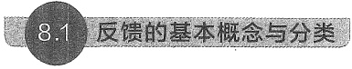

反馈的基本概念与分类

##### 8.1.1 什么是反馈

在电子电路中，所谓反馈，是指将电路输出电量（电压或电流）的一部分或全部通过反馈网络，用一定的方式送回到输入回路，以影响输入、输出电量（电压或电流）的过程。反馈体现了输出信号对输入信号的反作用。

在电子电路中，所谓反馈，是指将电路输出电量（电压或电流）的一部分或全部通过反馈网络，用一定的方式送回到输入回路，以影响输入、输出电量（电压或电流）的过程。反馈体现了输出信号对输入信号的反作用。

在前面各章中虽然没有具体地介绍反馈，但是在许多电路中都引入了反馈。例如，第2章讨论过的反相和同相放大电路以及各种运算电路，就是由集成运放和反馈网络组成的。又如，在图4.4.6a所示的共源极放大电路中，实质上就是通过外接源极电阻 $ R_{s} $引入负反馈，来稳定漏极静态电流 $ I_{DQ} $的。这种通过外接电路元件产生的反馈称为外部反馈。

在 BJT 的内部也存在着反馈，观察图 5.2.5b 所示 BJT 的 H 参数小信号模型便知，输入回路中的电压  $ h_{re}v_{ce} $ 就反映了 BJT 的输出电压  $ v_{ce} $ 对输入电压  $ v_{be} $ 的反作用，这种存在于器件内部的反馈称为内部反馈或寄生反馈，其作用很小，可以忽略。

在放大电路中还存在着由杂散电容或杂散电感将输出信号反馈到输入端而产生的寄生反馈。这种寄生反馈是有害的，严重时可使放大电路不能正常工作，实践中应竭力设法避免

<!-- page: 329 -->

或消除。

本章主要讨论放大电路中的各种外部反馈。

引入反馈的放大电路称为反馈放大电路，它由基本放大电路 A 和反馈网络 F 组成一个

闭合环路，如图8.1.1所示。其中 $ x_{I} $是反馈放大电路的输入信号， $ x_{0} $是输出信号， $ x_{F} $是反馈信号， $ x_{ID} $是基本放大电路的净输入信号。对于负反馈放大电路而言， $ x_{ID} $是输入信号 $ x_{I} $与反馈信号 $ x_{F} $相减后的差值信号。以上这些信号可以是电压，也可以是电流，但 $ x_{I} $、 $ x_{ID} $和 $ x_{F} $必须是同一种电量。

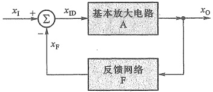

图 8.1.1 反馈放大电路的组成框图
 

为了简化分析，可以认为反馈环路中信号

是单向传输的，如图中箭头所示。即信号从输入到输出的正向传输（放大）只经过基本放大电路，而不通过反馈网络，因为反馈网络一般由无源元件组成，没有放大作用，故其正向传输作用可以忽略。基本放大电路的增益为  $ A = x_{0}/x_{ID} $。信号从输出到输入的反向传输只通过反馈网络，而不通过基本放大电路。反向传输系数为  $ F = x_{F}/x_{0} $，称为反馈系数。

由图8.1.1可以得知，判断一个放大电路中是否存在反馈，只要看该电路的输出回路与输入回路之间是否存在反馈网络，即反馈通路。若没有反馈网络，则不能形成反馈，这种状态称为开环。若有反馈网络存在，则能形成反馈，称这种状态为闭环。

例 8.1.1 试判断图 8.1.2 所示各电路中是否存在反馈。

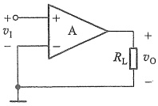

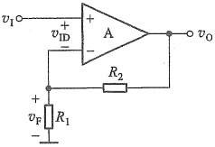

(a)
 

(b)
 

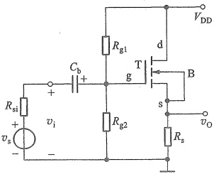

(c)
 

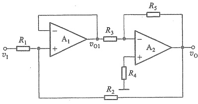

(b)
 

图 8.1.2 例 8.1.1 的电路图
 

<!-- page: 330 -->

解: 图 8.1.2a 所示电路中, 输出回路与输入回路间不存在反馈网络 (通常情况下电源连线或地线都不会引入反馈), 因而该电路中不存在反馈, 为开环状态。

图 8.1.2b 所示电路中，运放 A 构成基本放大电路，电阻  $ R_{2} $ 和  $ R_{1} $ 构成了反馈通路，因而该电路中存在反馈。

图 8.1.2c 为共漏极放大电路，由它的交流通路（即将电容  $ C_{b} $ 视为对交流短路，电源  $ +V_{DD} $ 视为交流的“地”）可知，源极电阻  $ R_{s} $ 既在输入回路中，又在输出回路中，它构成了反馈通路，因而该电路中存在着反馈。

图 8.1.2d 为两级放大电路，其中每一级都有一条反馈通路，第一级为电压跟随器，它的输出端与反相输入端之间由导线连接，形成反馈通路；第二级为反相放大电路，它的输出端与反相输入端之间由电阻  $ R_{5} $ 构成反馈通路。此外，从第二级的输出到第一级的输入也有一条反馈通路，由  $ R_{2} $ 构成。通常称每级各自存在的反馈为局部（或本级）反馈，称跨级的反馈为级间反馈。

##### 8.1.2 直流反馈与交流反馈

在放大电路中既含有直流分量，也含有交流分量，因而，必然有直流反馈与交流反馈之分。

存在于放大电路的直流通路中的反馈为直流反馈。直流反馈影响放大电路的直流性能，如静态工作点。

存在于交流通路中的反馈为交流反馈。交流反馈影响放大电路的交流性能，如增益、输入电阻、输出电阻和带宽等。

本章讨论的主要内容均针对交流反馈而言。

例 8.1.2 试判断图 8.1.3 所示电路中，哪些元件引入了级间直流反馈？哪些元件引入了级间交流反馈？

解：图8.1.3a所示电路中，在直流情况下，电容C可视为开路，电阻 $ R_{2} $、 $ R_{3} $和 $ R_{4} $形成反馈通路，引入直流反馈。电容C对交流信号可视为短路，交流情况下， $ R_{2} $并接在运放的反相输入端与地之间、 $ R_{3} $并接在输出端与地之间。不存在反馈通路。

图 8.1.3b 所示电路中，在直流情况下，电容 C 开路，不存在反馈通路。在交流情况下，电容 C 可视为短路， $ R_{2} $ 将运放输出端与反相输入端相连。所以  $ R_{2} $ 和 C 引入了交流反馈。

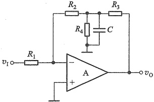

(a)
 

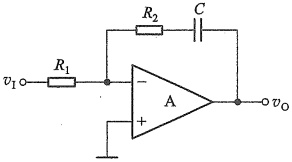

图 8.1.3 例 8.1.2 的电路图
 

(b)
 

（a）引入直流反馈的电路 （b）引入交流反馈的电路

<!-- page: 331 -->

##### 8.1.3 正反馈与负反馈

由图8.1.1所示的反馈放大电路组成框图可以得知，反馈信号送回到放大电路的输入回路与原输入信号共同作用后，对净输入信号的影响有两种效果：一种是使净输入信号量比没有引入反馈时减小了，这种反馈称为负反馈；另一种是使净输入信号量比没有引入反馈时增加了，这种反馈称为正反馈。在放大电路中一般引入负反馈。

判断反馈极性的基本方法是瞬时变化极性法，简称瞬时极性法。即判断电路中有关节点电压瞬时的值，增加用（+）、减少用（-）号标出。

具体做法是：先假设输入信号 $ v_{i} $在某一瞬时的值增加了，用(+)号标出，并设 $ v_{i} $的频率在放大电路的通带内（即中频区），然后沿着信号正向传输的路径，根据各种基本放大电路的输出信号与输入信号间的相位关系，从输入到输出逐级标出放大电路中各相关点电位的瞬时极性，或相关支路电流的瞬时流向，再经过反馈通路，确定从输出回路到输入回路的反馈信号的瞬时极性，最后判断反馈信号是削弱还是增强了净输入信号，如果是削弱，则为负反馈，反之则为正反馈。

例 8.1.3 试判断图 8.1.4 所示各电路中级间交流反馈的极性。

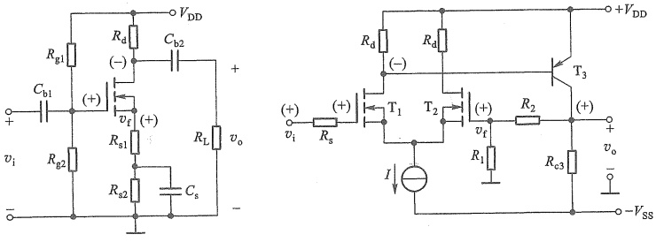

(a)
 

(b)
 

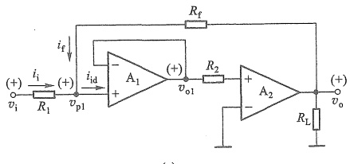

(c)
 

图 8.1.4 例 8.1.3 的电路（为简化起见，图中只标出交流信号分量） (a) 共源极放大电路 (b) 多级放大电路 (c) 运放电路
 

解：图8.1.4a所示电路中，因源极电容 $ C_{s} $的旁路作用，所以对交流信号而言，电阻 $ R_{s2} $上不存在交流信号，而电阻 $ R_{s1} $为交流通路的输入回路和输出回路所共有，构成了反馈通路。 $ R_{s1} $上的交流电压即为反馈信号 $ v_{f} $，基本放大电路的净输入信号是 $ v_{gs} $。设输入信号 $ v_{i} $的瞬时

<!-- page: 332 -->

极性为正，如图8.1.4a中所标，经NMOS管放大后，其漏极电压为负，源极电压 $ v_{s} $（即反馈信号 $ v_{f} $）为正，因而使该放大电路的净输入信号电压 $ v_{gs}(=v_{i}-v_{f}) $比没有反馈（即将 $ R_{s1} $短路）时的 $ v_{gs}(=v_{i}) $减小了，所以由 $ R_{s1} $引入的交流反馈是负反馈。

图 8.1.4b 所示电路是一个两级放大电路，第一级是由  $ T_{1} $ 和  $ T_{2} $ 构成的单端输入-单端输出式差分放大电路，第二级是由  $ T_{3} $ 组成的共射电路。在第二级的输出回路和第一级的输入回路之间由电阻  $ R_{1} $ 与  $ R_{2} $ 构成了级间交流反馈通路（虽然也引入直流反馈，但这里仅考虑交流反馈）。 $ R_{1} $ 上的交流电压是反馈信号  $ v_{f} $， $ T_{1} $ 和  $ T_{2} $ 两个栅极间的信号电压是该电路的净输入信号。

设输入信号  $ v_{i} $ 的瞬时极性为（+），则  $ T_{1} $ 栅极的交流电压  $ v_{g1} $ 也为（+），根据 NMOS 管输入输出相位关系，第一级的输出  $ (\mathrm{T}_{1} $ 的漏极 $ ) $ 信号  $ v_{d1} $ 为（-），第二级的输出信号  $ v_{c3} $ 为（+），经  $ R_{1} $ 与  $ R_{2} $ 反馈到  $ T_{2} $ 栅极的反馈信号  $ v_{f}(=v_{g2}) $ 也为（+），因而使该电路的净输入信号电压  $ v_{id}(=v_{g1}-v_{g2}) $ 比没有反馈时（断开  $ R_{2} $）减小了，所以  $ R_{1} $ 与  $ R_{2} $ 引入的是负反馈。

图 8.1.4c 所示电路中， $ R_{f} $ 构成了级间交流反馈通路。设输入信号  $ v_{i} $ 的瞬时极性为（+），则运放  $ A_{1} $ 同相端电压  $ v_{p1} $ 的极性也为（+），由  $ A_{1} $ 组成的电压跟随器的输出电压  $ v_{o1} $ 也为（+），第二级输出电压  $ v_{o} $ 与其输入电压  $ v_{o1} $ 同相位，并且有  $ v_{o} > v_{p1} $ （放大作用）。根据上述分析，可标出输入电流  $ i_{i} $、净输入电流  $ i_{id} $ 和反馈电流  $ i_{f} $ 的瞬时流向如图中箭头所示。因而净输入电流  $ i_{id}(=i_{i}+i_{f}) $ 比没有反馈时 ( $ i_{f}=0 $) 增加了，所以该电路中  $ R_{f} $ 引入了正反馈。

前面介绍的瞬时极性法同样适合直流反馈的判断。

##### 8.1.4 串联反馈与并联反馈

是串联还是并联反馈由反馈网络的输出端口 $ ^{①} $与基本放大电路输入端口的连接方式来判定。

在反馈放大电路的输入回路，凡是反馈网络的输出端口与基本放大电路的输入端口串联连接的，称为串联反馈，如图8.1.5a所示。这时，输入回路的信号 $ x_{i} $、 $ x_{f} $及 $ x_{id} $分别以电压 $ v_{i} $、 $ v_{f} $及 $ v_{id} $出现，并满足KVL方程，实现电压比较。对于串联负反馈，有 $ v_{id}=v_{i}-v_{f} $。所以图8.1.5a中引入的是串联负反馈。

凡是反馈网络的输出端口与基本放大电路的输入端口并联连接的，称为并联反馈，如图8.1.5b所示。这时，输入回路的信号 $ x_{i} $、 $ x_{f} $及 $ x_{id} $分别以电流 $ i_{i} $、 $ i_{f} $及 $ i_{id} $出现，并满足KCL方程，实现电流比较。对于并联负反馈，有 $ i_{id}=i_{i}-i_{f} $。图8.1.5b中引入的是并联负反馈。

实际上，由图8.1.5可以总结出判断串、并联反馈的更快捷的方法：当反馈信号与输入信号分别接至基本放大电路的不同输入端时，引入的是串联反馈；当反馈信号与输入信号接至基本放大电路的同一个输入端时，引入的是并联反馈。这里信号源的另一个端口接地。

需要说明的是，信号源内阻  $ R_{si} $ 的大小，会对串联负反馈和并联负反馈的效果带来不同的影响。由图8.1.5a所示的串联负反馈框图可见，基本放大电路的净输入电压  $ v_{id}=v_{i}-v_{f} $，要使串联负反馈的效果最佳，即反馈电压  $ v_{f} $ 对净输入电压  $ v_{id} $ 的调节作用最强，则要求输入电

<!-- page: 333 -->

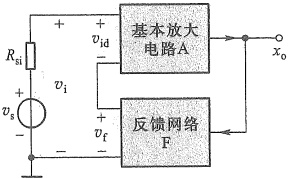

(a)
 

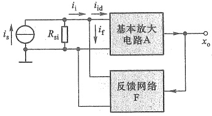

(b)
 

图 8.1.5 串联反馈与并联反馈 (a) 串联反馈 (b) 并联反馈
 

压  $ v_{i} $ 最好固定不变，而这只有在信号源  $ v_{s} $ 的内阻  $ R_{si}=0 $ 时才能实现，此时有  $ v_{i}=v_{s} $。如果信号源内阻  $ R_{si}=\infty $，则反馈信号  $ v_{f} $ 的变化对净输入信号  $ v_{id} $ 就没有影响，负反馈将不起作用。所以串联负反馈要求信号源内阻越小越好。

相反，对于图8.1.5b所示的并联负反馈而言，为增强负反馈效果，则要求信号源内阻越大越好。信号源内阻 $ R_{si}=\infty $时，有 $ i_{i}=i_{s} $， $ i_{i} $固定不变，净输入电流 $ i_{id}=i_{i}-i_{f} $，反馈电流 $ i_{f} $对净输入电流 $ i_{id} $的调节作用最强，并联负反馈的效果最佳。若 $ R_{si}=0 $，则负反馈将不起作用。

例 8.1.4 试判断图 8.1.2d 和图 8.1.4b 所示电路中的级间交流反馈是串联反馈还是并联反馈。

解：图8.1.2d所示电路中， $ R_{2} $引入级间交流负反馈。由于反馈信号与输入信号均接至基本放大电路的同一个输入端（运放 $ A_{1} $的同相输入端），显然是以电流形式进行比较，因此是并联反馈。

图 8.1.4b 所示电路中， $ R_{1} $ 和  $ R_{2} $ 引入了级间交流负反馈。由于反馈网络的输出端口接于基本放大电路的一个输入端（ $ T_{2} $ 管的栅极）和地之间，而输入信号  $ v_{i} $ 通过  $ R_{s} $ 加在基本放大电路的另一个输入端（ $ T_{1} $ 管的栅极）和地之间，反馈信号与输入信号接于不同的输入端，因此是串联反馈。

##### 8.1.5 电压反馈与电流反馈

是电压反馈还是电流反馈由反馈网络的输入端口在放大电路输出端口的取样对象来决定。如果把输出电压的一部分或全部取出来回送到放大电路的输入回路，则称为电压反馈。此时反馈信号 $ x_{f} $和输出电压成比例，即 $ x_{f}=Fv $。如图8.1.6a所示，电压反馈时反馈网络的输入端口并联于放大电路输出端口，如同万用表并联测电压一样。

当反馈信号  $ x_{f} $ 与输出电流成比例，即  $ x_{f}=F i_{0} $ 时，则是电流反馈。如图 8.1.6b 所示，此时反馈网络的输入端口串联于放大电路输出端口，如同万用表串联测电流一样。需要指出的是  $ i_{0} $ 多指放大器件的输出电流。

判断电压与电流反馈的常用方法是“输出短路法”，即假设输出电压  $ v_{0}=0 $ ，或令负载电阻  $ R_{L}=0 $ ，然后看反馈信号是否还存在，若反馈信号不存在了（即  $ x_{f}=0 $），则说明反馈信号与输出电压成比例，是电压反馈；若反馈信号还存在（即  $ x_{f}\neq0 $），则说明反馈信号不是与输出

<!-- page: 334 -->

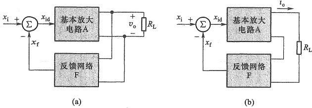

图 8.1.6 电压反馈与电流反馈 (a) 电压反馈 (b) 电流反馈
 

电压  $ v_{0} $ 成比例，而是与输出电流  $ i_{0} $ 成比例，是电流反馈。

电压负反馈的重要特点是能够稳定输出电压。例如，在图8.1.6a中，如果 $ x_{i} $大小保持一定，当负载电阻 $ R_{L} $减小而引起输出电压 $ v_{o} $下降时，该电路能自动进行调节，使 $ v_{o} $基本稳定不变。调节过程如下：

 $$ \begin{aligned}R_{L}\downarrow\xrightarrow{}&v_{o}\downarrow\xrightarrow{}x_{f}(=F v_{o})\downarrow\xrightarrow{x_{i} 一定时 }x_{id}(=x_{i}-x_{f})\uparrow\text{——}\\&v_{o}\uparrow\xleftarrow{}\end{aligned} $$ 

可见，电压负反馈能减小  $ v_{0} $ 受  $ R_{L} $ 等变化的影响，说明电压负反馈放大电路具有较好的恒压输出特性。

电流负反馈的重要特点是能够稳定输出电流。例如，如果图8.1.6b中的 $ x_{i} $大小保持一定，当负载电阻 $ R_{L} $增加（或运放中BJT的 $ \beta $值下降）而引起输出电流 $ i_{0} $减小时，该电路能自动进行如下调节过程：

 $$ \begin{array}{l}R_{\mathrm{L}}\uparrow\searrow\\\beta\downarrow\xrightarrow{}\begin{array}{l}i_{\mathrm{o}}\downarrow\longrightarrow x_{\mathrm{f}}(=F i_{\mathrm{o}})\downarrow\xrightarrow{x_{\mathrm{i}} 一定时 }x_{\mathrm{i d}}(=x_{\mathrm{i}}-x_{\mathrm{f}})\uparrow\longrightarrow\\ i_{\mathrm{o}}\uparrow\leftarrow\end{array}\end{array} $$ 

因此，电流负反馈具有近似于恒流的输出特性。

例 8.1.5 试判断图 8.1.7 所示各电路中的交流反馈是电压反馈还是电流反馈。

解：图8.1.7a所示电路中，交流反馈信号是流过反馈元件 $ R_{f} $的电流 $ i_{f} $（并联反馈），且有 $ i_{f}=\frac{v_{n}-v_{o}}{R_{f}}\approx\frac{-v_{o}}{R_{f}} $，因为 $ v_{n}\approx0 $。令 $ R_{L}=0 $，即令 $ v_{o}=0 $时，有 $ i_{f}=0 $，故该电路中引入的交流反馈是电压反馈。

图 8.1.7b 所示电路中，交流反馈信号是输出电流  $ i_{0} $ 在电阻  $ R_{f} $ 上的压降  $ v_{f} $，且有  $ v_{f}=i_{0}R_{f} $，令  $ R_{L}=0 $ 时， $ v_{0}=0 $，但运放 A 的输出电流  $ i_{0}\neq0 $，故  $ v_{f}\neq0 $，反馈信号依然存在，说明反馈信号与输出电流成比例，是电流反馈。

图 8.1.7c 所示电路中，电阻  $ R_{s} $ 和  $ R_{L} $ 并联构成交流反馈通路，由它们送回到输入回路的交流反馈信号是电压  $ v_{f} $，而且  $ v_{f}=v_{o} $，当用“输出短路法”，令  $ R_{L}=0 $，即令  $ v_{o}=0 $ 时，有  $ v_{f}=0 $，反

<!-- page: 335 -->

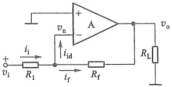

(a)
 

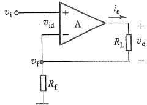

(b)
 

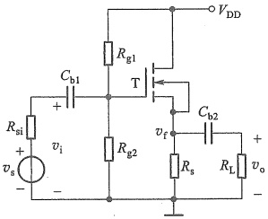

(c)
 

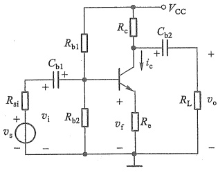

(d)
 

图 8.1.7 例 8.1.5 的电路图（为简化起见，图中只标出交流信号分量）
 

馈信号不存在了，所以该电路中的交流反馈是电压反馈。

图 8.1.7d 所示电路中，送回到输入回路的交流反馈信号是电阻  $ R_{e} $ 上的电压信号，且有  $ v_{f}=i_{e}R_{e}\approx i_{e}R_{e}(i_{e} $ 是 BJT 的输出交流电流 $ ) $ 。用“输出短路法”，令  $ v_{o}=0 $ ，即令  $ R_{L} $ 短路时， $ i_{e}\neq0 $ （因  $ i_{e} $ 受  $ i_{b} $ 控制），因此反馈信号  $ v_{f} $ 仍然存在，说明反馈信号与 BJT 的输出电流成比例，是电流反馈。

##### 8.1.6 负反馈放大电路的四种组态

由于反馈网络在放大电路输出端有电压和电流两种取样方式，在输入端有串联和并联两种连接方式，因此，负反馈放大电路有四种基本组态（或类型），即电压串联、电压并联、电流串联和电流并联。

正确判断反馈放大电路的组态十分重要，因为反馈组态不同，放大电路的性能就不同。

### 1. 电压串联负反馈放大电路

##### （1）运放构成的放大电路

图8.1.8所示电路中，运放A构成基本放大电路，电阻 $ R_{1} $与 $ R_{f} $构成反馈网络。反馈信号 $ v_{f} $和输入信号 $ v_{i} $接于基本放大电路A的不同输入端，因而是串联反馈，有 $ v_{id}=v_{i}-v_{f} $。

用瞬时极性法判断反馈极性， $ v_{f} $ 与  $ v_{i} $ 相位相同，净输入  $ v_{id} $ 比没有反馈时减小了，是负反馈。

对交流反馈而言，反馈信号为

 $$ v_{f}=\frac{R_{1}}{R_{1}+R_{f}}v_{o} $$

<!-- page: 336 -->

当令  $ R_{L}=0 $ 时，有  $ v_{0}=0, v_{f}=0 $ ，即反馈信号不存在了，是电压反馈。反馈系数  $ (v_{f}/v_{0}) $ 为电压反馈系数  $ F_{v} $，显然有

 $$ F_{v}=\frac{v_{f}}{v_{o}}=\frac{R_{1}}{R_{1}+R_{f}} $$ 

综合上述分析，图8.1.8所示为电压串联负反馈放大电路。

##### （2）三极管构成的放大电路

图8.1.9所示电路中，电阻 $ R_{1} $和 $ R_{2} $构成级间交流反馈通路。在放大电路的输入回路，反馈信号 $ v_{f} $与输入信号 $ v_{i} $分别接 $ T_{1} $管的源极和栅极，显然是串联反馈，净输入信号为 $ v_{gs} $。用瞬时极性法判断反馈极性， $ v_{f} $与 $ v_{i} $相位相同， $ v_{gs}=v_{i}-v_{f} $，比没有反馈时减小了，是负反馈。通常第一级电流远小于第二级电流，在忽略 $ T_{1} $源极信号电流情况下，反馈电压近似为

 $$ v_{f}=\frac{R_{1}}{R_{1}+R_{2}}v_{\circ} $$ 

令  $ v_{0}=0 $ 时，有  $ v_{f}=0 $ ，所以是电压反馈。综上分析可知，该电路是电压串联负反馈。

由于串联反馈输入回路的电压满足 KVL 方程，即输入信号以电压形式出现，而电压负反馈具有较好的恒压输出特性。因此，电压串联负反馈放大电路是一个电压控制的电压源，称为电压放大电路，可以实现电压-电压变换。

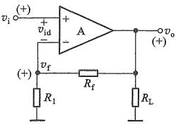

图 8.1.8 运放电路
 

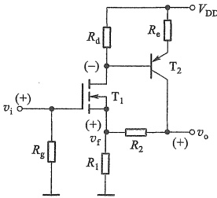

图 8.1.9 三极管电路
 

### 2. 电压并联负反馈放大电路

##### （1）运放构成的放大电路

图 8.1.10 所示电路，由例 8.1.5 中图 a 已知，该电路引入了电压反馈。另从反馈网络在放大电路输入端的连接方式看，为电流求和形式，是并联反馈。用“瞬时极性法”，设交流输入信号  $ v_{i} $ 在某一瞬时的极性为（+），则图中  $ v_{n} $ 也为（+），经运放 A 反相放大后，输出电压  $ v_{0} $ 为（-），电流  $ i_{i} $、 $ i_{f} $、 $ i_{id} $ 的瞬时流向如图中箭头所示。于是，净输入电流  $ i_{id}(=i_{i}-i_{f}) $ 比没有反馈时减小了，故为负反馈。综合以上分析，图 8.1.10 所示为电压并联负反馈放大电路，反馈电流为

 $$ i_{f}=-\frac{v_{o}}{R_{f}} $$

<!-- page: 337 -->

##### （2）三极管构成的放大电路

图 8.1.11 所示共射极放大电路中， $ R_{f} $ 和  $ C_{b2} $ 构成交流反馈通路。在放大电路的输入回路，忽略  $ R_{b1} $、 $ R_{b2} $ 支路的分流，反馈信号  $ i_{f} $ 与输入电流  $ i_{i} $ 均接在 T 的基极，显然是并联反馈，净输入信号为  $ i_{id} $。利用瞬时极性法，当  $ v_{i} $ 为 ( + ) 时，经共射极放大后，输出电压  $ v_{o} $ 为 ( - ) ，电流  $ i_{i} $、 $ i_{f} $、 $ i_{id} $ 的瞬时流向如图中箭头所示。于是，净输入电流  $ i_{id} = (i_{i} - i_{f}) $ 比没有反馈时减小了，故为负反馈。同理，令  $ v_{o} = 0 $ 时，有  $ i_{f} = 0 $，所以是电压反馈。综合以上分析，图 8.1.11 所示为电压并联负反馈放大电路，其反馈电流为

 $$ i_{f}=-\frac{v_{o}}{R_{f}} $$ 

由于并联反馈输入回路的电流满足 KCL 方程，即输入信号以电流形式出现，而电压负反馈具有较好的恒压输出特性。因此，可以说电压并联负反馈放大电路是一个电流控制的电压源，称为互阻放大电路，可以实现电流-电压变换。

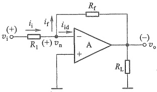

图 8.1.10 运放电路
 

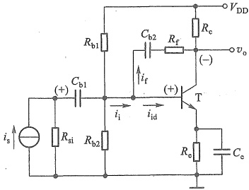

图 8.1.11 BJT 电路
 

### 3. 电流串联负反馈放大电路

##### （1）运放构成的放大电路

图 8.1.12 所示电路中，运放 A 构成基本放大电路，电阻  $ R_{f} $ 构成反馈网络。当设  $ v_{s} $、 $ v_{i} $ 的瞬时极性为（+）时，经运放 A 同相放大后， $ v_{s} $ 及  $ v_{f} $ 的瞬时极性也为（+），使净输入电压  $ v_{id} (=v_{i}-v_{f}) $ 比没有反馈时减小了，因此是负反馈。此电路的反馈信号和输入信号接在放大电路的不同输入端，所以是串联反馈。又由例 8.1.5 中图 b 分析已知，该电路中  $ R_{f} $ 引入的是电流反馈，故图 8.1.12 所示为电流串联负反馈放大电路，其反馈电压为

 $$ v_{f}=R_{f}i_{o} $$ 

##### （2）三极管构成的放大电路

图 8.1.13 所示共源极电路中， $ R_{a} $ 跨接在输入回路与输出回路之间，引入反馈，而且在直流通路与交流通路中都存在，因此，既有直流反馈，又有交流反馈。

当设  $ v_{s} $、 $ v_{i} $ 瞬时极性为（+）时，漏极电压为（-），则  $ i_{o}=i_{d} $，电流方向如图所示。 $ i_{o} $ 在  $ R_{s} $ 上产生的压降  $ v_{f} $ 即为反馈电压，极性为（+），净输入电压  $ v_{id}(=v_{gs}=v_{i}-v_{f}) $ 减小了，故电路引入负反馈，并且是串联反馈。

<!-- page: 338 -->

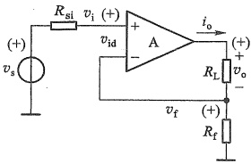

图 8.1.12 运放电路
 

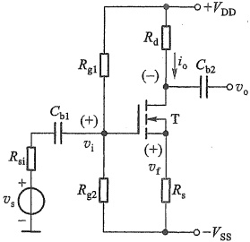

图 8.1.13 MOS 管电路
 

令输出电压  $ v_{0}=0 $ ，由于  $ i_{0}(=i_{d}) $ 是由  $ v_{gs} $ 控制的仍然存在，致使  $ v_{f} $ 仍然存在，所以电路引入电流反馈，反馈电压为

 $$ v_{f}=R_{s}i_{o} $$ 

由于串联反馈输入回路的电压满足 KVL 方程，即输入信号以电压形式出现，而电流负反馈能稳定输出电流，所以电流串联负反馈放大电路是电压控制的电流源，称为互导放大电路，可以实现电压-电流变换。

### 4. 电流并联负反馈放大电路

##### （1）运放构成的放大电路

图 8.1.14 所示电路中，电阻  $ R_{f} $ 和  $ R_{1} $ 构成反馈网络。反馈信号和输入信号均接于运放的反相端，信号以电流形式求和，所以是并联反馈。反馈信号  $ i_{f} $ 是输出电流  $ i_{o} $ 的一部分，即  $ i_{f} \approx \frac{R_{1}}{R_{1} + R_{f}} i_{o} $ （因为  $ v_{n} $ 很小，近似为 0， $ R_{f} $ 与  $ R_{1} $ 近似于并联），令负载  $ R_{L} = 0 $ 时，反馈量  $ i_{f} $ 仍然存在，所以是电流反馈。用瞬时极性法可以判断出是负反馈。因此，这是一个电流并联负反馈放大电路。反馈电流为

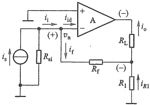

图 8.1.14 运放电路
 

 $$ i_{f}=\frac{R_{1}}{R_{1}+R_{f}}i_{\circ} $$ 

##### （2）三极管构成的放大电路

图 8.1.15 电路中，用上述类似的方法，可以判断出由  $ R_{5} $、 $ R_{2} $ 引入了级间交流电流并联负反馈。反馈电流为

 $$ i_{f}=\frac{R_{5}}{R_{2}+R_{5}}i_{o} $$ 

类似地，该电路是电流控制的电流源，称为电流放大电路，可以实现电流-电流变换。

<!-- page: 339 -->

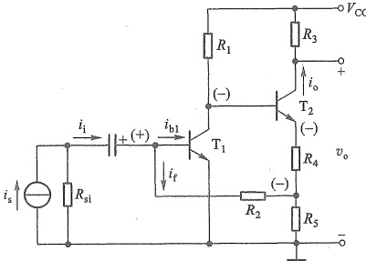

图 8.1.15 BJT 电路
 

例 8.1.6 试判断图 8.1.16 所示电路的交流反馈的类型。

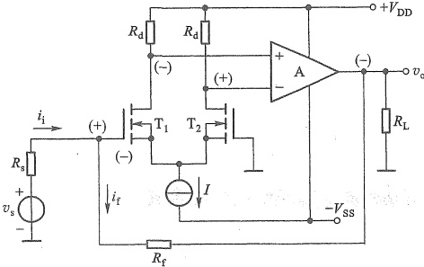

图 8.1.16 例 8.1.6 的电路图
 

解：图8.1.16所示电路中，第一级是由 $ T_{1} $、 $ T_{2} $组成的单端输入-双端输出差分式放大电路，第二级是运放构成的放大电路，电阻 $ R_{f} $是联系输出回路与输入回路的反馈元件。反馈信号与输入信号接于电路的同一个输入端（ $ T_{1} $的栅极），但 $ T_{1} $的栅极电流几乎为0，不容易判断净输入电流，此时可以用净输入电压判断。

设  $ T_{1} $ 栅极交流电压  $ v_{g1} $ 的瞬时极性为（+），则  $ T_{1} $ 的漏极为（-） ( $ T_{2} $ 的输出与  $ T_{1} $ 反相为（+）)，第二级运放的输出为（-），由  $ R_{f} $ 反馈到  $ T_{1} $ 栅极的电压也为（-），与输入的（+）电压叠加。因此，净输入电压 ( $ T_{1} $ 与  $ T_{2} $ 栅极压差) 比无反馈时减小了，所以是负反馈。

由电路可得  $ i_{f}=\frac{v_{g1}-v_{o}}{R_{f}}\approx\frac{-v_{o}}{R_{f}} $ （因为经放大后  $ \left|v_{o}\right|\gg\left|v_{g1}\right| $），用输出短路法令  $ R_{L}=0, v_{o}=0 $ 时，有  $ i_{f}=0 $，故它是电压反馈。综上所述，图8.1.16所示电路中引入了电压并联负反馈。

例 8.1.7 图 8.1.17 所示是某放大电路的交流通路，试判断其级间交流反馈的类型。

解：图8.1.17所示电路是两级共源放大电路，电阻 $ R_{t} $构成了级间交流反馈的通路。在该电路的输入回路，输入信号 $ v_{i} $接在 $ T_{1} $的栅极，反馈信号 $ v_{t} $接在 $ T_{1} $的源极，是串联反馈。在

<!-- page: 340 -->

该电路的输出回路，令  $ v_{0}=0 $ (即将  $ R_{L} $ 短接) 时， $ i_{0}\neq0 $ (因为  $ i_{0} $ 是  $ T_{2} $ 的漏极信号电流  $ i_{d2} $，它受控于该管的信号电压  $ v_{gs} $)， $ v_{f}\neq0 $，所以是电流反控于该管的信号电压  $ v_{gs} $)， $ v_{f}\neq0 $，所以是电流反馈。设  $ v_{i} $ 的瞬时极性为(+)，则  $ T_{1} $ 管的漏极电压为(-)， $ T_{2} $ 管的源极电压  $ v_{s2} $ 及反馈信号  $ v_{f} $ 也为(-)，结果使该电路的净输入电压  $ v_{gs1}=v_{i}-(-v_{f})=v_{i}+v_{f} $ 增加了，大于没加反馈时的输入电压  $ v_{i} $，是正反馈。综合上述分析，该电路中的级间交流反馈是电流串联正反馈。

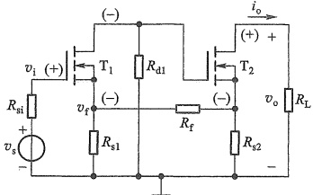

##### 复习思考题

图 8.1.17 例 8.1.7 的电路图
 

8.1.1 什么是反馈？如何判断电路中有无反馈？

8.1.2 什么是放大电路的开环状态和闭环状态？

8.1.3 怎样判断直流反馈和交流反馈？为什么要引入直流负反馈？

8.1.4 什么叫正反馈和负反馈？如何判断引入的反馈是正反馈还是负反馈？

8.1.5 串联反馈与并联反馈有何区别？为了使负反馈的效果更佳，对信号源内阻应有什么要求？

8.1.6 什么是电压反馈和电流反馈？如何判断引入的反馈是电压反馈还是电流反馈？

8.1.7 电压负反馈和电流负反馈各有什么特点？

8.1.8 负反馈放大电路有哪几种组态？如何判断？

#### 8.2 负反馈放大电路增益的一般表达式

本节将依据负反馈放大电路的组成框图，推导并讨论闭环增益的一般表达式。

由图 8.2.1 所示的负反馈放大电路组成框图可写出下列关系式：

基本放大电路的净输入信号为

$$  x_{\mathrm{id}}=x_{\mathrm{i}}-x_{\mathrm{f}}   \tag*{(8.2.1)}$$

基本放大电路的增益（开环增益）为

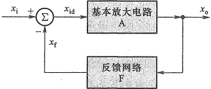

$$  A=\frac{x_{o}}{x_{id}}   \tag*{(8.2.2)}$$

图 8.2.1 负反馈放大电路的组成框图
 

反馈网络的反馈系数为

$$  F=\frac{x_{f}}{x_{o}}   \tag*{(8.2.3)}$$

负反馈放大电路的增益（闭环增益）为

$$  A_{f}=\frac{x_{o}}{x_{i}}   \tag*{(8.2.4)}$$

将式（8.2.1）~式（8.2.3）代入式（8.2.4），可得负反馈放大电路增益的一般表达式为

<!-- page: 341 -->

$$  A_{_{\mathrm{f}}}=\frac{x_{_{\circ}}}{x_{_{\mathrm{i}}}}=\frac{x_{_{\circ}}}{x_{id}+x_{_{\mathrm{f}}}}=\frac{x_{_{\circ}}}{\frac{x_{_{\circ}}}{A}+Fx_{_{\circ}}}=\frac{A}{1+AF}   \tag*{(8.2.5)}$$

由式(8.2.5)可以看出，引入负反馈后，放大电路的闭环增益 $ A_{t} $减小了，减小的程度与 $ (1+AF) $有关。通常把 $ (1+AF) $称为反馈深度，而将AF称为环路增益（详见8.6节）。

由于在一般情况下，A 和 F 都是频率的函数，即它们的幅值和相位角都是频率的函数。当考虑信号频率的影响时， $ A_{f} $、A 和 F 分别用  $ \dot{A}_{f} $、 $ \dot{A} $ 和  $ \dot{F} $ 表示。下面分几种情况对  $ \dot{A}_{f} $ 的表达式进行讨论。

①  $ 1 + AF > 1 $，则  $ \left| A_{f} \right| < \left| A \right| $，即引入反馈后，增益下降了，这时的反馈是负反馈。引入负反馈时，AF 为正实数， $ x_{f} $ 与  $ x_{i} $ 相位相同。

② $ 1+AF\gg1 $时，称为深度负反馈，此时

 $$ A_{i}\approx\frac{1}{F} $$ 

说明在深度负反馈条件下，闭环增益几乎只取决于反馈系数，而与开环增益的具体数值无关。

③ 当 $ \dot{A}\dot{F}<0 $ 时，环路增益 $ \dot{A}\dot{F} $ 产生 $ -180^{\circ} $ 附加相移， $ x_{f} $ 与  $ x_{i} $ 相位相反，净输入  $ x_{id} $ 增加，使得输出量  $ x_{0} $ 增加，则  $ |\dot{A}_{f}|>|\dot{A}| $，这说明电路中的反馈已从原来的负反馈变成了正反馈。

④当  $ 1+AF=0 $ 时，则  $ \left|A_{f}\right|\to\infty $，这就是说，放大电路在没有输入信号时，也会有输出信号，产生了自激振荡，使放大电路不能正常工作。在负反馈放大电路中，必须避免出现自激振荡现象。

必须指出，对于不同的反馈类型， $ x_{i} $、 $ x_{o} $、 $ x_{f} $ 及  $ x_{id} $ 所代表的电量不同，因而，四种负反馈放大电路的 A、 $ A_{f} $、F 相应地具有不同的含义和量纲。现归纳如表 8.2.1 所示，其中  $ A_{v} $、 $ A_{i} $ 分别表示电压增益和电流增益（量纲为 1）； $ A_{r} $、 $ A_{g} $ 分别表示互阻增益（单位为  $ \Omega $）和互导增益（单位为 S），相应的反馈系数  $ F_{v} $、 $ F_{i} $、 $ F_{g} $ 及  $ F_{r} $ 的量纲也各不相同，但环路增益 AF 总是量纲为 1 的。

表8.2.1 负反馈放大电路中各种信号量的含义
 

<table border=1 style='margin: auto; word-wrap: break-word;'><tr><td rowspan="2">信号量或信号传递比</td><td colspan="4">反馈类型</td></tr><tr><td style='text-align: center; word-wrap: break-word;'>电压串联</td><td style='text-align: center; word-wrap: break-word;'>电流并联</td><td style='text-align: center; word-wrap: break-word;'>电压并联</td><td style='text-align: center; word-wrap: break-word;'>电流串联</td></tr><tr><td style='text-align: center; word-wrap: break-word;'>$ x_o $</td><td style='text-align: center; word-wrap: break-word;'>电压</td><td style='text-align: center; word-wrap: break-word;'>电流</td><td style='text-align: center; word-wrap: break-word;'>电压</td><td style='text-align: center; word-wrap: break-word;'>电流</td></tr><tr><td style='text-align: center; word-wrap: break-word;'>$ x_i $、 $ x_f $、 $ x_{id} $</td><td style='text-align: center; word-wrap: break-word;'>电压</td><td style='text-align: center; word-wrap: break-word;'>电流</td><td style='text-align: center; word-wrap: break-word;'>电流</td><td style='text-align: center; word-wrap: break-word;'>电压</td></tr><tr><td style='text-align: center; word-wrap: break-word;'>$ A = x_o / x_{id} $</td><td style='text-align: center; word-wrap: break-word;'>$ A_v = v_o / v_{id} $</td><td style='text-align: center; word-wrap: break-word;'>$ A_i = i_o / i_{id} $</td><td style='text-align: center; word-wrap: break-word;'>$ A_r = v_o / i_{id} $</td><td style='text-align: center; word-wrap: break-word;'>$ A_g = i_o / v_{id} $</td></tr><tr><td style='text-align: center; word-wrap: break-word;'>$ F = x_f / x_o $</td><td style='text-align: center; word-wrap: break-word;'>$ F_v = v_f / v_o $</td><td style='text-align: center; word-wrap: break-word;'>$ F_i = i_f / i_o $</td><td style='text-align: center; word-wrap: break-word;'>$ F_g = i_f / v_o $</td><td style='text-align: center; word-wrap: break-word;'>$ F_r = v_f / i_o $</td></tr><tr><td style='text-align: center; word-wrap: break-word;'>$ A_f = x_o / x_i = \frac{A}{1+AF} $</td><td style='text-align: center; word-wrap: break-word;'>$ A_{st} = v_o / v_i = \frac{A_o}{1+A_v F_g} $</td><td style='text-align: center; word-wrap: break-word;'>$ A_{ii} = i_o / i_i = \frac{A_i}{1+A_i F_i} $</td><td style='text-align: center; word-wrap: break-word;'>$ A_{rt} = v_o / i_i = \frac{A_r}{1+A_r F_g} $</td><td style='text-align: center; word-wrap: break-word;'>$ A_{gt} = i_o / v_i = \frac{A_g}{1+A_g F_r} $</td></tr><tr><td style='text-align: center; word-wrap: break-word;'>功能</td><td style='text-align: center; word-wrap: break-word;'>$ v_i $控制 $ v_o $，电压放大</td><td style='text-align: center; word-wrap: break-word;'>$ i_i $控制 $ i_o $，电流放大</td><td style='text-align: center; word-wrap: break-word;'>$ i_i $控制 $ v_o $，电流转换为电压</td><td style='text-align: center; word-wrap: break-word;'>$ v_i $控制 $ i_o $，电压转换为电流</td></tr></table>

<!-- page: 342 -->

例 8.2.1 已知某电压串联负反馈放大电路在通带内（中频区）的反馈系数  $ F_{v}=0.01 $ ，输入信号  $ v_{i}=10\ mV $ ，开环电压增益  $ A_{v}=10^{4} $ ，试求该电路的闭环电压增益  $ A_{vf} $ 、反馈电压  $ v_{f} $ 和净输入电压  $ v_{id} $ 。

解：方法一：由式（8.2.5）可求得该电路的闭环电压增益为

 $$ A_{vf}=\frac{A_{v}}{1+A_{v} F_{v}}=\frac{10^{4}}{1+10^{4}\times0.01}\approx99.01 $$ 

反馈电压为

 $$ v_{\mathrm{f}}=F_{v}v_{\mathrm{o}}=F_{v}A_{v f}v_{\mathrm{i}}=0.01\times99.01\times10\mathrm{~m V}\approx9.9\mathrm{~m V} $$ 

净输入电压为

 $$ v_{\mathrm{id}}=v_{\mathrm{i}}-v_{\mathrm{f}}=\left(10-9.9\right)\mathrm{mV}=0.1\mathrm{~mV} $$ 

方法二：求  $ A_{vf} $ 的方法同方法一。

由式 $ （8.2.1） $推出如下关系式：

 $$ x_{\mathrm{id}}=x_{\mathrm{i}}-x_{\mathrm{f}}=x_{\mathrm{i}}-F x_{\mathrm{o}}=x_{\mathrm{i}}-F A x_{\mathrm{id}} $$ 

整理得

 $$ x_{id}=\frac{x_{i}}{1+AF} $$ 

对于本例题则有

 $$ v_{id}=\frac{v_{i}}{1+A_{v}F_{v}}=\frac{10\ mV}{1+10^{4}\times0.01}\approx0.099\ mV\approx0.1\ mV $$ 

而

 $$ v_{\mathrm{f}}=v_{\mathrm{i}}-v_{\mathrm{id}}=\left(10-0.1\right)\mathrm{mV}=9.9\mathrm{~mV} $$ 

由此例可知，在深度负反馈 $ (1+AF)\gg1 $ 条件下，反馈信号与输入信号的大小相差甚微，净输入信号则远小于输入信号。

##### 复习思考题

8.2.1 在通带内，负反馈放大电路的增益与其开环增益相比，是增加了还是减小了？

8.2.2 负反馈放大电路增益的一般表达式是在什么条件下推导出来的？

8.2.3 什么是深度负反馈？

#### 8.3 负反馈对放大电路性能的影响

在放大电路中引入负反馈后，除了使闭环增益下降外，还会影响放大电路的许多性能，现分述如下。

##### 8.3.1 提高增益的稳定性

放大电路的增益可能由于元器件参数的变化、环境温度的变化、电源电压的变化、负载大小的变化等因素的影响而不稳定，引入适当的负反馈后，可提高闭环增益的稳定性。

当负反馈很深，即 $ (1+AF)\gg1 $时，由式（8.2.5）得

$$  A_{t}=\frac{A}{1+AF}\approx\frac{1}{F}   \tag*{(8.3.1)}$$

<!-- page: 343 -->

这就是说，引入深度负反馈后，放大电路的增益取决于反馈网络的反馈系数，而与基本放大电路几乎无关。反馈网络一般由稳定性能优于三极管的无源线性元件（如 R、C）组成，因此，闭环增益是比较稳定的。

在一般情况下，增益的稳定性常用有、无反馈时增益的相对变化量之比来衡量。用  $ \mathrm{d}A/A $ 和  $ \mathrm{d}A_{f}/A_{f} $ 分别表示开环和闭环增益的相对变化量。将  $ A_{f}=\frac{A}{1+AF} $ 对 A 求导数得

$$  \frac{\mathrm{d}A_{f}}{\mathrm{d}A}=\frac{\left(1+AF\right)-AF}{\left(1+AF\right)^{2}}=\frac{1}{\left(1+AF\right)^{2}}\quad\text{ 或 }\quad\mathrm{d}A_{f}=\frac{\mathrm{d}A}{\left(1+AF\right)^{2}}   \tag*{(8.3.2)}$$

将式(8.3.2)两边分别除以 $ A_{f}=\frac{A}{1+AF} $，得

$$  \frac{\mathrm{d}A_{f}}{A_{f}}=\frac{1}{1+AF}\cdot\frac{\mathrm{d}A}{A}   \tag*{(8.3.3)}$$

该式表明，引入负反馈后，闭环增益的相对变化量为开环增益相对变化量的 $ \frac{1}{1+AF} $，即闭环增益的相对稳定度提高了， $ (1+AF) $越大，即负反馈越深， $ \mathrm{d}A_{t}/A_{t} $越小，闭环增益的稳定性越好。

例 8.3.1 设某放大电路的 A=1000，由于环境温度的变化，使增益下降为 900，引入负反馈后，反馈系数 F=0.099。求闭环增益的相对变化量。

解：无反馈时，增益的相对变化量为

 $$ \frac{\mathrm{d}A}{A}=\frac{1\ 000-900}{1\ 000}=10\% $$ 

反馈深度为

 $$ 1+AF=1+1\ 000\times0.099=100 $$ 

有反馈时，闭环增益的相对变化量为

 $$ \begin{aligned}\frac{\mathrm{d}A_{\mathrm{f}}}{A_{\mathrm{f}}}=&\frac{1}{1+AF}\frac{\mathrm{d}A}{A}=\frac{1}{100}\times10\%=0.1\%\\&A_{\mathrm{f}}=\frac{A}{1+AF}=\frac{1\ 000}{100}=10\end{aligned} $$ 

式中

显而易见，引入负反馈后，降低了闭环增益，但换取了增益稳定度的提高。不过有两点值得注意。

① 负反馈不能使输出量保持不变，只能使输出量趋于不变。而且只能减小由开环增益变化而引起的闭环增益的变化。如果反馈系数发生变化而引起闭环增益变化，则负反馈是无能为力的。所以，反馈网络一般都由无源元件组成。

② 不同类型的负反馈能稳定的增益也不同，如电压串联负反馈只能稳定闭环电压增益，而电流串联负反馈只能稳定闭环互导增益。

##### 8.3.2 减小非线性失真

由于半导体器件的非线性特性引起放大电路的非线性失真，使输出信号与输入信号之

<!-- page: 344 -->

间不是线性关系。引入负反馈后，可以减小这种非线性失真，现以下例说明。

某放大电路的开环传输特性和闭环传输特性分别如图8.3.1a、b所示，由图a看出，输入信号在不同范围内，开环增益的变化很大， $ x_{0} $与 $ x_{id} $具有明显的非线性关系。

引入负反馈后，反馈系数 F=0.099，根据式(8.2.5)可以求出三个范围内的闭环增益如图8.3.1b所示，可以看出，闭环增益随输入信号的变化程度减小，输出信号线性度变好。即负反馈减小了非线性失真，但要注意增益也减小了。负反馈减小非线性失真的程度与反馈深度 $ (1+AF) $有关。

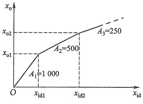

(a)
 

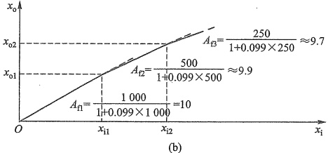

(b)
 

图 8.3.1 放大电路的传输特性
 

（a）开环传输特性 （b）闭环传输特性
 

应当注意的是，负反馈减小非线性失真所指的是反馈环内的失真。如果输入波形本身就是失真的，这时即使引入负反馈，也是无济于事的。

##### 8.3.3 抑制反馈环内噪声

对放大电路来说，噪声或干扰是有害的，下面介绍负反馈抑制噪声的原理。设在图8.3.2a的输入端，存在由该放大电路内部产生的折算到输入端的噪声或干扰电压 $ \dot{V}_{n} $ $ ^{①} $。由于信号和噪声都被放大了相同倍数，所以无反馈时电路的输出电压信噪比为

$$  \frac{S}{N}=\frac{|\dot{V}_{s}|}{|\dot{V}_{n}|}   \tag*{(8.3.4)}$$

<!-- page: 345 -->

为了提高电路的信噪比，在图8.3.2a的基础上，另外增加一增益为 $ A_{v2} $的前置级，并假定该级无噪声，然后对此整体电路加一反馈系数为 $ \dot{F}_{v} $的反馈网络（反馈信号可以取自输出电压或输出电流，所以没有画连接方式），如图8.3.2b所示。利用叠加原理分别求出 $ \dot{V}_{s} $和 $ \dot{V}_{n} $作用产生的输出电压 $ \dot{V}_{os} $和 $ \dot{V}_{on} $。当 $ \dot{V}_{n}=0 $时，根据式(8.2.5)可得引入负反馈后的输出信号电压

$$  \dot{V}_{os}=\frac{\dot{A}_{v1}\dot{A}_{v2}}{1+\dot{A}_{v1}\dot{A}_{v2}\dot{F}_{v}}\dot{V}_{s}   \tag*{(8.3.5a)}$$

当  $ \dot{V}_{s}=0 $ 时，反馈信号  $ (-F_{v}\dot{V}_{on}) $ 经过  $ \dot{A}_{v2} $ 后与  $ \dot{V}_{n} $ 叠加，然后再经过  $ \dot{A}_{v1} $ 产生  $ \dot{V}_{on} $，即  $ \dot{V}_{on}=(\dot{V}_{n}-\dot{A}_{v2}\dot{F}_{v}\dot{V}_{on})\dot{A}_{v1} $，则得引入负反馈后的输出噪声电压

$$  \dot{V}_{\mathrm{on}}=\frac{\dot{A}_{v1}}{1+\dot{A}_{v1}\dot{A}_{v2}\dot{F}_{v}}\dot{V}_{\mathrm{n}}   \tag*{(8.3.5b)}$$

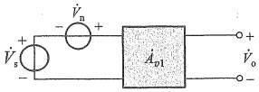

(a)
 

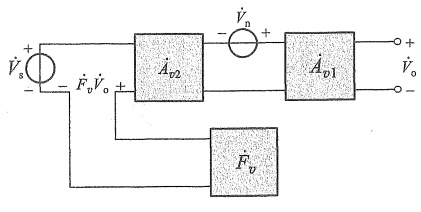

(b)
 

图 8.3.2 负反馈抑制反馈环内噪声的原理框图   (a) 无反馈 (b) 引入负反馈及前置级
 

由式 $  (8.3.5a)  $和式 $  (8.3.5b)  $可得引入负反馈后的输出信噪比为

$$  \left(\frac{S}{N}\right)_{f}=\left|\frac{\dot{V}_{os}}{\dot{V}_{on}}\right|=\left|\dot{A}_{v2}\right|\cdot\left|\frac{\dot{V}_{s}}{\dot{V}_{n}}\right|=\left|\dot{A}_{v2}\right|\cdot\frac{S}{N}   \tag*{(8.3.6)}$$

它比原有的信噪比提高了  $ \left|A_{v2}\right| $ 倍。必须注意的是，无噪声放大电路  $ A_{v2} $ 在实践中是很难做到的，但可使它的噪声尽可能小，如精选器件、调整参数、改进工艺等。

例如，一台扩音机的功率输出级常有交流噪声，来源于电源的50 Hz干扰。其前置级或电压放大级由稳定的直流电源供电，噪声或干扰较小，当对整个系统的后面几级外加一负反馈环时，对改善系统的信噪比具有明显的效果。

若噪声或干扰来自反馈环外，则引入负反馈也无济于事。

##### 8.3.4 对输入电阻和输出电阻的影响

放大电路中引入的交流负反馈的类型不同，则对输入电阻和输出电阻的影响也就不同，下面分别加以讨论。

<!-- page: 346 -->

### 1. 对输入电阻的影响

负反馈对放大电路输入电阻的影响取决于反馈网络输出端口与基本放大电路输入端口的连接方式，即取决于是串联还是并联负反馈，与输出回路中反馈的取样方式无直接关系（取样方式只改变 $ \overrightarrow{A}\overrightarrow{F} $的具体含义）。因此，分析负反馈对输入电阻的影响时，只需画出输入回路的连接方式，如图8.3.3所示。其中 $ R_{i} $是基本放大电路的输入电阻（开环输入电阻）， $ R_{if} $是负反馈放大电路的输入电阻（闭环输入电阻）。

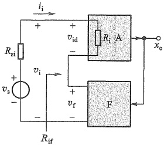

(a)
 

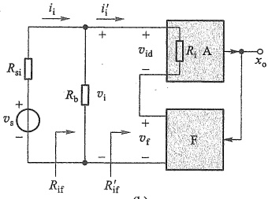

(b)
 

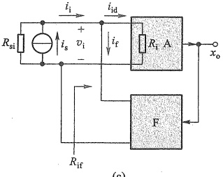

(c)
 

图 8.3.3 负反馈对输入电阻的影响
 

（a）串联反馈 （b）偏置电阻在反馈环之外时的串联负反馈电路方框图 （c）并联反馈
 

（1）串联负反馈对输入电阻的影响由图8.3.3a可知，开环输入电阻为

$$  R_{i}=\frac{v_{id}}{i_{i}}   \tag*{(8.3.7)}$$

有负反馈时的闭环输入电阻为

$$  R_{if}=\frac{v_{i}}{i_{i}}   \tag*{（8.3.8）}$$

而

$$  v_{\mathrm{i}}=v_{\mathrm{i d}}+v_{\mathrm{f}}=\left(1+A F\right)v_{\mathrm{i d}}   \tag*{（8.3.9）}$$

所以

$$  R_{\mathrm{i f}}=\left(1+A F\right)\frac{v_{\mathrm{i d}}}{i_{\mathrm{i}}}=\left(1+A F\right)R_{\mathrm{i}}   \tag*{（8.3.10）}$$

<!-- page: 347 -->

式(8.3.10)表明，引入串联负反馈后，输入电阻增加了。闭环输入电阻是开环输入电阻的 $ (1+AF) $倍。当引入电压串联负反馈时， $ R_{if}=(1+A_{v}F_{v})R_{i} $。当引入电流串联负反馈时， $ R_{if}=(1+A_{g}F_{r})R_{i} $。

需要指出的是，在某些负反馈放大电路中，有些电阻并不在反馈环内，如共射电路中的基极偏置电阻 $ R_{b} $，负反馈对它并不产生影响。这类电路的方框图如图8.3.3b所示，由图可知， $ R_{if}^{\prime}=(1+AF)R_{i} $，而整个电路的输入电阻 $ R_{if}=R_{b}\parallel R_{if}^{\prime} $。

##### （2）并联负反馈对输入电阻的影响

由图8.3.3c可见，在并联负反馈放大电路中，反馈网络的输出端口与基本放大电路的输入电阻并联，因此闭环输入电阻 $ R_{if} $小于开环输入电阻 $ R_{i} $。由于

$$  R_{i}=\frac{v_{i}}{i_{id}}   \tag*{(8.3.11)}$$

$$  R_{i i}=\frac{v_{i}}{i_{i}}   \tag*{（8.3.12）}$$

而

 $$ i_{\mathrm{i}}=i_{\mathrm{i d}}+i_{\mathrm{f}}=\left(\mathrm{~1+A F}\right)i_{\mathrm{i d}} $$ 

所以

$$  R_{if}=\frac{v_{i}}{\left(1+AF\right)i_{id}}=\frac{R_{i}}{1+AF}   \tag*{（8.3.13）}$$

式(8.3.13)表明，引入并联负反馈后，输入电阻减小了。闭环输入电阻是开环输入电阻的 $ 1/(1+AF) $。引入电压并联负反馈时，闭环输入电阻 $ R_{if}=\frac{R_{i}}{1+A_{r}F_{g}} $。引入电流并联负反馈时， $ R_{if}=\frac{R_{i}}{1+A_{i}F_{i}} $。

### 2. 对输出电阻的影响

负反馈对输出电阻的影响取决于反馈网络输入端口在放大电路输出回路的取样方式，即是电压还是电流负反馈。与反馈网络输出端口在放大电路输入回路的连接方式无直接关系（输入连接方式只改变AF的具体含义）。

##### （1）电压负反馈对输出电阻的影响

由于电压负反馈能使放大电路的输出电压趋于稳定，即从输出端口看进去更接近理想的电压源，其内阻更小。因此，电压负反馈可使放大电路的输出电阻减小。图8.3.4是求电压负反馈放大电路输出电阻的框图。其中 $ R_{0} $是基本放大电路的输出电阻（即开环输出电阻）， $ A_{0} $是基本放大电路在负载 $ R_{L} $开路时的增益。按照求放大电路输出电阻的方法，图中已令输入信号源 $ x_{a}=0 $，且忽略了信号源 $ x_{a} $的内阻 $ R_{si} $。将 $ R_{L} $开路（令 $ R_{L}=\infty $），在输出端加一测试电压 $ v_{t} $，于是，闭环输出电阻为

$$  R_{of}=\frac{v_{t}}{i_{t}}   \tag*{(8.3.14)}$$

为简化分析，假设反馈网络的输入电阻为无穷大，这样，反馈网络对放大电路输出端没有负载效应。由图8.3.4可得

$$  v_{\mathrm{t}}=i_{\mathrm{t}}R_{\mathrm{o}}+A_{\mathrm{o}}x_{\mathrm{id}}   \tag*{（8.3.15）}$$

$$  x_{id}=-Fv_{i}   \tag*{（8.3.16）}$$

而

<!-- page: 348 -->

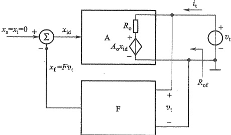

图 8.3.4 求电压负反馈放大电路输出电阻的框图
 

将式(8.3.16)代入式(8.3.15)得

$$  v_{\mathrm{t}}=i_{\mathrm{t}}R_{\mathrm{o}}-A_{\mathrm{o}}F v_{\mathrm{t}}   \tag*{(8.3.17)}$$

 $$ R_{of}=\frac{v_{t}}{i_{t}}=\frac{R_{o}}{1+A_{o}F} $$ 

于是得

式(8.3.18)表明，引入电压负反馈后，输出电阻减小了。闭环输出电阻是开环输出电阻的 $ 1/(1+A_{o}F) $倍。当引入电压串联负反馈时， $ R_{of}=\frac{R_{o}}{1+A_{so}F_{s}} $。当引入电压并联负反馈时， $ R_{of}=\frac{R_{o}}{1+A_{ro}F_{g}} $。

##### （2）电流负反馈对输出电阻的影响

由于电流负反馈能使输出电流趋于稳定，即从输出端口看进去更接近理想的电流源，其内阻更大。因此，电流负反馈可使放大电路的输出电阻增大。图8.3.5是求电流负反馈放大电路输出电阻的框图。其中 $ R_{0} $是基本放大电路的输出电阻， $ A_{s} $是基本放大电路在负载短路时的增益。同样，图中已令输入信号源 $ x_{s}=0 $，且忽略 $ x_{s} $的内阻 $ R_{si} $。将 $ R_{L} $开路，在输出端加一测试电压 $ v_{t} $，并假设反馈网络的输入电阻为零，于是它对放大电路输出端没有负载效应。由图8.3.5可得

 $$ \begin{aligned}{i_{\mathrm{t}}=}&{{}\frac{v_{\mathrm{t}}}{R_{\mathrm{o}}}+A_{\mathrm{s}}x_{\mathrm{i d}}=\frac{v_{\mathrm{t}}}{R_{\mathrm{o}}}-A_{\mathrm{s}}F i_{\mathrm{t}}}\\ {R_{\mathrm{o f}}}&{{}=\frac{v_{\mathrm{t}}}{i_{\mathrm{t}}}=\left(1+A_{\mathrm{s}}F\right)R_{\mathrm{o}}}\\ \end{aligned}. $$ 

于是

式(8.3.19)表明，引入电流负反馈后，输出电阻增加了。闭环输出电阻是开环输出电阻的 $ (1+A_{s}F) $倍。当引入电流串联负反馈时， $ R_{of}=(1+A_{gs}F_{r})R_{o} $。当引入电流并联负反馈时， $ R_{of}=(1+A_{is}F_{i})R_{o} $。

值得注意的是，与求输入电阻相类似，式（8.3.19）所求的是反馈环内的输出电阻。例如，图8.1.7d为电流串联负反馈， $ R_{c} $不在反馈环内，式（8.3.19）所求的输出电阻与 $ R_{c} $并联后才是实际的输出电阻。

<!-- page: 349 -->

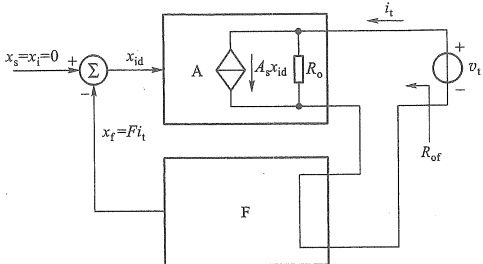

图.8.3.5 求电流负反馈放大电路输出电阻的框图
 

#### 8.3.5 扩展带宽

到目前为止，我们对反馈放大电路的讨论限于通带内，即假设放大电路的开环增益 A 和反馈系数 F 均与信号频率无关。然而，由第 6 章的讨论得知，由于电路中电抗性元件及半导体器件内部结电容的存在，任何放大电路的增益都是信号频率的函数，增益的大小和相移都是随频率变化的。另外，当反馈网络中含有电抗性元件时，反馈系数也是频率的函数。因此，反馈放大电路的增益也必然是信号频率的函数。

### 1. 频率响应的一般表达式

为了使问题简单化，我们设反馈网络由纯电阻组成，即反馈系数是与信号频率无关的实数，而且设放大电路在高频区和低频区各有一个转折频率（一个时间常数）。

由第6章已知，基本放大电路的高频响应表达式为

$$  \dot{A}_{\mathrm{~H~}}=\frac{\dot{A}_{~M}}{1+\mathrm{j}\frac{f}{f_{\mathrm{H}}}}   \tag*{(8.3.20)}$$

式中 $ A_{M} $为开环通带（中频区）增益； $ f_{H} $为开环上限频率。

引入负反馈后，由式（8.2.5）可知

$$  \dot{A}_{\mathrm{H f}}=\frac{\dot{A}_{\mathrm{H}}}{1+\dot{A}_{\mathrm{H}}F}   \tag*{(8.3.21)}$$

将式（8.3.20）代入式（8.3.21），得

$$  \dot{A}_{\mathrm{Hf}}=\frac{\frac{\dot{A}_{\mathrm{M}}}{1+\mathrm{j}}\frac{f}{f_{\mathrm{H}}}}{1+\frac{\dot{A}_{\mathrm{M}}F}{1+\mathrm{j}}\frac{f}{f_{\mathrm{H}}}}=\frac{\dot{A}_{\mathrm{M}}}{1+\mathrm{j}}\frac{f}{f_{\mathrm{H}}}+\dot{A}_{\mathrm{M}}F}=\frac{\dot{A}_{\mathrm{M}}/(1+\dot{A}_{\mathrm{M}}F)}{1+\mathrm{j}\frac{f}{(1+\dot{A}_{\mathrm{M}}F)f_{\mathrm{H}}}}=\frac{\dot{A}_{\mathrm{M}}}{1+\mathrm{j}}\frac{f}{f_{\mathrm{H}}}   \tag*{(8.3.22)}$$

式中

<!-- page: 350 -->

$$  \dot{A}_{m f}=\frac{\dot{A}_{m}}{1+\dot{A}_{m}F}   \tag*{(8.3.23)}$$

为闭环通带增益；

$$  f_{\mathrm{H f}}=\left(1+\dot{A}_{\mathrm{~M~}}F\right)f_{\mathrm{H}}   \tag*{(8.3.24)}$$

为闭环上限频率。

由式(8.3.23)可见，闭环通带增益是开环通带增益的 $ \frac{1}{1+\dot{A}_{M}F} $倍，但闭环增益的上限频率增加到开环增益上限频率的 $ (1+\dot{A}_{M}F) $倍[见式(8.3.24)]。不过对于不同组态的负反馈放大电路，其增益的物理意义不同，因而 $ f_{Hf}=(1+\dot{A}_{M}F)f_{H} $的含义也就不同。例如，对于电压并联负反馈放大电路，是将互阻增益的上限频率增加到 $ (1+\dot{A}_{rM}F_{g})f_{H} $。

利用上述推导方法，可以得到负反馈放大电路的低频响应表达式

$$  \dot{A}_{\mathrm{Mf}}=\frac{\dot{A}_{\mathrm{Mf}}}{1-\mathrm{j}\frac{f_{\mathrm{Mf}}}{f}}   \tag*{(8.3.25)}$$

式中  $ f_{Lf}=\frac{f_{L}}{1+\dot{A}_{M}F} $。显然引入负反馈后，下限频率减小了，减小的程度与反馈深度有关。

综上分析可知，引入负反馈后，放大电路的通频带展宽了，即

$$  B\mathbb{W}_{\mathrm{f}}=f_{\mathrm{H f}}-f_{\mathrm{L f}}\approx f_{\mathrm{H f}}   \tag*{(8.3.26)}$$

当放大电路的波特图中有多个转折频率，而且反馈网络不是纯电阻网络时，问题将复杂得多，但是通频带展宽的趋势不会变。

例 8.3.2 由标准运放构成的同相放大电路如图 8.3.6a 所示，设运放的开环低频电压增益  $ A_{v}=10^{5} $，开环上限频率  $ f_{H}=10 $ Hz，且 0 dB 以上只有这一个转折频率。

（1）试求当  $ R_{1} $ 分别为  $ 1 \, k\Omega $、 $ 11 \, k\Omega $ 和开路时的闭环电压增益和带宽。

（2）作出开环电压增益及 $ R_{1} $取不同值时闭环电压增益的幅频响应波特图。

解：（1）已知同相放大电路的闭环电压增益

$$  A_{vf}=1+\frac{R_{f}}{R_{1}}   \tag*{(8.3.27)}$$

根据  $ A_{vf}=\frac{A_{v}}{1+A_{v}F_{v}} $ 并考虑到  $ A_{vf}\leq A_{v} $，得到反馈系数

$$  F_{_{v}}=\frac{1}{A_{_{vf}}}-\frac{1}{A_{_{v}}}\approx\frac{1}{A_{_{vf}}}=\frac{R_{_{1}}}{R_{_{1}}+R_{_{f}}}   \tag*{(8.3.28)}$$

根据式(8.3.24)得

$$  f_{\mathrm{H f}}=\left(\begin{array}{c}1+A_{v}F_{v}\end{array}\right)f_{\mathrm{H}}   \tag*{(8.3.29)}$$

将已知参数代入式(8.3.28)~式(8.3.29)，便可求得  $ R_{1} $ 三种情况下的闭环通带增益和带宽如下：

<!-- page: 351 -->

$$ \omega r I Z; $$ 

 $$ R_{1}=11\mathrm{~k}\Omega:F_{v}=11/111,A_{v f2}=10.09,20\mathrm{l g}A_{v f2}\approx20\mathrm{~d B},f_{\mathrm{H f2}}\approx99.1\mathrm{~k H z}; $$ 

 $ R_{1} $ 开路: 是电压跟随器,  $ A_{v3} \approx 1 $,  $ 20\lg A_{v3} \approx 0 $ dB,  $ f_{H3} \approx 1 $ MHz;

（2）根据开环增益  $ 20\lg A_{v}=20\lg10^{5} $ dB = 100 dB 和上限频率  $ f_{H}=10 $ Hz，可作出波特图如图8.3.6b中的曲线①所示。同样，根据（1）计算的闭环结果作出三种情况下的幅频响应分别如图8.3.6b中的曲线②、③、④所示。

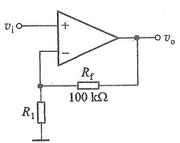

(a)
 

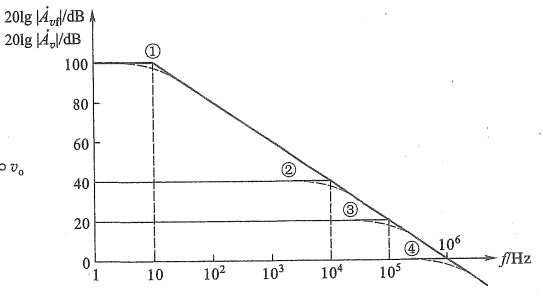

(b)
 

图8.3.6 例8.3.2的电路与幅频响应波特图 (a) 同相放大电路 (b) 波特图
 

上例说明，引入负反馈后，闭环增益下降，但通频带变宽，二者变化的程度均与反馈深度有关。负反馈越深，闭环增益下降得越多，而通频带则越宽。

### 2. 增益—带宽积

放大电路的增益与带宽的乘积的绝对值称为增益-带宽积。引入负反馈后，由式（8.3.23）、式（8.3.24）和式（8.3.26）得到放大电路的增益-带宽积为

$$  \mid\dot{A}_{\mathrm{~M~f~}}\cdot B W\mid\approx\mid\dot{A}_{\mathrm{~M~f~}}\cdot f_{\mathrm{H f}}\mid=\left|\frac{\dot{A}_{\mathrm{~M~}}}{1+\dot{A}_{\mathrm{~M~}}F}\cdot(1+\dot{A}_{\mathrm{~M~}}F)f_{\mathrm{H}}\right|=\mid\dot{A}_{\mathrm{~M~}}f_{\mathrm{H}}\mid   \tag*{（8.3.30）}$$

即闭环增益-带宽积等于开环增益带宽积，说明放大电路的增益-带宽积近似为常数。但要注意，这是在反馈网络是纯电阻网络，而且假设放大电路在高频区 0 dB 以上只有一个上限频率并忽略下限频率的条件下得到的。对标准运放构成的负反馈放大电路来说，它的增益-带宽积就等于运放的单位增益带宽  $ f_{r} $。例 8.3.2 验证了这个结论，三种情况下的增益带宽积基本相同，约为 1 MHz。它也是该运放的单位增益带宽（图 8.3.6b 中  $ 20\lg|\dot{A}_{r}| $ 与横轴交点的频率）。

上述结论启示我们，对于一个给定的放大电路，可以通过降低增益来增加带宽，反之亦然。同时也给我们另一个启示，当用选定的标准运

拓展文档8.1：用标准运放构成多级放大电路来扩展频带

放设计一个确定增益的放大电路时，采用多级实现比单级实现时的带宽更宽。例如，用例

<!-- page: 352 -->

8.3.2 中的两个运放，构成两个 10 倍增益的放大电路，将它们级联实现 100 倍增益，其带宽可达 64 kHz（扫码看扩展文档），高于用单级实现的 10 kHz。当然代价是运放及其他元件数量增加，电路复杂度提高。

### 3. 电流反馈型运放的闭环带宽

7.4.4 节曾经提到，对于电流反馈型运放，当改变电路的闭环增益时带宽不受影响，即增益带宽积不为常数。下面分析这种运放构成的放大电路的闭环增益与带宽。

电流反馈型运放构成的同相放大电路如图8.3.7a所示，图b画出了运放电路模型（参见图7.4.9a），其中在电路中高阻节点 $ c_{6,8} $处补充了高频时的等效电容 $ C_{eq} $（该处的时间常数最大，决定了运放开环上限频率）。

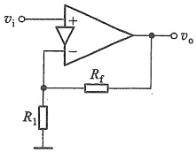

(a)
 

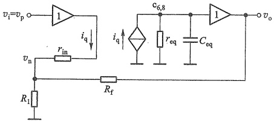

(b)
 

图 8.3.7 电流反馈型运放构成的同相放大电路
 

（a）同相放大电路 （b）用运放电路模型表示
 

由图 8.3.7b 电路可得

$$  \dot{V}_{\mathrm{~o~}}=\dot{I}_{\mathrm{~q~}}\bigg(r_{\mathrm{~e q~}}//\frac{1}{\mathrm{j}\omega C_{\mathrm{~e q~}}}\bigg)   \tag*{(8.3.31)}$$

因为通常有  $ r_{in} \ll R_{1} \parallel R_{f} $，所以可以忽略  $ r_{in} $ 上的压降，即  $ v_{n} \approx v_{p} = v_{i} $，此时  $ v_{n} $ 节点的 KCL

$$  \dot{I}_{\mathrm{~q~}}+\frac{\dot{V}_{\mathrm{~o~}}-\dot{V}_{\mathrm{~i~}}}{R_{\mathrm{f}}}=\frac{\dot{V}_{\mathrm{~i~}}}{R_{\mathrm{f}}}   \tag*{（8.3.32）}$$

由式（8.3.31）和式（8.3.32）得到电路的高频区闭环电压增益

 $$ \dot{A}_{_{vf}}=\frac{\dot{V}_{_{0}}}{\dot{V}_{_{i}}}=\left(1+\frac{R_{_{f}}}{R_{_{1}}}\right)\quad\cdot\quad\frac{1}{1+\mathrm{j}\omega R_{f}C_{_{eq}}+R_{f}/r_{_{eq}}} $$ 

由于  $ r_{eq} $ 是 MΩ 数量级，所以电路设计容易满足  $ R_{f} \ll r_{eq} $，则闭环增益近似为

$$  \dot{A}_{_{\mathrm{e f}}}\approx\left(1+\frac{R_{\mathrm{f}}}{R_{\mathrm{I}}}\right)\cdot\frac{1}{1+\mathrm{j}\omega R_{\mathrm{f}}C_{_{\mathrm{e q}}}}=A_{_{\mathrm{v M f}}}\cdot\frac{1}{1+\mathrm{j}\left(f/f_{\mathrm{H f}}\right)}   \tag*{（8.3.33）}$$

其中

$$  A_{_{v M f}}=1+\frac{R_{_{f}}}{R_{_{1}}}   \tag*{(8.3.34a)}$$

$$  f_{\mathrm{Hf}}=\frac{1}{2\pi R_{\mathrm{f}}C_{\mathrm{eq}}}   \tag*{(8.3.34b)}$$

 $ A_{vMf} $ 为闭环通带电压增益， $ f_{Hf} $ 就是闭环带宽（上限频率）。对比式（8.3.34a）和式（8.3.27）可

<!-- page: 353 -->

可以看出，电流反馈型运放电路的闭环通带增益与标准运放电路的完全相同。但是由式(8.3.34b)看出，它的闭环带宽除了与运放内部电路等效电容有关外，还与反馈电阻 $ R_{t} $有关。

由式(8.3.34)可知，当固定 $ R_{f} $，通过改变 $ R_{1} $而改变 $ A_{vMf} $时， $ f_{Hf} $不会改变，即电路的带宽不变，用幅频响应描述时如图8.3.8所示。这是电流反馈型运放独特的优势，它特别适合用来做宽带放大器，也特别适合用编程方法改变增益而带宽不变的场合。

当减小  $ R_{f} $ 并按一定比例同时减小  $ R_{1} $ 时，可以保持增益不变而扩展带宽。

但要注意，电阻值的选取要满足  $ r_{in} \ll R_{1} \parallel R_{f} $ 和  $ R_{f} \ll r_{eq} $。不仅如此，不同闭环增益下  $ R_{f} $ 有一个最佳值，如果  $ R_{f} $ 偏离最佳值太多，会影响通带增益的平坦度。所以电流反馈型运放使用起来要比标准运放复杂些。

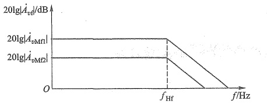

图 8.3.8 图 8.3.7a 电路固定  $ R_{f} $ 改变  $ R_{1} $ 时的闭环增益幅频响应
 

综上分析，可以得到这样的结论：负反馈之所以能够改善放大电路的多方面的性能，归根结底是由于将电路的输出量 $ (v_{0}\text{或}i_{0}) $引回到输入端与输入量 $ (v_{i}\text{或}i_{i}) $进行比较，从而随时对输出量进行调整。

前面讨论过的增益稳定性的提高、非线性失真的减小、抑制噪声、对输入电阻和输出电阻的影响以及扩展频带（除电流反馈型运放外），均可用自动调整作用来解释。反馈越深，即（1+AF）的值越大，调整作用越强，对放大电路性能的影响越大，但闭环增益下降也越多。

由此可知，负反馈对放大电路性能的影响，是以牺牲增益为代价的。另一方面，也必须注意到，反馈深度（1+AF）或环路增益AF的值也不能无限制增加，否则在多级放大电路中，将容易产生不稳定现象（自激振荡），这一问题将在8.6节讨论。因此，这里所得的结论在一定条件下才是正确的。

为了便于比较和应用，现将负反馈对各类放大电路性能的影响归纳于表8.3.1中。

表8.3.1 负反馈对各类放大电路性能的影响
 

<table border=1 style='margin: auto; word-wrap: break-word;'><tr><td style='text-align: center; word-wrap: break-word;'>反馈类型</td><td style='text-align: center; word-wrap: break-word;'>放大类型</td><td style='text-align: center; word-wrap: break-word;'>稳定的增益</td><td style='text-align: center; word-wrap: break-word;'>输入电阻  $ R_{sf} $</td><td style='text-align: center; word-wrap: break-word;'>输出电阻  $ R_{sf} $</td><td style='text-align: center; word-wrap: break-word;'>通频带</td></tr><tr><td style='text-align: center; word-wrap: break-word;'>电压串联</td><td style='text-align: center; word-wrap: break-word;'>电压</td><td style='text-align: center; word-wrap: break-word;'>$ A_{sf} $</td><td style='text-align: center; word-wrap: break-word;'>$ (1+A_{s}F_{v})R_{i} $ 增大</td><td style='text-align: center; word-wrap: break-word;'>$ R_{o}/(1+A_{so}F_{v}) $ 减小</td><td style='text-align: center; word-wrap: break-word;'>增宽</td></tr><tr><td style='text-align: center; word-wrap: break-word;'>电压并联</td><td style='text-align: center; word-wrap: break-word;'>互阻</td><td style='text-align: center; word-wrap: break-word;'>$ A_{rt} $</td><td style='text-align: center; word-wrap: break-word;'>$ R_{i}/(1+A_{r}F_{g}) $ 减小</td><td style='text-align: center; word-wrap: break-word;'>$ R_{o}/(1+A_{ro}F_{g}) $ 减小</td><td style='text-align: center; word-wrap: break-word;'>增宽</td></tr><tr><td style='text-align: center; word-wrap: break-word;'>电流串联</td><td style='text-align: center; word-wrap: break-word;'>互导</td><td style='text-align: center; word-wrap: break-word;'>$ A_{gt} $</td><td style='text-align: center; word-wrap: break-word;'>$ (1+A_{g}F_{r})R_{i} $ 增大</td><td style='text-align: center; word-wrap: break-word;'>$ (1+A_{gs}F_{r})R_{o} $ 增大</td><td style='text-align: center; word-wrap: break-word;'>增宽</td></tr><tr><td style='text-align: center; word-wrap: break-word;'>电流并联</td><td style='text-align: center; word-wrap: break-word;'>电流</td><td style='text-align: center; word-wrap: break-word;'>$ A_{if} $</td><td style='text-align: center; word-wrap: break-word;'>$ R_{i}/(1+A_{i}F_{i}) $ 减小</td><td style='text-align: center; word-wrap: break-word;'>$ (1+A_{is}F_{i})R_{o} $ 增大</td><td style='text-align: center; word-wrap: break-word;'>增宽</td></tr></table>

注：这里所列的  $ R_{if} $ 和  $ R_{of} $ 是指反馈环内的输入和输出电阻表达式。

<!-- page: 354 -->

##### 复习思考题

8.3.1 负反馈对放大电路增益的稳定性有何影响？反馈放大电路的闭环增益表达式（8.3.1）中  $ A_{f} \approx 1/F $ 的物理意义是什么？

8.3.2 在多级放大电路中，为了抑制噪声，为什么特别重视第一级的低噪声设计？若引入负反馈，则反馈环外的前置级的低噪声设计显得更为重要，何故？

8.3.3 在多级放大电路中，其输出级多属功率放大级，这时容易产生非线性失真或工频(50 Hz)干扰，试问用什么方法可以有效地改善上述工作情况？

8.3.4 负反馈对放大电路的输入电阻有何影响？

8.3.5 负反馈对放大电路的输出电阻有何影响？

8.3.6 引入负反馈后，放大电路的上、下限频率有何变化？带宽有何变化？

8.3.7 增益-带宽积为常数有哪些前提条件？电流反馈型运放电路遵循这一规律吗？

#### 8.4 深度负反馈条件下的近似计算

从原则上来说，反馈放大电路是一个带反馈回路的有源线性网络。利用大家都熟悉的电路理论中的节点电流法、回路电压法或二端口网络理论均可求解。但是，当电路较复杂时，这类方法使用起来很不方便。

本节从工程实际出发，讨论在深度负反馈的条件下，反馈放大电路增益的近似计算。

一般情况下，大多数负反馈放大电路，特别是由集成运放组成的放大电路都能满足深度负反馈的条件。

由图8.2.1所示方框图可得

$$  A_{f}=\frac{x_{o}}{x_{i}}   \tag*{(8.4.1)}$$

$$  \frac{1}{F}=\frac{x_{o}}{x_{s}}   \tag*{(8.4.2)}$$

前面讨论过，在深度负反馈条件下闭环增益 $ A_{f}\approx\frac{1}{F} $，所以有

$$  x_{i}\approx x_{f}   \tag*{(8.4.3)}$$

此式表明，当 $ (1+AF)\gg1 $时，反馈信号 $ x_{f} $与输入信号 $ x_{i} $相差甚微，净输入信号 $ x_{id} $甚小，因而有

$$  x_{id}=x_{i}-x_{f}\approx0   \tag*{(8.4.4)}$$

对于串联负反馈有  $ v_{i} \approx v_{f}, v_{id} \approx 0 $，因而在基本放大电路输入电阻上产生的输入电流也必然趋于零，即  $ i_{id} \approx 0 $。对于并联负反馈有  $ i_{i} \approx i_{f}, i_{id} \approx 0 $，因而在基本放大电路输入电阻上产生的输入电压  $ v_{id} \approx 0 $。总之，不论是串联还是并联负反馈，在深度负反馈条件下，均有  $ v_{id} \approx 0 $（虚短）和  $ i_{id} \approx 0 $（虚断）同时存在。利用“虚短”“虚断”的概念可以快速方便地估算出负反馈放大电路的闭环增益或闭环电压增益。下面举例说明。

例 8.4.1 设图 8.4.1 所示电路满足  $ (1+AF) \gg 1 $ 的条件，试写出该电路的闭环电压增益表达式。

<!-- page: 355 -->

解：图8.4.1所示电路是一多级放大电路，电阻 $ R_{1} $和 $ R_{2} $组成反馈网络。在放大电路的

输出回路，反馈网络接至信号输出端，用输出短路法判断是电压反馈；在放大电路的输入回路，输入信号加在 $ T_{1} $的栅极，反馈信号 $ v_{f} $加在 $ T_{2} $的栅极，净输入信号 $ v_{id}=v_{i}-v_{f} $，是串联反馈；用瞬时极性法可判断该电路为负反馈。由于是深度负反馈，利用“虚短”和“虚断”，即 $ v_{i}\approx v_{f},i_{g1}=i_{g2}\approx0 $，可直接写出

 $$ v_{i}\approx v_{f}=\frac{R_{1}}{R_{1}+R_{2}}v_{o} $$ 

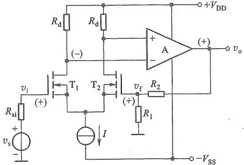

图 8.4.1 例 8.4.1 的电路
 

于是得闭环电压增益

 $$ A_{vf}=\frac{v_{o}}{v_{i}}\approx1+\frac{R_{2}}{R_{1}} $$ 

例 8.4.2 试写出图 8.4.2 所示电路的闭环增益和闭环电压增益表达式。解：显然，图 8.4.2 所示电路中  $ R_{f} $ 是反馈元件。

由图中所标各有关点的交流电位的瞬时极性及各有关支路的交流电流的瞬时流向，可以判断  $ R_{f} $ 引入了负反馈。又从反馈在放大电路输出端的电压取样方式和输入端的电流求和方式可知，该电路是电压并联负反馈放大电路。它的内部含有一个集成运放，因而开环增益很大，能够满足  $ (1+AF)\gg1 $ 的条件，根据虚断概念有  $ i_{id}\approx0, i_{f}\approx i_{1} $，即  $ (v_{i}-v_{n})/R_{1}\approx(v_{n}-v_{o})/R_{f}, v_{p}=0 $。由虚短概念得  $ v_{n}\approx v_{p}=0 $，所以闭环增益

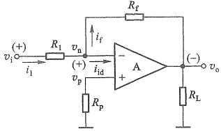

图 8.4.2 例 8.4.2 的电路
 

 $$ A_{r\mathrm{f}}=\frac{v_{\mathrm{o}}}{i_{\mathrm{l}}}=\frac{v_{\mathrm{o}}}{i_{\mathrm{f}}}=-R_{\mathrm{f}} $$ 

闭环电压增益

 $$ A_{_{vf}}=\frac{v_{_{0}}}{v_{_{i}}}=\frac{v_{_{0}}}{R_{_{1}}i_{_{1}}}=\frac{1}{R_{_{1}}}A_{_{rf}}=-\frac{R_{_{f}}}{R_{_{1}}} $$ 

例 8.4.3 共源极放大电路如图 8.4.3 所示。试近似计算它的闭环电压增益  $ A_{vf} $。

解：此电路中由  $ R_{s} $ 引入电流串联负反馈。利用虚短、虚断的概念，可直接计算其闭环电压增益。按照图中各电压、电流的参考方向，可得  $ v_{i} \approx v_{f} = i_{s} R_{s} \approx i_{o} R_{s} $，而  $ v_{o} \approx -i_{o} R_{d} $，故得闭环电压增益

 $$ A_{_{vf}}=\frac{v_{_{0}}}{v_{_{i}}}\approx\frac{v_{_{0}}}{v_{_{f}}}\approx-\frac{R_{_{d}}}{R_{_{s}}} $$ 

将上式与式(4.4.10)做比较可知，当 $ g_{m}R_{s}\gg1 $时，式(4.4.10)即可简化成上式。

例 8.4.4 设图 8.4.4 所示电路满足深度负反馈的条件，近似计算它的闭环电流增益和

<!-- page: 356 -->

闭环电压增益，并定性地分析它的输入电阻。

解：该电路与图8.1.14电路类似，引入了电流并联负反馈。在深度负反馈的条件下，有 $ i_{i}\approx i_{f},i_{id}\approx0,v_{n}\approx v_{p}=0 $ 。由此得

 $$ i_{f}=\frac{R}{R_{f}+R}i_{o} $$ 

所以闭环电流增益

 $$ A_{i i}=\frac{i_{o}}{i_{i}}\approx\frac{i_{o}}{i_{f}}=\frac{R_{f}+R}{R} $$ 

闭环电压增益

 $$ A_{_{vf}}=\frac{v_{_{o}}}{v_{_{s}}}=\frac{-R_{_{L}}i_{_{o}}}{R_{_{si}}i_{_{i}}}=-\frac{R_{_{L}}}{R_{_{si}}}\cdot\frac{i_{_{o}}}{i_{_{i}}}=-\frac{R_{_{L}}}{R_{_{si}}}\cdot\frac{R_{_{f}}+R}{R} $$ 

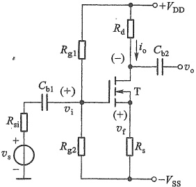

图 8.4.3 例 8.4.3 的电路
 

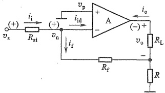

图 8.4.4 例 8.4.4 的电路
 

输入电阻的定性分析：由于  $ R_{si} $ 是信号源内阻，所以端口电压是  $ v_{n} $，考虑到  $ v_{n} \approx 0 $，所以该电路的输入电阻近似地表示为  $ R_{if} \approx v_{n}/i_{i} \approx 0 $，接近于理想值。从负反馈效果最佳的角度考虑，这种电路适合于放大高内阻的电流源信号。

例 8.4.5 图 8.4.5 所示为某反馈放大电路的交流通路。电路的输出端通过电阻  $ R_{f} $ 与电路的输入端相连，形成大环反馈。（1）试判断电路中大环反馈的组态；（2）判断  $ T_{2} $ 和  $ T_{3} $ 之间所引反馈的极性；（3）求深度负反馈条件下该电路闭环互阻增益的近似表达式；（4）定性分析该电路的输入电阻和输出电阻。

解：（1）首先用瞬时极性法判断该反馈的极性。设电流源  $ i_{s} $ 的流向如图中箭头所示，则由此引起的电路中各支路电流的流向亦如图中箭头所示；而各节点电压的极性如图中（+）、（-）号所示，净输入电流  $ i_{id}=i_{b1}=i_{i}-i_{f} $ 比没有该反馈时减小了，因此， $ R_{f} $ 引入负反馈。根据  $ R_{f} $ 在电路输出端、输入端的连接方式可知，该反馈为电压并联负反馈。

（2）设  $ T_{2} $ 基极电压的瞬时极性为  $ (-) $，则  $ T_{3} $ 的基极为  $ (+) $，其发射极也为  $ (+) $，由  $ R_{2} $ 引回到  $ T_{2} $ 发射极的反馈信号的极性也为  $ (+) $，于是使  $ T_{2} $ 的净输入电压  $ v_{be2} $ 增加，说明  $ T_{2} $、 $ T_{3} $ 间引入的是正反馈。

<!-- page: 357 -->

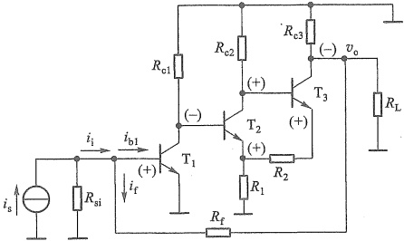

图 8.4.5 例 8.4.5 的电路
 

（3）在深度负反馈条件下，由虚断得  $ i_{i} \approx i_{f}, i_{b1} \approx 0 $ 。由虚短得  $ v_{b1} \approx v_{e1} = 0 $ ，于是  $ i_{i} \approx i_{f} \approx \frac{-v_{o}}{R_{f}} $ ，闭环互阻增益  $ A_{rf} = \frac{v_{o}}{i_{i}} \approx -R_{f} $ 。

（4）并联负反馈使 $ R_{if} $减小。在深度负反馈条件下， $ v_{bel}\approx0 $，故 $ R_{if}=\frac{v_{bel}}{i_{i}}\approx0 $。由于电压负反馈的特点是使输出电压更加稳定，故该电路的闭环输出电阻 $ R_{of} $很小，其值趋近于0。

在深度负反馈条件下，放大电路的闭环增益也可由  $ A_{f}=\frac{1}{F} $ 求得。

例 8.4.6 电路如图 8.4.6 所示。MOS 管参数： $ K_{n}=10\ mA/V^{2} $， $ K_{p}=4\ mA/V^{2} $， $ V_{TN}=1\ V $， $ V_{TP}=-1.149\ V $， $ \lambda=0 $。

（1）判断电路中极间反馈组态，近似计算闭环电压增益  $ A_{vf}=v_{0}/v_{s} $，定性分析输入电阻  $ R_{i} $ 和  $ R_{if} $。

（2）试运用 SPICE 求：电路的闭环电压增益  $ A_{vf} $ 和输出电阻  $ R_{of} $。去掉  $ R_{f} $，电路的开环电压增益  $ A_{v} $ 和输出电阻  $ R_{o} $。

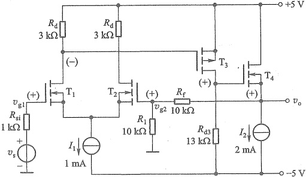

图 8.4.6 例 8.4.6 的电路
 

<!-- page: 358 -->

解：（1）电路中  $ R_{f} $、 $ R_{1} $ 引入电压串联负反馈。深度负反馈条件下利用虚短和虚断，有  $ v_{s} \approx v_{g1} \approx v_{g2} = \frac{R_{1}}{R_{1} + R_{f}} v_{0} $，所以

 $$ A_{_{ef}}=\frac{v_{_{o}}}{v_{_{i}}}\approx\frac{v_{_{o}}}{v_{_{s}}}=\frac{R_{_{1}}+R_{_{f}}}{R_{_{1}}}=2 $$ 

仿真说明文档8.1：

例 8.4.6 电路的仿真

由于 MOS 管的栅极电阻趋于无穷，所以电路的输入电阻  $ R_{i} $ 和  $ R_{if} $ 趋于无穷。

（2）用 SPICE 仿真分析有反馈电阻  $ R_{f} $ 与去掉  $ R_{f} $ 的结果列于表 8.4.1 中。电路引入的是电压串联负反馈，由于  $ A_{v}=237, F=R_{1}/(R_{1}+R_{f})=0.5 $，则  $ 1+AF\approx120 $，所以引入反馈后，电压增益和输出电阻均约为原值的 1/120。仿真结果与理论计算基本一致。

表 8.4.1 例 8.4.6 电路 SPICE 仿真分析结果
 

<table border=1 style='margin: auto; word-wrap: break-word;'><tr><td style='text-align: center; word-wrap: break-word;'>条件</td><td style='text-align: center; word-wrap: break-word;'>电压增益</td><td style='text-align: center; word-wrap: break-word;'>输出电阻</td></tr><tr><td style='text-align: center; word-wrap: break-word;'>无  $ R_{{f}} $</td><td style='text-align: center; word-wrap: break-word;'>237</td><td style='text-align: center; word-wrap: break-word;'>98.6  $ \Omega $</td></tr><tr><td style='text-align: center; word-wrap: break-word;'>有  $ R_{{f}} $</td><td style='text-align: center; word-wrap: break-word;'>1.98</td><td style='text-align: center; word-wrap: break-word;'>0.83  $ \Omega $</td></tr><tr><td style='text-align: center; word-wrap: break-word;'>$ A_{{af}}/A_{{v}} $ 或  $ R_{{af}}/R_{{o}} $</td><td style='text-align: center; word-wrap: break-word;'>1/120</td><td style='text-align: center; word-wrap: break-word;'>1/119</td></tr></table>

##### 复习思考题

8.4.1 在负反馈放大电路中，什么叫虚短和虚断？其物理实质是什么？

8.4.2 深度负反馈条件下，如何估算放大电路的闭环增益及闭环电压增益？

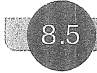

#### 8.5 负反馈放大电路设计

在放大电路中引入适当的负反馈，可以影响电路的许多性能，而且反馈的组态不同，所产生的影响也各不相同。因此，在设计负反馈放大电路时，应根据实际需要和设计目标引入合适的负反馈。

##### 8.5.1 设计负反馈放大电路的一般步骤

### 1. 选定需要的反馈类型

选择反馈类型可参照下面的一些原则。

（1）根据信号源的性质选择串联负反馈或并联负反馈。当信号源为电压源时，为了减小信号源内阻的电压损耗，使放大电路获得尽可能大的输入电压，需要尽可能增大放大电路的输入电阻，应引入串联负反馈。当信号源为电流源时，为了使放大电路获得尽可能大的输入电流，必须减小放大电路的输入电阻，应选择并联负反馈。

（2）根据对放大电路输出信号的要求，选择电压负反馈或电流负反馈。当要求放大电路输出稳定的电压信号时，应选择电压负反馈。而要求输出稳定的电流信号时，则应选择电流负反馈。

<!-- page: 359 -->

（3）根据表8.3.1中列出的四种反馈放大电路的功能，选择合适的反馈组态。例如，若要求电路接近理想的电压放大电路，则应该选择电压串联负反馈放大电路；若要求将电压信号转换为电流信号，则应该选择电流串联负反馈放大电路；等等。

上述原则是针对交流负反馈而言的，若要稳定放大电路的静态工作点，则应在电路中引入直流负反馈。

### 2. 确定反馈系数的大小

通常情况下，假设引入的是深度负反馈，由设计指标及 $ A_{f}\approx\frac{1}{F} $的关系确定反馈系数F的大小。

### 3. 适当选择反馈网络中的电阻阻值

多数情况下，反馈网络由电阻或电阻和电容组成。一个给定的反馈系数值，往往可由不同的电阻值组合获得。例如，当电压反馈系数  $ F_{v}=\frac{R_{1}}{R_{1}+R_{2}}=0.1 $ 时，可以取  $ R_{1}=1\ \Omega, R_{2}=9\ \Omega $，也可以取  $ R_{1}=0.3\ k\Omega, R_{2}=2.7\ k\Omega $ 等。为满足设计要求，必须适当选择反馈网络中的电阻值，以减小反馈网络对放大电路输入端口和输出端口的负载效应（即影响）。

显然，反馈类型不同，对反馈网络中电阻值的要求也就不同。在串联负反馈中，当反馈网络输出端口的等效阻抗远小于基本放大电路的输入阻抗时，它对放大电路输入端口的影响才能被忽略（因两个阻抗是串联的，见图8.1.5a）。相反，在并联负反馈中，当反馈网络输出端口的等效阻抗远大于基本放大电路的输入阻抗时，它对放大电路输入端口的影响才能被忽略（因两个阻抗是并联的，见图8.1.5b）。

为减小反馈网络输入端口对放大电路输出端口的负载效应，在电压负反馈中，因两个端口是并联的（见图8.1.6a），反馈网络输入端口的等效阻抗应远大于基本放大电路的输出阻抗；而电流负反馈中，因两个端口是串联的（见图8.1.6b），反馈网络输入端口的等效阻抗应远小于基本放大电路的输出阻抗。

### 4. 用 SPICE 分析设计的电路，检验是否符合设计目标

下面结合例题说明以上设计过程。

##### 8.5.2 设计举例

例 8.5.1 用集成运放设计一个负反馈放大电路，它的输入信号来自一个内阻  $ R_{si} = 2 \, k\Omega $ 的电压源  $ v_{s} $，负载电阻  $ R_{L} = 50 \, \Omega $。要求该电路向负载提供的输出电压  $ v_{o} = 10v_{s} $，且当负载变化时，输出电压趋于稳定。设计中所用集成运算放大器的参数为  $ A_{vo} = 10^{5} $,  $ R_{i} = 200 \, k\Omega $,  $ R_{o} = 100 \, \Omega $。设计合适的反馈网络，并用 SPICE 检验设计结果。

##### 解：（1）选择反馈类型

因为所用信号源是内阻  $ R_{si}=2\ k\Omega $ 的电压源，为减小放大电路对信号源的负载效应，待设计的反馈放大电路必须有很高的输入电阻，因此，选择同相输入的放大电路，同时电路中引入串联负反馈。

根据设计要求，当负载变化时，输出电压趋于稳定。因此，电路中必须引入电压负反馈。

<!-- page: 360 -->

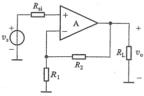

(a)
 

(b)
 

图 8.5.1 例 8.5.1 的电路图
 

（a）电压串联负反馈放大电路 （b）图8.5.1a的小信号等效电路
 

综上所述，需要设计一个近乎理想的电压放大电路，其电路结构如图8.5.1a所示，图8.5.1b所示为其小信号等效电路。

##### （2）确定反馈系数  $ F_{v} $

由设计要求知，该反馈放大电路的闭环源电压增益  $ A_{v_{sf}}=\frac{v_{o}}{v_{s}}=10 $，又  $ A_{v_{sf}}=\frac{v_{o}}{v_{i}}\cdot\frac{v_{i}}{v_{s}}=A_{vf}\cdot\frac{R_{if}}{R_{vi}+R_{if}} $。已知  $ R_{i}\gg R_{vi} $，而闭环输入电阻  $ R_{if}=(1+A_{vo}F_{v})R_{i} $，所以有  $ A_{v_{sf}}\approx A_{vf} $。又因在深度负反馈条件下  $ A_{vf}\approx\frac{1}{F_{v}}\approx A_{vf}=10 $，所以  $ F_{v}=0.1 $。

由此可得反馈深度  $ 1+A_{vo}F_{v}=1+10^{5}\times0.1\approx10^{4}\gg1 $。 $ R_{if}=(1+A_{vo}F_{v})R_{i}=10^{4}\times200\ k\Omega=2\times10^{6}\ k\Omega $，很大。而闭环输出电阻  $ R_{of}=R_{o}/(1+A_{vo}F_{v})=0.01\ \Omega $，很小。这样的输入电阻和输出电阻几乎是理想的，因此可以确保负载变化时，输出电压基本不变。

##### （3）确定反馈网络中 $ R_{1} $、 $ R_{2} $的阻值

因为  $ F_{s}=\frac{R_{1}}{R_{1}+R_{2}}=0.1 $ ，所以  $ R_{2}/R_{1}=9 $ 。另外，为消除运放输入偏置电流产生的误差，应使运放两输入端等效电阻相等，即  $ R_{1}\parallel R_{2}=R_{si}=2\ k\Omega $ 。解得  $ R_{1}=2.2\ k\Omega, R_{2}=19.8\ k\Omega $ 。

由图8.5.1b可见，在放大电路的输出端，反馈网络也是放大电路的负载，为了减小反馈网络对放大电路输出端的负载效应，要求 $ R_{2}+R_{1}\gg R_{0} $。同时，由于反馈网络输出端口与放大电路输入端口串联作为信号源的负载，为了减小反馈网络对信号源的负载效应，要求 $ R_{1}\parallel R_{2}\ll R_{i} $。

 $ R_{1} $、 $ R_{2} $的选择可以满足上述要求。实际电路中， $ R_{2} $可用一个小阻值的可变电阻串联一个固定电阻替代，以减小电阻公差对闭环增益精度的影响。

##### （4）用 SPICE 分析检验设计结果

采用图8.5.1a所示电路，将参数代入进行仿真（扫码看仿真说明文档），结果如下：

闭环源电压增益： $ A_{v_{sf}} = 9.998 $，即  $ v_{o} = 9.999v_{s} $，与设计要求相对误差为 0.02%。

闭环输入电阻： $ R_{if} = 1572\ M\Omega $。

<!-- page: 361 -->

闭环输出电阻： $ R_{of}=0.008\ \Omega $，远小于50 $ \Omega $的负载电阻。负载变化时，输出电压几乎不变。

下面介绍一个光电信号传输系统，然后为系统中的光电隔离器设计带负反馈的驱动放大电路。光电隔离器可由3.5.4节介绍的发光二极管和光电二极管构成，由光电隔离器构成的光电信号传输系统的基本组成如图8.5.2所示。利用光电隔离器可以实现输入、输出回路间没有直接电气连接的信号传输。

仿真说明文档8.2：例8.5.1电路的仿真

图 8.5.2 光电信号传输系统的基本组成
 

发光二极管 LED 也具有单向导电性，其电流方程与普通二极管的电流方程相似，外加正向电压使电流足够大时，LED 会发光。发光强度与 LED 的正向电流成正比。不同颜色 LED 的正向压降不同，通常为 1.5~2 V，高亮管达到 3.6 V，普通 LED 的导通电流为 2~10 mA，高亮的导通电流达 20 mA。

光电隔离器中的光电二极管(图中  $ D_{2} $) 接收到 LED 发出的光后，会将其转换为电流，此电流的大小与入射光的照度成正比。

由于 LED 的发光强度与正向电流成正比，而 LED 的 I-V 特性是非线性的，所以如果将输入电压直接加在 LED 上，则不能保证信号传输的线性关系。为了使流过 LED 的电流与输入电压  $ v_{s} $ 呈线性关系，需要设计驱动 LED 的互导放大器电路。

同理，在输出回路中，为了使输出电压与光电二极管的电流具有线性关系，需要设计互阻放大器。

例 8.5.2 试设计图 8.5.2 所示光电传输系统中的互导放大器和互阻放大器。信号源电压  $ v_{s} $ 的变化范围为  $ 0 \sim 5 $ V，内阻  $ R_{si} = 500 $  $ \Omega $。负载电阻  $ R_{L} = 500 $  $ \Omega $。所用集成运放的开环增益  $ A_{vo} = 10^{5} $，开环输入电阻  $ R_{i} = 200 $ k $ \Omega $，开环输出电阻  $ R_{o} = 100 $  $ \Omega $。

（1）设计互导放大器可以将  $ 0 \sim 5 $ V 的电压  $ v_s $ 线性地转换为  $ 0 \sim 5 $ mA 电流，以驱动 LED。设计后用 SPICE 检验发光二极管的电流。

（2）设计互阻放大器能将流过光电二极管  $ D_{2} $ 的  $ 0\sim50\ \mu A $ 电流线性地转换为  $ 0\sim5\ V $ 输出电压。设计后用 SPICE 检验光电二极管的电流及电压。

解：（1）因为输入信号来自一个有内阻的电压源，所以需要设计一个高输入电阻的放大电路，即需要引入串联负反馈，以减小放大电路对信号源的负载效应。又因为要求向LED提供0~5mA且不失真的电流，所以需要引入电流负反馈。

综上所述，需要设计一个电流串联负反馈放大电路。可采用图8.5.3a所示的电路结构。

由设计要求知，该反馈放大电路的闭环源互导增益  $ A_{gsf}=\frac{i_{01}}{v_{S}}=5\ mA/5\ V=1\ mS=10^{-3}\ S $ 而  $ A_{gsf}=\frac{i_{01}}{v_{1}}\cdot\frac{v_{1}}{v_{S}}=A_{gf}\cdot\frac{R_{if}}{R_{si}+R_{if}} $，但  $ R_{if}=\left(1+A_{vo}F_{v}\right)R_{i}\gg R_{si} $，所以有  $ A_{gsf}\approx A_{gf} $。又因在深度负反

<!-- page: 362 -->

(a)
 

(b)
 

(c)
 

(d)
 

(e)
 

图 8.5.3 例 8.5.2 的图
 

（a）互导放大电路 （b）LED 的仿真波形 （c）互阻放大电路
 

（d）光电二极管仿真模型 （e）光电二极管电流及输出电压的仿真波形
 

<!-- page: 363 -->

馈条件下  $ A_{gf} \approx \frac{1}{F_{r}} \approx A_{gf} = 1 \, mS $，所以  $ F_{r} \approx 1 \, k\Omega $。又因为  $ F_{r} = \frac{v_{F}}{i_{01}} = \frac{i_{01} R_{f}}{i_{01}} = R_{f} $，故取  $ R_{f} = 1 \, k\Omega $。

现在用 SPICE 验证设计结果，得到 LED 的电压和电流波形如图 8.5.3b 所示。由图可见，LED 两端的电压  $ v_{01} $（即仿真波形中的  $ V(Vd1)-V(Vd2) $）波形失真很严重，这是由于 LED 的 I-V 特性的非线性引起的。LED 的电流几乎是理想的正弦波，且有  $ i_{01}=10^{-3}v_{s} $。说明设计的放大电路符合设计要求。

（2）光电二极管在反相电压作用下工作，并且其电流的大小与入射光的照度成正比，短路电流可达数十至数百  $ \mu $A。为了减小对光电二极管的影响，互阻放大电路的输入电阻要尽可能小，同时为了稳定输出电压，输出电阻也要尽可能小，因此应在放大电路中引入电压并联负反馈。其电路结构如图8.5.3c所示。其中直流电源  $ V_{bias} $ 是光电二极管工作时需要的反向偏置电压。

由已知条件可求得互阻放大电路的闭环互阻增益  $ A_{rf}=\frac{v_{0}}{i_{I2}}=5\ V/50\ \mu A=10^{5}\ \Omega $

在深度负反馈条件下, $ A_{rf}=R_{f} $，所以选择 $ R_{f}=100\ k\Omega $。

最后，用 SPICE 对设计的电路进行仿真。光电二极管模型如图 8.5.3d 所示，其中 D 为理想二极管， $ i_{SC} $ 是被辐射光激发的电流源， $ i_{L} $ 是表示光电二极管漏电流，可以忽略。 $ C_{PD} $ 是结电容，可取 50 pF。 $ R_{PD} $ 是寄生的暗电阻，典型值为 1 000 MΩ。串联寄生电阻  $ R_{S} $ 的典型值为 100 Ω。用模型代替图 8.5.3c 光电二极管，得到光电二极管电流及输出电压的仿真波形如图 8.5.3e 所示。由图可见，该电路的输入电流与输出电压满足 0~50 μA 到 0~5 V 的线性转换关系。

仿真说明文档8.3：例8.5.2电路的仿真

拓展文档8.2：脉搏血氧仪的LED驱动电路

实际光电耦合器的光敏器件除光电二极管外，还有光电三极管等，可以对信号进行放大。限于篇幅更多内容不再赘述。

##### 复习思考题

8.5.1 设计负反馈放大电路时，如何选择反馈类型？

8.5.2 设计何种类型的反馈放大电路才能使其既可以从信号源获得尽可能大的电流，又能稳定输出电流？

8.5.3 减小放大电路对信号源的负载效应与减小反馈网络输出端对信号源的负载效应是同一个概念吗？为什么？

### 6 负反馈放大电路的稳定性

从前面的讨论得知，交流负反馈对放大电路性能的影响程度由负反馈深度的大小决定，1+AF 越大，放大电路的性能越好。然而反馈过深时，不但不能改善放大电路的性能，反而会使电路产生自激振荡而不能稳定地工作。下面先分析产生自激振荡的原因，研究负反馈放大电路稳定工作的条件，然后介绍消除自激振荡的方法——频率补偿。

<!-- page: 364 -->

##### 8.6.1 负反馈放大电路的自激振荡及稳定工作的条件

### 1. 产生自激振荡的原因

前面讨论的负反馈放大电路都是假定其工作在通带内（中频区），这时电路中各个电抗性元件的影响均可忽略。按照定义，引入负反馈后，放大电路的净输入信号 $ \dot{X}_{id}(=\dot{X}_{i}-\dot{X}_{f}) $将减小，因此， $ \dot{X}_{f} $与 $ \dot{X}_{i} $必然是同相的，即有 $ \varphi_{a}+\varphi_{f}=2n\times180^{\circ},n=0,1,2,\cdots $（ $ \varphi_{a},\varphi_{f} $分别是 $ \dot{A} $、 $ \dot{F} $的相角）。

可是，在高频区或低频区，电路中各种电抗性元件的影响不能再被忽略。A、F是频率的函数，它们的幅值和相位都会随频率而变化。相位的改变，使 $ \dot{X}_f $与 $ \dot{X}_i $不再同相，产生了附加相移（ $ \Delta\varphi_a + \Delta\varphi_f $）。可能在某一频率下， $ \dot{A} $、 $ \dot{F} $的附加相移达到 $ 180^\circ $，使 $ \varphi_a + \varphi_f = (2n+1) \times 180^\circ $。这时， $ \dot{X}_f $与 $ \dot{X}_i $必然由通带内的同相变为反相，使放大电路的净输入信号增大，放大电路中引入的负反馈就变成了正反馈。

当正反馈较强以致 $ \dot{X}_{id} = -\dot{X}_f = -\dot{A}\dot{F}\dot{X}_{id} $，也就是 $ \dot{A}\dot{F} = -1 $时，即使没有输入信号，输出端也会产生输出信号，电路产生自激振荡，如图8.6.1所示，这时电路会失去正常的放大作用。环路增益 $ \dot{AF} $表示信号在环路上绕行一周的增益（不含求和环节的-1）。

实际上，需要放大的信号通常都是在通带内的，不会出现 $ 180^{\circ} $的附加相移。而电路中噪声的频谱分布非常广，总会有某一频

图 8.6.1 负反馈放大电路的自激振荡现象
 

率的噪声，使AF产生 $ 180^{\circ} $的附加相移。当正反馈足够强时，便会出现自激振荡。

### 2. 自激振荡的条件

由上述分析可知，负反馈放大电路产生自激振荡的条件是环路增益

$$  \dot{A}\dot{F}=-1   \tag*{(8.6.1)}$$

它包括幅值条件和相位条件，即

$$  \left\{\begin{aligned}&\mid\dot{A}\dot{F}\mid=1\\ &\varphi_{\mathrm{a}}+\varphi_{\mathrm{f}}=\left(2n+1\right)\times180^{\circ},n=0,1,2,\cdots\end{aligned}\right.   \tag*{(8.6.2)}$$

为了突出附加相移，相位条件也常写为

$$  \Delta\varphi_{a}+\Delta\varphi_{f}=\pm180^{\circ}   \tag*{(8.6.3)}$$

当幅值条件和相位条件同时满足时，负反馈放大电路就会产生自激振荡。在  $ \Delta\varphi_{a} + \Delta\varphi_{f} = \pm180^{\circ} $ 及  $ \left|\dot{A}\dot{F}\right| > 1 $ 时，更加容易产生自激振荡。

### 3. 稳定工作的条件

由自激振荡的条件可知，如果频率变化时，环路增益AF的幅值条件和相位条件不能同

<!-- page: 365 -->

时满足，负反馈放大电路就不会产生自激振荡。故负反馈放大电路稳定工作的条件是：

 $$ \left\{\begin{aligned}\left|\dot{A}\dot{F}\right|=1\\ \left|\Delta\varphi_{a}+\Delta\varphi_{f}\right|<180^{\circ}\end{aligned}\right.\quad 或 \quad\left\{\begin{aligned}\left|\dot{A}\dot{F}\right|<1\\ \Delta\varphi_{a}+\Delta\varphi_{f}=\pm180^{\circ}\end{aligned}\right. $$ 

为了直观地运用这个条件，工程上常用环路增益AF的波特图来分析判断负反馈放大电路的稳定性。

图8.6.2 是某负反馈放大电路环路增益

 $ \dot{A}\dot{F} $ 的近似波特图。令  $ 20\lg|\dot{A}\dot{F}|=0 $ dB 和  $ \Delta\varphi_{a}+\Delta\varphi_{f}=-180^{\circ} $ 对应的频率分别为  $ f_{0} $ 和  $ f_{180^{\circ}} $

由此图可知，当  $ f=f_{180} $ 时，有  $ 20\lg|\dot{A}\dot{F}|<0\ \text{dB} $，即  $ |\dot{A}\dot{F}|<1 $；而当  $ f=f_{0} $ 时，有  $ \left|\Delta\varphi_{a}+\Delta\varphi_{f}\right|<180^{\circ} $，说明幅值条件和相位条件不会同时满足，放大电路是稳定的，不会产生自激振荡。

与此相反，当 $ f=f_{180} $时，有 $ 20\lg\left|\dot{A}\dot{F}\right|\geq0\ \text{dB} $，即 $ \left|\dot{A}\dot{F}\right|\geq1 $；或当 $ f=f_{0} $时，有 $ \left|\Delta\varphi_{a}+\Delta\varphi_{f}\right|\geq180^{\circ} $，则会产生自激振荡。

由图8.6.2可见，用环路增益的波特图判断负反馈放大电路是否稳定的方法是：

图 8.6.2 某负反馈放大电路环路
 

（1）若 $ f_{180}>f_{0} $，则负反馈放大电路是稳定的；

 $$ \dot{A}\dot{F} $$ 

（2）若 $ f_{180}<f_{0} $，则负反馈放大电路会产生自激。

为使电路具有足够的稳定性，不仅要避免电路进入自激状态，还要使其远离自激状态，即要有一个稳定的裕量，称为稳定裕度。这样，当环境温度、电源电压、电路参数等在一定范围内变化时，电路都能稳定地工作。稳定裕度包括增益裕度和相位裕度。

定义  $ f=f_{180} $ 时对应的  $ 20\lg\left|\dot{A}\dot{F}\right| $ 为增益裕度，用  $ G_{m} $ 表示，如图 8.6.2 所示幅频特性中的标注。 $ G_{m} $ 的表达式为

$$  G_{m}=20\lg\mid\dot{A}\dot{F}\mid_{f=f_{180}}(\mathrm{~d B})   \tag*{(8.6.4)}$$

稳定的负反馈放大电路的  $ G_{m}<0 $ dB，一般要求  $ G_{m}\leq-10 $ dB，保证电路有足够的增益裕度。

定义  $ f=f_{0} $ 时， $ \left|\Delta\varphi_{a}+\Delta\varphi_{f}\right| $ 与  $ 180^{\circ} $ 的差值为相位裕度，用  $ \varphi_{m} $ 表示，如图 8.6.2 所示相频特性中的标注。 $ \varphi_{m} $ 的表达式为

$$  \varphi_{m}=180^{\circ}-\left|\begin{array}{c}\Delta\varphi_{a}+\Delta\varphi_{f}\\\end{array}\right|_{f=f_{0}}   \tag*{(8.6.5)}$$

稳定的负反馈放大电路的  $ \varphi_{m}>0^{\circ} $，一般要求  $ \varphi_{m}\geqslant45^{\circ} $，保证电路有足够的相位裕度。

在工程实践中，通常要求  $ G_{m} \leqslant -10 $ dB，或  $ \varphi_{m} = 45^{\circ} \sim 60^{\circ} $。按此要求设计的放大电路，不

<!-- page: 366 -->

仅可以在预定的工作情况下满足稳定条件，而且环境温度、电路参数及电源电压等因素在一定范围内发生变化时，也能满足稳定条件，这样的放大电路才能正常地工作。

### 4. 负反馈电路的稳定性分析

当负反馈放大电路中的反馈网络由纯电阻构成时，反馈系数F为一常数，同时有 $ \varphi_{f}=0^{\circ} $。这种情况下，环路增益表示为

$$  20\mathrm{lg}\left|\dot{A}\dot{F}\right|=20\mathrm{lg}\left|\dot{A}\right|-20\mathrm{lg}\frac{1}{\left|\dot{F}\right|}=20\mathrm{lg}\left|\dot{A}\right|-20\mathrm{lg}\frac{1}{F}   \tag*{(8.6.6)}$$

因此，基本放大电路增益  $ 20\lg|A| $ 与  $ 20\lg(1/F) $ 的差值就是环路增益的幅频响应。由于 F 与频率无关，所以在波特图中  $ 20\lg(1/F) $ 是一条水平线， $ 20\lg|\dot{A}| $ 与  $ 20\lg(1/F) $ 的交点满足  $ 20\lg|\dot{A}\dot{F}|=0 $，其对应的频率即为  $ f_{0} $。下面举例说明。

例 8.6.1 设一电压放大电路的开环电压增益表达式为

 $$ \dot{A}_{v}=\frac{10^{5}}{\left(1+\mathrm{j}\frac{f}{10^{5}}\right)\left(1+\mathrm{j}\frac{f}{10^{6}}\right)\left(1+\mathrm{j}\frac{f}{10^{7}}\right)} $$ 

 $ A_{v} $的频率响应波特图如图8.6.3所示。在电路中，由电阻引入电压串联负反馈。试判断：

（1）若  $ F_{v}=3\times10^{-5} $ 时，电路是否稳定？

图 8.6.3 例 8.6.1 电路的稳定性波特图分析
 

<!-- page: 367 -->

（2）若  $ F_{v}=10^{-4} $ 时，电路是否稳定？

（3）若  $ F_{v}=10^{-3} $ 时，电路稳定性如何？

解：基本放大电路有三个转折频率， $ f_{H1}=10^{5} $ Hz， $ f_{H2}=10^{6} $ Hz， $ f_{H3}=10^{7} $ Hz。开环增益的带宽由 $ f_{H1} $决定，故 $ f_{H1} $为上限频率。反馈系数 $ F_{v} $为一常数， $ \varphi_{f}=0^{\circ} $，即 $ \Delta\varphi_{a}+\Delta\varphi_{f}=\Delta\varphi_{a} $。

(1)  $ 20\lg\frac{1}{F_{v}}=20\lg\frac{1}{3\times10^{-5}}\approx90\ \text{dB} $，该水平线与基本放大电路幅频特性交于M点。以此线为横轴，根据式(8.6.6)，得到 $ 20\lg|\dot{A}\dot{F}| $的幅频特性，以及相频特性如图8.6.4所示，M点即为 $ f_{0} $点。

由图可见， $ f_{0}<f_{180} $，电路是稳定的。其 $ f_{0} $点对应的相位裕度 $ \varphi_{m}=180^{\circ}-\left|-90^{\circ}\right|=90^{\circ} $

（2） $ 20\lg\frac{1}{F_{v}}=20\lg\frac{1}{10^{-4}}=80\ \text{dB} $，与基本放大电路幅频特性交于N点（见图8.6.3），其相位裕度 $ \varphi_{m}=180^{\circ}-\left|-135^{\circ}\right|=45^{\circ} $。

因此， $ f_{0}<f_{180} $，电路仍是稳定的，但处于临界稳定状态。 $ F_{v}=10^{-4} $ 是满足相位裕度要求的最大反馈系数。

（3） $ 20\lg\frac{1}{F_{v}}=20\lg\frac{1}{10^{-3}}=60\ \text{dB} $，其 $ f_{0} $对应的相移为 $ -180^{\circ} $，相位裕度 $ \varphi_{m}=0^{\circ} $（见图8.6.3）。电路不稳定。

图 8.6.4  $ F_{v}=3\times10^{-5} $ 时环路增益的频率响应
 

由上面的分析得知以下几点。

① 对于同一个基本放大电路，引入的负反馈越深，即反馈系数越大，相位裕度就越小，增益裕度也越小，电路越容易产生自激。因此，对反馈深度需加以限制，并注意  $ \varphi_{m} $ 和  $ G_{m} $ 的要求。

<!-- page: 368 -->

②从图8.6.3中可见，对于纯电阻的反馈网络，如果反馈线 $ 20\lg(1/F_{v}) $与幅频特性曲线 $ 20\lg|\dot{A}_{v}| $相交于-20 dB/十倍频的斜率上。电路是绝对稳定的。

也就是  $ 20\lg\left|A_{v}F_{v}\right| $ 幅频特性横坐标以上只有一个转折频率，并且使  $ f_{H1}<0.1f_{0} $，其他较高的转折频率（如  $ f_{H3} $）都大于  $ 10f_{0} $。

③ 在只有一个上限转折频率的放大电路中引入负反馈，最大附加相移为  $ -90^{\circ} $，相位条件无法满足，故不可能产生自激。

在有两个上限转折频率的放大电路中引入负反馈，最大附加相移为 $ -180^{\circ} $（此时 $ \varphi_{m}<45^{\circ} $），电路不能可靠稳定工作，须采取消振措施。

在有两个以上转折频率的放大电路中引入负反馈，附加相移超过 $ -180^{\circ} $，电路肯定会自激，必须采取消振措施。

例 8.6.2 试用图 8.6.5 所示的 SPICE 电路验证例 8.6.1 的分析结果。该电路使用了由两个跨导和一个单位增益放大器组成的三级放大电路，其中直流增益  $ A_{10} = G_{m1}R_{1} = 10^{3} $， $ A_{20} = G_{m2}R_{2} = 10^{2} $，因此， $ A_{0} = A_{10}A_{20} = 10^{5} $，三个转折点频率分别为  $ f_{1} = 1/(2\pi R_{1}C_{1}) = 10^{5} $ Hz， $ f_{2} = 1/(2\pi R_{2}C_{2}) = 10^{6} $ Hz， $ f_{3} = 1/(2\pi R_{3}C_{3}) = 10^{7} $ Hz。

图 8.6.5 例 8.6.2 电压放大电路的 SPICE 电路
 

解：进行交流扫描分析，得到幅频响应和相频响应如图8.6.6所示。当引入负反馈后，保证有 $ 45^{\circ} $的相位裕度，即环路附加相移在 $ 0^{\circ} $~ $ -135^{\circ} $之内，电路就可以稳定工作。由于反馈网络没有相移，所以环路的附加相移就是开环放大电路的相移。

图 8.6.6 例 8.6.2 SPICE 电路仿真的幅、相频率特性
 

<!-- page: 369 -->

（1）当  $ F_{v}=3\times10^{-5} $ 时， $ 20\lg\left(1/F_{v}\right)=90 $ dB，与基本放大电路幅频特性交点对应的相位为  $ -88^{\circ} $，相位裕度  $ \varphi_{m}\approx180^{\circ}-\left|-88^{\circ}\right|=92^{\circ} $，电路是稳定的。

（2）当  $ F_{v}=10^{-4} $ 时， $ 20\lg\left(1/F_{v}\right)=80 $ dB 对应的相位为  $ -125^{\circ} $，相位裕度为  $ \varphi_{m}\approx180^{\circ}-\left|-125^{\circ}\right|=55^{\circ} $，电路是稳定的，接近临界稳定状态。

（3）当  $ F_{v}=10^{-3} $ 时， $ 20\lg\left(1/F_{v}\right)=60 $ dB 对应的相位为  $ -177^{\circ} $，相位裕度为  $ \varphi_{m}\approx180^{\circ}-|-177^{\circ}|=3^{\circ} $，电路不稳定。

上述仿真结果与例 8.6.1 的理论分析有误差，特别是 80 dB 处误差大些，原因是三个转折频率在此处合并相移所致。

####  $ ^{8.6.2} $ 自激振荡的消除——频率补偿

发生在负反馈放大电路中的自激振荡是有害的，必须设法消除。最简单的方法是减小反馈深度，如减小反馈系数 $ \dot{F} $，但这又不利于改善放大电路的其他性能。为解决此矛盾，通常采用频率修正的方法，或称频率补偿法。实施方法是在反馈环路内增加一些电抗性元件，从而改变环路增益 $ \dot{A}\dot{F} $的频率特性，破坏自激振荡的条件。下面介绍几种常用的频率补偿方法，为简单起见，仍假设反馈网络由纯电阻构成，基本放大电路是直接耦合电路。

### 1. 滞后补偿

##### （1）增加转折频率

在基本放大电路中增加一个转折频率，并使它远小于第二个转折频率，从而改变环路增益的频率特性，实现频率补偿。

例 8.6.3 在例 8.6.1 中基本放大电路基础上，由电阻网络引入负反馈，反馈系数  $ F_{v}=0.01 $ 。试分析该电路的工作稳定性。若不稳定，请用增加转折频率的方法实现频率补偿。

解：根据例8.6.1分析可知， $ F_{v}=10^{-4} $ 是满足相位裕度要求的最大反馈系数。因此， $ F_{v}=0.01 $ 时，电路工作不稳定。用增加一个转折频率进行频率补偿。具体做法如下：

① 在 $ A_{v} $的表达式中插入一个转折频率 $ f_{H} $。

在 $ \dot{A}_{v} $的分母中增加一个二项式因子，而原来的三个转折频率不变，得到的新表达式为

 $$ \dot{A}_{v}^{\prime}=\frac{10^{5}}{\left(1+\mathrm{j}\frac{f}{f_{\mathrm{H}}}\right)\left(1+\mathrm{j}\frac{f}{10^{5}}\right)\left(1+\mathrm{j}\frac{f}{10^{6}}\right)\left(1+\mathrm{j}\frac{f}{10^{7}}\right)} $$ 

② 确定新增的转折频率 $ f_{H} $

在保证相位裕度  $ \varphi_{m} \geqslant 45^{\circ} $ 的条件下，应使反馈线  $ 20\lg\left(1/F_{v}\right) $ 与  $ \dot{A}^{\prime} $ 幅频特性曲线  $ 20\lg\left|\dot{A}^{\prime}_{v}\right| $ 相交于斜率为 -20 dB/十倍频的线段上，同时使低于  $ f_{0} $ 的转折频率数为 1。

据此可通过作图确定新增转折频率  $ f_{H} $。在图8.6.7中，过  $ f_{H1} $ 点作垂线，与反馈线  $ 20\lg\left(1/0.01\right)=40\ \text{dB} $ 交于 N 点。过 N 点作斜率为 -20 $ \text{dB} $/十倍频的直线，它与  $ \dot{A}_{v} $ 的幅频特性曲线低频段交点的横坐标即是新增加的转折频率  $ f_{H} $。

再根据 $ \dot{A}_{v}^{\prime} $的表达式作出幅频和相频特性曲线。在相频特性曲线中， $ f_{H} $处的 $ \varphi_{a}=-45^{\circ} $。在 $ 0.1f_{H}\leq f\leq10f_{H} $范围内， $ \varphi_{a} $以 $ -45^{\circ}/ $十倍频的斜率变化，此间最大相移为 $ -90^{\circ} $。在 $ 0.1f_{H1}\sim $

<!-- page: 370 -->

$ f_{H1} $ 之间， $ \varphi_{a} $ 在  $ -90^{\circ} $ 的基础上，又以  $ -45^{\circ} $/十倍频的斜率变化，到第二转折频率  $ f_{H1} $ 处， $ \varphi_{a} = -135^{\circ} $ 。此处正是  $ F_{v} = 0.01 $ 时的  $ f_{0} $ 频率点，满足相位裕度。

可见，用增加转折频率法补偿后，在  $ F_{v} \leq 0.01 $ 的范围内，负反馈放大电路都能稳定工作。与图8.6.3相比， $ F_{v} $ 的最大值由补偿前的  $ 10^{-4} $，增加到补偿后的 0.01。因此，引入的反馈更深。但这是以牺牲带宽为代价的（补偿前带宽是  $ f_{H1} $，补偿后带宽为  $ f_{H} $）。另外，补偿后环路增益的相位更加滞后，故又称为滞后补偿。

③由 $ f_{H}=1/(2\pi RC) $确定新增RC电路中电阻R和电容C的值，即

 $$ f_{\mathrm{H}}=\frac{1}{2\pi R C} $$ 

因为  $ f_{H} $ 较低，所以 C 的值较大。同时要求新增 RC 电路对原来电路的各个转折频率不产生影响。

请读者自行分析，若取  $ F_{0}=1 $，补偿后该电路的带宽如何变化。

图 8.6.7 增加转折频率前后，放大电路稳定性的分析
 

##### （2）改变转折频率

与前一种方法相比，这种方法在补偿前、后转折频率的个数不变，只是把原来的转折频率  $ f_{H} $ 左移，使之远离其他转折频率，直到  $ \left| \dot{A}F \right| $ 幅频响应波特图上的第二个转折点不超过 0 dB 线为止。这样，在  $ \left| \dot{A}F \right| $ 幅频响应大于 0 dB 的范围内，相移不会超过  $ -135^{\circ} $。

具体方法是在基本放大电路中时间常数最大的回路（决定最小转折频率的回路）接入一电容，如图8.6.8a所示，图8.6.8b是它的部分等效电路。补偿前的转折频率为

<!-- page: 371 -->

$$ f_{\mathrm{H}1}=\frac{1}{2\pi\left(R_{\mathrm{o}1}\big/\big/R_{\mathrm{i}2}\right)C_{\mathrm{i}2}} $$ 

补偿后的转折频率

 $$ f_{\mathrm{H}1}=\frac{1}{2\pi\left(R_{\mathrm{o}1}\big/\big/R_{\mathrm{i}2}\right)\left(C+C_{\mathrm{i}2}\right)} $$ 

(a)
 

(b)
 

图 8.6.8 改变转折频率的频率补偿
 

（a）原理电路 （b）图 a 的部分等效电路
 

例 8.6.4 对图 8.6.5 所示电路采用改变转折频率的频率补偿法，即在电容  $ C_{1} $ 两端并联一个电容  $ C_{p} $ 来降低上限转折频率。求出反馈系数 F=1 时，在相位裕度  $ \varphi_{m}=45^{\circ} $ 下，电路稳定工作时电容  $ C_{p} $ 的值，并用 SPICE 验证。

解:加补偿电容后转折频率点的个数不变,只是把原来的转折频率 $ f_{H1} $左移至 $ f_{HD} $,为使电路在 $ F=1 $时稳定,要求 $ 20\lg|\dot{A}_{v}\dot{F}_{v}| $幅频特性在横坐标以上只有一个转折点,即幅频特性与横坐标交于 $ f_{H2} $点,频率补偿后的幅频特性如图8.6.9所示。

图 8.6.9 改变转折频率前后的幅频特性分析
 

利用增益带宽积的恒定性，有  $ A_{0}\cdot f_{HD}=f_{H2} $，则  $ f_{HD}=f_{H2}/A_{0}=10 $ 。因为

 $$ f_{\mathrm{HD}}=\frac{1}{2\pi R_{1}\left(C_{1}+C_{p}\right)} $$

<!-- page: 372 -->

所以

 $$ C_{\mathrm{p}}=\frac{1}{2\pi R_{1}f_{\mathrm{HD}}}-C_{1}=\left(\frac{1}{2\times3.14\times10^{5}\times10}-15.9\times10^{-12}\right)\mathrm{F}=159.2\mathrm{~nF} $$ 

仿真电路如图 8.6.10 所示，进行交流扫描分析，可以得到图 8.6.11 所示频率特性曲线。由于水平线  $ 20\lg(1/F)=0\ \text{dB} $ 即为横坐标，图中幅频特性与横坐标的交点所对应的相移约为  $ -132^\circ $，所以补偿后的电路是稳定。

图 8.6.10 例 8.6.4 的 SPICE 仿真电路
 

图 8.6.11 例 8.6.4 的幅、相频率响应仿真结果
 

### 2. 密勒补偿

上述滞后补偿中转折频率较低，时间常数都比较大，在集成电路内部制作大电容比较困难，这时可以采用密勒电容补偿。

密勒电容补偿是将补偿电容 C 跨接在某级放大电路的输入、输出之间，如图 8.6.12 所示。这样，用较小的电容（有的用几至几十皮法）就可以获得满意的补偿效果（参见图 7.4.1a 中的  $ C_{c} $ 及习题 8.6.4）。

集成运放741内部就是采用这种方式进行补偿的（参见图7.4.6），补偿电容 $ C_{c} $为30 pF，

图 8.6.12 密勒效应补偿
 

补偿后的幅频响应从上限截止频率点  $ f_{\mathrm{HI}} (= 7 \, \mathrm{Hz}) $ 到  $ f_{\mathrm{T}} $ 间都以 -20 dB/十倍频的斜率下降。

<!-- page: 373 -->

为了保证相位裕度  $ \varphi_m \geqslant 45^\circ $，在设计负反馈放大电路时，通常应使  $ 20\lg |\overrightarrow{AF}| = 0 $ dB 时的频率  $ f_0 \leqslant f_{H2}(f_{H2} $ 是第二个转折频率 $ ) $。对于纯电阻的反馈网络，应使反馈线  $ 20\lg (1/F_v) $ 与幅频特性曲线  $ 20\lg |\overrightarrow{A}_v| $ 相交于斜率为 -20 dB/十倍频的线段上。同时使低于  $ f_0 $ 的转折频率数为 1，并且该转折频率  $ f_{H1} < 0.1f_0 $，其他较高的各转折频率（如  $ f_{H3} $）都大于  $ 10f_0 $。

标准型集成运放的幅频响应通常都满足上述要求，所以在用电阻网络引入负反馈时电路都能稳定工作。而且如果电路出现振荡，可以通过在反馈电阻  $ R_{t} $ 两端并联电容的方法（类似如图8.6.12中电容的效果）消除振荡。但如果是电流反馈型运放，这种方法适得其反。因为电流反馈型运放的反相输入端对电流非常敏感，电容的电流是电压的微分，会引入更多的高频噪声和干扰，导致电路不稳定。所以实际应用中，不用电流反馈型运放构成积分电路。

##### 复习思考题

8.6.1 什么是自激振荡？负反馈放大电路产生自激振荡的原因是什么？

8.6.2 为什么放大电路中的负反馈会变成正反馈？

8.6.3 什么是环路增益？如何用环路增益的波特图来判断负反馈放大电路是否稳定？

8.6.4 什么是增益裕度？什么是相位裕度？

8.6.5 频率补偿的含义是什么？

#### 小结

几乎在所有实用的放大电路中都要引入负反馈。反馈是指把输出电压或输出电流的一部分或全部通过反馈网络，用一定的方式回送到放大电路的输入回路，以影响输入电量的过程。反馈网络与基本放大电路一起组成一个闭合环路。通常假设反馈环内的信号是单向传输的，即信号从输入到输出的正向传输只经过基本放大电路，反馈网络的正向传输作用被忽略；而信号从输出到输入的反向传输只经过反馈网络。

教学视频8.1：反馈放大电路小结

有无反馈的判断方法是：除了信号正向放大通路外，看放大电路的输

出回路与输入回路之间是否还存在其他传输通路，若有则存在反馈，电路为闭环的形式；否则就不存在反馈，电路为开环的形式。

- 交、直流反馈的判断方法是：存在于放大电路交流通路中的反馈为交流反馈。引入交流负反馈是为了改善放大电路的性能；存在于直流通路中的反馈为直流反馈。引入直流负反馈的目的是稳定放大电路的静态工作点。

反馈极性的判断方法是：瞬时极性法，即假设输入信号在某瞬时的极性为（+），再根据各类放大电路输出信号与输入信号间的相位关系，逐级标出电路中各有关点电位的瞬时极性或各有关支路电流的瞬时流向，最后看反馈信号是削弱还是增强了净输入信号，若是削弱了净输入信号，则为负反馈；反之则为正反馈。

电压、电流反馈的判断方法是：输出短路法，即设 $ R_{L}=0 $（或 $ v_{0}=0 $），若反馈信号不存在了，则是电压反馈；若反馈信号仍然存在，则为电流反馈。电压负反馈能稳定输出电压，电流负反馈

<!-- page: 374 -->

能稳定输出电流。

串联、并联反馈的判断方法是：观察反馈网络输出端口与基本放大电路输入端口的连接方式。若二者以串联方式连接，则为串联反馈，此时 $ x_{t} $与 $ x_{i} $以电压形式求和；若二者以并联方式连接，则为并联反馈，此时 $ x_{t} $与 $ x_{i} $以电流形式求和。为了使负反馈的效果更好，当信号源为电压源时，宜采用串联负反馈；当信号源为电流源时，宜采用并联负反馈。

负反馈放大电路有四种类型：电压串联负反馈、电压并联负反馈、电流串联负反馈及电流并联负反馈放大电路。它们又常被对应称为电压放大器（或压控电压源）、互阻放大器（或流控电压源）、互导放大器（或压控电流源）和电流放大器（或流控电流源）。

引入贝项项后，虽然降低了增益，但是放大电路的许多性能指标得到了改善，如提高了放大电路增益的稳定性、减小了反馈环内的非线性失真，抑制了反馈环内的干扰和噪声，串联负反馈使输入电阻增加，并联负反馈使输入电阻减小，电压负反馈减小输出电阻，电流负反馈使输出电阻增加。负反馈还可以扩展放大电路的通频带。标准型运放构成放大电路时，增益-带宽积基本为常数。负反馈对放大电路所有性能的影响程度均与反馈深度(1+AF)有关。实际应用中，可依据负反馈的上述作用引入符合设计要求的负反馈。

设计负反馈放大电路时，首先要选择反馈类型，然后确定反馈系数的大小，再选择反馈网络中的电阻阻值，最后检验设计效果。

在深度负反馈条件下，利用“虚短、虚断”概念可求四种反馈放大电路的闭环增益或闭环电压增益。

负反馈越深，放大电路性能改善越显著。但由于电路中存在电容等电抗性元件，导致环路增益 $ \dot{A}\dot{F} $的大小和相位都随频率而变化，当频率的变化同时满足 $ \left|\dot{A}\dot{F}\right|\geqslant1 $及 $ \varphi_{a}+\varphi_{f}=(2n+1)\times180^{\circ} $（或 $ \Delta\varphi_{a}+\Delta\varphi_{f}=\pm180^{\circ} $）时，电路就会产生自激振荡。通常用频率补偿法来消除自激振荡。

电流反馈型运算放大器的增益-带宽积不是常数。

#### 8.1 反馈的基本概念与分类

8.1.1 在图题 8.1.1 所示的各电路中，哪些元件组成了级间反馈通路？它们所引入的反馈是正反馈还是负反馈？是直流反馈还是交流反馈（设各电路中电容的容抗对交流信号均可忽略）？

8.1.2 试判断图题 8.1.1 所示各电路中，级间交流反馈的组态。

<!-- page: 375 -->

(a)
 

(b)
 

(c)
 

(d)
 

(e)
 

(f)
 

图题8.1.1
 

<!-- page: 376 -->

8.1.3 在图题 8.1.3 所示的两电路中，从反馈的效果来考虑，对信号源内阻  $ R_{si} $ 的大小有何要求？

(a)
 

(b)
 

图题8.1.3
 

8.1.4 指出图题 8.1.4 所示电路中的反馈元件，并说明引入了何种组态的反馈。

图题8.1.4
 

8.1.5 试指出图题 8.1.5a、b 所示电路能否实现规定的功能，若不能，应如何改正？

(a)
 

(b)
 

图题8.1.5
 

(a)  $ A_{wf}=100 $ 的直流放大电路 (b)  $ i_{L}=v_{I}/R $ 的压控电流源
 

8.1.6 由集成运放 A 及 BJT  $ T_{1} $、 $ T_{2} $ 组成的放大电路如图题 8.1.6 所示，试分别按下列要求将信号源  $ v_{s} $、电阻  $ R_{f} $ 正确接入该电路。

（1）引入电压串联负反馈。

<!-- page: 377 -->

（2）引入电压并联负反馈。

（3）引入电流串联负反馈。

（4）引入电流并联负反馈。

图题8.1.6
 

8.1.7 试判断图题 8.1.7 所示各电路中，级间交流反馈的极性及组态。

(a)
 

(b)
 

(c)
 

(d)
 

图题8.1.7
 

<!-- page: 378 -->

8.1.8 图题8.1.8a、b分别是两个MOS管放大电路的交流通路，试分析两电路中各能引入下列反馈中的哪几种，并将反馈电阻 $ R_{f} $正确接入两电路的输入和输出回路中：

（1）电压串联负反馈。

(2) 电压并联负反馈。

(3) 电流并联负反馈。

（4）电流串联负反馈。

(b)
 

图题8.1.8
 

8.2 负反馈放大电路增益的一般表达式

8.2.1 某反馈放大电路的方框图如图题8.2.1所示，已知其开环电压增益 $ A_{v}=2000 $，反馈系数 $ F_{v}=0.0495 $。若输出电压 $ v_{0}=2V $，求输入电压 $ v_{i} $、反馈电压 $ v_{f} $及净输入电压 $ v_{id} $的值。

8.2.2 某反馈放大电路的方框图如图题8.2.2所示，试推导其闭环增益 $ x_{0}/x_{i} $的表达式。

图题8.2.1
 

图题8.2.2
 

8.2.3 由运放组成的同相放大电路中，运放的  $ A_{vo}=10^{6} $， $ R_{f}=47\ k\Omega $， $ R_{1}=5.1\ k\Omega $，求反馈系数  $ F_{v} $ 和闭环电压增益  $ A_{vf} $。试与 SPICE 仿真的闭环电压增益进行比较，运放模型采用  $ \mu A741 $。

8.3 负反馈对放大电路性能的影响

8.3.1 一放大电路的开环电压增益为  $ A_{vo}=10^{4} $，当它接成负反馈放大电路时，其闭环电压增益为  $ A_{vf}=50 $，若  $ A_{vo} $ 变化 10%，问  $ A_{vf} $ 变化多少？

8.3.2 反馈放大电路的方框图如图题8.3.2所示，设 $ \dot{V}_{1} $为输入端引入的噪声， $ \dot{V}_{2} $为基本放大电路内引入的干扰（例如电源干扰）， $ \dot{V}_{3} $为放大电路输出端引入的干扰。放大电路的开环电压增益为 $ \dot{A}_{v}=\dot{A}_{v1}\dot{A}_{v2} $。证明

<!-- page: 379 -->

并说明负反馈抑制干扰的能力。

 $$ \dot{V}_{_{o}}=\frac{\dot{A}_{_{v}}\left[\left(\dot{V}_{_{i}}+\dot{V}_{_{1}}\right)-\dot{V}_{_{2}}/\dot{A}_{_{v1}}-\dot{V}_{_{3}}/\dot{A}_{_{v}}\right]}{1+\dot{A}_{_{v}}\dot{F}_{_{v}}} $$ 

图题8.3.2
 

8.3.3 图题 8.1.1 所示各电路中，哪些电路能稳定输出电压？哪些电路能稳定输出电流？哪些电路能提高输入电阻？哪些电路能降低输出电阻？

8.3.4 电路如图题 8.3.4 所示。

（1）分别说明由  $ R_{n} $、 $ R_{n2} $ 引入的两路反馈的组态及各自的主要作用。

(2) 这两路反馈在影响该放大电路性能方面可能出现的矛盾是什么？

（3）为了消除上述可能出现的矛盾，有人提出将 $ R_{2} $断开，此办法是否可行？为什么？怎样才能消除这个矛盾？

图题8.3.4
 

8.3.5 在图题 8.3.5 所示电路中，按下列要求分别接成所需的两级反馈放大电路：

（1）具有低输入电阻和稳定的输出电流。

（2）具有高输入电阻和低输出电阻。

（3）具有低输入电阻和稳定的输出电压。

（4）具有高输入电阻和高输出电阻。

8.3.6 试在图题 8.3.6 所示多级放大电路的交流通路中正确接入反馈元件  $ R_{f} $，以分别实现下列要求：

（1）当负载变化时， $ v_{0} $变化不大，并希望该电路有较小的输入电阻 $ R_{1} $。

(2) 当电路参数变化时， $ i_{0} $ 变化不大，并希望有较大的  $ R_{if} $

<!-- page: 380 -->

图题8.3.5
 

图题8.3.6
 

8.3.7 设某运算放大器的增益-带宽积为  $ 4 \times 10^{5} $ Hz, 若将它组成一同相放大电路时, 其闭环增益为 50, 则它的闭环带宽为多少?

8.3.8 设某运放的开环增益为  $ 10^{6} $，其最低的转折频率为 5 Hz。若将该运放组成一同相放大电路，并使它的增益为 100，则此时的带宽和增益-带宽积各为多少？

8.3.9 设某直接耦合放大电路的开环电压增益为  $ \dot{A}=\frac{300}{1+\mathrm{j}\omega/(2\pi\times10^{4})} $，若在该电路中引入反馈系数 F=0.3 的电压串联负反馈，试问引入该反馈后电路的中频电压增益是多大？带宽是多少？

8.4 深度负反馈条件下的近似计算

8.4.1 电路如图题 8.1.1a、b、d、e、f 所示，试在深度负反馈条件下，近似计算它们的闭环增益和闭环电压增益。

8.4.2 电路如图题 8.4.2 所示, MOS 管

参数:  $ V_{TN}=1\ V $,  $ V_{TP}=-1\ V $,  $ K_{n}=10\ mA/V^{2} $,

 $ K_{p}=4\ mA/V^{2},\lambda=0 $

（1）试指出反馈通路并判断反馈组态。

（2）在深度负反馈条件下，求反馈系数和闭环增益表达式。

（3）如果闭环增益为100 μS，试求 $ R_{2} $

图题8.4.2
 

<!-- page: 381 -->

的值。

（4）试与 SPICE 仿真的闭环增益进行比较。

8.4.3 电路如图题 8.4.3 所示，试在深度负反馈的条件下，近似计算它的闭环电压增益。

8.4.4 设图题 8.4.4 所示电路中运放的开环增益  $ A_{v0} $ 很大。

（1）指出所引反馈的组态：

(2) 写出输出电流  $ i_{0} $ 的表达式：

（3）说明该电路的功能。

图题8.4.3
 

图题8.4.4
 

8.4.5 电路如图题 8.4.5 所示。

（1）判断  $ R_{f} $ 引入的反馈组态，求它的闭环电压增益表达式，定性分析引入反馈后输入电阻和输出电阻的变化。并与 SPICE 时域仿真求得的闭环增益进行比较，仿真时各管的  $ \beta $ 均为 100。

（2）若要求既提高该电路的输入电阻又有较小的输出电阻，图中的连线应作哪些变动？

(3) 连线变动后的闭环电压增益是多少?

图题8.4.5
 

8.4.6 电路如图题 8.4.6 所示，MOS 管参数： $ V_{TN}=0.8\ V $， $ K_{n}=1.2\ mA/V^{2} $， $ \lambda=0 $。

（1）判断电路中的反馈组态。

（2）当  $ R_{f}=\infty $ 时，求其电压增益。

（3）在深度负反馈的条件下，求  $ R_{t}=47\ k\Omega $ 时的闭环增益和闭环电压增益。

（4）当  $ K_{n} $ 变为  $ K_{n}=1.5\ mA/V^{2} $ 时，重复计算（2）（3）中电压增益，并计算它们的相对变化量。

<!-- page: 382 -->

8.4.7 电路如图题 8.4.7 所示，MOS 管参数： $ V_{TN}=1\ V $， $ V_{TP}=-1\ V $， $ K_{n}=K_{p}=10\ mA/V^{2} $， $ \lambda_{n}=\lambda_{p}=0 $。发光二极管 LED 导通压降  $ V_{D}=1.6\ V $，交流电阻  $ r_{d}=0 $。

（1）判断电路中的反馈组态。

（2）计算  $ T_{1} $ 和  $ T_{2} $ 的静态漏极电流。

（3）画出电路的交流小信号等效电路，计算闭环增益。

图题8.4.6
 

图题8.4.7
 

#### 8.5 负反馈放大电路设计

8.5.1 设计一个电压放大电路，用以放大内阻为  $ 5 \, k\Omega $ 麦克风输出的电压信号。当麦克风输出  $ 10 \, mV $ 时，要求  $ 75 \, \Omega $ 负载上获得  $ 0.5 \, V $ 的信号。所用集成运放的输入电阻  $ R_{i} = 200 \, k\Omega $，输出电阻  $ R_{o} = 100 \, \Omega $，低频电压增益  $ A_{vo} = 10^{5} $。

8.5.2 试设计一个电流放大电路，放大倍数  $ A_{if}=10 $，用于驱动  $ R_{L}=50\ \Omega $ 的负载。它由一个内阻  $ R_{si}=10\ k\Omega $ 的电流源提供输入信号。所用集成运放的参数同题8.5.1。

8.5.3 试用单个运放设计一个电流-电压转换电路（互阻放大器），将某传感器输出的 0~50 nA 电流信号，转换为 0~5 V 电压输出。要求所用电阻在 1~10 kΩ 范围内。运放的参数同题 8.5.1。

8.5.4 试用单个运放设计一个电压-电流转换电路（互导放大器），将输入 0~5 V 电压转换为 0~0.5 mA 电流输出。考虑负载没有接地（浮地）和接地两种情况，并且所用电阻在 1~10 kΩ 范围内。已知集成运放的输入电阻  $ R_i = 200\ k\Omega $，输出电阻  $ R_o = 100\ \Omega $，低频开环电压增益  $ A_{vo} = 10^5 $，输出电压最大值  $ \pm V_{om} = \pm 13\ V $，最大输出电流  $ \pm 25\ mA $。

#### 8.6 负反馈放大电路的稳定性

8.6.1 设某集成运放的开环频率响应的表达式为

 $$ \dot{A}_{v}=\frac{10^{5}}{\left(1+\mathrm{j}\frac{f}{f_{\mathrm{H1}}}\right)\left(1+\mathrm{j}\frac{f}{f_{\mathrm{H2}}}\right)\left(1+\mathrm{j}\frac{f}{f_{\mathrm{H3}}}\right)} $$ 

其中  $ f_{H1}=1\ MHz, f_{H2}=10\ MHz, f_{H3}=100\ MHz $

（1）画出它的波特图。

（2）若为该运放引入纯电阻网络构成的负反馈，并要求有 $ 45^{\circ} $的相位裕度，问此放大电路的最大低频环路增益为多少？

（3）若用该运放组成一电压跟随器，能否稳定地工作？

（4）用 SPICE 仿真频率响应，判断组成电压跟随器时电路的稳定性。

<!-- page: 383 -->

8.6.2 设某运放开环频率响应如图题8.6.2所示。若将它接成一个电压串联负反馈电路，其反馈系数  $ F_{v}=R_{1}/(R_{1}+R_{2}) $ 。为保证该电路具有  $ 45^{\circ} $ 的相位裕度，试问  $ F_{v} $ 的变化范围为多少？低频环路增益的范围为多少？

图题8.6.2
 

 $ ^{*} $8.6.3 负反馈放大电路与题8.6.2相同，若补偿后的运放开环频率响应如图题8.6.3所示。为保证该电路稳定地工作， $ F_{v} $的变化范围是多少？

8.6.4 两级 CMOS 电路如图题 8.6.4 所示，试用 SPICE 仿真分析无密勒电容和有密勒电容  $ C_{c} $ 时（增加电容值使相位裕度为  $ 45^{\circ} $），电路的稳定性。场效应管模型选择及需要修改的参数如下，其余参数采用默认值。

T1、T2选用 IRF9512，参数修改为：Kp=10.15 u，W=16 u，L=1 u，Vto=-0.7，Rds=266.7 K。

T3、T4 选用 IRF832，参数修改为：Kp = 20.85 u，W = 16 u，L = 1 u，Vto = 0.7，Rds = 2MEG。

T5 选用 IRF840，参数修改为：Kp = 20.85 u，W = 32 u，L = 1 u，Vto = 0.7，Rds = 2MEG。

T6、T7、T8 选用 IRF9510，参数修改为：Kp = 10.15 u，W = 16 u，L = 1 u，Vto = -0.7，Rds = 266.7 K。

<!-- page: 384 -->

图题8.6.3
 

图题8.6.4
 

第8章部分习题答案

