# 09-第9章 功率放大电路

[返回全书目录](../../README.md)

> PDF 页码：385–408

<!-- page: 385 -->

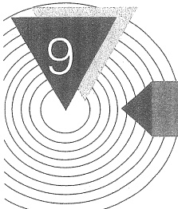

# 功率放大电路

## 引言

在多级放大电路中，输出信号往往要驱动一定的装置。例如，扬声器的音圈、电动机的控制绕组等。多级放大电路除了应有电压放大级外，还要求有一个能输出一定信号功率的输出级。这类主要用于向负载提供功率的放大电路常称为功率放大电路。前面所讨论的放大电路主要用于增强电压幅度或电流幅度，因而相应地称为电压放大电路或电流放大电路。但无论哪种放大电路，在负载上都同时存在输出电压、电流和功率，上述称呼上的区别只不过是强调输出量的不同而已。

本章以分析功率放大电路的输出功率、效率和非线性失真之间的矛盾为主线，逐步提出解决矛盾的措施。在电路方面，以BJT互补对称功率放大电路为重点进行较详细的分析与计算。最后，对功率器件的散热问题，功率BJT、VMOS、DMOS、MOS管互补对称电路和集成功率放大器实例等也予以介绍。

#### 功率放大电路的一般问题

### 1. 功率放大电路的特点及主要研究对象

如前所述，放大电路实质上都是能量转换电路。从能量控制的观点来看，功率放大电路和电压放大电路没有本质的区别。但是，功率放大电路和电压放大电路所要完成的任务是不同的。电压放大电路的主要要求是使其输出端得到不失真的电压信号，讨论的主要指标是电压增益、输入和输出阻抗等，输出功率并不一定大。而功率放大电路则不同，它主要要求获得一定的不失真（或失真较小）的输出功率，因此功率放大电路包含着一系列在电压放大电路中没有出现过的特殊问题，这些问题如下。

为了获得大功率输出，要求功放管的输出电压和电流都要有足够大的幅度，因此器件往往在接近极限状态下工作。

##### （1）要求输出功率尽可能大

##### （2）效率更高

由于输出功率大，因此直流电源消耗的功率也大，这就存在一个效率问题。所谓效率就是负载得到的有用信号功率和电源供给的直流功率的比值。这个比值越大，效率就越高。

<!-- page: 386 -->

##### （3）非线性失真要小

功率放大电路通常在大信号下工作，所以不可避免会产生非线性失真，而且同一功放管输出功率越大，非线性失真往往越严重，这就使输出功率和非线性失真成为一对主要矛盾。但是，在不同场合下，对非线性失真的要求不同，例如，在测量系统和电声设备中，这个问题显得很重要，而在工业控制系统等场合中，则以输出功率为主要目的，对非线性失真的要求就降为次要问题了。

##### （4）功率器件的散热问题

在功率放大电路中，有相当大的功率消耗在管子上，使结温和管壳温度升高。为了充分利用允许的管耗而使放大管输出足够大的功率，放大器件的散热就成为一个重要问题。

此外，在功率放大电路中，为了输出较大的信号功率，器件承受的电压要高，通过的电流要大，功率管损坏的可能性也就比较大，所以功率管的损坏与保护问题也不容忽视。

在分析方法上，由于管子在大信号状态下工作，需要同时考虑直流和交流对管子工作状态的影响，故通常采用图解法。

### 2. 提高功率放大电路效率的主要途径

从前面的讨论可知，在电压放大电路中，在整个信号周期内都有电流流过放大器件，这种工作方式通常称为甲类放大。甲类放大的典型工作状态如图9.1.1a所示，此时 $ i_{c} \geqslant 0 $。在甲类放大电路中，电源始终不断地输送功率，在没有信号输入（静态）时，这些功率全部消耗在电路内部的元器件上，并转化为热量耗散出去。当有信号输入时，其中一部分转化为有用的输出功率，信号越大，输送给负载的功率越大。通过下节射极输出器的讨论可以证明，甲类放大电路的效率较低。

怎样才能使电源供给的功率大部分转化为有用的信号功率输出呢？从甲类放大电路可知，静态电流是造成管耗的主要因素。如果把静态工作点 Q 向下移动，使信号等于零时电源供给的功率减小，甚至为零，信号增大时电源供给的功率随之增大，这样电源供给功率及管耗都随着输出功率的大小而变，从而解决甲类放大效率低的问题。利用图 9.1.1b、c 所示工作情况，就可实现上述设想。在图 9.1.1b 中，器件在大于信号半个周期内导通  $ (i_{c}>0) $；图 9.1.1c 中，器件只在半个周期内导通，它们分别称为甲乙类和乙类放大 $ ^{①} $。这两种放大主要用于功率放大电路中。

虽然甲乙类和乙类放大减小了静态功耗，提高了效率，但都出现了严重的波形失真，因此，既要保持静态时管耗小，又要使失真不太严重，就需要改进电路结构。有关这方面的讨论将在9.3节进行。下面首先研究一个甲类功率放大电路实例。

<!-- page: 387 -->

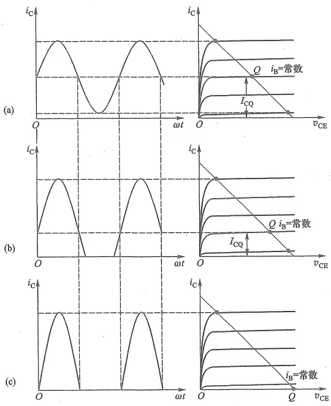

图 9.1.1 Q 点对放大电路工作状态的影响
 

(a) 甲类放大在一周期内  $ i_{C}>0 $ (b) 甲乙类放大在一周期内有半个周期以上  $ i_{C}>0 $ (c) 乙类放大在一个周期内只有半个周期 i_{C}>0
 

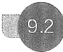0 $ (b) 甲乙类放大在一周期内有半个周期以上 $ i_{C}>0 $ (c) 乙类放大在一个周期内只有半个周期 i_{C}>0" width="8%" />

#### 射极输出器——甲类放大的实例

射极输出器的电压增益虽然近似为1。但电流增益很大，可获得较大的功率增益。由于它的输出电阻很小，带负载能力强，因而常用作集成放大器的输出级。

1. 电路结构及工作原理

用电流源作射极偏置的射极输出器简化电路如图9.2.1所示。

设  $ v_{i} $ 为正弦波，T 工作在放大区，它的基射极间电压近似为 0.6 V，因此输出电压与输入电压的关系为

$$  v_{o}\approx v_{i}-0.6~{\mathrm{V}}   \tag*{(9.2.1)}$$

当  $ v_{i} $ 为正半周，T 进入临界饱和时， $ v_{0} $ 正向振幅达到最大值。设 T 的饱和压降  $ V_{CES} \approx 0.2\ V $，则有

$$  V_{om+}\approx V_{cc}-0.2V   \tag*{(9.2.2)}$$

<!-- page: 388 -->

当  $ v_{i} $ 为负半周，加在 T 基射极间电压  $ v_{BE} $ 将减小，如  $ v_{i} $ 幅值太大，将导致 T 出现截止， $ v_{0} $ 出现削波。在临界截止时由于  $ i_{C} \approx i_{E} = 0 $ ，输出的（负向）电流和电压的振幅分别为  $ \frac{+V_{CC}}{1} $

$$  I_{om^{-}}=\left|-I_{bias}\right|   \tag*{(9.2.3)}$$

和

$$  V_{\mathrm{o m-}}=\mid-I_{\mathrm{b i a s}}R_{\mathrm{L}}\mid   \tag*{(9.2.4)}$$

### 2. 功率及效率的计算举例

例 9.2.1 设电路如图 9.2.1 所示。 $ V_{CC} = V_{EE} = 15\ V $,  $ I_{bias} = 1.85\ A $,  $ R_L = 8\ \Omega $。在基极回路设置一偏置电压源  $ V_{bias} = 0.6\ V $,  $ v_1 = V_{bias} + v_i $, 当  $ v_i = 0 $ 时，输出电压  $ v_0 \approx 0 $。若  $ v_i $ 为正弦信号电压，试计算最大输出功率  $ P_{om} $、直流电源供给的功率  $ P_V $ 和效率  $ \eta $。

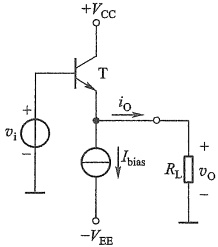

图9.2.1 一个集成射极输出器输出级
 

解：（1）求最大输出功率 $ P_{om} $

由式 $ （9.2.2） $和式 $ （9.2.4） $分别可求出

 $$ V_{om+}\approx V_{cc}-0.2\mathrm{~V}=14.8\mathrm{~V} $$ 

和

 $$ V_{\mathrm{om-}}=\left|-I_{\mathrm{bias}}R_{\mathrm{L}}\right|=\left|-1.85\times8\right|\mathrm{V}=14.8\mathrm{~V} $$ 

因此输出电压是正负最大幅值均为  $ V_{om}=14.8\ V $ 的正弦波，最大输出功率为

 $$ P_{\mathrm{om}}=\left(\frac{V_{\mathrm{om}}}{\sqrt{2}}\right)^{2}\cdot\frac{1}{R_{\mathrm{L}}}=\left(\frac{14.8}{\sqrt{2}}\right)^{2}\cdot\frac{1}{8}\mathrm{~W}=13.69\mathrm{~W} $$ 

（2）求直流电源供给的功率

由于在正弦信号一个完整周期内，T 的  $ i_{C} $ 和  $ v_{CE} $ 的平均值就是它们的静态值，即  $ I_{cav} = I_{bias} = 1.85\ A $， $ V_{CEcav} = V_{CC} $。因此正电源  $ V_{CC} $ 提供的功率

 $$ P_{V_{CC}}=V_{CE_{cav}}I_{cav}=V_{CC}I_{cav}=15\times1.85\ W=27.75\ W $$ 

负电源- $ V_{EE} $提供的功率 $ P_{V_{EE}} $也是电流源消耗的功率 $ P_{bias} $，即

 $$ P_{V_{EE}}=P_{bias}=V_{EE}I_{bias}=27.75\mathrm{~W} $$ 

而直流电源供给的总功率

 $$ P_{v}=P_{v_{CC}}+P_{v_{EE}} $$ 

（3）求放大器的效率 $ \eta $

 $$ \eta=\frac{P_{om}}{P_{v_{CC}}+P_{v_{EE}}}\times100\%=\frac{13.69}{27.75+27.75}\times100\%=24.7\% $$ 

这说明，工作在甲类的图9.2.1所示射极输出器的效率小于25%。可以证明，若采用变压器耦合连接负载，在理想情况下，甲类放大电路的效率最高也只能达到50%。

#### 9.3 乙类双电源互补对称功率放大电路

##### 9.3.1 BJT 乙类双电源互补对称功率放大电路组成

乙类放大电路虽然管耗小，有利于提高效率，但存在严重的失真，使得输出信号的半个

<!-- page: 389 -->

波形被削掉了。如果用两个管子，使之都工作在乙类放大状态，但一个在正半周工作，而另一个在负半周工作，同时使这两个输出波形都能加到负载上，从而在负载上得到一个完整的波形，这样就能解决效率与失真的矛盾。

采用图 9.3.1a 所示的互补对称电路便可实现上述设想。 $ T_1 $ 为 NPN 型管、 $ T_2 $ 为 PNP 型管，两管的基极、发射极分别连接在一起，信号从基极输入、从射极输出， $ R_L $ 为负载。这个电路可以看成是由图 9.3.1b、c 所示的两个射极输出器组合而成。因为 BJT 发射结处于正向偏置时才导电，当信号处于正半周时， $ T_2 $ 截止， $ T_1 $ 承担放大任务，有电流通过负载  $ R_L $；而当信号处于负半周时， $ T_1 $ 截止，由  $ T_2 $ 承担放大任务，仍有电流通过负载  $ R_L $，只是与  $ T_1 $ 工作时电流方向相反；这样，图 9.3.1a 所示基本互补对称电路实现了静态 ( $ v_i = 0 $) 时两管不导电，而在有信号时， $ T_1 $ 和  $ T_2 $ 轮流导电，组成推挽式功率放大电路。由于两管互补对方的不足，工作性能对称，所以这种电路通常称为互补对称电路。又由于两管都为射极输出，所以也称为互补射极输出电路。

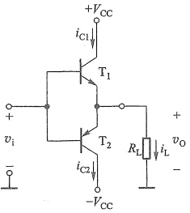

(a)
 

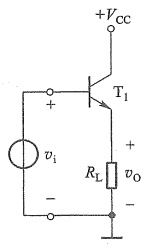

(b)
 

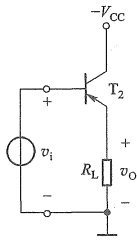

(c)
 

图 9.3.1 两射极输出器组成的基本互补对称电路
 

（a）基本互补对称电路 （b）由 NPN 型管组成的射极输出器 （c）由 PNP 型管组成的射极输出器
 

##### 9.3.2 分析计算

图 9.3.2a 表示图 9.3.1a 所示电路在  $ v_i $ 为正半周时  $ T_1 $ 的工作情况（注意图中  $ i_{C1} $、 $ i_{C2} $ 的参考方向都是电流实际方向）。图中假定，只要  $ v_{BE} > 0 $， $ T_1 $ 就开始导电，则在一个周期内  $ T_1 $ 导电时间约为半个周期。图 9.3.1a 中  $ T_2 $ 的工作情况和  $ T_1 $ 相似，只是在信号的负半周导电。为了便于分析，将  $ T_2 $ 的特性曲线倒置画在  $ T_1 $ 的右下方  $ (-v_{CE2} $ 的箭头指向左边)，并令二者在 Q 点，即  $ v_{CE1} = -v_{CE2} = V_{CC} $ 处重合 ( $ v_i = 0 $ 时两管均处于截止状态)，形成  $ T_1 $ 和  $ T_2 $ 的所谓合成曲线，如图 9.3.2b 所示。这时负载线通过  $ V_{CC} $ 点形成一条斜线，其斜率为  $ -1/R_L $。显然，负载电流变化的最大范围为  $ 2I_{em} $，电压的变化范围为  $ 2(V_{CC} - V_{CES}) = 2V_{cem} = 2I_{em} R_L $。如果忽略管子的饱和压降  $ V_{CES} $，则  $ V_{cem} = I_{cm} R_L \approx V_{CC} $。

根据以上分析，不难求出工作在乙类的互补对称电路的输出功率、管耗、直流电源供给的功率和效率。

<!-- page: 390 -->

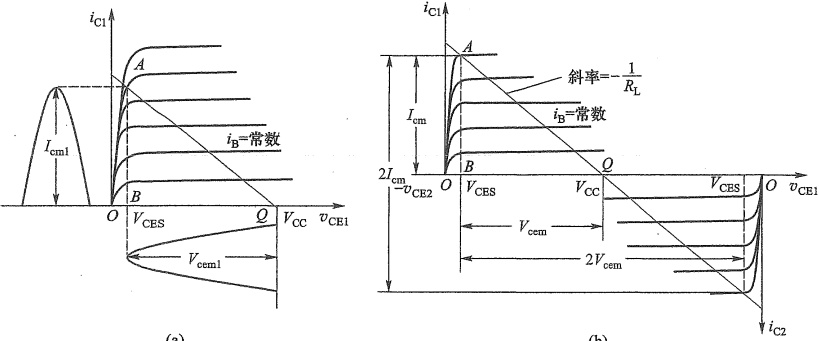

(a)
 

(b)
 

图 9.3.2 互补对称电路图解分析
 

（a）图9.3.1a所示电路 $ v_{i} $为正半周时 $ T_{1} $管工作情况（b）互补对称电路工作情况
 

### 1. 输出功率

输出功率为输出电压有效值  $ V_{0} $ 和输出电流有效值  $ I_{0} $ 的乘积。设输出电压的幅值为  $ V_{om} $，则

$$  P_{o}=V_{o}I_{o}=\frac{V_{om}}{\sqrt{2}}\cdot\frac{V_{om}}{\sqrt{2}R_{L}}=\frac{1}{2}\cdot\frac{V_{om}^{2}}{R_{L}}   \tag*{(9.3.1)}$$

图 9.3.1 中的  $ T_{1} $、 $ T_{2} $ 可以看成工作在射极输出器状态， $ A_{v} \approx 1 $。当输入信号足够大，使  $ V_{im} = V_{om} = V_{CC} - V_{CES} \approx V_{CC} $ 和  $ I_{om} = I_{cm} $ 时，可获得最大输出功率

$$  P_{\mathrm{o m}}=\frac{1}{2}\cdot\frac{V_{\mathrm{o m}}^{2}}{R_{\mathrm{L}}}=\frac{1}{2}\cdot\frac{V_{\mathrm{c e m}}^{2}}{R_{\mathrm{L}}}\approx\frac{1}{2}\cdot\frac{V_{\mathrm{c c}}^{2}}{R_{\mathrm{L}}}   \tag*{（9.3.2）}$$

 $ I_{om} $ 和  $ V_{cem} $ 可以分别用图 9.3.2b 中的 AB 和 BQ 表示，因此， $ \triangle ABQ $ 的面积就代表了工作在乙类的互补对称电路输出功率的大小，面积越大，输出功率  $ P_{0} $ 也越大。但该三角形受 BJT 安全工作区的限制（见图 5.1.11）。

### 2. 管耗 $ P_{T} $

考虑到  $ T_{1} $ 和  $ T_{2} $ 在一个信号周期  $ (2\pi) $ 内各导电约半个周期，且通过两管的电流和两管电极的电压  $ v_{CE} $ 在数值上都分别相等（只是在时间上错开了半个周期）。因此，为求出总管耗，只需先求出单管的损耗就行了。设输出电压为  $ v_{o}=V_{om}\sin\omega t $，则  $ T_{1} $ 的管耗为

 $$ \begin{aligned}P_{\mathrm{T1}}=&\frac{1}{2\pi}\int_{0}^{\pi}v_{\mathrm{CE}}i_{\mathrm{C}}\mathrm{d}\left(\omega t\right)\\ =&\frac{1}{2\pi}\int_{0}^{\pi}\left(V_{\mathrm{CC}}-v_{o}\right)\frac{v_{o}}{R_{\mathrm{L}}}\mathrm{d}\left(\omega t\right)\\ =&\frac{1}{2\pi}\int_{0}^{\pi}\left(V_{\mathrm{CC}}-V_{om}\sin\omega t\right)\frac{V_{om}\sin\omega t}{R_{\mathrm{L}}}\mathrm{d}\left(\omega t\right)\end{aligned} $$

<!-- page: 391 -->

$$  \begin{aligned}&=\frac{1}{2\pi}\int_{0}^{\pi}\left[\frac{V_{\mathrm{CC}}V_{\mathrm{om}}}{R_{\mathrm{L}}}\sin\omega t-\frac{V_{\mathrm{om}}^{2}}{R_{\mathrm{L}}}\sin^{2}\omega t\right]\mathrm{d}(\omega t)\\&=\frac{1}{R_{\mathrm{L}}}\left(\frac{V_{\mathrm{CC}}V_{\mathrm{om}}}{\pi}-\frac{V_{\mathrm{om}}^{2}}{4}\right)\end{aligned}   \tag*{(9.3.3)}$$

而两管的管耗为

$$  P_{\mathrm{T}}=P_{\mathrm{T1}}+P_{\mathrm{T2}}=\frac{2}{R_{\mathrm{L}}}\left(\frac{V_{\mathrm{CC}}V_{\mathrm{om}}}{\pi}-\frac{V_{\mathrm{om}}^{2}}{4}\right)\\ =\frac{2V_{\mathrm{CC}}V_{\mathrm{om}}}{\pi R_{\mathrm{L}}}-\frac{V_{\mathrm{om}}^{2}}{2R_{\mathrm{L}}}   \tag*{(9.3.4)}$$

3. 直流电源供给的功率 $ P_{V} $

直流电源供给的功率  $ P_{V} $ 包括负载得到的信号功率和  $ T_{1} $、 $ T_{2} $ 消耗的功率两部分。当  $ v_{i}=0 $ 时， $ P_{V}=0 $；当  $ v_{i}\neq0 $ 时，由式(9.3.1)和式(9.3.4)得

$$  P_{V}=P_{0}+P_{T}=\frac{2V_{CC}V_{om}}{\pi R_{L}}   \tag*{(9.3.5)}$$

当输出电压幅值达到最大，即  $ V_{om} \approx V_{CC} $ 时，则得电源供给的最大功率为

$$  P_{V\mathrm{m}}\approx\frac{2}{\pi}\cdot\frac{V_{\mathrm{c c}}^{2}}{R_{\mathrm{L}}}   \tag*{(9.3.6)}$$

### 4. 效率 $ \eta $

一般情况下效率为

$$  \eta=\frac{P_{o}}{P_{V}}=\frac{\pi}{4}\cdot\frac{V_{om}}{V_{cc}}   \tag*{(9.3.7)}$$

当  $ V_{om} \approx V_{CC} $ 时，则

$$  \eta=\frac{P_{o}}{P_{v}}\approx\frac{\pi}{4}\approx78.5\%   \tag*{(9.3.8)}$$

这个结论是假定互补对称电路工作在乙类，负载电阻为理想值，忽略管子的饱和压降 $ V_{CES} $，且输入信号足够大 $ (V_{im}\approx V_{om}\approx V_{CC}) $ 情况下得来的，实际效率会低于这个值。

##### 9.3.3 功率 BJT 的选择

### 1. 最大管耗和最大输出功率的关系

工作在乙类的基本互补对称电路，在静态时，管子几乎不取电流，管耗接近于零，因此，当输入信号较小时，输出功率较小，管耗也小，这是容易理解的；但能否认为，当输入信号越大，输出功率也越大，管耗就越大呢？答案是否定的。那么，最大管耗发生在什么情况下呢？由式(9.3.3)可知，管耗  $ P_{T1} $ 是输出电压幅值  $ V_{om} $ 的函数，因此，可以用求极值的方法来求解。由式(9.3.3)有

 $$ \frac{\mathrm{d}P_{\mathrm{T1}}}{\mathrm{d}V_{\mathrm{om}}}=\frac{1}{R_{\mathrm{L}}}\left(\frac{V_{\mathrm{cc}}}{\pi}-\frac{V_{\mathrm{om}}}{2}\right)\ , 令 \frac{\mathrm{d}P_{\mathrm{T1}}}{\mathrm{d}V_{\mathrm{om}}}=0\ , 则 \frac{V_{\mathrm{cc}}}{\pi}-\frac{V_{\mathrm{om}}}{2}=0\  故 $$ 

$$  V_{om}=\frac{2V_{cc}}{\pi}   \tag*{(9.3.9)}$$

即，当  $ V_{om}=\frac{2V_{cc}}{\pi}\approx0.6V_{cc} $ 时有最大管耗

<!-- page: 392 -->

$$  P_{\mathrm{T l m}}=\frac{1}{R_{\mathrm{L}}}\left[\frac{\frac{2}{\pi}V_{\mathrm{c c}}^{2}}{\pi}-\frac{\left(\frac{2V_{\mathrm{c c}}}{\pi}\right)^{2}}{4}\right]=\frac{1}{R_{\mathrm{L}}}\left(\frac{2V_{\mathrm{c c}}^{2}}{\pi^{2}}-\frac{V_{\mathrm{c c}}^{2}}{\pi^{2}}\right)=\frac{1}{\pi^{2}}\cdot\frac{V_{\mathrm{c c}}^{2}}{R_{\mathrm{L}}}   \tag*{(9.3.10)}$$

考虑到最大输出功率  $ P_{om} \approx \frac{1}{2} \cdot \frac{V_{cc}^{2}}{R_{L}} $，则每管的最大管耗和电路的最大输出功率具有如下的关系：

$$  P_{\mathrm{T1m}}=\frac{1}{\pi^{2}}\cdot\frac{V_{\mathrm{cc}}^{2}}{R_{\mathrm{L}}}\approx0.2P_{\mathrm{om}}   \tag*{(9.3.11)}$$

式（9.3.11）常用来作为乙类互补对称电路选择功率管的依据之一，它表明，如果要求输出功率为10 W，则两个功率管的额定功率都必须大于2 W。

诚然，上面的计算是在理想情况下进行的，实际上在确定管子额定功耗时，还要留有充分的余地。考虑到  $ P_o, P_v $ 和  $ P_{T1} $ 都是  $ V_{om} $ 的函数，如用  $ V_{om}/V_{CC} $ 表示的自变量作为横坐标，纵坐标分别用  $ P_o, P_v $ 和  $ P_{T1} $ 除  $ P_{om} \approx V_{CC}^2 / (2R_L) $ 的归一化表示。则  $ P_o, P_v $ 和  $ P_{T1} $ 与  $ V_{om}/V_{CC} $ 的关系曲线如图 9.3.3 所示。图 9.3.3 也进一步说明， $ P_o $ 和  $ P_{T1} $ 与  $ V_{om}/V_{CC} $ 不是线性关系。

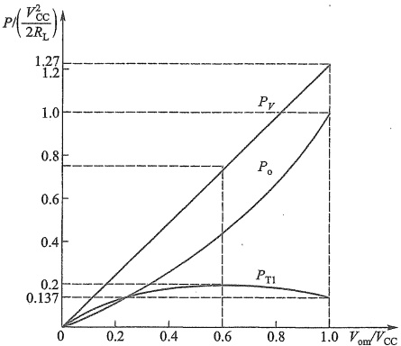

图 9.3.3 乙类互补对称电路  $ P_{e} $、 $ P_{V} $ 和  $ P_{T1} $ 与  $ V_{om}/V_{CC} $ 变化的关系曲线
 

### 2. 功率 BJT 的选择

由上述分析可知，若想得到最大输出功率，功率 BJT 的参数必须满足下列条件：

（1）每只 BJT 的最大允许管耗  $ P_{CM} $ 必须大于  $ 0.2P_{om} $;

（2）考虑到当  $ T_{2} $ 导通时， $ -v_{CE2} \approx 0 $，此时  $ v_{CE1} $ 具有最大值，且等于  $ 2V_{CC} $。因此，应选用  $ \left|V_{(BR)CEO}\right| > 2V_{CC} $ 的功率管；

（3）通过功率 BJT 的最大集电极电流为  $ V_{CC}/R_{L} $，所选功率 BJT 的  $ I_{CM} $ 一般不宜低于此值。

例 9.3.1 功放电路如图 9.3.1a 所示，设  $ V_{CC} = 12\ V $， $ R_L = 8\ \Omega $，功率 BJT 的  $ V_{CES} = 0 $，极限参数为  $ I_{CM} = 2\ A $， $ \left|V_{(BR)CEO}\right| = 30\ V $， $ P_{CM} = 5\ W $。试求：（1）最大输出功率  $ P_{om} $ 值，并检验所给

<!-- page: 393 -->

功率 BJT 是否能安全工作；(2) 放大电路在  $ \eta=0.6 $ 时的输出功率  $ P_{0} $ 值。

解：（1）求  $ P_{om} $，并检验功率 BJT 的安全工作情况

由式(9.3.2)可求出

 $$ P_{\mathrm{om}}\approx\frac{1}{2}\cdot\frac{V_{\mathrm{cc}}^{2}}{R_{\mathrm{L}}}=\frac{(12\mathrm{~V})^{2}}{2\times8\mathrm{~\Omega}}=9\mathrm{~W} $$ 

通过 BJT 的最大集电极电流、BJT c、e 极间的最大压降和它的最大管耗分别为

 $$ i_{\mathrm{c m}}=\frac{V_{\mathrm{c c}}}{R_{\mathrm{L}}}=\frac{12\mathrm{~V}}{8\mathrm{~\Omega}}=1.5\mathrm{~A} $$ 

 $$ v_{CEm}=2V_{CC}=24V $$ 

 $$ P_{\mathrm{T1m}}\approx0.2P_{\mathrm{om}}=0.2\times9\mathrm{~W}=1.8\mathrm{~W} $$ 

所求  $ i_{Cm} $、 $ v_{CEm} $ 和  $ P_{T1m} $，均分别小于极限参数  $ I_{CM} $、 $ \left|V_{(BR)CEO}\right| $ 和  $ P_{CM} $，故功率 BJT 能安全工作。

##### （2）求 $ \eta=0.6 $时的 $ P_{0} $值

由式(9.3.7)可求出

 $$ V_{om}=\eta\cdot4\frac{V_{cc}}{\pi}=\frac{0.6\times4\times12\ V}{\pi}\approx9.2\ V $$ 

将 $ V_{om} $代入式(9.3.1)得

 $$ P_{o}=\frac{1}{2}\cdot\frac{V_{om}^{2}}{R_{L}}=\frac{1}{2}\cdot\frac{(9.2\mathrm{~V})^{2}}{8\Omega}\approx5.3\mathrm{~W} $$ 

#### 9.3.4 MOSFET 乙类双电源互补对称功率放大电路

如果将图 9.3.1(a) 中的 BJT 管替换成 MOS 管，就可以得到图 9.3.4 所示的 MOSFET 乙类双电源互补对称功率放大电路。

如果输入的信号幅度足够大，且 MOS 管的阈值电压可以忽略不计时，图 9.3.4 电路同样可以实现静态时两管不导电，而在有信号时， $ T_{1} $ 和  $ T_{2} $ 轮流导电的乙类互补工作方式。由于两管都为源极输出，所以也称为互补源极输出电路。若忽略功放管的饱和压降，负载上最大电压可达电源电压，计算方法和 BJT 互补对称功率放大电路计算类似，读者可以自行分析计算。

##### 复习思考题

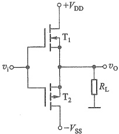

9.3.1 由于功率放大电路中的功率 BJT 常处于接近极限工作状态，因此，在选择 BJT 时必须特别注意哪三个参数？

图 9.3.4 MOSFET 乙类双电源互补对称功率放大电路
 

9.3.2 有人说：“在功率放大电路中，输出功率最大时，

功放管的功率损耗也最大。”你认为对吗？设输入信号为正弦波，工作在甲类的功率放大输出级和工作在乙类的互补对称功率输出级，管耗最大各发生在什么工作情况？

9.3.3 与甲类功率放大电路相比，乙类互补对称功率放大电路的主要优点是什么？

9.3.4 乙类互补对称功率放大电路的效率在理想情况下可达到多少？

9.3.5 设采用双电源互补对称电路, 如果要求最大输出功率为 5 W, 则每只功率 BJT 的最大允许管耗  $ P_{CM} $ 至少应大于多少?

<!-- page: 394 -->

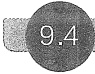

#### 甲乙类互补对称功率放大电路

前面讨论的乙类互补对称电路（图 9.4.1a），由于没有直流偏置，所以输入信号  $ \left|v_{i}\right| $ 必须大于发射结的门槛电压（硅管约为 0.6 V），功率管才能导通，因此这种电路的输出波形并不能很好地反映输入的变化。当  $ \left|v_{i}\right| $ 低于门槛电压时， $ T_{1} $ 和  $ T_{2} $ 都截止， $ i_{C1} $ 和  $ i_{C2} $ 基本为零，负载  $ R_{L} $ 上无电流通过，出现一段死区，如图 9.4.1b 所示。这种现象称为交越失真。

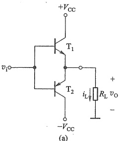

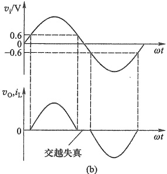

图 9.4.1 工作在乙类的双电源互补对称电路   (a) 电路 (b) 交越失真的波形
 

##### 9.4.1 甲乙类双电源互补对称电路

为克服交越失真，就需要为功率管预先设置一个刚刚导通的静态工作点，图 9.4.2 所示的左侧支路就是这样一种偏置电路。图中  $ T_3 $ 构成前置放大级， $ V_{B3} $ 是  $ T_3 $ 的静态电压（图中未画出  $ T_3 $ 的直流偏置电路），只要  $ T_3 $ 能正常工作， $ D_1 $、 $ D_2 $ 就始终处于正向导通状态，可以近似用恒压降模型代替  $ D_1 $ 和  $ D_2 $。静态时，在  $ D_1 $、 $ D_2 $ 上产生的压降为  $ T_1 $、 $ T_2 $ 提供了一个适当的偏压，使之处于微导通状态。通过适当调整  $ R_{e3} $ 和  $ R_{e3} $ 可以使输出电路上下两部分达到对称，静态时  $ i_{c1} = i_{c2} $， $ i_L = 0 $， $ v_0 = 0 $。而有信号时，由于电路工作在甲乙类，即使输入交流信号  $ v_1 $ 很小，也可产生相应的输出  $ v_0 $。另外要注意的是， $ D_1 $ 和  $ D_2 $ 采用恒压降模型时， $ T_1 $ 和  $ T_2 $ 两管基极的交流信号电压完全相同。基本上可线性地进行放大。

上述偏置方法的缺点是，T₁和T₂两基极间的静态偏置电压不易调整。而在图9.4.3中，流入T₄的基极电流远小于流过R_{e1}、R_{e2}的电流，则由图可求出V_{CE4}=V_{BE4}(R_{e1}+R_{e2})/R_{e2}，因此，利用T₄管的V_{BE4}基本为一固定值（硅管为0.6~0.7V），只要适当调节R_{e1}、R_{e2}的比值，就可改变T₁、T₂的偏压值。这种方法，在集成电路中经常用到。

<!-- page: 395 -->

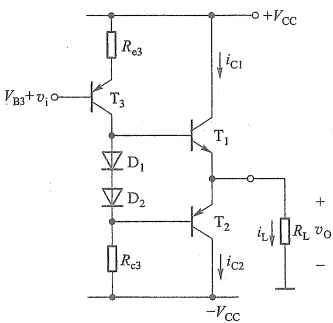

图 9.4.2 利用二极管进行偏置的互补对称电路
 

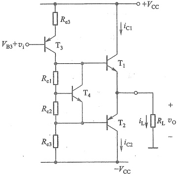

图 9.4.3 利用  $ V_{BE} $ 扩大电路进行偏置的互补对称电路
 

##### 9.4.2 甲乙类单电源互补对称电路

在图 9.4.2 的基础上，令  $ -V_{cc}=0 $，并在输出端与负载  $ R_{L} $ 之间接入一大电容 C，就得到图 9.4.4 所示的单电源互补对称原理电路 $ ^{①} $。由图可见，在输入信号为零（静态）时，只要将  $ D_{1} $、 $ D_{2} $ 之间的电位设置在  $ V_{cc}/2 $，由于  $ T_{1} $、 $ T_{2} $ 上下对称，就会使 K 点电位  $ V_{K}=V_{C} $（电容 C 两端电压） $ \approx V_{CC}/2 $。

当有信号时，在信号  $ v_i $ 的负半周， $ \mathrm{T}_3 $ 集电极输出电压为正半周， $ \mathrm{T}_1 $ 导通，有电流通过负载  $ R_L $，同时向  $ C $ 充电，负载上获得正半周信号；在信号的正半周， $ \mathrm{T}_3 $ 集电极为负半周， $ \mathrm{T}_2 $ 导通，则已充有  $ V_{cc}/2 $ 电压的电容  $ C $，通过负载  $ R_L $ 放电，负载上得到负半周信号。只要选择时间常数  $ R_L C $ 足够大（比信号的最长周期还大得多） $ ^{②} $，就可以认为用电容  $ C $ 和一个电源  $ V_{cc} $ 可代替原来的  $ +V_{cc} $ 和  $ -V_{cc} $ 两个电源的作用。

值得指出的是，采用单电源的互补对称电路，由于每个管子的工作电压不是原来的  $ V_{cc} $，而是

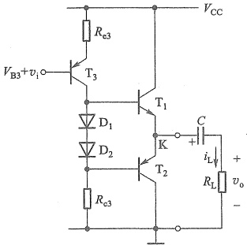

图 9.4.4 采用单电源的互补对称原理电路
 

 $ V_{cc}/2 $（输出电压最大也只能达到约 $ V_{cc}/2 $），所以前面导出的计算 $ P_{o} $、 $ P_{T} $、 $ P_{V} $和 $ P_{Tm} $的公式，

<!-- page: 396 -->

必须加以修正才能使用。修正的方法也很简单，只要以  $ V_{cc}/2 $ 代替原来公式中的  $ V_{cc} $ 即可。单电源互补对称电路的典型应用参见图9.7.3。

##### 9.4.3 MOS 管甲乙类双电源互补对称电路

前面讨论了 BJT 甲乙类互补对称电路，下面简要介绍 MOS 管甲乙类互补对称电路。

图 9.4.5 电路中 MOS 管上下对称， $ T_1 $ 和  $ T_2 $ 的栅极和漏极直接相连，构成所谓的“二极管”（参见 4.4.4 节）。静态时，恒定电流  $ I_{\text{bias}} $ 流过  $ T_1 $ 和  $ T_2 $，产生两个固定电压  $ V_{GS1} $ 和  $ V_{GS2} $，即  $ V_{GG} = V_{GS1} + V_{GS2} $ 为  $ T_3 $ 和  $ T_4 $ 的栅源极提供合适的静态偏置电压，确保  $ T_3 $ 和  $ T_4 $ 不会工作于截止区，以避免交越失真。注意，静态电压  $ V_{G4} $ 等于  $ -V_{GS2} $ 时，才能保证  $ v_0 $ 静态输出为零。与图 9.4.2 电路不同的是，图 9.4.5 中的功放管  $ T_3 $ 和  $ T_4 $ 工作时栅极不取电流，可以维持  $ T_1 $ 和  $ T_2 $ 的偏置电流保持常数，因此偏置电压  $ V_{GG} $ 也就维持恒定，与输出电压和输出电流无关。

另一种性能更好的 BiMOS 甲乙类双电源互补对称功率放大电路如图 9.4.6 所示。图中  $ R_{1} $、 $ R_{2} $ 和  $ T_{3} $ 构成的  $ V_{BE} $ 扩大电路与两个二极管一起产生静态电压  $ V_{BB} $，为  $ T_{1} $ 和  $ T_{2} $ 提供合适的静态偏置，以克服交越失真。而  $ R_{3} $ 上的压降则为  $ T_{5} $ 和  $ T_{6} $ 提供合适的静态偏置。 $ T_{1} $ 和  $ T_{2} $ 构成的射极跟随器，具有很低的输出电阻，与  $ T_{5} $ 和  $ T_{6} $ 的栅极电容构成很小的时间常数，可以大大提高输出级的工作速度，充分发挥功率 MOS 管的优势。

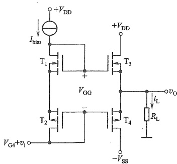

图 9.4.5 MOS 管甲乙类双电源互补对称电路
 

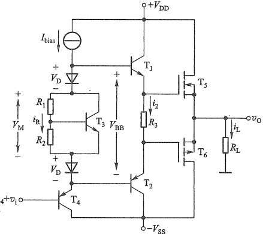

图 9.4.6 BiMOS 甲乙类双电源互补对称电路
 

##### 复习思考题

9.4.1 在图 9.4.1a 所示双电源互补对称电路中，输入信号为 1 kHz、10 V 的正弦电压，输出电压波形如图 9.4.7 所示，这说明电路出现了何种失真？为了改善上述的输出波形，应在电路中采取什么措施？

<!-- page: 397 -->

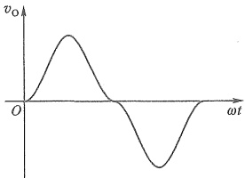

图 9.4.7 复习思考题 9.4.1 的图
 

9.4.2 在图9.4.2所示电路中，用二极管 $ D_{1} $和 $ D_{2} $的管压降为 $ T_{1} $和 $ T_{2} $提供适当的偏置，而二极管具有单向导电的特性，此时输入的交流信号能否通过此二极管从而亦为 $ T_{1} $和 $ T_{2} $供给交流信号？请说明理由。

9.4.3 在正弦输入信号作用下，互补对称电路输出波形有可能出现线性（即频率）失真吗？为什么？

9.4.4 在单电源互补对称电路中，能用式(9.3.1)~式(9.3.11)直接计算输出功率、管耗、电源供给的功率、效率并选择管子吗？

#### 9.5 丁类（D类）功率放大电路原理简介

在丁类功率放大电路中，三极管交替工作于饱和导通与截止的开关状态。由于管子饱和导通时，管压降近似为零，而截止时的管电流近似为零，因此工作于开关状态下的管耗很小，从而可以获得很高的效率。同时，由于丁类功放的管耗很小，可以不用散热器或者减小散热器的尺寸，所以广泛应用于空间受限的便携式设备和大功率场合。

为使三极管工作于开关模式，通常采用脉冲宽度调制（pulse width modulation，PWM）将音频信号转换为脉冲信号来控制三极管的导通和截止，其基本原理框图如图9.5.1所示。

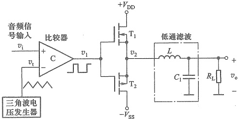

图 9.5.1 PWM 丁类功放的原理框图
 

音频输入信号  $ v_{i} $ (此处用频率较低的正弦波代表音频信号) 和三角波发生器输出信号  $ v_{t} $ 被送入比较器 (将在 10.8 节介绍), 它们的波形如图 9.5.2a 所示。当  $ v_{i} $ 大于  $ v_{t} $ 时, 输出近似

<!-- page: 398 -->

为比较器的正电源电压；反之，近似为比较器的负电源电压，因此，在比较器的输出端，得到如图 9.5.2b 所示的脉冲波形。观察可知，这个脉冲波的频率等于三角波频率（称为取样频率  $ f_{s} $），脉冲的宽度随音频信号瞬时值的增减而增减，从而实现脉冲宽度调制。三角波的取样频率  $ f_{s} $ 一般设计为至少 10 倍于音频信号最高频率， $ f_{s} $ 过高会增加开关管的动态管耗，过低则不利于 PWM 信号中高频分量的滤除。该 PWM 信号控制开关管的导通和截止，得到  $ v_{2} $ 波形如图 9.5.2c 所示。

由于脉冲波形的平均值取决于其占空比（脉冲波形的高电平时间占整个周期的比值），而占空比又正比于音频信号，因此 $ v_{2} $的平均值正比于音频信号 $ v_{i} $，用低通滤波器 $ ^{①} $（见图9.5.1）滤除高频分量，就可以从脉冲波形中恢复放大后的 $ v_{i} $信号。低通滤波器的上限频率只要高于音频信号的最高频率，就可以重现音频信号如图9.5.2d所示。

TPA3255 是一款高性能丁类功率放大器（不含低通滤波），4 Ω 负载时，最高效率

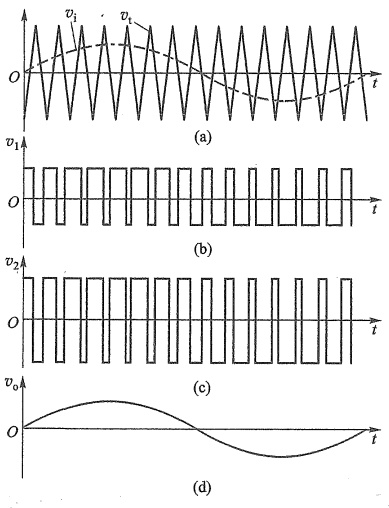

图 9.5.2 脉宽调制丁类功放波形示意图
 

（a）音频输入信号  $ v_{i} $ 和三角波参考信号  $ v_{t} $ （b）比较器输出的 PWM 信号 （c）功率放大后的 PWM 信号 （d）低通滤波后的音频输出信号
 

可达90%，电源电压范围：18~53.5 V，在单声道时最大功率可达600 W，广泛用于高端一体化家庭影院（home theater in a box，HTIB）、视音频接收机（AV接收机）、高端条形音箱、有源扬声器和低音炮等，具体应用请查阅其数据手册。

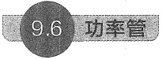

#### 功率管

##### 9.6.1 功率 BJT

大功率 BJT 与小功率 BJT 的工作原理完全相同，只是 PN 结面积大得多。为了能更好地散热，功率 BJT 通常在封装上采取一些特殊措施，将集电极衬底与它的金属外壳保持良好接触，以便通过散热器快速散热 $ ^{②} $。典型的功率 BJT 外形如图 9.6.1 所示。

在实际工作中，常发现功率 BJT 的功耗并未超过允许的  $ P_{CM} $ 值，管身也并不烫，但功率 BJT 却突然失效或者性能显著下降。这种损坏的原因，很多是由于二次击穿所造成的。

<!-- page: 399 -->

一般说来，二次击穿是一种与电流、电压、功率和结温都有关系的效应。它的物理过程多数认为是由于流过 BJT 结面电流的不均匀，造成结面局部高温（称为热斑），因而产生热击穿所致。这与 BJT 的制造工艺有关。

为了保证功率管安全工作，必须考虑二次击穿的因素。因此，功率管的安全工作区，不仅受集电极允许的最大电流  $ I_{CM} $、集射间允许的最大击穿电压  $ V_{(BR)CE} $ 和集电极允许的最大功耗  $ P_{CM} $ 所限制，而且还受二次击穿临界曲线所限制，其安全工作区如图 9.6.2 虚线内所示。显然，考虑了二次击穿以后，功率 BJT 的安全工作范围变小了。

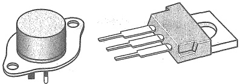

图 9.6.1 功率 BJT 外形图
 

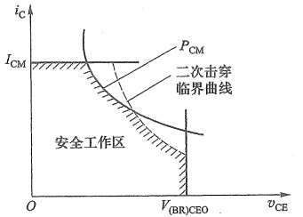

图 9.6.2 安全工作区
 

#### 9.6.2 功率 VMOSFET 和 DMOSFET

为了适应大功率的要求，20世纪70年代末出现了一种V形开槽的纵向MOS管，称为VMOS（vertical MOS）。由于它的许多优良特性，受到人们的重视。20世纪80年代末又出现了一种更新型的双扩散MOS管，称为DMOS（double-diffused MOS）。下面对这两种纵向MOS管的结构和特性做简要介绍。

### 1. VMOS

VMOSFET 的结构剖面图如图 9.6.3 所示。它以  $ N^{+} $ 型衬底作漏极，在其上生长一层  $ N^{-} $

型外延层，然后在外延层上掺杂形成一个P型层和一个 $ N^{+} $型层源极区，最后利用光刻的方法沿垂直方向刻出一个V形槽，并在V形槽表面生长一层二氧化硅和覆盖一层金属铝，形成栅极。当栅极加正电压，且 $ v_{GS}>V_{TN} $时，靠近栅极V形槽下面的P型半导体将形成一个反型层N型导电沟道（图中未画出）。可见，自由电子沿导电沟道由源极到漏极的运动是纵向的，它与第4章介绍的载流子是横向从源极到漏极的小功率MOSFET不同。因此，这种器件被命名为VMOS。

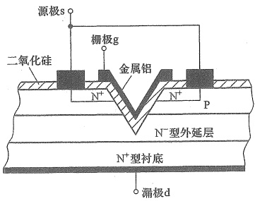

图 9.6.3 VMOSFET 结构剖面图
 

<!-- page: 400 -->

由此可见，VMOS 管的漏区面积大，有利于利用散热片散去器件内部耗散的功率。沟道长度（当栅极加正电压时在 V 形槽下 P 型层部分形成）可以做得很短，且沟道间又呈并联关系（根据需要可并联多个），故允许流过的电流  $ I_{D} $ 很大。此外，利用现代工艺，使它靠近栅极形成一个低浓度的  $ N^{-} $外延层，当漏极与栅极间的反向电压形成耗尽区时，这一耗尽区主要出现在  $ N^{-} $外延区， $ N^{-} $区的正离子密度低，电场强度低，因而能承受较高的电压。这些都有利于 VMOS 制成大功率器件。目前 VMOS 产品耐压能力达 1 200 V 以上，最大连续电流值高达 200 A。

### 2. DMOS

DMOS 是一种短沟道功率 MOSFET，其结构剖面图如图 9.6.4 所示。它以低掺杂浓度的

 $ N^{-} $作为衬底，其底部做一层高掺杂浓度的  $ N^{+} $层，以便与漏极接触。衬底的上部进行两次扩散，一次扩散生成高掺杂浓度的  $ P^{+} $沟道体，另一次扩散生成高掺杂浓度的  $ N^{+} $源区。表面形成  $ SiO_{2} $ 氧化层，并覆盖一层金属作为栅极，源区与  $ P^{+} $区也通过金属短接。

当  $ v_{GS} > V_{TN} $ 时，在  $ P^{+} $ 沟道体靠近栅极的氧化层下面形成反型层 N 沟道，沟道长度 L 很短（1～2 μm），如图 9.6.4 中所示。这样，当外加电压  $ v_{DS} $ 时，电子将从源极出发，经过沟道进入  $ N^{-} $ 区，然后

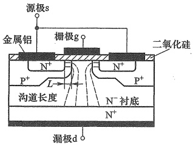

图 9.6.4 DMOS 结构剖面图
 

垂直向下到达漏极。可见，DMOS 的沟道虽是横向的，但电流却是纵向的。

DMOS 的沟道虽然很短，但其击穿电压却很高（可达 600 V 以上），这是因为衬底和沟道体之间的耗尽层主要出现在低掺杂的衬底。此外，其电流容量也很大，可达 50 A 以上。

与 BJT 相比，VMOS 和 DMOS 器件有许多

优点。

（1）与 MOS 器件一样是电压控制电流器件，输入电阻极高，因此所需驱动电流极小，功率增益高。

(2) 功率 MOS 管在不同温度时呈现的  $ i_{D}-v_{GS} $ 特性如图 9.6.5 所示。由图可见，存在一个  $ v_{GS} $ 值（大多数 MOS 管该值为 4~6 V）漏极电流  $ i_{D} $ 的温度系数等于 0，当  $ v_{GS} $ 值增大时  $ i_{D} $ 的温度系数是负的，有天然的温度补偿作用。

（3）MOS管不存在二次击穿。

（4）因为少子存储问题，功率 MOS 管具有更高的开关速度，双极型功率管的开关时间为 100 ns~1 μs，而 MOS 功率管的开关时间为 10~

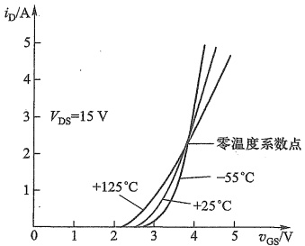

图 9.6.5 MOS 功率管 (IRF630, Siliconix) 在外壳温度分别为 -55 °C, +25 °C 和 +125 °C 时的  $ i_{D}-v_{GS} $ 特性曲线 (Siliconix 公司)
 

100 ns, 其工作频率可达 1 MHz 以上, 所以大功率 MOS 管常用于高频电路或开关式稳压电

<!-- page: 401 -->

源等。VMOS 在这一点上更显优越（其  $ f_{T}=600\ MHz $）。

（5）MOS 管与 BJT 相比几乎不需要直流驱动电流。但 MOS 功率放大电路的驱动级至少要提供足够的电流来保证对 MOS 管较大的输入电容进行充放电。

#### 9.6.3 功率器件 IGBT

值得指出的是，功率 MOS 管存在一个突出矛盾：高耐压和低导通电阻之间的矛盾，这使它不利于作为耐压大于 500 V 的器件。这个矛盾虽可用增加芯片面积来解决，但又导致开关速度变慢及成本提高。为解决此矛盾，人们设计了一种新型器件：绝缘栅双极型功率管（insulated gate bipolar transistor, IGBT）。这种器件一方面保留了功率 MOS 管具有高输入阻抗、高速的特点，同时又引入了低饱和压降的 BJT，因此 IGBT 就具有它们共同的优点。图 9.6.6 是这种 IGBT 结构的简化等效电路及器件符号。

图 9.6.6a 中  $ T_{2} $ 为增强型 MOS 管，工作时，首先在施加一定栅压之后形成导电沟道，出现 PNP 型管  $ T_{1} $ 的基极电流，IGBT 导电；当 FET 沟道消失，基极电流切断，IGBT 截止。有关 IGBT 的详细工作原理可参阅有关器件手册，这里不再赘述。 $ ^{①} $

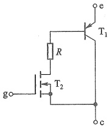

(a)
 

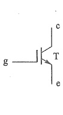

(b)
 

图 9.6.6 IGBT 的等效电路及符号 (a) 等效电路 (b) 符号
 

市场上已有很多上述 VMOS、DMOS 和 IGBT 功率器件产品，读者可根据不同需要选用。表9.6.1列举了几款功率管样例。

表9.6.1 功率管样例
 

<table border=1 style='margin: auto; word-wrap: break-word;'><tr><td style='text-align: center; word-wrap: break-word;'>型号</td><td style='text-align: center; word-wrap: break-word;'>类型</td><td style='text-align: center; word-wrap: break-word;'>主要参数</td></tr><tr><td style='text-align: center; word-wrap: break-word;'>2N3055</td><td style='text-align: center; word-wrap: break-word;'>功率 BJT</td><td style='text-align: center; word-wrap: break-word;'>$ V_{CE(max)}=60\ V $;  $ I_{C(max)}=15\ A $;  $ P_{C(max)}=115\ W $</td></tr><tr><td style='text-align: center; word-wrap: break-word;'>2N6678</td><td style='text-align: center; word-wrap: break-word;'>功率 BJT</td><td style='text-align: center; word-wrap: break-word;'>$ V_{CE(max)}=400\ V $;  $ I_{C(max)}=20\ A $;  $ P_{C(max)}=175\ W $</td></tr><tr><td style='text-align: center; word-wrap: break-word;'>IRFP264</td><td style='text-align: center; word-wrap: break-word;'>功率 MOSFET</td><td style='text-align: center; word-wrap: break-word;'>$ V_{DS(max)}=200\ V $;  $ I_{D(max)}=46\ A $;  $ P_{D(max)}=280\ W $</td></tr><tr><td style='text-align: center; word-wrap: break-word;'>BUZ380</td><td style='text-align: center; word-wrap: break-word;'>功率 MOSFET</td><td style='text-align: center; word-wrap: break-word;'>$ V_{DS(max)}=1000\ V $;  $ I_{D(max)}=8\ A $;  $ P_{D(max)}=150\ W $</td></tr><tr><td style='text-align: center; word-wrap: break-word;'>GT40M101</td><td style='text-align: center; word-wrap: break-word;'>功率 IGBT</td><td style='text-align: center; word-wrap: break-word;'>$ V_{CES}=900\ V $;  $ I_{C(max)}=40\ A $;  $ P_{D(max)}=90\ W $</td></tr><tr><td style='text-align: center; word-wrap: break-word;'>IRG4PH30KPBF</td><td style='text-align: center; word-wrap: break-word;'>功率 IGBT</td><td style='text-align: center; word-wrap: break-word;'>$ V_{CES}=1\ 200\ V $;  $ I_{C(max)}=40\ A $;  $ P_{D(max)}=100\ W $</td></tr></table>

##### 复习思考题

9.6.1 与功率 BJT 相比，VMOS 和 DMOS 管突出的优点是什么？

9.6.2 与功率 BJT 相比，IGBT 的优点是什么？

<!-- page: 402 -->

#### 集成功率放大器举例

##### 9.7.1 以 MOS 功率管作输出级的集成功率放大器

TDA7294 是一款以 DMOS 功率管作输出级的大功率音频集成功率放大器，有  $ \pm10 $~ $ \pm40 $ V 的宽电压工作范围，100 W 的音乐输出功率，而且具有静音和待机功能，很低的噪声和失真，主要应用于有源超低音系统以及 Hi-Fi 领域。

其内部简化原理电路如图 9.7.1 所示，电路由三级组成。 $ T_1 \sim T_4 $ 构成带有源负载的双入单出差分式输入级， $ I_1 $ 为其提供静态偏置。第二级由  $ T_5 $ 构成共源放大电路， $ I_2 $ 为其提供静态偏置并做有源负载。 $ T_6 $ 产生一个恒定的压差  $ V_{DS6} (= V_{GS6}) $，为  $ T_7 $ 提供合适的栅源静态偏置电压，以克服交越失真，同时也可以将  $ T_5 $ 漏极的输出信号无损地传送到  $ T_7 $ 的栅极。 $ T_7 $ 和  $ A_1 $、 $ T_8 $ 构成输出级。

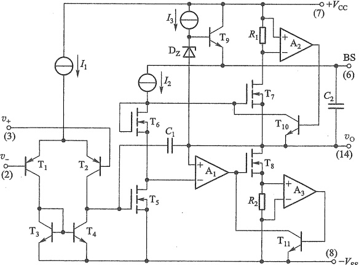

图 9.7.1 TDA7294 集成功率放大器简化原理电路
 

 $ R_{1} $、 $ A_{2} $、 $ T_{10} $及 $ R_{2} $、 $ A_{3} $、 $ T_{11} $构成输出短路保护电路，当 $ T_{7} $电流过大时， $ R_{1} $上压降增大，经差分放大器 $ A_{2} $放大后使 $ T_{10} $饱和导通，其饱和压降 $ V_{CES10} $远小于 $ T_{7} $的阈值电压，从而使 $ T_{7} $截止，限制输出电流。类似地，当 $ T_{8} $电流过大时， $ R_{2} $、 $ A_{3} $、 $ T_{11} $构成的保护电路也会使 $ T_{8} $截止，限制灌入电流。

 $ I_{3} $、 $ T_{9} $、 $ D_{Z} $及 $ C_{2} $构成目本电路。静态时 $ C_{2} $充电电压约为齐纳二极管 $ D_{Z} $的击穿电压，即 $ V_{C2}\approx V_{Z} $。当电路正常工作输出信号正半周时，BS端的电压 $ V_{BS}=V_{C2}+v_{0}, v_{0} $使 $ V_{BS} $升高 $ (>V_{CC}) $， $ T_{7} $的栅极便有足够高的电压，从而保证 $ v_{0} $正半周的幅值足够大，仿佛 $ v_{0} $自己提升了自己。但需保证 $ C_{2} $的放电时间常数远大于信号的最长周期。

<!-- page: 403 -->

电容  $ C_{1} $ 用于频率补偿，避免电路出现自激振荡。

输出级的  $ T_{7} $ 和  $ T_{8} $ 是 DMOS 功率管。 $ T_{8} $ 为共源组态，其输出漏极又连接到  $ A_{1} $ 的同相端形成负反馈，这样  $ A_{1} $ 和  $ T_{8} $ 一起构成了电压跟随器，等效于一个 PMOS 管的源极跟随器。同时，这个负反馈也消除了  $ T_{8} $ 可能出现的交越失真。而  $ T_{7} $ 为 NMOS 管源极跟随器，因此  $ T_{7} $ 和  $ T_{8} $ （及  $ A_{1} $）一起构成等效的甲乙类互补推挽输出级，该级也称为 DMOS 单位增益输出缓冲器。

单片 TDA7294 的典型应用电路如图 9.7.2 所示，图中的小圆圈边的数字表示芯片引脚编号，外围的分立器件主要功能为：

（1）电阻  $ R_{1} $ 连接在同相输入端和地之间，决定放大器的输入阻抗；

（2）电阻  $ R_{2} $、 $ R_{3} $ 和电容  $ C_{2} $ 决定放大器的交流闭环电压增益， $ A_{v}=1+R_{3}/R_{2} $

（3）电阻  $ R_{4} $ 、电容  $ C_{4} $ 决定 STBY 的时间常数。STBY 为芯片待机控制端子，低电平时维持待机状态；

（4）电阻  $ R_{s} $ 、电容  $ C_{3} $ 决定 MUTE 的时间常数。MUTE 为芯片静音控制端子，低电平时芯片静音；

（5）电容  $ C_{1} $ 为输入耦合电容，与电阻  $ R_{1} $ 一起影响电路的下限截止频率；

（6）电容  $ C_{2} $ 也与电阻  $ R_{2} $ 一起影响电路的低频特性；

（7）电容  $ C_{5} $ 为自举电容（接于输出端与 BS 端之间，见图 9.7.1）；

（8） $ C_{6} $～ $ C_{9} $为电源去耦电容，并抑制高频干扰。

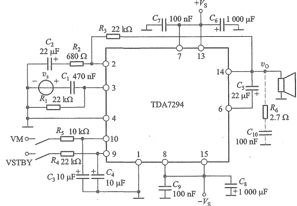

图 9.7.2 TDA7294 典型应用电路
 

##### 9.7.2 BJT 集成功率放大器举例

BJT 集成音频功率放大器 LM386 的原理电路如图 9.7.3a 所示，它由输入级、中间级和输出级所组成。 $ T_{1} $、 $ T_{2} $ 和  $ T_{3} $、 $ T_{4} $ 构成 CC-CE 复合管差分放大器， $ T_{5} $、 $ T_{6} $ 构成的镜像电流源作为其有源负载。中间级为  $ T_{7} $ 组成的带电流源负载的共射放大电路，以提高本级的电压增

<!-- page: 404 -->

益。输出级为  $ T_{8} $、 $ T_{9} $、 $ T_{10} $ 组成准互补对称的甲乙类功率放大电路，其中  $ T_{8} $、 $ T_{9} $ 等效于一个 PNP 型管，这种复合管方案是考虑到集成电路中的横向 PNP 型管的电流放大系数较低的缘故。二极管  $ D_{1} $、 $ D_{2} $ 组成偏置电路，为  $ T_{8} $、 $ T_{9} $、 $ T_{10} $ 提供直流偏置，以克服交越失真。电阻  $ R_{6} $ 引入了级间交直流负反馈，其中直流负反馈用以稳定电路的静态工作点，交流反馈为电压串联负反馈，用于确定电路初始增益并改善电路的交流性能。

LM386 是一个 8 引脚的器件, 图 9.7.3a 括号中的数字是其引脚编号。查阅数据手册可知, 当 1 脚和 8 脚之间开路时, 电压增益为初始增益 20; 当 1 和 8 脚之间接  $ 10\ \mu\text{F} $ 电容将  $ R_5 $ 交流短路时, 增益为最大值 200; 如果在引脚 1 和 8 之间串接电容和不同大小的电阻, 就可以使电压增益在 20~200 之间可调。

LM386 可在 4~12 V 单电源下工作。当电源电压为 6 V，负载电阻为 8 Ω 时，典型输出功率为 325 mW，典型静态电流 4 mA，静态功率为 24 mW，因此 LM386 非常适合用于收音机、对讲机等电池供电的应用电路。图 9.7.3b 为 LM386 应用于调幅收音机的典型应用电路。

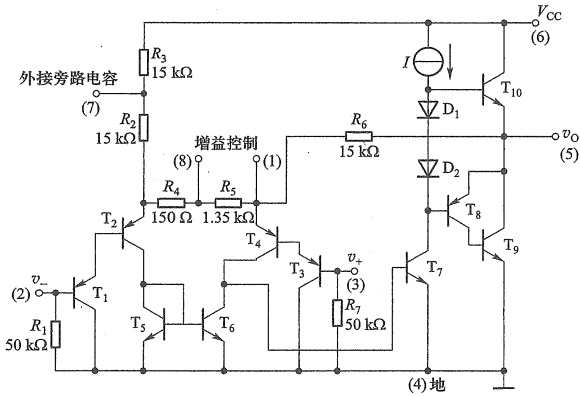

(a)
 

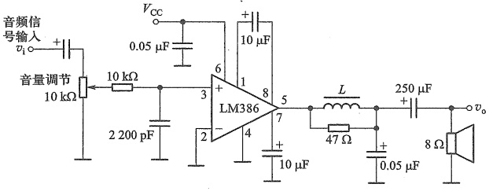

(b)
 

图 9.7.3 LM386 集成音频功率放大器
 

（a）内部原理电路 （b）LM386典型应用电路
 

<!-- page: 405 -->

另一种集成音频功率放大器的型号为 LM3886，其供电电压范围可达  $ \pm28\ V $， $ 4\ \Omega $ 负载时，输出功率可达 68 W。

#### 小结

功率放大电路是在大信号下工作，通常采用图解法进行分析。研究的重点是如何在有限的失真情况下，尽可能提高输出功率和效率。

与甲类功率放大电路相比，乙类互补对称功率放大电路的主要优点是效率高，在理想情况下，其最大效率约为78.5%。为保证BJT安全工作，双电源互补对称电路工作在乙类时，器件的极限参数必须满足： $ P_{cm}>P_{T1}\approx0.2P_{om} $， $ \left|V_{(BR)CEO}\right|>2V_{CC} $， $ I_{CM}>V_{CC}/R_{L} $。

教学视频9.1：

功率放大电路小结

由于功率 BJT 输入特性存在死区，工作在乙类的互补对称电路将出现交越失真，克服交越失真的方法是采用甲乙类（接近乙类）互补对称电路。通常可利用二极管或  $ V_{BE} $ 扩大电路进行偏置。

在单电源互补对称电路中，计算输出功率、效率、管耗和电源供给的功率时，可借用双电源互补对称电路的计算公式，但要用  $ V_{cc}/2 $ 代替原公式中的  $ V_{cc} $。

在丁类功率放大电路中，三极管工作于开关状态，管子饱和导通时，管压降近似为零，而截止时的管电流近似为零，因此管耗很小，可以获得很高的效率。

• MOS 功率管不存在二次击穿。但 MOS 功放电路的驱动级至少要提供足够的电流来完成对 MOS 管较大的输入电容的充放电。此外，MOS 管的运行速度比 BJT 高，因此 MOS 功率管特别适合作为开关应用。

#### 习题

#### 9.1 功率放大电路的一般问题

9.1.1 在甲类、乙类和甲乙类放大电路中，放大管的导通角分别等于多少？它们中哪一类放大电路效率最高？

#### 9.3 乙类双电源互补对称功率放大电路

9.3.1 在图题 9.3.1 所示电路中，设 BJT 的  $ \beta=100 $， $ V_{BE}=0.7\ V $， $ V_{CES}=0.5\ V $， $ I_{CEO}=0 $，电容 C 对交流可视为短路。输入信号  $ v_i $ 为正弦波。（1）计算电路可能达到的最大不失真输出功率  $ P_{om} $；（2）此时  $ R_b $ 应调节到什么数值？（3）此时电路的效率  $ \eta= $？试与工作在乙类的互补对称电路比较；（4）图中 T 采用 Q2N3904，将其电流放大系数改为 100，利用 SPICE 仿真电路的静态工作点。当输入正弦波的幅值为 50 mV，频率为 1 kHz 时，仿真绘出输入和输出信号的波形。

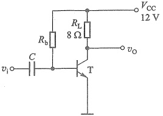

图题9.3.1
 

<!-- page: 406 -->

9.3.2 一双电源互补对称电路如图题9.3.2所示，设已知 $ V_{cc}=12\ V,R_{L}=16\ \Omega,v_{i} $为正弦波。

求：(1) 在 BJT 的饱和压降  $ V_{CES} $ 可以忽略不计的条件下，负载上可能得到的最大输出功率  $ P_{om} $; (2) 每个管子允许的管耗  $ P_{CM} $ 至少应为多少？(3) 每个管子的耐压  $ \left|V_{(BR)CEO}\right| $ 应大于多少？(4) 若 BJT 管的饱和压降  $ V_{CES}=2V $，重新计算上述问题。

9.3.3 在图题 9.3.2 所示电路中，设  $ v_i $ 为正弦波， $ R_L = 8\ \Omega $，要求最大输出功率  $ P_{om} = 9\ W $。试在 BJT 的饱和压降  $ V_{CES} $ 可以忽略不计的条件下，求：(1) 正、负电源  $ V_{CC} $ 的最小值；(2) 根据所求  $ V_{CC} $ 最小值，计算相应的  $ I_{CM} $、 $ \left|V_{(BR)CEO}\right| $ 的最小值；(3) 输出功率最大  $ (P_{om} = 9\ W) $ 时，电源供给的功率  $ P_V $；(4) 每个管子允许的管耗  $ P_{CM} $ 的最小值；(5) 当输出功率最大  $ (P_{om} = 9\ W) $ 时的输入电压有

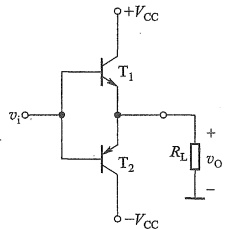

图题9.3.2
 

效值；(6) 图中  $ T_{1} $ 采用 Q2N3904， $ T_{2} $ 采用 Q2N3906，试利用 SPICE 仿真求解，当  $ R_{L}=8 $ Ω，电源电压为  $ \pm12 $ V 时，可输出的最大功率为多少？并与题目给定的最大功率作比较。

9.3.4 设电路如图题9.3.2所示，管子在输入信号 $ v_{i} $作用下，在一周期内 $ T_{1} $和 $ T_{2} $轮流导电约 $ 180^{\circ} $，电源电压 $ V_{cc}=20\ V $，负载 $ R_{L}=8\ \Omega $，试计算：（1）在输入信号 $ V_{i}=10\ V $（有效值）时，电路的输出功率、管耗、直流电源供给的功率和效率；（2）当输入信号 $ v_{i} $的幅值为 $ V_{im}=V_{cc}=20\ V $时，电路的输出功率、管耗、直流电源供给的功率和效率。

9.3.5 电路如图 9.3.4 所示，设 MOS 管  $ T_{1} $ 和  $ T_{2} $ 的  $ K_{n}=K_{p}=0.25\ A/V^{2} $，忽略它们的阈值电压，即  $ V_{TN}=V_{TP}=0 $ 。若电路中  $ V_{DD}=V_{SS}=10\ V, R_{L}=8\ \Omega $ 。当  $ T_{1} $ 工作于恒流区时，试求输出电压的最大值，以及对应的负载电流和输入电压。

#### 9.4 甲乙类互补对称功率放大电路

9.4.1 一单电源互补对称功放电路如图题9.4.1所示，设 $ v_{i} $为正弦波， $ R_{L}=8\Omega $，管子的饱和

压降  $ V_{CES} $ 可忽略不计。试求最大不失真输出功率  $ P_{cm} $ (不考虑交越失真) 为 9 W 时，电源电压  $ V_{CC} $ 至少应为多大？

9.4.2 在图题 9.4.1 所示单电源互补对称电路中，设  $ V_{cc}=12\ V $， $ R_{L}=8\ \Omega $，C 的电容量很大， $ v_{i} $ 为正弦波，(1) 在忽略管子饱和压降  $ V_{CES} $ 情况下，试求该电路的最大输出功率  $ P_{om} $；(2) 设三极管饱和压降  $ V_{CES}=1\ V $，再求该电路的最大输出功率  $ P_{om} $。

9.4.3 一单电源互补对称电路如图题9.4.3所示，设 $ T_{1} $、 $ T_{2} $的特性完全对称， $ v_{i} $为正弦波， $ V_{cc}=12\ V $， $ R_{L}=8\ \Omega $。试回答下列问题：（1）静态时，电容 $ C_{2} $两端电压应是多少？调

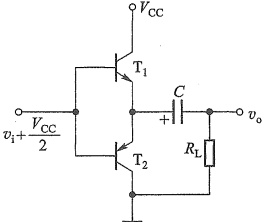

图题9.4.1
 

整哪个电阻能满足这一要求？(2)动态时，若输出电压 $ v_{0} $出现交越失真，应调整哪个电阻？如何调整？(3)若 $ R_{1}=R_{3}=1.1\ k\Omega $， $ T_{1} $和 $ T_{2} $的 $ \beta=40 $， $ \left|V_{BE}\right|=0.7\ V $， $ P_{CM}=400\ mW $，假设 $ D_{1} $、 $ D_{2} $、 $ R_{2} $中任意一个开路，将会产生什么后果？

 $$ V_{\mathrm{c c}}=35\mathrm{~V},R_{\mathrm{L}}=35\Omega $$ 

 $$ i_{e}=0.45\mathrm{c o s}\omega t\mathrm{A} $$ 

 $$ P_{。}((2) $$ 

 $$ P_{vc} $$ 

9.4.5 一双电源互补对称电路如图题9.4.5所示（图中未画出 $ T_{3} $的偏置电路），设输入电压 $ v_{i} $为正弦波，电源电压 $ V_{cc}=24\ V, R_{L}=16\ \Omega $，由 $ T_{3} $组成的放大电路的电压增益 $ \Delta v_{c3}/\Delta v_{B3}=-16 $，射

<!-- page: 407 -->

极输出器的电压增益为1，当输入电压有效值 $ V_{i}=1V $时，试计算电路的输出功率 $ P_{e} $、电源供给的功率 $ P_{v} $、两管的管耗 $ P_{T} $以及效率 $ \eta $。

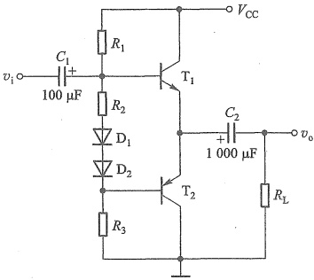

图题9.4.3
 

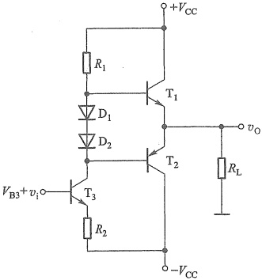

图题9.4.5
 

9.4.6 某集成电路的输出级如图题9.4.6所示。试说明：(1) $ R_{1} $、 $ R_{2} $和 $ T_{3} $组成什么电路，在电路中起何作用；(2)恒流源I在电路中起何作用；(3)电路中引入了 $ D_{1} $、 $ D_{2} $作为过载保护，试说明其理由。

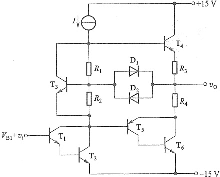

图题9.4.6
 

9.4.7 电路如图 9.4.5 所示，MOS 管  $ T_{1} $ 和  $ T_{2} $ 的参数为  $ V_{TN} = -V_{TP} = 1\ V $， $ K_{n1} = K_{p2} = 5\ mA/V^{2} $，电路中  $ R_{L} = 0.5\ k\Omega $， $ I_{bias} = 200\ \mu A $， $ V_{DD} = V_{SS} = 12\ V $。若  $ T_{3} $ 和  $ T_{4} $ 的  $ K_{n3} = K_{p4} $，为了使  $ T_{3} $ 和  $ T_{4} $ 的静态电流为 5 mA，试求  $ K_{n3} $ 和  $ K_{p4} $ 的值。

9.5 丁类（D类）功率放大电路原理简介

9.5.1 在图 9.5.1 所示的电路中。若  $ v_{t} $ 是峰值为  $ \pm10 $ V，频率为 1 kHz 的三角波，比较器的

<!-- page: 408 -->

输出电压为 $ \pm10\ V $；若音频信号输入端的电压分别为：(1)0 V, (2)5 V, (3)10 V, (4)-5 V, (5)-10 V 时，试求输出波形的占空比和输出电压的平均值。

 $ ^{*} $9.5.2 在图9.5.1所示的电路中。(1) 若  $ v_{i} $ 是幅值为5 V的正弦波， $ v_{t} $ 为峰值为 $ \pm10 $ V的三角波， $ v_{t} $ 的频率为  $ v_{i} $ 的5倍，且比较器的输出电压幅值为 $ \pm10 $ V，试画出比较器的输出电压  $ v_{i} $ 的波形；(2) 利用 SPICE 仿真比较器输出的  $ v_{i} $ 波形。

#### 9.7 集成功率放大器举例

9.7.1 在图 9.7.3b 所示的 LM386 的应用电路中，说明图中 250  $ \mu $F 电容的作用？

9.7.2 阅读 LM386 的数据手册，说明在图 9.7.3b 所示的 LM386 的应用电路中，若将一个阻值为 1.2 kΩ 的电阻与 10 μF 电容串接于 1 脚和 8 脚之间，此时电路的闭环电压增益为多少？

9.7.3 某集成功放组成的功率放大电路如图题 9.7.3 所示。已知电路在通带内的电压增益为 40 dB，在  $ R_L = 8\ \Omega $ 时不失真的最大输出电压（峰-峰值）可达 18 V（接 47 μF 电容的引脚类似于 LM386 的 7 号引脚）。求当  $ v_i $ 为正弦信号时：（1）最大不失真输出功率  $ P_{om} $；（2）输出功率最大时的输入电压有效值。

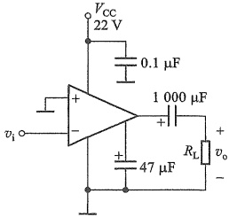

图题9.7.3
 

9.7.4 电路如图 9.7.2 所示，若  $ R_{2}=1.2\ k\Omega, R_{3}=12\ k\Omega $

若电路的输入和输出电压均在合理范围时，试求电路交流的电压增益值。

第9章部分习题答案

