# 10-第10章 信号处理与信号产生电路

[返回全书目录](../../README.md)

> PDF 页码：409–469

<!-- page: 409 -->

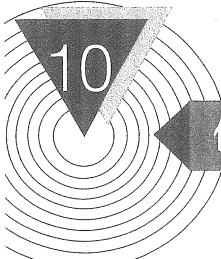

# 信号处理与信号产生电路

## 引言

本章主要讨论信号的处理（滤波）和信号的产生（振荡），它主要涉及四种电路。这些电路和它们的用途如下。

1. 有源滤波器。滤波器的主要功能是传送输入信号中有用的频率成分，衰减或抑制无用的频率成分。本章在主要讨论由 R、C 和运放组成的有源滤波电路之后，接着简要介绍开关电容滤波器。

2. 正弦波振荡电路。例如，在通信、广播、电视系统中，都需要射频（高频）发射，这里的射频波就是载波，把音频（低频）、视频信号或脉冲信号运载出去，这就需要能产生高频信号的振荡器。又如工业生产中的高频感应加热、熔炼、淬火，超声波焊接和生物医学领域内的超声诊断和核磁共振成像等设备中，都需要功率或大或小、频率或高或低的振荡器。可见，正弦波振荡电路在各领域的应用是十分广泛的。

3. 非正弦波产生电路。一些电子系统需要的特殊信号，如方波、三角波等，就可通过非正弦波产生电路来产生。

4. 本章在讨论正弦波振荡电路之后、非正弦波信号产生电路之前，还要研究一种重要单元电路——电压比较器，它不仅是波形产生电路中常用的基本单元，也广泛用于测控系统和电子仪器中。希望读者予以足够的重视。

以上这些电路都可以用集成运放构成。

#### 0.1 滤波电路的基本概念与分类

### 1. 基本概念

滤波电路是一种有“频率选择”功能的电子装置，它允许一定频率范围内的信号通过，而同时抑制或急剧衰减此频率范围以外的信号。工程上常用它来作信号处理、数据传送和抑制干扰等。

以往这种滤波电路主要采用无源元件 R、L 和 C 组成，称之为无源滤波器。20 世纪 60 年代以来，集成运放获得了迅速发展，由运放和 R、C 组成的滤波电路，称之为有源滤波器。有源滤波器具有不用电感、体积小、重量轻等优点。

此外，由于集成运放的开环电压增益和输入阻抗均很高，而输出阻抗又低，所以构成有

<!-- page: 410 -->

源滤波电路后还具有一定的电压放大和缓冲作用。但是，集成运放的带宽有限，所以目前有源滤波电路的工作频率难以做得很高，以及难以对功率信号进行滤波，这是它的不足之处。

图 10.1.1 是滤波电路的一般结构图。

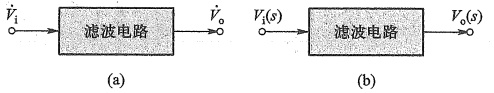

图 10.1.1 滤波电路的一般结构图   (a) 频域 (b) 复频域
 

在分析滤波电路时，一般先通过拉普拉斯变换将滤波器变换到复频域，即将输入、输出电压变换为象函数  $ V_{i}(s) $ 和  $ V_{o}(s) $，电阻、电容变换为运算阻抗形式 R、1/ $ sC $，通过输出电压与输入电压之比得到传递函数

 $$ A\left(s\right)=\frac{V_{o}\left(s\right)}{V_{i}\left(s\right)} $$ 

然后，令  $ s = j\omega $，将传递函数转换到频域，得到

$$  \dot{A}(\mathrm{j}\omega)=\left|\dot{A}(\mathrm{j}\omega)\right|\mathrm{e}^{\mathrm{j}\varphi(\omega)}   \tag*{(10.1.1)}$$

这里， $ \left|\dot{A}(j\omega)\right| $ 为传递函数的模，也称幅频响应。 $ \varphi(\omega) $ 为输出电压与输入电压之间的相位差，也称相频响应。

由于正弦信号的相位变化与时间的关系可表示为  $ \Delta\varphi = \omega \times \Delta t $，故常用时延  $ \tau $ 来表示信号相位的变化量，定义为

$$  \tau\left(\omega\right)=-\frac{\mathrm{d}\varphi\left(\omega\right)}{\mathrm{d}\omega}\left(\mathrm{s}\right)   \tag*{(10.1.2)}$$

其单位为 s(秒)。 $ \tau(\omega) $ 表示不同频率的输入信号通过滤波电路时所产生的延迟时间。由于信号常为复合频率，所以  $ \tau(\omega) $ 也常称为群时延 $ ^{①} $。

虽然常用幅频响应表征滤波电路特性，但实际上欲使信号通过滤波电路的失真小，不仅需要考虑幅频响应，还需要考虑相频（或时延）响应。当相频响应  $ \varphi(\omega) $ 作线性变化时， $ \tau(\omega) $ 为常数，即信号中各频率分量的时延相同，输出信号才可能避免相位失真。但实际滤波器的幅频响应和相频响应是相互制约的，幅频响应改善了，相频响应却恶化了，或者相反。因此，设计滤波器时总要有所舍弃。

### 2. 有源滤波电路的分类

从图10.1.2所示的幅频响应的角度看，通常把能够通过滤波电路的信号频率范围定义为通常，而把受阻或衰减的信号频率范围称为阻带，通带和阻带的分界频率称为截止频率 $ ^{②} $。理想滤波电路在通带内应具有零衰减的幅频响应和线性的相频响应，而在阻带内幅度衰减到零

<!-- page: 411 -->

$ \left(|\dot{A}(\mathrm{j}\omega)|=0\right) $。但实际滤波器的幅频响应并没有这么理想，在通带内，信号的幅度并不是零衰减，只不过衰减较小（一般规定不超过3 dB）；在通带外，信号幅度也不会立即衰减到零，而是存在一个过渡带（将在本节最后讨论）。

按照通带和阻带的相互位置不同，滤波电路通常可分为以下几类。

##### （1）低通滤波电路

其幅频响应如图10.1.2a所示。它的功能是允许低频信号通过，阻止高频信号通过。图中 $ A_{0} $表示低频增益， $ |A| $为增益的幅值。角频率的 $ 0\sim\omega_{H} $范围为通带，高于 $ \omega_{H} $的范围为阻带，因此其带宽 $ BW=\omega_{H} $。

##### （2）高通滤波电路

其幅频响应如图 10.1.2b 所示。它的功能是允许高频信号通过，阻止低频信号通过。图中  $ 0<\omega<\omega_{L} $ 的范围为阻带，高于  $ \omega_{L} $ 的范围为通带。从理论上来说，它的带宽  $ BW=\infty $，但实际上，由于受有源器件和外接元件以及杂散参数的影响，带宽受到限制，所以高通滤波电路的带宽也是有限的。

##### （3）带通滤波电路

其幅频响应如图 10.1.2c 所示。它的功能是允许某个频带范围内的信号通过，阻止或衰减该频带之外的信号。由图可知，它有一个通带  $ \omega_{L}<\omega<\omega_{H} $，两个阻带： $ 0<\omega<\omega_{L} $ 和  $ \omega>\omega_{H} $，因此带宽  $ BW=\omega_{H}-\omega_{L} $。

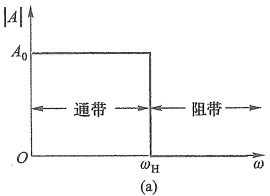

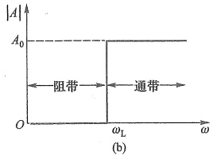

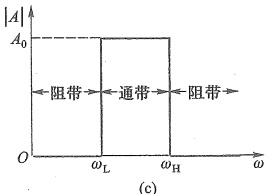

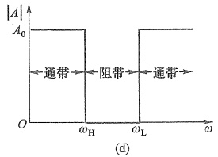

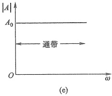

图 10.1.2 各种滤波电路的理想幅频响应
 

(a) 低通滤波电路 (low pass filter, LPF) (b) 高通滤波电路 (high pass filter, HPF) (c) 带通滤波电路 (band pass filter, BPF) (d) 带阻滤波电路 (band reject filter, BRF) (e) 全通滤波电路 (all pass filter, APF)
 

##### （4）带阻滤波电路

其幅频响应如图 10.1.2d 所示。由图可知，它有两个通带： $ 0<\omega<\omega_{H} $ 及  $ \omega>\omega_{L} $；一个阻带： $ \omega_{H}<\omega<\omega_{L} $。因此它的功能是允许某个频带范围之外的信号通过，阻止或衰减该频带（ $ \omega_{H}\sim\omega_{L} $）内的信号。同高通滤波电路相似，由于受有源器件带宽等因素的限制， $ \omega>\omega_{L} $ 的通带也

<!-- page: 412 -->

是有限的。

##### （5）全通滤波电路

图 10.1.2e 所示是理想全通滤波器的幅频响应。它只有通带，没有阻带。因此，在全频域内幅度都没有衰减，只有相移随频率而变，常用作对某一特定频率信号的移相或对若干频率信号实现群时延。在时延电路、相移均衡电路中有广泛应用。

### 3. 频率响应的逼近方式

实际上，理想化的特性是无法实现的，物理上可以实现的只能是它的逼近。如何逼近呢？这既是一个电路理论问题，又是一个数学问题。关键是用什么样的数学函数来逼近这种理想化的响应曲线。

工程中，常用巴特沃斯（Butterworth）、切比雪夫（Chebyshev或Chebyshev 1）、反切比雪夫（Inverse Chebyshev或Chebyshev 2）、贝塞尔（Bessel）和椭圆型（Elliptic）等不同形式的传递函数去逼近理想化的频率响应。它们中的任何一种都可用来实现低通、高通、带通与带阻四种不同功能的滤波器。

图 10.1.3 给出了相同阶数情况下三类低通滤波器的典型幅频响应。巴特沃斯滤波器的幅频响应是单调下降的，且在通带中具有最平坦的幅度，但从通带到阻带衰减较慢。切比雪夫滤波器的幅频响应在一定范围内有起伏波动，但能迅速单调衰减到阻带。而贝塞尔滤波器的幅频响应也是单调下降曲线，但通带的平坦度不如巴特沃斯滤波器，从通带到阻带的衰减也比巴特沃斯慢，但它有线性的相频响应（未画出），相位失真最小。

反切比雪夫滤波器（也称为切比雪夫2型）的幅频响应如图10.1.4所示，在通带内

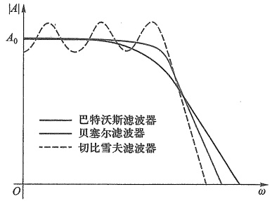

图10.1.3 相同样阶数的三类低通滤波器幅频响应比较图
 

是单调平坦的，阻带内有起伏波动，且在截止频率后衰减速度较快。图10.1.5所示为椭圆型低通滤波器的幅频响应，虽然通带和阻带内均有波动，但衰减速度最快。

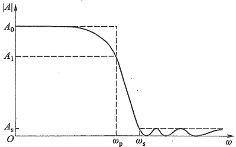

图 10.1.4 反切比雪夫低通滤波器的幅频响应
 

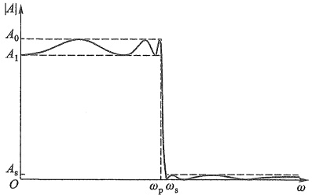

图 10.1.5 椭圆型低通滤波器的幅频响应
 

<!-- page: 413 -->

可根据实际需要，选用不同的滤波器。例如，在不允许带内有波动时，用巴特沃斯滤波器较好。如果允许带内有一定波动，则可用切比雪夫或椭圆型滤波器，以便从通带到阻带有更快速地衰减。如果需要线性的相移，就要选用贝塞尔滤波器。

### 4. 实际滤波电路的参数说明

图 10.1.6 是一个实际低通滤波电路的幅频响应，由于实际电路的传输特性在通带边界处不可能急剧变化，而只能指定增益下降到某一特定值 $ \left(\gamma_{\min}\right) $以下时为进入阻带，所以，通带与阻带之间存在过渡带。下面，对滤波电路中一些参数的含义进行说明。

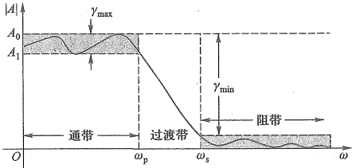

图 10.1.6 滤波电路常用参数定义
 

（1）通带纹波 $ \left(\gamma_{\max}\right) $：指通带增益的波动范围（误差范围），如图中上部的阴影区域所示。一般用增益的最大变化值（常用dB表示）进行说明。根据不同的应用， $ \gamma_{max} $的值一般为0.05~3 dB。

（2）通带截止角频率 $ \omega_{p} $：指幅频响应曲线在通带内下降到误差范围以外的频率点。对于单调衰减的幅频响应（巴特沃斯、贝塞尔等），通常定义 $ \left|A/A_{0}\right|=1/\sqrt{2} $所对应的频率点称为通带截止角频率或3 dB截止频率。由于该频率点输出信号的功率正好等于通带增益下输出信号功率的一半，所以也称半功率点。

（3）阻带最小衰减量 $ \left(\gamma_{\min}\right) $：指通带增益衰减到阻带时的最小衰减量（常用 dB 表示）。理想情况下阻带最大衰减量可达无穷大。阻带内的  $ \left|A\right| $ 也会有起伏，但它与通带内  $ \left|A\right| $ 的差值的绝对值要大于  $ \gamma_{\min} $。根据不同的应用， $ \gamma_{\min} $ 的值一般为 20~100 dB。

（4）阻带截止角频率 $ \omega_{s} $ ①：指幅频响应曲线达到最小衰减量时所对应的频率点。

（5）频率选择性因子 $ \left(\omega_{s}/\omega_{p}\right) $：过渡带的带宽 $ \left(\omega_{s}-\omega_{p}\right) $越窄，幅频响应曲线越陡峭，滤波器的频率选择性越好，因此，可用比值 $ \omega_{s}/\omega_{p} $来衡量滤波电路的选频性能，称 $ \omega_{s}/\omega_{p} $为频率选择性因子，简称选择性。通常 $ \left(\omega_{s}/\omega_{p}\right)\geqslant1 $，此值越接近于1，频率选择性越好。

注意，并不是所有滤波电路设计都需要用上述所有参数来描述。例如，巴特沃斯和贝塞尔滤波器就不需要通带纹波。

##### 复习思考题

10.1.1 滤波电路的功能是什么？什么叫无源和有源滤波电路？

10.1.2 如果把第4章讨论的阻容耦合放大电路看成一个滤波电路，它属于什么类型

<!-- page: 414 -->

的滤波电路？其通带电压增益等于多少？

10.1.3 对于低通滤波电路，巴特沃斯、切比雪夫、贝塞尔三种常见的逼近方法有何不同？

#### 一阶有源滤波电路

在前面 6.1.2 节，曾讨论过 RC 低通电路。如果在一级 RC 低通电路的输出端再加上电压跟随器，就构成了简单的一阶有源低通滤波电路。由于电压跟随器的输入阻抗很高、输出阻抗很低，因此，它能很好地隔离 RC 电路与负载，且带负载能力得到加强。

如果希望电路不仅有滤波功能，而且能起放大作用，则只要将电路中的电压跟随器改为同相比例放大电路即可，如图10.2.1a所示。下面介绍它的性能。

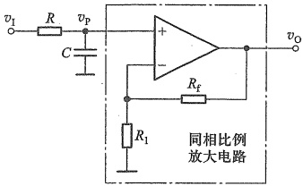

(a)
 

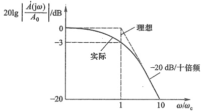

(b)
 

图 10.2.1 一阶低通滤波电路
 

（a）带同相比例放大电路的低通滤波电路 （b）幅频响应
 

### 1. 传递函数

在图 10.2.1a 中，同相比例放大电路的电压增益为

$$  A_{_{v f}}=\frac{V_{o}(s)}{V_{p}(s)}=1+\frac{R_{f}}{R_{1}}   \tag*{(10.2.1)}$$

而运放同相端的电压为

$$  V_{\mathrm{p}}(s)=\frac{\frac{1}{s C}}{R+\frac{1}{s C}}V_{\mathrm{i}}(s)=\frac{1}{1+s R C}V_{\mathrm{i}}(s)   \tag*{(10.2.2)}$$

因此，可导出电路的传递函数为

$$  A\left(s\right)=\frac{V_{\mathrm{o}}\left(s\right)}{V_{\mathrm{i}}\left(s\right)}=\frac{V_{\mathrm{o}}\left(s\right)}{V_{\mathrm{p}}\left(s\right)}\cdot\frac{V_{\mathrm{p}}\left(s\right)}{V_{\mathrm{i}}\left(s\right)}=\frac{A_{\mathrm{vf}}}{1+\frac{s}{\omega_{\mathrm{e}}}}   \tag*{（10.2.3）}$$

式中  $ \omega_{c}=1/(RC) $,  $ \omega_{c} $ 称为特征角频率（characteristic angular frequency）。

由于式 $ （10.2.3） $中分母为s的一次幂，故上式所示滤波电路称为一阶低通有源滤波电路。

### 2. 幅频响应

对于实际的频率来说，式(10.2.3)中的 s 可用  $ s = j\omega $ 代入，于是得到

<!-- page: 415 -->

$$  \dot{A}\left(\mathrm{j}\omega\right)=\frac{\dot{V}_{\mathrm{o}}\left(\mathrm{j}\omega\right)}{\dot{V}_{\mathrm{i}}\left(\mathrm{j}\omega\right)}=\frac{A_{0}}{1+\mathrm{j}\left(\frac{\omega}{\omega_{\mathrm{o}}}\right)}   \tag*{(10.2.4)}$$

 $ A_{0} $ 称为通带电压增益，即  $ \omega=0 $ (C 相当于开路) 时，输出电压  $ v_{0} $ 与输入电压  $ v_{1} $ 的比值，且有  $ A_{0}=A_{vf} $

其幅频响应表达式为 $ ^{①} $

$$  \left|\frac{\dot{A}\left(\mathrm{j}\omega\right)}{A_{0}}\right|=\frac{1}{\sqrt{1+\left(\frac{\omega}{\omega_{0}}\right)^{2}}}   \tag*{(10.2.5)}$$

显然，当  $ \omega = \omega_{c} $ 时， $ |A(j\omega)/A_{0}| $ 的分贝数为 -3 dB，因此，该电路的  $ \omega_{c} $ 就是 -3 dB 通带截止角频率  $ \omega_{H} $。

由式(10.2.5)可画出其幅频响应曲线，如图10.2.1b所示。当 $ \omega\gg\omega_{c} $时，幅频响应曲线以-20 dB/十倍频的斜率下降，与理想滤波器的矩形特性相距甚远。

一阶高通有源滤波电路可通过交换图10.2.1a中R和C的位置来组成，这里不再赘述。

10.2.1 一阶滤波电路幅频响应通带外的衰减斜率是多少?

##### 复习思考题

10.2.2 试写出图 10.2.1a 所示电路的相频响应表达式。

10.2.3 如何判断滤波电路的类型和阶数？如何推导滤波电路的传递函数？

#### 10.3 高阶有源滤波电路

为了使滤波电路的幅频响应在过渡带内有更快的衰减速度，可以采用二阶、三阶等高阶滤波电路。实际上，高于二阶的滤波电路可以由一阶和二阶有源滤波电路级联构成。因此，下面重点研究二阶有源滤波电路的组成和特性。

通过20世纪50~70年代，人们对滤波器进行了深入研究，获得了一些性能稳定的电路结构。常用的二阶有源滤波电路结构有两种。一种是将二阶RC滤波网络接在运放的同相输入端组成压控电压源型滤波电路。另一种是将二阶RC滤波网络接在运放反相输入端，组成无限增益多路反馈型滤波电路。它们都能构成低通、高通、带通、带阻等滤波电路。

10.3.1 有源低通滤波电路

1. 压控电压源型二阶有源低通滤波电路 $ ^{②} $

在一阶滤波电路的基础上再加一级 RC 低通电路，就可构成二阶低通滤波电路，如图

<!-- page: 416 -->

10.3.1 所示。从反馈放大电路角度看，同相比例放大电路属电压控制的电压源，所以称该电路为压控电压源（voltage-controlled voltage source，VCVS）型二阶低通滤波电路。

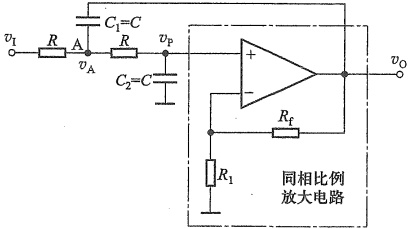

图 10.3.1 压控电压源型二阶低通滤波电路
 

图中  $ C_{1} $ 的另外一端没有接地而改接到输出端，形成了运放的另一个反馈。尽管它可能会引入正反馈，但当信号频率趋于零时， $ C_{1} $ 的容抗趋于无穷大，反馈很弱；而当信号频率趋于无穷大时， $ C_{2} $ 的容抗趋于零，使  $ v_{p} $ 趋于零，即  $ v_{0} $ 也几乎为零。也就是说在两种极端频率情况下，正反馈都很弱。因此，只要参数选择合适，就可以在全频域控制正反馈的强度，不致使电路自激振荡；而在截止频率附近引入正反馈，可以使  $ \omega_{c} $ 附近的电压增益得到提高，改善  $ \omega_{c} $ 附近的幅频响应。所以，电路中的运放同时引入了正反馈和负反馈（由  $ R_{f} $ 引入的）。

##### （1）传递函数

前已指出，同相放大电路的电压增益  $ A_{af} $ 就是低通滤波器的通带电压增益  $ A_{0} $，即

$$  A_{0}=A_{v f}=\frac{V_{o}(s)}{V_{p}(s)}=1+\frac{R_{f}}{R_{1}}   \tag*{(10.3.1)}$$

考虑到运放的同相输入端电压为

$$  V_{p}(s)=\frac{V_{o}(s)}{A_{vf}}   \tag*{（10.3.2）}$$

而  $ V_{p}(s) $ 与  $ V_{a}(s) $ 的关系为

$$  V_{p}(s)=\frac{V_{a}(s)}{1+s R C}   \tag*{（10.3.3）}$$

对于节点 A，应用 KCL 可得

$$  \frac{V_{\mathrm{i}}(s)-V_{\mathrm{a}}(s)}{R}-\left[\begin{array}{l}V_{\mathrm{a}}(s)-V_{\mathrm{o}}(s)\end{array}\right]s C-\frac{V_{\mathrm{a}}(s)-V_{\mathrm{p}}(s)}{R}=0   \tag*{（10.3.4）}$$

将式(10.3.1)~式(10.3.4)联立求解，可得电路的传递函数为

$$  A\left(\boldsymbol{s}\right)=\frac{V_{o}\left(\boldsymbol{s}\right)}{V_{i}\left(\boldsymbol{s}\right)}=\frac{A_{vf}}{1+\left(3-A_{vf}\right)sCR+\left(sCR\right)^{2}}   \tag*{（10.3.5）}$$

 $$ \left.\begin{array}{l}\omega_{\mathrm{e}}=\frac{1}{RC}\\ Q=\frac{1}{3-A_{\mathrm{pf}}}\end{array}\right\} $$ 

令

<!-- page: 417 -->

得到二阶低通滤波电路传递函数的典型表达式

$$  A\left(s\right)=\frac{A_{_{uf}}}{1+\frac{1}{Q\omega_{c}}\cdot s+\frac{1}{\omega_{c}^{2}}\cdot s^{2}}=\frac{A_{0}}{1+\frac{1}{Q}\left(\frac{s}{\omega_{c}}\right)+\left(\frac{s}{\omega_{c}}\right)^{2}}   \tag*{(10.3.7)}$$

其中  $ \omega_{c} $ 称为特征角频率，Q 称为等效品质因数。

##### （2）幅频响应

用  $ s=j\omega $ 代入式(10.3.7)，得到实际的频率响应表达式

$$  \dot{A}\left(\mathrm{j}\omega\right)=\frac{A_{0}}{1-\left(\frac{\omega}{\omega_{\mathrm{c}}}\right)^{2}+\mathrm{j}\frac{1}{Q}\cdot\frac{\omega}{\omega_{\mathrm{c}}}}   \tag*{(10.3.8)}$$

当  $ \omega = \omega_{c} $ 时，式(10.3.8) 可以化简为

$$  \dot{A}\left(\mathrm{j}\omega\right)\big|_{\omega=\omega_{\mathrm{c}}}=-\mathrm{j}Q A_{0}   \tag*{(10.3.9a)}$$

对上式取模，得到

$$  \left|\frac{\dot{A}(\mathrm{j}\omega)}{A_{0}}\right|_{\omega=\omega_{c}}=Q   \tag*{(10.3.9b)}$$

可见, $ \omega=\omega_{c} $ 时的电压增益与通带电压增益 $ A_{0} $ 之比的绝对值与Q值相等。Q值不同时,对应的 $ \left|\dot{A}(j\omega)/A_{0}\right|_{\omega=\omega_{c}} $也不同。

注意,根据式(10.3.6),当 $ A_{vf}=3 $时, $ Q\to\infty $,滤波电路将产生自激振荡。当 $ A_{vf}>3 $时,Q为负,式(10.3.7)分母中复频率的一次项系数为负,将有极点处于右半s平面上,滤波电路将不能稳定工作 $ ^{①} $。因此,设计电路时,应使 $ A_{vf}<3 $。故这类滤波电路又被称为有限增益多路反馈(finite gain multiple feedback)滤波器。

由式 $ （10.3.8 $）可得幅频响应和相频响应分别为

$$  20\lg\left|\frac{\dot{A}\left(\mathrm{j}\omega\right)}{A_{0}}\right|=20\lg\frac{1}{\sqrt{\left[1-\left(\frac{\omega}{\omega_{\mathrm{c}}}\right)^{2}\right]^{2}+\left(\frac{\omega}{\omega_{\mathrm{c}}}Q\right)^{2}}}   \tag*{(10.3.10a)}$$

$$  \varphi\left(\omega\right)=-\arctan\frac{\omega/\left(\omega_{c}Q\right)}{1-\left(\frac{\omega}{\omega_{c}}\right)^{2}}   \tag*{(10.3.10b)}$$

式(10.3.10a)表明，当  $ \omega=0 $ 时， $ \left|\dot{A}(j\omega)\right|=A_{0} $; 当  $ \omega\to\infty $ 时， $ \left|A(j\omega)\right|\to0 $。显然，这是低通滤波电路的特性。由式(10.3.10a)可画出不同 Q 值下的幅频响应，如图 10.3.2 所示。

由图可见，Q值的大小对  $ \omega_{0} $ 附近的幅频响应影响很大，当Q>0.707时，幅频响应出现升峰现象，Q值越大，峰值越高（此时 $ C_{1} $引入的正反馈较强，提高了 $ \omega_{0} $附近的电压增益）。只有当Q=0.707时，在通带内幅频响应曲线最大限度平坦，没有起伏，在通带外则单调下降直至为零。具有这种特性的滤波电路被称为巴特沃斯低通滤波器。

<!-- page: 418 -->

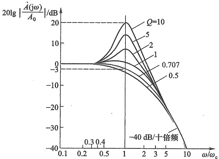

图 10.3.2 图 10.3.1 所示二阶低通滤波电路的幅频响应
 

在  $ \omega = \omega_{c} $ 处，只有当 Q = 0.707 时，归一化增益才为 -3 dB，即此时  $ \omega_{c} $ 才与通带截止角频率  $ \omega_{H} $ 相等；在  $ \omega = 10\omega_{c} $ 处，归一化增益为 -40 dB，说明幅频响应大约从  $ \omega_{c} $ 开始，以 -40 dB/十倍频的斜率下降，可见二阶滤波器通带外增益衰减速度快于一阶。但这种滤波电路在高 Q 值时，元件参数的微小误差就会引起频率响应的较大变化。

### 2. 无限增益多路反馈二阶有源低通滤波电路

另一种常用的二阶低通滤波电路如图10.3.3所示。信号由运放的反相端输入。

当  $ \omega = 0 $ (即直流信号) 时， $ C_{1} $ 和  $ C_{2} $ 相当于开路，因此通带电压增益为

$$  A_{0}=A_{vf}=\frac{V_{o}(s)}{V_{i}(s)}=-\frac{R_{f}}{R_{1}}   \tag*{(10.3.11)}$$

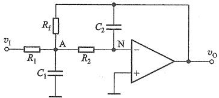

此时，运放构成反相放大电路。

图 10.3.3 无限增益多路反馈型二阶低通滤波电路
 

由图 10.3.3 可以推导出该电路的传递函数

 $$ \begin{aligned}A\left(s\right)&=\frac{A_{vf}}{1+sC_{2}R_{2}R_{f}\left(\frac{1}{R_{1}}+\frac{1}{R_{2}}+\frac{1}{R_{f}}\right)+s^{2}C_{1}C_{2}R_{2}R_{f}}\\&\left.\omega_{c}=\frac{1}{\sqrt{C_{1}C_{2}R_{2}R_{f}}}\right.\\&\left.Q=\left(R_{1}\parallel R_{2}\parallel R_{f}\right)\sqrt{\frac{C_{1}}{C_{2}R_{2}R_{f}}}\right\}\\ \end{aligned} $$ 

令

得到二阶低通滤波电路传递函数的典型表达式

<!-- page: 419 -->

$$  A\left(s\right)=\frac{A_{v f}}{1+\frac{1}{Q\omega_{c}}\cdot s+\frac{1}{\omega_{c}^{2}}\cdot s^{2}}=\frac{A_{0}}{1+\frac{1}{Q\left(\frac{s}{\omega_{c}}\right)}+\left(\frac{s}{\omega_{c}}\right)^{2}}   \tag*{(10.3.14)}$$

该式与式(10.3.7)完全相同。但式(10.3.13)的 Q 不会出现负值，电路始终可以稳定工作，无须限制增益  $ A_{vf} $。又因为电路通过  $ C_{2} $、 $ R_{f} $ 形成两条反馈通路，故称该电路为无限增益多路反馈（multiple-feedback，MFB）型滤波电路。除了输出与输入反相外，该电路的优点是使用元件较少，对元件误差的敏感性弱于压控电压源滤波电路，特别适合于高 Q 值滤波器。但调节增益时会影响滤波特性。

### 3. 高阶低通滤波电路

为了获得更好的滤波效果，可以采用高阶滤波电路。在实现 n 阶滤波器时，需要级联 n/2 个二阶滤波电路；如果 n 为奇数，则第一级通常为一阶滤波电路。而且通常是将 Q 值最低的一级放在输入端附近，将 Q 值最高的一级放在输出端附近，以便电路工作更加稳定。

在高阶巴特沃斯滤波电路中，为了使通带内总幅频响应曲线最平坦，对各级通带电压增益  $ A_{0} $ 是有限制的，如表10.3.1所示。按照表中规定的增益设计电路，可以保证在  $ \omega_{p} $ 处总增益下降3 dB且与阶数无关。

表 10.3.1 巴特沃斯低通（高通）电路阶数 n 与增益的关系
 

<table border=1 style='margin: auto; word-wrap: break-word;'><tr><td colspan="2">阶数 n</td><td style='text-align: center; word-wrap: break-word;'>2</td><td style='text-align: center; word-wrap: break-word;'>4</td><td style='text-align: center; word-wrap: break-word;'>6</td><td style='text-align: center; word-wrap: break-word;'>8</td></tr><tr><td rowspan="4">单级增益  $ A_0 $</td><td style='text-align: center; word-wrap: break-word;'>第一级</td><td style='text-align: center; word-wrap: break-word;'>1.586</td><td style='text-align: center; word-wrap: break-word;'>1.152</td><td style='text-align: center; word-wrap: break-word;'>1.068</td><td style='text-align: center; word-wrap: break-word;'>1.038</td></tr><tr><td style='text-align: center; word-wrap: break-word;'>第二级</td><td style='text-align: center; word-wrap: break-word;'></td><td style='text-align: center; word-wrap: break-word;'>2.235</td><td style='text-align: center; word-wrap: break-word;'>1.586</td><td style='text-align: center; word-wrap: break-word;'>1.337</td></tr><tr><td style='text-align: center; word-wrap: break-word;'>第三级</td><td style='text-align: center; word-wrap: break-word;'></td><td style='text-align: center; word-wrap: break-word;'></td><td style='text-align: center; word-wrap: break-word;'>2.483</td><td style='text-align: center; word-wrap: break-word;'>1.889</td></tr><tr><td style='text-align: center; word-wrap: break-word;'>第四级</td><td style='text-align: center; word-wrap: break-word;'></td><td style='text-align: center; word-wrap: break-word;'></td><td style='text-align: center; word-wrap: break-word;'></td><td style='text-align: center; word-wrap: break-word;'>2.610</td></tr><tr><td style='text-align: center; word-wrap: break-word;'>总增益</td><td style='text-align: center; word-wrap: break-word;'></td><td style='text-align: center; word-wrap: break-word;'>1.586</td><td style='text-align: center; word-wrap: break-word;'>2.575</td><td style='text-align: center; word-wrap: break-word;'>4.206</td><td style='text-align: center; word-wrap: break-word;'>6.842</td></tr></table>

例 10.3.1 试用运放设计—截止频率  $ f_{c}=100 $ Hz 的四阶巴特沃斯低通滤波器。要求：

(1) 选择运放；

(2) 选择和计算全部电阻、电容参数；

(3) 用 SPICE 仿真做出总增益幅频响应波特数；

(4) 用 SPICE 做出各级和总的纵轴归一化幅频响应曲线。

解：采用两个如图10.3.1所示的压控电压源型二阶低通滤波电路串联，便可构成四阶低通巴特沃斯滤波电路，如图10.3.4所示。设计时一般应考虑：①对所用运放的技术参数应有适当要求（如增益带宽积、输入阻抗、转换速率等）；②所选元件数较少，且数值不宜太分散，如有必要应提出容差要求；③便于调整。

具体设计步骤如下。

##### （1）选择运放

为了减少运放对滤波电路的负载效应，同时便于调整，现选用 CF412（LF412）。这是一种具有 JFET 作输入级的低失调、高输入阻抗运放。CF412 每片含有两个运放，其中  $ I_{IB} \approx 60\ pA $， $ V_{IO} \approx 1.5\ mV $， $ S_{R} \approx 15\ V/\mu s $，单位增益带宽积约为 5.5 MHz。当输出电压幅值达到 10 V 时，其全功率带宽约为 239 kHz。各厂家产品参数略有不同。若选用 CF412C

<!-- page: 420 -->

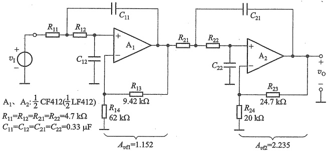

图 10.3.4 例 10.3.1 四阶巴特沃斯低通滤波电路
 

(LF412C)，性能更好。输入阻抗可达  $ 10^{12} $ Ω，单位增益带宽积为 8 MHz， $ S_{R}=25\ V/\mu s $。

##### （2）选择电容器的容量，计算电阻器的阻值

在设计滤波器时，通常的做法是先确定电容的值，再计算电阻的值。这是因为市面上出售的电容器一般是公差为20%的E6系列产品，而电阻器则有公差为1%的E96系列产品。如果电路元件值的误差太大，可能就满足不了频率响应设计指标的要求了。

电容 C 的容量宜在微法数量级以下，电阻器的阻值一般应在几百千欧以内。现选择  $ C_{11}=C_{12}=C_{21}=C_{22}=C=0.33\ \mu F $，因巴特沃斯滤波器的特征频率  $ f_{c}=f_{H} $，所以根据式（10.3.6）中的  $ \omega_{c}=1/(RC) $ 可算出

 $$ R_{11}=R_{12}=R_{21}=R_{22}=R=\frac{1}{2\pi f_{c}C}=\frac{1}{2\pi\times100\times0.33\times10^{-6}}\ \Omega\approx4.8\ k\Omega $$ 

选择标准电阻 R=4.7 kΩ, 这与计算值有一点误差, 可能导致截止频率比预定值稍有升高。

由表10.3.1可见，四阶巴特沃斯滤波器总的增益由两级组成，即 $ A_{vf1}=1.152 $和 $ A_{vf2}=2.235 $，因此总的通带增益 $ A_{0}=A_{vf}=1.152\times2.235\approx2.575 $。

选择  $ R_{13} $、 $ R_{14} $、 $ R_{23} $ 和  $ R_{24} $ 时，为了减少偏置电流的影响，应尽可能使加到运放同相端对地的直流电阻与加到反相端对地直流电阻基本相等。

现选  $ R_{14}=62\ k\Omega, R_{24}=20\ k\Omega $ ，则根据已知增益可算出

 $$ \begin{aligned}&R_{13}=\left(1.152-1\right)R_{14}\approx9.42\mathrm{~k}\Omega\\&R_{23}=\left(2.235-1\right)R_{24}\approx24.7\mathrm{~k}\Omega\\ \end{aligned} $$ 

（3）用 SPICE 仿真，画出波特图

图 10.3.5 是用 SPICE 仿真得到的幅频响应波特图（为了直观，图中横坐标用 f 而不用  $ \omega $ 表示）。仿真时，采用了电路参数设计值和简单线性运放模型。

由图可见， $ 20\lg A_{0} \approx 8.2\ \text{dB} $，即  $ A_{0} \approx 2.57 $，滤波器的截止频率  $ f_{H} \approx 100\ \text{Hz} $，当  $ f > f_{H} $ 时，四阶的增益曲线以 -80 dB/十倍频率衰减。因此，在  $ f = 10\ \text{kHz} $ 时，增益从 8.2 dB 下降了约 160 dB。

（4）用 SPICE 画出各级和总的纵轴归一化的幅频响应曲线

四阶巴特沃斯低通滤波器各级归一化幅频响应曲线如图10.3.6所示。

<!-- page: 421 -->

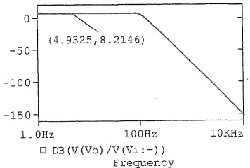

图 10.3.5 图 10.3.4 四阶巴特沃斯
 

低通电路幅频响应波特图

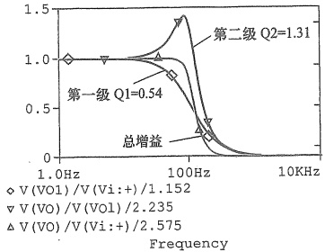

图10.3.6 图10.3.4中各级及总的归一化幅频响应曲线
 

由图可见，因等效品质因数  $ Q_{1}<0.707 $，故第一级增益曲线没有过冲，是单调下降的；而第二级的  $ Q_{2}>0.707 $，故在  $ f_{H}=100 $ Hz 附近出现了增益提升。而总增益是各级增益的乘积（当各级增益用 dB 表示时，则是各级增益的相加），因此总增益的幅频响应曲线消除了峰值，曲线平坦部分得到了扩展，体现了巴特沃斯低通滤波电路的特点。

可见，在高阶巴特沃斯低通滤波电路中，限制各级的通带增益，是为了获得总幅频响应曲线的最大平坦度。

#### 10.3.2 有源高通滤波电路

高通滤波电路与低通滤波电路有对偶关系，如果将 RC 低通电路中滤波元件 R 和 C 的位置互换，就可得到 RC 高通滤波电路。如互换图 10.3.1 电路中 R 和 C 的位置，便得到二阶压控电压源高通滤波电路，如图 10.3.7 所示。

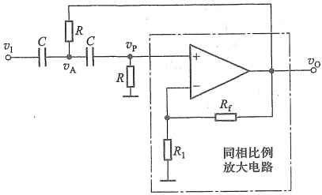

图 10.3.7 压控电压源型二阶高通滤波电路
 

由图10.3.7可导出其传递函数为

<!-- page: 422 -->

$$  A\left(s\right)=\frac{A_{v f}s^{2}}{s^{2}+\frac{\omega_{e}}{Q}s+\omega_{e}^{2}}=\frac{A_{0}\cdot\left(\frac{s}{\omega_{e}}\right)^{2}}{1+\frac{1}{Q}\left(\frac{s}{\omega_{e}}\right)+\left(\frac{s}{\omega_{e}}\right)^{2}}   \tag*{(10.3.15)}$$

式中， $ \omega_{c}=\frac{1}{RC}, Q=\frac{1}{3-A_{vf}}, A_{0}=A_{vf} $

用  $ s=j\omega $ 代入式(10.3.15)，整理后得到实际的二阶高通电路频率响应

$$  \dot{A}\left(\mathrm{j}\omega\right)=\frac{A_{0}}{1-\left(\frac{\omega_{\mathrm{e}}}{\omega}\right)^{2}-\mathrm{j}\frac{1}{Q}\frac{\omega_{\mathrm{e}}}{\omega}}   \tag*{(10.3.16)}$$

其归一化的幅频响应表达式为

$$  20\lg\left|\frac{\dot{A}\left(\mathrm{j}\omega\right)}{A_{0}}\right|=20\lg\frac{1}{\sqrt{\left[1-\left(\frac{\omega_{\mathrm{c}}}{\omega}\right)^{2}\right]^{2}+\left(\frac{\omega_{\mathrm{c}}}{\omega Q}\right)^{2}}}   \tag*{(10.3.17)}$$

由式(10.3.17)可画出不同 Q 值下的幅频响应曲线如图 10.3.8 所示。可见，二阶高通电路的幅频响应和低通电路具有对偶（镜像）关系。

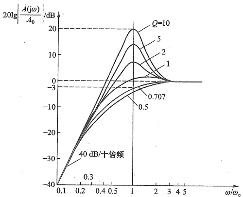

图 10.3.8 图 10.3.7 所示高通滤波电路的幅频响应
 

同理，为了保证电路稳定工作，要求 $ A_{vf}<3 $。当Q=0.707时，幅频响应曲线最平坦，此时下限截止角频率与特征角频率相等，即 $ \omega_{L}=\omega_{c} $。

#### 10.3.3 有源带通滤波电路

将低通和高通滤波电路串行级联，且使低通滤波电路的截止角频率  $ \omega_{H} $ 大于高通滤波电路的截止角频率  $ \omega_{L} $，如图 10.3.9 所示，则在  $ \omega_{L} \sim \omega_{H} $ 之间形成一个通带，其他频率范围为

<!-- page: 423 -->

阻带，从而构成带通滤波电路。

图 10.3.10 为压控电压源型二阶有源带通滤波电路。其中 R、C 组成无源低通网络， $ C_{1} $、 $ R_{3} $ 组成无源高通网络，当  $ RC < R_{3}C_{1} $ 时，就能满足  $ \omega_{H} > \omega_{L} $ 的要求，两者串联就组成了带通滤波电路。 $ R_{2} $ 引入正反馈。

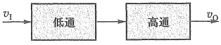

(a)
 

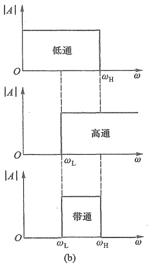

图 10.3.9 带通滤波电路构成示意图   (a) 原理框图 (b) 理想的幅频响应
 

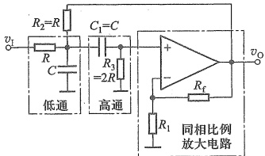

图 10.3.10 压控电压源型二阶带通滤波电路
 

为了计算简便，设  $ R_{2}=R, R_{3}=2R, C_{1}=C $，通过列写电路方程，可导出带通滤波电路的传递函数

$$  A(s)=\frac{A_{vf}sCR}{1+(3-A_{vf})sCR+(sCR)^{2}}   \tag*{（10.3.18）}$$

式中， $ A_{vf} $ 为同相比例放大电路的电压增益，同样要求  $ A_{vf} < 3 $，电路才能稳定工作。令

$$  \left.\begin{aligned}&A_{0}=\frac{A_{vf}}{3-A_{vf}}\\ &\omega_{0}=\frac{1}{RC}\\ &Q=\frac{1}{3-A_{vf}}\\ \end{aligned}\right\}   \tag*{(10.3.19)}$$

则得到二阶带通滤波电路传递函数的典型表达式

<!-- page: 424 -->

$$  A(s)=\frac{A_{0}\frac{s}{Q\omega_{0}}}{1+\frac{1}{Q}\cdot\frac{s}{\omega_{0}}+\left(\frac{s}{\omega_{0}}\right)^{2}}   \tag*{(10.3.20)}$$

式中， $ \omega_{0} $ 是特征角频率，也是带通滤波电路的中心角频率。

令  $ s=j\omega $，代入式(10.3.20)，则有

$$  \dot{A}\left(\mathrm{j}\omega\right)=\frac{A_{0}\frac{1}{Q}\frac{\mathrm{j}\omega}{\omega_{0}}}{1-\left(\frac{\omega}{\omega_{0}}\right)^{2}+\mathrm{j}\frac{\omega}{\omega_{0}Q}}=\frac{A_{0}}{1+\mathrm{j}Q\left(\frac{\omega}{\omega_{0}}-\frac{\omega_{0}}{\omega}\right)}   \tag*{(10.3.21)}$$

式(10.3.21)表明，当  $ \omega = \omega_0 $ 时，图10.3.10所示电路具有最大电压增益，且  $ \left| \dot{A} \left( j\omega_0 \right) \right| = A_0 = A_{vt} / (3 - A_{vt}) $，这就是带通滤波电路的通带电压增益。根据式(10.3.21)，不难求出其幅频响应，如图10.3.11所示。由图可见，Q值越大，曲线越尖锐，表明滤波电路的频率选择性越好，但通带越窄。

当式（10.3.21）等号右边分母的虚部之绝对值为1时，得到 $ 20\lg\left|\dot{A}(j\omega)/A_{0}\right|=20\lg\left|1/\sqrt{2}\right|\approx-3\ \text{dB} $，因此，通带的截止频率可以由式

 $$ Q\left(\frac{\omega}{\omega_{0}}-\frac{\omega_{0}}{\omega}\right)=1 $$ 

求出。解这个方程，取正根，可得图10.3.10所示带通滤波电路的两个截止角频率分别为

$$  \left.\begin{aligned}&\omega_{\mathrm{L}}=\frac{\omega_{0}}{2}\left(\sqrt{4+\frac{1}{Q^{2}}}-\frac{1}{Q}\right)\Bigg\}\\ &\omega_{\mathrm{H}}=\frac{\omega_{0}}{2}\left(\sqrt{4+\frac{1}{Q^{2}}}+\frac{1}{Q}\right)\end{aligned}\right\}   \tag*{(10.3.22)}$$

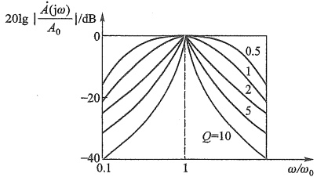

图 10.3.11 图 10.3.10 所示电路的幅频响应
 

于是，带宽为

$$  B\mathbb{W}=f_{\mathrm{H}}-f_{\mathrm{L}}=\omega_{\mathrm{H}}/\left(2\pi\right)-\omega_{\mathrm{L}}/\left(2\pi\right)=\omega_{0}/\left(2\pi Q\right)=f_{0}/Q   \tag*{(10.3.23a)}$$

考虑到  $ Q=1/(3-A_{vf}) $ 和  $ A_{vf}=1+R_{f}/R_{1} $，则带宽还可写为

$$  B\boldsymbol{W}=f_{0}\left(3-A_{vf}\right)=f_{0}\left(2-R_{f}/R_{1}\right)   \tag*{（10.3.23b）}$$

<!-- page: 425 -->

上式表明，改变电阻  $ R_{f} $ 或  $ R_{1} $ 就可以改变通带宽度，并不影响中心频率  $ f_{0} $。为了避免  $ A_{vf}=3 $ 时发生自激振荡，一般取  $ R_{f}<2R_{1} $。

例 10.3.2 带通滤波电路如图 10.3.10 所示，要求电路的中心频率  $ f_{0}=1\ \text{kHz} $，带宽  $ BW=100\ \text{Hz} $，试计算和选择该电路的电容值和电阻值。

解:首先选择一个合适的电容值。选择的原则是:C值不易过大,通常是 $ 1\ \mu F \sim 5\ pF $。推荐使用薄膜电容或钽电容,因为它们比其他类型电容的性能更好。选择 $ C=0.01\ \mu F $,则有

 $$ R=\frac{1}{\omega_{0}C}=\frac{1}{2\pi f_{0}C}=\frac{1}{2\pi\times10^{3}\mathrm{~Hz}\times0.01\times10^{-6}\mathrm{~F}}\approx15.92\mathrm{~k}\Omega $$ 

 $$ \frac{R_{\mathrm{f}}}{R_{1}}=2-\frac{BW}{f_{0}}=2-\frac{100\ Hz}{1\ 000\ Hz}=1.9 $$ 

根据式 $  (10.3.23b)  $得

在考虑运放两输入端的平衡电阻时，要求  $ R_{f} \parallel R_{1} = R_{3} = 2R = 31.84\ k\Omega $，与上式联合求解，可得  $ R_{1} = 48.61\ k\Omega $ 和  $ R_{f} = 92.36\ k\Omega $。

考虑到滤波电路性能对元件的误差相当敏感，电路宜选用精密的电阻器和电容器。

##### 10.3.4 有源带阻滤波电路

带阻滤波电路是用来抑制或衰减某一频段的信号，而让该频段以外的所有信号通过。这种滤波电路也叫陷波电路，经常用于电子系统的抗干扰。

通过从输入信号中减去带通滤波电路处理过的信号，就可得到带阻滤波后的信号。这是实现带阻滤波的思路之一，读者可自行分析。

这里，讨论另一种方案，即将低通和高通滤波电路并联，且使低通电路的截止频率低于高通电路的截止频率，便可获得带阻滤波电路如图10.3.12所示。图中，起滤波作用的电阻和电容元件组成双T网络，故称为双T形带阻滤波电路。

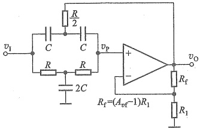

图 10.3.12 双 T 形带阻滤波电路
 

不难导出电路的传递函数为

 $$ \begin{aligned}A\left(s\right)=\frac{V_{o}\left(s\right)}{V_{i}\left(s\right)}=\frac{A_{vf}\left[1+\left(\frac{s}{\omega_{0}}\right)^{2}\right]}{1+2\left(2-A_{vf}\right)\frac{s}{\omega_{0}}+\left(\frac{s}{\omega_{0}}\right)^{2}}&=\frac{A_{0}\left[1+\left(\frac{s}{\omega_{0}}\right)^{2}\right]}{1+\frac{1}{Q}\cdot\frac{s}{\omega_{0}}+\left(\frac{s}{\omega_{0}}\right)^{2}}\\ &\dot{A}\left(j\omega\right)=\frac{A_{0}\left[1+\left(\frac{j\omega}{\omega_{0}}\right)^{2}\right]}{1+\frac{1}{Q}\frac{j\omega}{\omega_{0}}+\left(\frac{j\omega}{\omega_{0}}\right)^{2}}\\ \end{aligned} $$ 

或

式中  $ \omega_{0}=\frac{1}{RC} $，既是特征角频率，也是带阻滤波电路的中心角频率； $ A_{sf}=A_{0}=1+\frac{R_{f}}{R_{1}} $ 为带阻滤波

<!-- page: 426 -->

电路的通带电压增益； $ Q=\frac{1}{2(2-A_{0})} $为等效品质因数。该电路稳定工作的前提条件是 $ 1\leq A_{0}<2 $，如果 $ A_{0}=1 $，则 $ Q=0.5 $，增加 $ A_{0} $、Q将随之升高。当 $ A_{0} $趋近2时，Q趋向无穷大。因此， $ A_{0} $越接近2， $ \left|\dot{A}(\mathrm{j}\omega)\right| $越大，可使带阻滤波电路的选频特性越好，即阻断的频率范围越窄。图10.3.12所示带阻滤波电路的幅频响应如图10.3.13所示。

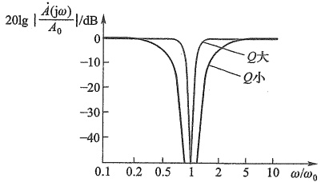

图 10.3.13 图 10.3.12 所示带阻滤波电路的幅频响应
 

以上主要分析了二阶有源滤波电路的传递函数和幅频响应。为便于对比分析，现将四种滤波电路传递函数的一般形式列于表10.3.2中。表中  $ \omega_{0} $ 为特征角频率， $ \omega_{0} $ 为带通、带阻滤波器的中心角频率。不同类型滤波电路的传递函数仅分子有区别，注意这些区别有助于识别滤波电路的功能。

实际上，设计一个满足特定需求的高阶滤波电路是一项比较复杂的电路综合任务，通常可以借助模拟滤波器的软件设计工具来完成。常用的滤波器设计软件有 Nuhertz 公司的产品 Filter Solutions, Schematica 公司的软件 Filter Wiz Pro, TI 公司提供的免费有源滤波器设计软件 WEBENCH Filter Designer, ADI 公司的软件 Analog Filter Wizard, Maxim 公司的软件 FilterLab 等。这些软件可以帮助我们完成无源或者有源滤波电路的设计。

表10.3.2 二阶滤波电路的传递函数 $ ^{①} $
 

<table border=1 style='margin: auto; word-wrap: break-word;'><tr><td style='text-align: center; word-wrap: break-word;'>功能</td><td style='text-align: center; word-wrap: break-word;'>二阶函数</td><td style='text-align: center; word-wrap: break-word;'>功能</td><td style='text-align: center; word-wrap: break-word;'>二阶函数</td></tr><tr><td style='text-align: center; word-wrap: break-word;'>低通</td><td style='text-align: center; word-wrap: break-word;'>$  \frac{A_0}{1+\frac{1}{Q}\left(\frac{s}{\omega_e}\right)+\left(\frac{s}{\omega_e}\right)^2}  $</td><td style='text-align: center; word-wrap: break-word;'>带通</td><td style='text-align: center; word-wrap: break-word;'>$  \frac{A_0}{1+\frac{1}{Q}\cdot\frac{s}{\omega_0}+\left(\frac{s}{\omega_0}\right)^2}  $</td></tr><tr><td style='text-align: center; word-wrap: break-word;'>高通</td><td style='text-align: center; word-wrap: break-word;'>$  \frac{A_0\cdot\left(\frac{s}{\omega_e}\right)^2}{1+\frac{1}{Q}\left(\frac{s}{\omega_e}\right)+\left(\frac{s}{\omega_e}\right)^2}  $</td><td style='text-align: center; word-wrap: break-word;'>带阻</td><td style='text-align: center; word-wrap: break-word;'>$  \frac{A_0\left[1+\left(\frac{s}{\omega_0}\right)^2\right]}{1+\frac{1}{Q}\cdot\frac{s}{\omega_0}+\left(\frac{s}{\omega_0}\right)^2}  $</td></tr></table>

##### 复习思考题

10.3.1 二阶滤波电路幅频响应通带外的衰减斜率是多少?

<!-- page: 427 -->

10.3.2 对于图 10.3.1 所示的有源低通滤波电路，同相放大电路的  $ A_{af} $ 最大不能超过多少才能使电路稳定？该滤波电路的通带电压增益为多少？

10.3.3 什么时候需要高阶滤波电路？通常用什么方法实现更高阶数的滤波电路？

10.3.4 两个特性参数完全相同的低通滤波电路级联后，其-3 dB 截止频率  $ f_{H} $ 与原来的单个低通滤波电路是否相同？为什么？

10.3.5 能否利用低通滤波电路、高通滤波电路来组成带通滤波电路？有什么约束条件？

10.3.6 带通滤波器品质因数的含义是什么？品质因数的大小会对电路产生什么影响？

10.3.7 能否利用带通滤波电路和其他运算电路组成带阻滤波电路？

###  $ ^{10.4} $ 开关电容滤波器

前面讨论的有源 RC 滤波电路，由于要求有较大的电容和精确的 RC 时间常数，以致在芯片上制造集成组件难度较大，甚至不可能。随着 MOS 工艺迅速发展，一种由电容、MOS 开关管和 MOS 运放组成的开关电容滤波器（switched capacitor filter, SCF）实现了单片集成化，并得到广泛应用。这种滤波器具有成本低、体积小、功耗低、温度稳定性好、易于制造等优点，可以对频率在零点几赫到几百千赫范围内的模拟信号进行滤波。但是，它会产生比传统有源滤波器更大的噪声。

### 1. 基本原理

图 10.4.1a 所示是一个有源 RC 积分器。在图 10.4.1b 中，用一个接地电容  $ C_{1} $ 和用作开关的源漏两极可互换的增强型 MOS 管  $ T_{1} $、 $ T_{2} $（此处用的是简化符号）来代替输入电阻  $ R_{1} $。

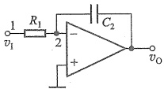

(a)
 

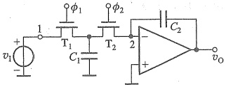

(b)
 

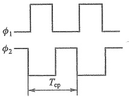

(c)
 

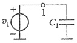

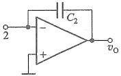

(d)
 

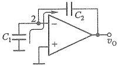

(e)
 

图 10.4.1 开关电容滤波器的基本原理
 

（d）在  $ \phi_{1} $ 为高电平时， $ v_{1} $ 向  $ C_{1} $ 充电 （e）在  $ \phi_{2} $ 为高电平时， $ C_{1} $ 向  $ C_{2} $ 放电

<!-- page: 428 -->

图中  $ T_{1} $、 $ T_{2} $ 用不重叠的两相时钟脉冲  $ \phi_{1} $ 和  $ \phi_{2} $ 来驱动。图 10.4.1c 画出了这种时钟波形  $ \phi_{1} $ 和  $ \phi_{2} $。假定时钟频率  $ f_{ep}(=1/T_{ep}) $ 远高于被滤波的信号频率，那么，在  $ \phi_{1} $ 为高电平时， $ T_{1} $ 导通而  $ T_{2} $ 截止（见图 10.4.1d）。此时  $ C_{1} $ 与输入信号  $ v_{1} $ 相连并被充电，即有

 $$ q_{\mathrm{e l}}=C_{1}v_{1} $$ 

而在  $ \phi_{2} $ 为高电平期间， $ T_{1} $ 截止、 $ T_{2} $ 导通。于是  $ C_{1} $ 转接到运放的输入端，如图 10.4.1e 所示。此时  $ C_{1} $ 放电，所充电荷  $ q_{e1} $ 传输到  $ C_{2} $ 上。

由此可见，在每一时钟周期  $ T_{ep} $ 内，从信号源中提取的电荷  $ q_{e1}=C_{1}v_{I} $ 供给了积分电容  $ C_{2} $。因此，在节点1、2之间流过的平均电流为

 $$ i_{\mathrm{a v}}=\frac{C_{1}v_{\mathrm{I}}}{T_{\mathrm{e p}}}=C_{1}v_{\mathrm{I}}f_{\mathrm{e p}} $$ 

如果  $ T_{op} $ 足够短，可以近似认为这个过程是连续的。将这个表达式与欧姆定律进行比较，就可以在1、2两节点之间定义一个等效电阻  $ R_{eq} $，即

$$  R_{\mathrm{eq}}=\frac{v_{1}}{i_{\mathrm{av}}}=\frac{T_{\mathrm{ep}}}{C_{1}}=\frac{1}{C_{1}f_{\mathrm{ep}}}   \tag*{(10.4.1)}$$

这说明，电路两节点间接有带高速开关的电容，就相当于该两节点间连接一个等效电阻。因此就可得到一个等效的积分器时间常数 $ \tau $，即

$$  \boldsymbol{\tau}=\boldsymbol{C}_{2}\boldsymbol{R}_{\mathrm{eq}}=\boldsymbol{T}_{\mathrm{cp}}\frac{\boldsymbol{C}_{2}}{\boldsymbol{C}_{1}}   \tag*{(10.4.2)}$$

显然，影响滤波器频率响应的时间常数取决于时钟周期  $ T_{op} $ 和电容比值  $ C_2/C_1 $，而与电容的绝对数值无关。在 MOS 工艺中，同一个芯片上电容比值的精度可以控制在 0.1%以内。这样，只要合理选用时钟频率（如 100 kHz）和不太大的电容比值（如 10），对于低频应用来说，就可获得合适的大时间常数（如  $ 10^{-4} $ s）。

### 2. 开关电容滤波器举例

图 10.4.2a 所示为一阶低通滤波电路（在时域里看，它就是比例积分电路），其传递函数为

$$  A\left(s\right)=\frac{V_{\mathrm{o}}\left(s\right)}{V_{\mathrm{i}}\left(s\right)}=-\frac{R_{\mathrm{f}}}{R_{1}}\cdot\frac{1}{1+s R_{\mathrm{f}}C_{\mathrm{f}}}=\frac{A_{0}}{1+s/\omega_{\mathrm{e}}}   \tag*{(10.4.3)}$$

上限截止角频率为

$$  \omega_{\mathrm{H}}=\omega_{\mathrm{c}}=\frac{1}{R_{\mathrm{f}}C_{\mathrm{f}}}   \tag*{(10.4.4a)}$$

或

$$  f_{\mathrm{H}}=\frac{1}{2\pi R_{\mathrm{f}}C_{\mathrm{f}}}   \tag*{(10.4.4b)}$$

如果所需的截止频率为 10 kHz 且  $ C_{f}=10\ pF $，则所需电阻  $ R_{f} $ 约为 1.6 MΩ。此外，如果要求的增益为  $ A_{0}=-\frac{R_{f}}{R_{1}}=-10 $，那么电阻  $ R_{1} $ 必须为 160 kΩ。

图 10.4.2b 为图 10.4.2a 的等效开关电容滤波器电路。其传递函数仍如式(10.4.3)所示，式中  $ R_{f}=R_{f_{eq}}=1/(f_{ep}C_{2}) $， $ R_{1}=R_{1_{eq}}=1/(f_{ep}C_{1}) $。则传递函数变为

<!-- page: 429 -->

$$  A\left(\mathrm{j}\omega\right)=-\frac{1/\left(f_{\mathrm{ep}}C_{2}\right)}{1/\left(f_{\mathrm{ep}}C_{1}\right)}\cdot\frac{1}{1+\mathrm{j}\frac{2\pi fC_{\mathrm{f}}}{f_{\mathrm{ep}}C_{2}}}=-\frac{C_{1}}{C_{2}}\cdot\frac{1}{1+\mathrm{j}\frac{f}{f_{\mathrm{H}}}}   \tag*{(10.4.5)}$$

低频增益为 $ -C_{1}/C_{2} $（也即是两个电容器比值），并且上限截止频率为

 $$ f_{\mathrm{H}}=\left(f_{\mathrm{ep}}C_{2}\right)/\left(2\pi C_{\mathrm{f}}\right) $$ 

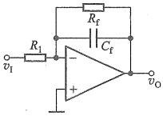

(a)
 

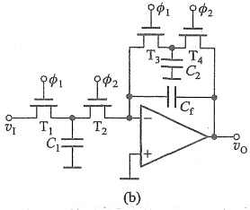

图 10.4.2 开关电容滤波器举例电路
 

（a）一阶低通滤波器电路 （b）等效的开关电容滤波器电路
 

### 3. 开关电容滤波器的类型

1978 年以来，已涌现出大量开关电容滤波器产品，在脉冲编码调制（pulse-code modulation，PCM）通信、语音信号处理等领域得到了广泛应用。Linear Technology $ ^{①} $ 和 Maxim 等公司提供多种不同型号的开关电容滤波器，主要有专用型和通用型两大类。

专用型开关电容滤波器已经根据确定的传递函数（巴特沃斯、贝塞尔和椭圆函数）完成了配置，不需要外接电阻，就能实现低通滤波，有许多产品供选择。使用时，除了提供电源外，只需要将一个特定频率的时钟信号连接到时钟引脚，其频率通常是滤波器截止频率的100倍或者50倍不等。例如，LTC1069-6是一个8阶椭圆函数低通滤波器，有8个引脚（其中2个是空引脚）。它的通带纹波为±0.1 dB，最高截止频率为20 kHz。图10.4.3是截止频率为5 kHz时的连接示意图。

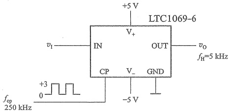

图 10.4.3 用 LTC1069-6 构成 8 阶椭圆函数低通滤波电路
 

<!-- page: 430 -->

通用型开关电容滤波器通过连接外部电阻，可以实现低通、高通、带通和全通滤波。一般会将多个二阶电路制造在一个芯片中，于是可以将它们级联起来，在单个芯片上实现高阶滤波器。典型产品有 LTC 1060、LTC 1061、LTC 1064、LTC 1067、LTC 1068、MAX260～MAX266 等。

总之，开关电容滤波器的滤波特性决定于电容比和时钟频率，可实现高精度和高稳定滤波，同时便于集成。

##### 复习思考题

10.4.1 开关电容滤波器由哪几部分组成？对驱动 MOS 开关的两相时钟信号有何要求？

10.4.2 根据图 10.4.1b, 说明为什么用两个 MOS 开关和一个电容就可以等效为一个电阻？其等效电阻等于多少?

10.4.3 开关电容滤波器中的开关频率  $ f_{c} $ 要远大于输入信号的频率  $ f_{s} $，对吗？

#### 正弦波振荡电路的振荡条件

在没有外部交流输入信号的情况下，能够产生一定频率和固定幅度的重复波形的电路被称为振荡电路。振荡产生的波形可以是正弦波、方波或者三角波等。

正弦波振荡电路可以用图10.5.1的方框图来描述，它就像一个没有输入信号的闭环放大电路。图10.5.1a表示接成正反馈时，放大电路在输入信号 $ \dot{X}_{i}=0 $时的方框图，改画一下，便得图10.5.1b。由图可知，如放大电路的输入端(1端)外接一定频率、一定幅度的正弦波信号 $ \dot{X}_{a} $，经过基本放大电路和反馈网络所构成的环路传输后，在反馈网络的输出端(2端)，得到反馈信号 $ \dot{X}_{f} $，如果 $ \dot{X}_{f} $与 $ \dot{X}_{a} $在大小和相位上都一致，那么，就可以除去外接信号 $ \dot{X}_{a} $，而将1、2两端连接在一起(如图中的虚线所示)而形成闭环系统，其输出端可能继续维持与开环时一样的输出信号 $ ^{①} $。这样，由于 $ \dot{X}_{f}=\dot{X}_{a} $，便有

$$  \begin{aligned}\frac{\dot{X}_{\mathrm{f}}}{\dot{X}_{\mathrm{a}}}&=\frac{\dot{X}_{\mathrm{o}}}{\dot{X}_{\mathrm{a}}}\cdot\frac{\dot{X}_{\mathrm{f}}}{\dot{X}_{\mathrm{o}}}=1\\\dot{A}\dot{F}&=1\end{aligned}   \tag*{（10.5.1）}$$

或

在式(10.5.1)中，设 $ \dot{A}=A\underline{\underline{\varphi_{a}}},\dot{F}=F\underline{\underline{\varphi_{f}}} $，则可得

 $$ \dot{A}\dot{F}=A F\underline{{\dot{\varphi}_{a}+\dot{\varphi}_{f}}}=1 $$ 

即

$$  \left|\dot{A}\dot{F}\right|=A F=1   \tag*{（10.5.2）}$$

和

$$  \varphi_{a}+\varphi_{f}=2n\pi,n=0,1,2,\cdots   \tag*{（10.5.3）}$$

式（10.5.2）称为振幅平衡条件，而式（10.5.3）则称为相位平衡条件，这是正弦波振荡电

<!-- page: 431 -->

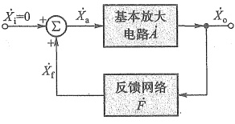

(a)
 

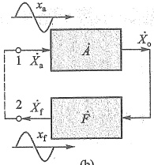

(b)
 

图 10.5.1 正弦波振荡电路的方案框图
 

(a) 正反馈放大电路的方框图 ( $ \dot{X}_{i}=0 $) (b) 正弦波振荡电路的方框图
 

路持续振荡的两个条件。这里“平衡”的含义是指振荡电路中的信号始终不改变自己的大小和相位。

值得注意的是，无论是负反馈放大电路的自激条件 $ (-AF=1) $还是振荡电路的振荡条件 $ (AF=1) $，都是要求环路增益等于1，不过，由于反馈信号送到比较环节输入端的+、-符号不同[参见图8.6.1和图10.5.1a]，所以环路增益各异，从而导致相位条件不一致[比较式(8.6.2)和式(10.5.3)]。

由于正弦波为单一频率波形，所以为了振荡出正弦波，电路中要有选频功能环节，只在一个频率下满足式(10.5.3)的相位平衡条件，这个频率就是 $ f_{0} $。这就要求在AF环路中包含一个具有选频特性的网络，简称选频网络。它可以设置在放大电路A中，也可设置在反馈网络F中，它可以用R、C元件组成，也可以用L、C元件组成。用R、C元件组成选频网络的振荡电路称为RC振荡电路，一般用来产生1 Hz~1 MHz范围内的低频信号；用L、C元件组成选频网络的振荡电路称为LC振荡电路，一般用来产生1 MHz以上的高频信号。

欲使振荡电路能自行建立振荡，就必须满足  $ \left|AF\right|>1 $ 的条件。这样，在接通电源后，振荡电路就有可能自行起振，或者说能够自激。当输出达到一定幅值时，通过稳幅环节自动调整环路增益，使  $ \left(\dot{AF}\right)=1 $，电路进入平衡状态。

由于正弦波振荡电路中的放大器是工作在线性区(RC振荡电路)或接近线性区(LC振荡电路)，因此在分析中，可以近似按线性电路来处理。

##### 复习思考题

10.5.1 正弦波振荡电路的振荡条件和负反馈放大电路的自激条件都是环路放大倍数等于1,但是由于反馈信号加到比较环节上的极性不同,前者为 $ \dot{A}\dot{F}=1 $,而后者则为 $ -\dot{A}\dot{F}=1 $。除了数学表达式的差异外,构成相位平衡条件的实质有什么不同吗?

10.5.2 在满足相位平衡条件的前提下，既然正弦波振荡电路的振幅平衡条件为  $ \left| \dot{A} \dot{F} \right| = 1 $，如果  $ \left| \dot{F} \right| $ 为已知，则  $ \left| \dot{A} \right| = \left| 1 / \dot{F} \right| $ 即可起振，你认为这种说法对吗？

<!-- page: 432 -->

#### 10.6

#### RC 正弦波振荡电路

RC 正弦波振荡电路有桥式、双 T 网络式和移相式等振荡电路，下面主要讨论桥式振荡电路。

### 1. 电路原理图

图10.6.1是RC桥式振荡电路的原理电路，这个电路由两部分组成，即放大电路 $ \dot{A}_{v} $和选频网络 $ \dot{F}_{v} $。 $ \dot{A}_{v} $为集成运放所组成的电压串联负反馈放大电路（即同相放大电路），具有输入阻抗高和输出阻抗低的特点。而 $ \dot{F}_{v} $则由RC串并联 $ (Z_{1},Z_{2}) $组成，同时兼作正反馈网络。由图可知， $ Z_{1},Z_{2} $和 $ R_{1},R_{f} $正好形成一个四臂电桥，电桥的对角线顶点接到放大电路的两个输入端，桥式振荡电路的名称即由此得来 $ ^{①} $。

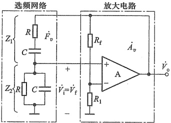

图 10.6.1 RC 桥式振荡电路
 

下面首先分析 RC 串并联网络的选频特性，然后根据正弦波振荡电路的振幅平衡及相位平衡条件设计合适的放大电路指标，就可以构成一个完整的振荡电路。

### 2. RC 串并联选频网络的选频特性

RC 串并联网络如图 10.6.1 中左侧的点画线方框所示， $ \dot{V}_{a} $ 为网络的输入信号， $ \dot{V}_{f} $ 是它的输出信号，下面求它的频率响应。

由图10.6.1有

 $$ \begin{aligned}&Z_{_{1}}=R+\frac{1}{sC}=\frac{1+sCR}{sC}\\&Z_{_{2}}^{^{\prime}}=\frac{R\cdot\frac{1}{sC}}{R+\frac{1}{sC}}=\frac{R}{1+sCR}\\ \end{aligned} $$ 

用 RC 串并联网络的输出信号除以输入信号，得到传递函数

$$  \begin{aligned}F_{v}(s)&=\frac{V_{f}(s)}{V_{o}(s)}=\frac{Z_{2}}{Z_{1}+Z_{2}}\\&=\frac{s CR}{1+3s CR+\left(s CR\right)^{2}}\end{aligned}   \tag*{(10.6.1)}$$

它也是振荡电路的反馈系数。就实际的频率而言，可用  $ s=j\omega $ 替换，则得

 $$ \dot{F}_{v}=\frac{\mathrm{j}\omega R C}{\left(1-\omega^{2}R^{2}C^{2}\right)+\mathrm{j}3\omega R C} $$

<!-- page: 433 -->

如令  $ \omega_{0}=\frac{1}{RC} $，则上式变为

$$  \dot{F}_{_{v}}=\frac{1}{3+\mathrm{j}\left(\frac{\omega}{\omega_{0}}-\frac{\omega_{0}}{\omega}\right)}   \tag*{(10.6.2)}$$

由此可得 RC 串并联网络的幅频响应及相频响应表达式

$$  F_{v}=\frac{1}{\sqrt{3^{2}+\left(\frac{\omega}{\omega_{0}}-\frac{\omega_{0}}{\omega}\right)^{2}}}   \tag*{(10.6.3)}$$

 $$ \varphi_{1}=-\arctan\frac{\begin{aligned}&\frac{\omega}{\omega_{0}}-\frac{\omega_{0}}{\omega}\\ &\omega_{0}\quad\omega\end{aligned}}{3} $$ 

和

由式 $ （10.6.3） $及式 $ （10.6.4） $可知，当

$$  \omega=\omega_{0}=\frac{1}{RC}\quad 或 \quad f=f_{0}=\frac{1}{2\pi RC}   \tag*{（10.6.5）}$$

时，幅频响应的幅值为最大，即

$$  F_{vmax}=\frac{1}{3}   \tag*{(10.6.6)}$$

而相频响应的相位角为零，即

$$  \varphi_{i}=0   \tag*{（10.6.7）}$$

根据式(10.6.3)和式(10.6.4)可画出 RC 串并联网络的幅频响应及相频响应曲线，如图10.6.2所示。由此可见， $ \omega = \omega_{0} $ 是一个特殊的频率点，只有在该频率点， $ F_{v} $ 才达到最大值1/3，相位角  $ \varphi_{f} $ 才为  $ 0^{\circ} $，即 RC 串并联网络的输出电压与输入电压同相。由图10.6.2a的幅频响应看出，该网络就是一个无源的带通滤波电路。

### 3. 振荡的建立与稳定

图 10.6.1 将 RC 串并联网络和放大电路结合起来组成 RC 振荡电路。当  $ \omega = \omega_0 = 1/RC $ 时，经 RC 选频网络传输到运放同相端的电压  $ \dot{V}_f $ 与  $ \dot{V}_o $ 同相，即有  $ \varphi_f = 0^\circ $；而运放 A 构成同相放大电路，有  $ \varphi_a = 0^\circ $，于是  $ \varphi_a + \varphi_f = 0^\circ $。这样，放大电路和由  $ Z_1, Z_2 $ 组成的反馈网络刚好形成正反馈系统，可以满足式 (10.5.3) 的相位平衡条件，因而有可能振荡。

图 10.6.1 所示电路并无输入信号，电源接通后不久，电路就会输出角频率为  $ \omega_0 $ 的正弦波。那么信号的源头来自哪里呢？实际上电路中的元器件都是有噪声的，而且它们的频谱分布极广，其中也包含  $ \omega_0 $ 成分，只是它的幅值很小，需要将其不断放大，才能达到需要的幅值，这便是振荡的建立过程。只有当  $ \left| \dot{A}_v(j\omega_0) \dot{F}_v(j\omega_0) \right| > 1 $ 时， $ \omega_0 $ 的噪声才能在环路中被不断放大。由于  $ \left| \dot{F}_v(j\omega_0) \right| = 1/3 $，所以要求  $ \left| \dot{A}_v(j\omega_0) \right| > 3 $，即电路的起振条件为

$$  \mid\ddot{A}_{v}(\mathrm{j}\omega_{0})\mid=\left(1+\frac{R_{\mathrm{f}}}{R_{1}}\right)>3\quad 或 \quad R_{\mathrm{f}}>2R_{1}   \tag*{(10.6.8)}$$

当输出幅值达到规定值时，要通过电路中非线性元件的限制，使 $ \left|A_{v}(j\omega_{0})\right| $自动回到等

<!-- page: 434 -->

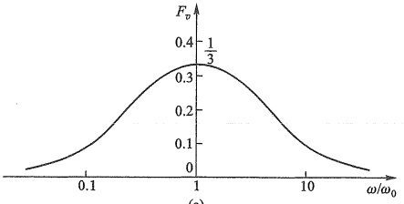

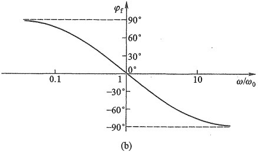

图 10.6.2 RC 串并联选频网络的频率响应 (a) 幅频响应 (b) 相频响应
 

于3，满足幅值平衡条件 $ \left|\dot{A}_{v}(j\omega_{0})\dot{F}_{v}(j\omega_{0})\right|=1 $，从而使振荡幅度稳定下来，即稳幅时应有 $ R_{f}=2R_{1} $ (10.6.9)

### 4. 振荡频率与振荡波形

前已提及，从正弦稳态的工作情况来看，振荡频率是由相位平衡条件所决定的，这是一个重要的概念。从式(10.6.5)～式(10.6.7)已知，只有当  $ \omega = \omega_{0} = 1 / (RC) $，即  $ \varphi_{f} = 0^{\circ}, \varphi_{a} = 0^{\circ} $ 时，才满足相位平衡条件，所以振荡频率由式(10.6.5)决定，即  $ f_{0} = 1 / (2\pi RC)^{\textcircled{1}} $。

当适当调整  $ A_{v} $ 的大小，使  $ A_{v} $ 的值在起振时略大于3时，达到稳幅时  $ A_{v}=3 $ ，其输出波形为正弦波，失真很小。如  $ A_{v} $ 的值远大于3，则因振幅的增长，致使放大器工作在非线性区域，波形将产生严重的非线性失真。反之，若  $ A_{v} $ 的值小于3，电路将无法起振。

### 5. 稳幅措施

为了起振后能实现稳幅，可以在放大电路的负反馈回路里采用非线性元件来自动调整反馈的强弱以维持输出电压恒定。例如，在图 10.6.1 所示的电路中， $ R_f $ 可用一温度系数为负的热敏电阻代替。当输出电压  $ \dot{V}_0 $ 增加时，通过负反馈回路的电流  $ \dot{I}_f $ 也随之增加， $ R_f $ 的功耗增加，温度升高，结果使  $ R_f $ 的阻值减小， $ \dot{A}_v $ 减小，从而使输出电压  $ \dot{V}_0 $ 下降；反之，当  $ \dot{V}_0 $ 下降时，由于热敏电阻的自动调整作用，将使  $ \dot{V}_0 $ 回升，因此，可以维持输出电压基

<!-- page: 435 -->

本恒定。

非线性电阻稳定输出电压的另一种方案是利用 JFET 工作在可变电阻区充当可变电阻。由第 4 章讨论可知，当 JFET 的漏源电压  $ v_{DS} $ 较小时，它的漏源电阻  $ R_{ds} $ 可通过栅源电压来改变。因此，可利用 JFET 进行稳幅，图 10.6.3 所示就是这样一个振荡电路。图中负反馈网络由  $ R_{p3} $、 $ R_{3} $ 和 JFET 的漏源电阻  $ R_{ds} $ 组成。正常工作时，输出电压经二极管 D 整流和  $ R_{4} $、 $ C_{3} $ 滤波后变成直流，通过  $ R_{4} $、 $ R_{5} $、 $ R_{p4} $ 为 JFET 栅极提供控制电压。当  $ v_{0} $ 幅值增大时， $ v_{GS} $ 变负， $ R_{ds} $ 将自动加大以加强负反馈。反之亦然。这样，就可达到自动稳幅的目的。

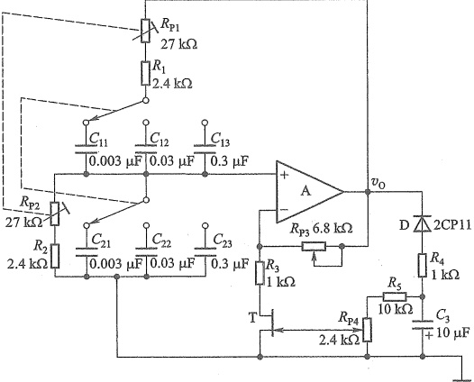

图 10.6.3 JFET 稳幅音频信号产生电路
 

调整  $ R_{P3} $ 或  $ R_{P4} $，就可使失真最小。通过改变联动开关连接  $ C_{11} \sim C_{13} $ 和  $ C_{21} \sim C_{23} $ 中不同的电容，便可改变振荡频率，调节微调电阻  $ R_{P1} $ 和  $ R_{P2} $，可微调振荡频率。该电路的频率范围为 20 Hz~20 kHz，输出电压约为 1 V。

例 10.6.1 根据图 10.6.1，设计一个振荡频率为  $ 1 \, kHz $ 的正弦波振荡电路。

解：（1）选取一个合适的电容值，取  $ C=0.01\ \mu\mathrm{F} $

（2）由式(10.6.5)计算R的值：

 $$ R=\frac{1}{2\pi f_{0}C}=\frac{1}{2\pi\times1\mathrm{~kHz}\times0.01\mathrm{~\mu F}}\approx15.92\mathrm{~k}\Omega $$ 

选取标称电阻值  $ R=16\ k\Omega $

（3）选取 $ R_{1} $的阻值，令 $ R_{1}=10k\Omega $，由式（10.6.9）有

 $$ R_{r}=2R_{1}=2\times10\mathrm{~k}\Omega=20\mathrm{~k}\Omega $$ 

为了满足式(10.6.8)的起振条件, $ R_{t} $可以采用具有负温度系数的热敏电阻。电路未工作时(冷电路),要求 $ R_{t}>20\ k\Omega $。

例 10.6.2 图 10.6.4 所示为移相式正弦波振荡电路，试简述其工作原理。

解: 在图 10.6.4a 中, 运放 A 与反相端电阻 R 和  $ R_{f} $ 构成反相放大电路, 其输出电压与输

<!-- page: 436 -->

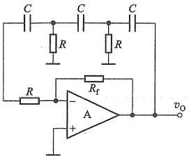

(a)
 

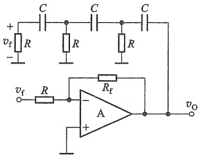

(b)
 

图10.6.4 移相式正弦波振荡电路   (a) 电路图 (b) 等效电路图
 

入电压的相位差为  $ \varphi_{a}=180^{\circ} $ 。另外，输出电压经过3节RC电路又反馈到反相放大电路的输入端，因此，3节RC电路引入的反馈信号必须再次反相，即  $ \varphi_{f}=180^{\circ} $，才能满足振荡的相位平衡条件。

由6.1.1节RC高通电路的频率响应已知，图10.6.4中每一节RC电路都是相位超前电路，能够提供 $ 0\sim90^{\circ} $的相移。但是当相移为 $ 90^{\circ} $时，R两端的电压已为零了，所以两节RC电路组成的反馈网络（兼选频网络）不能满足相位条件。图中3节RC移相电路，移相范围为 $ 0\sim270^{\circ} $，因此，可以在特定频率 $ f_{0} $下移相 $ 180^{\circ} $，即 $ \varphi_{i}=180^{\circ} $。于是有

 $$ \varphi_{a}+\varphi_{f}=360^{\circ}\quad 或 \quad0^{\circ} $$ 

显然，只要适当调节  $ R_{f} $ 的值，使  $ A_{v} $ 适当，就可同时满足相位和振幅条件，产生正弦振荡。

利用运放反相端的虚地，可以将图10.6.4a所示电路等效为图b。于是得到移相电路的传递函数

$$  F_{v}(s)=\frac{V_{f}(s)}{V_{o}(s)}=\frac{(R C s)^{3}}{(R C s)^{3}+6(R C s)^{2}+5R C s+1}   \tag*{(10.6.10)}$$

反相放大电路的电压增益为

$$  A_{_{v}}(s)=\frac{V_{_{o}}(s)}{V_{_{i}}(s)}=-\frac{R_{_{f}}}{R}   \tag*{(10.6.11)}$$

将式(10.6.10)和式(10.6.11)代入振荡条件  $ \dot{A}_{v}(j\omega_{0})\dot{F}_{v}(j\omega_{0})=1 $，并以  $ j\omega_{0} $ 替换 s，整理后得到

$$  -\frac{R_{\mathrm{f}}}{R}\cdot\frac{\left(\omega_{0}R C\right)^{3}}{\left(\omega_{0}R C\right)^{3}-5\omega_{0}R C-\mathrm{j}\left(6\omega_{0}^{2}R^{2}C^{2}-1\right)}=1   \tag*{（10.6.12）}$$

要使等式左侧部分等于右侧实数1，首先虚部必须为零，所以令上式分母虚部等于0，即 $ (6\omega_{0}^{2}R^{2}C^{2}-1)=0 $，可求得振荡频率

$$  \omega_{0}=\frac{1}{\sqrt{6}RC}\quad 或 \quad f_{0}=\frac{1}{2\pi\sqrt{6}RC}   \tag*{（10.6.13）}$$

<!-- page: 437 -->

将  $ \omega_{0}=1/(\sqrt{6}RC) $ 代入式(10.6.12)，得到满足振荡条件的反相放大电路增益的绝对值

$$  \mathrm{\frac{R_{f}}{R}}=29   \tag*{(10.6.14)}$$

综上所述，正弦波振荡电路（含RC和LC振荡电路）的分析方法可归纳如下。

（1）从电路组成来看，检查其是否包括放大、反馈、选频和稳幅等基本部分。

（2）分析放大电路能否正常工作。对分立元件电路，看静态工作点是否合适；对集成运放，看输入端是否有直流通路。

（3）检查电路是否满足自激条件。

① 利用瞬时极性法检查相位平衡条件。

② 检查幅值平衡条件。 $ \left|\dot{A}\dot{F}\right|<1 $ 不能振荡； $ \left|\dot{A}\dot{F}\right|=1 $ 不能起振；如果没有稳幅措施， $ \left|\dot{A}\dot{F}\right|>1 $，则虽能振荡，输出波形将失真。一般应取  $ \left|\dot{A}\dot{F}\right| $ 略大于 1，起振后采取稳幅措施使  $ \left|\dot{A}\dot{F}\right|=1 $，产生幅度稳定的正弦波。

（4）根据选频网络参数，估算振荡频率 $ f_{0} $

##### 复习思考题

10.6.1 设图 10.6.1 中  $ R_{1}=1\ k\Omega $， $ R_{f} $ 由一个固定电阻  $ R_{fl}=1\ k\Omega $ 和一个 10 kΩ 可调电阻  $ R_{t2} $ 串联而成。试分析：（1）当  $ R_{t2} $ 调到零时，用示波器观察输出电压  $ v_{0} $ 波形，将看到什么现象？说明产生这种现象的原因；（2）当  $ R_{t2} $ 调到 10 kΩ 时，电路又将出现什么现象？说明产生这种现象的原因，并定性地画出  $ v_{0} $ 的波形。

10.6.2 在图10.6.3中，利用N沟道JFET的漏源电阻 $ R_{ds} $随 $ v_{GS} $变负而增大的特点，可以达到稳幅的目的。若将T改用P沟道JFET，为了达到同样目的，图中的整流二极管D和滤波电路中的 $ R_{4} $、 $ R_{3} $是否也要相应进行调整？

#### 0.7 LC 正弦波振荡电路

LC 正弦波振荡电路是由放大器和 LC 选频网路组成的，主要用来产生频率为 100 kHz~100 MHz 范围内的正弦信号。下面首先讨论 LC 并联谐振回路的一些基本特性，然后介绍几种常用的 LC 振荡电路。

##### 10.7.1 LC 并联谐振回路

LC 并联谐振回路如图 10.7.1 所示，其中 R 表示回路的等效损耗电阻，由于电容器的损耗很小，可以认为 R 主要是电感支路的损耗。

先定性分析一下并联回路阻抗 Z 的频率特性。当频率很低时，容抗很大，可以认为开路，而感抗很小，则并联阻抗主要取决于电感支路，故阻抗 Z 呈感性，且频率越低，阻抗值越小。当频率很高时，感抗很大，可以认为开路，但容抗很小，此时并联阻抗主要取决于电容支路，且频

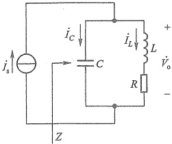

图 10.7.1 LC 并联谐振回路
 

<!-- page: 438 -->

率越高，阻抗值越小。由此看来，只有在中间某一频率时，并联阻抗有最大值，这个频率称为LC并联电路的谐振频率。

为了求得 LC 并联电路的谐振频率，根据图 10.7.1，写出并联回路的等效阻抗为

$$  Z=\frac{1}{\mathrm{j}\omega C}\mathord{\mathord/{\left/{\vphantom{\mathrm{j}\omega C\mathrm{R}+\mathrm{j}\omega L}\mathrm{R}}}\right.}\mathrm{R}+\mathrm{j}\omega L)=\frac{\frac{1}{\mathrm{j}\omega C}\mathord{\left/{\vphantom{\mathrm{j}\omega C\mathrm{R}+\mathrm{j}\omega L}\mathrm{R}}}\right.}\mathrm{R}+\mathrm{j}\omega L   \tag*{（10.7.1）}$$

考虑到通常有  $ R \ll \omega L $，所以

$$  Z\approx\frac{\frac{1}{\mathrm{j}\omega C}\cdot\mathrm{j}\omega L}{R+\mathrm{j}\left(\omega L-\frac{1}{\omega C}\right)}=\frac{L/C}{R+\mathrm{j}\left(\omega L-\frac{1}{\omega C}\right)}   \tag*{(10.7.2)}$$

对于某个特定频率  $ \omega_{0} $，满足  $ \omega_{0}L=1/(\omega_{0}C) $ 时，上式分母的虚部为 0，Z 出现最大值，回路发生并联谐振。此时，LC 并联回路具有如下特点。

（1）回路的谐振频率为

$$  \omega_{0}=\frac{1}{\sqrt{LC}}\quad 或 \quad f_{0}=\frac{1}{2\pi\sqrt{LC}}   \tag*{（10.7.3）}$$

（2）谐振时，回路的等效输入阻抗为纯电阻性质，其值最大，即

$$  Z_{_{0}}=\frac{L}{RC}=Q\omega_{_{0}}L=\frac{Q}{\omega_{_{0}}C}   \tag*{(10.7.4)}$$

其中

$$  Q=\frac{\omega_{0}L}{R}=\frac{1}{\omega_{0}C R}=\frac{1}{R}\sqrt{\frac{L}{C}}   \tag*{(10.7.5)}$$

Q称为谐振回路的品质因数，它反映了回路损耗程度。由于回路的等效损耗电阻值R较小，所以Q值在几十到几百范围内。Q值越大，表示损耗越小，信号源电流 $ \dot{I}_{s} $与 $ \dot{V}_{0} $同相。

（3）输入电流 $ \left|I_{s}\right| $和回路电流 $ \left|I_{L}\right| $或 $ \left|I_{C}\right| $的关系

由图 10.7.1 和式(10.7.4) 有

 $$ \dot{V}_{o}=\dot{I}_{s}Z_{0}=\dot{I}_{s}Q/\left(\omega_{0}C\right)=\dot{I}_{s}Q\left(\omega_{0}L\right) $$ 

并联谐振时，电容支路的电流是

$$  \dot{I}_{c}=\frac{\dot{V}_{o}}{1/(\mathrm{j}\omega_{0}C)}=\mathrm{j}Q\dot{I}_{s}   \tag*{(10.7.6a)}$$

同理，得到电感支路的电流是

$$  \dot{I}_{L}=\frac{\dot{V}_{\mathrm{o}}}{R+\mathrm{j}\omega_{0}L}\approx\frac{\dot{V}_{\mathrm{o}}}{\mathrm{j}\omega_{0}L}=-\mathrm{j}Q\dot{I}_{\mathrm{s}}   \tag*{(10.7.6b)}$$

可见，并联谐振时，电容支路的电流和电感支路的电流大小相等，方向相反。由于  $ Q \gg 1 $，故有  $ \left| \dot{I}_{c} \right| \approx \left| \dot{I}_{L} \right| > \left| \dot{I}_{s} \right| $。即谐振时，LC 并联电路的回路电流  $ \left| \dot{I}_{c} \right| $ 或  $ \left| \dot{I}_{L} \right| $ 比输入电流

<!-- page: 439 -->

$ \left|I_{s}\right| $大得多，此时可忽略谐振回路外部电流 $ \dot{I}_{s} $的影响。这个结论对于分析LC正弦波振荡电路的相位关系十分有用。

##### （4）回路阻抗的频率响应

根据式(10.7.2)有

$$  Z=\frac{\frac{L}{R C}}{1+\mathrm{j}\frac{\omega L}{R}\left(1-\frac{\omega_{0}^{2}}{\omega^{2}}\right)}=\frac{\frac{L}{R C}}{1+\mathrm{j}\frac{\omega L}{R}\cdot\frac{\left(\omega+\omega_{0}\right)\left(\omega-\omega_{0}\right)}{\omega^{2}}}   \tag*{(10.7.7)}$$

在式(10.7.7)中，如果所讨论的并联等效阻抗只局限于  $ \omega_{0} $ 附近，则可认为  $ \omega \approx \omega_{0}, \omega L / R \approx \omega_{0} L / R = Q, \omega + \omega_{0} \approx 2\omega_{0}, \omega - \omega_{0} = \Delta\omega $ ，则式(10.7.7)可改写为

$$  Z=\frac{Z_{0}}{1+\mathrm{j}Q\frac{2\Delta\omega}{\omega_{0}}}   \tag*{(10.7.8)}$$

从而可得阻抗的模为

$$  \mid Z\mid=\frac{Z_{0}}{\sqrt{1+\left(Q\frac{2\Delta\omega}{\omega_{0}}\right)^{2}}}   \tag*{(10.7.9a)}$$

或

$$  \frac{\left|Z\right|}{Z_{0}}=\frac{1}{\sqrt{1+\left(Q\frac{2\Delta\omega}{\omega_{0}}\right)^{2}}}   \tag*{(10.7.9b)}$$

其相角为

$$  \varphi=-\arctan\biggl(Q\,\frac{2\Delta\omega}{\omega_{0}}\biggr)   \tag*{（10.7.10）}$$

式中  $ |Z| $ 为信号的角频率  $ \omega $ 偏离谐振角频率  $ \omega_{0} $ 时回路的等效阻抗值； $ Z_{0} $ 为回路谐振时的等效阻抗； $ 2\Delta\omega/\omega_{0} $ 为相对失谐量，表明信号角频率偏离回路谐振角频率  $ \omega_{0} $ 的程度。

图 10.7.2 绘出了 LC 并联谐振回路阻抗的频率响应曲线，从图中的两条曲线可以得出如下的结论。

① 从幅频响应可见，当外加信号角频率  $ \omega = \omega_{0} $（即  $ 2\Delta\omega / \omega_{0} = 0 $）时，产生并联谐振，回路等效阻抗达最大值  $ Z_{0} = L / (RC) $。当角频率  $ \omega $ 偏离  $ \omega_{0} $ 时， $ |Z| $ 将减小，而  $ \Delta\omega $ 越大， $ |Z| $ 越小。曲线形状与带通滤波器幅频响应类似。

②从相频响应可知，当  $ \omega > \omega_{0} $ 时，相对失谐  $ (2\Delta\omega/\omega_{0}) $ 为正，此时由图10.7.1可看出，由于容抗小于感抗，等效阻抗为电容性，因此Z的相角为负值，即回路输出电压 $ \dot{V}_{s} $滞后于 $ \dot{I}_{s} $。反之，当  $ \omega < \omega_{0} $ 时，等效阻抗为电感性，因此 $ \varphi $为正值， $ \dot{V}_{s} $超前于 $ \dot{I}_{s} $。

③谐振曲线的形状与回路的Q值有密切的关系，Q值越大，谐振曲线越尖锐，相角变化越快，在 $ \omega_{0} $附近 $ \varphi $值变化更为急剧。

<!-- page: 440 -->

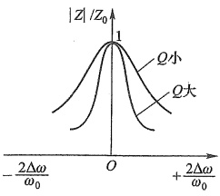

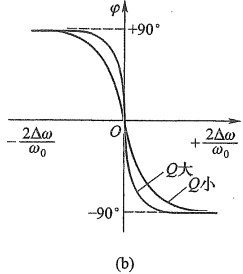

图10.7.2 LC 并联谐振回路阻抗的频率响应 (a) 幅频响应 (b) 相频响应
 

#### 10.7.2 变压器反馈式 LC 振荡电路

### 1. 电路的组成及工作原理

图 10.7.3 是变压器反馈式 LC 振荡电路。它包括放大电路、反馈网络和选频网络等。放大电路与前面学过的共射极放大电路类似，但在集电极上接的不是电阻  $ R_{c} $，而是由并联谐振回路构成的选频网络，因此称为选频放大电路。电路的反馈是通过变压器耦合实现的，二次绕组  $ L_{2} $ 上的电压作为反馈信号引回到 BJT 的基极。振荡信号由二次绕组  $ L_{3} $ 输出送给负载。

注意，这里所说的谐振回路，不能仅理解为 $ L_{1} $和C，而应该考虑 $ L_{2} $、 $ L_{3} $的影响。

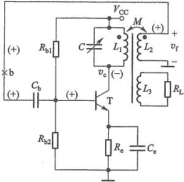

当电源  $ V_{cc} $ 刚接通时，由于电路中存在噪声或某种扰动，这相当于在放大器的输入端上加了许多不同频率的正弦信号。这些不同频率的信号中，只有

图 10.7.3 变压器反馈式 LC 正弦波振荡电路
 

角频率为  $ \omega_{0} $（谐振频率）的信号才能得到充分的放大，其放大倍数为  $ -\beta Z_{0}/r_{be} $，其他频率的信号则由于谐振电路的  $ \left|Z\right|<Z_{0} $ 而不能得到足够的放大。因此，在这个电路中，只有角频率为  $ \omega_{0} $ 的信号才能满足振幅平衡条件。

现在，用瞬时极性法来分析相位条件。将图中的反馈从 b 点断开，加入角频率为  $ \omega_{0} $ 的信号  $ v_{b} $，在输入端标记瞬时极性为（+），电容  $ C_{b} $ 和  $ C_{e} $ 对  $ \omega_{0} $ 所呈现的阻抗均较小，可视为短路，则三极管 T 的基极信号极性为（+），由于并联回路呈纯电阻性，则 T 的集电极信号  $ v_{c} $ 极性为（-），即放大器相移  $ \varphi_{a}=180^{\circ} $。根据变压器同名端位置可知，二次绕组  $ L_{2} $ 的上端和一次绕组  $ L_{1} $ 的下端互为异名端，所以， $ L_{2} $ 上端的极性为（+）， $ v_{f} $ 与  $ v_{c} $ 的相位差为  $ 180^{\circ} $，即反馈网路相移  $ \varphi_{f}=180^{\circ} $。因此满足相位平衡条件  $ (\varphi_{a}+\varphi_{f}=\pm2n\pi) $。

<!-- page: 441 -->

### 2. 振荡频率和起振条件

根据上述分析，只有在谐振频率处，电路才满足相位平衡条件，才有可能振荡。在 Q 值足够大和忽略分布参数影响的条件下，电路的振荡频率为

$$  \omega_{0}=\frac{1}{\sqrt{L^{\prime}C}}\approx\frac{1}{\sqrt{L_{1}C}}   \tag*{(10.7.11)}$$

式中， $ L' $ 是谐振回路的等效电感，即应考虑其他绕组的影响。当  $ L_{2} $ 和  $ L_{3} $ 中的电流不大时，可以近似地认为  $ L' \approx L_{1} $。

欲使电路起振，必须满足 $ \left|\dot{A}\dot{F}\right|>1 $ 的振幅条件。可以证明，该电路的起振条件为 $ ^{①} $

 $$ \beta>\frac{r_{ba}R^{\prime}C}{M} $$ 

式中， $ r_{be} $ 为三极管 b、e 之间的等效电阻， $ R' $ 是谐振回路和负载等的总损耗电阻，M 为  $ L_{1} $ 与  $ L_{2} $ 之间的互感。

振幅的稳定是利用放大器件的非线性来实现的。当振幅达到一定值时，BJT集电极电流波形可能会出现截止失真，但由于集电极的负载是谐振回路，有很好的选频特性，因此，通过变压器绕组 $ L_{3} $送到负载的电压波形一般失真不大。

在图10.7.3中，并联谐振回路接在集电极电路中，通常称为集电极调谐变压器反馈式振荡电路。并联谐振回路也可接在基极或发射极，如图10.7.4所示，它们分别称为发射极调谐和基极调谐变压器反馈式LC振荡器。由于基极和发射极之间的输入阻抗较低，为了避免过多地影响回路的Q值，故在这两个电路中，BJT与谐振回路只作部分耦合（通过 $ L_{1} $部分线圈反馈）。

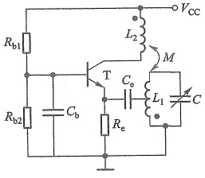

(a)
 

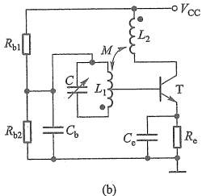

(b)
 

图 10.7.4 变压器反馈式 LC 正弦波振荡电路   (a) 发射极调谐电路 (b) 基极调谐电路
 

读者可自行分析，当 LC 回路谐振时，图 10.7.4 所示振荡电路同样满足相位平衡条件。

##### 10.7.3 三点式 LC 振荡电路

LC 振荡电路除变压器反馈式外，尚有常用的电感三点式和电容三点式振荡电路。现分

<!-- page: 442 -->

别讨论如下。

### 1. 电感三点式 LC 振荡电路

图 10.7.5a 是电感三点式振荡电路的原理图。电感分成  $ L_{1} $ 与  $ L_{2} $ 两个部分，通常绕在一个线圈架上，且绕的方向相同，其间有互感  $ M_{\circ} $。由图 10.7.5b 所示的高频交流通路可见，并联回路的电感有首端、中间抽头和尾端三个端点，分别接到三极管的集电极、发射极（地）和基极，且反馈电压  $ v_{f} $ 取自电感  $ L_{2} $，所以称为电感反馈三点式振荡电路或电感三点式振荡电路 $ ^{①} $。

(a)
 

(b)
 

图10.7.5 电感三点式振荡电路   (a) 原理电路 (b) 交流通路
 

由10.7.1节已知，LC并联回路谐振时，回路电流远比外电路电流大，1、3两端近似呈现纯电阻特性。因此，当 $ L_{1} $和 $ L_{2} $的同名端如图所示时，若选取中间抽头(2)为参考电位(交流地电位)点，则首(1)、尾(3)两端的电压极性相反。

现在用瞬时极性法分析图 10.7.5 所示的相位条件。设从反馈线的点 b 处断开，同时输入  $ v_{b} $ 为 (+) 极性的信号。由于并联回路呈纯电阻性，在纯电阻负载条件下，共射电路具有反相作用，因而其集电极电压 (1 端) 瞬时极性为 (-)，因此 3 端的瞬时极性为 (+)，即反馈信号  $ v_{f} $ (从  $ L_{2} $ 上取出) 与输入信号  $ v_{b} $ 同相，满足相位平衡条件。

至于振幅条件，由于  $ A_{v} $ 较大，只要适当选取  $ L_{2}/L_{1} $ 的比值，就可实现起振。当加大  $ L_{2} $ （或减小  $ L_{1} $ ）时，有利于起振。考虑  $ L_{1}, L_{2} $ 间的互感 M 后，电路的振荡频率可近似表示为

$$  \omega=\omega_{0}\approx\frac{1}{\sqrt{LC}}=\frac{1}{\sqrt{\left(L_{1}+L_{2}+2M\right)C}}   \tag*{(10.7.12a)}$$

或

$$  f=f_{0}\approx\frac{1}{2\pi\sqrt{\left(L_{1}+L_{2}+2M\right)C}}   \tag*{(10.7.12b)}$$

这里忽略了负载回路（图中未画出）和放大电路输入电阻的影响。

在电感三点式振荡电路中，采用可变电容器，就可以方便地调节振荡频率，其工作频率范

<!-- page: 443 -->

围可以从数百千赫至数十兆赫。但由于反馈电压  $ v_{f} $ 取自电感  $ L_{2} $，而电感对高次谐波（相对于  $ f_{0} $ 而言）阻抗较大，因此电压波形中含有高次谐波，波形较差，且频率稳定度不高。所以电感三点式振荡电路通常用于要求不高的设备中，例如高频加热器、接收机的本机振荡等。

### 2. 电容三点式 LC 振荡电路

图 10.7.6 是电容三点式 LC 振荡电路。与图 10.7.5 相比，原先接电感的地方现在接了电容，而原先接电容的地方现在接了电感。图中  $ C_{b1} $、 $ C_{b2} $ 为耦合电容，对振荡频率信号可视为短路。由于  $ C_{1} $、 $ C_{2} $ 不能传送直流，因此，将  $ C_{1} $、 $ C_{2} $ 之间的连接线直接接地，构成电容三点式电路 $ ^{①} $。

(a)
 

(b)
 

图 10.7.6 电容三点式 LC 振荡电路   (a) 原理电路 (b) 交流通路
 

电容三点式和电感三点式一样，都具有 LC 并联回路，因此，电容  $ C_{1} $、 $ C_{2} $ 中的三个端点的相位关系与电感三点式也相似。设从反馈线点 b 处断开，同时加入  $ v_{b} $ 瞬时极性为（+）的信号，则得 BJT 集电极的  $ v_{c} $ 瞬时极性为（-），因为 2 端接地，处于零电位，所以 3 端与 1 端的电压极性相反，即  $ v_{f} $ 为（+）极性，与  $ v_{b} $ 同相位，满足相位平衡条件。

至于振幅平衡条件或起振条件，只要将 BJT 的  $ \beta $ 值选得大一些（例如数十），并恰当选取比值  $ C_{2}/C_{1} $，就有利于起振，一般常取  $ C_{2}/C_{1}=0.01\sim0.5 $。由于 BJT 的输入电阻  $ r_{be} $ 比较小，增大  $ C_{2}/C_{1} $ 的值也不会有明显的效果，所以实际上，有时为了方便起见，也取  $ C_{1}=C_{2} $。

电容三点式振荡电路的振荡频率可近似表示如下：

$$  \omega=\omega_{0}\approx\frac{1}{\sqrt{LC}}=\frac{1}{\sqrt{L\left(\frac{C_{1}C_{2}}{C_{1}+C_{2}}\right)}}   \tag*{(10.7.13a)}$$

或

$$  f=f_{0}\approx\frac{1}{2\pi\sqrt{L\frac{C_{1}C_{2}}{C_{1}+C_{2}}}}   \tag*{(10.7.13b)}$$

<!-- page: 444 -->

该电路的特点是，反馈电压取自电容  $ C_{2} $，由于电容对高次谐波的阻抗较小，因而可滤除高次谐波，所以输出波形较好。调节  $ C_{1} $ 或  $ C_{2} $ 可以改变振荡频率，但同时会影响起振条件，因此常采用同轴电容器同时调节  $ C_{1} $ 和  $ C_{2} $，在不改变它们比值的情况下改变振荡频率，可调范围从数百千赫到100兆赫以上。也可在 L 两端并联一个可调电容来调节频率，但受固定电容  $ C_{1} $、 $ C_{2} $ 的影响，频率的调节范围比较小。

##### 10.7.4 石英晶体振荡电路

### 1. 正弦波振荡电路的频率稳定问题

在工程应用中，往往要求正弦波振荡电路的振荡频率非常稳定，例如通信系统中的射频振荡电路、数字系统的时钟产生电路等。通常用频率稳定度来衡量振荡频率的稳定性，它是振荡电路的质量指标之一。

一般用频率的相对变化量  $ \Delta f/f_{0} $ 来表示频率稳定度， $ f_{0} $ 为振荡频率， $ \Delta f $ 为频率偏移。频率稳定度有时附加时间条件，如一小时或一日内的频率相对变化量。

影响 LC 振荡电路振荡频率稳定度的因素主要是 LC 并联谐振回路的参数 L、C 和 R。LC 谐振回路的 Q 值对频率稳定也有较大影响，可以证明，Q 值越大，频率稳定度越高。由式 (10.7.5) 可知， $ Q = \omega_{0} L / R = \frac{1}{R} \cdot \sqrt{L / C} $。为了提高 Q 值，应尽量减小回路的损耗电阻 R 并加大 L/C 值。但一般的 LC 振荡电路，其 Q 值只可达数百，在要求频率稳定度高的场合，往往采用石英晶体振荡电路。

石英晶体振荡电路，就是用石英晶体作为选频网路，取代 LC 振荡电路中的 L、C 元件。它的频率稳定度可高达  $ 10^{-9} $ 甚至  $ 10^{-11} $ 。

石英晶体振荡电路之所以具有极高的频率稳定度，主要是由于采用了具有极高 Q 值的石英晶体元件。下面首先了解石英晶体的构造和它的基本特性，然后再分析具体的振荡电路。

### 2. 石英晶体的基本特性与等效电路

石英晶体是一种各向异性的结晶体，它是硅石的一种，其化学成分是二氧化硅（SiO_{2}）。从一块晶体上按一定的方位角切下的薄片称为晶片（可以是正方形、矩形或圆形等），然后在晶片的两个对应表面上涂敷银层并装上一对金属板，就构成石英晶体产品，如图10.7.7所示，一般用金属外壳密封，也有用玻璃壳封装的。

石英晶片之所以能做振荡电路是基于它的压电效应。从物理学中知道，若在晶片的两个极板间加一电场，会使晶体产生机械变形；反之，若在极板间施加机械力，又会在相应的方向上产生电场，这种现象称为压电效应。如在极板间所加的是交变电压，就会产生机械变形振动，同时机械变形振动又会产生交变电压。一般来说，这种机械振动的振幅是比较小的，其振动频率则是很稳定的。但当外加交变电压的频率与晶片的固有频率（决定于晶片的尺寸）相等时，机械振动的幅度将急剧增加，这种现象称为压电谐振，因此石英晶体又称为石英晶体谐振器。

石英晶体的代表符号、电路模型和电抗特性如图10.7.8所示。电路模型中的 $ C_{0} $为切片与金属板构成的静电电容，L和C分别模拟晶体的质量（代表惯性）和弹性，而晶片振动时，因摩擦而造成的损耗则用电阻R来等效。石英晶体的一个可贵的特点在于它具有很高的

<!-- page: 445 -->

图 10.7.7 石英晶体的一种结构
 

图 10.7.8 石英晶体的电路模型与电抗特性 (a) 代表符号 (b) 电路模型 (c) 电抗-频率响应特性
 

质量与弹性的比值(等效于  $ L/C $), 因而它的品质因数 Q 高达 10 000~500 000。例如一个 4 MHz 的石英晶体的典型参数为:  $ L=100\ \text{mH}, C=0.015\ \text{pF}, C_0=5\ \text{pF}, R=100\ \Omega, Q=25\ 000 $。

（1）当 R、L、C 支路发生串联谐振时，其串联谐振频率为

$$  f_{s}=\frac{1}{2\pi\sqrt{LC}}   \tag*{(10.7.14)}$$

由于  $ C_{0} $ 很小，它的容抗比 R 大得多，因此，串联谐振的等效阻抗近似为 R，呈纯阻性，且其阻值很小。

（2）当频率高于  $ f_{s} $ 小于  $ f_{p} $ 时，R、L、C 支路呈感性，当与  $ C_{0} $ 发生并联谐振时，其振荡频率为

$$  f_{p}=\frac{1}{2\pi\sqrt{LC}}\sqrt{1+\frac{C}{C_{0}}}=f_{s}\sqrt{1+\frac{C}{C_{0}}}   \tag*{(10.7.15)}$$

由于  $ C \ll C_{0} $，因此  $ f_{a} $ 与  $ f_{p} $ 很接近。

通常石英晶体产品所给出的标称频率既不是 $ f_{s} $，也不是 $ f_{p} $，而是外接一个小电容 $ C_{s}^{①} $时校正的振荡频率， $ C_{s} $与石英晶体串联，如图10.7.9所示。利用 $ C_{s} $可使石英晶体的谐振频率在一个小范围内调整。 $ C_{s} $的值应选择得比C大。

<!-- page: 446 -->

为了计算串入  $ C_{s} $ 后谐振频率的偏移，可从图10.7.9b导出新的电抗

$$  X^{\prime}=-\frac{1}{\omega C_{s}}\cdot\frac{C+C_{0}+C_{s}-\omega^{2}LC\left(C_{0}+C_{s}\right)}{C_{0}+C-\omega^{2}LCC_{0}}   \tag*{(10.7.16)}$$

令上式中的分子为零，得到新的串联谐振频率

$$  f_{s}^{\prime}=\frac{1}{2\pi\sqrt{LC}}\sqrt{1+\frac{C}{C_{0}+C_{s}}}=f_{s}\sqrt{1+\frac{C}{C_{0}+C_{s}}}   \tag*{(10.7.17a)}$$

将上式展开成幂级数，并注意到  $ C \ll (C_{0} + C_{s}) $，从而略去高次项，可近似得

 $$ f^{\prime}_{s}=f_{s}\left[1+\frac{C}{2\left(C_{0}+C_{s}\right)}\right] $$ 

可见频率的相对变化量为

图 10.7.9 石英晶体串联谐振频率的调整
 

$$  \frac{\Delta f}{f_{s}}=\frac{C}{2\left(C_{0}+C_{s}\right)}   \tag*{(10.7.18)}$$

由以上分析可知，串入  $ C_s $ 之后，并不影响并联谐振频率，因为式（10.7.16）中分母的第二项因子与  $ C_s $ 无关。但将式（10.7.17a）与式（10.7.15）做一比较表明，当  $ C_s \to 0 $ 时， $ f'_s = f_p $，而当  $ C_s \to \infty $ 时， $ f'_s = f_s $。实用时， $ C_s $ 是一个微调电容，使  $ f'_s $ 在  $ f_s $ 与  $ f_p $ 之间的一个狭窄范围内变动。根据前面给出的 4 MHz 石英晶体及参数，取  $ C_s = 3 $ pF，可算出  $ \Delta f \approx 4 $ Hz。

### 3. 石英晶体振荡器

石英晶体振荡器电路的形式是多种多样的，但其基本电路只有两类，即并联晶体振荡器和串联晶体振荡器，前者石英晶体是以并联谐振的形式出现，而后者则是以串联谐振的形式出现。现以图10.7.10所示（交流通路）并联晶体振荡器为例，简要介绍其工作原理。

对比图 10.7.10 和图 10.7.6b 可以看出，如果石英晶体与  $ C_{s} $ 支路呈感性，则图 10.7.10 就是电容三点式振荡电路。由图 10.7.8c 可知，振荡频率在  $ \omega_{s} $ 与  $ \omega_{p} $ 之间时，

图 10.7.10 并联晶体振荡器
 

石英晶体呈现感抗。所以振荡频率主要取决于石英晶体与  $ C_{s} $ 的谐振频率，与石英晶体本身的谐振频率十分接近。石英晶体作为一个等效电感  $ L_{eq} $ 很大，而  $ C_{s} $ 又很小，使得等效 Q 值极高，其他元件和杂散参数对振荡频率的影响极微，故频率稳定度很高。

##### 复习思考题

10.7.1 电容三点式振荡电路与电感三点式振荡电路比较，其输出的谐波成分小，输出波形较好，为什么？

10.7.2 在电感三点式振荡电路中，若用绝缘导线绕制一电感线圈（线圈骨架为一纸质或其他材料制成的圆筒），问  $ L_{1} $ 和  $ L_{2} $ 如何绕法？如何抽出三个端子？是  $ L_{1} $ 的匝数多还是  $ L_{2} $ 的匝数应多些？

<!-- page: 447 -->

10.7.3 对于 RC、LC 和石英晶体三种正弦波振荡电路，试说明哪一种频率稳定度最高，哪一种最低。为什么？

10.7.4 试分别说明，石英晶体在并联晶体振荡电路和串联晶体振荡电路中等效为何种元件（电阻、电感和电容）。

#### 10.8 非正弦信号产生电路

本节介绍的非正弦信号产生电路有方波产生电路、锯齿波产生电路等。考虑到电压比较器在信号产生电路中的广泛应用，下面首先讨论它的电路结构和工作原理。

##### 10.8.1 电压比较器

### 1. 单门限电压比较器

电压比较器是一种用来比较两个输入电压大小的电路，也常用于一个输入电压  $ v_{I} $ 和一个参考电压  $ V_{REF} $ 的比较。图 10.8.1a 为其基本电路，符号 C 表示比较器，它在实际应用时最重要的两个动态参数是灵敏度和响应时间（或响应速度），因此可以根据不同要求选用专用集成比较器或运放。现假设 C 由运放组成，参考电压  $ V_{REF} $ 加于运放的反相端。而输入信号  $ v_{I} $ 则加于运放的同相端。这时，运放处于开环工作状态，具有很高的开环电压增益。

电路的传输特性如图 10.8.1b 所示，当输入电压  $ v_I $ 小于参考电压  $ V_{REF} $ 时，即差模输入电压  $ v_{ID} = v_I - V_{REF} < 0 $ 时，运放的高增益使输出进入负饱和状态， $ v_0 = V_{OL} $；当  $ v_I $ 升高到略大于参考电压  $ V_{REF} $ 时，即  $ v_{ID} = v_I - V_{REF} > 0 $，运放立即转入正饱和状态， $ v_0 = V_{OH} $，如图 10.8.1b 的实线所示（图中  $ v_0 $ 跳变时的斜率画得较倾斜，实际由于运放的开环增益很大， $ v_0 $ 几乎是突变的），它表示  $ v_I $ 从小于  $ V_{REF} $ 变化到大于  $ V_{REF} $ 时，输出电压从负的饱和值  $ V_{OL} $ 跳变到正的饱和值  $ V_{OH} $；反之亦然。把比较器输出电压  $ v_0 $ 从一个电平跳变到另一个电平时对应的输入电压  $ v_I $ 值为门限电压或阈值电压  $ V_T $，对于图 10.8.1a 所示电路， $ V_T = V_{REF} $。由于  $ v_I $ 从同相端输入且只有一个门限电压，故称为同相输入单门限电压比较器。反之，当  $ v_I $ 从反相端输入， $ V_{REF} $ 改接到同相端，则称为反相输入单门限电压比较器。其相应传输特性如图 10.8.1b 中的虚线所示。

要特别注意，由于运放工作于非线性状态，所以虚短不再成立， $ v_{P}=v_{N} $ 仅对应输出翻转时刻。另外，由于运放的输入电阻较大，所以分析比较器时，虚断仍被采用。

用集成运放构成的电压比较器，可以如图10.8.1c所示加限幅措施，避免内部管子进入深度饱和区，来提高响应速度。

如果参考电压  $ V_{REF}=0 $ ，则输入信号电压  $ v_{1} $ 每次过零时，输出就要产生突然的变化。这种比较器称为过零比较器。

例 10.8.1 电路如图 10.8.1a 所示， $ v_{I} $ 为三角波，其峰值为 6 V，如图 10.8.2 中虚线所示。设电源电压  $ \pm V_{CC} = \pm 12 $ V，运放为理想器件，试分别画出  $ V_{REF} = 0 $、 $ V_{REF} = +2 $ V 和  $ V_{REF} = -4 $ V 时比较器输出电压  $ v_{0} $ 的波形。

解：由于  $ v_{1} $ 加到运放的同相端，因此有

 $$ \left\{\begin{aligned}v_{I}>V_{REF} 时 ,v_{0}&=V_{OH}=12V.\\ v_{I}<V_{REF} 时 ,v_{0}&=V_{OL}=-12V\end{aligned}\right. $$

<!-- page: 448 -->

(a)
 

(b)
 

(c)
 

图 10.8.1 同相输入单门限电压比较器
 

（a）电路图 （b）传输特性 （c）提高响应速度的限幅电路
 

据此可画出  $ V_{REF}=0 $、 $ V_{REF}=2 $ V 和  $ V_{REF}=-4 $ V 时的  $ v_0 $ 波形，如图 10.8.2a、b、c 所示。由图可看出，当三角波固定不变，改变  $ V_{REF} $ 时，会改变输出方波的高电平持续时间（也称脉冲宽度），但周期不变（与三角波周期相同）。此时称输出波形为脉冲宽度调制（pulse width modulation，PWM）波形， $ V_{REF} $ 为调制信号。电路将  $ V_{REF} $ 的大小转换到输出波形的脉冲宽度上了。

(a)
 

(b)
 

(c)
 

图 10.8.2 例 10.8.1 的解答图
 

(a)  $ V_{REF}=0 $ 时的  $ v_{0} $ 波形 (b)  $ V_{REF}=2 $ V 时的  $ v_{0} $ 波形 (c)  $ V_{REF} = -4 $ V 时的  $ v_{0} $ 波形
 

<!-- page: 449 -->

例 10.8.2 图 10.8.3a 是单门限电压比较器的另一种形式，试求出其门限电压（阈值电压） $ V_{T} $，画出其电压传输特性。设运放输出的高、低电平分别为  $ V_{OH} $ 和  $ V_{OL} $。

(a)
 

(b)
 

图 10.8.3 例 10.8.2 电路和解答图   (a) 电路 (b) 电压传输特性
 

解：根据图 10.8.3a，考虑到虚断，利用叠加原理可得

$$  v_{p}=\frac{R_{2}}{R_{1}+R_{2}}\bar{V}_{REF}+\frac{R_{1}}{R_{1}+R_{2}}v_{1}   \tag*{(10.8.1)}$$

理想情况下，输出电压发生跳变时对应  $ v_{p}=v_{N}=0 $ ，即

 $$ R_{2}V_{REF}+R_{1}v_{I}=0 $$ 

由此可求出门限电压

$$  V_{\mathrm{T}}=\left(v_{\mathrm{I}}=\right)-\frac{R_{2}}{R_{1}}V_{\mathrm{REF}}   \tag*{(10.8.2)}$$

当  $ v_{I}>V_{T} $ 时， $ v_{P}>v_{N} $，所以  $ v_{O}=V_{OH} $；当  $ v_{I}<V_{T} $ 时， $ v_{P}<v_{N} $，所以  $ v_{O}=V_{OL} $。我们已知电压传输特性的三个要素：输出电压的高电平  $ V_{OH} $ 和低电平  $ V_{OL} $、门限电压和输出电压的跳变方向，因此，可画出图 10.8.3a 的电压传输特性如图 10.8.3b 所示。

根据式(10.8.2)可知，只要改变 $ V_{REF} $的大小和极性，以及电阻 $ R_{1} $和 $ R_{2} $的阻值，就可以改变门限电压 $ V_{T} $的大小和极性。若要改变 $ v_{1} $过 $ V_{T} $时 $ v_{0} $的跃变方向，则只要将图10.8.3a所示电路运放的同相输入端和反相输入端所接外电路互换。

### 2. 迟滞比较器

单门限电压比较器虽然有电路简单、灵敏度高等特点，但其抗干扰能力差。例如，图10.8.1a所示单门限电压比较器，当 $ v_{1} $中含有噪声或干扰电压时，其输入和输出电压波形如图10.8.4所示。由于 $ v_{1} $在 $ V_{T}=V_{REF} $附近出现干扰， $ v_{0} $将时而为 $ V_{OH} $，时而为 $ V_{OL} $，导致比较器输出不稳定。如果用这个输出电压 $ v_{0} $去控制电机，将出现频繁的起停现象，这种情况是不允许的。如果输出电压跳变后，门限值也跟着跳离当前的 $ v_{1} $值，那么就可以解决这个问题。迟滞比较器就具有这样的特性。

##### （1）电路组成

如何让门限值跟随输出电压跳变呢？我们自然会想到反馈。为了保证运放工作在非线性区实现比较器功能，这个反馈必须是正反馈，其电路如图10.8.5所示， $ R_{1} $ 引入了正反馈。此时门限值由 $ V_{REF} $ 和 $ v_{0} $ 共同决定。而且正反馈会使增益变得更大，比较器的翻转速度会更快。

<!-- page: 450 -->

图 10.8.4 单门限电压比较器在  $ v_{1} $ 中包含有干扰电压时的输出电压  $ v_{0} $ 波形
 

图 10.8.5 反相输入迟滞比较器电路
 

##### （2）门限电压的估算

由图10.8.5可知，当 $ v_{I}>v_{P} $时，输出电压 $ v_{0} $为低电平 $ V_{OL} $;反之， $ v_{0} $为高电平 $ V_{OH} $;而 $ v_{I}=v_{N}\approx v_{P} $是 $ v_{0} $翻转的临界条件，也即 $ v_{P} $值就是门限电压 $ V_{T} $，据此可求出门限电压 $ V_{T} $。设运放是理想的，利用叠加原理并考虑虚断有

$$  v_{\mathrm{p}}=V_{\mathrm{T}}=\frac{R_{1}V_{\mathrm{REF}}}{R_{1}+R_{2}}+\frac{R_{2}v_{0}}{R_{1}+R_{2}}   \tag*{（10.8.3）}$$

根据输出电压  $ v_{0} $ 的不同值 ( $ V_{OH} $ 或  $ V_{OL} $)，可分别求出上门限电压  $ V_{T+} $ 和下门限电压  $ V_{T-} $ 分别为

$$  V_{\mathrm{T+}}=\frac{R_{1}V_{\mathrm{REF}}}{R_{1}+R_{2}}+\frac{R_{2}V_{\mathrm{OH}}}{R_{1}+R_{2}}   \tag*{（10.8.4）}$$

和

$$  V_{\mathrm{T-}}=\frac{R_{1}V_{\mathrm{REF}}}{R_{1}+R_{2}}+\frac{R_{2}V_{\mathrm{OL}}}{R_{1}+R_{2}}   \tag*{（10.8.5）}$$

门限宽度或回差电压为

$$  \Delta V_{\mathrm{T}}=V_{\mathrm{T}+}-V_{\mathrm{T}-}=\frac{R_{2}(V_{0\mathrm{H}}-V_{0\mathrm{L}})}{R_{1}+R_{2}}   \tag*{（10.8.6）}$$

需要特别注意，由于  $ v_{0} $ 不可能同时为  $ V_{OH} $ 和  $ V_{OL} $，所以  $ V_{T+} $ 和  $ V_{T-} $ 不可能同时存在。这意味着这种比较器看上去有两个门限值，但实际上是门限值随输出电压的跳变在  $ V_{T+} $ 和  $ V_{T-} $ 之间跳变，即实际门限值所处位置取决于当前输出电压的状态。由式(10.8.4)和式(10.8.5)看出，当  $ v_{0}=V_{on} $ 时， $ V_{T+} $ 有效；而当  $ v_{0}=V_{on} $ 时， $ V_{T-} $ 有效。

设电路参数如图 10.8.5 所示，且  $ V_{OH} = -V_{OL} = 5\ V $，则由式(10.8.4)～式(10.8.6)可求得  $ V_{T+} = 1.04\ V $， $ V_{T-} = 0.94\ V $ 和  $ \Delta V_{T} = 0.1\ V $。

<!-- page: 451 -->

##### （3）传输特性

设从  $ v_{1}=0, v_{0}=V_{OH} $ 开始讨论。

由于  $ v_{0}=V_{OH} $，所以当前门限值为  $ v_{p}=V_{T+} $。当  $ v_{I} $ 由零向正方向增加到接近  $ V_{T+} $ 之前， $ v_{0} $ 一直保持  $ v_{0}=V_{OH} $ 不变。当  $ v_{I} $ 增加到略大于  $ V_{T+} $ 时， $ v_{0} $ 由  $ V_{OH} $ 下跳到  $ V_{OL} $，同时使门限值  $ v_{p} $ 下跳到  $ v_{p}=V_{T-} $， $ v_{I} $ 再增加， $ v_{0} $ 保持  $ v_{0}=V_{OL} $ 不变，其传输特性如图 10.8.6a 所示。

若减小  $ v_1 $，只要  $ v_1 > V_{T-} $，则  $ v_0 $ 将始终保持  $ v_0 = V_{OL} $ 不变，只有当  $ v_1 < V_{T-} $ 时， $ v_0 $ 才由  $ V_{OL} $ 跳变到  $ V_{OH} $，门限值也随之跳回到  $ V_{T+} $，其传输特性如图 10.8.6b 所示。把图 10.8.6a 和 b 的传输特性结合在一起，就构成了如图 10.8.6c 所示的完整的传输特性，它有一个迟滞回环，所以这种比较器称为迟滞比较器 $ ^{①} $。根据  $ V_{REF} $ 的正、负和大小不同， $ V_{T+} $、 $ V_{T-} $ 可正可负。

图 10.8.5 所示比较器的输入信号  $ v_{I} $ 由反相端输入，所以是反相输入迟滞比较器。如将  $ v_{I} $ 与  $ V_{REF} $ 位置互换，就可构成同相输入迟滞比较器。

例 10.8.3 设电路参数如图 10.8:7a 所示，输入信号  $ v_{1} $ 的波形如图 10.8.7c 所示。试画出其传输特性和输出电压  $ v_{0} $ 的波形。

##### 解：（1）求门限电压

由于  $ V_{REF}=0 $ ，由式(10.8.4)和式(10.8.5)有

图 10.8.6 反相输入迟滞比较器的传输特性
 

(a)  $ v_{1} $ 增加时的传输特性

(b)  $ v_{1} $ 减少时的传输特性

(c) 合成（输入-输出）传输特性

 $$ V_{T+}=\frac{R_{2}V_{OH}}{R_{1}+R_{2}}=\frac{20\times10}{20+20}\ V=5\ V $$ 

 $$ V_{T-}=\frac{R_{2}V_{0L}}{R_{1}+R_{2}}=\frac{-20\times10}{20+20}\mathrm{~V}=-5\mathrm{~V} $$ 

##### （2）画传输特性

由于图 10.8.7a 所示电路结构与图 10.8.5 的差别是，前者的  $ V_{REF}=0 $，因此可画出其传输特性如图 10.8.7b 所示。此时的上门限电压和下门限电压对称于纵轴。

##### （3）画出 $ v_{0} $波形

根据图10.8.7b、c可画出 $ v_{0} $波形。

当 t=0 时，由于  $ v_{1}<V_{T-}=-5\ V $，所以  $ v_{0}=10\ V $， $ v_{p}=5\ V $。以后  $ v_{1} $ 在  $ v_{1}<v_{p}=V_{T+}=5\ V $ 内变化， $ v_{0} $ 保持 10 V 不变。

当  $ t=t_{1} $ 时， $ v_{I}\geqslant v_{P}=V_{T+},v_{0} $ 由 10 V 下跳到 -10 V，门限值  $ v_{P} $ 也由  $ V_{T+} $ 变为  $ v_{P}=V_{T-}=-5\ V $ （ $ V_{T+} $ 已无效）。所以后面即使  $ v_{I} $ 又多次穿越  $ V_{T+} $，但只要  $ v_{I}>V_{T-},v_{0} $ 就保持 -10 V 不变。

当  $ t=t_{2} $ 时， $ v_{1}\leq-5\ V $， $ v_{0} $ 又由 -10 V 上跳到 10 V，门限值  $ v_{p} $ 又由  $ V_{T-}=-5\ V $ 变回到  $ v_{p}= $

<!-- page: 452 -->

$$ V_{\mathrm{T}+}=5\mathrm{~V}_{\circ} $$ 

依此类推，可画出  $ v_{0} $ 的波形，如图 10.8.7d 所示。由图可知，虽然  $ v_{1} $ 的波形很不“整齐”，但得到的  $ v_{0} $ 是一近似矩形波。因此，图 10.8.7a 所示电路可以消除图 10.8.4 中的干扰，它可用于波形整形。具有迟滞特性的比较器在控制系统、信号甄别和波形产生电路中应用较广。

(a)
 

(b)
 

(d)
 

图 10.8.7 例 10.8.3 电路及波形
 

(a) 电路 (b) 传输特性 (c) 输入电压  $ v_{1} $ 波形 (d) 输出电压  $ v_{0} $ 波形
 

通过上述几种电压比较器的分析，可得出如下结论。

① 由于电压比较器通常工作在开环或正反馈状态，运放工作在非线性区，其输出电压只有高电平  $ V_{OH} $ 和低电平  $ V_{OL} $ 两种情况，虚短不再成立。

②一般用电压传输特性来描述输出电压与输入电压的函数关系。

③电压传输特性的三个要素是输出电压的高电平 $ V_{OH} $和低电平 $ V_{OL} $、门限电压和输出电压的跳变方向。令 $ v_{P}=v_{N} $所求出的 $ v_{I} $就是门限电压； $ v_{I} $等于门限电压时输出电压的跳变方向决定于输入电压作用于同相输入端还是反相输入端。

实际比较器的输出电压  $ v_0 $ 从一个电平变到另一个电平并不是理想阶跃，它要经过线性区（见图 10.8.8a），设  $ V_{11} $、 $ V_{12} $ 分别对应距离  $ v_0 $ 底部和顶部 0.1 ( $ V_{OH}-V_{OL} $) 处的  $ v_1 $ 值，则  $ V_{12} $、 $ V_{11} $ 的差值  $ \Delta V_1 $ 就称为比较器的灵敏度。 $ \Delta V_1 $ 越小，灵敏度越高。因此，灵敏度  $ \Delta V_1 $ 表示了比较器对输入信号电压的分辨能力。为了提高灵敏度，应选择开环电压增益大、失调与温漂小的集成运放或集成比较器构成电压比较器电路。

如果在比较器的输入端加上一理想阶跃信号，其输出电压  $ v_{0} $ 如图 10.8.8b 所示。显然，

<!-- page: 453 -->

(a)
 

(b)
 

图 10.8.8 比较器的灵敏度和响应时间 (a) 灵敏度 (b) 响应时间
 

 $ v_{0} $ 也不是一个理想跃变，而是需要一定时间  $ \Delta t $，这个时间称为比较器的响应时间。 $ \Delta t $ 越小，响应速度越快。为了提高响应速度，应选择高速、宽带集成运放或高速、超高速集成电压比较器。

### 3. 集成电压比较器

电压比较器可将模拟信号转换成双值信号，即只有高电平和低电平两种状态的离散信号。因此，可用电压比较器作为模拟电路和数字电路的接口电路。

集成电压比较器比集成运算放大器的开环增益低、失调电压大、共模抑制比小，因而它的灵敏度往往不如用集成运放构成的比较器高，但由于集成电压比较器通常工作在两种状态之一（输出为高电平或低电平），因此不需要频率补偿电容，也就不会像集成运算放大器那样因加入频率补偿电容引起转换速率受限。集成电压比较器改变输出状态的典型响应时间是30~200 ns。转换速率为0.7 V/μs的741集成运算放大器，其响应时间的期望值是30 μs左右，约为集成电压比较器1000倍。

近年来，高速、超高速集成电压比较器获得迅速发展。例如，以互补双极工艺制造的AD790高速电压比较器，其精度已达到  $ V_{IO} \leq 50\ \mu\text{V} $,  $ K_{\text{CMR}} \geq 105\ \text{dB} $。它可以双电源供电（±15 V），也可以单电源工作（+5 V）。其输出可与 TTL、CMOS电平匹配，输出级可驱动100 pF的容性负载。AD790在+5 V单电源工作时的功耗约为60 mW，响应时间的典型值为40 ns。

超高速集成电压比较器的型号也很多。例如，LT1016（10 ns）；LT685（5.5 ns）；TLV3201/TLV3202（40 ns）等。

此外，根据输出方式不同，集成电压比较器还可分为普通、集电极（或漏极）开路输出或互补输出三种情况。集电极（或漏极）开路输出电路必须在输出端接一个电阻至电源。互补输出电路有两个输出端，若一个为高电平，则另一个必为低电平。

例如，常用的 LM339，其芯片内集成了四个独立的电压比较器。由于 LM339 采用了集电极开路的输出形式，使用时允许将各比较器的输出端直接连在一起。利用这一特点，可以

<!-- page: 454 -->

方便地用 LM339 内两个比较器组成双限比较器，共用外接电阻 R，如图 10.8.9a 所示。当信号电压  $ v_{1} $ 满足  $ V_{REF1} < v_{1} < V_{REF2} $ 时，输出电压  $ v_{0} $ 为高电平  $ V_{OH} $，否则  $ v_{0} $ 为低电平  $ V_{OL} $。由此可画出其电压传输特性如图 10.8.9b 所示。

(a)
 

(b)
 

图 10.8.9 由 LM339 构成的双限比较器及其电压传输特性 (a) 原理电路 (b) 电压传输特性
 

##### 10.8.2 方波产生电路

### 1. 电路组成及工作原理

方波产生电路是一种能够直接产生方波或矩形波的非正弦信号发生电路。由于方波或矩形波包含极丰富的谐波，因此，这种电路又称为多谐振荡电路。

基本电路组成如图 10.8.10a 所示，它在迟滞比较器的基础上，增加了一个由  $ R_{f} $、C 组成的积分电路，把输出电压经  $ R_{f} $、C 反馈到比较器的反相端。在比较器的输出端引入限流电阻 R 和两个背靠背的齐纳二极管（稳压值为  $ \pm V_{z} $）就组成了一个如图 10.8.10b 所示的双向限幅方波发生电路。由图可知，电路的正反馈系数为同相端电压与输出电压之比，即 $ ^{①} $

$$  F\approx\frac{R_{2}}{R_{1}+R_{2}}   \tag*{（10.8.7）}$$

在接通电源的瞬间，输出电压究竟偏于正向饱和还是负向饱和，那纯属偶然。假设开始时输出电压为正饱和值，即  $ v_0 = +V_z $ 时，加到电压比较器同相端的电压为  $ +FV_z $（当前门限值），而加于反相端的电压为电容器上的电压  $ v_c $。由于  $ v_c $ 不能突变，只能由输出电压  $ v_0 $ 通过电阻  $ R_f $ 按指数规律向 C 充电来建立，如图 10.8.11a 所示，充电电流为  $ i^+ $。显然，当加到反相端的电压  $ v_c $ 略大于  $ +FV_z $ 时，输出电压便从正饱和值  $ (+V_z) $ 迅速翻转到负饱和值  $ (-V_z) $，即  $ v_0 = -V_z $（见图 10.8.11b），于是电压比较器同相端的门限电压也立即变为  $ -FV_z $；输出电压变为  $ -V_z $ 后，电容  $ C $ 通过  $ R_f $ 开始放电，放电电流如图 10.8.11a 中  $ i^- $ 所示，使  $ v_c $ 上的电压值逐渐降低。直到  $ v_c $ 略低于  $ -FV_z $ 值时，输出状态又翻转回去。如此循环，形成一系列的方波输

<!-- page: 455 -->

(a)
 

(b)
 

图 10.8.10 方波产生电路
 

（a）基本电路 （b）双向限幅的方波产生电路
 

(a)
 

(b)
 

图 10.8.11 方波产生电路工作原理图
 

（a）电容器 C 充、放电情况 （b）输出电压与电容器电压波形图
 

### 2. 振荡频率

出，如图10.8.11b所示。

图10.8.11b画出了电路稳定振荡后，输出端及电容器C上的电压波形。设t=0时， $ v_{c}=-FV_{z} $，则T/2的时间内，电容C上的电压 $ v_{c} $将以指数规律由 $ -FV_{z} $向 $ V_{z} $方向变化，电容器端电压随时间变化规律为

$$  v_{C}(t)=V_{Z}\left[1-\left(1+F\right)\mathrm{e}^{-\frac{t}{R_{f}C}}\right]   \tag*{(10.8.8)}$$

设 T 为方波的周期，当 t=T/2 时， $ v_{c}(T/2)=FV_{z} $，代入式（10.8.8），可得

 $$ v_{c}\bigg(\frac{T}{2}\bigg)=V_{z}\big[\;1-\big(1+F\big)\;{\mathrm{e}}^{-\frac{T}{2R_{f}C}}\;\big]=F V_{z} $$ 

对 T 求解，可得

$$  T=2R_{f}C\mathrm{l n}\frac{1+F}{1-F}=2R_{f}C\mathrm{l n}\left(1+2\frac{R_{2}}{R_{1}}\right)   \tag*{(10.8.9)}$$

方波的频率为

<!-- page: 456 -->

$$  f=\frac{1}{T}   \tag*{（10.8.10）}$$

上式表明，方波的频率与充放电时间常数  $ R_{f}C $ 和迟滞比较器的电阻比值  $ R_{2}/R_{1} $ 有关，与齐纳二极管的稳压值  $ V_{z} $ 无关，但方波的幅值是由  $ V_{z} $ 决定的。实际应用中常通过改变  $ R_{f} $ 来调节频率。

在低频范围（如  $ 10 \, Hz \sim 10 \, kHz $）内，对于固定频率来说，用运放来组成图 10.8.11 所示电路尚可。当振荡频率较高时，为了获得前后沿较陡的方波，最好选择转换速率较高的集成电压比较器代替运放。

### 3. 占空比可调的方波产生电路

通常将矩形波为高电平的持续时间与振荡周期的比值称为占空比（用 q 表示）。图10.8.11中的 $ v_{0} $波形为对称方波，其占空比为50%。如需产生占空比小于或大于50%的矩形波，只需使电容C的充电和放电时间常数不同即可。

图 10.8.12a 是一种占空比可调的矩形波产生电路，图中电位器  $ R_{p} $ 和二极管  $ D_{1} $、 $ D_{2} $ 的作用是将电容充电和放电的回路分开，并可调节充电和放电两个时间常数的比例。这样，当  $ v_{0} $ 为正时， $ D_{1} $ 导通而  $ D_{2} $ 截止，充电时间常数为  $ (R_{f} + R_{p1})C $；当  $ v_{0} $ 为负时， $ D_{1} $ 截止而  $ D_{2} $ 导通，放电时间常数为  $ (R_{f} + R_{p2})C $， $ v_{C} $ 和  $ v_{0} $ 的电压波形如图 10.8.12b 所示。

(a)
 

(b)
 

图 10.8.12 占空比可调的矩形波产生电路   (a) 电路原理图 (b) 输出波形图
 

当忽略二极管的正向导通电阻时，利用类似的方法，可求得电容充电和放电的时间分别为

$$  T_{1}=\left(R_{\mathrm{f}}+R_{\mathrm{P}1}\right)C\ln\left(1+2\frac{R_{2}}{R_{1}}\right)   \tag*{（10.8.11a）}$$

$$  T_{2}=\left(R_{\mathrm{f}}+R_{\mathrm{P}2}\right)C\ln\left(1+2\frac{R_{2}}{R_{1}}\right)   \tag*{（10.8.11b）}$$

输出波形的振荡周期为

<!-- page: 457 -->

$$  T=T_{1}+T_{2}=\left(2R_{\mathrm{f}}+R_{\mathrm{p}}\right)C\ln\left(1+2\frac{R_{2}}{R_{1}}\right)   \tag*{（10.8.12）}$$

矩形波的占空比为

$$  q=\frac{T_{1}}{T}\times100\%=\frac{R_{f}+R_{p1}}{2R_{f}+R_{p}}\times100\%   \tag*{（10.8.13）}$$

上式表明，调节  $ R_{P1} $ 的值，就能改变占空比，而输出波形的周期不受影响。

##### 10.8.3 锯齿波产生电路

锯齿波和正弦波、方波、三角波是常用的基本测试信号。下面以图10.8.13a所示的锯齿波电压产生电路为例，讨论其组成及工作原理。

### 1. 电路组成

由图 10.8.13a 可见，它由同相输入迟滞比较器 $ (C_{1}) $和充放电时间常数不等的积分器 $ (A_{2}) $共同组成锯齿波电压产生电路。

### 2. 门限电压的估算

为便于讨论，单独画出图10.8.13a中由 $ C_{1} $组成的同相输入迟滞比较器，如图10.8.13b所示。图中的 $ v_{1} $就是图a中的 $ v_{0} $。由图b有

$$  v_{_{\mathrm{P}1}}=v_{_{\mathrm{I}}}-\frac{v_{_{\mathrm{I}}}-v_{_{01}}}{R_{_{1}}+R_{_{2}}}R_{_{1}}   \tag*{(10.8.14)}$$

考虑到电路翻转时，有  $ v_{N1} \approx v_{P1} = 0 $，即得

$$  v_{1}=V_T=-\frac{R_1}{R_2}v_{01}   \tag*{（10.8.15）}$$

由于  $ v_{01}=\pm V_{z} $，由式(10.8.15)，可分别求出上、下门限电压和门限宽度

$$  V_{\mathrm{T}+}=\frac{R_{1}}{R_{2}}V_{\mathrm{z}}\quad\left(v_{01}=-V_{\mathrm{z}}\right)   \tag*{（10.8.16）}$$

$$  V_{\mathrm{T-}}=-\frac{R_{1}}{R_{2}}V_{\mathrm{z}}\quad\left(v_{01}=V_{\mathrm{z}}\right)   \tag*{（10.8.17）}$$

和

$$  \Delta V_{\mathrm{T}}=V_{\mathrm{T}+}-V_{\mathrm{T}-}=2\frac{R_{1}}{R_{2}}V_{z}   \tag*{（10.8.18）}$$

### 3. 工作原理

设 t=0 时接通电源，有  $ v_{01}=-V_{z} $，则  $ -V_{z} $ 经  $ R_{6} $ 向 C 恒流充电，使输出电压按线性规律增长。当  $ v_{0} $ 上升到门限电压  $ V_{T+} $ 使  $ v_{P1}=v_{N1}=0 $ 时，比较器输出  $ v_{01} $ 由  $ -V_{z} $ 上跳到  $ +V_{z} $，同时门限电压下跳到  $ V_{T-} $ 值。以后  $ v_{01}=+V_{z} $ 经  $ R_{6} $ 和 D、 $ R_{5} $ 两支路向 C 反向充电，由于时间常数小于之前的充电时间常数，所以  $ v_{0} $ 迅速下降到负值。当  $ v_{0} $ 降到  $ V_{T-} $ 使  $ v_{P1}=v_{N1}=0 $ 时，比较器输出  $ v_{01} $ 又由  $ +V_{z} $ 下跳到  $ -V_{z} $。如此周而复始，产生振荡。由于电容 C 的正向与反向充电时间常数不相等，但都是恒流充电，所以  $ v_{0} $ 为锯齿波， $ v_{01} $ 为矩形波，如图 10.8.14 所示。当忽略二极管的正向导通电阻时，可求得振荡周期为

<!-- page: 458 -->

(a)
 

(b)
 

图 10.8.14 图 10.8.13a 所示电路的波形
 

图 10.8.13 锯齿波电压产生电路
 

（a）电路 （b）同相输入迟滞比较器
 

$$  \begin{aligned}T&=T_{1}+T_{2}\\&=\frac{2R_{1}R_{6}C}{R_{2}}+\frac{2R_{1}\left(R_{6}\big/\big/R_{5}\right)C}{R_{2}}\\&=\frac{2R_{1}R_{6}C\left(R_{6}+2R_{5}\right)}{R_{2}\left(R_{5}+R_{6}\right)}\end{aligned}   \tag*{(10.8.19)}$$

显然，当去掉图10.8.13a电路中的 $ R_{5} $、D支路，C的正、反向充电时间常数就相等，锯齿波就变成三角波了，电路就变成方波 $ (v_{01}) $-三角波 $ (v_{0}) $产生电路了，其振荡周期为

$$  T=\frac{4R_{1}R_{6}C}{R_{2}}   \tag*{(10.8.20)}$$

##### 复习思考题

10.8.1 电压比较器中的运放通常工作在什么状态（负反馈、正反馈或开环）？一般它的输出电压是否只有高电平和低电平两个稳定状态？

10.8.2 迟滞比较器有几个门限电压值？

10.8.3 迟滞比较器的传输特性为什么具有迟滞特性？

10.8.4 试分别指出，在下列情况下应选用哪种输入方式和何种类型的比较器：

（1）要求  $ v_{1}>0 $ 时  $ v_{0} $ 为低电平， $ v_{1}<0 $ 时  $ v_{0} $ 为高电平；

（2）要求  $ v_{1} > 3 $ V 时  $ v_{0} $ 为高电平，而在  $ v_{1} < 3 $ V 时  $ v_{0} $ 为低电平。

10.8.5 集成电压比较器与集成运放比较主要有什么特点？为什么为了获得前后沿较陡的方波，宜选用转换速率较高的集成电压比较器组成比较电路？

<!-- page: 459 -->

# 小结

有源滤波电路通常是由运放和 RC 网络构成的电子系统，根据幅频响应不同，可分为低通、高通、带通、带阻和全通滤波电路。高阶滤波电路一般都可由一阶和二阶有源滤波电路组成。

- 开关电容滤波器的精度和稳定性均较高，目前已有多种集成电路器件供选用，但其高频信号的滤波受到限制。

正弦波振荡电路由放大电路、正反馈网络、选频网络和稳幅环节等部分组成，振荡的条件是环路增益 $ \dot{A}\dot{F}=1 $，它可拆分成幅值条件和相位条件。由相位条件决定振荡频率，由幅值条件决定电路能否起振和稳幅。

教学视频10.1：

信号处理与信号

产生电路小结

- RC 桥式正弦波振荡电路利用 RC 串并联网络作为选频网络和正反馈网络，结合同相放大电路构成。振荡频率为  $ f_{0}=1/(2\pi RC) $，起振条件为  $ \left|\dot{A}_{v}\right|>3 $。RC 振荡电路可产生几赫至几百千赫的低频信号。

LC 振荡电路有变压器反馈式、电感三点式、电容三点式等形式，它们的选频网络都是 LC 谐振回路，电路的振荡频率等于 LC 的谐振频率。谐振回路的品质因数越大，电路的选频特性越好，振荡频率越稳定。LC 振荡电路可产生几十兆赫甚至一百兆赫以上的正弦信号。

石英晶体振荡电路是用石英谐振器作为选频网路实现振荡的，其振荡频率取决于石英晶体的谐振频率，且频率稳定度可高达 $ 10^{-9} $甚至 $ 10^{-11} $数量级。石英晶体振荡电路有并联型和串联型两类。

单门限电压比较器、过零比较器和迟滞比较器均有同相输入和反相输入两种接法。单门限电压比较器和过零比较器中的运放或比较器工作在开环状态，只有一个门限电压；而迟滞比较器中的运放或比较器通常工作在正反馈状态，对应输出高、低两个电平，有两个门限电压值，电压传输特性有一个迟滞回环。输出电压发生跳变的临界条件是 $ v_{N}\approx v_{P} $，据此可求得门限电压。

集成电压比较器比集成运算放大器的开环增益低、失调电压大、共模抑制比小，因而它的灵敏度往往不如用集成运放构成的比较器高，但集成电压比较器的响应时间远小于集成运放。因此，要求响应时间短的场合应当用高速集成电压比较器组成比较电路。

在非正弦波信号产生电路中没有选频网络。方波、锯齿波和三角波产生电路通常由比较器、反馈网络和积分电路等组成。判断电路能否振荡的方法是，设比较器的输出为高电平（或低电平），经反馈、积分等环节能使比较器输出从一种状态跳变到另一种状态，则电路能振荡。锯齿波产生电路与三角波产生电路的差别是，前者积分电路的正向和反向充放电时间常数不相等，而后者是一致的。

#### 习题

#### 10.1 滤波电路的基本概念与分类

10.1.1 在下列几种情况下，应分别采用哪种类型的滤波电路（低通、高通、带通、带阻）？

<!-- page: 460 -->

(1) 有用信号的频率为 100 Hz; (2) 有用信号的频率低于 400 Hz; (3) 希望抑制 50 Hz 交流电源的干扰; (4) 希望抑制 500 Hz 以下的信号。

10.1.2 设运放为理想器件。在下列几种情况下，它们应分别属于哪种类型的滤波电路（低通、高通、带通、带阻）？并定性画出其理想幅频响应。(1) 理想情况下，当  $ f=0 $ 和  $ f \to \infty $ 时的电压增益相等，且不为零；(2) 直流电压增益就是它的通带电压增益；(3) 在理想情况下，当  $ f \to \infty $ 时的电压增益就是它的通带电压增益；(4) 在  $ f=0 $ 和  $ f \to \infty $ 时，其电压增益都等于零。

10.2 一阶有源滤波电路

10.2.1 图题10.2.1所示为一个一阶低通滤波电路，设A为理想运放，试推导电路的传递函数，并求出其-3 dB截止角频率 $ \omega_{H} $。

10.2.2 图题10.2.2所示电路，在时域中为比例积分器，而在频域中为一阶低通滤波电路。设运放是理想的，试推导电路的传递函数  $ \dot{A}_{v}(j\omega)=\dot{V}_{v}(j\omega)/\dot{V}_{i}(j\omega) $，并求通带电压增益和-3 dB 截止角频率  $ \omega_{H} $。

图题10.2.1
 

图题10.2.2
 

10.2.3 图题10.2.3所示为一阶高通滤波器电路，设A为理想运放，试推导电路的传递函数，并画出其幅频响应波特图，求-3 dB截止角频率 $ \omega_{L} $。

10.2.4 图题 10.2.4 所示是一阶全通滤波电路的一种形式。要求: (1) 证明电路的电压增益表达式为  $ \dot{A}_{v}(j\omega)=\frac{\dot{V}_{o}(j\omega)}{\dot{V}_{i}(j\omega)}=-\frac{1-j\omega RC}{1+j\omega RC} $。 (2) 求它的幅频响应和相频响应，说明当  $ \omega $ 由  $ 0\to\infty $ 时，相角  $ \varphi $ 的变化范围。

图题10.2.3
 

图题10.2.4
 

<!-- page: 461 -->

#### 10.3 高阶有源滤波电路

10.3.1 在图 10.3.1 所示低通滤波电路中，设  $ R_{1}=10\ k\Omega, R_{f}=5.86\ k\Omega, R=100\ k\Omega, C_{1}=C_{2}=0.1\ \mu F $，试计算截止角频率  $ \omega_{H} $ 和通带电压增益，并画出其波特图。

10.3.2 设计一个电路结构如图 10.3.1 所示的压控电压源型二阶低通滤波电路，其截止频率  $ f_{H} = 100 \, \text{Hz} $,  $ Q = 0.707 $，试确定电路中电阻和电容的值。

10.3.3 电路如图题 10.3.3 所示，设  $ A_{1} $、 $ A_{2} $ 为理想运放。(1) 求  $ A_{1}(s)=\frac{V_{o1}(s)}{V_{i}(s)} $ 及  $ A(s)=\frac{V_{o}(s)}{V_{i}(s)} $; (2) 根据导出的  $ A_{1}(s) $ 和  $ A(s) $ 表达式，判断它们分别属于什么类型的滤波电路。

图题10.3.3
 

10.3.4 设 A 为理想运放，试写出图题 10.3.4 所示电路的传递函数，指出这是一个什么类型的滤波电路。

10.3.5 设 A 为理想运放，试写出图题 10.3.5 所示电路的传递函数，指出这是一个什么类型的滤波电路。

图题10.3.4
 

图题10.3.5
 

10.3.6 在图 10.3.10 所示带通滤波电路中，设  $ R = R_2 = 10\ k\Omega $， $ R_3 = 20\ k\Omega $， $ R_1 = 38\ k\Omega $， $ R_f = 20\ k\Omega $， $ C_1 = C = 0.01\ \mu F $，试计算中心频率  $ f_0 $ 和带宽 BW，画出其幅频响应曲线。

10.3.7 高通电路如图 10.3.7 所示。已知 Q=1，试求其幅频响应的峰值，以及峰值所对应的角频率。设  $ \omega_{c}=2\pi\times200 $ rad/s。

10.3.8 已知某有源滤波电路的传递函数为

 $$ A(s)=\frac{V_{o}(s)}{V_{i}(s)}=\frac{-s^{2}}{s^{2}+\frac{3}{R_{1}C}s+\frac{1}{R_{1}R_{2}C^{2}}} $$

<!-- page: 462 -->

(1) 试定性分析该电路的滤波特性（低通、高通、带通或带阻）（提示：可从增益随角频率变化情况判断）；(2) 求通带增益  $ A_{0} $ 、特征角频率  $ \omega $ 及等效品质因数 Q。

10.3.9 试画出下列传递函数的幅频响应曲线，并分别指出各传递函数表示哪一种（低通、高通）滤波电路（提示：下面各式中的  $ S = s / \omega_{c} = j \omega / \omega_{c} $）：

(1)

 $$ A\left(S\right)=\frac{1}{S^{2}+\sqrt{2}S+1} $$ 

(2)

 $$ A\left(S\right)=\frac{1}{S^{3}+2S^{2}+2S+1} $$ 

(3)

 $$ A\left(S\right)=\frac{S^{3}}{S^{3}+2S^{2}+2S+1} $$ 

 $ ^{*}10.4 $ 开关电容滤波器

10.4.1 影响开关电容滤波器频率响应的时间常数取决于什么？为什么时钟频率  $ f_{cp} $ 通常比滤波器的工作频率（例如截止频率  $ f_{p} $）要大得多（例如  $ f_{cp}/f_{p} > 100 $）？

10.4.2 开关电容滤波器与一般 RC 有源滤波电路相比有何主要优点？

10.6 RC 正弦波振荡电路

10.6.1 电路如图题 10.6.1 所示，试用相位平衡条件判断哪个电路可能振荡，哪个不能，并简述理由。

(a)
 

(b)
 

图题10.6.1
 

10.6.2 电路如图题 10.6.2 所示。(1) 试从相位平衡条件分析电路能否产生正弦波振荡；(2) 若能振荡， $ R_{f} $ 和  $ R_{e1} $ 的值应有何关系？振荡频率是多少？为了稳幅，电路中哪个电阻可采用热敏电阻，其温度系数如何？

10.6.3 一节 RC 高通或低通电路的最大相移绝对值小于  $ 90^{\circ} $，试从相位平衡条件出发，判断图题 10.6.3 所示电路哪个可能振荡，哪个不能，并简述理由。

10.6.4 在图题 10.6.1b 所示电路中，设运放是理想器件，运放的最大输出电压为  $ \pm10 $ V。试问由于某种原因使  $ R_{2} $ 断开时，其输出电压的波形是什么（正弦波、近似为方波或停振）？输出波形的峰-峰值为多少？

10.6.5 设运放 A 是理想的，试分析图题 10.6.5 所示正弦波振荡电路：(1) 为满足振荡条件，试在图中用 +、- 标出运放 A 的同相端和反相端；(2) 为能起振， $ R_{p} $ 和  $ R_{2} $ 两个电阻之和应大于何

<!-- page: 463 -->

图题10.6.2
 

(a)
 

(b)
 

图题10.6.3
 

图题10.6.5
 

值？(3)此电路的振荡频率 $ f_{0}=? $(4)试证明稳定振荡时输出电压的峰值为

 $$ V_{\mathrm{om}}=\frac{3R_{\mathrm{1}}}{2R_{\mathrm{1}}-R_{\mathrm{p}}}\circ\mathrm{~V}_{\mathrm{z}} $$ 

10.6.6 正弦波振荡电路如图题10.6.6所示，已知 $ R_{p} $在0~5kΩ范围内可调，设运放A是理想的，振幅稳定后二极管的动态电阻近似为 $ r_{d}=500\Omega $，求 $ R_{p} $应调整到的阻值。

10.6.7 图题10.6.7所示为RC桥式正弦波振荡电路，已知A为运放741，其最大输出电压为 $ \pm14V $。(1)图中用二极管 $ D_{1} $、 $ D_{2} $作为自动稳幅元件，试分析它的稳幅原理；(2)设电路已产生稳幅正弦波振荡，当输出电压达到正弦波峰值时，二极管的正向压降约为0.6V，试粗略估算输出电

<!-- page: 464 -->

压的峰值  $ V_{om} $; (3) 试定性说明因不慎使  $ R_{2} $ 短路时，输出电压  $ v_{0} $ 的波形; (4) 试定性画出当  $ R_{2} $ 不慎断开时，输出电压  $ v_{0} $ 的波形 (并标明振幅值)。

图题10.6.6
 

图题10.6.7
 

10.0.8 图题10.6.8所示为简易电子琴电路，按卜个同琴键（图中用开关表示），就可以改变 $ R_{2} $的阻值 $ (R_{21}\sim R_{28}) $，发出不同频率的琴音。当 $ C_{1}=C_{2}=C $，而 $ R_{1}\neq R_{2} $时，振荡频率为 $ f_{0}=1/(2\pi C\sqrt{R_{1}R_{2}}) $，且在 $ f_{0} $时，正反馈网络的反馈系数为 $ \left|F_{v}\right|=1/(2+R_{1}/R_{2}) $。当 $ R_{2}>>R_{1} $时， $ \left|F_{v}\right|\approx1/2 $。已知8个基本音阶在C调时所对应的频率如表题10.6.8所示。试求：(1)计算图中 $ R_{21}\sim R_{28} $的阻值。(2) $ R_{p} $大致调到多大才能起振？

图题10.6.8
 

表题 10.6.8 音阶在 C 调时
 

所对应的频率
 

<table border=1 style='margin: auto; word-wrap: break-word;'><tr><td style='text-align: center; word-wrap: break-word;'>C调</td><td style='text-align: center; word-wrap: break-word;'>$ f_{0}/Hz $</td></tr><tr><td style='text-align: center; word-wrap: break-word;'>1</td><td style='text-align: center; word-wrap: break-word;'>264</td></tr><tr><td style='text-align: center; word-wrap: break-word;'>2</td><td style='text-align: center; word-wrap: break-word;'>297</td></tr><tr><td style='text-align: center; word-wrap: break-word;'>3</td><td style='text-align: center; word-wrap: break-word;'>330</td></tr><tr><td style='text-align: center; word-wrap: break-word;'>4</td><td style='text-align: center; word-wrap: break-word;'>352</td></tr><tr><td style='text-align: center; word-wrap: break-word;'>5</td><td style='text-align: center; word-wrap: break-word;'>396</td></tr><tr><td style='text-align: center; word-wrap: break-word;'>6</td><td style='text-align: center; word-wrap: break-word;'>440</td></tr><tr><td style='text-align: center; word-wrap: break-word;'>7</td><td style='text-align: center; word-wrap: break-word;'>495</td></tr><tr><td style='text-align: center; word-wrap: break-word;'>i</td><td style='text-align: center; word-wrap: break-word;'>528</td></tr></table>

10.6.9 试推导图 10.6.4b 中移相反馈网络的传递函数表达式  $ F(s)=v_{f}(s)/v_{o}(s) $。

10.7 LC 正弦波振荡电路

10.7.1 电路如图题10.7.1所示，试用相位平衡条件判断哪个能振荡，哪个不能，说明理由。

<!-- page: 465 -->

(a)
 

(b)
 

(c)
 

(d)
 

图题10.7.1
 

10.7.2 对图题 10.7.2 所示的各三点式振荡器的交流通路（或电路），试用相位平衡条件判断哪个可能振荡，哪个不能，指出可能振荡的电路属于什么类型。

(a)
 

(c)
 

(b)
 

图题10.7.2
 

<!-- page: 466 -->

10.7.3 两种改进型电容三点式振荡电路如图题 10.7.3a、b 所示。(1) 画出图 a 的交流通路，若  $ C_{b} $ 很大， $ C_{1} \gg C_{3} $， $ C_{2} \gg C_{3} $，求振荡频率的近似表达式；(2) 画出图 b 的交流通路，若  $ C_{b} $ 很大， $ C_{1} \gg C_{3} $， $ C_{2} \gg C_{3} $，求振荡频率的近似表达式；(3) 定性说明三极管的极间电容对两种电路振荡频率的影响。

(a)
 

(b)
 

图题10.7.3
 

10.7.4 RC文氏电桥振荡电路如图题10.7.4所示。(1)试说明石英晶体的作用：在电路产生正弦波振荡时，石英晶体是在串联还是并联谐振下工作？(2)电路中采用了什么稳幅措施，它是如何工作的？

10.7.5 试分析图题 10.7.5 所示正弦波振荡电路是否有错误，如有错误请改正。

图题10.7.4
 

图题10.7.5
 

10.8 非正弦信号产生电路

10.8.1 电路如图题10.8.1所示， $ A_{1} $为理想运放， $ C_{2} $为电压比较器，二极管D也是理想器件， $ R_{b}=51\ k\Omega,R_{c}=5.1\ k\Omega $，BJT的 $ \beta=50,V_{CES}\approx0,I_{CEO}\approx0 $。（1）当 $ v_{1}=1\ V $时， $ v_{0} $为多少？（2）当 $ v_{1}=3\ V $时， $ v_{0} $为多少？（3）当 $ v_{1}=5\sin\omega t $ V时，试画出 $ v_{1} $、 $ v_{02} $和 $ v_{0} $的波形。

<!-- page: 467 -->

图题10.8.1
 

10.8.2 电路如图题 10.8.2a 所示，其输入电压的波形如图题 10.8.2b 所示，已知输出电压  $ v_{0} $ 的最大值为  $ \pm10 $ V，运放是理想的，试画出输出电压  $ v_{0} $ 的波形。

图题10.8.2
 

10.8.3 一比较电路如图题 10.8.3 所示。设运放是理想的，且  $ V_{REF} = -1\ V, V_z = 5\ V $，试求门限电压值  $ V_T $，画出比较器的传输特性  $ v_0 = f(v_1) $。

10.8.4 设运放为理想器件，试求图题 10.8.4 所示电压比较器的门限电压，并画出它的传输特性（图中  $ V_{z}=9\ V $）。

图题10.8.3
 

图题10.8.4
 

10.8.5 一电压器比较器电路如图题 10.8.5 所示。(1) 若稳压管  $ D_{z} $ 的双向限幅值为  $ \pm V_{z}=\pm6 $ V，运放的开环电压增益  $ A_{so}=\infty $，试画出比较器的传输特性；(2) 若在同相输入端与地之间接上一参考电压  $ V_{REF}=-5 $ V，重做第(1)问的内容。

10.8.6 电路如图题 10.8.6 所示，设稳压管  $ D_{2} $ 的双向限幅值为  $ \pm6~V $。（1）画出该电路的传输特性；（2）画出幅值为 6 V 正弦信号电压  $ v_{1} $ 所对应的输出电压波形。

<!-- page: 468 -->

图题10.8.5
 

10.8.7 图题10.8.7是利用两个二极管 $ D_{1} $、 $ D_{2} $和两个参考电压 $ V_{A} $、 $ V_{B} $来实现双限比较的窗口比较电路。设电路通常有： $ R_{2} $和 $ R_{3} $均远小于 $ R_{4} $和 $ R_{1} $。(1)试证明只有当 $ V_{A}>v_{1}>V_{B} $时， $ D_{1} $、 $ D_{2} $导通， $ v_{0} $才为负；(2)试画出它的输入-输出传输特性。

图题10.8.6
 

提示: 例如, 假设  $ D_{1} $、 $ D_{2} $ 为理想二极管, 运放也是具有理想特性的,  $ R_{2}=R_{3}=0.1\ k\Omega $,  $ R_{1}=1\ k\Omega $,  $ R_{4}=100\ k\Omega $,  $ V_{cc}=12\ V $。

图题10.8.7
 

10.8.8 图题10.8.8所示为一波形发生器电路，试说明，它是由哪些单元电路组成的，各起什么作用，并定性画出A、B、C各点的输出波形。

图题10.8.8
 

<!-- page: 469 -->

10.8.9 方波-三角波产生电路如图题 10.8.9 所示，试求出其振荡频率，并画出  $ v_{01} $、 $ v_{02} $ 的波形。

图题10.8.9
 

10.8.10 电路如图题 10.8.10 所示，设  $ A_{1} $、 $ A_{2} $ 均为理想运放， $ C_{3} $ 为比较器，电容 C 上的初始电压  $ v_{c}(0)=0~V $ 。若  $ v_{1} $ 为 0.11 V 的阶跃信号，求加上信号后一秒钟时， $ v_{01} $、 $ v_{02} $、 $ v_{03} $ 所达到的数值。

图题10.8.10
 

