# 11-第11章 直流稳压电源

[返回全书目录](../../README.md)

> PDF 页码：470–506

<!-- page: 470 -->

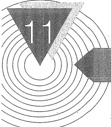

### 直流稳压电源

## 引言

由前述章节看到，许多电子电路都需要直流工作电源，如何将220 V交流电网电压转变为稳定合适的直流电压是本章讨论的问题。小功率线性稳压电源的组成可以用图11.0.1a表示，它主要由电源变压器、整流、滤波和稳压电路四部分组成。电源变压器是将交流电网220 V的电压降为所需要的电压值，然后通过整流电路将交流电压变成脉动的直流电压。由于此电压还含有较大的纹波，必须通过滤波电路（电容C、电感L）加以滤除。但这样的电压还随电网电压波动（一般有±10%的波动）、负载和温度的变化而变化。为此在整流、滤波电路之后，还需要稳压电路以维持输出电压的稳定。

线性稳压电源输出电压稳定、纹波小、结构简单，但功率较小，且效率较低。为提高效率，可采用图11.0.1b所示的开关稳压电路。它先将220V交流电压直接整流、滤波后得到300多伏的直流电压，用其产生高频振荡及控制脉冲，驱动高频功率开关管，将直流逆变成高频方波电压，而后通过高频变压器降压、二次整流、滤波再转换成直流电压。取样电路监视输出电压，通过反馈控制使输出电压保持稳定。

与线性电源相比，开关电源的突出优点是效率高，时常不需要散热器，且高频变压器体积远

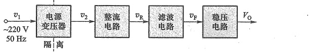

(a)
 

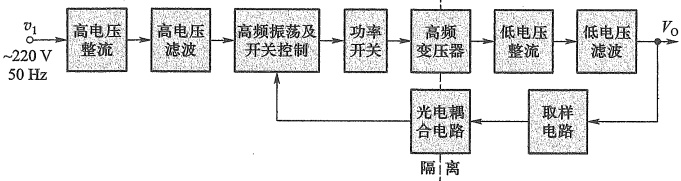

(b)
 

图 11.0.1 直流稳压电源结构图
 

（a）小功率线性电源 （b）开关电源
 

<!-- page: 471 -->

远小于工频变压器，因此电源体积可以做得很小，目前应用也极为广泛。但它电路复杂，纹波较大。另外两种电源的高、低压隔离位置也不同。

本章首先讨论小功率整流、滤波电路和线性串联型稳压电路，然后介绍三端集成线性稳压器和开关稳压电源的工作原理。

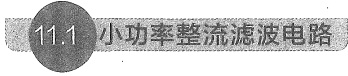

#### 11.1 小功率整流滤波电路

##### 11.1.1 单相桥式整流电路

整流电路的任务是将交流电变换成直流电。由第3章的内容可知，二极管的单向导电作用可以完成这一任务，因此二极管是构成整流电路的关键元件。在小功率整流电路中（1 kW以下），常见的几种整流电路有单相半波、全波、桥式和倍压整流电路。本节主要讨论单相桥式整流电路和滤波电路。

为简明起见，以下分析整流电路时，二极管均采用理想模型，即正向导通电阻为零，反向电阻为无穷大。

### 1. 工作原理

电路如图 11.1.1a 所示,图中 Tr 为电源变压器,它将交流电网电压  $ v_1 $ 变成整流电路所需要的交流电压  $ v_2 = \sqrt{2} V_2 \sin \omega t $,  $ R_L $ 是负载电阻,整流二极管  $ D_1 \sim D_4 $ 接成电桥的形式,因此称为桥式整流电路。图 11.1.1b 是它的简化画法。二极管  $ D_1 $、 $ D_2 $ 的连接处称共阴极,其为整流电压的正极性端,用“+”标记,即电流从此处流出,  $ D_3 $、 $ D_4 $ 连接处称共阳极,其为整流电压的负极性端,用“-”标记,其他两点接交流电源,用“~”标记。

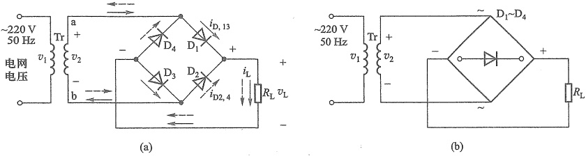

图 11.1.1 单相桥式整流电路图
 

（a）单相桥式整流电路 （b）简化画法
 

由二极管的单向导电性可知，在电源电压  $ v_{2} $ 的正半周（a 端为正，b 端为负时）内  $ D_{1}, D_{3} $ 导通， $ D_{2}, D_{4} $ 截止，电流通路如图 11.1.1a 中实线箭头所示，而在  $ v_{2} $ 负半周内  $ D_{2}, D_{4} $ 导通， $ D_{1}, D_{3} $ 截止，电流通路如图中虚线箭头所示，可见流过负载  $ R_{L} $ 的电流方向始终不变。

通过负载  $ R_{L} $ 的电流  $ i_{L} $ 以及电压  $ v_{L} $ 的波形如图 11.1.2 所示。显然，它们都是单方向的全波脉动波形。

<!-- page: 472 -->

2. 负载上的直流电压  $ V_{L} $ 和直流电流  $ I_{L} $ 的计算

对图 11.1.2 中  $ v_{L} $ 的波形进行傅里叶级数分解后可得

$$  V_{L}=\sqrt{2}V_{2}\left(\frac{2}{\pi}-\frac{4}{3\pi}\cos2\omega t-\frac{4}{15\pi}\cos4\omega t-\frac{4}{35\pi}\cos6\omega t\cdots\right)   \tag*{(11.1.1)}$$

式中直流分量即为负载电压 $ v_{L} $的平均值 $ V_{L} $，因此有

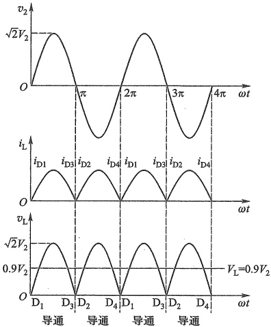

图 11.1.2 单相桥式整流电路电压、电流波形图
 

$$  V_{\mathrm{L}}=\frac{2\sqrt{2}V_{2}}{\pi}\approx0.9V_{2}   \tag*{(11.1.2)}$$

直流电流为

$$  I_{L}=\frac{0.9V_{2}}{R_{L}}   \tag*{(11.1.3)}$$

由式(11.1.1)看出，最低次(2次)谐波分量的幅值为 $ \frac{4\sqrt{2}V_{2}}{3\pi} $，角频率为电源频率的两倍，即 $ 2\omega $。其他交流分量的角频率为 $ 4\omega,6\omega\cdots\cdots $偶次谐波分量。这些谐波分量总称为纹波，其叠加于直流分量之上。常用纹波系数 $ K_{y} $来表示纹波电压相对直流输出电压的大小，即

$$  K_{\gamma}=\frac{V_{\mathrm{L}\gamma}}{V_{\mathrm{L}}}=\frac{\sqrt{V_{2}^{2}-V_{\mathrm{L}}^{2}}}{V_{\mathrm{L}}}   \tag*{(11.1.4)}$$

式中  $ V_{L_{y}} $ 为谐波电压总的有效值，它表示为

 $$ V_{\mathrm{L}\gamma}=\sqrt{V_{\mathrm{L}2}^{2}+V_{\mathrm{L}4}^{2}+\cdots}=\sqrt{V_{2}^{2}-V_{\mathrm{L}}^{2}} $$ 

式中  $ V_{L2} $， $ V_{L4} $ 为二次、四次谐波的有效值。由式(11.1.2)和式(11.1.4)得出桥式整流电路的

<!-- page: 473 -->

纹波系数  $ K_{y}=\sqrt{(1/0.9)^{2}-1}\approx0.484 $ 。由于  $ v_{L} $ 中存在较大的纹波，故需用滤波电路来滤除纹波电压。

### 3. 整流元件参数的计算

在桥式整流电路中，二极管  $ D_{1} $、 $ D_{3} $ 和  $ D_{2} $、 $ D_{4} $ 是两两轮流导通的，所以流经每个二极管的平均电流为负载电流的一半，即

$$  I_{\mathrm{D}}=-\frac{1}{2}I_{\mathrm{L}}=-\frac{0.45V_{2}}{R_{\mathrm{L}}}   \tag*{（11.1.5）}$$

二极管在截止时管子两端承受的最大反向电压可以从图11.1.1a看出。在 $ v_{2} $正半周时， $ D_{1} $、 $ D_{3} $导通、 $ D_{2} $、 $ D_{4} $截止。此时 $ D_{2} $、 $ D_{4} $所承受的最大反向电压均为 $ v_{2} $的最大值，即

$$  V_{RM}=\sqrt{2}V_{2}   \tag*{(11.1.6)}$$

同理，在  $ v_{2} $ 的负半周， $ D_{1} $、 $ D_{3} $ 也承受同样大小的反向电压。

一般电网电压波动范围为 $ \pm10\% $。实际上二极管的最大整流电流 $ I_{DM} $和最高反向电压 $ V_{RM} $应留有大于10%的余量。

桥式整流电路的优点是输出电压高，管子所承受的最大反向电压较低，同时因电源变压器在正、负半周内都有电流供给负载，电源变压器得到了充分的利用，效率较高。因此，这种电路在整流电路中得到了颇为广泛的应用。目前市场上已有集成电路整流桥堆出售，其正向电流有 0.5~20 A，最大反向电压  $ V_{RM} $ 为 25~1 000 V 等多种规格。如 QL51A~G、QL62A~L 等，其中 QL62A~L 的额定电流为 2 A，最大反向电压为 25~1 000 V。

##### 11.1.2 滤波电路

滤波电路用于滤除整流输出电压中的纹波，一般由电抗元件组成，如在负载电阻两端并

联电容 C，或在整流电路输出端与负载间串联电感 L，以及由电容、电感组合而成的各种复式滤波电路。常见的结构如图 11.1.3 所示，其中称图 a 为电容输入式，图 b 为电感输入式。电容输入式滤波电路多用于小功率电源中，而电感输入式滤波电路多用于较大功率电源中（而且当电流很大时仅用一电感与负载串联）。本节重点分析小功率整流电源中应用较多的电容滤波电路，然后再简要介绍其他形式的滤波电路。

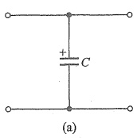

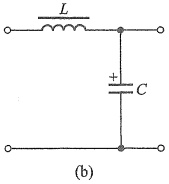

图 11.1.3 滤波电路的基本形式 （a）电容滤波电路 （b）倒L形滤波电路
 

### 1. 电容滤波电路

图 11.1.4 为单相桥式整流、电容滤波电路。在分析电容滤波电路时，要特别注意电容器两端电压  $ v_{c} $ 对二极管导电状态的影响，二极管只有受正向电压作用时才导通，否则便截止。

负载  $ R_{L} $ 未接入（开关 S 断开）时的情况：设电容器两端初始电压为零，接入交流电源后，当  $ v_{2} $ 为正半周时， $ v_{2} $ 通过  $ D_{1} $ 、 $ D_{3} $ 向电容器 C 充电； $ v_{2} $ 为负半周时，经  $ D_{2} $ 、 $ D_{4} $ 向电容器 C 充电。

<!-- page: 474 -->

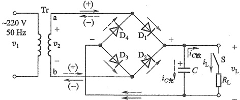

图 11.1.4 桥式整流、电容滤波电路
 

充电时间常数为

$$  \tau_{_{c}}=R_{_{int}}C   \tag*{(11.1.7)}$$

式中  $ R_{int} $ 包括变压器二次绕组的直流电阻和二极管的正向导通电阻。由于  $ R_{int} $ 一般很小，电容器很快就充电到交流电压  $ v_2 $ 的最大值  $ \sqrt{2}V_2 $，极性如图 11.1.4 所示。但是电容器无放电回路，故电容器 C 两端的电压  $ v_C $ 保持在  $ \sqrt{2}V_2 $，即输出为一个恒定的直流电压，如图 11.1.5 中  $ \omega t < 0 $ 部分所示。

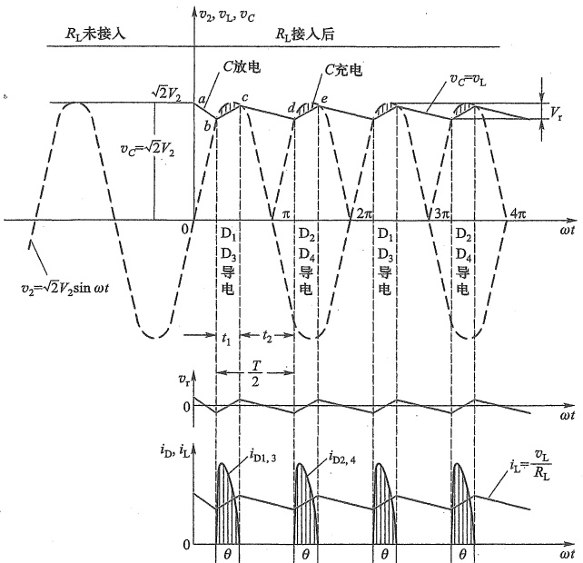

图 11.1.5 桥式整流、电容滤波时的电压、电流和纹波电压波形
 

接入负载  $ R_{L} $ (开关 S 合上) 的情况: 设变压器二次电压  $ v_{2} $ 从 0 开始上升（即正半周开始）

<!-- page: 475 -->

时接入负载  $ R_{L} $，由于负载接入前电容器已充满电压，故负载刚接入时， $ v_{2}<v_{c} $，原本应该导通的  $ D_{1} $、 $ D_{3} $ 也受反向电压作用而截止，电容器 C 经  $ R_{L} $ 放电，放电的时间常数为

$$  \tau_{d}=R_{L}C   \tag*{（11.1.8）}$$

因  $ \tau_{d} $ 一般较大，故电容两端的电压  $ v_{c} $ 按指数规律慢慢下降。其输出电压  $ v_{L}=v_{C} $，如图 11.1.5 的 ab 段所示。与此同时，交流电压  $ v_{2} $ 按正弦规律上升。当  $ v_{2}>v_{C} $ 时，二极管  $ D_{1} $、 $ D_{3} $ 受正向电压作用而导通，此时  $ v_{2} $ 经  $ D_{1} $、 $ D_{3} $ 一方面向负载  $ R_{L} $ 提供电流，另一方面向电容 C 充电（接入负载时的充电时间常数  $ \tau_{e}=(R_{L}\parallel R_{int})C\approx R_{int}C $ 很小 ( $ R_{int}\ll R_{L} $))， $ v_{C} $ 升高如图 11.1.5 中的 bc 段，bc 段上部的阴影分为电路中的电流在整流电路内阻  $ R_{int} $ 上产生的压降。 $ v_{C} $ 随着交流电压  $ v_{2} $ 升高到最大值  $ \sqrt{2}V_{2} $ 的附近。然后， $ v_{2} $ 又按正弦规律下降。当  $ v_{2}<v_{C} $ 时，二极管受反向电压作用而截止，电容 C 又经  $ R_{L} $ 放电， $ v_{C} $ 下降， $ v_{C} $ 波形如图 11.1.5 中的 cd 段。电容 C 如此周而复始地进行充放电，负载上便得到如图 11.1.5 所示的一个近似锯齿波的电压  $ v_{L} $，使负载电压的波动比无滤波电路时大为减小。电路的电压、电流和纹波电压  $ v_{r} $ 波形如图 11.1.5 所示。

由以上分析可知，电容滤波电路有如下特点。

（1）二极管的导电角  $ \theta<\pi $，流过二极管的瞬时电流很大，电流  $ i_{D1,3} $ 和  $ i_{D2,4} $ 如图 11.1.5 所示。电流的有效值和平均值的关系与波形有关，在平均值相同的情况下，波形越尖，有效值越大。在纯电阻负载时，根据式（11.1.3），变压器二次电流的有效值  $ I_{2}=V_{2}/R_{L}=1.11I_{L} $，而有电容滤波时，C 与  $ R_{L} $ 并联，等效阻抗减小，导致变压器二次绕组的电流增大，此时应选为

$$  I_{2}=\left(1.5\sim2\right)I_{L}   \tag*{(11.1.9a)}$$

因二极管的峰值电流很大，所以选择二极管的整流电流要留有充分的余地，一般选择为

$$  I_{\mathrm{D}}=\left(2\sim3\right)I_{\mathrm{L}}   \tag*{(11.1.9b)}$$

（2）负载平均电压  $ V_{L} $ 升高，纹波（交流成分）减小，且  $ R_{L}C $ 越大，电容放电速率越慢，则负载电压中的纹波成分越小，负载平均电压越高。

为了得到平滑的负载电压，一般取

$$  \tau_{d}=R_{L}C\geqslant(3\sim5)\frac{T}{2}   \tag*{(11.1.10)}$$

式中 T 为电源交流电压的周期。

（3）负载直流电压随负载电流增加 $ (R_{L} $减小)而减小。 $ V_{L} $随 $ I_{L} $的变化关系称为输出特性或外特性。如图11.1.6所示。

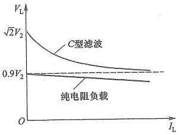

图 11.1.6 纯电阻  $ R_{L} $ 和具有电容滤波的桥式整流电路的输出特性
 

当  $ R_{L}=\infty $ ，即空载时（C值一定） $ \tau_{d}=\infty $ ，有

 $$ V_{L0}=\sqrt{2}V_{2}\approx1.4V_{2} $$ 

当 C=0，即无电容（纯电阻负载）时，有

$$  V_{L0}=0.9V_{2}   \tag*{(11.1.11)}$$

在整流电路的内阻不太大(几欧)和放电时间常数满足式(11.1.10)的关系时,电容滤波电路的负载电压  $ V_{L} $ 与  $ V_{2} $ 的关系为

$$  V_{L}=\left(1.1\sim1.2\right)V_{2}   \tag*{（11.1.12）}$$

<!-- page: 476 -->

二极管承受的最大反向电压  $ V_{RM} = \sqrt{2} V_{2} $，当考虑电网电压波动 10% 等因数影响，反向击穿电压应选为

$$  V_{BR}\geqslant2V_{2}   \tag*{（11.1.13）}$$

（4）纹波电压（ripple voltage） $ V_{r} $，由图11.1.5可知， $ V_{r} $为从峰值到放电结束时下降的电压，由于二极管导电时间很短 $ (t_{1} \ll T/2 $时)，C的放电时间近似为T/2，在放电结束时有

 $$ \sqrt{2}V_{2}-V_{r}\approx\sqrt{2}V_{2}\mathrm{e}^{-T/(2R_{\mathrm{L}}C)} $$ 

式中  $ 2R_{L}C\gg T $，利用  $ \mathrm{e}^{-T/(2R_{L}C)}\approx1-T/(2R_{L}C) $

$$  V_{r}=\sqrt{2}V_{2}\times\frac{T}{2R_{L}C}=\frac{\sqrt{2}V_{2}}{R_{L}}\times\frac{1}{2fC}=\frac{I_{L}}{2fC}   \tag*{(11.1.14)}$$

由式(11.1.14)可看出，要减小纹波电压值，滤波电容越大越好，交流电源频率越高越好。目前在计算机、电视机等电子设备中采用了高频整流电源，其滤波电容很小。

总之，电容滤波电路简单，负载直流电压  $ V_{L} $ 较高，纹波也较小，它的缺点是输出特性较差，故适用于负载电压较高、负载变动不大的场合。

### 2. 电感滤波电路

在桥式整流电路和负载电阻  $ R_{L} $ 之间串入一个电感 L，如图 11.1.7 所示。当通过电感线圈的电流增加时，电感线圈产生自感电动势  $ e_{L} $（左“+”右“-”）阻止电流增加，同时将一部分电能转化为磁场能量储存于电感中；当电流减小时，自感电动势  $ e_{L} $（左“-”右“+”）阻止电流减小，同时将电感中的磁场能量释放出来，以补偿电流的减小。此时整流二极管 D 依然导电，导电角  $ \theta $ 增大，使  $ \theta = \pi $。利用电感的储能作用可以减小输出电压和电流的纹波，从而得到比较平滑的直流。当忽略电感 L 的电阻时，负载上的平均电压和无电感时相同，即  $ V_{L} = 0.9V_{2} $。

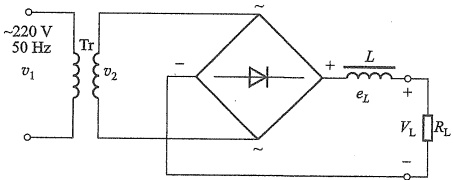

图 11.1.7 桥式整流、电感滤波电路
 

应当指出，要保证电感滤波电路中电流的连续性，需要满足  $ \omega L \gg R_{L} $，也就是电感储存的能量可维持负载电流连续，此时负载上的平均电流为  $ I_{L} = 0.9 V_{2}/R_{L} $。

电感滤波的特点是，二极管的导电角大（单相整流  $ \theta=\pi $，电感 L 的反电动势使整流管导电角增大），无峰值电流，输出电压脉动小，输出特性比较平坦。其缺点是由于铁心的存在，笨重、体积大，易引起电磁干扰。一般只适用于低电压、大电流且电流变化较大的场合。

此外，为了进一步减小负载电压中的纹波，在电感后面可再接一电容构成倒L形滤波电路，如图11.1.3b所示，它普遍用于开关电源中。与用于线性电源不同的是，在开关电源中滤除的是几十千赫到几百千赫的高频交流量，而不是工频交流量，所需电感量较小，所以

<!-- page: 477 -->

电感体积很小。

例 11.1.1 单相桥式整流、电容滤波电路如图 11.1.4 所示。已知交流电源电压幅值为 220 V，频率为 50 Hz，要求直流电压  $ V_{L}=30 ~V $，负载电流  $ I_{L}=50 ~mA $。试求电源变压器二次电压  $ v_{2} $ 的有效值；选择整流二极管及滤波电容器。

##### 解：（1）变压器二次电压有效值

由式 $  (11.1.12)  $，取 $ V_{L}=1.2V_{2} $，则

 $$ V_{2}=30/1.2\ V=25\ V $$ 

##### （2）选择整流二极管

流经二极管的平均电流根据  $ I_{D}=(2\sim3)I_{L} $，可算出

 $$ I_{d}=\left(2\sim3\right)\times50\mathrm{~m A}=100\sim150\mathrm{~m A} $$ 

二极管承受的最大反向电压  $ V_{RM} = \sqrt{2} V_2 \approx 35 V $，反向击穿电压应为

 $$ V_{BR}\geqslant2V_{2}=50V $$ 

因此，可选用 2CZ54C 整流二极管（其允许最大电流  $ I_{F}=500 $ mA，最大反向电压  $ V_{RM}=100 $ V），也可选用硅桥堆 QL51-Ⅰ型（ $ I_{F}=500 $ mA， $ V_{RM}=100 $ V）。

##### （3）选择滤波电容器

负载电阻

 $$ R_{L}=\frac{V_{L}}{I_{L}}=\frac{30}{50}\mathrm{~k}\Omega=0.6\mathrm{~k}\Omega $$ 

由式(11.1.10)，取  $ R_{L}C=4\times\frac{T}{2}=2T=2\times\frac{1}{50} $ s=0.04 s。由此得滤波电容

 $$ C=\frac{0.04}{R_{L}}=\frac{0.04}{600}\mathrm{~F}=66.7\mu\mathrm{F} $$ 

若考虑电网电压波动 $ \pm10\% $，则电容器承受的最高电压为

 $$ V_{cm}=\sqrt{2}V_{2}\times1.1\approx(1.4\times25\times1.1)V=38.5V $$ 

选用标称值为 100 μF/50 V 的电解电容器。

#####  $ ^{*}11.1.3 $ 倍压整流电路

利用滤波电容对电荷的存储作用，当负载电流很小时，由多个电容和二极管可以获得几

倍于变压器二次电压的直流电压，具有这种功能的整流电路称为倍压整流电路。

图11.1.8所示为二倍压整流电路，变压器二次电压 $ v_{2}=\sqrt{2}V_{2}\sin\omega t $，当 $ v_{2} $处于正半周时， $ D_{1} $导通、 $ D_{2} $截止， $ v_{2} $向电容器 $ C_{1} $充电，电压极性为右正左负，峰值电压可达 $ \sqrt{2}V_{2} $；当 $ v_{2} $处于负半周时， $ D_{1} $截止， $ D_{2} $导通，电压 $ v_{2}+V_{c1} $（ $ C_{1} $两端电压）向电容器 $ C_{2} $充电，电压极性为右正左负，峰值电压为 $ 2\sqrt{2}V_{2} $，即 $ V_{0}=V_{c2}= $

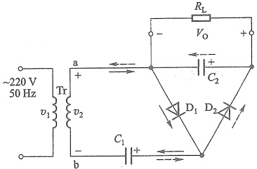

图 11.1.8 倍压整流电路
 

<!-- page: 478 -->

$ 2\sqrt{2}V_{2} $，故图11.1.8的电路为二倍压整流电路。上述结果的条件是 $ C_{2} $的放电时间常数远大于电源电压周期，即 $ \tau=R_{L}C_{2}\gg T $。分析此类电路总假设电路空载 $ (R_{L}=\infty) $。如果接上负载，输出电压会有所下降，且电压纹波增加。

通常该电路中的二极管承受的最大反向电压大于  $ 2\sqrt{2}V_{2} $。 $ C_{1} $ 的耐压大于  $ \sqrt{2}V_{2} $， $ C_{2} $ 的耐压应大于  $ 2\sqrt{2}V_{2} $。当在图 11.1.8 所示电路中再增加连接的级数，可得到更高倍数的输出电压，但电路的内阻和流过二极管的峰值电流将随级数的增加而增加，尤其是通电瞬间峰值电流更大，故倍压整流电路所使用的二极管必须耐受更大的冲击电流。倍压整流电路一般用于高电压、小电流（几毫安以下）和负载变化不大的直流电源中。

##### 复习思考题

11.1.1 整流二极管的反向电阻不够大，而正向电阻较大时，对整流效果会产生什么影响？

11.1.2 电路如图11.1.1所示，试分析该电路出现下述故障时，电路会出现什么现象：

（1）二极管  $ D_{1} $ 的正负极性接反；（2） $ D_{1} $ 击穿短路；（3） $ D_{1} $ 开路。

11.1.3 在整流滤波电路中，采用滤波电路的主要目的是什么？就其结构而言，滤波电路有电容输入式和电感输入式两种，各有什么特点？各应用于何种场合？图11.1.4、图11.1.7和图11.1.3a、b各属于何种滤波电路？

11.1.4 电路如图11.1.4所示， $ v_{2} $ 的有效值  $ V_{2}=20~V $。（1） $ R_{L} $ 和 C 增大时，输出电压是增大还是减小？为什么？（2）在  $ R_{L}C=(3\sim5)\frac{T}{2} $ 时，输出电压  $ V_{L} $ 与  $ V_{2} $ 的近似关系如何？（3）若将二极管  $ D_{1} $ 和负载电阻  $ R_{L} $ 分别断开，各对  $ V_{L} $ 有什么影响？（4）若 C 断开时， $ V_{L}=? $

（3）若将二极管  $ D_{1} $ 和负载电阻  $ R_{L} $ 分别断开，各对  $ V_{L} $ 有什么影响？（4）若 C 断开时， $ V_{L}=? $

（5）当要求  $ V_{L}=25\ V, I_{L}=40\ mA $，应如何选二极管和电容？

11.1.5 电容滤波电路中二极管的导通角  $ \theta $ 与哪些因素有关？电感滤波电路中的导通角  $ \theta = \pi $ 的条件是什么？

11.1.6 若需要实现3倍压整流，试画出该电路并利用SPICE仿真其输出波形。

#### 11.2 线性稳压电路

线性稳压电路分为串联型和并联型两类，最简单的并联型是由齐纳二极管与负载并联的稳压电路，这在第3章已做了介绍。本节主要介绍串联型线性稳压电路。

##### 11.2.1 线性串联反馈式稳压电路

### 1. 输出电压固定的稳压电路

图 11.2.1 是串联反馈式稳压电路的一般原理图，电路可划分为如图点画线分割的四部分。实际上，如果将  $ V_{REF} $ 看作输入信号， $ V_{0} $ 为输出信号， $ V_{1} $ 为工作电源，那么 EA、T 和  $ R_{1} $、 $ R_{2} $ 组成的电路就是典型的反馈放大电路，其中  $ R_{1} $ 与  $ R_{2} $ 引入了电压串联负反馈。但作为稳压电路， $ V_{REF} $ 并非输入信号，而是由齐纳二极管  $ D_{z} $ 与限流电阻 R 串联产生的恒定基准电压，从而使输出  $ V_{0} $ 也为恒定的直流电压。 $ V_{1} $ 则是 11.1 节介绍的整流滤波电路的输出电压。

<!-- page: 479 -->

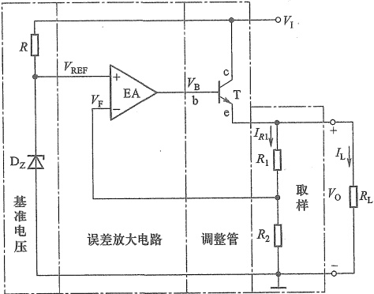

图 11.2.1 串联反馈式稳压电路一般结构图
 

电压负反馈可以稳定输出电压。该稳压电路正是通过这种深度的电压负反馈实现稳压的，具体稳压过程简述如下：当电网电压波动导致输入电压  $ V_{I} $ 增加，或负载电阻增大使输出电压  $ V_{0} $ 增加时，反馈电压  $ V_{F} $ 也增加，但是基准电压  $ V_{REF} $ 维持不变，而  $ V_{F} $ 接入的是 EA 的反相端，因此使 EA 输出减小，即  $ V_{B} $ 和  $ I_{C} $ 减小，限制了  $ V_{0} $ 的增加，从而维持  $ V_{0} $ 基本恒定。其反馈控制过程可简单表示如下：

 $$ \begin{array}{c}V_{\mathrm{I}}\uparrow\\R_{\mathrm{L}}\uparrow\\\end{array}\stackrel{\leftarrow}{=}V_{\mathrm{O}}\uparrow\xrightarrow{\quad}V_{\mathrm{F}}\left(V_{\mathrm{n}}\right)\quad\uparrow\rightarrow\quad\left(V_{\mathrm{REF}}-V_{\mathrm{F}}\right)\quad\downarrow\rightarrow V_{\mathrm{B}}\downarrow\quad\downarrow\quad\downarrow\quad\downarrow\quad\downarrow\quad\downarrow\quad\downarrow\quad\downarrow $$ 

同理，当输入电压  $ V_{1} $ 减小或负载电阻  $ R_{L} $ 减小使  $ V_{0} $ 减小时，通过负反馈亦将使输出电压基本保持不变。而且反馈越深，调整作用越强，输出电压  $ V_{0} $ 也越稳定，电路的输出电阻  $ R_{0} $ 也越小。

这里可能会有疑问，既然  $ V_{REF} $ 已经是恒定电压，直接做稳压输出就行，为什么还要后面的电路呢？这是因为齐纳二极管的工作电流有限，通常无法满足负载对电流的要求，就需要通过功率三极管提高输出电流。

以上看到， $ V_{1} $变化  $ V_{0} $不变时，变化量由 T 的  $ V_{CE} $ 承担了，所以称三极管 T 为调整管。这里调整管 T 与负载串联，故称为串联式稳压电路。另外，要使反馈控制起作用，电路中的 EA 和 T 必须工作在线性区，所以该电路也称为线性稳压电路。

利用误差放大器输入端的虚短和虚断，可得输出电压为

$$  V_{0}=V_{REF}\left(1+\frac{R_{1}}{R_{2}}\right)   \tag*{（11.2.1）}$$

实际上，图11.2.1中的误差放大器EA也需有直流供电电源，通常取自 $ V_{1} $

### 2. 输出电压可调的稳压电路

如果将图 11.2.1 所示电路的取样部分置于点画线框的外部，如图 11.2.2 所示，并将反

<!-- page: 480 -->

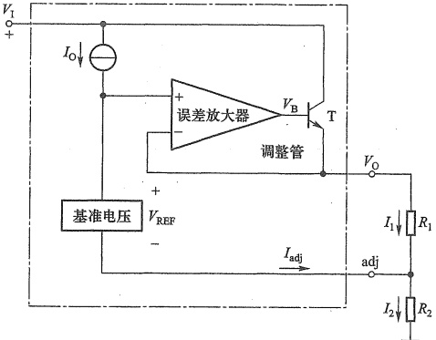

图 11.2.2 输出电压可调的电路结构图
 

馈信号  $ V_{F} $ 直接取自输出电压  $ V_{0} $，基准电压下端作为调整端引出，便可构成输出电压可调的稳压电路。

利用误差放大器输入端的虚短，可得输出电压为

$$  \begin{aligned}V_{0}&=V_{\mathrm{REF}}+I_{2}R_{2}=V_{\mathrm{REF}}+\left(\frac{V_{\mathrm{REF}}}{R_{1}}+I_{\mathrm{adj}}\right)R_{2}\\&=V_{\mathrm{REF}}\left(1+\frac{R_{2}}{R_{1}}\right)+I_{\mathrm{adj}}R_{2}\end{aligned}   \tag*{（11.2.2）}$$

可见，通过调整  $ R_{2} $ 和  $ R_{1} $ 的比值，就可以调整输出电压  $ V_{0} $ 的大小。也可以串入电位器，实现输出电压连续可调。

 $ R_{1} $ 和  $ R_{2} $ 除了用于调整  $ V_{0} $ 的值外，还为稳压器在空载时提供静态电流通路，所以它们又称空载偏置电阻，一般建议通过  $ R_{1} $ 的电流  $ I_{1}=5\ mA $，且通常有  $ I_{adj} \ll I_{1} $，此时可以忽略式 (11.2.2) 中的第二项。

### 3. 低压差稳压电路

无论是输出固定还是输出可调的稳压电路，由于调整管工作于放大区，为了保证具有一定的调整范围，输入和输出电压的差值通常要大于2V，但是在很多应用中，这个2V是一个较为严重的限制。例如在数字逻辑电路中，我们需要稳定的直流输出是3.3V，但是输入直流电压只有5V，或者需要稳定的输出是2.5V，但是输入只有3.3V，即无法满足输入和输出压差的要求。另外，这个压差也是导致调整管功耗较大，稳压电路效率较低的根本原因。因此，低压差（low dropout，LDO）稳压电路应运而生。

采用 PMOS 管的 LDO 基本电路如图 11.2.3a 所示。电路由增强型 PMOS 管  $ T_1 $、误差放大器  $ A_1 $、基准电压  $ V_{REF} $ 和取样电路  $ R_1 $、 $ R_2 $ 构成。与图 11.2.1 所示电路类似，这里依然是通过电压串联负反馈实现稳压的。所不同的是， $ V_1 $ 与  $ V_0 $ 的压差可以很小，即  $ \left| V_{DS} \right| $ 可能小到出现满足可变电阻区的工作条件： $ V_{DS} > V_{GS} - V_{TP} $（注意式中电压都是负值），这时  $ T_1 $ 工作在可变电阻区，其稳压原理如下：

<!-- page: 481 -->

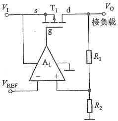

(a)
 

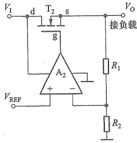

(b)
 

图 11.2.3 LDO 基本电路
 

(a) PMOS LDO (b) NMOS LDO
 

当负载电阻减小或输入电压  $ V_{1} $ 降低导致输出电压  $ V_{0} $ 下降时，通过反馈使误差放大器  $ A_{1} $ 的输出拉低  $ T_{1} $ 的栅极电压，使  $ \left|V_{GS}\right| $ 增大，从而减小漏源电阻  $ R_{DS} $，导致其压降  $ \left|V_{DS}\right| $ 减小，因而限制了输出电压的减小。如果某种原因使  $ V_{0} $ 升高，调节过程则相反。

当  $ V_{1} $ 与  $ V_{0} $ 有较大压差时， $ T_{1} $ 可能工作在恒流区，稳压原理与 11.2.1 所示电路相同，不再赘述。

但是由于  $ A_{1} $ 的工作电源下轨接地，它的输出也就是  $ T_{1} $ 的栅极电压不会低于 0 V，这就要求  $ T_{1} $ 的源极电压必须大于一定的值，满足  $ \left|V_{GS}\right|>\left|V_{TP}\right| $，才能使  $ T_{1} $ 导通，因此这种以 P 沟道 MOSFET 为调整管的 LDO 电路要求  $ V_{1}>\left|V_{TP}\right| $，一般  $ V_{1} $ 最低约为 2.5 V。

在某些应用中，可能需要用非常低的电压来驱动 LDO 电路，这时可以选用以 N 沟道 MOSFET 为调整管的 LDO 稳压电路，如图 11.2.3b 所示。通过反馈电路的分析方法可知，该电路依然构成电压串联负反馈。这里要求调整管  $ T_2 $ 的栅极电压  $ V_G $ 满足  $ V_G - V_0 > V_{TN} $，才能使  $ T_2 $ 导通。当  $ V_1 $ 较低时， $ A_2 $ 就不能再用  $ V_1 $ 作工作电源了，否则就无法提供足够高的  $ V_G $ 电压。这时要由 LDO 内部电荷泵电路或外部输入高电压为  $ A_2 $ 供电。这种 LDO 稳压电路的输入电压可以低至 1 V。

图 11.2.3 所示 LDO 电路的输出电压表达式与式(11.2.1)相同。也有输出电压可调的 LDO 稳压电路。

#### 11.2.2 线性集成稳压器及其应用举例

### 1. 集成稳压器简介及主要参数

将图11.2.1所示点画线内全部电路集成在一个芯片上，封装后仅引出输入 $ V_{1} $、输出 $ V_{0} $和接地 $ \bot $（公共端）三个引脚，便是目前常用的、输出电压固定的线性集成三端稳压器。它的常见外形图和框图如图11.2.4所示。需要注意，不同封装形式和不同制造商，器件的引脚排列也不尽相同，使用时应查阅器件手册。

固定输出的三端集成稳压器常以  $ 78 \times \times $（正电源）和  $ 79 \times \times $（负电源）来命名。其中后两个数字“××”表示稳压的输出电压幅值，如 7805 表示输出 +5 V 的直流电压。其额定电流一般用 78 或 79 后面所加的字母来表示，L 表示 0.1 A，M 表示 0.5 A，没有字母表示 1.5 A。当

<!-- page: 482 -->

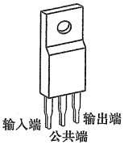

(a)
 

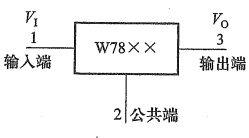

(b)
 

图 11.2.4 78L××型输出电压固定的三端集成稳压器 (a) 常见封装外形图 (b) 方框图
 

然，使用时还是要以数据手册给出的参数为准。

LM317 则是采用图 11.2.2 所示原理电路的输出电压可调的集成三端稳压器。它的  $ V_{REF}=1.25\ V $,  $ I_{adj}=50\ \mu A $, 由于  $ I_{adj} \ll I_1 $, 故式 (11.2.2) 可简化为

$$  V_{0}=V_{\mathrm{REF}}\left(1+\frac{R_{2}}{R_{1}}\right)\approx1.25\mathrm{V}\times\left(1+\frac{R_{2}}{R_{1}}\right)   \tag*{(11.2.3)}$$

LM337是与LM317对应的负电压三端可调集成稳压器。可调式三端稳压器的特点是输出电压连续可调，调节范围较宽，且电压调整率 $ ^{①} $、电流调整率 $ ^{②} $等指标优于固定式三端稳压器。

LDO 集成稳压器属于新型线性集成稳压器，具有功耗低，效率高的优点，广泛用于低噪声、低功耗应用电路的供电。而且常常设有工作和关断控制端，使用灵活方便，所以引脚数通常多于3个。

表11.2.1列出了几款集成稳压器及其主要性能指标，更多详情请参阅它们的数据手册。

表 11.2.1 几款集成稳压器及其主要性能指标（未做特别说明，表中参数均为典型值）
 

<table border=1 style='margin: auto; word-wrap: break-word;'><tr><td style='text-align: center; word-wrap: break-word;'>参数\n型号</td><td style='text-align: center; word-wrap: break-word;'>LM7805\n(输出固定)</td><td style='text-align: center; word-wrap: break-word;'>LM7905\n(输出固定)</td><td style='text-align: center; word-wrap: break-word;'>LM317\n(输出可调)</td><td style='text-align: center; word-wrap: break-word;'>LM337\n(输出可调)</td><td style='text-align: center; word-wrap: break-word;'>LT3080\n(LDO 输出可调)</td><td style='text-align: center; word-wrap: break-word;'>TPS79901\n(LDO 输出可调)</td></tr><tr><td style='text-align: center; word-wrap: break-word;'>输入电压  $ V_{{1}}/V $</td><td style='text-align: center; word-wrap: break-word;'>7~35</td><td style='text-align: center; word-wrap: break-word;'>-35~-7</td><td style='text-align: center; word-wrap: break-word;'>3~40</td><td style='text-align: center; word-wrap: break-word;'>-40~-3</td><td style='text-align: center; word-wrap: break-word;'>1.2~36</td><td style='text-align: center; word-wrap: break-word;'>2.7~6.5</td></tr><tr><td style='text-align: center; word-wrap: break-word;'>输出电压  $ V_{{0}}/V $</td><td style='text-align: center; word-wrap: break-word;'>5</td><td style='text-align: center; word-wrap: break-word;'>-5</td><td style='text-align: center; word-wrap: break-word;'>1.3~37</td><td style='text-align: center; word-wrap: break-word;'>-37~-1.3</td><td style='text-align: center; word-wrap: break-word;'>0~35</td><td style='text-align: center; word-wrap: break-word;'>1.2~6.4</td></tr><tr><td style='text-align: center; word-wrap: break-word;'>最小输入输出电压差\n $ | (V_{{1}}-V_{{0}})|_{\text{min}}/V $</td><td style='text-align: center; word-wrap: break-word;'>2</td><td style='text-align: center; word-wrap: break-word;'>2</td><td style='text-align: center; word-wrap: break-word;'></td><td style='text-align: center; word-wrap: break-word;'></td><td style='text-align: center; word-wrap: break-word;'>0.3</td><td style='text-align: center; word-wrap: break-word;'>0.1</td></tr></table>

<!-- page: 483 -->

续表
 

<table border=1 style='margin: auto; word-wrap: break-word;'><tr><td colspan="2">参数 型号</td><td style='text-align: center; word-wrap: break-word;'>LM7805 (输出固定)</td><td style='text-align: center; word-wrap: break-word;'>LM7905 (输出固定)</td><td style='text-align: center; word-wrap: break-word;'>LM317 (输出可调)</td><td style='text-align: center; word-wrap: break-word;'>LM337 (输出可调)</td><td style='text-align: center; word-wrap: break-word;'>LT3080 (LDO 输出可调)</td><td style='text-align: center; word-wrap: break-word;'>TPS79901 (LDO 输出可调)</td></tr><tr><td rowspan="2">电压调整率</td><td style='text-align: center; word-wrap: break-word;'>$ \Delta V_o/mV $</td><td style='text-align: center; word-wrap: break-word;'>4</td><td style='text-align: center; word-wrap: break-word;'>8</td><td style='text-align: center; word-wrap: break-word;'></td><td style='text-align: center; word-wrap: break-word;'></td><td style='text-align: center; word-wrap: break-word;'></td><td style='text-align: center; word-wrap: break-word;'></td></tr><tr><td style='text-align: center; word-wrap: break-word;'>$ S_v/% $</td><td style='text-align: center; word-wrap: break-word;'></td><td style='text-align: center; word-wrap: break-word;'></td><td style='text-align: center; word-wrap: break-word;'>0.01</td><td style='text-align: center; word-wrap: break-word;'>0.02</td><td style='text-align: center; word-wrap: break-word;'>0.003</td><td style='text-align: center; word-wrap: break-word;'>0.02</td></tr><tr><td rowspan="2">负载调整率</td><td style='text-align: center; word-wrap: break-word;'>$ \Delta V_o/mV $</td><td style='text-align: center; word-wrap: break-word;'>4</td><td style='text-align: center; word-wrap: break-word;'>3</td><td style='text-align: center; word-wrap: break-word;'></td><td style='text-align: center; word-wrap: break-word;'></td><td style='text-align: center; word-wrap: break-word;'>0.6</td><td style='text-align: center; word-wrap: break-word;'></td></tr><tr><td style='text-align: center; word-wrap: break-word;'>$ S_f/% $</td><td style='text-align: center; word-wrap: break-word;'></td><td style='text-align: center; word-wrap: break-word;'></td><td style='text-align: center; word-wrap: break-word;'>0.1</td><td style='text-align: center; word-wrap: break-word;'>0.3</td><td style='text-align: center; word-wrap: break-word;'></td><td style='text-align: center; word-wrap: break-word;'>0.002</td></tr><tr><td colspan="2">纹波抑制比 $ ^{1} $RR/dB</td><td style='text-align: center; word-wrap: break-word;'>73</td><td style='text-align: center; word-wrap: break-word;'>60</td><td style='text-align: center; word-wrap: break-word;'>80</td><td style='text-align: center; word-wrap: break-word;'>77</td><td style='text-align: center; word-wrap: break-word;'>75</td><td style='text-align: center; word-wrap: break-word;'></td></tr><tr><td colspan="2">输出电流  $ I_o/A $</td><td style='text-align: center; word-wrap: break-word;'>1</td><td style='text-align: center; word-wrap: break-word;'>1</td><td style='text-align: center; word-wrap: break-word;'>1</td><td style='text-align: center; word-wrap: break-word;'>1</td><td style='text-align: center; word-wrap: break-word;'>1.1</td><td style='text-align: center; word-wrap: break-word;'>0.4</td></tr><tr><td colspan="2">调整电流  $ I_{adj}/mA $</td><td style='text-align: center; word-wrap: break-word;'></td><td style='text-align: center; word-wrap: break-word;'></td><td style='text-align: center; word-wrap: break-word;'>50</td><td style='text-align: center; word-wrap: break-word;'>65</td><td style='text-align: center; word-wrap: break-word;'></td><td style='text-align: center; word-wrap: break-word;'></td></tr><tr><td colspan="2">输出噪声电压  $ V_n/\mu V $</td><td style='text-align: center; word-wrap: break-word;'>42</td><td style='text-align: center; word-wrap: break-word;'>40</td><td style='text-align: center; word-wrap: break-word;'></td><td style='text-align: center; word-wrap: break-word;'></td><td style='text-align: center; word-wrap: break-word;'>40</td><td style='text-align: center; word-wrap: break-word;'>70</td></tr><tr><td colspan="2">静态电流  $ I_Q/mA $</td><td style='text-align: center; word-wrap: break-word;'>5</td><td style='text-align: center; word-wrap: break-word;'>3</td><td style='text-align: center; word-wrap: break-word;'></td><td style='text-align: center; word-wrap: break-word;'></td><td style='text-align: center; word-wrap: break-word;'></td><td style='text-align: center; word-wrap: break-word;'>0.04</td></tr><tr><td colspan="2">温度系数  $ S_r/(mV \cdot °C^{-1}) $</td><td style='text-align: center; word-wrap: break-word;'>-0.8</td><td style='text-align: center; word-wrap: break-word;'>-0.4</td><td style='text-align: center; word-wrap: break-word;'></td><td style='text-align: center; word-wrap: break-word;'></td><td style='text-align: center; word-wrap: break-word;'></td><td style='text-align: center; word-wrap: break-word;'></td></tr></table>

①用输入电压纹波的峰-峰值 $ \widetilde{V}_{lrp-p} $与输出电压纹波的峰-峰值 $ \widetilde{V}_{0rp-p} $之比的分贝数表示，即 $ RR=20\lg(\widetilde{V}_{lrp-p}/\widetilde{V}_{0rp-p}) $ dB。

### 2. 应用举例

##### （1）固定式三端稳压器应用

图 11.2.5a 为 78L××构成的输出电压固定的典型稳压电路，正常工作时，输入、输出电压差为 2~3 V。电路中靠近引脚处接入瓷介质电容  $ C_{1} $、 $ C_{2} $ 用来实现频率补偿，防止稳压器产生高频自激振荡和抑制电路引入的高频干扰， $ C_{3} $ 是电解电容，以减小由输入电源引入的低频干扰。D 是保护二极管，当输入端异常短路时，为  $ C_{3} $ 提供一个放电通路，防止  $ C_{3} $ 电压使稳压器的输出端电压高于输入端电压，导致稳压器内部调整管反向击穿而损坏。

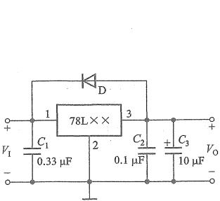

(a)
 

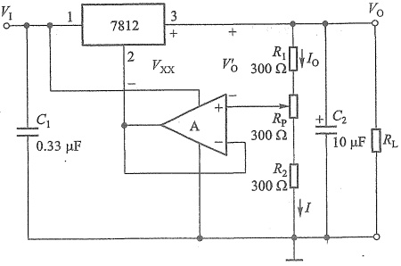

(b)
 

图 11.2.5 稳压器应用举例
 

（a）三端稳压器的典型接法 （b）输出电压可调的稳压电路
 

<!-- page: 484 -->

在增加一定的辅助电路后，固定式三端稳压器也可以实现可调的稳压输出，如图11.2.5b所示。其中运放A构成电压跟随器，7812的输出电压是固定的，即 $ V_{xx}=V_{32}=12\ V $。考虑到A输入端的虚短和虚断，得知 $ V_{0} $与A同相端的差值电压 $ V_{0}^{\prime}=V_{xx} $也固定不变，这样，当调节 $ R_{p} $的动端位置时，输出电压随之变化，其调节范围为

 $$ V_{\mathrm{o_{m i n}}}=\frac{R_{1}+R_{\mathrm{p}}+R_{2}}{R_{1}+R_{\mathrm{p}}}V_{\mathrm{x x}}\;;\quad V_{\mathrm{o_{m a x}}}=\frac{R_{1}+R_{\mathrm{p}}+R_{2}}{R_{1}}V_{\mathrm{x x}} $$ 

设  $ R_{1}=R_{P}=R_{2}=300\ \Omega $ 时，则输出电压的调节范围为 18~36 V。设计电路时可根据输出电压调节范围和输出电流的大小选择合适的三端稳压器、运放 A 以及取样电阻  $ R_{1} $、 $ R_{P} $ 和  $ R_{2} $ 的值。

例 11.2.1 小功率直流稳压电源如图 11.2.6 所示。（1）电路两输出端对地的直流电压是多少？（2）若 7815、7915 输入与输出的最小电压差为 2.5 V，则  $ v_{2} $ 的有效值不应小于多少？（3）若考虑到交流电网电压有  $ \pm10\% $ 的波动，则  $ v_{2} $ 的有效值不应小于多少？（4）一般情况下， $ C_{1} $、 $ C_{2} $ 的电容值越大越好，还是越小越好？为什么？

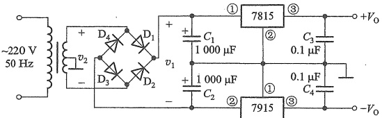

图 11.2.6 例 11.2.1 的电路
 

解：（1）图示电路采用了集成三端稳压器7815和7915，因此电路的两个输出端对地电压 $ +V_{0}=+15\ V,-V_{0}=-15\ V $。

（2）若稳压器的输入与输出最小电压差为2.5 V，则7815输入端电压至少为：15 V+2.5 V=17.5 V，7915输入端电压至少为-15 V+(-2.5 V)=-17.5 V，则 $ V_{1}=17.5\ V-(-17.5\ V)=35\ V $，因此由式(11.1.12)可知， $ v_{2} $的有效值不应小于（这里取系数为1.2计算）

 $$ V_{2}=V_{1}/1.2\mathrm{~V}\approx29\mathrm{~V} $$ 

（3）若交流电网电压有 $ \pm10\% $的波动，即变压器二次电压只有原来的90%时，仍能实现稳压，此时 $ v_{2} $的有效值不应小于（这里取系数为1.2计算）

 $$ V_{2}\left[V_{1}/1.2\right]/0.9V\approx32V $$ 

（4）为了获得尽可能平滑的滤波效果，一般  $ C_{1} $ 、 $ C_{2} $ 的电容值越大越好。

##### （2）可调式三端稳压器应用

这类稳压器是依靠外接电阻来调节输出电压的，为保证输出电压的精度和稳定性，要选择精度高的电阻，同时电阻要紧靠稳压器，防止输出电流在连线电阻上产生误差电压。图11.2.7所示为可调式三端稳压器的典型应用电路，其中图a是由LM117和LM137组成的正、负输出电压可调的稳压电路。稳压器的 $ V_{21} = -V_{31} = V_{REF} = 1.25\ V $，当 $ I_1 = 5 \sim 10\ mA $时， $ R_1 = R'_1 = 120 \sim 240\ \Omega $，为保证空载情况下输出电压稳定， $ R_1 $和 $ R'_1 $不宜高于240 $ \Omega $。 $ R_2 $和 $ R'_2 $的大小根据输出电压调节范围确定。该电路的输入电压分别为+25V和-25V，输出电压可调范围为 $ \pm(1.25 \sim 20) $V。

<!-- page: 485 -->

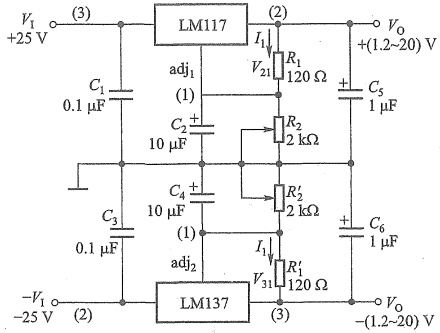

(a)
 

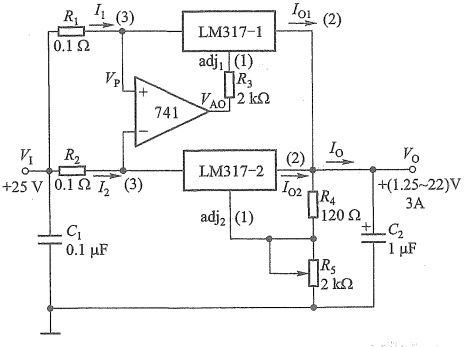

(b)
 

图 11.2.7 可调式三端稳压器的应用电路
 

（a）输出正、负电压可调的稳压电路 （b）并联扩流的稳压电路
 

当单个稳压器不能满足输出电流要求时，可以采用两个稳压器并联实现扩流，电路如图11.2.7b所示。它由两个可调式稳压器 LM317 组成，输入电压  $ V_1 = 25\ V $，输出电流  $ I_0 \approx I_{01} + I_{02} = 3\ A $，输出电压可调范围为 1.25~22 V。电路中的运放 741 用来平衡两稳压器的输出电流。如果 LM317-1 输出电流  $ I_{01} $ 大于 LM317-2 输出电流  $ I_{02} $ 时，电阻  $ R_1 $ 上的电压降增加，运放的同相端电位  $ V_p = (V_1 - I_1 R_1) $ 降低，运放输出端电压  $ V_{A0} $ 降低，通过调整端  $ adj_1 $ 使 LM317-1 内部的  $ V_B $（参见图 11.2.2）下降，从而减小  $ I_{01} $，恢复平衡；反之亦然。改变电阻  $ R_5 $ 可调节输出电压的数值。

可调式三端稳压器的应用形式是多种多样的，只要能维持输出端与调整端之间的电压恒定并控制调整端电压，就不难设计出各种应用电路。

##### （3）LDO稳压器应用

TPS79901为可调式LDO集成稳压器。具有高电源抑制比（PSRR）、低噪声、快速启动

<!-- page: 486 -->

特性, 同时具有极低的接地电流 (典型值  $ 40\ \mu A $)。

采用 TPS79901 提供可调输出的典型应用电路如图 11.2.8 所示，在输出 200 mA 电流时输入输出压差仅为 100 mV。

另外，TPS79901 具备关断（shutdown）使能控制端 EN，当该引脚被施加高电平时，会启动稳压器工作，而当 EN 为低电平

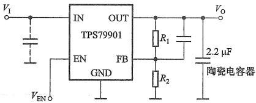

图 11.2.8 TPS79901 典型应用电路
 

时，稳压器停止工作，如果不使用此控制引脚，应该将其连接到输入电压  $ V_{1} $ 上。正常工作时，输出电压的值为： $ V_{0} = [(R_{1} + R_{2}) / R_{2}] \times 1.193 $，可调输出电压范围为 1.2~6.4 V。

此外，型号 TPS799××中××的具体数字表示稳压器固定输出的电压值，如 TPS79915、TPS79918、TPS79925、TPS79933 等分别是固定输出电压为 1.5 V、1.8 V、2.5 V 和 3.3 V 的 LDO 稳压器。

##### 复习思考题

11.2.1 整流滤波电路的输出电压不稳定的影响因素有哪些？

11.2.2 线性串联反馈式稳压电路的稳压原理是什么？调整管的主要作用是什么？调整管上的功耗如何计算？

11.2.3 在图11.2.1所示的电路中，若已知电路参数和基准电压  $ V_{REF} $ 时，求下列三种情况下的输出电压：（1） $ R_{1} $ 短路；（2） $ R_{2} $ 开路；（3） $ R_{1}=R_{2} $

11.2.4 在使用三端稳压器时，需要注意哪些问题？

11.2.5 某集成三端稳压器，在输入电压为 5 V 时，若稳定的输出电压为 2.5 V，则该稳压电路的效率约为多少？若想提高效率，有哪些途径？

#### 开关式稳压电路

传统的线性串联反馈式稳压电路的调整管工作在线性放大区，因此在负载电流较大时，调整管的损耗很大，电源效率较低，一般为40%～60%，有时还要配备庞大的工频电源变压器和散热装置，体积大且笨重，而LDO线性稳压器在宽输入电压范围的应用场合也将失去用武之地。开关式稳压电路则可以克服上述缺点。相对于线性稳压电源，开关式稳压电源有如下特点：

（1）开关稳压电路中的三极管主要工作在饱和导通和截止的开关状态，由于饱和导通时的管压降和截止时的管电流都很小，管耗主要发生在开与关的转换过程中，所以电源效率可提高到75%~95%。

（2）由于省去了体积庞大的工频变压器，改由体积很小的高频变压器降压（见图11.0.1b），而且小功率电源也常省去调整管的散热装置，所以其体积小、重量轻。

（3）主要缺点是输出电压中所含纹波较大，而且控制电路比较复杂。但由于其优点突出，且控制电路也高度集成化，所以开关稳压电源已成为众多电子设备中电源的主流，应用十分广泛。

<!-- page: 487 -->

交流输入的开关稳压电源的原理框图如图11.0.1b所示。

开关稳压电路要解决的核心问题是，在直流输入电压作用下，如何通过控制开关管的工作来实现输出稳定的直流电压。下面首先通过无变压器的开关稳压电路，介绍其基本工作原理，然后再介绍带变压器的完整开关稳压电源电路。

#### 11.3.1 无变压器的开关稳压电路

在三极管“通”和“断”的开关工作状态下，如何输出直流电压是开关稳压电路需要解决的首要问题，其次是如何实现稳压。本小节首先讨论把开关电压转换为直流电压的基本电路，解决第一个问题，其次介绍稳压的实现。

### 1. 开关 DC/DC 变换器基本电路

可以将开关电压变换为直流电压的电路种类繁多，但它们可归结为三种基本电路：串联型（也称降压型或Buck型）、并联型（也称升压型或Boost型）和极性反转（inverting Buck Boost）型（也称反极型）。

##### ① 串联型(降压型或 Buck 型)

串联型 DC/DC 变换电路主回路原理图如图 11.3.1 所示，电路由开关管 T、二极管 D（一般选用开关性能好的肖特基二极管）、LC 滤波电路构成。图中  $ V_{1} $ 是整流滤波后的直流电压， $ V_{0} $ 为输出电压。因为开关管 T 与负载  $ R_{L} $ 是串联结构，所以该电路称为串联型电路。

图 11.3.1 中的  $ v_{G} $ 控制 T 的通断，当  $ v_{G} $ 为高电平时 T 导通，如果忽略 T 的饱和压降，则  $ v_{S} = V_{1} $，此时 D 截止，电感 L 充电存储能量，电流  $ i_{L} $ 开始增加，随着  $ i_{L} $ 不断增大，C 由放电转为充电， $ V_{0} $ 开始上升。当  $ v_{G} $ 为低电平时 T 截止，此时 L 的自感电动势极性如图中  $ v_{L} $ 所示，D 正向导通，接续  $ i_{L} $ 电流回路（因而常称 D 为续流二极管）， $ v_{S} = -V_{D} $。由于  $ i_{L} $ 不能突变，所以负载中电流无明显变化， $ V_{0} $ 也不会突变。随着 L 的放电， $ i_{L} $ 逐渐减小，C 由充电逐渐变为放电， $ V_{0} $ 开始下降。图 11.3.2 画出了  $ v_{S}, i_{L} $ 和  $ V_{0} $ 的示意波形。由此可见，尽管  $ v_{S} $ 是矩形波电压，但经过 LC 滤波电路后，输出电压  $ V_{0} $ 变成了较平坦的直流了。而且 T 导通时间越长，L 储能越多， $ V_{0} $ 越大，反之亦然。

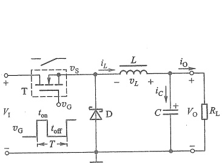

图 11.3.1 串联型 DC/DC 变换电路 主回路原理图
 

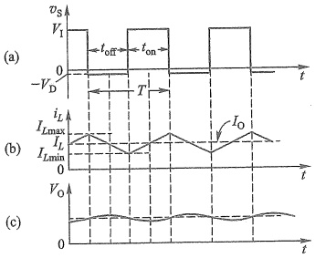

图 11.3.2 串联型主回路的电压、电流波形图 (a)  $ v_{S} $波形 (b)  $ i_{L} $波形 (c)  $ V_{0} $波形
 

实际上在频域里看，正矩形波  $ v_{s} $ 可以展开成直流分量、基波分量及各高次谐波分量的叠

<!-- page: 488 -->

加。而  $ v_{s} $ 基波频率通常在几十千赫以上，只要 LC 滤波电路的截止频率远低于这个频率，就可以较好地滤除基波和各高次谐波，留下直流分量。

由于电路是将一直流电压  $ V_{i} $ 转换为负载工作所需的另一直流电压  $ V_{0} $，且中间经过了矩形波电压，所以称这种电路为 DC/DC 变换电路（实际上还应包括后面要讲的稳压实现电路）。

在稳定的串联型电路中，理想电感只实现能量的传递，不会消耗能量。在一个开关周期中，电感吸收的能量和释放的能量相等。因此一个周期内，电感电压对时间的积分为零，称为伏秒平衡原理。

当串联型电路工作于电流连续模式（continuous-conduction mode, CCM）下，依据伏秒平衡原理，在一个周期内电感电压的平均值为零，当忽略二极管 D 和开关管 T 的压降时， $ (V_{1}-V_{0})\times t_{on}=V_{0}\times t_{off} $，也就是

$$  V_{0}=V_{1}\frac{t_{on}}{t_{on}+t_{off}}=V_{1}\times q   \tag*{(11.3.1)}$$

这里  $  q = t_{\mathrm{on}} / (t_{\mathrm{on}} + t_{\mathrm{off}}) = t_{\mathrm{on}} / T  $，称为矩形波的占空比。由式(11.3.1)看出，输出电压  $ V_{0} $ 一定小于输入电压  $ V_{I} $，所以称图11.3.1所示电路为降压（Buck）型。

当忽略转换电路的损耗时，由能量守恒定律， $ V_{1} \times I_{1} = V_{0} \times I_{0} $，因此  $ I_{1} = (V_{0} \times I_{0}) / V_{1} $，而  $ V_{0} = V_{1} \times q $，故

$$  I_{1}=q\times I_{0}   \tag*{（11.3.2）}$$

必须注意，由于电容也是储能元件，所以电路工作于CCM模式时，电感的平均电流一定等于输出电流，即 $ I_{L}=I_{0} $（参见图11.3.2）。而电感电流的变化量与输出电压、开关周期、占空比和电感值等有关，即

$$  \Delta I_{L}=\left(I_{L\max}-I_{L\min}\right)=\frac{V_{0}(1-q)T}{L}   \tag*{（11.3.3）}$$

那么，维持电路工作于CCM模式时就需要限制最小输出电流，也称为临界输出电流，否则电感会出现断流，电路工作于断续电流模式（discontinuous-conduction mode，DCM）。

由图11.3.2看出，临界输出电流

$$  I_{0min}=\frac{\Delta I_{L}}{2}=\frac{V_{0}(1-q)T}{2L}   \tag*{(11.3.4)}$$

当所需输出电流确定时，也可以据此得到电路工作于CCM模式时电感的最小值，也就是

$$  L_{min}=\frac{V_{0}(1-q)T}{2I_{0}}   \tag*{（11.3.5）}$$

② 并联型(升压型或 Boost 型)

并联型 DC/DC 变换电路主回路如图 11.3.3a 所示，由于开关管 T 与负载  $ R_{L} $ 并联，所以称之为并联型电路。电感 L 接在输入端，D 仍为续流二极管。

当  $ v_{G} $ 为高电平时 ( $ t_{on} $ 期间)，T 导通，输入电压  $ V_{1} $ 直接加到电感 L 两端， $ v_{L} \approx V_{1} $ (忽略 T 的导通压降)，电感充电， $ i_{L} $ 线性增加， $ i_{L} = \frac{1}{L} \int v_{L} dt \approx \frac{V_{1}}{L} \cdot t $，此时 D 截止，之前已充电的电容 C 向负载提供电流  $ i_{放} = i_{0} $，在满足  $ R_{L} C \gg t_{on} $ 时， $ V_{0} $ 基本不变。当  $ v_{G} $ 为低电平时 ( $ t_{off} $ 期间)，T 截止， $ i_{L} $ 不能突变，L 的自感电动势  $ v_{L} $ 为左负右正（如图中括号内标注），此时  $ v_{X} = V_{1} + v_{L} $，因而此

<!-- page: 489 -->

电路的 L 常称为升压电感。当  $ V_{1}+v_{L}>V_{0} $ 时，D 导通， $ V_{1}+v_{L} $ 给负载提供电流  $ i_{0} $，同时又向 C 充电，此时  $ i_{L}=i_{C}+i_{0} $，显然输出电压  $ V_{0}>V_{1} $，所以该电路称为升压 (Boost) 型电路。

同样， $ V_{0} $ 与控制信号  $ v_{G} $ 的占空比有关。正常工作时  $ v_{G} $、 $ v_{X} $、 $ i_{L} $ 和  $ V_{0} $ 的示意波形如图 11.3.3b 所示。

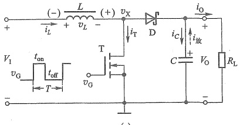

(a)
 

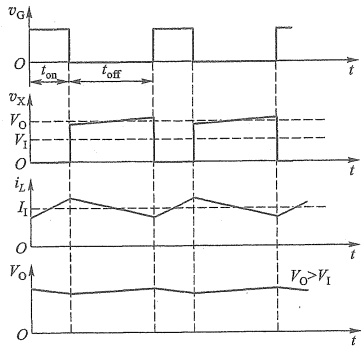

(b)
 

图 11.3.3 并联型 DC/DC 变换电路主回路
 

(a) 原理图 (b)  $ v_{G} $ 作用在  $ i_{L} $ 连续条件下  $ v_{X} $、 $ i_{L} $ 和  $ V_{0} $ 波形

和串联型电路类似，当电路工作于CCM模式时，依据伏秒平衡原理，可以得到

$$  V_{0}=\frac{V_{I}}{1-q}   \tag*{(11.3.6)}$$

为了维持工作于 CCM 模式，临界输出电流

$$  I_{0\mathrm{m i n}}=\frac{T V_{0}q(1-q)^{2}}{2L}.   \tag*{（11.3.7）}$$

最小电感值为

$$  L_{\min}=\frac{TV_{0}q(1-q)^{2}}{2I_{0}} 鐘  或鐘 L_{\min}=\frac{T}{2I_{0}}\bigg(\frac{V_{1}}{V_{0}}\bigg)^{2}(V_{0}-V_{1})   \tag*{（11.3.8）}$$

##### ③ 极性反转型

图 11.3.4 为极性反转型 DC/DC 变换电路主回路，与图 11.3.3a 比较，互换了 T 和 L 的位置，且颠倒了 D 的方向。其工作过程与并联型类似，当 T 导通时，D 截止，输入端直流电源对电感 L 充电，负载电阻  $ R_{L} $ 依靠电容器 C 的储能供电；当 T 截止时，L 中的自感电动势极性为下正上负，D 导通，L 存储的能量为  $ R_{L} $ 提供电流，并同时对电容 C 充电。可以看出，输出电压的极性与输入电压相反，所以称该电路为极性反转型电路。

当电路工作于 CCM 模式时，同样可以得到

$$  V_{0}=-V_{1}\times\frac{q}{1-q}   \tag*{(11.3.9)}$$

<!-- page: 490 -->

由此看出，当改变开关信号的占空比时，极性反转型电路既可以降压输出，也可以升压输出。

### 2. 稳压的实现

DC/DC 变换电路引入开关管的目的是要实现稳压。以上看出，无论哪种类型的变换电路，输出电压  $ V_{0} $ 的大小总是受信号  $ v_{G} $ 占空比的控制，如果通过负反馈使  $ V_{0} $ 的变化影响  $ v_{G} $ 的占空比，就可以实现稳压了。

在图 11.3.1 所示电路基础上，加入反馈控制电路，就可以构成串联型开关稳压电路（DC/DC 变换电

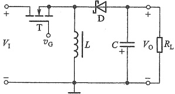

图 11.3.4 极性反转型 DC/DC 变换电路主回路
 

路），如图11.3.5所示。与线性稳压电路类似，取样电路检测 $ V_{0} $并与基准电压 $ V_{REF} $比较，其误差经误差放大器放大得到控制电压 $ v_{A} $。但与线性稳压电路不同的是， $ v_{A} $不能直接用于控制开关管T，需将其转换成矩形波 $ v_{G} $的占空比q，再去控制开关管T（实际电路中比较器的输出还须通过驱动电路再驱动T）。这里将 $ v_{A} $作为比较器C的阈值电压，与固定幅值和频率的三角波 $ v_{T} $进行比较，便可产生脉冲宽度调制（PWM）信号 $ v_{G} $（见例10.8.1），其占空比q就反映了 $ v_{A} $的大小，这样就可以通过q控制 $ V_{0} $实现稳压了。

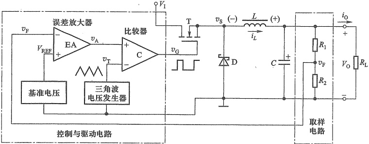

图 11.3.5 串联型开关稳压电路 (DC/DC 变换电路) 原理图
 

例如，当输入电压  $ V_{I} $ 增加或负载  $ R_{L} $ 增大，致使输出电压  $ V_{0} $ 增加时，反馈信号  $ v_{F} $ 也增大，经 EA 后使  $ v_{A} $ 减小（反相关系），通过脉宽调制使  $ v_{G} $ 的占空比 q 减小 ( $ v_{G} $ 与  $ v_{T} $ 是反相的)，从而限制  $ V_{0} $ 增大，达到稳定  $ V_{0} $ 的目的。上述调节过程可表示为：

 $$ \begin{array}{l}V_{\mathrm{I}}\uparrow\\R_{\mathrm{L}}\uparrow\xrightarrow{}\begin{array}{l}V_{\mathrm{O}}\uparrow\xrightarrow{}v_{\mathrm{F}}\uparrow\rightarrow v_{\mathrm{A}}\downarrow\rightarrow v_{\mathrm{G}}\\V_{\mathrm{O}}\downarrow\xleftarrow{}\end{array} 的 q\downarrow\end{array} $$ 

同理， $ V_{0} $ 受  $ V_{I} $ 或  $ R_{L} $ 影响减小时，有  $ v_{F} $ 减小使  $ v_{A} $ 增大，导致  $ v_{G} $ 的 q 增大，从而限制  $ V_{0} $ 的减小。电路正常工作时，由于负反馈的作用，使  $ v_{F} $ 始终跟踪  $ V_{REF} $，即有虚短  $ v_{F} \approx V_{REF} $。再根据 EA 的虚断可得到取样电路的电压关系  $ v_{F} = V_{0} R_{2} / (R_{1} + R_{2}) $，于是输出电压

$$  V_{0}=v_{\mathrm{F}}\left(1+\frac{R_{1}}{R_{2}}\right)=V_{\mathrm{R E F}}\left(1+\frac{R_{1}}{R_{2}}\right)   \tag*{（11.3.10）}$$

<!-- page: 491 -->

与式 $  (11.2.1)  $完全相同。

注意，图11.3.5中的控制与驱动电路所用电源也是 $ V_{1} $。

为了提高开关稳压电源的效率，应选取导通压降小、截止漏电流小的开关管。另外，开关频率  $ f_{K} $ 对稳压电路的性能影响也很大。 $ f_{K} $ 越高，需要使用的 L、C 值越小。这样，系统的尺寸和重量都会减小。但另一方面， $ f_{K} $ 越高，开关管单位时间转换的次数会增加，功耗将增大，导致效率降低。因此要慎重选择开关频率，而且针对不同的器件和电路结构，最佳的开关频率往往是不同的。续流二极管 D 一般选用正向压降小、反向电流小及反向恢复时间短的肖特基二极管。滤波电容和电感要使用耐高温的高频电解电容和高频电感。

并联型和极性反转型稳压电路的稳压原理与串联型基本相同，不再赘述。

### 3. 集成开关稳压器及其应用举例

图11.3.5中的控制与驱动电路只是简化后的原理框图，三角波电压发生器、误差放大器和比较器等实际电路都较复杂，还要考虑如何驱动开关管才能保证它可靠地导通和截止并快速切换。通常还要设计过流、过压、欠压和过热等保护电路。不过目前对使用者来说这都不再是问题，因为这些电路都已被集成到一个芯片中，常称作DC/DC变换器/控制器，也称集成开关稳压器。

目前，集成 DC/DC 变换器有多种，一类是仅包含控制与驱动电路在内，需外接开关管、滤波电路和续流二极管，一般用于功率较大的场合，称之为开关控制器；另一类是将开关管也集成在芯片内部的转换器；还有集成电感的转换模块。几种典型集成 DC/DC 变换器性能如表 11.3.1 所示。

表 11.3.1 集成 DC/DC 变换器
 

<table border=1 style='margin: auto; word-wrap: break-word;'><tr><td colspan="2">稳压器类型</td><td colspan="2">降压型  $ V_0 &lt; V_1 $</td><td colspan="2">升压型  $ V_0 &gt; V_1 $</td><td style='text-align: center; word-wrap: break-word;'>极性反转型</td><td style='text-align: center; word-wrap: break-word;'>分离式转换器</td></tr><tr><td style='text-align: center; word-wrap: break-word;'>参数</td><td style='text-align: center; word-wrap: break-word;'>型号\n符号</td><td style='text-align: center; word-wrap: break-word;'>LM2596-5.0</td><td style='text-align: center; word-wrap: break-word;'>TPS564201</td><td style='text-align: center; word-wrap: break-word;'>LM3478</td><td style='text-align: center; word-wrap: break-word;'>TPS61178</td><td style='text-align: center; word-wrap: break-word;'>MAX764</td><td style='text-align: center; word-wrap: break-word;'>TPS65131</td></tr><tr><td style='text-align: center; word-wrap: break-word;'>输入电压</td><td style='text-align: center; word-wrap: break-word;'>$ V_1/V $</td><td style='text-align: center; word-wrap: break-word;'>8~40</td><td style='text-align: center; word-wrap: break-word;'>4.5~17</td><td style='text-align: center; word-wrap: break-word;'>2.97~40</td><td style='text-align: center; word-wrap: break-word;'>2.7~20</td><td style='text-align: center; word-wrap: break-word;'>3~16</td><td style='text-align: center; word-wrap: break-word;'>2.7~5.5</td></tr><tr><td style='text-align: center; word-wrap: break-word;'>输出电压</td><td style='text-align: center; word-wrap: break-word;'>$ V_0/V $</td><td style='text-align: center; word-wrap: break-word;'>5</td><td style='text-align: center; word-wrap: break-word;'>0.76~7</td><td style='text-align: center; word-wrap: break-word;'>1.26~500</td><td style='text-align: center; word-wrap: break-word;'>4.5~20</td><td style='text-align: center; word-wrap: break-word;'>固定-5或可调-(1~16)</td><td style='text-align: center; word-wrap: break-word;'>-15~15</td></tr><tr><td style='text-align: center; word-wrap: break-word;'>开关频率</td><td style='text-align: center; word-wrap: break-word;'>$ f_K/kHz $</td><td style='text-align: center; word-wrap: break-word;'>150</td><td style='text-align: center; word-wrap: break-word;'>500~600</td><td style='text-align: center; word-wrap: break-word;'>100~1 000</td><td style='text-align: center; word-wrap: break-word;'>200~2 000</td><td style='text-align: center; word-wrap: break-word;'>300</td><td style='text-align: center; word-wrap: break-word;'>1 250</td></tr><tr><td style='text-align: center; word-wrap: break-word;'>最大占空比</td><td style='text-align: center; word-wrap: break-word;'>q</td><td style='text-align: center; word-wrap: break-word;'>100%</td><td style='text-align: center; word-wrap: break-word;'>75%</td><td style='text-align: center; word-wrap: break-word;'>100%</td><td style='text-align: center; word-wrap: break-word;'>85%</td><td style='text-align: center; word-wrap: break-word;'></td><td style='text-align: center; word-wrap: break-word;'>87.5%</td></tr><tr><td style='text-align: center; word-wrap: break-word;'>最大输出电流</td><td style='text-align: center; word-wrap: break-word;'>$ I_{OM}/A $</td><td style='text-align: center; word-wrap: break-word;'>3</td><td style='text-align: center; word-wrap: break-word;'>4</td><td style='text-align: center; word-wrap: break-word;'>1</td><td style='text-align: center; word-wrap: break-word;'>8</td><td style='text-align: center; word-wrap: break-word;'>0.25</td><td style='text-align: center; word-wrap: break-word;'>2</td></tr><tr><td style='text-align: center; word-wrap: break-word;'>开关管类型</td><td style='text-align: center; word-wrap: break-word;'>T</td><td style='text-align: center; word-wrap: break-word;'>内置 BJT 开关管</td><td style='text-align: center; word-wrap: break-word;'>内置 MOS 管</td><td style='text-align: center; word-wrap: break-word;'>外接</td><td style='text-align: center; word-wrap: break-word;'>内置 MOS 管</td><td style='text-align: center; word-wrap: break-word;'>CMOS</td><td style='text-align: center; word-wrap: break-word;'>一个内置 MOS 管另一个需外接</td></tr><tr><td style='text-align: center; word-wrap: break-word;'>控制方式</td><td style='text-align: center; word-wrap: break-word;'></td><td style='text-align: center; word-wrap: break-word;'>PWM</td><td style='text-align: center; word-wrap: break-word;'>PWM</td><td style='text-align: center; word-wrap: break-word;'>PWM</td><td style='text-align: center; word-wrap: break-word;'>PFM</td><td style='text-align: center; word-wrap: break-word;'>PWM PFM</td><td style='text-align: center; word-wrap: break-word;'>PWM</td></tr><tr><td style='text-align: center; word-wrap: break-word;'>特点应用</td><td style='text-align: center; word-wrap: break-word;'></td><td style='text-align: center; word-wrap: break-word;'></td><td style='text-align: center; word-wrap: break-word;'></td><td style='text-align: center; word-wrap: break-word;'>外接开关 MOSFET</td><td style='text-align: center; word-wrap: break-word;'></td><td style='text-align: center; word-wrap: break-word;'></td><td style='text-align: center; word-wrap: break-word;'>可输出正、负两组电压</td></tr></table>

<!-- page: 492 -->

##### （1）固定输出降压型 DC/DC 变换器 LM2596-5.0 的应用

LM2596-5.0 是一款固定 5 V 输出的 DC/DC 变换器。器件内部包含图 11.3.5 中除续流二极管、滤波电感和电容以外的所有电路。三角波振荡频率为 150 kHz；外围电路简单，使用方便。其引脚如图 11.3.6 所示。各引脚功能为：1  $ V_{IN} $ 为输入电压端；2 Output 为输出电压端；3 Ground 为接地端；4 Feed Back 为反馈端；5 ON/OFF 为通/断控制端，在低电平时工作，高电平时输出关断，阈值电压为 1.3 V。

LM2596-5.0 应用电路如图 11.3.7 所示。输入电压  $ V_{1} $ 范围是 +7~40 V，输出电压  $ V_{0} $ 为 5 V。其外部只需连接 4 个元件。 $ C_{1} $ 为输入端滤波电容，可以抑制在输入端出现大的瞬态电压，同时为 LM2596-5.0 在每次关断后的启动提供瞬态电流。其余 3 个元件的作用已在图 11.3.1 中介绍过，不再重复。

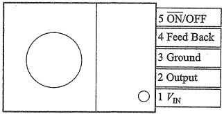

图 11.3.6 LM2596 引脚图
 

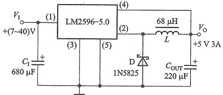

图 11.3.7 LM2596-5.0 应用电路
 

（2）可调降压型 DC/DC 变换器 TPS564201 的应用

TPS564201 是一款内部封装了 MOS 开关管的降压型转换器，共有 6 个引脚，所需外部元件少。其输出为 5 V 电压的典型应用电路如图 11.3.8 所示。

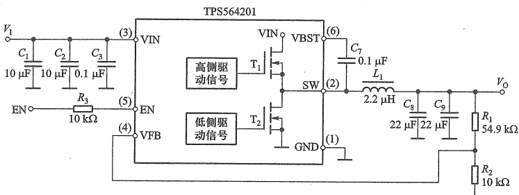

图 11.3.8 TPS564201 输出为 5 V 电压的典型应用电路
 

需要注意的是，TPS564201 内部集成了两个 MOS 开关管，一般称之为高侧开关管和低侧开关管，其中高侧开关管为主开关，而低侧开关管替代了图 11.3.5 中的续流二极管 D。

TPS564201的引脚1为接地端，引脚2为高侧开关管和低侧开关管的连接点，引脚3为直流电压输入端，引脚4为反馈电压输入端，引脚5为使能端，高有效，引脚6为高侧开关管驱动电路的辅助供电端，用于外接自举电容。

<!-- page: 493 -->

电路中采用两容量相等电容的并联 $ (C_{1}, C_{2} $ 以及  $ C_{8}, C_{9} $，主要是为了减小非理想电容的等效电阻，同时获得较大的电容量，可滤除低频干扰。电容  $ C_{7} $ 为自举电容，用于给高侧的  $ T_{1} $ 提供足够高的开启电压。

查阅其数据手册可知，在合适的输入电压作用下，电路的输出电压由外部电阻 $ R_{1} $和 $ R_{2} $决定，关系式为 $ V_{0}=0.76\times(1+R_{1}/R_{2}) $，因此图11.3.8电路的输出电压为 $ V_{0}=0.76\times(1+54.9/10) $V≈5V。

##### （3）极性反转型 DC/DC 变换器 MAX764

MAX764 为一款输出电压固定-5 V 或可调的 DC/DC 变换器，其利用外部储能电感、滤波电容和续流二极管构成极性反转的-5 V 稳压电路如图 11.3.9 所示。输入正电压在 3~16 V 之间。其中，OUT(1) 为固定输出检测端，FB(2) 为反馈输入端，SHDN(3) 为高有效的关断模式控制端，REF(4) 为 1.5 V 的基准电压输出端，V+(6)(7) 为正电源电压输入端，LX(8) 端内部为 PMOS 开关管的漏极，GND(5) 为接地端。

同样，MAX764 也可以连接为可调负电压输出，详见其数据手册。

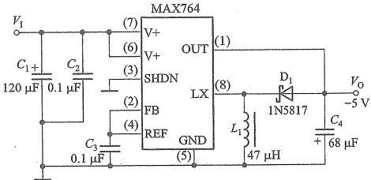

图 11.3.9 MAX764 应用电路
 

虽然在 DC/DC 变换器基本电路描述中给出过电感选取的最小值要求，但在实际电路设计时，所用集成 DC/DC 变换器数据手册中都会给出电感、电容等外接元件的建议值，使用者可据此选取合适的元件构成满足需要的稳压电路，这使得设计开关稳压电路变得简单容易了。

##### 11.3.2 带变压器的开关稳压电路

尽管理论上可以通过 DC/DC 变换器，直接将电网交流电压整流滤波后 300 多伏的直流电压变换为几伏的直流低压，但工程实际中一般不这样做，这是因为这种电路高、低压部分没有隔离，存在极大的安全隐患，而且这时控制信号需要极小的占空比，对器件性能要求苛刻。这时普遍采用带隔离变压器的开关稳压电路。

### 1. 基本电路及工作原理

带隔离变压器的 DC/DC 变换器，通过磁耦合方式传递能量，实现了输入和输出端的电气隔离，同时完成降压任务。如果变压器二次侧采用多绕组，还很容易实现多个输出。

图 11.3.10a 所示电路为正激式 DC/DC 变换器基本电路，图 b 为反激式基本电路。

在图 a 的正激电路中，开关管  $ T_{1} $ 导通时，变压器二次侧的二极管  $ D_{1} $ 导通， $ D_{2} $ 截止，电网

<!-- page: 494 -->

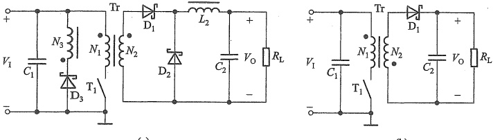

图 11.3.10 带变压器的 DC/DC 变换器基本电路 (a) 正激式 (b) 反激式
 

电压通过变压器Tr向负载 $ R_{L} $传送能量，此时输出滤波电感 $ L_{2} $也储存能量。当 $ T_{1} $截止时，二极管 $ D_{1} $截止，电感 $ L_{2} $的储能通过续流二极管 $ D_{2} $向负载释放，维持开关截止时的负载电压。电路的问题是：当开关管关断时，变压器处于“空载”状态，其中储存的磁场能量将会积累到下一个开关周期，直至电感饱和，烧坏开关器件。因此图中连接了 $ N_{3} $与 $ D_{3} $支路，提供释放多余磁场能量的回路。

观察图 b 所示的反激式电路，可以发现，变压器的同名端与图 a 不同，当  $ T_{1} $ 导通驱动变压器一次侧时，二极管  $ D_{1} $ 截止，变压器二次侧不对负载供电而储能，负载电阻  $ R_{L} $ 依靠电容  $ C_{2} $ 储能提供电流。当  $ T_{1} $ 截止时，变压器二次侧的感应电压使  $ D_{1} $ 导通，一方面给负载供电，另一方面给  $ C_{2} $ 充电。

以上看出，正激式是开关管导通时，就通过变压器向电感、电容和负载传送能量了，而当开关断开时，便停止传送。反激式则是当开关管导通时将能量储存在变压器中，只有在开关断开时，才会向负载和电容释放能量。

与正激式电路相比，反激式电路少了一个续流二极管  $ D_{2} $ 和储能滤波器电感  $ L_{2} $，同时没有磁复位绕组  $ N_{3} $ 支路，这是因为在变换器反激期间，二次绕组和整流二极管  $ D_{1} $ 构成电流回路，同时完成了磁复位功能。

需要注意的是，这里所用到的变压器和图11.0.1a中的变压器不同，后者为工频降压器，工作于50 Hz频率下。而图11.3.10中变压器的工作频率和开关管的开关频率相同，一般为几百千赫，所以体积比工频变压器小很多。

采用和串联型电路类似的分析可知，在 CCM 模式下，正激式电路输入和输出电压的关系为

$$  V_{0}=V_{1}\times\frac{N_{\mathrm{s e c}}\times T_{\mathrm{o n}}}{N_{\mathrm{p r i}}\times T}=V_{1}\times\frac{N_{\mathrm{s e c}}}{N_{\mathrm{p r i}}}\times q.   \tag*{(11.3.11)}$$

这里  $ N_{pri} $ 为变压器的一次匝数，而  $ N_{sec} $ 为变压器的二次匝数。

反激式电路输入和输出电压的关系为

$$  V_{0}=V_{1}\times\frac{N_{\mathrm{sec}}\times T_{\mathrm{on}}}{N_{\mathrm{pri}}\times T_{\mathrm{off}}}=V_{1}\times\frac{N_{\mathrm{sec}}}{N_{\mathrm{pri}}}\times\frac{q}{1-q}   \tag*{（11.3.12）}$$

在图 11.3.10 基础上增加取样、反馈、控制与驱动电路，就可以构成带变压器的开关稳

<!-- page: 495 -->

压电路如图11.3.11所示，稳压原理与无变压器的DC/DC变换器类似。由于要隔离输入和输出回路，所以反馈信号一般通过光电耦合器实现隔离。

与 DC/DC 变换器类似，目前，也有很多用于带变压器的开关稳压电路的集成控制器供选用。有的是集成了开关管的，如 TNY263，有的是需要外接开关管的，如 FAN6754。

### 2. 集成控制器及开关稳压电源

##### （1）控制器 FAN6754 及其应用

FAN6754 是一种反激式开关电源的 PWM 控制器，具有引脚少、外围电路简单、性能优良等优

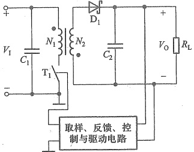

图 11.3.11 反激式开关稳压电路
 

点。内部振荡电路的振荡频率为  $ 65 ~kHz $。其 8 个引脚的功能如表 11.3.2 所示。

表 11.3.2 FAN6754 引脚功能
 

<table border=1 style='margin: auto; word-wrap: break-word;'><tr><td style='text-align: center; word-wrap: break-word;'>引脚</td><td style='text-align: center; word-wrap: break-word;'>引脚名称</td><td style='text-align: center; word-wrap: break-word;'>引脚功能</td></tr><tr><td style='text-align: center; word-wrap: break-word;'>1</td><td style='text-align: center; word-wrap: break-word;'>GND</td><td style='text-align: center; word-wrap: break-word;'>公共地端，外接阻容元件，补偿控制回路</td></tr><tr><td style='text-align: center; word-wrap: break-word;'>2</td><td style='text-align: center; word-wrap: break-word;'>FB</td><td style='text-align: center; word-wrap: break-word;'>内部通过电阻接5V，外接光电耦合器输出端光电三极管的集电极，接收输出电压的取样信号，调节矩形波的占空比</td></tr><tr><td style='text-align: center; word-wrap: break-word;'>3</td><td style='text-align: center; word-wrap: break-word;'>NC</td><td style='text-align: center; word-wrap: break-word;'>无须外部连接</td></tr><tr><td style='text-align: center; word-wrap: break-word;'>4</td><td style='text-align: center; word-wrap: break-word;'>HV</td><td style='text-align: center; word-wrap: break-word;'>高电压启动</td></tr><tr><td style='text-align: center; word-wrap: break-word;'>5</td><td style='text-align: center; word-wrap: break-word;'>RT</td><td style='text-align: center; word-wrap: break-word;'>温度过高保护，连接一个负温度系数的热敏电阻到地</td></tr><tr><td style='text-align: center; word-wrap: break-word;'>6</td><td style='text-align: center; word-wrap: break-word;'>SENSE</td><td style='text-align: center; word-wrap: break-word;'>电流检测</td></tr><tr><td style='text-align: center; word-wrap: break-word;'>7</td><td style='text-align: center; word-wrap: break-word;'>$ V_{DD} $</td><td style='text-align: center; word-wrap: break-word;'>供电电源，开启电压16.5V，关断电压9V</td></tr><tr><td style='text-align: center; word-wrap: break-word;'>8</td><td style='text-align: center; word-wrap: break-word;'>GATE</td><td style='text-align: center; word-wrap: break-word;'>栅极驱动输出，用于连接外部开关管的栅极，内部钳位低于13V</td></tr></table>

由 FAN6754 控制的隔离型开关稳压电源完整电路如图 11.3.12 所示。220 V 的交流电网电压经过电容  $ C_1 \sim C_4 $ 和电感  $ L_1 $、 $ L_2 $ 构成电磁干扰（electro magnetic interference, EMI）滤波器，滤除电网中的高频噪声，再送入 KBP307 整流桥整流、经  $ C_5 $ 滤波，将高压交流电转换为约 310 V 的直流电， $ C_5 $ 的容量为 100  $ \mu $F 或者 68  $ \mu $F，耐压值 400 V 以上。 $ C_6 $、 $ R_2 $ 和  $ D_3 $ 构成钳位电路，可以在  $ T_1 $ 断开时将变压器一次漏感电压尖峰值削弱到安全范围。开关管采用增强型 NMOS 管 FQPF8N80。

220 V 市电通过二极管  $ D_{5} $ 和启动电阻  $ R_{1} $ 支路触发芯片内部的恒流源，对 FAN6754 供电引脚 7 的  $ V_{DD} $ 电容充电，当  $ V_{DD} $ 引脚电压达到门槛电压 (16.5 V) 后，引脚 8 输出栅极控制脉冲，控制  $ T_{1} $ 的通断，电源开始工作，此后 FAN6754 由辅助绕组  $ L_{4} $ 供电， $ D_{1} $、 $ D_{2} $、 $ R_{6} $、 $ C_{9} $ 和  $ C_{10} $ 构成的整流滤波电路使引脚 7 的电压维持在 16.5~24 V 之间。

 $ R_{7} $ 检测出  $ T_{1} $ 的电流，经滤波电路  $ R_{8} $、 $ C_{13} $ 滤除变压器寄生电容造成的脉冲前沿振荡，然后送入 SENSE 引脚，实现峰值电流控制。

电路的稳压过程为：FAN6754 的 8 号引脚输出 PWM 脉冲，驱动开关管  $ T_{1} $ 的导通和截止，一次绕组的高频脉冲高电压通过高频变压器降压后由二次绕组输出，再经过整流滤波电

<!-- page: 496 -->

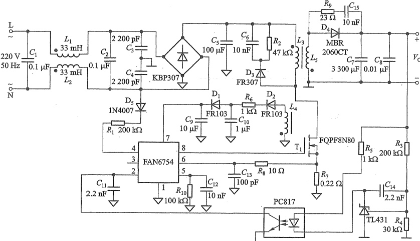

图 11.3.12 由 FAN6754 控制的隔离型开关稳压电源
 

路变成直流电压输出。分压电阻  $ R_{3} $ 和  $ R_{4} $ 对输出电压取样，与 TL431 的 2.5 V 精密基准电压进行比较，在 TL431 的阴极上得到误差电压，与电阻  $ R_{5} $ 一起控制光耦 LED 的工作电流，经过线性光电耦合器 PC817 反馈回 FAN6754，控制 8 号引脚输出 PWM 信号的占空比，从而实现稳压。高频变压器和光电耦合器 PC817 实现了高压电路和低压电路的隔离（注意，两边的接地符号不同）。

 $ R_{9} $ 和  $ C_{9} $ 构成二极管  $ D_{4} $ 的高频振荡抑制电路，避免  $ D_{4} $ 反向恢复期间产生高频振荡。

从设计的角度看待该电路时，需要考虑：

① 开关管  $ T_{1} $ 的选择：由于变压器反电动势的作用， $ T_{1} $ 承受的电压通常高于直流输入电压，所以其耐压值要足够高；而依据输出功率、输入电压和脉冲占空比等指标可以核算  $ T_{1} $ 的平均电流和峰值电流；另外  $ T_{1} $ 的阈值电压应能满足 FAN6754 输出的控制电压高电平使  $ T_{1} $ 可靠导通的要求。当然  $ T_{1} $ 的工作频率也必须满足要求。

②高频变压器的选择（设计）：需要根据开关频率和电源功率选择合适的磁芯材料和有效截面积；根据输入电压、 $ T_{1} $ 的导通时间和磁芯磁通量大小等确定一次匝数；再根据输入电压、输出电压、一次匝数和占空比等，确定二次匝数。同样可以用类似的方法计算 FAN6754 供电绕组的匝数。根据变压器的输入功率、脉冲频率和脉冲占空比以及流过变压器的一次最大电流，确定变压器的一次电感量。

③ 取样电路参数的设计：需要根据输出电压、光电耦合器线性工作区以及 FAN6754 反馈信号输入引脚的电压范围，来确定取样电路的参数。

当然，最终要通过实测，检验参数设计是否正确。总之，与线性稳压电源和无变压器的开关DC/DC变换器相比，隔离型开关稳压电源的设计比较复杂，实际设计时需要结合电源

<!-- page: 497 -->

指标要求和控制器选型等综合考虑。具体设计可参考器件手册。

##### （2）含开关管的集成控制器应用

另外一种类型的开关电源控制器内部集成了高压功率 MOS 管，集成度更高，如 TinySwitch-4系列产品 TNY284-290，广泛应用于小功率（<30 W）的 PC 待机电源及小型便携式设备的充电器/适配器等。

目前大多数开关电源由额定负载转入轻载或待机状态时，电源效率急剧下降，待机效率不能满足要求，因此很多供电系统会同时配置一个待机时的电源，当系统进入待机状态时自动切换至待机电源，从而有效降低功耗。图11.3.13就是TinySwitch-4在待机电源中的典型应用。

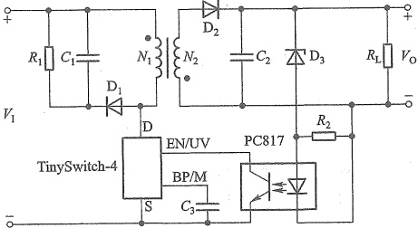

图 11.3.13 TinySwitch-4 的典型应用
 

芯片引脚 D 为内部功率 MOS 管的漏极，旁路/多功能引脚 BP/M 需要连接一个外部的旁路电路，用于得到内部 5.85 V 的供电电源，还可通过外部限流的设定值对芯片进行关断，使能/欠压引脚 EN/UV 为输入使能信号和输入电压欠压检测，引脚 S 内部连接到 MOS 管的源极，为电路提供电压参考点。

其一般工作于限流模式，启动时，芯片内振荡器在每个周期开始启动功率MOS管，当电流逐渐上升到限流值时MOS管关断。由于MOS管的限流和开关频率为常数，提供的功率与变压器的初级电感成正比，与输入电压基本无关，可实现宽范围的输入电压。

由于 TinySwitch 在一个器件上集成了高压 MOSFET 开关和电源控制器，因此集成度高，电路设计较为简单，成本低。

### 3. 简易型开关稳压电源

图 11.3.14 为某简易型开关稳压电源，图中交流电网电压经过  $ D_{1} \sim D_{4} $ 桥式高电压整流、电容  $ C_{1} $ 滤波后，得到 310 V 左右的直流电压，通过启动电阻  $ R_{2} $ 给开关管  $ T_{1} $ 的基极提供启动电流， $ T_{1} $ 导通后，经  $ L_{1} $ 产生集电极电流，同时在  $ L_{2} $ 和  $ L_{3} $ 的二次侧产生感应电压， $ L_{2} $ 通过反激式经  $ D_{7} $ 整流、 $ C_{5} $ 滤波后为负载提供直流电压。 $ L_{3} $ 的电压经  $ D_{6} $ 整流、 $ C_{2} $ 滤波后通过  $ D_{21} $、 $ T_{2} $ 组成的取样比较电路，检测输出电压的高低。

 $ L_{3} $、 $ C_{3} $、 $ R_{4} $还构成 $ T_{1} $管的正反馈通路，使得 $ T_{1} $管可以产生高频振荡，周期性给 $ L_{1} $供电，当电路的负载变大或者输入电压变大使得输出电压变大时， $ L_{3} $的电压也增大，使 $ D_{21} $反向击穿，导致 $ T_{2} $导通，分流 $ T_{1} $的基极电流， $ T_{1} $集电极电流随之减小，从而使输出电压降低；若输出电压变低， $ T_{2} $取样后会截止， $ T_{1} $基极无分流，集电极电流增大，输出电压就会升高，从而实现自

<!-- page: 498 -->

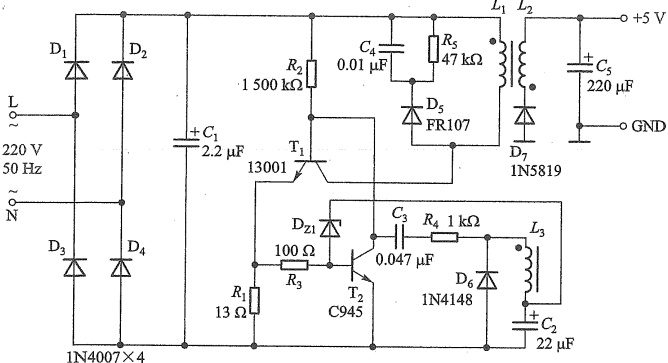

图 11.3.14 简易型开关稳压电源图
 

动稳压。

电路中负载过载或者短路时， $ T_{1} $ 的集电极电流迅速升高，导致  $ T_{1} $ 的发射极电阻  $ R_{1} $ 上产生较大的压降，这个电压经过  $ R_{3} $ 电阻，会让  $ T_{2} $ 饱和导通，从而  $ T_{1} $ 截止，没有输出信号，实现了过载保护。

和图11.3.10所示电路类似，电路中 $ C_{4} $、 $ R_{5} $和 $ D_{5} $构成了钳位电路，避免 $ T_{1} $断开时 $ L_{1} $过高的感生电压击穿开关管 $ T_{1} $。

注意， $ T_{1} $、 $ T_{2} $都需要有310 V以上的耐压值。 $ T_{1} $的选择要考虑 $ V_{CE(max)} $和 $ I_{C(max)} $以及功耗；改变电路中 $ T_{1} $的发射极电阻 $ R_{1} $，可以控制负载输出电流的大小，减小 $ R_{1} $电阻，将会增加负载输出电流，但是可能导致 $ T_{1} $过流而损坏，如果需要大电流输出，可以考虑更换13003等大电流的开关管。

由于电路无须集成开关控制器，结构比较简单，成本低，因此称之为简易型开关稳压电源。

##### 复习思考题

11.3.1 串联开关式稳压电源与串联反馈式线性稳压电源的主要区别是什么？两者相比各有什么优缺点？开关式电源的开关管工作在什么状态？

11.3.2 电路如图 11.3.1 所示，简述开关稳压电源主电路的工作原理。

11.3.3 电路如图11.3.5所示，在闭环情况下，输出电压 $ V_{0} $为某一预定值 $ V_{set} $，当输入电压 $ V_{1} $增加（或负载电流 $ I_{0} $减小）时，使输出电压增加 $ V_{0}>V_{set} $，电路如何自动稳定输出电压？

11.3.4 电路如图11.3.5所示，当 $ V_{I} $、 $ V_{REF} $一定时，输出电压的调节范围应由电路中哪些参数决定？若要使 $ V_{0} $增加，应如何调节电路参数？

11.3.5 并联型开关稳压电路实现直流升压变换 $ V_{0}>V_{1} $的基本原理是什么？为什么串联开关稳压电路是降压变换 $ V_{0}<V_{1} $?

11.3.6 开关稳压电源对电路中的元器件有何特殊要求？应如何选用？

11.3.7 开关稳压电源中，开关管的频率选择需要注意哪些问题？

<!-- page: 499 -->

# 小结

在电子系统中，经常需要将交流电压转换为稳定的直流电压，为此要用整流、滤波和稳压等电路来实现。

· 整流电路是利用二极管的单向导电性将交流电转变为脉动的直流电。为抑制整流输出电压中的纹波，通常在整流电路后连接滤波电路。滤波电路一般可分为电容输入式和电感输入式两大类。在输出直流电流较小且负载几乎不变的场合，宜采用电容输入式，而负载电流大的大功率场合，采用电感输入式。

教学视频 11.1：直流稳压电源小结

电容输入式滤波电路是电容C与负载 $ R_{L} $并联（电容接在最前面），整流二极管导电角 $ \theta<\pi $，滤波效果与电容C和负载电阻 $ R_{L} $的乘积有关，RC越大滤波效果越好，但二极管导电角越小，导电电流的尖峰越大；电感输入式滤波是电感L与负载 $ R_{L} $串联（电感接在最前面），电路中 $ \omega L>R_{L} $时，电流是连续的，整流二极管导电角 $ \theta=\pi $（单相整流），电感一定时，负载电流大滤波效果好。

为了保证输出电压不受电网电压、负载和温度的变化而产生波动，可再接入稳压电路。在小功率供电系统中，多采用串联反馈式线性稳压电路，在移动式电子设备中或要求节能的场合，多采用由集成开关稳压器组成的DC/DC变换器供电，在而中、大功率稳压电源一般采用集成的PWM（或PFM）控制与驱动电路再外接大功率开关调整管和LC滤波电路的开关稳压电路。

串联反馈式线性稳压电路的调整管工作在线性放大区，利用控制调整管的管压降来调整输出电压，它是一个带负反馈的闭环有差调节系统，它的输出电压小于输入电压，即 $ V_{0}<V_{1} $，调整管功耗大，电源效率低（只有40%~60%），纹波电压小。

• 开关稳压电源的调整管工作在开关状态，通过控制调整管导通时间与截止时间的比例（或占空比  $ q=\frac{t_{on}}{T} $）来调整和稳定输出电压，它也是一个带负反馈的闭环有差调节系统。按输出电压与输入电压的关系分类有降压型、升压型和反极型三种开关电源。它的控制方式有脉宽调制型（PWM）、脉频调制型（PFM）及混合调制（即脉宽-频率调制）型。开关调整管工作状态的转换过程消耗功率小，电源效率可高达 75%~95%，但纹波电压大。

#### 习题

#### 11.1 小功率整流滤波电路

11.1.1 变压器二次侧有中心抽头的全波整流电路如图11.1.1所示，二次电源电压为 $ v_{2a}=-v_{2b}=\sqrt{2}V_{2}\sin\omega t $，假定忽略二极管的正向压降和变压器内阻：（1）试画出 $ v_{2a} $、 $ v_{2b} $、 $ i_{D1} $、 $ i_{D2} $、 $ i_{L} $、 $ v_{L} $及二极管承受的反向电压 $ v_{R} $的波形；（2）已知 $ V_{2} $（有效值），求 $ V_{L} $、 $ I_{L} $（均为平均值）；（3）计算整流二极管的平均电流 $ I_{D} $、最大反向电压 $ V_{RM} $；（4）若已知 $ V_{L}=30V $， $ I_{L}=80mA $，试计算 $ V_{2a} $、 $ V_{2b} $的值，并选择整流二极管。

11.1.2 电路参数如图题11.1.2所示，图中标出了变压器二次电压（有效值）和负载电阻值，若忽略二极管的正向压降和变压器内阻，试求：(1) $ R_{L1} $、 $ R_{L2} $两端的电压 $ V_{L1} $、 $ V_{L2} $和电流 $ I_{L1} $、 $ I_{L2} $（平

<!-- page: 500 -->

均值): (2) 通过整流二极管  $ D_{1}, D_{2}, D_{3} $ 的平均电流和二极管承受的最大反向电压。

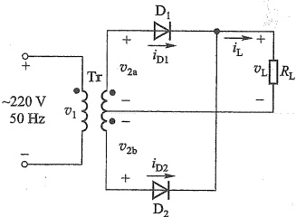

图题 11.1.1
 

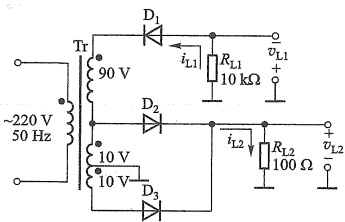

图题11.1.2
 

11.1.3 桥式整流、电容滤波电路如图 11.1.4 所示，已知交流电源电压为 220 V/50 Hz， $ R_{L}=50\Omega $，要求输出直流电压为 24 V，纹波较小。(1) 选择整流管的型号；(2) 选择滤波电容器（容量和耐压）；(3) 确定电源变压器的二次电压和电流；(4) 确定纹波电压  $ V_{r} $ 的值。

11.1.4 电路如图11.1.4所示，已知 $ V_{2}=20\ V, R_{L}=50\ \Omega, C=1\ 000\ \mu F $ 。（1）如当电路中电容C开路或短路，电路会产生什么后果？两种情况下 $ V_{L} $ 各等于多少？（2）当输出电压 $ V_{L}=28\ V, 18\ V, 24\ V $ 和9V时，试分析，哪些属于正常工作的输出电压，哪些属于故障情况，并指出故障原因。

11.1.5 如图题11.1.5所示倍压整流电路，要求标出每个电容器上的电压和二极管承受的最大反向电压；求输出电压 $ V_{L1}, V_{L2} $ 的大小，并标出极性。

#### 11.2 线性稳压电路

11.2.1 并联稳压电路如图题 11.2.1 所示，稳压管  $ D_{z} $ 的稳定电压  $ V_{z}=6\ V $,  $ V_{1}=18\ V $, C=1 000  $ \mu $F, R=1 k $ \Omega $,  $ R_{L}=1\ k\Omega $。（1）电路中稳压管接反或限流电阻 R 短路，会出现什么现象？（2）求变压器二次电压有效值  $ V_{2} $,

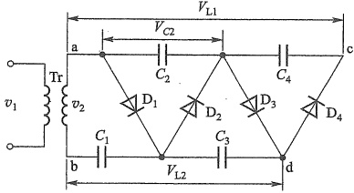

图题11.1.1.5
 

输出电压  $ V_{0} $ 的值；(3) 若稳压管  $ D_{z} $ 的动态电阻  $ r_{z}=20\ \Omega $，求稳压电路的内阻  $ R_{e} $ 及  $ \Delta V_{0}/\Delta V_{1} $ 的值；(4) 将电容器 C 断开，试画出  $ V_{1} $、 $ V_{0} $ 及电阻 R 两端电压  $ V_{R} $ 的波形。(5) 利用 SPICE 仿真  $ V_{1} $， $ V_{0} $ 及电阻 R 两端电压  $ V_{R} $ 的波形。

11.2.2 有温度补偿的稳压管基准电压源如图题 11.2.2 所示，稳压管的稳定电压  $ V_z = 6.3\ V $，BJT  $ T_1 $ 的  $ V_{BE} = 0.7\ V $。 $ D_z $ 具有正温度系数 +2.2 mV/℃，而 BJT  $ T_1 $ 的  $ V_{BE1} $ 具有负温度系数 -2 mV/℃。(1) 当输入电压  $ V_1 $ 增大（或负载电阻  $ R_L $ 增大）时，说明它的稳压过程和温度补偿作用；(2) 试求基准电压  $ V_{REF} $ 的值并标出电压极性。

11.2.3 直流稳压电路如图题 11.2.3 所示，已知 BJT  $ T_{1} $ 的  $ \beta_{1}=20 $， $ T_{2} $ 的  $ \beta_{2}=50 $， $ V_{BE}=0.7~V $ (1) 试说明电路的组成有什么特点；(2) 判断电路中电阻  $ R_{3} $ 开路或短路时会出现什么故障；(3) 求电路正常工作时，输出电压的调节范围；(4) 当电网电压波动 10% 时，电位器  $ R_{p} $ 的滑动端在什么位置时， $ T_{1} $ 的  $ V_{CE1} $ 最大，其值为多少？(5) 当  $ V_{0}=15~V $， $ R_{L}=50~\Omega $ 时，求  $ T_{1} $ 的功耗  $ P_{C1} $。

<!-- page: 501 -->

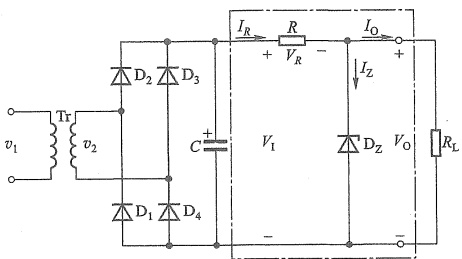

图题11.2.1
 

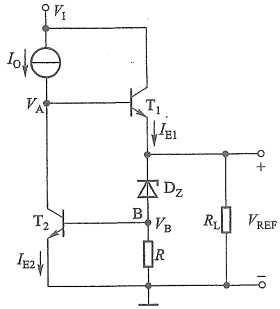

图题11.2.2
 

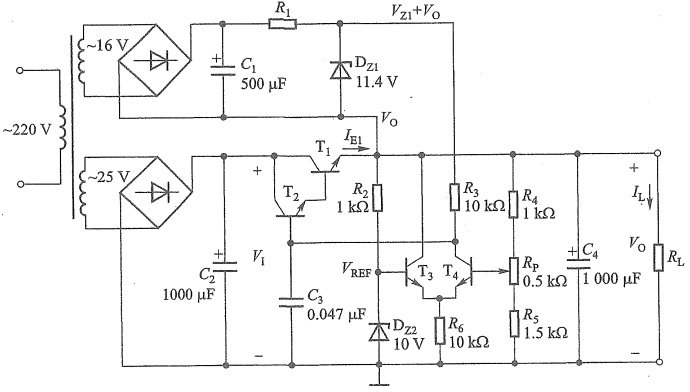

图题11.2.3
 

11.2.4 图题11.2.4电路为-9 V（即 $ V_{0}=-9 $ V）的直流稳压电源，设 $ R_{L}=30 $ Ω，整流滤波的电压关系按系数1.2计算，几种三端稳压器及部分参数如表11.2.1所示。(1)确定电路中三端稳压器应选用的型号；(2)求电压 $ \left|V_{A}\right| $ 的最小值；(3)若电网电压有±10%波动，则按电网标称值设计的变压器二次电压 $ v_{2} $ 的有效值至少为多少？

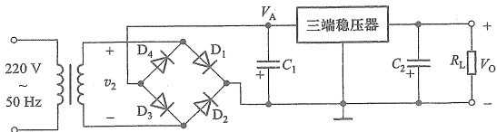

图题11.2.4
 

<!-- page: 502 -->

11.2.5 输出电压的扩展电路如图题11.2.5所示。设  $ V_{32}=V_{xx} $，试证明

 $$ V_{0}=V_{\mathrm{x x}}\left(\frac{R_{3}}{R_{3}+R_{4}}\right)\quad\left(1+\frac{R_{2}}{R_{1}}\right) $$ 

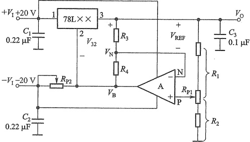

图题11.2.5
 

11.2.6 图题11.2.6是具有跟踪特性的正、负电压输出的稳压电路、78L××输出为正电源电压+ $ V_{0} $，试说明用运放741和功放管 $ T_{1} $、 $ T_{2} $使 $ -V_{0} $跟踪+ $ V_{0} $变化的原理（正常时+ $ V_{0} $和 $ -V_{0} $是绝对值相等的对称输出）。

11.2.7 图题11.2.7是由LM317组成输出电压可调的典型电路，当 $ V_{31}=V_{REF}=1.2\ V $时，流过 $ R_{1} $的最小电流 $ I_{R_{min}} $为5~10mA，调整端1输出的电流 $ I_{adj}<<I_{R_{min}} $， $ V_{1}-V_{0}=2\ V $。（1）求 $ R_{1} $的值；（2）当 $ R_{1}=210\ \Omega $， $ R_{2}=3\ k\Omega $时，求输出电压 $ V_{0} $；（3）当 $ V_{0}=37\ V $， $ R_{1}=210\ \Omega $时， $ R_{2}=? $电路的最小输入电压 $ V_{1min}=? $（4）调节 $ R_{2} $从0变化到6.2kΩ时，求输出电压的调节范围？

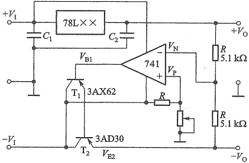

图题11.2.6
 

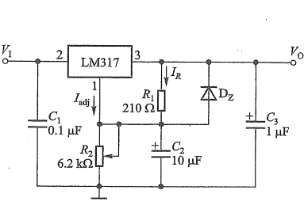

图题11.2.7
 

11.2.8 可调恒流源电路如图题11.2.8所示。(1)当 $ V_{31}=V_{REF}=1.2\ V $，R从0.8~120Ω改变时，求恒流 $ I_{0} $的变化范围？（假设 $ I_{adj}\approx0 $）；(2)当 $ R_{L} $用待充电电池代替，若50mA恒流充电，充电电压 $ V_{E}=1.5\ V $，求电阻 $ R_{L}= $？

11.2.9 图题 11.2.9 是 6 V 限流充电器，T 为限流管， $ V_{BE}=0.6\ V $， $ R_{3} $ 是限流取样电阻，最大充电电流  $ I_{OM}=V_{BE}/R_{3}=0.6\ A $，说明当  $ I_{0}>I_{OM} $ 时如何限制充电电流。

<!-- page: 503 -->

图题11.2.8
 

图题11.2.9
 

#### 11.3 开关式稳压电路

11.3.1 电路如图11.3.1所示，开关调整管T的饱和压降 $ V_{CES}=1\ V $，穿透电流 $ I_{CEO}=1\ mA $， $ v_{T} $是幅度为5V、周期为60μs的三角波，它的控制电压 $ v_{B} $为矩形波，续流二极管D的正向电压 $ V_{D}=0.6\ V $。 $ v_{E} $脉冲波形的占空比q=0.6，周期 $ T=60\ \mu s $，输入电压 $ V_{1}=20\ V $，输出电压 $ V_{0}=12\ V $，输出电流 $ I_{0}=1\ A $，比较器C的输出电压为0和20V，试定量画出电路中当在整个开关周期电流 $ i_{L} $连续情况下 $ v_{T} $、 $ v_{A} $、 $ v_{B} $、 $ v_{E} $、 $ i_{L} $和 $ V_{0} $的波形（标出电压的幅度）。

图题11.3.1
 

11.3.2 电路给定条件如题11.3.1，(1)当续流二极管反向电流很小时，试求开关调整管T和续流二极管D的平均功耗；(2)当电路中电感L和电容C足够大时，忽略L、C和控制电路的损耗，计算电源的效率。

11.3.3 反极型开关稳压电路的主回路

如图题 11.3.3 所示 $ ^{①} $，已知  $ V_{1}=12\ V $， $ V_{0}=-15\ V $，控制电压  $ v_{c} $ 为矩形波，电路中 L、C 为

图题11.3.3
 

<!-- page: 504 -->

储能元件，D为续流二极管。(1)试分析电路的工作原理；(2)已知 $ V_{1} $的大小和 $ v_{G} $的波形， $ v_{G} $的占空比q=1/3，画出在 $ v_{G} $作用下， $ i_{L} $在整个开关周期连续情况下， $ v_{D} $、 $ v_{DS} $、 $ v_{L} $、 $ i_{L} $和 $ V_{0} $的波形，并说明 $ V_{0} $与 $ V_{1} $极性相反。

11.3.4 图题 11.3.4 所示是利用集成的升压型 MAX633 和反极型 MAX637（结构如图中点画线内所示），外接±12 V 汽车电池、电感 L 和电容 C 组成的±15 V 低功率开关电源，试分析电路的工作原理，当 MOSFET 控制电压  $ v_{G} $ 为矩形波时，在整个开关周期电感电流  $ i_{L} $ 连续情况下分别画出升压型和反极型两组开关稳压电路  $ v_{D} $、 $ v_{DS} $、 $ i_{L} $、 $ v_{L} $ 和  $ V_{01} $ 和  $ V_{02} $ 的波形（n=1,2）。

图题11.3.4
 

 $ ^{*} $11.3.5 电路如图题11.3.5所示，当电路中开关频率 $ f_{K}=\frac{1}{T} $和电感L较小时，试分析在整个开关周期T内电感电流 $ i_{L} $有断流条件下的工作特性，当 $ v_{G} $的波形和 $ V_{1} $已知时，画出 $ v_{G} $、 $ i_{L} $、 $ v_{s} $和 $ V_{0} $的波形。

*11.3.6 降压型、升压型和反极型三种开关稳压(DC/DC)电路结构如图11.3.6所示，输入直流电压 $ V_{1}=10\ V $，控制电压 $ v_{G} $为矩形波，电路中电感足够大，流过电感的电流 $ i_{L} $是连续的，其占空比 $ q=t_{on}/T $已知。(1)求出三种电路中用q表示的 $ V_{0} $与 $ V_{1} $的关系式，以及开关调整管最大的漏极电流 $ I_{Dmax} $，漏源间的反向电压值 $ V_{DSR} $值，二极管的电流 $ I_{DF} $和反向电压 $ V_{DR} $的表达式；(2)列表表示电路中电压、电流的关系式；(3)当q分别为1/3，1/2和4/5时，输出电压 $ V_{0} $分别是多少？

<!-- page: 505 -->

图题11.3.5
 

(a)
 

图题11.3.6
 

11.3.7 TinySwitch 构成的 5 V/4 A 的应用电路如图题 11.3.7 所示，说明：(1) 电路中  $ C_{3} $、 $ VR_{1} $、 $ R_{1} $ 的作用；(2) 二次绕组 4、5 的功能；(3) TNY290PG 的稳压过程；(4) 电路如何实现输入和输出的隔离。

<!-- page: 506 -->

图题11.3.7
 

##### 第11章部分习题答案

