# 13-附录B 电路理论简明复习

[返回全书目录](../../README.md)

> PDF 页码：510–514

<!-- page: 510 -->

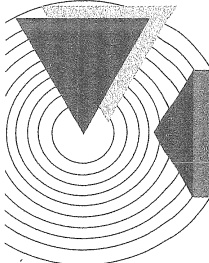

### 附录B

### 电路理论简明复习

本课程的先修课程是电路理论（电路分析基础），在本课程的电子电路分析与计算中，需要用到电路理论中的有关定理和定律。为便于学习，本附录将对电路理论中的基尔霍夫定律、线性电路的叠加原理、戴维南-诺顿定理和密勒定理进行简要回顾。

#### 1) 基尔霍夫电流、电压定律

基尔霍夫定律是描述电路网络中电流关系和电压关系的基本定律，它包括电流定律和电压定律。

### 1. 基尔霍夫电流定律（KCL）

在集总电路中，对任一节点，在任何时刻，流出（或流进）该节点的所有支路电流的代数和为零。其数学表达式为

$$  \sum_{k=1}^{n}i_{k}(t)=0   \tag*{(B.1.1)}$$

式中  $ i_{k}(t) $ 为 t 时刻流出（或流进）该节点的第 k 条支路的电流；n 为该节点处的支路数。此处，电流的“代数和”是包含电流的流向的。若流出节点的电流前面取“+”号，则流入节点的电流前面取“-”号；电流是流出节点还是流入节点，均根据电流的参考方向判定。例如对图 B.1.1 所示电路中的节点 1，有

 $$ -i_{s}+i_{1}+i_{3}=0 $$ 

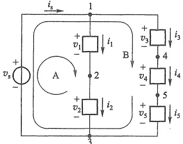

图 B.1.1
 

### 2. 基尔霍夫电压定律（KVL）

在集总电路中，对于任一回路，在任何时刻，沿着该回路的所有支路电压降的代数和为零。其数学表达式为

$$  \sum_{k=1}^{n}v_{k}(t)=0   \tag*{(B.1.2)}$$

式中  $ v_{k}(t) $ 为 t 时刻该回路中的第 k 条支路的电压；n 为该回路中的支路数。上式取和时，需要任意指定一个回路的绕行方向，凡支路电压的参考方向与回路的绕行方向一致者，该电压前面取“+”号，否则取“-”号。例如对图 B.1.1 所示电路中的回路 B，有

<!-- page: 511 -->

$$ v_{3}+v_{4}+v_{5}-v_{\mathrm{a}}=0 $$ 

基尔霍夫定律适用于包括线性和非线性的任意集总电路网络。

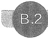

#### 叠加原理

叠加性是线性电路最重要的基本性质。一般来说，叠加原理可以陈述如下：

在任何线性电路中，任何支路的电流或电压都可以看作是每个独立源单独作用于电路时，在该支路上所产生的电流或电压的代数和。独立电源单独作用时，其他独立源应强制为零值，即令电压源短路，电流源开路。

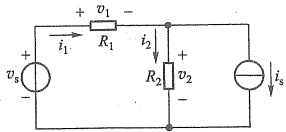

下面以图 B.2.1 所示电路为例加以说明。图中  $ v_{s} $ 和  $ i_{s} $ 是两个独立电源，当独立电压源  $ v_{s} $ 单独作用时，可

图 B.2.1 叠加原理应用举例
 

以将图 B.2.1 等效为图 B.2.2a 的形式；而独立电流源  $ i_{s} $ 单独作用时，则等效为图 B.2.2b 的形式。根据叠加原理，此时电流  $ i_{1} $ 为图 B.2.2a 中电流  $ i_{1}^{\prime} $ 和图 B.2.2b 中电流  $ i_{1}^{\prime\prime} $ 的线性叠加，即

 $$ i_{1}=i_{1}^{\prime}\mid_{i_{s}=0}+i_{1}^{\prime\prime}\mid_{v_{s}=0}=\frac{v_{s}}{R_{1}+R_{2}}+\frac{R_{2}}{R_{1}+R_{2}}\cdot i_{s} $$ 

同理可得电流  $ i_{2} $ 为

 $$ i_{2}=i_{2}^{\prime}\mid_{i_{s}=0}+i_{2}^{\prime\prime}\mid_{v_{s}=0}=\frac{v_{s}}{R_{1}+R_{2}}-\frac{R_{1}}{R_{1}+R_{2}}\cdot i_{s} $$ 

由此可见，利用叠加原理，常常使电路求解变得较简单了。

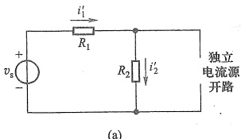

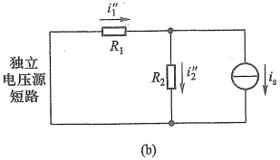

图 B.2.2 用叠加原理计算图 B.2.1 的例子
 

(a) 令独立电流源  $ i_{s}=0 $ (b) 令独立电压源  $ v_{s}=0 $
 

此例中，也可以用叠加原理求出电路中的电压  $ v_{1} $ 和  $ v_{2} $

应用叠加原理时应注意：

（1）只有线性电路才具有叠加性，对非线性电路不能应用叠加原理。

（2）只有独立电源才能进行置零处理，对含有受控源的电路，使用叠加原理时切勿强制受控源取零值。这是因为一旦受控源被强制取零值就等于在电路中撤销了该受控源所代表的物理元件，从而导致错误的结果。

（3）功率的计算不能用叠加原理。

<!-- page: 512 -->

##### B.3 戴维南定理和诺顿定理

##### B.3.1 戴维南定理

戴维南定理指出：任何一个线性含源单口电阻网络可以用一个电压源  $ v_{Th} $ 和一个电阻  $ R_{Th} $ 串联替代，如图 B.3.1 所示，图 B.3.1b 电路称为戴维南等效电路。等效电路端口的 v-i 特性与实际电路端口的 v-i 特性完全相同。电压源的电压  $ v_{Th} $ 等于含源单口网络的端口开路电压，电阻  $ R_{Th} $ 等于含源单口网络化成无源（不含有独立电源）网络后的端口等效电阻。线性含源电阻网络是指仅包含电阻、独立电源和受控电源的线性网络。

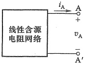

(a)
 

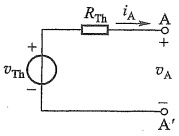

(b)
 

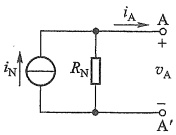

(c)
 

图 B.3.1 戴维南定理的应用例子
 

（a）线性含源电阻网络 （b）戴维南等效电路 （c）诺顿等效电路
 

求解戴维南等效电路的方法归纳如下：

（1）断开网络端口负载，求出端口开路电压即为戴维南等效电路中的电压源 $ v_{Th} $。

（2）运用以下两种方法之一求出戴维南等效电路中的电阻  $ R_{Th} $

① 将网络内部独立电源置零（即电压源短路，电流源开路），用串并联公式计算出从端口看入的等效电阻  $ R_{Th} $。如果电路中包含受控电源，则需要用外加测试电源的方法求解等效电阻  $ R_{Th} $，具体见例 B.3.1。

② 将端口短路，求出短路电流  $ i_{s} $，则等效电阻  $ R_{Th}=v_{Th}/i_{s} $

对于实际的电路，常常通过实验测得端口的开路电压和短路电流，从而得到其戴维南等效电路。这种实验测试方法可以在不知道网络内部具体电路的情况下进行。

例 B.3.1 试求图 B.3.2a 所示电路的戴维南等效电路。

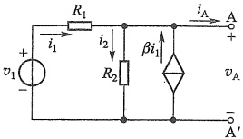

(a)
 

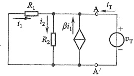

(b)
 

图 B.3.2 例 B.3.1 的电路
 

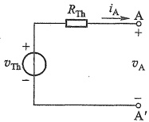

(c)
 

（a）原电路 （b）外加测试电压时 （c）戴维南等效电路
 

<!-- page: 513 -->

解: 首先求图 B.3.2a 的端口开路电压。由图看出, 端口开路电压就是电阻  $ R_{2} $ 上的电压。因为端口开路, 所以  $ i_{A}=0 $, 端口开路电压

$$  v_{\mathrm{T h}}=i_{2}R_{2}   \tag*{(B.3.1)}$$

又根据基尔霍夫定律及欧姆定律有

$$  \left\{\begin{aligned}{}&{{}i_{2}-i_{1}-\beta i_{1}=0}\\ {}&{{}i_{1}=\frac{v_{1}-v_{\mathrm{T h}}}{R_{1}}}\\ \end{aligned}\right.   \tag*{(B.3.2)}$$

由式(B.3.1)和式(B.3.2)得

$$  v_{\mathrm{Th}}=\frac{\left(1+\beta\right)R_{2}}{R_{1}+\left(1+\beta\right)R_{2}}v_{1}   \tag*{(B.3.3)}$$

由于电路中含有受控源，所以需用外加测试电源的方法求解等效电阻 $ R_{Th} $。将独立电压源置零后，在端口外加一测试电压源如图B.3.2b所示，对此可列出如下关系式：

$$  \left\{\begin{aligned}{}&{{}i_{2}-i_{1}-\beta~i_{1}-i_{\operatorname{T}}=0}\\ {}&{{}v_{\operatorname{T}}=i_{2}R_{2}}\\ {}&{{}v_{\operatorname{T}}=-i_{1}R_{1}}\\ \end{aligned}\right.   \tag*{(B.3.4)}$$

由此可得端口等效电阻  $ R_{Th} $ 为

$$  R_{\mathrm{Th}}=\frac{v_{\mathrm{T}}}{i_{\mathrm{T}}}=\frac{R_{1}R_{2}}{R_{1}+\left(1+\beta\right)R_{2}}=R_{2}\mathbin{//}\frac{R_{1}}{1+\beta}   \tag*{(B.3.5)}$$

故戴维南等效电路如图 B.3.2c 所示。

##### B.3.2 诺顿定理

诺顿定理指出：任何一个线性含源单口电阻网络可以用一个电流源  $ i_{N} $ 和一个电阻  $ R_{N} $ 并联替代，如图 B.3.1c 所示。电流源电流  $ i_{N} $ 等于该网络的端口短路电流，并联电阻等于该网络内部独立电源均为零（即电压源短路，电流源开路）时，网络的端口等效电阻。

实际上，根据电源的等效变换原理，把用戴维南定理求出的等效含源支路（图 B.3.1b）变换为一个电流源和一个电阻的并联电路（图 B.3.1c），便可以得到诺顿等效电路，其中  $ i_{N}=v_{Th}/R_{Th}, R_{Th}=R_{N} $。

##### B.4 密勒定理

在放大电路分析中，有时候会遇到图 B.4.1a 所示的网络结构，在节点 1 和节点 2 之间接有一阻抗 Z，会增加计算的复杂程度。密勒定理则提供了一种简化分析的方法。可以把图 B.4.1a 的电路变换成为图 B.4.1b 的电路，后者称为前者的密勒等效电路。现说明如下。

假设在一个任意网络中 $ V_{1} $和 $ \dot{V}_{2} $分别为节点1和2对地的电压，节点1和2之间跨接着阻抗Z，如图B.4.1a所示。并已知该两点间电压传输系数为

$$  \dot{K}=\dot{V}_{2}/\dot{V}_{1}   \tag*{(B.4.1)}$$

<!-- page: 514 -->

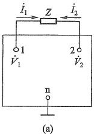

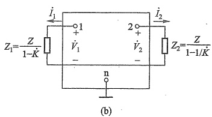

图 B.4.1 用密勒定理对网络进行变换   (a) 原网络 (b) 密勒等效电路
 

在图 B.4.1a 中， $ I_{1} $ 是由节点 1 出发流过 Z 的电流，有

$$  \dot{I}_{1}=\frac{\dot{V}_{1}-\dot{V}_{2}}{Z}=\frac{\dot{V}_{1}-\dot{K}\dot{V}_{1}}{Z}=\frac{\dot{V}_{1}(1-\dot{K})}{Z}=\frac{\dot{V}_{1}}{Z/(1-\dot{K})}=\frac{\dot{V}_{1}}{Z_{1}}   \tag*{(B.4.2)}$$

其中

$$  Z_{1}=\frac{Z}{1-\dot{K}}   \tag*{(B.4.3)}$$

式(B.4.2)说明，原来由节点1出发流过Z的电流 $ \dot{I}_{1} $等于由节点1出发通过接地阻抗 $ Z_{1} $的电流，如图B.4.1b左侧所示。换句话说，在节点1与地之间并联一阻抗 $ Z_{1} $以取代原先的阻抗Z，从节点1流出的电流 $ \dot{I}_{1} $与原网络相等。

同理，对于由节点2出发流过Z的电流 $ I_{2} $也有

$$  \dot{I}_{2}=\frac{\dot{V}_{2}-\dot{V}_{1}}{Z}=\frac{\dot{V}_{2}-\dot{V}_{2}/\dot{K}}{Z}=\frac{\dot{V}_{2}\left(1-\frac{1}{\dot{K}}\right)}{Z}=\frac{\dot{V}_{2}}{Z/\left(1-\frac{1}{\dot{K}}\right)}=\frac{\dot{V}_{2}}{Z_{2}}   \tag*{(B.4.4)}$$

其中

$$  Z_{2}=\frac{Z}{1-\frac{1}{\dot{K}}}   \tag*{(B.4.5)}$$

式(B.4.4)说明，在节点2与地之间并联一阻抗 $ Z_{2} $以取代原来的阻抗Z，则从节点2流出的电流 $ \dot{I}_{2} $与原网络相等，如图B.4.1b右侧所示。

由上述分析可知，当比例系数 K 由图 B.4.1a 确定，而  $ Z_{1} $ 和  $ Z_{2} $ 则由式 (B.4.3) 及式 (B.4.5) 分别确定时，图 B.4.1 中的图 a 与图 b 是等效的。

必须指出的是，应用密勒定理对电路进行分析计算时，若电压传输系数 K 值很大，则经密勒变换后的阻抗  $ Z_{2} $ 可以认为与 K 值无关，允许近似处理，即  $ Z_{2} \approx Z $。

