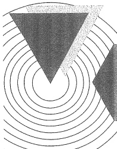
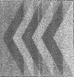
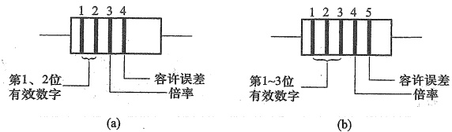

# 14-附录C 电阻的彩色编码和标称阻值

[返回全书目录](../../README.md)

> PDF 页码：515–516

<!-- page: 515 -->

## 附录 C 电阻的彩色编码和标称阻值

### 1. 电阻器的容许误差和标称阻值

电阻器的标称阻值是产品标注的“名义”阻值。标称阻值的规定与电阻的误差等级直接相关。电阻器常见的容许误差有±20%、±10%、±5%三个误差等级，分别对应E6、E12、E24系列，它们分别表示对应的系列有6个、12个和24个标称值。高精度的电阻器则有E48、E96和E192三个标称值系列，分别对应±2%、±1%、±0.5%三个误差等级，高于±0.5%的也使用E192误差等级。E48系列有48个标称值，精度越高，标称值的数目越多。电阻器标称值系列如表C.0.1所示。表中未给出E96和E192系列。

表C.0.1 标称阻值
 

<table border=1 style='margin: auto; word-wrap: break-word;'><tr><td style='text-align: center; word-wrap: break-word;'>标称值系列</td><td style='text-align: center; word-wrap: break-word;'>允许误差</td><td colspan="14">标称阻值系列</td></tr><tr><td style='text-align: center; word-wrap: break-word;'>E6</td><td style='text-align: center; word-wrap: break-word;'>$ \pm 20\% $</td><td style='text-align: center; word-wrap: break-word;'>10</td><td style='text-align: center; word-wrap: break-word;'>15</td><td style='text-align: center; word-wrap: break-word;'>22</td><td style='text-align: center; word-wrap: break-word;'>33</td><td style='text-align: center; word-wrap: break-word;'>47</td><td style='text-align: center; word-wrap: break-word;'>68</td><td style='text-align: center; word-wrap: break-word;'></td><td style='text-align: center; word-wrap: break-word;'></td><td style='text-align: center; word-wrap: break-word;'></td><td style='text-align: center; word-wrap: break-word;'></td><td style='text-align: center; word-wrap: break-word;'></td><td style='text-align: center; word-wrap: break-word;'></td><td style='text-align: center; word-wrap: break-word;'></td><td style='text-align: center; word-wrap: break-word;'></td></tr><tr><td style='text-align: center; word-wrap: break-word;'>E12</td><td style='text-align: center; word-wrap: break-word;'>$ \pm 10\% $</td><td style='text-align: center; word-wrap: break-word;'>10</td><td style='text-align: center; word-wrap: break-word;'>12</td><td style='text-align: center; word-wrap: break-word;'>15</td><td style='text-align: center; word-wrap: break-word;'>18</td><td style='text-align: center; word-wrap: break-word;'>22</td><td style='text-align: center; word-wrap: break-word;'>27</td><td style='text-align: center; word-wrap: break-word;'>33</td><td style='text-align: center; word-wrap: break-word;'>39</td><td style='text-align: center; word-wrap: break-word;'>47</td><td style='text-align: center; word-wrap: break-word;'>56</td><td style='text-align: center; word-wrap: break-word;'>68</td><td style='text-align: center; word-wrap: break-word;'>82</td><td style='text-align: center; word-wrap: break-word;'></td><td style='text-align: center; word-wrap: break-word;'></td></tr><tr><td rowspan="2">E24</td><td rowspan="2">$ \pm 5\% $</td><td style='text-align: center; word-wrap: break-word;'>10</td><td style='text-align: center; word-wrap: break-word;'>11</td><td style='text-align: center; word-wrap: break-word;'>12</td><td style='text-align: center; word-wrap: break-word;'>13</td><td style='text-align: center; word-wrap: break-word;'>15</td><td style='text-align: center; word-wrap: break-word;'>16</td><td style='text-align: center; word-wrap: break-word;'>18</td><td style='text-align: center; word-wrap: break-word;'>20</td><td style='text-align: center; word-wrap: break-word;'>22</td><td style='text-align: center; word-wrap: break-word;'>24</td><td style='text-align: center; word-wrap: break-word;'>27</td><td style='text-align: center; word-wrap: break-word;'>30</td><td style='text-align: center; word-wrap: break-word;'>33</td><td style='text-align: center; word-wrap: break-word;'>36</td></tr><tr><td style='text-align: center; word-wrap: break-word;'>51</td><td style='text-align: center; word-wrap: break-word;'>56</td><td style='text-align: center; word-wrap: break-word;'>62</td><td style='text-align: center; word-wrap: break-word;'>68</td><td style='text-align: center; word-wrap: break-word;'>75</td><td style='text-align: center; word-wrap: break-word;'>82</td><td style='text-align: center; word-wrap: break-word;'>91</td><td style='text-align: center; word-wrap: break-word;'></td><td style='text-align: center; word-wrap: break-word;'></td><td style='text-align: center; word-wrap: break-word;'></td><td style='text-align: center; word-wrap: break-word;'></td><td style='text-align: center; word-wrap: break-word;'></td><td style='text-align: center; word-wrap: break-word;'></td><td style='text-align: center; word-wrap: break-word;'></td></tr><tr><td rowspan="4">E48</td><td rowspan="4">$ \pm 2\% $</td><td style='text-align: center; word-wrap: break-word;'>100</td><td style='text-align: center; word-wrap: break-word;'>105</td><td style='text-align: center; word-wrap: break-word;'>110</td><td style='text-align: center; word-wrap: break-word;'>115</td><td style='text-align: center; word-wrap: break-word;'>121</td><td style='text-align: center; word-wrap: break-word;'>127</td><td style='text-align: center; word-wrap: break-word;'>133</td><td style='text-align: center; word-wrap: break-word;'>140</td><td style='text-align: center; word-wrap: break-word;'>147</td><td style='text-align: center; word-wrap: break-word;'>154</td><td style='text-align: center; word-wrap: break-word;'>162</td><td style='text-align: center; word-wrap: break-word;'>169</td><td style='text-align: center; word-wrap: break-word;'>178</td><td style='text-align: center; word-wrap: break-word;'>187</td></tr><tr><td style='text-align: center; word-wrap: break-word;'>196</td><td style='text-align: center; word-wrap: break-word;'>205</td><td style='text-align: center; word-wrap: break-word;'>215</td><td style='text-align: center; word-wrap: break-word;'>226</td><td style='text-align: center; word-wrap: break-word;'>237</td><td style='text-align: center; word-wrap: break-word;'>249</td><td style='text-align: center; word-wrap: break-word;'>261</td><td style='text-align: center; word-wrap: break-word;'>274</td><td style='text-align: center; word-wrap: break-word;'>287</td><td style='text-align: center; word-wrap: break-word;'>301</td><td style='text-align: center; word-wrap: break-word;'>316</td><td style='text-align: center; word-wrap: break-word;'>332</td><td style='text-align: center; word-wrap: break-word;'>348</td><td style='text-align: center; word-wrap: break-word;'>365</td></tr><tr><td style='text-align: center; word-wrap: break-word;'>383</td><td style='text-align: center; word-wrap: break-word;'>402</td><td style='text-align: center; word-wrap: break-word;'>422</td><td style='text-align: center; word-wrap: break-word;'>442</td><td style='text-align: center; word-wrap: break-word;'>464</td><td style='text-align: center; word-wrap: break-word;'>487</td><td style='text-align: center; word-wrap: break-word;'>511</td><td style='text-align: center; word-wrap: break-word;'>536</td><td style='text-align: center; word-wrap: break-word;'>562</td><td style='text-align: center; word-wrap: break-word;'>590</td><td style='text-align: center; word-wrap: break-word;'>619</td><td style='text-align: center; word-wrap: break-word;'>649</td><td style='text-align: center; word-wrap: break-word;'>681</td><td style='text-align: center; word-wrap: break-word;'>715</td></tr><tr><td style='text-align: center; word-wrap: break-word;'>750</td><td style='text-align: center; word-wrap: break-word;'>787</td><td style='text-align: center; word-wrap: break-word;'>825</td><td style='text-align: center; word-wrap: break-word;'>866</td><td style='text-align: center; word-wrap: break-word;'>909</td><td style='text-align: center; word-wrap: break-word;'>953</td><td style='text-align: center; word-wrap: break-word;'></td><td style='text-align: center; word-wrap: break-word;'></td><td style='text-align: center; word-wrap: break-word;'></td><td style='text-align: center; word-wrap: break-word;'></td><td style='text-align: center; word-wrap: break-word;'></td><td style='text-align: center; word-wrap: break-word;'></td><td style='text-align: center; word-wrap: break-word;'></td><td style='text-align: center; word-wrap: break-word;'></td></tr></table>

一般固定式电阻器产品都按标称阻值生产。它们的阻值应符合上表所列数值或上表所列数值乘以 $ 10^{n} $，其中n取值为-2,-1,0,1,2,3, $ \cdots $,9，单位为 $ \Omega $。

### 2. 电阻器的彩色编码

体积很小的电阻器经常采用色环法表示阻值和误差，不同颜色的色环代表不同的数字，通过色环的颜色可以读出电阻阻值的大小和容许误差。由于E6、E12和E24系列标称值的有效数字只有2位，而E48、E96和E192等高精度系列标称值有3位有效数字，所以色环电阻有4色环和5色环两种标注方式，如图C.0.1所示。两者的区别在于：4色环电阻用前2位表示电阻的有效数字，而5色环电阻用前3位表示该电阻的有效数字，两者的倒数第二位表示倍率，即有效数字后零的个数，最后一位表示了该电阻的误差。色环表示的含义见表C.0.2。

<!-- page: 516 -->

图 C.0.1 电阻的色环标记
 

（a）4 色环标记 （b）5 色环标记

表 C.0.2 色环颜色的规定
 

<table border=1 style='margin: auto; word-wrap: break-word;'><tr><td style='text-align: center; word-wrap: break-word;'>颜色</td><td style='text-align: center; word-wrap: break-word;'>黑</td><td style='text-align: center; word-wrap: break-word;'>棕</td><td style='text-align: center; word-wrap: break-word;'>红</td><td style='text-align: center; word-wrap: break-word;'>橙</td><td style='text-align: center; word-wrap: break-word;'>黄</td><td style='text-align: center; word-wrap: break-word;'>绿</td><td style='text-align: center; word-wrap: break-word;'>蓝</td><td style='text-align: center; word-wrap: break-word;'>紫</td><td style='text-align: center; word-wrap: break-word;'>灰</td><td style='text-align: center; word-wrap: break-word;'>白</td><td style='text-align: center; word-wrap: break-word;'>金</td><td style='text-align: center; word-wrap: break-word;'>银</td><td style='text-align: center; word-wrap: break-word;'>无</td></tr><tr><td style='text-align: center; word-wrap: break-word;'>对应数字</td><td style='text-align: center; word-wrap: break-word;'>0</td><td style='text-align: center; word-wrap: break-word;'>1</td><td style='text-align: center; word-wrap: break-word;'>2</td><td style='text-align: center; word-wrap: break-word;'>3</td><td style='text-align: center; word-wrap: break-word;'>4</td><td style='text-align: center; word-wrap: break-word;'>5</td><td style='text-align: center; word-wrap: break-word;'>6</td><td style='text-align: center; word-wrap: break-word;'>7</td><td style='text-align: center; word-wrap: break-word;'>8</td><td style='text-align: center; word-wrap: break-word;'>9</td><td style='text-align: center; word-wrap: break-word;'></td><td style='text-align: center; word-wrap: break-word;'></td><td style='text-align: center; word-wrap: break-word;'></td></tr><tr><td style='text-align: center; word-wrap: break-word;'>倍率</td><td style='text-align: center; word-wrap: break-word;'>$ 10^{0} $</td><td style='text-align: center; word-wrap: break-word;'>$ 10^{1} $</td><td style='text-align: center; word-wrap: break-word;'>$ 10^{2} $</td><td style='text-align: center; word-wrap: break-word;'>$ 10^{3} $</td><td style='text-align: center; word-wrap: break-word;'>$ 10^{4} $</td><td style='text-align: center; word-wrap: break-word;'>$ 10^{5} $</td><td style='text-align: center; word-wrap: break-word;'>$ 10^{6} $</td><td style='text-align: center; word-wrap: break-word;'>$ 10^{7} $</td><td style='text-align: center; word-wrap: break-word;'>$ 10^{8} $</td><td style='text-align: center; word-wrap: break-word;'>$ 10^{9} $</td><td style='text-align: center; word-wrap: break-word;'>$ 10^{-1} $</td><td style='text-align: center; word-wrap: break-word;'>$ 10^{-2} $</td><td style='text-align: center; word-wrap: break-word;'></td></tr><tr><td style='text-align: center; word-wrap: break-word;'>容许误差/%</td><td style='text-align: center; word-wrap: break-word;'></td><td style='text-align: center; word-wrap: break-word;'>$ \pm 1 $</td><td style='text-align: center; word-wrap: break-word;'>$ \pm 2 $</td><td style='text-align: center; word-wrap: break-word;'></td><td style='text-align: center; word-wrap: break-word;'></td><td style='text-align: center; word-wrap: break-word;'>$ \pm 0.5 $</td><td style='text-align: center; word-wrap: break-word;'>$ \pm 0.25 $</td><td style='text-align: center; word-wrap: break-word;'>$ \pm 0.1 $</td><td style='text-align: center; word-wrap: break-word;'></td><td style='text-align: center; word-wrap: break-word;'></td><td style='text-align: center; word-wrap: break-word;'>$ \pm 5 $</td><td style='text-align: center; word-wrap: break-word;'>$ \pm 10 $</td><td style='text-align: center; word-wrap: break-word;'>$ \pm 20 $</td></tr></table>

在某些不好区分的情况下，也可以对比两个起始端的色彩，因为计算的起始部分即第1色环不会是金、银、黑3种颜色。如果靠近边缘的是这3种色彩，则需要倒过来计算。

例如，某电阻器的5道色环依次为“棕、绿、黄、橙、金”，则其阻值为154 000 Ω，误差为±5%。

