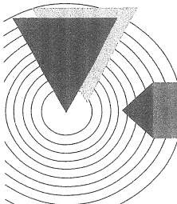

# 15-参考文献

[返回全书目录](../../README.md)

> PDF 页码：517–518

<!-- page: 517 -->

## 参考文献

[1] Adel S S, Kenneth C S. Microelectronic Circuits [M]. 7th ed. New York: Oxford University Press, 2015.

[2] Donald A N. Microelectronics: Circuit Analysis and Design[M]. 4th ed. 影印版. 北京：清华大学出版社，2018.

[3] Pual H, Winfield H. The Art of Electronics [M]. 3rd ed. Cambridge: Cambridge University Press, 2015.

[4] Sergio F. Analog Circuit Design: Discrete & Integrated[M]. New York: McGraw-Hill Education, 2015.

[5] Sergio F. Design with Operational Amplifiers and Analog Integrated Circuits [M]. 4th ed. New York: McGraw-Hill Education, 2015.

[6] Richard C J, Travis N B, Microelectronic Circuit Design [M]. 5th ed. New York: McGraw-Hill Education, 2016.

[7] Ulrich T, Christoph S, Eberhard G. Electronic Circuits Handbook for Design and Applications [M]. 2nd ed. Springer com., 2008.

[8] Allan R H. Electranics[M]. 2nd ed. New Jersey: Prentice-Hall Inc., 2000.

[9] Horenstein M N. Microelectronic Circuits and Devices[M]. 2nd ed. New Jersey: Prentice-Hall Inc., 1996.

[10] Millman J, Grabel A. Microelectronics[M]. New York: McGraw-Hill Book Company, 1987.

[11] 清华大学电子学教研组编，童诗白，华成英. 模拟电子技术基础 [M]. 5 版. 北京：高等教育出版社，2015.

[12] 哈尔滨工业大学电子学教研室编，王淑娟，蔡惟铮，齐明．模拟电子技术基础[M]．北京：高等教育出版社，2009.

[13] 西安交通大学电子学教研组编，赵进全，杨拴科．模拟电子技术基础[M]．3版．北京：高等教育出版社，2019.

[14] 浙江大学电工电子基础教学中心电子技术课程组编，郑家龙，陈隆道，蔡忠法．集成电子技术基础教程 上册[M].2版.北京：高等教育出版社，2008.

[15] 谢嘉奎. 电子线路 线性部分[M]. 4 版. 北京：高等教育出版社，1999.

[16] 王远．模拟电子技术[M]. 2版．北京：机械工业出版社，1994.

[17] 谢沅清，邓钢．电子电路基础[M]．北京：电子工业出版社，2006.

<!-- page: 518 -->

[18] 陈大钦．模拟电子技术基础[M]. 3 版. 北京：高等教育出版社，2000.

[19] 瞿安连. 应用电子技术[M]. 北京：科学出版社，2003.

[20] 朱达斌，张宝玉，张文骏．模拟集成电路的特性与应用[M]．北京：航空工业出版社，1994.

[21] 李瀚荪. 电路分析基础上、中、下册[M]. 3版. 北京：高等教育出版社，2000.

[22] 郑君里，应启珩，杨为理．信号与系统上、下册[M]. 2版. 北京：高等教育出版社，2000.

[23] 张凤言．电子电路基础[M]. 2 版. 北京：高等教育出版社，1995.

