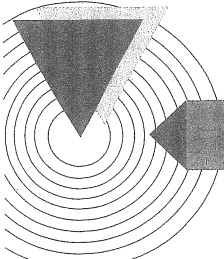

# 16-索引

[返回全书目录](../../README.md)

> PDF 页码：519–526

<!-- page: 519 -->

### 索引

## 二 画

##### 二极管(diode) 61

点接触型~（point contact type~）61  

面结型~（junction type~）61  

~I-V特性（~I-V characteristic）62  

~参数（~parameters）63  

~理想模型（~ideal model）66  

~恒压降模型（~constant voltage drop model）66  

~折线模型（~piecewise model）67  

~微变电阻（~increment resistance）68  

齐纳~（Zener~）77  

变容~（varactor~）79  

肖特基~（Schottky~）80  

光电~（photo~）81  

发光~（light-emitting~）81  

激光~（laser~）82

三极管(transistor) 89 152

双极结型~(bipolar junction~) 152

场效应~(field effect~) 89

三角波产生电路(triangle-wave generator) 433

## 三 画

小信号模型（small signal model）67 111

二极管~(diode~) 67

MOSFET~(FET~) 111

BJT~(BJT~) 164

## 四 画

双极结型三极管（bipolar junction transistor, BJT）152

~结构(~construction) 152

~共基极组态(~common-base configuration) 157

~共射极组态(~common-emitter configuration) 157

~电流放大系数(~current gain) 157

~特性曲线(~characteristics) 158

~放大区(~active region) 160

~截止区(~cutoff region) 160

~饱和区(~saturation region) 160

~参数(~parameters) 160

~极限参数(定额)(~ratings) 161

~击穿电压(~breakdown voltage) 161

~图解分析(~graphical analysis) 163

<!-- page: 520 -->

~小信号模型(~small signal model)

~基区的体电阻( $ r_{bb'} $)(~base-spreading resistance) 167

~混合  $ \pi $ 模型 (~hybrid  $ \pi $ model) 201

开关电容滤波器(switched capacitor filter)401

开关稳压电路(switching regulated circuit)

~脉宽调制(~pulse width modulation,

~PWM) 464

~占空比(~duty ratio) 462

升压型~(Boost~) 462

降压型~(Buck~)461

极性反转型~(Buck Boost-inverting~)

太阳能电池（solar cell）83

厄利电压(Early voltage) 98 160

互导(transconductance) 99 202

~增益(~gain) 6

互补对称功率放大电路(complementary symmetry power amplifier) 362

互补型 MOS(complementary MOS, CMOS)

中心角频率 (central angular frequency)

反向偏置(reverse bias) 58

反向饱和电流(reverse saturation current)

58 63 161

反馈放大电路(feedback amplifiers) 302

~方框图(~block diagram) 303

~万框图(~block diagram) 303

~基本放大电路(~basic amplifier) 30

~反馈网络(~feedback network) 302

电压串联~(voltage-series~) 309

电压并联~(voltage-shunt~) 310

电流串联~(current-series~) 311

电流并联~(current-shunt~) 312

~一般表达式(~basic equation) 314

~开环增益(~open-loop gain) 314

~闭环增益(~closed-loop gain) 314

~环路增益(~loop gain) 315

~开环上限频率(~open-loop high 3-dB frequency) 323

~闭环上限频率(~closed-loop high 3-dB frequency) 324

~反馈深度(~desensitivity) 315

~非线性失真(~nonlinear distortion) 317

~抑制噪声(~reduction of noise) 318

~输入电阻(~input resistance) 320

~输出电阻(~output resistance) 321

~频率响应(~frequency response) 323

~稳定性(~stability) 337

~波特图(~Bode plot) 339

~增益裕度(~gain margin) 339

~相位裕度(~phase margin) 339

~频率补偿(~frequency compensation) 343

正向偏置(forward bias) 57

功率放大电路(power amplifier) 359

~效率(~efficiency) 359

甲类~(class A~) 361

乙类~(class B~) 362

分贝(decibel, dB) 11

方波产生电路(square wave generator) 428

## 五 画

甲乙类~(class AB~) 368

丁类~(class D~) 371

互补对称~(complementary symmetry~)

推挽式~(push pull~) 363

<!-- page: 521 -->

OCL~(output capacitorless~) 369

OTL~(output transformerless~) 369

集成~(integrated~) 376

功率管(power transistor) 372

~二次击穿(~second breakdown) 373

纵向 MOS~(VMOS) 373

双扩散 MOS~（DMOS）373

平顶降落（tilt）220

电压比较器（voltage comparator）421

电压跟随器（voltage follower）26 173

电容（capacitance）27

势垒~（barrier~）61

扩散~（diffusion~）60

负载~(load~) 190

接线~（wiring~）287

电流跟随器（current follower）127

电流源 (current source) 228

镜像～(mirror~) 228

多路~(multiple~) 230 233

微~（widlar~）232

四象限乘法器(quarter-square multiplier)

失真(distortion) 13

幅度~ $ amplitude\sim $ 13

相位~ $ phase\sim $ 13

非线性~ $ (nonlinear\sim) $ 14

交越~(crossover~) 368

截止~(cutoff~) 107 164

饱和～（saturation～）107 164

仪用放大器(instrumentation amplifier) 35

半导体(semiconductor) 51

~二极管(见二极管) 61

~三极管(见三极管) 89 152

#### 六画

共价键(covalent bond) 51

共模信号（common-mode signal）21 234

共模抑制比(common-mode rejection ratio)

22 239

场效应三极管(field effect transistor, FET)

金属-氧化物-半导体~(metal-oxide-

semiconductor~, MOS~) 89

绝缘栅型～（isolated gate～）90

增强型～(enhancement~) 89 90

耗尽型～(depletion~) 89 95

~ 沟道长度调制效应(~ channel length modulation effect) 98

~阈值电压(~threshold voltage) 91

~夹断电压(~pinch off voltage) 137

~夹断点轨迹(~pinch off point track)

~特性方程(~characteristic equation)

~输出特性(共源)(~output characteristics (CS)) 93

~转移特性(~transfer characteristics) 95

~结构(~construction) 90

~衬底(~substrate) 90

~参数(~parameters) 99

~共源极放大电路(~common source amplifier) 102

~共漏极放大电路(~common drain amplifier) 121

~共栅极放大电路(~common gate amplifier) 123

结型(~junction~) 136

压控电压源（voltage-controlled voltage source）390

有源负载（active load）118 251

<!-- page: 522 -->

自由电子(free electron) 52 阻容耦合~(RC-coupled~) 134    
负载线(load line) 65 交流通路(AC path) 108    
直流~(direct current~, DC~) 106 齐纳击穿(Zener breakdown) 60    
交流~(alternating current~, AC~) 110 齐纳(稳压)二极管(见二极管) 77    
多级放大电路(multistage amplifier) 131

#### 七画

运算放大器(operational amplifier) 18

理想~(ideal~) 23

~虚短(~virtual short circuit) 23

~虚地(~virtual ground) 28

~输出饱和压降(~output saturation voltage drop) 20

~同相放大电路(~noninverting amplifier) 24

~反相放大电路(~inverting amplifier) 28

~求和电路(~summing amplifier) 32

~求差电路(~subtracting amplifier) 33

~积分电路(~integrator) 39

~微分电路(~differentiator) 40

集成~(integrated~) 255

通用~(popular~) 274

专用~(special~) 274

标准~(standard~) 259

全差分~(fully differential~) 259

电流反馈~(current feedback~, CFA) 263

~参数(~parameters) 265

~ 偏置电流 (~ bias current) 257

~ 失调电流 (~ offset currents) 256

~ 失调电压 (~ offset voltages) 256

~ 开环电压增益 (~ open loop voltage gain) 19

~ 幅频响应 (~ frequency response) 268

~ 单位增益带宽 (~ unit gain band width) 269

~ 共模抑制比 (~ common mode rejection ratio) 269

~ 输入电阻 (~ input resistance) 269

~ 输出电阻 (~ output resistance) 269

~ 转换速率 (~ slew rate) 270

~ 轨到轨输入 (~ rail-to-rail input, RRI) 270

~ 轨到轨输出 (~ rail-to-rail output, RRO) 269

迟滞比较器 (comparator with hysteresis) 423

时间常数 (time constant) 198

开路 ~ (open circuit ~) 210

直流(direct current) 102

~通路(~path) 103

~负载线(~load line) 106

#### 八画

势垒(barrier) 57

~电容(~capacitance) 61

受主杂质(acceptor impurities) 53

放大电路(amplifier) 102

电压~(voltage~) 310

电流~(current~) 312

互阻~(transresistance~) 311

<!-- page: 523 -->

互导～(transconductance~) 312

三极管~(transistor~) 89 152

共漏极～(common drain~) 121

共栅极~(common gate~) 123

共源-共栅~ $ cascade\sim $ 135

折叠式 cascode~(folded cascode~) 135

CMOS~ (complementary MOS~) 255

~频率响应(~frequency response) 190

~上限频率 (~high 3-dB frequency)

~下限频率 (~low 3-dB frequency)

~瞬态响应 (~transient response) 218

差分式~(differential~) 233

功率~(power~) 359

空穴(hole) 52

空间电荷区(space charge region) 56

波特图(Bode plot) 192

线性稳压电路(linear regulated circuit)

低压差~(low dropout, LDO~) 454

#### 九画

玻耳兹曼常数（Boltzmann constant）59

品质因数（quality factor）412

复合管（达林顿）电路（Darlington circuit）179

信号(signal) 1

~频谱(~frequency spectrum) 2

施主杂质(donor impurities) 54

栅源直流电阻(gate-source direct current resistance) 99

## 十 画

耗尽区（depletion region）56

载波（carrier）282

振荡电路（oscillator）404

正弦波~（sinusoidal~）404

RC ~ 406

LC~ 411

桥式（文氏电桥）~(Wien-bridge~)406

移相式~(phase shift~)409

三点式~(three-point~)415

晶体~(crystal~)418

变压器耦合~(transformer-coupled~)414

多谐~(multi-harmonic~)428

积分电路(integrator)39

特征角频率(characteristic angular frequency) 388

信噪比(signal-noise ratio) 286

倍压整流（voltage doubler circuit）451

射极输出器(emitter follower) 172

调制（modulation）282

振幅~ $ amplitude $~ $ 282 $

脉冲宽度~(pulse width~) 371 422

通频带(pass band) 13

放大电路~(amplifier~) 190

陷波(wave notch) 399

<!-- page: 524 -->

## 十 一 画

基区宽度调制效应(base-width modulating

effect) 160

密勒效应(Miller effect) 208

混合参数(H 参数)(hybrid parameter)

雪崩击穿（avalanche breakdown）59

密勒电容(Miller capacitance) 207

#### 十二画

集成功率放大器（见功率放大器）376 温漂（temperature drift）238

#### 十三画

零点漂移(zero drift) 238

频率(frequency) 2

特征～（characteristic～）203

~补偿(~compensation) 343

锯齿波产生电路(saw-tooth wave generator)

微分电路（differentiator）40

解调（demodulation）282

滤波电路(filter) 383

低通～(low-pass～) 385

有源~(active~) 383

带通～(band-pass～) 385

高通~(high-pass~) 384

带阻  $ \sim $ (band-reject  $ \sim $) 385

巴特沃斯~（Butterworth~）386

切比雪夫～（Chebyshev～） 386

贝塞尔～(Bessel~) 386

椭圆型～(Elliptic～) 386

开关电容~(switched capacitor~) 401

电容~ $ capacitance $~ $ 447 $

电感～(inductance～) 450

## 十 四 画

模拟乘法器（analog multiplier）277

线性~ $ linear\sim $ 452

变跨导～(variable transconductance～)

开关～(switching～) 460

稳压电源(regulated power supply) 444  

稳压管(见二极管) 77

## 十 五 画

##### 增益(Gain) 5

电压~ $ voltage\sim $6

互导~(transconductance~)6

电流  $ \sim $ (current  $ \sim $) 6

互阻~ $ (transresistance\sim) $ 6

共模电压～(common-mode voltage~)22

<!-- page: 525 -->

## 十 六 画

噪声(noise) 283 1/f~(fizker~) 285    
热~(thermal~) 284 ~系数(~factor) 286    
散粒~(shot~) 285

<!-- page: 526 -->

