# 01-第1章 电路的基本概念与电路定律

[返回全书目录](../../README.md)

> PDF 页码：11–35

<!-- page: 11 -->

### 第1章 电路的基本概念与电路定律

本章从建立电路模型、认识电路变量等最基本的问题出发，给出电路中电压、电流参考方向的概念，介绍电阻、独立电源和受控源等基本电路元件，阐述电路所遵循的基本定律，为电路分析奠定基础。

### 1.1 实际电路与电路模型

“模型”是现代自然科学、社会科学分析研究问题时普遍使用的重要概念。例如，没有宽窄厚薄的“直线”是数学学科研究中的一种模型；没有空间尺寸却有一定质量的“质点”是物理学科研究中的一种模型。人们在分析研究某一客观事物时，几乎都要采用模型化的方法，将客观事物科学抽象成反映客观事物最主要物理本质的理想化的物理模型，使问题得到合理的简化，然后再建立与物理模型相对应的数学模型，并以此模型作为对象进行定性和/或定量分析，根据分析结果，做出合乎客观事物实际情况的科学结论。在采用模型化的方法中，人们用对其模型的分析代替对客观事物的分析。可以说，一切科学理论都建立在模型基础之上，没有模型就很难形成科学分析。分析研究电路问题也是如此，首先要建立电路模型，然后再用数学的方法对电路模型进行定量分析和计算。

#### 1.1.1 实际电路的组成与功能

人们对 “实际电路” 的概念并不陌生，在广泛用电的今天，实际电路可以说是随处可见。例如，一个干电池，一个灯泡，一个开关，再加上三根导线，按照图1-1所示的方式连接起来，就组成了一个最简单的实际照明电路。

由此可以对实际电路做出如下的一般性定义：若干个电气设备或电子元件，按照一定的方式相互连接起来所形成的电流的通路，就是实际电路。

实际电路的形式多种多样，如由电阻、电感、电容及晶体管等元件构成的分立元件电路，或将数以千计的元件集成在

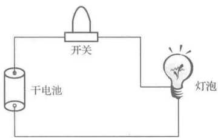

图 1-1 简单照明电路
 

几个平方毫米内的集成电路，以及电力系统、现代通信网络、数据信息计算机网络等大型电路。

实际电路的功能基本上可以分成两类。一类是用来实现电能的转换、传输和分配。例如，发电厂的发电机把热能或水能转换成电能，通过变压器、输电线等输送分配给用电单位，其用电设备又把电能转换成机械能、光能或热能等，这样就构成了一个庞大的极为复杂的电力系统电路。其中供给电能的设备称为电源，而用电设备则称为负载。另一类是用来传输、储存、处理各种电信号。例如，数字语音信号、数字图像信号和控制信号等。目前，人们可以很方便地设计制造出各种不同的电路，以完成某种预期的功能。如整流，即把两个方向的交流电信号变成单一方向的交流电信号；放大，即把微弱电信号放大为强电信号；滤波，即把电信号中不需要的频率成分或干扰抑制掉；变换，即把一种电信号波形变换为所需要的另一种电信号波形；取样，即把连续电信号变成离散电信号；记忆，即把原电信号存储下来，需要时再将其取出。图1-2是描述上述这些电路功能的示意图，左边波形为电路的输入信号也称电路的激励，而右边波形则为电路的输出信号也称电路的响应。

<!-- page: 12 -->

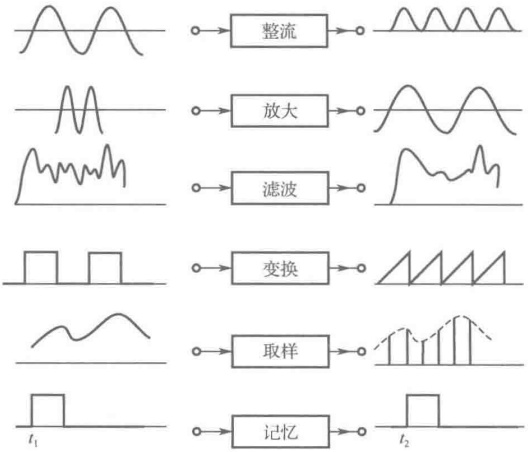

图 1-2 电路功能示意图
 

#### 1.1.2 电路模型

构成实际电路的电气设备和电子元件统称为实际电路元件，常用的实际电路元件有发电机、电池、信号发生器、电阻器、电容器、电感器、变压器、晶体管等，这些都是人们制造出的实物，看得见，摸得着。当然，人们制造某种元件是为了要利用它的某种物理性质。例如，制造一个电阻器，是要利用它的电阻，即对电流呈现阻力的性质；制造连接导体是要利用它的优良导电性质，使电流顺畅流过。但是，事实上，在制造元件时很难制造出只表现某一特定性质的理想元件。任何一个实际电路元件在通电后，其表现相当复杂，往往同时会出现若干种电磁现象。例如，当通过电池的电流增大时，电池的端电压会降低，且电池会发热；电阻器通电后会发热，同时还有磁场产生；电流流过电感线圈时会产生磁场，电感线圈会发热，匝间还会有电场出现；当电容器极板间的电压变化时，电容器中除了变化的电场外还有变化的磁场，同时还有热损耗。因此，直接分析由实际电路元件构成的实际电路是相当困难的。解决这一难题最好的方法是采用模型化的方法，即在一定的条件下对实际电路元件进行理想化处理，忽略次要性质，用一个足以表征其主要电磁性质的模型来表示，这种模型称为理想电路元件，其电磁性质可以用数学公式予以严格定义，在绘制电路图时可以采用规定的图形符号来对其进行描绘。

实际电路元件虽然种类繁多，但在电磁现象上却有许多共同的地方。只要具有相同的主要电磁性质，在一定条件下就可用同一个模型来表示。例如，电阻器、照明器具、电炉等，它们的主

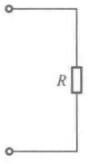

(a)
 

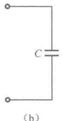

(b)
 

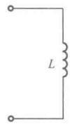

图 1-3 理想电阻、电容、电感元件图形符号
 

要特性是消耗电能，可用一个具有两个端钮的理想电阻元件来反映其消耗电能的特性，其模型的图形符号如图 1-3（a）所示，R 是用来反映能量损耗性质的电路参数；类似地，各种实际电容器的主要特性是储存电能，可用一个具有两个端钮的理想电容元件来反映其储存电能的特性，其模型的图形符号如图 1-3（b）所示，C 是用来反映电场储能性质的电路参数；各种实际电感器的主要特性是储存磁能，可用一个具有两个端钮的理想电感元件来反映其储存磁能的特性，其模型的图形符号如图 1-3（c）所示，L 是用来反映磁场储能性

去掉了各类实际电路元件的外形和尺寸的差异性，用相应的质的电路参数。在这些图形符号中，去掉了各类实际电路元件的外形和尺寸的

<!-- page: 13 -->

电路参数来表示各类的共性（主要的电磁性质）。

有了上述定义的理想电阻元件、理想电容元件和理想电感元件，对于任何一个实际电阻器、电容器和电感器，可根据不同的应用条件，使用足以反映其主要电磁性质的一些理想电路元件或其组合来表示，构成实际电路元件的模型。例如一个实际电感器，它是在一个骨架上用金属导线绕制而成的，如图1-4（a）所示。如果应用在低频电路中，它主要表现为储存磁能的性质，而消耗的电能与储存的电能都很小，可以忽略不计，所以在低频应用条件下的实际电感器的模型为图1-4（b）所示的理想电感元件。如果应用在高频电路中，需要考虑绕制电感线圈的导线所消耗的电能，但它储存的电能仍可忽略，在这种情况下，实际电感器的模型为图1-4（c）所示的理想电感元件与理想电阻元件的串联。如果这个实际电感器应用在更高频率的电路中，它储存的电能也需要考虑，这时其模型就要在图1-4（c）基础上再与理想电容元件并联，如图1-4（d）所示。

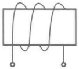

(a)
 

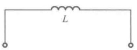

（b）
 

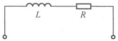

(c)
 

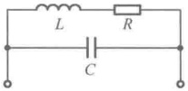

(d)
 

图 1-4 实际电感器在不同应用条件下的电路模型
 

将实际电路中各个实际电路元件都用其模型的图形符号来表示，且连接导线用理想导线（线段）来表示，这样画出的图称为实际电路的电路模型图，简称电路图，电路图并不反映实际电路的大小尺寸。图1-5就是图1-1简单照明电路的电路图，其中，干电池的模型是理想电压源 $ U_{s} $，灯泡的模型是理想电阻元件R，连接导线的模型是理想导线。电路理论分析研究的对象正是电路模型而不是实际电路。

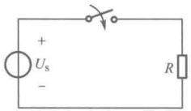

图 1-5 模型化的简单照明电路的电路图
 

#### 1.1.3 集中参数电路

实际电路中使用的实际电路元件一般都与电能的消耗现象和电磁能的储存现象有关。电能的消耗发生在实际电路元件的所有导体通路之中，电磁能则储存在实际电路元件的电场、磁场之中。一般这些现象同时存在，且又发生在整个元件之中，交织在一起。因此，实际电路中的能量损耗和电场储能、磁场储能具有连续分布的特征，故反映这些能量过程的三种电路参数 R、C、L 也是连续分布的。于是，在实际电路的任何部分，都既有电阻，又有电容，还有电感，这给分析研究电路带来了很大的困难。幸好科学研究表明，若实际电路元件及实际电路满足集中化条件，即它们的各向几何尺寸 d 远小于电路工作频率 f 所对应的电磁波的波长  $ \lambda $，即

 $$ d\ll\lambda\text{；}\lambda=c/f\text{；}c=3\times10^{8}m/s\text{（光速）} $$ 

这时，电路参数的连续分布特性对电路性质的影响并不明显，可以将具有分布特性的电路参数集中起来，即认为能量损耗、电场储能和磁场储能这三种电磁过程是分别集中在电阻元件、电容元件和电感元件内部进行的。这样的元件称为集中参数元件，每一种集中参数元件只表示一种电磁特性，并且其电磁特性还可以用数学方法精确定义。由集中参数元件构成的电路称为集中参数电路，集中参数电路的突出特点是：将实际电路元件中的电场和磁场在空间分隔开，电场只与电容元件相关联，磁场只与电感元件相关联，两种场之间不存在相互作用，因而没有任何电、磁能量辐射；电流传送到电路的各处是同时到达的，即没有时间延迟，整个电路可以看成电磁空间的一个点，电路中的电压及电流仅是时间t的函数，而与空间坐标无关。当电路具有这样的特点时，就给分析带来了很大的方便。

<!-- page: 14 -->

例如，我国工业用电的频率为 50Hz，其波长为 6000km，对于低频电子电路而言，其尺寸与这一波长相比可以忽略不计。因此，可以采用集中参数概念，将它们作为集中参数电路来处理。而远距离的通信线路和电力输电线则不满足集中化条件，必须考虑到电场、磁场沿电路分布的现象，这时就不能用集中参数，而要用分布参数来表征电路。集中化条件是电路分析的重要假设，本书在这一部分所讨论的电路基本定律及以基本定律为基础的各种分析计算方法都是以集中化条件为前提的。本书所分析研究的对象都是集中参数电路。

### 1.2 电路变量及其参考方向

任何一个物理过程及物理现象，都必须用一些基本物理量来描述和度量。在分析研究电路时，同样也需要用到一些基本物理量，这些物理量与电路中发生的电磁现象有密切的关系。电流  $ i(t) $、电压  $ u(t) $、电荷  $ q(t) $、磁链  $ \psi(t) $ 就是分析研究电路时所用到的4个基本变量，以此为基础，又用功率  $ p(t) $ 和能量  $ W(t) $ 这两个基本复合变量来反映电路的能量消耗与传递情况。电路分析的任务就是要求解这些变量，这些变量中最常用到的便是电流、电压和功率，物理学课程中对它们已有详细讨论，在这里先做简要的复习，然后引出电流、电压的参考方向的概念，再着重说明功率数值正、负号的物理意义。

#### 1.2.1 电流及其参考方向

带电粒子的定向移动形成电流，电流的大小或强弱取决于导体中电荷量变化的快慢。通常，把单位时间内通过导体横截面的电荷量定义为电流，即在时刻 t 穿过某导体截面积 S 的电流强度  $ i(t) $ 等于从 t 到  $ t+\Delta t $ 的时间内，从该面的一边穿到另一边的电荷量的代数和  $ \Delta q $ 与此时间间隔  $ \Delta t $ 之比，当  $ \Delta t \to 0 $ 时的极限，即

$$  i(t)=\frac{\mathrm{d}q}{\mathrm{d}t}\qquad\qquad i(t)=\lim_{\Delta t\to0}\frac{\Delta q}{\Delta t}=\frac{\mathrm{d}q}{\mathrm{d}t}   \tag*{(1-1)}$$

式（1-1）中，若电荷量的单位为 C（库仑，简称库），时间的单位为 s（秒），则电流的单位为 A（安培），因此 1 安 = 1 库/秒。在电力系统中，安培这个单位太小，有时取 kA（千安）为电流的单位；而在电子电路中，安培这个单位太大，常用 mA（毫安）、μA（微安）作为电流单位，它们之间的换算关系是

$$  1kA=10^{3}A；\quad1mA=10^{-3}A；\quad1\mu A=10^{-6}A   \tag*{（1-2）}$$

电流不仅有大小，而且有方向性，通常规定正电荷运动的方向为电流的实际方向（真实方向），可用一个单方向箭头来表示。

如果电流的大小和方向都不随时间变化，则这种电流称为恒定电流，简称直流电流（记作 dc 或 DC），可用符号 I 表示。如果电流的大小和方向都随时间变化，则称为交变电流，简称交流电流（记作 ac 或 AC），可用符号 i(t) 表示。

在一些类似图 1-5 所示的简单电路中，电流的实际方向是显而易见的，从电源正极流出，流向电源负极。但是对一些较为复杂的电路，如图 1-6 所示，电阻 R 上的电流的实际方向就难以确定。此外，如果电路中电流的实际方向不断地随时间变化，那么就更不可能用一个固定的单方向箭头来表示电流的真实方向。为了解决这样的困难，须引入电流的参考方向这一概念。电流的参考方向是人为任意假定的，在电路图中可用单方向箭头标出。依据假定的电流方向，就可以建立描述电路的数学方程（电路方程），求解出的电流是代数量。若求解出的电流为正值，说明实际方向与所标的参考方向一致；若求解出的电流为负值，说明实际方向与所标的参考方向相反。

如图 1-7 所示，对于同一段电路（或元件）ab，电流的参考方向既可以设定为从 a 端指向

<!-- page: 15 -->

b 端 [见图 1-7 (a)]，也可以设定为从 b 端指向 a 端 [见图 1-7 (b)]。电流参考方向的表示方法有两种：（1）用箭头表示；（2）用双下标表示，方向为从第一个下标代表的端点指向第二个下标代表的端点。图 1-7（a）中的电流参考方向既可以用自左向右的箭头表示，也可以用双下标表示为  $ i_{ab} $。图 1-7（b）中的电流参考方向既可以用自右向左的箭头表示，也可以用双下标表示为  $ i_{ba} $。由于电路中任意一段的电流都有两种可能的参考方向，因此当对同一段的电流设定相反的参考方向时，对应的电流表达式应相差一个负号。例如在图 1-7（a）和（b）中，指定的参考方向相反，所以二者符号相反，即  $ i_{ab} = -i_{ba} $。依照图 1-7（a）所示参考方向列电路方程解得的电流值大于零，从而可以判定出电流的真实方向与参考方向相同；依照图 1-7（b）所示参考方向列电路方程解得的电流值小于零，从而可以判定出电流的真实方向与参考方向相反。注意：电流值的正负只有在设定其参考方向的前提下才有明确的意义，且电流的参考方向一经指定，在计算过程中就不能再改变了。

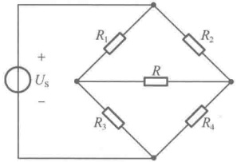

图 1-6 电流的实际方向说明图
 

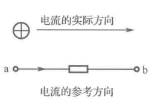

(a)
 

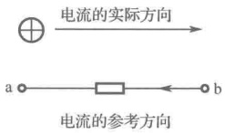

(b)
 

图 1-7 电流参考方向示意图
 

例 1-1 如图 1-8（a）所示的电路元件，设每秒有 10 库仑的正电荷由 a 端移到 b 端。

（1）若电流的参考方向如图1-8（b）所示，求 $ i_{1}=? $

（2）若电流的参考方向如图1-8（c）所示，求 $ i_{2}=? $

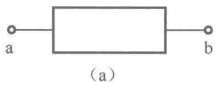

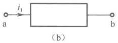

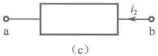

图1-8 例1-1图
 

解：（1）图1-8（b）的参考方向与正电荷运动的方向相同，故电流应取正值，即 $ i_{1}=10A $

（2）图1-8（c）的参考方向与正电荷运动的方向相反，故电流应取负值，即 $ i_{2}=-10A $。显然，在这两种参考方向下，两个电流之间的关系为 $ i_{1}=-i_{2} $。

### 历史人物

安德烈·玛丽·安培（André-Marie Ampère，1775—1836），法国物理学家、化学家和数学家。安培在电磁作用方面的研究成就卓著，是电动力学（现称电磁学）的奠基人，他于1820年提出了著名的安培定律，被麦克斯韦誉为“电学中的牛顿”。为了纪念这位杰出多产的科学家，电流的国际单位安培（Ampere）即以其姓氏命名。

#### 1.2.2 电压及其参考方向

电路中的电荷具有电位（势）能。电荷只有在电场力的作用下才能做有规则的定向移动，形成电流。电场力对电荷做功的大小是用电压来衡量的，电路中 a、b 两点之间的电位（势）之差即为 a、b 两点间的电压，在数值上等于单位正电荷由 a 点转移到 b 点时所获得或失去的能量，即

<!-- page: 16 -->

$$  u(t)=\frac{\mathrm{d}W}{\mathrm{d}q}   \tag*{（1-3）}$$

式（1-3）中，dq 为由 a 点移动到 b 点的正电荷的电量，单位为 C（库仑）；dW 为移动过程中电荷 dq 所获得或失去的能量，单位为 J（焦耳）；u(t) 是 a、b 两点间的电压，单位为 V（伏特）。因此，1 伏 = 1 焦/库。常用的电压单位还有 kV （千伏）、mV （毫伏）及  $ \mu $V （微伏），它们之间的换算关系为

$$  1kV=10^{3}V；\quad1mV=10^{-3}V；\quad1\mu V=10^{-6}V   \tag*{（14）}$$

电压除了大小，还有极性，也就是电压的方向，通常把电位降低的方向作为电压的实际方向。如图1-9（a）所示，如果单位正电荷由a点移动到b点，获得1J的能量，则a、b间电压的大小为1V，且表现为电位升高（电压升），即a点为低电位（负极），b点为高电位（正极）。电压的实际方向为从b点指向a点， $ u_{ba}=1V $；再如图1-9（b）所示，如果单位正电荷由a点移动到b点，失去1J能量，则a、b点间电压的大小仍为1V，但表现为电位降低（电压降），即a点为高电位（正极），b点为低电位（负极），电压的实际方向为从a点指向b点， $ u_{ab}=1V $。电压的实际方向既可以用正、负极性表示，也可以用正极指向负极的箭头表示，当然还可以用电压双下标记法来表示，双下标字母表示计算电压时所涉及的两点，其前后次序则表示计算电压降时所遵循的方向。

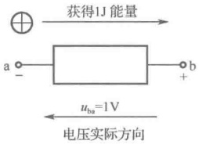

(a)
 

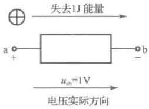

(b)
 

图 1-9 电压实际方向说明图
 

如果电压的大小和极性都不随时间变化，则这种电压称为恒定电压或直流电压，可用符号U表示；如果电压的大小和极性都随时间变化，则称为交变电压或交流电压，可用符号u(t)表示。

在电路分析中，如同电流需要假定参考方向一样，电压也需要假定参考方向（或参考极性）。电压的参考方向是人为任意假定的，在电路图中有三种表示方法：（1）用正、负极性表示；（2）用由正极指向负极的箭头表示；（3）用电压双下标记法来表示，双下标字母表示计算电压时所涉及的两点，方向为从第一个下标代表的点指向第二个下标代表的点。依据假定的电压方向，就可以建立描述电路的数学方程（电路方程），求解出的电压是代数量。若求解出的电压为正值，说明实际方向与所标的参考方向一致；若求解出的电压为负值，说明实际方向与所标的参考方向相反。注意：电压的参考方向一经指定，在计算过程中就不能再改变了。

### 历史人物

亚历山德罗·伏特（Alessandro Volta，1745—1827），意大利物理学家。他18岁开始与欧洲学者一起进行电路实验，改进起电盘和验电器，发明了第一个容电器（现在的电容器），利用化学反应发明了伏打电堆，首次产生了连续的电能，使电能得到了切实的应用。为纪念他的卓越贡献，国际电气委员会将电动势和电压的计量单位取名伏特。

#### 1.2.3 关联参考方向

综上所述，在分析电路时，对电路中的电流、电压假定参考方向是非常必要的。后面将会知道，若不设置电流、电压的参考方向，电路基本定律就不便于应用，电路问题的分析计算就无法进行下去。

<!-- page: 17 -->

既要为电路中的电流假定参考方向，同时也要为电路中的电压假定参考方向，对于电路中的同一个元件，这两个方向可以彼此独立、无关地任意假定。这时将会出现两种可能的方向关系：一种称为关联参考方向，即电流与电压参考方向一致，如图1-10（a）所示；另一种称为非关联参考方向，即电流与电压参考方向相反，如图1-10（b）所示。为了分析方便起见，常常采用关联（一致）参考方向，这样，在电路图上标出的一个单方向箭头既代表了电流的参考方向，同时也代表了电压的参考方向。

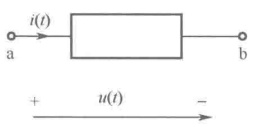

（a）关联参考方向
 

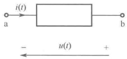

（b）非关联参考方向
 

图 1-10 两种可能的参考方向关系
 

#### 1.2.4 功率及其正负值的物理意义

电功率（简称功率）是衡量电路中能量转换速率的物理量，电路在单位时间内所消耗（或产生）的能量定义为瞬时功率，即

$$  p(t)=\frac{\mathrm{d}W}{\mathrm{d}t}   \tag*{（1-5）}$$

式（1-5）中，dW 为 dt 时间内变化的能量，在国际单位制中，功率单位是 W（瓦特），1W 等于 1J/s。常用的功率单位还有 kW（千瓦）、mW（毫瓦）及  $ \mu $W（微瓦），它们之间的换算关系为

$$  1\mathrm{kW}=10^{3}\mathrm{W}；\quad1\mathrm{mW}=10^{-3}\mathrm{W}；\quad1\mu\mathrm{W}=10^{-6}\mathrm{W}   \tag*{（1-6）}$$

在电路分析中，更受关注的是功率与电流、电压之间的关系。下面以图1-11（a）所示电路为例来建立功率与电流、电压的关系。图中矩形框代表任意一段电路，其内可以是电阻元件、电源、或若干电路元件的组合，电压 $ u(t) $和电流 $ i(t) $假定为关联参考方向。

由

得

再由

 $$ \begin{aligned}u(t)&=\frac{\mathrm{d}W}{\mathrm{d}q}\\\mathrm{d}W&=u(t)\mathrm{d}q\\i(t)&=\frac{\mathrm{d}q}{\mathrm{d}t}\\\mathrm{d}t&=\frac{\mathrm{d}q}{i(t)}\\\sigma(t)&=\frac{\mathrm{d}W}{\mathrm{d}t}=u(t)i(t)\end{aligned} $$ 

得

根据功率定义式（1-5），得

式（1-7）说明，一段电路的瞬时功率等于这段电路的电压与电流的乘积。由于电压、电流是在假定的参考方向下计算出来的，都是代数量，可正可负，因此功率值也可正可负。那么功率值的正、负有什么意义呢？又怎么与这段电路发出功率或吸收功率联系起来呢？下面仍以图1-11（a）来说明功率正、负值具有的物理意义。

设  $ u(t) $、 $ i(t) $ 为关联参考方向，若  $ p(t) > 0 $，则  $ u(t) $、 $ i(t) $ 均为正值或均为负值，如果均为正值，则意味着图 1-11（a）假定的电压、电流参考方向就是电压、电流的实际方向；如果均为负值，则表明电压、电流实际方向与图 1-11（a）假定的参考方向相反。在这两种情况下，电流的实际方向都与电压的实际方向相同。由于电流的实际方向是正电荷移动的方向，而电压的实际方向代表了电位降，正电荷在通过这段电路时，电位降低了。电位降低表示失去能量，正电荷失去的能量被这段电路吸收（或消耗），电路在单位时间内吸收的能量就是所吸收的功率。于是得到：在  $ u(t) $、

<!-- page: 18 -->

$ i(t) $ 为关联参考方向下， $ p(t)>0 $ 表明这段电路在吸收功率；反之，若  $ p(t)<0 $，则  $ u(t) $、 $ i(t) $ 二者正、负值交错，其中有一个实际方向与参考方向相反，其结果是电流的实际方向与电压的实际方向相反，正电荷在通过这段电路时，电位升高而获得能量，正电荷获得的能量来源于这段电路释放（发出）的能量，电路在单位时间内发出的能量就是所发出的功率。由此可以断定：当  $ u(t) $、 $ i(t) $ 为关联参考方向时， $ p(t)<0 $ 表明这段电路在发出功率。当  $ u(t) $、 $ i(t) $ 假定为非关联参考方向时，如图 1-11（b）所示，仍可用式（1-7）计算功率，只是功率值正、负具有的物理意义与前面正好相反，即  $ p(t)>0 $ 表明这段电路发出功率， $ p(t)<0 $ 表明这段电路吸收功率。

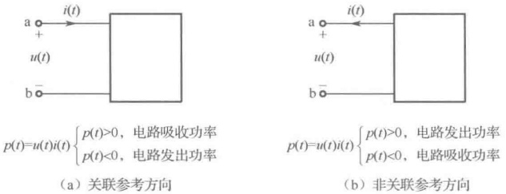

（a）关联参考方向
 

（b）非关联参考方向
 

图 1-11 功率正、负值的物理意义
 

例 1-2 在图 1-12 所示电路中，电压与电流的参考方向已经假定，并已知  $ U_{1}=3V $， $ U_{2}=1V $， $ U_{3}=2V $， $ U_{4}=-2V $， $ I_{1}=2A $， $ I_{2}=-3A $， $ I_{3}=1A $，试计算每个元件上的功率，并说明这些元件是吸收功率还是发出功率。

解：

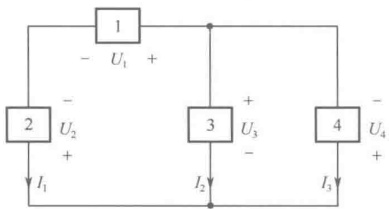

 $$ p_{1}=U_{1}\times I_{1}=3\times2=6W>0 $$ 

由于 $ U_{1} $与 $ I_{1} $取关联参考方向，故元件1吸收功率6W。

 $$ p_{2}=U_{2}\times I_{1}=1\times2=2W>0 $$ 

由于 $ U_{2} $与 $ I_{1} $取非关联参考方向，故元件2发出功率2W。

图 1-12 例 1-2 电路
 

 $$ p_{3}=U_{3}\times I_{2}=2\times(-3)=-6W<0 $$ 

由于 $ U_{3} $与 $ I_{2} $取关联参考方向，故元件3发出功率6W。

 $$ p_{4}=U_{4}\times I_{3}=(-2)\times1=-2W<0 $$ 

由于 $ U_{4} $与 $ I_{3} $取非关联参考方向，故元件4吸收功率2W

电路吸收的总功率： $ \sum p_{吸收}=p_{1}+\left|p_{4}\right|=8W $

电路发出的总功率： $ \sum p_{发出}=p_{2}+\left|p_{3}\right|=8W $

 $$ \sum p_{ 吸收 }=\sum p_{ 发出 } $$ 

电路中发出的总功率与吸收的总功率正好相等，这称为功率平衡。这一点根据能量守恒原理是容易理解的，对于一个完整的电路来说，电路中吸收的总功率必然要等于发出的总功率。在电路分析中，常用功率平衡来检验计算结果是否正确。

在图 1-11（a）所示的关联参考方向下，该段电路从 $ t_{0} $ 到 t 时刻内所吸收的能量为

$$  \begin{array}{r}{W[t_{0},t]=\int_{t_{0}}^{t}p(t^{\prime})\mathrm{d}t^{\prime}=\int_{t_{0}}^{t}u(t^{\prime})i(t^{\prime})\mathrm{d}t^{\prime}}\end{array}   \tag*{（1-8）}$$

在国际单位制中，能量的单位为焦耳，简称焦（J）。

### 历史人物

詹姆斯·瓦特（James Watt，1736—1819）英国皇家学会院士，爱丁堡皇家学会院士，苏格兰著名的发明家和机械工程师，第一次工业革命的重要人物。他于1776年制造出第一台有实用

<!-- page: 19 -->

价值的蒸汽机，开辟了人类利用能源新时代，使人类进入“蒸汽时代”。后人为了纪念这位伟大的发明家，把功率的单位定为瓦特（简称瓦，符号为W）。

詹姆斯·普雷斯科特·焦耳（James Prescott Joule，1818—1889），英国物理学家，英国皇家学会会员。焦耳在研究热的本质时，发现了热和功之间的转换关系，并由此得到了能量守恒定律，最终发展出热力学第一定律。他和开尔文合作发展了温度的绝对尺度。他还观测过磁致伸缩效应，发现了导体电阻、通过导体电流及其产生热能之间的关系，也就是常称的焦耳定律。由于焦耳在热学、热力学和电方面的贡献，皇家学会授予他最高荣誉的科普利奖章（Copley Medal）。后人为了纪念他，把能量或功的单位命名为焦耳，简称焦；并用焦耳姓氏的第一个字母J来标记热量及功的物理量。

### 1.3 电阻元件

电阻元件是从实际电阻器经科学抽象得出的一种模型。电阻元件按其电压、电流关系的直线性和非直线性分为线性电阻元件和非线性电阻元件；按其特性是否随时间变化又分为时变电阻元件和非时变电阻元件。本书将在第6章介绍非线性电阻元件，若无特别说明，书中涉及的是最常用的线性非时变电阻元件（简称电阻元件）。

#### 1.3.1 电阻元件的定义

线性非时变电阻元件是一个二端的集中参数元件，元件的图形符号如图1-13（a）所示，当元件上的电压、电流取关联参考方向时，在任意时刻其两端的电压和电流服从欧姆定律，即

$$  u(t)=Ri(t)   \tag*{（1-9）}$$

或

$$  i(t)=Gu(t)   \tag*{（1-10）}$$

上述两式中，R为线性非时变电阻元件的电阻参数，G为线性非时变电阻元件的电导参数，二者均为与电压、电流无关的正实常数，并且

$$  G=\frac{1}{R}   \tag*{（1-11）}$$

在国际单位制中，电阻的单位是 $ \Omega $（欧姆，简称欧），电导的单位是S（西门子，简称西）。电阻和电导是反映同一电阻元件性能而互为倒数的两个电路参数，如果说电阻反映一个电阻元件对电流的阻力，那么电导就可以作为衡量一个电阻元件导电能力强弱的标志。

如果电压、电流取非关联参考方向，如图1-13（b）所示，则

$$  u(t)=-Ri(t)   \tag*{（1-12）}$$

或

$$  i(t)=-Gu(t)   \tag*{（1-13）}$$

欧姆定律所表示的关系也称为电阻元件的伏安特性（性能方程），可以在u-i平面（或i-u平面）上画成曲线，称为电阻元件的伏安特性曲线。显然，线性非时变电阻元件的伏安特性曲线是一条不随时间变化、经过坐标原点的直线，如图1-13（c）所示。电阻值可由直线的斜率来确定。

从电阻元件的伏安特性曲线上可以看出电阻元件具有两个重要特性：其一，在任一瞬时电阻上的电压值（或电流值）完全取决于同一瞬时流过的电流值（或电压值），而与过去的电流（或电压）值无关。从这个意义上讲，电阻是一种无记忆的元件；其二，电阻元件的伏安特性曲线关于原点对称，这说明电阻元件对于不同方向的电流或不同极性的电压其表现是一样的，即电阻元件是一种双向性元件。因此，在使用线性非时变电阻元件时，它的两个端子是没有任何区别的。

<!-- page: 20 -->

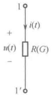

（a）电压、电流取关联参考方向
 

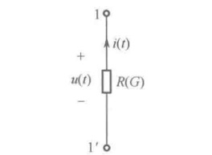

（b）电压、电流取非关联参考方向
 

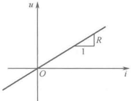

（c）伏安特性曲线
 

图 1-13 线性非时变电阻元件图形符号及其伏安特性曲线
 

#### 1.3.2 开路与短路

在对线性非时变电阻元件的伏安特性曲线认识的基础上，可以将线性非时变电阻元件的两种极端情况与开路和短路这两个概念联系起来。

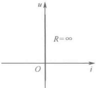

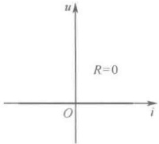

（a）开路的伏安特性曲线
 

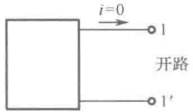

（b）短路的伏安特性曲线
 

(c) 开路表示
 

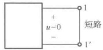

（d）短路表示
 

一个二端电阻元件不论其两端电压多大，如果其电流恒等于零，则此电阻元件称为开路。开路的伏安特性曲线在u-i平面上与电压轴重合，它相当于 $ R=\infty $或 $ G=0 $，如图1-14（a）所示。类似地，一个二端电阻元件不论其电流多大，若其两端电压恒等于零，则此电阻元件称为短路。短路的伏安特性曲线在u-i平面上与电流轴重合，它相当于 $ R=0 $或 $ G=\infty $，如图1-14（b）所示。如果电路中的一对端子1-1'之间呈断开状态，如图1-14（c）所示，这相当于1-1'之间接有 $ R=\infty $的电阻，此时称1-1'处于开路。如果电路中的一对端子1-1'之间用理想导线（R=0）连接起来，称这对端子1-1'被短路，如图1-14（d）所示。

图 1-14 开路和短路的伏安特性曲线及表示
 

#### 1.3.3 电阻元件的功率与能量

当电压、电流取关联参考方向时，线性非时变电阻元件在任一瞬时吸收的功率为

$$  p_{R}(t)=u(t)i(t)=Ri^{2}(t)=Gu^{2}(t)   \tag*{（1-14）}$$

式（1-14）表明，电阻元件吸收的功率与通过元件的电流的平方或元件端电压的平方成正比，且恒有  $ p_{R}(t)>0 $，因此电阻元件是一种无源元件。

电阻元件在 $ [t_{0},t] $时间内吸收的电能为

$$  \boldsymbol{W}_{R}[t_{0},t]=\int_{t_{0}}^{t}\boldsymbol{p}_{R}(t^{\prime})\mathrm{d}t^{\prime}=\int_{t_{0}}^{t}\boldsymbol{u}(t^{\prime})\boldsymbol{i}(t^{\prime})\mathrm{d}t^{\prime}   \tag*{（1-15）}$$

电阻元件一般把吸收的电能转换成热能或其他能量，所以电阻元件也称为耗能元件。

当电流流过电阻时，电阻会因消耗电能而发热，这使人们能够利用电来加热、发光。当然，电灯、电炉、电烙铁及电动机、变压器（它们都要用导线来制作，具有一定的电阻）等电器都会因有电阻的存在，不可避免地要发热，产生一种无谓的电能损失。如果在使用时，电流过大或电压过高都将引起电器的功率过大，因发热过度而损坏。为了保证电器的使用安全，制造厂家对各种电器都要标明电压、电流和功率的限额，分别称为额定电压、额定电流和额定功率，作为使用时的根据。由于电压、电流和功率三者之间有确定关系，因此三个额定值只需要标出其中两个即可。例如，电灯泡通常只标出额定电压和额定功率，电子电路中常用的线绕电阻与碳膜电阻只标

<!-- page: 21 -->

明电阻值和额定功率。

### 历史人物

格奥尔格·西蒙·欧姆（Georg Simon Ohm，1787—1854），德国物理学家。欧姆发现了电阻中电流与电压的正比关系，即著名的欧姆定律；他还证明了导体的电阻与其长度成正比，与其横截面积和传导系数成反比；以及在稳定电流的情况下，电荷不仅在导体的表面上，而且在导体的整个截面上运动。电阻的国际单位制“欧姆”以他的名字命名。

### 1.4 电压源和电流源

任何一种实际电路必须有电源提供能量才能工作，实际电路中有各种各样的电源，如干电池、蓄电池、光电池、发电机及电子电路中的信号源等。电压源和电流源就是从实际电源经科学抽象得出的模型。

#### 1.4.1 电压源

电压源是一个二端的集中参数元件，接到任意外部电路后，该元件两端电压始终保持给定的时间函数，与通过它的电流大小无关。

电压源的图形符号如图 1-15（a）所示（图中电压源连接了一个外部电路），其中  $ u_{s}(t) $ 为电压源的电压，是给定的时间函数，且方向也是给定的。而  $ u(t) $、 $ i(t) $ 分别为元件电压、元件电流，其参考方向可以任意假定。在图中所示元件电压  $ u(t) $ 的参考方向下，电压源的性能方程可用下式表示：

$$  u(t)=u_{\mathrm{S}}(t)   \tag*{（1-16）}$$

而 $ u(t) $的大小与元件电流 $ i(t) $无关。若 $ u_{S}(t) $是不随时间变化的恒定值，即为直流电压源，用 $ U_{S} $表示。如图1-15（b）所示的长短线是电池的图形符号，用以表示直流电压源，其中长细线表示电源的“+”极，短粗线表示电源的“-”极。

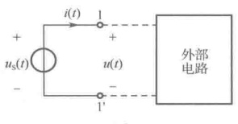

电压源的伏安特性可以在u-i平面上画成曲线。当电压源是直流电压源时，其大

(a)
 

(b)
 

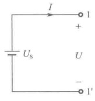

图 1-15 电压源图形符号
 

小和方向都不随时间而变，特性曲线是一条与电流i轴平行的直线，如图1-16（a）所示；当电压源是交流电压源时，其大小和方向按照一定的规律随时间变化，图1-16（b）所示的是一种时变电压源，其特性曲线是一族与电流i轴平行的直线。特性曲线表明了电压源的电压与其电流大小无关。

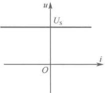

(a)
 

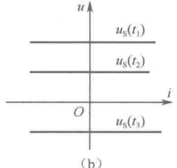

(b)
 

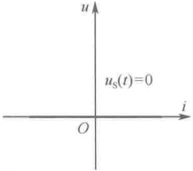

图 1-16 电压源特性曲线
 

(c)
 

若 $ u_{s}(t)=0 $，则此电压源的特性曲线与电流i轴重合，如图1-16（c）所示，正好是短路的特

<!-- page: 22 -->

性曲线。因此，电压源电压为零相当于短路。这一概念应用在电路分析中将电压源“置零”这种状况，将电压源“置零”的含义是令这个电压源不起作用，使其端电压为零，即视为短路。

电压源的特点是电压源的元件电压 $ u(t) $的数值是由其自身独立决定的已知量，与所接的外部电路情况无关；而流经电压源的元件电流 $ i(t) $是由电压源及外部电路共同决定的待求变量，也就是说，电压源的元件电流随外部电路变化，可以等于任意值。例如，外部电路为开路的情况，这时元件电压仍为 $ u_{S}(t) $，而元件电流却为零。根据外部电路的不同情况，电流可以从不同的方向流过电压源，故电压源既可以向外部电路提供能量（作为电源），也可以从外部电路获得能量（作为负载）。从理论上讲，电压源既可以提供无穷大的能量，也可以获得无穷大的能量。

真正理想的电压源实际上是不存在的，但是，对于新的干电池或发电机等许多实际电源，在一定电流范围内可将其近似地看成一个电压源，或者用电压源与电阻元件串联作为实际电压源的模型。电压源可用电子电路来实现，如晶体管稳压电源等。

#### 1.4.2 电流源

电流源是一个二端的集中参数元件，连接到任意外部电路后，该元件输出的电流始终保持给定的时间函数，与其两端电压大小无关。

电流源的图形符号如图 1-17（a）所示（图中电流源连接了一个外部电路），其中  $ i_{s}(t) $ 为电流

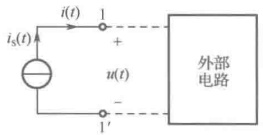

(a)
 

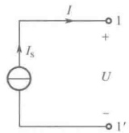

（b）
 

图 1-17 电流源图形符号
 

源的电流，是给定的时间函数，方向也是给定的。而 $ u(t) $、 $ i(t) $分别为元件电压、元件电流，其参考方向可以任意假定。在如图所示元件电流 $ i(t) $的参考方向下，电流源的性能方程可用下式表示：

$$  i(t)=i_{\mathrm{S}}(t)   \tag*{（1-17）}$$

 $ i(t) $ 的大小与元件电压  $ u(t) $ 无关。当  $ i_{s}(t) $ 是不随时间变化的恒定值时，即为直流电流源，用  $ I_{s} $ 表示，如图 1-17（b）所示。

电流源的伏安特性可以在 u-i 平面上画成曲线。当电流源是直流电流源时，其大小和方向都不随时间而变，特性曲线是一条与电压 u 轴平行的直线，如图 1-18（a）所示；当电流源是交流电流源时，其大小和方向按照一定的规律随时间而变，如图 1-18（b）所示的是一种时变电流源，其特性曲线是一族与电压 u 轴平行的直线。特性曲线表明了电流源的电流与端电压大小无关。

若  $ i_{S}(t)=0 $，则此电流源的特性曲线与电压 u 轴重合，如图 1-18（c）所示，正好是开路的特性曲线。因此，电流源电流为零相当于开路。这个概念应用在电路分析中将电流源“置零”的状况，将电流源“置零”的含义是令这个电流源不起作用，使其输出电流为零，即做开路处理。

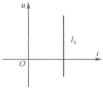

(a)
 

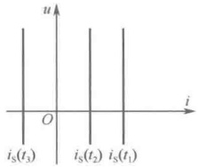

(b)
 

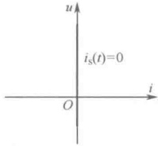

图 1-18 电流源特性曲线
 

(c)
 

电流源的特点是电流源的元件电流 $ i(t) $数值是由其自身独立决定的已知量，与所连接的外部电路情况无关，而电流源的元件电压 $ u(t) $是由电流源及外部电路共同决定的待求变量，也就是说，

<!-- page: 23 -->

电流源的元件电压随外部电路变化，可以等于任意值。例如，外部电路为短路的情况，这时元件电流仍为 $ i_{s}(t) $，而元件电压为零。如同电压源一样，电流源既可以向外部电路提供能量，也可以从外部电路获得能量，这要根据电流源两端电压的真实极性而定，并且它提供或获得的能量，从理论上讲也可以是无穷大的。

真正理想的电流源实际上是不存在的，但是，光电池等实际电源在一定的电压范围内可近似地看作一个电流源，或者用电流源与电阻元件并联作为实际电流源的模型。电流源也可用电子电路来实现。

例 1-3 电压源与电流源串联所组成的电路如图 1-19 所示，试分析两个电源的功率情况。

解：设两个元件的电压、电流取关联参考方向。

 $$ i=i_{S}=3A；\quad p_{u_{s}}=u_{S}\times i=4\times3=12W $$ 

由于 $ u_{s} $与i取关联参考方向，且 $ p_{u_{s}}>0 $，故电压源吸收12W功率，电压源是电路中的负载。

 $$ u=-u_{\mathrm{S}}=-4\mathrm{V};\quad p_{i_{\mathrm{s}}}=u\times i_{\mathrm{S}}=(-4)\times3=-12\mathrm{W} $$ 

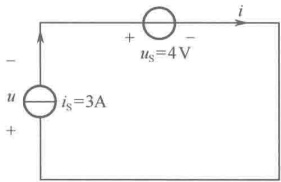

由于u与 $ i_{s} $取关联参考方向，且 $ p_{i_{s}}<0 $，故电流源发出12W功率，电流源是电路中真正的电源。

图 1-19 例 1-3 电路
 

 $$ p_{ 吸收 }=p_{ 发出 }, 功率平衡 $$ 

### 1.5 受控源

前面介绍了电压源和电流源，它们的电压（或电流）或为定值，或为给定的时间函数，与所连接的外电路无关，具体来说，与电路中其他支路的电压或电流无关，具有自身的独立性，因此常把电压源和电流源称为独立电源。但在电子电路中，还有另一类电源，这些电源的电压或电流不是给定的时间函数，而是依赖于电路中其他支路的电压或电流，或者说受电路中某一支路的电压或电流的控制，不具有自身的独立性，这类电源称为受控源，或称为非独立电源。受控源是对晶体管等电子元件中一些物理现象采用模型化的方法科学抽象得出的模型，为了区别于独立电源，用菱形符号表示受控源，图1-20（a）、（b）和（c）分别表示受控电压源、受控电流源及控制电压（或控制电流）。

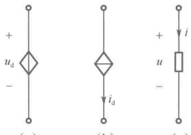

(a)
 

(b)
 

受控源由一个电路中的两条支路构成，其中一条支路称为控制支路，也称为输入端口，如图1-20（c）所示，u、i称为控制量；另一条支路为受控支路，也称为输出端口，如图1-20（a）和（b）所示， $ u_{d} $、 $ i_{d} $称为受控量，是一个依赖于控制量的电压源或电流源。因此，可以把受控源看成一种二端口元件，它将输入端口的电压（或电流）变成了输出端口的电压（或电流）。根据控制量和受控量的不同组合，受控源有4种基本形式。

图 1-20 受控源的图形符号
 

为了使受控源的图形符号更加简化，可以对控制支路做如下处理：

凡控制量是电压的受控源，控制支路用开路表示；凡控制量是电流的受控源，控制支路用短路表示，即用开路电压或短路电流作为控制量。图1-21为4种基本形式受控源的图形符号。

（1）电压控制电压源（VCVS），如图1-21（a）所示。其输入控制量是 $ u_{1} $，输出电压是 $ u_{2} $，并且

$$  u_{2}=\mu u_{1}   \tag*{（1-18）}$$

式中的控制系数 $ \mu $是无量纲常数，称为转移电压比或电压放大系数。

<!-- page: 24 -->

（2）电压控制电流源（VCCS），如图1-21（b）所示。其输入控制量是 $ u_1 $，输出电流是 $ i_2 $，并且 $ i_2 = gu_1 $ (1-19)式中的控制系数g是电导量纲常数，称为转移电导。

（3）电流控制电压源（CCVS），如图1-21（c）所示。其输入控制量是 $ i_{1} $，输出电压是 $ u_{2} $，并且

$$  u_{2}=r i_{1}   \tag*{（1-20）}$$

式中的控制系数 r 是电阻量纲常数，称为转移电阻。

（4）电流控制电流源（CCCS），如图1-21（d）所示。其输入控制量是 $ i_{1} $，输出电流是 $ i_{2} $，并且

$$  i_{2}=\beta i_{1}   \tag*{（1-21）}$$

式中的控制系数 $ \beta $ 是无量纲常数，称为转移电流比或电流放大系数。

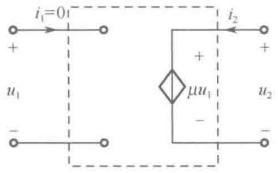

(a) VCVS
 

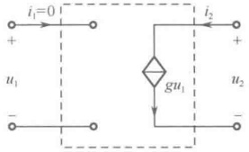

(b) VCCS
 

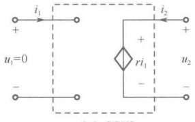

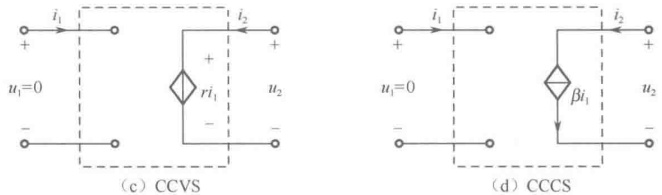

(c) CCVS
 

(d) CCCS
 

图 1-21 4 种受控源的图形符号
 

由于  $ \mu $、g、 $ \gamma $、 $ \beta $ 均为常量，受控量与控制量成正比，因此这 4 种受控源是线性非时变受控源。受控源并不一定要画成如图 1-21 所示的二端口元件的形式，一般只要在电路图中画出受控源的图形符号并标明控制量的位置、种类及参考方向就可以了。例如，图 1-22（a）所示的含受控源的电路，可以画成图 1-22（b）的形式。

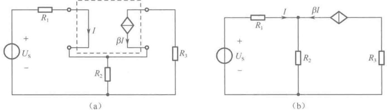

(a)
 

图 1-22 电路中受控源的习惯表示
 

(b)
 

受控源与独立电源在电路中的作用完全不同。独立电源是电路的输入（激励），它代表了外界对电路的作用；受控源常用来模拟电子元件中所发生的物理现象，仅表示电路中某处的电压或电流受另一处电压或电流控制的关系，这种控制关系从信号能量传递的角度来讲，也是一种电耦合关系。如果电路中无独立电源激励，则各处都没有电压和电流，于是控制量为零，受控源的电压或电流也为零。

例 1-4 图 1-23 所示为一个含有 VCVS 的电路，试分析电路的功率情况。

<!-- page: 25 -->

解：

 $$ \begin{aligned}u_{1}&=R_{1}\times i_{S}=5\times2=10V\\u_{2}&=0.5u_{1}=0.5\times10=5V\\&\quad i=\frac{u_{2}}{R_{2}}=\frac{5}{2}=2.5A\\p_{i}&=u_{1}\times i_{S}=10\times2=20W\end{aligned} $$ 

由于 $ u_{1} $与 $ i_{s} $取非关联参考方向，且 $ p_{i_{s}}>0 $，故 $ i_{s} $发出20W功率。

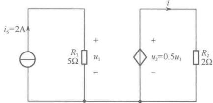

 $$ p_{_{R_{1}}}=u_{_{1}}\times i_{s}=10\times2=20W $$ 

图 1-23 例 1-4 电路
 

由于 $ u_{1} $与 $ i_{s} $取关联参考方向，且 $ p_{R_{n}}>0 $，故 $ R_{1} $吸收20W功率。

 $$ p_{VCVS}=u_{2}\times i=5\times2.5=12.5W $$ 

由于 $ u_{2} $与i取非关联参考方向，且 $ p_{v_{CVS}}>0 $，故VCVS发出12.5W功率。

 $$ p_{R_{2}}=u_{2}\times i=5\times2.5=12.5W $$ 

由于 $ u_{2} $与i取关联参考方向，且 $ p_{R_{2}}>0 $，故 $ R_{2} $吸收12.5W功率。

整个电路功率平衡。另外，还可看出，受控源虽然也能向电路发出功率，但它的这种作用依赖于同一电路中的独立电流源 $ i_{s} $。如果电路中 $ i_{s}=0 $，即独立电流源不起作用，则受控源将会由于控制量 $ u_{1} $为零而没有功率输出。

### 1.6 基尔霍夫定律

集中参数电路是由许多集中参数元件按一定方式相互连接所构成的电流的通路，元件数目较多、规模较大的电路常称为网络。实际上，在电路分析中，电路与网络这两个术语并无明确的区别，一般可以混用，今后常用字母N表示电路。

整个电路表现如何，即电路具有什么特性，既要看每个元件各自具有什么特性，又要看这些元件是怎样连接而构成一个完整电路的，也就是要看电路的拓扑结构如何。关于元件的特性，之前已做了详细的介绍，下面首先介绍几个与电路拓扑结构有关的名词或术语，再来描述电路的拓扑结构对电路中电压、电流的影响。

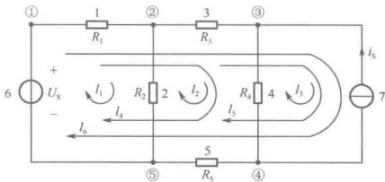

图 1-24 说明支路、节点、回路用图
 

（1）支路：在集中参数电路中，每一个二端元件构成一条支路，用编号1、2、…、b（b是支路总数）表示。根据这个定义，图1-24所示电路具有7条支路，这种支路也称简单支路。

（2）节点：在集中参数电路中，两条及两条以上支路的连接点称为节点。用编号①、②、⋯、⑦（n 是节点总数）表示。图 1-24 所示电路具有 5 个节点，其中节点①称为简单节点。

为了减少电路中的支路数和节点数，常常将电压源或受控电压源与电阻的串联作为一条支路，也将电流源或受控电流源与电阻的并联作为一条支路，这类支路称为复合支路。按照这种规定，图1-24所示的电路就只有5条支路、4个节点。

（3）回路：在集中参数电路中，从某一节点（始节点）出发，沿着一些节点、支路不重复地绕行一周，又回到原来出发节点（终节点）的闭合路径称为回路。注意：沿回路某个方向（既可以顺时针方向也可以逆时针方向）绕行时，除始节点、终节点外，回路中的每一节点及每一条支路

<!-- page: 26 -->

都只能经过一次。回路用编号 $ l_{1} $、 $ l_{2} $、…、 $ l_{l} $表示，图1-24所示电路就有6个回路，带箭头的弧线表示回路绕行的方向。

有了支路、节点、回路的概念之后，可以看到电路中每条支路都连接在两个节点上，称为支路与节点关联；每条支路又可能出现在一个回路或多个回路中，称为支路与回路关联。流过支路的电流称为支路电流，支路端点间的电压称为支路电压，在电路图中必须标明各支路电流、电压的参考方向，且不同支路上的电流、电压，要用下标加以区别。对于简单支路而言，支路电流、支路电压就是元件电流、元件电压。如果将电路中支路电流和支路电压作为电路变量来对待，那么这些变量要受到两类约束。一类是元件的特性造成的约束。例如，线性非时变电阻元件的电压与电流必须服从欧姆定律 $ u = R i $的约束；另一类是支路的相互连接方式（电路的拓扑结构）对支路电流之间或支路电压之间的约束，因为电路中支路的相互连接必然迫使这些支路的电流之间以及这些支路的电压之间存在着一定的联系，或者说存在着一定的约束。具体反映在：与一个节点相连的各支路电流必须受到基尔霍夫电流定律（KCL）的约束；共同形成一个回路的各支路电压必须受到基尔霍夫电压定律（KVL）的约束。一切集中参数电路中的支路电流、支路电压无不为这两类约束所支配。

#### 1.6.1 基尔霍夫电流定律（KCL）

基尔霍夫电流定律（Kirchhoff's Current Law，KCL）表述为：集中参数电路中，在任一时刻，流出（或流入）节点的各支路电流的代数和恒等于零。定律的数学表达式为

$$  \sum i=0   \tag*{（1-22）}$$

式（1-22）称为 KCL 方程，也称为节点电流方程。

在列写 KCL 方程时，应先标明所有支路电流的参考方向。已知支路电流的参考方向常常是给定的，未知支路电流的参考方向可任意假定。再根据各支路电流的参考方向是流出或是流入节点来决定方程中各支路电流的代数符号，即可以设流出节点的支路电流为“+”项，流入为“-”项；也可以反过来，以流入节点的支路电流为“+”项，流出为“-”项。本书规定：流出节点的支路电流为“+”项，流入为“-”项，以此明确代数和的含义。至于各个支路电流 i，是在假定的参考方向下计算出来的，是一个代数量，本身还有数值上的符号问题，它的正负取决于实际方向与参考方向是否一致。这样，在列写 KCL 方程时，常需要与两套符号打交道。一般是先根据支路电流的参考方向相对于节点的流出、流入决定方程中各项前面的正负号，并列出方程，然后在具体计算时，再将各个支路电流 i 的具体数值代入。

例如，在图 1-25 所示电路中，根据基尔霍夫电流定律，可对节点①、②、③、④、⑤列出 KCL 方程如下：

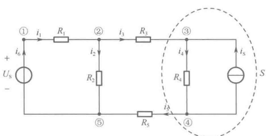

图 1-25 列出 KCL 方程用图
 

节点 $ ^{①} $:  $ i_{1}-i_{6}=0 $

节点②： $ -i_{1}+i_{2}+i_{3}=0 $

节点③： $ -i_{3}+i_{4}-i_{S}=0 $

节点④： $ -i_{4}+i_{5}+i_{S}=0 $

节点⑤： $ -i_{2}-i_{5}+i_{6}=0 $

经适当的移项处理后，写成如下形式：

节点 $ ^{①} $:  $ i_{1}=i_{6} $

节点②： $ i_{2}+i_{3}=i_{1} $

节点③： $ i_{4}=i_{3}+i_{S} $

节点④： $ i_{5}+i_{S}=i_{4} $

节点⑤： $ i_{6}=i_{2}+i_{5} $

<!-- page: 27 -->

观察上述方程可发现，每个方程等式的左边各项是流出节点的电流，而右边各项是流入节点的电流。由此可见，基尔霍夫电流定律可以换一种表述形式：对于集中参数电路中的任意一个节点而言，在任一时刻，流出此节点的电流之和等于流入此节点的电流之和。用数学式表达为

$$  \sum i_{ 出 }=\sum i_{ 入 }   \tag*{（1-23）}$$

这种表达形式更容易看出 KCL 的物理背景。因为流入任一节点的电流等于流出该节点的电流，实际上就是在任意一个无限小的单位时间内，流入任一节点的电荷量与流出该节点的电荷量必然相等，即说明任一节点电荷守恒，电路中的电流是连续流动的。因此，KCL 的实质是电流连续性原理在集中参数电路中的表现形式。

KCL 还可以推广运用到电路中的任一假想的闭合面 S，如图 1-25 中的虚线所示，这种假想的闭合面包围着支路和节点，又称广义节点。对这个广义节点列出 KCL 方程，有

 $$ -i_{3}+i_{5}=0\quad 或 \quad i_{3}=i_{5} $$ 

KCL 方程的具体形式仅仅依赖支路与节点的连接关系和支路电流的参考方向，列写 KCL 方程只需要知道这些信息：一个节点上连接有几条支路？这几条支路电流的参考方向如何？至于各支路是什么元件不必知道，也就是说，KCL 与元件的性质无关，仅与支路的相互连接方式有关。因此，KCL 反映了电路的拓扑结构对各支路电流的约束。

#### 1.6.2 基尔霍夫电压定律（KVL）

基尔霍夫电压定律（Kirchhoff's Voltage Law，KVL）表述为：集中参数电路中，在任一时刻，沿任一回路方向，回路中各支路电压降的代数和恒等于零。定律的数学表达式为

$$  \sum u=0   \tag*{（1-24）}$$

式（1-24）称为 KVL 方程，也称回路电压方程。

在列写 KVL 方程时，应先标明所有支路电压的参考方向。已知支路电压的参考方向常常是给定的，未知支路电压的参考方向可任意假定。还要任选一个回路绕行的方向（简称回路方向），可以设顺时针方向，也可以设逆时针方向，并在电路图中用带箭头的弧线标明。凡支路电压的参考方向与回路方向一致（顺绕）的，在 KVL 方程中为“+”项，反之（逆绕）为“-”项，这样的规定明确了代数和的含义。至于各个支路电压 u，是在假定的参考方向下计算出来的，是一个代数量，本身还有要与数值上的符号问题，它的正负取决于实际方向与参考方向是否一致。这样，在列写 KVL 方程时常需要与两套符号打交道。一般是先根据支路电压的参考方向相对于回路方向的顺绕、逆绕决定方程中各项前面的正负号，并列出方程，然后在具体计算时，再将各个支路电压 u 的具体数值代入。

例如，在图 1-26 所示电路中，根据基尔霍夫电压定律，可对回路  $ l_{1} $、 $ l_{2} $、 $ l_{3} $、 $ l_{4} $、 $ l_{5} $、 $ l_{6} $ 列出 KVL 方程如下：

回路 $ l_{1} $:  $ u_{1}+u_{2}-U_{S}=0 $

回路 $ l_{2} $:  $ u_{3}+u_{4}+u_{5}-u_{2}=0 $

回路 $ l_{3} $:  $ u_{7}-u_{4}=0 $

回路 $ l_{4} $:  $ u_{1}+u_{3}+u_{4}+u_{5}-U_{S}=0 $

回路 $ l_{5} $:  $ u_{3}+u_{7}+u_{5}-u_{2}=0 $

回路 $ l_{6} $:  $ u_{1}+u_{3}+u_{7}+u_{5}-U_{S}=0 $

经适当的移项处理后，写成如下形式：

回路 $ l_{1} $:  $ u_{1}+u_{2}=U_{S} $

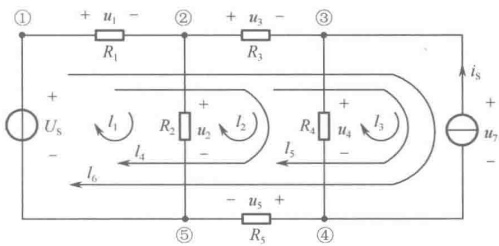

图 1-26 列出 KVL 方程用图
 

回路 $ l_{2} $:  $ u_{3}+u_{4}+u_{5}=u_{2} $

<!-- page: 28 -->

回路 $ l_{3} $:  $ u_{7}=u_{4} $

回路 $ l_{5} $:  $ u_{3}+u_{7}+u_{5}=u_{2} $

回路 $ l_{4} $:  $ u_{1}+u_{3}+u_{4}+u_{5}=U_{S} $

 $$ l_{6}:\ u_{1}+u_{3}+u_{7}+u_{5}=U_{8} $$ 

观察上述方程可发现，每个方程等式的左边各项是沿回路的电压降，而右边项是沿回路的电压升。由此可见，基尔霍夫电压定律可以换一种表述形式：对于集中参数电路中的任意一个回路而言，在任一时刻，沿任一回路方向，电压降之和等于电压升之和。用数学式表达为

$$  \sum u_{ 降 }=\sum u_{ 升 }   \tag*{（1-25）}$$

这种表达形式更容易看出 KVL 的物理背景，因为沿任一回路绕行一周，电压降之和等于电压升之和，实际上是单位正电荷绕行回路一周失去的能量等于获得的能量，即回路能量守恒。因此，KVL 的实质是能量守恒原理在集中参数电路中的表现形式。这也反映出电路中任意两点间的电压是单值的，与计算路径无关。例如，在图 1-26 所示电路中，节点①、⑤之间的电压  $ u_{15} $ 可从以下四条路径去计算：

 $$ u_{15}=U_{\mathrm{S}}\;;\quad u_{15}=u_{1}+u_{2}\;;\quad u_{15}=u_{1}+u_{3}+u_{4}+u_{5}\;;\quad u_{15}=u_{1}+u_{3}+u_{7}+u_{5} $$ 

今后在求解电路中两点间的电压时，可以在该两点间选择任意一条路径，计算出该路径上电压降的代数和（沿路径电压降为正项、电压升为负项）。

KVL 不仅适用于电路中的具体回路，对于电路中任意假想的回路，它也是成立的。例如，在图 1-27 中，假设在节点②、④之间连接一条虚拟支路 x，于是就出现假想回路  $ l_{B} $，虚拟支路电压为  $ u_{x} $，当选择假想回路  $ l_{B} $ 的方向为顺时针方向时，可列出如下 KVL 方程：

 $$ -u_{x}+u_{3}-u_{4}=0 $$ 

图 1-27 假想回路用图
 

从中可求出 $ u_{x} $。当然也可以直接根据电路中两点间电压的单值性计算 $ u_{x} $，即

 $$ u_{x}=u_{24}=u_{3}-u_{4}\quad 或 \quad u_{x}=u_{24}=-u_{2}-u_{1} $$ 

KVL 方程的具体形式仅仅依赖回路所关联的支路、回路中各支路电压的参考方向，以及回路方向。列出 KVL 方程只需要知道这些信息：一个回路是由几条支路连接而成的？构成回路的各支路电压的参考方向如何？回路方向如何？至于各支路是什么元件不必知道，这表明，KVL 与元件的性质无关，仅与支路的相互

连接方式有关，因此 KVL 反映了电路的拓扑结构对各支路电压的约束。

本书主要研究电路分析问题，电路分析的典型问题是：给定电路的结构、元件的特性，以及各独立电源的电压或电流，求出电路中所有的（或某些指定的）支路电压、支路电流，进而求出支路功率，分析电路的功率情况。

前面几节介绍了电路元件的电压、电流关系（伏安特性或性能方程），这是电路的各个组成部分所表现出的特性，称为电路的个体规律，它反映了元件的性质对电路变量的约束；本节介绍的KCL、KVL两个电路定律，是将电路作为一个整体来看，电路变量应服从的规律，称为电路的整体规律，它反映了电路拓扑结构对电路变量的约束。电路的个体规律和电路的整体规律构成了电路的基本规律，它们是分析一切集中参数电路的基本依据。根据电路的基本规律，可以列写电路方程，并解出所需的未知电路变量。

电路图是分析电路问题的信息载体，是进行电路分析的对象。在求解电路时，首先要明确题意，明确哪些是已知条件，哪些是待求量。然后确定解题的途径：应根据什么概念、定律去求什么量、先求哪一个量，后求哪一个量。这样求解起来就可以做到心中有数，条理清晰，解答过程简捷明了。在运用电路的基本规律列写电路方程之前，还应在电路图上标明各支路电压及各支路电流变量的参考方向、节点编号、回路编号及回路方向，为列写正确的电路方程做好充分的准备。

<!-- page: 29 -->

下面通过综合示例，进一步描述如何运用电路的基本规律来分析计算一些简单的电路问题。

### 历史人物

古斯塔夫·罗伯特·基尔霍夫（Gustav Robert Kirchhoff，1824—1887），德国物理学家，在电路、光谱学的基本原理（两个领域中各有根据其名字命名的基尔霍夫定律）有重要贡献。1845年，21岁时他发表了第一篇论文，提出了稳恒电路网络中电流、电压、电阻关系的两条电路定律，即著名的基尔霍夫电流定律（KCL）和基尔霍夫电压定律（KVL），解决了电器设计中电路方面的难题。后来又研究了电路中电的流动和分布，从而阐明了电路中两点间的电势差和静电学的电势这两个物理量在量纲和单位上的一致。使基尔霍夫电路定律具有更广泛的意义。直到现在，基尔霍夫电路定律仍旧是解决复杂电路问题的重要工具。基尔霍夫被称为“电路求解大师”。

### 1.7 综合示例

例 1-5 试求图 1-28 所示电路中的电压 U。

解：图1-28所示电路中有两个节点，节点编号为①、②。选择三个回路，回路编号为 $ l_{1} $、 $ l_{2} $、 $ l_{3} $。首先假定2Ω电阻上电流 $ I_{2} $的参考方向及三个回路方向（均为顺时针方向）并在电路图上标明，然后应用KCL、KVL及元件性能方程列写有关的电路方程。

将 KCL 应用于节点 $ ^{①} $，可得

 $$ I_{1}+I_{2}-2I_{1}-I_{S}=0\quad 即 \quad-I_{1}+I_{2}=I_{S} $$ 

将 KVL 应用于回路  $ l_{1} $、 $ l_{2} $、 $ l_{3} $ 可得并联的 4 个元件电压均为 U。

再由电阻元件性能方程可得

 $$ U=6I_{1},\quad U=2I_{2} $$ 

图 1-28 例 1-5 电路
 

最后联立求解得

 $ -\frac{U}{6}+\frac{U}{2}=I_{s} $， $ U=3I_{s}=3\times4=12V $，U>0表示实际方向与参考方向相同。

例 1-6 试求图 1-29 所示电路中的电流 I。

解：图 1-29 所示电路中有一个回路 l 及 4 个简单节点，节点编号为①、②、③、④。首先假定  $ 6\Omega $ 电阻上电压  $ U_{2} $ 的参考方向及回路 l 的回路方向（顺时针方向），并在电路图上标明，然后应用 KCL、KVL 及元件性能方程列写有关的电路方程。

将 KCL 应用于节点①、②、③、④可得串联的 4 个元件电流均为 I 。

图 1-29 例 1-6 电路
 

将 KVL 应用于回路 l，可得

 $$ -u_{1}+3u_{1}+u_{2}-U_{s}=0\quad 即 \quad2u_{1}+u_{2}=U_{s} $$ 

再由电阻元件性能方程可得

 $$ u_{1}=-2I\quad( 非关联参考方向 ),\quad u_{2}=6I $$ 

最后联立求解得

 $$ 2\times(-2I)+6I=U_{\mathrm{s}};\quad I=U_{\mathrm{s}}/2=3\mathrm{A} $$ 

I>0 表示实际方向与参考方向相同。

例 1-7 如图 1-30 所示电路，已知  $ U_{S}=7V $， $ i_{1}=1A $， $ R_{1}=R_{2}=2\Omega $，求  $ u_{3} $ 和  $ i_{2} $。

解：先假定  $ R_{1} $、 $ R_{2} $ 上电压  $ u_{1} $、 $ u_{2} $ 的参考方向及两个回路  $ l_{1} $、 $ l_{2} $ 的回路方向，并在电路图上标明。

<!-- page: 30 -->

图 1-30 例 1-7 电路
 

将 KVL 应用于回路  $ l_{2} $，可得

(1)

 $$ \left):i_{1}\rightarrow\left.\begin{aligned}u_{1}\\ u_{d}\end{aligned}\right\}(2):\rightarrow\begin{aligned}&KVL&l_{1}:u_{3}\\ &KVL&l_{2}:u_{2}\end{aligned}\right\}(3):u_{2}\rightarrow i_{2} $$ 

（1）求解第一步：

 $$ u_{1}=R_{1}i_{1}=2\times1=2V；u_{d}=4i_{1}=4\times1=4V $$ 

（2）求解第二步：

将 KVL 应用于回路  $ l_{1} $，可得

 $$ \begin{aligned}u_{1}+u_{3}-U_{S}&=0\quad 即 \quad u_{3}=U_{S}-u_{1}=7-2=5V\\u_{d}+u_{2}-u_{3}&=0\quad 即 \quad u_{2}=u_{3}-u_{d}=5-4=1V\end{aligned} $$ 

##### （3）求解第三步：

根据电阻元件性能方程可得

 $$ i_{2}=u_{2}/R_{2}=0.5A $$ 

例 1-8 如图 1-31 所示电路，已知  $ R_1 = 0.5\,\text{k}\Omega $， $ R_2 = 1\,\text{k}\Omega $， $ R_3 = 2\,\text{k}\Omega $， $ U_S = 10\,\text{V} $，电流控制电流源的电流  $ i_d = 50i_1 $，求电阻  $ R_3 $ 两端的电压  $ u_3 $。

解：首先确定流过  $ R_{3} $ 的电流为  $ i_{d} $，且  $ i_{d} $ 的参考方向与  $ u_{3} $ 的参考方向为非关联参考方向，根据电阻元件的性能方程可得

 $$ u_{3}=-R_{3}i_{\mathrm{d}}=-2\times10^{3}\times50i_{1}=-10^{5}i_{1} $$ 

从中发现 $ i_{1} $是一个关键变量。为了求 $ i_{1} $，对节点①应用KCL，可得

 $$ -i_{1}+i_{2}-i_{d}=0\quad 即 \quad i_{2}=i_{1}+i_{d}=i_{1}+50i_{1}=51i_{1} $$ 

再对回路 $ l_{1} $应用KVL（同时将元件性能方程代入），可得

 $$ R_{1}i_{1}+R_{2}i_{2}-U_{S}=0\quad 即 \quad R_{1}i_{1}+R_{2}\times51i_{1}=U_{S} $$ 

图 1-31 例 1-8 电路
 

 $$ i_{1}=\frac{U_{s}}{R_{1}+51R_{2}}=\frac{10}{500+51\times1000}=0.194mA $$ 

最后得  $ R_{3} $ 两端的电压： $ u_{3} = -10^{5}i_{1} = -19.4V $

例 1-9 如图 1-32 所示电路，试求每个元件发出或吸收的功率。

解：根据电阻元件性能方程可得，流过  $ 5\Omega $ 电阻的电流为  $ i_{d}=10/5=2A $ 。

该电流正好是 CCCCS 的电流，由此可知

图 1-32 例 1-9 电路
 

 $$ i_{d}=0.9i_{1}=2A, 即 \quad i_{1}=\frac{2}{0.9}=\frac{20}{9}A $$ 

对节点 $ ^{①} $应用KCL，可得

对回路 $ l_{1} $、 $ l_{2} $分别应用KVL，可得

 $$ -i_{1}+i_{2}+i_{d}=0, 即 \quad i_{2}=i_{1}-i_{d}=\frac{20}{9}-2=\frac{2}{9}A $$ 

再由电阻元件性能方程可得

 $$ u_{1}=6\times i_{1}=6\times\frac{20}{9}=\frac{120}{9}V,\quad u_{2}=4\times i_{2}=4\times\frac{2}{9}=\frac{8}{9}V $$ 

 $$ \begin{cases}u_{1}+u_{2}-U_{S}=0\\10+u_{d}-u_{2}=0\end{cases} $$ 

 $$ \left\{\begin{aligned}U_{\mathrm{S}}&=u_{1}+u_{2}=\frac{120}{9}+\frac{8}{9}=\frac{128}{9}\mathrm{V}\\ u_{\mathrm{d}}&=-10+u_{2}=-10+\frac{8}{9}=-\frac{82}{9}\mathrm{V}\end{aligned}\right. $$ 

最后求得每个元件的功率为

<!-- page: 31 -->

$ p_{U_S} = U_S \times i_1 = \frac{128}{9} \times \frac{20}{9} = \frac{2560}{81} W > 0 $，非关联参考方向，发出 $ \frac{2560}{81} W $功率。

 $ p_{6\Omega}=u_1\times i_1=\frac{120}{9}\times\frac{20}{9}=\frac{2400}{81}\text{W}>0 $，关联参考方向，吸收 $ \frac{2400}{81}\text{W} $功率。

 $ p_{4\Omega}=u_2\times i_2=\frac{8}{9}\times\frac{2}{9}=\frac{16}{81}\mathrm{W}>0 $，关联参考方向，吸收 $ \frac{16}{81}\mathrm{W} $功率。

 $ p_{5\Omega}=10\times i_{d}=10\times2=20W>0 $，关联参考方向，吸收20W功率。

 $ p_{CCCS} = u_d \times i_d = -\frac{82}{9} \times 2 = -\frac{164}{9} $ W < 0，关联参考方向，发出 $ \frac{164}{9} $ W 功率。

 $$ p_{ 发出 }=\frac{2560}{81}+\frac{164}{9}=\frac{4036}{81}W；p_{ 吸收 }=\frac{2400}{81}+\frac{16}{81}+20=\frac{4036}{81}W；p_{ 发出 }=p_{ 吸收 }, 功率平衡。 $$ 

### 1.8 计算机仿真

在电路分析的理论部分涉及较多的数学计算，手工进行验证非常耗时。此时，可以采用电路仿真软件包进行快速的电路分析。Multisim $ ^{①} $是美国国家仪器（NI）有限公司推出的基于Windows的仿真工具，适用于板级的模拟/数字电路板的设计工作。它包含了电路原理图的图形输入、电路硬件描述语言输入方式，具有丰富的仿真分析能力。为适应不同的应用场合，Multisim推出了许多版本，用户可以根据自己的需要加以选择。本书将以教育版为演示软件，结合教学的实际需要，简要地介绍该软件的概况和使用方法，并给出若干应用实例。

例 1-10 图 1-33 所示电路可以用来验证基尔霍夫电流定律，三条支路的电流均为参考方向，对于节点 A 来说，I2 是流入节点的，I1 和 I3 是流出节点的，将电流表按设定的参考方向接入电路。仿真实验结果 I1 为 -3.192mA，I2 为 6.027mA，I3 为 9.220mA。

根据仿真结果，节点 A 的电流代数和为 $ (-3.192)-6.027+9.220\approx0A $，从而验证了基尔霍夫电流定律的正确性。

例 1-11 图 1-34 所示电路可以用来验证基尔霍夫电压定律，BAOCB 为闭合回路，支路电流参考方向已标出，电阻电压和电流采用关联参考方向，电压表接入时要注意极性。回路的绕行方向为顺时针。启动仿真后，电压表的读数为其所并联电阻的电压值。

根据仿真结果，回路 BAOCB 电压的代数和为 $ -(-0.889)+2.778-(-1.333)-5\approx0V $，从而验证了基尔霍夫电压定律的正确性。

图 1-33 基尔霍夫电流定律的验证
 

图 1-34 基尔霍夫电压定律的验证
 

例 1-12 图 1-35 为例 1-8 题的仿真电路。4 种受控源可以在 Multisim 的 “Place->Component->Sources” 中找到。

<!-- page: 32 -->

图 1-35 例 1-8 仿真电路
 

电压表 U3 的读数即为电阻 R3 的电压，仿真结果显示为-19.414V，与手工求解的结果相符。

### 思考题

1-1 理想电路元件与实际电路元件之间的联系和差别是什么？

1-2 电流、电压的实际方向是怎样规定的？有了实际方向这个概念，为什么还要引入电流、电压的参考方向的概念？参考方向的意义是什么？对于任意一个具体电路，是否可以任意指定电流、电压的参考方向？

1-3 功率的定义是什么？功率与电流、电压之间有什么关系？元件在什么情况下是吸收功率的？在什么情况下是发出功率的？它与电流、电压的参考方向有何关系？

1-4 电压源和电流源各有什么特点？

1-5 若令电压源的电压为零，可做何种处理？若令电流源的电流为零，可做何种处理？

1-6 受控源能否作为电路的激励？若电路中无独立电源，电路中还会有电流、电压响应吗？

1-7 应用基尔霍夫电流定律列写某节点电流方程时，与该节点相连的各支路上的元件性质对方程有何影响？

1-8 应用基尔霍夫电压定律列写某回路电压方程时，构成该回路的各支路上的元件性质对方程有何影响？

1-9 基尔霍夫电流定律是描述电路中与节点相连的各支路电流间相互关系的定律，应用此定律可写出节点电流方程。对于一个具有 n 个节点的电路，可写出多少个独立的节点电流方程？

1-10 基尔霍夫电压定律是描述电路中与回路相关的各支路电压间相互关系的定律，应用此定律可写出回路电压方程。对于一个具有 n 个节点、b 条支路的电路，可写出多少个独立的回路电压方程？

### 习题

1-1 2C 的电荷由 a 点移到 b 点，能量的改变为 20J，若（1）电荷为正且失去能量；（2）电荷为正且获得能量；求  $ u_{ab} $。

1-2 在题 1-2 图中，试问对于  $ N_{A} $ 与  $ N_{B} $，u, i 的参考方向是否关联？此时下列各组乘积  $ u \times i $ 对  $ N_{A} $ 与  $ N_{B} $ 分别意味着什么功率？并说明功率是从  $ N_{A} $ 流向  $ N_{B} $，还是相反。

(a) i = 15A, u = 20V

(b) i = -5A, u = 100V

(c) i = 4A, u = -50V

(d)  $ i = -16A $, u = -25V

<!-- page: 33 -->

1-3 题 1-3 图所示电路由 5 个元件组成，其中  $ u_1 = 9\text{V} $， $ u_2 = 5\text{V} $， $ u_3 = -4\text{V} $， $ u_4 = 6\text{V} $， $ u_5 = 10\text{V} $， $ i_1 = 1\text{A} $， $ i_2 = 2\text{A} $， $ i_3 = -1\text{A} $。试求：

（1）各元件的功率；（2）全电路吸收功率及发出功率各为多少？说明了什么规律？

题1-2图
 

题1-3图
 

1-4 在假定的电压、电流参考方向下，写出题1-4图所示各元件的性能方程。

1-5 求题 1-5 图所示各电源的功率，并指明它们是吸收功率还是发出功率。

(a)
 

(d)
 

(b)
 

(e)
 

(c)
 

题1-4图
 

(f)
 

(a)
 

（b）
 

(c)
 

题1-5图
 

(d)
 

1-6 在题 1-6 图所示电路中，一个 3A 的电流源分别与三种不同的外电路相接，求三种情况下 3A 电流源的功率，并指明是吸收功率还是发出功率。

(a)
 

题1-6图
 

(c)
 

1-7 试求题 1-7 图所示电路中电压源及电流源的功率，并指明它们是吸收功率还是发出功率。

(a)
 

题1-7图
 

(c)
 

1-8 试求：

（1）题1-8（a）图所示电路中受控电压源的端电压及其功率；

（2）题1-8（b）图所示电路中受控电流源的电流及其功率。

<!-- page: 34 -->

题1-8图
 

1-9 试求题 1-9 图所示电路中各电源的功率，并说明它们是吸收功率还是发出功率。

1-10 试求题 1-10 图所示电路中的电流 I 、电压源电压  $ U_{s} $ 及电压  $ U_{ab} $

题1-9图
 

题1-10图
 

1-11 如题 1-11 图所示电路，求 a、b 点对地的电位  $ U_{a} $ 和  $ U_{b} $，以及 a、b 两点间的电压  $ U_{ab} $。

1-12 如题 1-12 图所示电路，求开关 S 打开与闭合时 A、B 点对地的电位  $ U_{A} $ 和  $ U_{B} $。

1-13 题 1-13 图表示某电路中的部分电路，各已知的电流及电阻元件值已标示在图中，试求  $ I $、 $ U_{s} $、R。

题1-11 图
 

题1-12图
 

题1-13图
 

1-14 试求题 1-14 图所示电路中的电流 i。

1-15 试求题 1-15 图所示电路中的电流  $ I_{ab} $、 $ I_{ca} $ 及 I 。

1-16 试求题 1-16 图所示电路中的  $ U_{AB} $、 $ I_{1} $ 及  $ I_{2} $。

题1-14 图
 

题1-15图
 

题1-16图
 

<!-- page: 35 -->

1-17 试求题 1-17 图所示电路中各支路电压及电流。

1-18 试求题 1-18 图所示电路中的电流 I 。

1-19 试求题 1-19 图所示电路中受控电流源的功率。

题1-17图
 

题1-18图
 

题1-19图
 

1-20 试求：

（1）题1-20图（a）所示电路中的电流 $ I_{2} $；（2）题1-20图（b）所示电路中的电压 $ u_{ab} $。

(a)
 

（b）
 

题1-20图
 

1-21 电路如题 1-21 图所示。

（1）题1-21图（a）中，已知 $ u_{s}=12V $，求电压 $ u_{ab} $；（2）题1-21图（b）中，已知 $ R=3\Omega $，求电压 $ u_{ab} $。

1-22 试求题 1-22 图所示电路中各元件的功率，并验算功率是否平衡。

(a)
 

(b)
 

题1-21 图
 

题1-22图
 

