# 02-第2章 电阻电路的等效变换

[返回全书目录](../../README.md)

> PDF 页码：36–61

<!-- page: 36 -->

### 第2章 电阻电路的等效变换

“等效”在电路分析中是一个十分重要的概念，电路的等效变换法已成为电路分析中常用的简便、快捷的方法。本章首先阐述电路等效的一般概念，然后具体研究一些由简单电阻电路构成的单口网络的等效变换，从中总结出一些规律，进而推出电路的等效变换法。对电路进行等效变换的优越之处在于可将一个复杂的电路经一次或多次等效变换为一个十分简单的电路，只需列写少量的电路方程，便可轻松求解电路问题。

### 2.1 电路等效的一般概念

由线性非时变电阻元件、线性受控源和独立电源组成的电路，称为线性非时变电阻电路，简称电阻电路。电路中电压源的电压或电流源的电流可以是直流，也可以随时间按某种规律变化。当电路中的独立电源都是直流电源时，这类电路简称为直流电阻电路。

在对复杂电路进行分析时，如果只对其中某一支路的电压、电流或其中某些支路的电压、电流感兴趣，则可以用分解法把原来的复杂电路分解成两个通过两根导线相连的子电路  $ N_{A} $ 和  $ N_{B} $ （见图2-1）。 $ N_{A} $ 中的电压、电流不必细究，而  $ N_{B} $ 中则有我们感兴趣并且要求解的电压和电流。

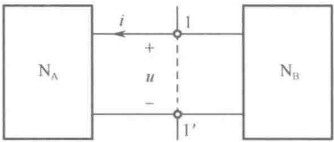

图2-1 复杂电路分解成两个子电路
 

像  $ N_{A} $、 $ N_{B} $ 这种由元件相连接组成的，对外只有两个端子的子电路称为二端网络或单口网络（一端口网络）。1、1' 是两个端子，1-1' 构成一个端口，u 称为端口电压，i 称为端口电流。如果单口网络内部含有独立电源、电阻、受控源，则称之为含源单口网络，用  $ N_{s} $ 表示；如果单口网络内部仅含有电阻、受控源，没有独立电源，则称为无源单口网络，用  $ N_{0} $ 表示。

#### 2.1.1 单口网络的伏安关系

当单口网络的内部情况（电路结构、元件参数）完全明确时，可根据 KCL、KVL 及元件性能方程列出相关的电路方程，并求出其端口电压 u 与端口电流 i 之间的关系；当单口网络内部情况不明（黑箱）时，可以用实验方法测得 u 与 i 之间的关系，端口 u 与 i 之间的关系称为单口网络的伏安关系，用  $ u = f(i) $ 或  $ i = g(u) $ 来表示。单口网络的伏安关系是由网络内部的电路结构、元件参数决定的，与外接的电路无关，它只反映出单口网络本身性质对外接电路的作用或影响，因此，又将单口网络的伏安关系称为单口网络的外特性方程，该外特性方程可以在连接任意外电路情况下求出。图 2-2 为单口网络连接外电路的示意图，一般可以假定一种最简单的外电路情况，求出单口网络的外特性方程。

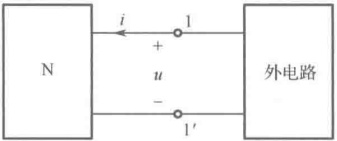

图 2-2 单口网络连接外电路
 

#### 2.1.2 等效、等效电路与等效变换

如图2-3（a）、（b）中所示的两个单口网络 $ N_{1} $和 $ N_{2} $，它们内部的电路结构、元件参数可以完全不同， $ N_{1} $是一个复杂的单口网络， $ N_{2} $是一个简单的单口网络。如果 $ N_{1} $、 $ N_{2} $的外特性方程完全

<!-- page: 37 -->

相同，则意味着这两个单口网络对外电路的作用或影响是完全相同的，这时就称  $ N_{1} $ 与  $ N_{2} $ 是相互等效的，互称等效电路。这样，在计算外电路的电压、电流时，可将相互等效的两个单口网络  $ N_{1} $ 与  $ N_{2} $ 进行置换。置换前后与它们相连接的外电路的电压、电流和功率保持不变，这种置换称为等效变换。通常是用简单的单口网络  $ N_{2} $ 来置换复杂的单口网络  $ N_{1} $，这会给对外电路的计算带来方便。因此，常常将电路的等效变换又称为电路的等效化简。

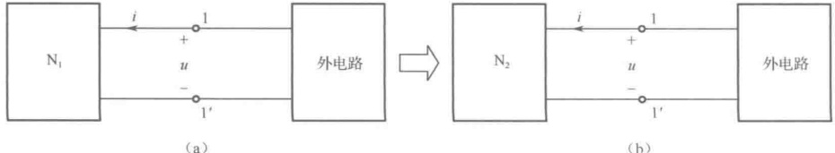

图 2-3 单口网络的等效
 

一旦由图2-3（b）计算出外电路的电压、电流， $ N_{2} $ 就失去了意义。如果还要求  $ N_{1} $ 内的电压、电流，就必须返回到图2-3（a），根据已求得的端口电压 u 和端口电流 i 来进行求解。等效电路仅适用于对外电路的求解，而等效电路内部的电压、电流是没有必要知道的。

下面的问题是怎样将一个复杂的单口网络化简成与之等效的简单的单口网络，即需要研究等效电路是如何构成的。根据等效的概念，只要求出复杂的单口网络的外特性方程并整理成最简单的形式，然后凭借已有的经验，构造一个与此外特性方程相吻合的简单的单口网络，即可得到等效电路。下面通过一个例子来说明如何构造等效电路。

例 2-1 构造图 2-4（a）所示含源单口网络的最简单的等效电路。

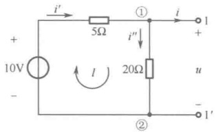

（a）含源单口网络
 

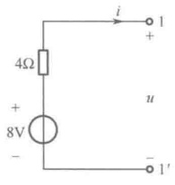

（b）串联等效电路
 

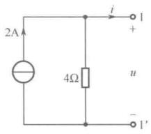

（c）并联等效电路
 

图2-4 例2-1图
 

解：首先假定图2-4（a）中 $ 5\Omega $及 $ 20\Omega $元件上电流 $ i' $、 $ i'' $的参考方向和回路l的回路方向。

（1）应用 KCL、KVL、元件性能方程对图 2-4（a）列写电路方程。

 $$ \mathbf{K}\mathbf{C}\mathbf{L}\quad\textcircled{1}{}\mathbf{\Lambda:}\qquad i{}^{\prime}=i{}^{\prime \prime}+i $$ 

 $$ \mathbf{K}\mathbf{V}\mathbf{L} \quad l: \quad u=-5i^{\prime}+10 $$ 

电阻元件性能方程： $ i''=u/20 $

（2）联立求解得外特性方程。

 $$ u=8-4i\quad 或 \quad i=2-u/4 $$ 

（3）构造等效电路。

由 u = 8 - 4i 并根据 KVL，构造一个 8V 电压源与 4Ω 电阻相串联的支路，如图 2-4（b）所示。由 i = 2 - u/4 并根据 KCL，构造一个 2A 电流源与 4Ω 电阻相并联的支路，如图 2-4（c）所示。

上面利用求出复杂单口网络的外特性方程的方法来构造等效电路的过程自然是最根本的途径，因为它是直接由等效的概念得出的。但是，如果单口网络很复杂，求外特性方程可能会变得

<!-- page: 38 -->

很困难，构造等效电路就不是一件容易的事。在这种情况下，必须寻找更好的方法。可以先用上述的方法分析研究一些简单、典型单口网络的等效电路，从中总结出一些规律，再将这些规律综合运用到复杂单口网络的等效电路的构造中。具体做法是，将复杂单口网络分解成许多简单的单口网络的组合，对每个简单的单口网络，根据规律用其等效电路置换，这样由各个局部等效合成整体等效，最终可以方便、快捷地得到复杂单口网络的等效电路。

以下几节主要分析研究一些简单、典型单口网络的等效电路，并将其规律归纳成结论和公式。

### 2.2 电阻的串联、并联和混联等效

#### 2.2.1 电阻的串联等效

图2-5（a）所示电路为 n 个电阻  $ R_{1} $、 $ R_{2} $、…、 $ R_{n} $ 串联组成的无源单口网络。设各电阻上电压、电流取关联参考方向，电阻串联时，由 KCL 可知每个电阻中的电流均为同一电流 i，再由 KVL 及电阻元件的性能方程可得端口的外特性方程为

 $$ \begin{aligned}&u=u_{1}+u_{2}+\cdots+u_{k}+\cdots+u_{n}=R_{1}i+R_{2}i+\cdots+R_{k}i+\cdots+R_{n}i=(R_{1}+R_{2}+\cdots+R_{k}+\cdots+R_{n})i=R_{eq}i\\ & 中 ,\quad R_{eq}\frac{\mathrm{def}}{i}=\frac{u}{i}=R_{1}+R_{2}+\cdots+R_{k}+\cdots+R_{n}=\sum_{k=1}^{n}R_{k}\quad(2-1)\\ \end{aligned} $$ 

其中，

电阻  $ R_{eq} $ 称为 n 个电阻相串联的等效电阻，其值等于相串联的 n 个电阻之和。用  $ R_{eq} $ 构造一个如图 2-5（b）所示的单口网络，即为图 2-5（a）所示电路的等效电路。在求解外电路时，可用图 2-5（b）置换图 2-5（a），也就是将图 2-5（a）等效变换为图 2-5（b）。

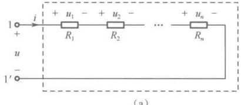

(a)
 

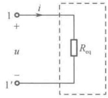

（b）
 

图 2-5 电阻串联及等效电路
 

显然，等效电阻  $ R_{eq} $ 必大于任意一个串联的电阻，而且等效电阻吸收的功率等于 n 个串联电阻吸收的功率之和。

电阻串联有分压关系。已知串联电阻端口电压，求相串联各电阻上的电压，称为分压。第 k 个串联电阻上的分电压为

$$  u_{k}=R_{k}i=\frac{R_{k}}{R_{eq}}u\qquad(k=1,2,\cdots,n)   \tag*{（2-2）}$$

式（2-2）称为分压公式，式中  $ R_{k}/R_{eq} $ 称为分压系数。串联的每个电阻，其电压与自身的电阻值成正比，即电阻值大者分得的电压大。

#### 2.2.2 电阻的并联等效

在研究电阻的并联等效时，为使公式简单，常将电阻的并联用电导的并联来表示，图2-6（a）所示电路为 n 个电导  $ G_{1}, G_{2}, \cdots, G_{n} $ 并联组成的无源单口网络。设各电导上电压、电流取关联参考方向，电导并联时，由 KVL 可知每个电导的电压均为同一电压 u，再由 KCL 及电导元件的性能方程得端口的外特性方程为

<!-- page: 39 -->

$$ \begin{aligned}&i=i_{1}+i_{2}+\cdots+i_{k}+\cdots+i_{n}=G_{1}u+G_{2}u+\cdots+G_{k}u+\cdots+G_{n}u=(G_{1}+G_{2}+\cdots+G_{k}+\cdots+G_{n})u=G_{eq}u\\ & 其中 ,\quad G_{eq}\overset{def}{=}\frac{i}{u}=G_{1}+G_{2}+\cdots+G_{k}+\cdots+G_{n}=\sum_{k=1}^{n}G_{k}\quad(2-3)\\ \end{aligned} $$ 

电导  $ G_{eq} $ 称为 n 个电导相并联的等效电导，其值等于相并联的 n 个电导之和。n 个电阻并联的等效电阻为

 $$ \begin{aligned}R_{eq}=\frac{1}{G_{eq}}=\frac{1}{\sum_{k=1}^{n}G_{k}}=\frac{1}{\sum_{k=1}^{n}\frac{1}{R_{k}}}\\\frac{1}{R_{eq}}=\sum_{k=1}^{n}\frac{1}{R_{k}}\end{aligned} $$ 

即

显然，等效电阻  $ R_{eq} $ 小于任意一个并联的电阻。用  $ G_{eq} $（或  $ R_{eq} $）构造一个如图 2-6（b）所示的单口网络，即为图 2-6（a）所示电路的等效电路。

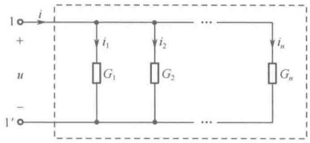

(a)
 

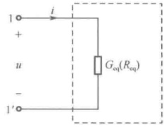

(b)
 

图2-6 电阻并联及等效电路
 

电导并联有分流关系。已知并联电导端口总电流，求相并联各电导上的电流，称为分流。第 k 个并联电导上的分电流为

$$  i_{k}=G_{k}u=\frac{G_{k}}{G_{\mathrm{eq}}}i\quad(k=1,2,\cdots,n)   \tag*{(2-5)}$$

式（2-5）称为分流公式，式中  $ G_{k}/G_{ea} $ 称为分流系数。并联的每个电导上的电流与其自身的电导值成正比，即电导值大者分得的电流大。

电路分析中常遇到的两个电阻相并联的情况如图2-7（a）所示，等效电导及等效电阻分别为

 $$ G_{\mathrm{eq}}=G_{\mathrm{l}}+G_{\mathrm{2}}~;\quad R_{\mathrm{eq}}=\frac{1}{\frac{1}{R_{\mathrm{l}}}+\frac{1}{R_{2}}}=\frac{R_{\mathrm{l}}R_{2}}{R_{\mathrm{l}}+R_{2}} $$ 

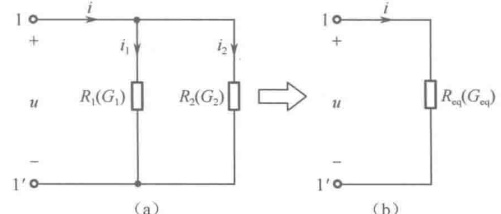

(a)
 

(b)
 

再由分流公式得两并联电阻的电流分别为

图2-7 两电阻并联及等效电路
 

 $$ i_{1}=\frac{G_{1}}{G_{1}+G_{2}}i=\frac{\frac{1}{R_{1}}}{\frac{1}{R_{1}}+\frac{1}{R_{2}}}i=\frac{R_{2}}{R_{1}+R_{2}}i\;;\quad i_{2}=\frac{G_{2}}{G_{1}+G_{2}}i=\frac{\frac{1}{R_{2}}}{\frac{1}{R_{1}}+\frac{1}{R_{2}}}i=\frac{R_{1}}{R_{1}+R_{2}}i $$ 

用  $ R_{eq} $ （或  $ G_{eq} $ ）构造一个如图2-7（b）所示的单口网络，即为图2-7（a）所示电路的等效电路。

#### 2.2.3 电阻的混联等效

既有电阻串联又有电阻并联的电路称为混联电阻电路，图2-8（a）所示电路为一个简单的混联电阻电路。

<!-- page: 40 -->

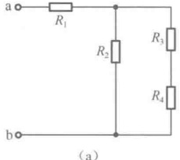

(a)
 

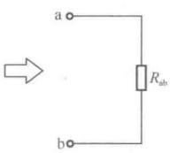

(b)
 

混联电阻电路等效电阻的计算可充分运用电阻的串、并联等效化简规则逐步完成。具体做法是，先从端口判断出电阻的串、并联关系，即在假定端口施加电源激励的情况下，凡电流相同的电阻为串联关系，凡电压相同的电阻为并联关系。然后按电阻串、并联等效化简规则对各部分的串、并联电阻逐一进行等效化简，最后得到整个电路的等效电阻。图2-8（a）所示电路中，电阻 $ R_{3} $、 $ R_{4} $串联后与电阻 $ R_{2} $并联，再与电阻 $ R_{1} $串联。该混联电阻电路的等效电阻为

图 2-8 混联电阻电路及等效电路
 

 $$ R_{eq}=R_{ab}=R_{1}+\frac{R_{2}\times(R_{3}+R_{4})}{R_{2}+(R_{3}+R_{4})} $$ 

 $ R_{ab} $ 表示以 a、b 两端子构成端口的单口网络的等效电阻。对于同一电路，求不同端口的等效电阻时，电阻之间的串、并联关系会有所不同，因而等效电阻也会不同。

例2-2 如图2-9（a）所示的电路，求等效电阻 $ R_{ab} $、 $ R_{ac} $、 $ R_{bc} $。

解：将图2-9（a）所示电路逐步进行电阻串、并联等效化简，依次得到图2-9（b）、（c）、（d），最后由图2-9（d）求出各等效电阻分别为

 $$ R_{\mathrm{ab}}=\frac{5\times(4+1)}{5+(4+1)}=2.5\Omega\;;\quad R_{\mathrm{ac}}=\frac{4\times(5+1)}{4+(5+1)}=2.4\Omega\;;\quad R_{\mathrm{bc}}=\frac{1\times(5+4)}{1+(5+4)}=0.9\Omega $$ 

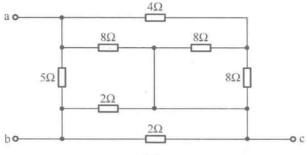

(a)
 

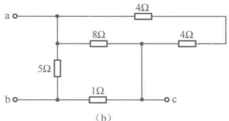

(b)
 

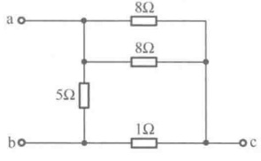

(c)
 

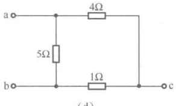

(d)
 

图2-9 例2-2图
 

电阻的连接除了串联、并联，还有一种特殊的桥形连接，图2-10（a）所示为一个电桥电路， $ R_{1} $、 $ R_{2} $、 $ R_{3} $、 $ R_{4} $为四个桥臂电阻。

当  $ R_{1}:R_{2}=R_{3}:R_{4} $，即  $ R_{1}R_{4}=R_{2}R_{3} $ 时，电桥达到平衡状态。这时若在端口 AB 施加电源激励，则电桥电路中 C、D 两点是等电位点，即 CD 支路上的电压  $ U_{CD}=0 $，且 CD 支路上的电流为零。根据若两点间电压为零，则两点间可作短路处理，以及根据若支路电流为零，则该支路可作开路处理，在求端口 AB 的等效电阻  $ R_{AB} $ 时，可将 CD 支路作短路或开路处理，如图 2-10（b）、（c）所示，再运用电阻串、并联等效化简规则求其等效电阻。

<!-- page: 41 -->

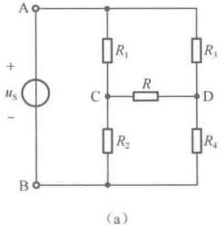

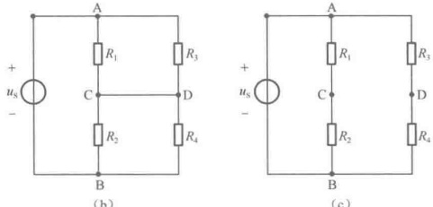

(b)
 

图 2-10 平衡电桥及等效电路
 

 $$ R_{AB}=\frac{R_{1}\times R_{3}}{R_{1}+R_{3}}+\frac{R_{2}\times R_{4}}{R_{2}+R_{4}} $$ 

 $$ R_{_{AB}}=\frac{(R_{1}+R_{2})\times(R_{3}+R_{4})}{(R_{1}+R_{2})+(R_{3}+R_{4})} $$ 

但当电桥不满足平衡条件时，就无法直接运用电阻串、并联等效化简规则求端口 AB 的等效电阻，这时必须寻求其他方法。

在如图 2-10（a）所示的电桥电路中，电阻  $ R_{1} $、R、 $ R_{2} $ 以及  $ R_{3} $、R、 $ R_{4} $ 之间的连接方式称为星形（或 Y 形）连接，电阻  $ R_{1} $、R、 $ R_{3} $ 以及  $ R_{2} $、R、 $ R_{4} $ 之间的连接方式称为三角形（或  $ \triangle $ 形）连接，这两种连接方式在一定的条件下可以进行等效变换，进而为求端口 AB 的等效电阻创造了条件。

### 2.3 电阻的 Y 形连接与  $ \triangle $ 形连接的等效变换

#### 2.3.1 Y形、 $ \triangle $形连接方式

将三个电阻（ $ R_{1} $、 $ R_{2} $、 $ R_{3} $）的一端连接在一个节点（中节点）上，而它们的另一端分别接到三个不同的端子上，就构成了如图2-11（a）所示的Y形连接的电阻电路。将三个电阻（ $ R_{12} $、 $ R_{23} $、 $ R_{31} $）分别接在每两个端子之间，使三个电阻构成一个回路，就构成了如图2-11（b）所示的△形连接的电阻电路。这两种连接都通过三个端子1、2、3与外电路相连，若这两种电阻电路中的电阻之间满足一定关系，使得它们对端子1、2、3和端子1、2、3以外的特性完全相同，即如果在它们的对应端子之间具有相同的电压 $ u_{12} $、 $ u_{23} $、 $ u_{31} $，则流入对应端子的电流 $ i_{1} $、 $ i_{2} $和 $ i_{3} $也应分别对应相等。在这种条件下，它们是相互等效的，互为等效电路。对于外电路而言，Y形连接的电阻电路与△形连接的电阻电路可以进行等效变换，而不影响外电路任何部分的电压、电流。这种等效变换可以用来简化电路，为进一步计算提供方便。注意：Y形连接等效变换为△形连接时，与外电路相连的三个端子1、2、3保持不变，而中节点会消失。同理，△形连接等效变换为Y形连接时，与外电路相连的三个端子1、2、3保持不变，却会出现一个新的中节点。

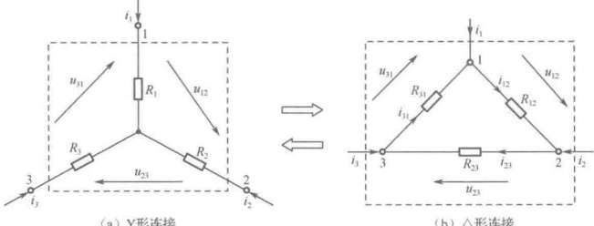

（a）Y形连接
 

（b）△形连接
 

图2-11 Y形连接与 $ \triangle $形连接的等效变换
 

<!-- page: 42 -->

#### 2.3.2 Y- $ \triangle $等效变换

下面从前述等效变换条件着手推导出 Y 形、 $ \triangle $形连接的电阻电路相互等效变换的电阻换算公式。推导的思路是，根据 KCL、KVL 及电阻元件性能方程列写图 2-11（a）及图 2-11（b）的有关电路方程，然后由等效变换条件进行方程平衡，对比方程中变量前的系数即可得到电阻换算公式。

对于图2-11（a）、（b）电路，由KCL、KVL可知

$$  i_{3}=-(i_{1}+i_{2})   \tag*{(2-6)}$$

$$  u_{12}=-(u_{23}+u_{31})   \tag*{(2-7)}$$

显然，图2-11（a）、（b）电路中的3个电流变量和3个电压变量中各只有两个是相互独立的，可选 $ i_{1} $、 $ i_{2} $和 $ u_{23} $、 $ u_{31} $作为独立的电路变量列写电路方程。

由图2-11（a）所示的Y形电阻连接的电路，根据KVL及电阻元件性能方程，得

 $$ u_{23}=R_{2}i_{2}-R_{3}i_{3};\quad u_{31}=R_{3}i_{3}-R_{1}i_{1} $$ 

将式（2-6）代入以上两式，消去 $ i_{3} $，得到Y形连接的电阻电路的外特性方程为

$$  \left.\begin{array}{l}u_{23}=R_{3}i_{1}+(R_{2}+R_{3})i_{2}\\ u_{31}=-(R_{1}+R_{3})i_{1}-R_{3}i_{2}\end{array}\right\}   \tag*{(2-8)}$$

联立求解以上两式，得 Y 形连接的电阻电路外特性方程的另一种形式为

$$  \left.\begin{aligned}i_{1}&=-\frac{R_{3}}{R_{1}R_{2}+R_{2}R_{3}+R_{3}R_{1}}u_{23}-\frac{R_{2}+R_{3}}{R_{1}R_{2}+R_{2}R_{3}+R_{3}R_{1}}u_{31}\\ i_{2}&=\frac{R_{1}+R_{3}}{R_{1}R_{2}+R_{2}R_{3}+R_{3}R_{1}}u_{23}+\frac{R_{3}}{R_{1}R_{2}+R_{2}R_{3}+R_{3}R_{1}}u_{31}\end{aligned}\right\}   \tag*{（2-9）}$$

由图2-11（b）所示的△形连接的电阻电路，根据KCL及电阻元件性能方程，得

 $$ i_{1}=i_{12}-i_{31}=\frac{u_{12}}{R_{12}}-\frac{u_{31}}{R_{31}}；i_{2}=i_{23}-i_{12}=\frac{u_{23}}{R_{23}}-\frac{u_{12}}{R_{12}} $$ 

将式（2-7）代入以上两式，消去 $ u_{12} $，得到△形连接的电阻电路的外特性方程为

$$  \left.\begin{array}{l}i_{1}=-\frac{1}{R_{12}}u_{23}-\frac{R_{12}+R_{31}}{R_{12}R_{31}}u_{31}\\ i_{2}=\frac{R_{12}+R_{23}}{R_{12}R_{23}}u_{23}+\frac{1}{R_{12}}u_{31}\end{array}\right\}   \tag*{（2-10）}$$

联立求解以上两式，得△形连接的电阻电路外特性方程的另一种形式为

$$  \left.\begin{aligned}u_{23}=&\frac{R_{31}R_{23}}{R_{12}+R_{23}+R_{31}}i_{1}+\frac{R_{23}(R_{12}+R_{31})}{R_{12}+R_{23}+R_{31}}i_{2}\\ u_{31}=&-\frac{R_{31}(R_{12}+R_{23})}{R_{12}+R_{23}+R_{31}}i_{1}-\frac{R_{31}R_{23}}{R_{12}+R_{23}+R_{31}}i_{2}\end{aligned}\right\}   \tag*{（2-11）}$$

令式（2-8）与式（2-11）分别相等，并比较等式两边，再令 $ i_{1} $、 $ i_{2} $前的系数对应相等，即

$$  \left.\begin{aligned}R_{3}&=\frac{R_{31}R_{23}}{R_{12}+R_{23}+R_{31}}\\ R_{1}+R_{3}&=\frac{R_{31}(R_{12}+R_{23})}{R_{12}+R_{23}+R_{31}}\\ R_{2}+R_{3}&=\frac{R_{23}(R_{12}+R_{31})}{R_{12}+R_{23}+R_{31}}\end{aligned}\right\}   \tag*{（2-12）}$$

<!-- page: 43 -->

由式（2-12）容易解得由△形连接电阻电路等效变换为Y形连接电阻电路的电阻换算公式为

$$  \left.\begin{aligned}R_{1}&=\frac{R_{31}R_{12}}{R_{12}+R_{23}+R_{31}}\\ R_{2}&=\frac{R_{12}R_{23}}{R_{12}+R_{23}+R_{31}}\\ R_{3}&=\frac{R_{23}R_{31}}{R_{12}+R_{23}+R_{31}}\end{aligned}\right\}   \tag*{(2-13)}$$

同理，令式（2-9）与式（2-10）分别相等，比较等式两边，再令 $ u_{23} $、 $ u_{31} $前的系数对应相等，即

$$  \left.\begin{aligned}\frac{1}{R_{12}}&=\frac{R_{3}}{R_{1}R_{2}+R_{2}R_{3}+R_{3}R_{1}}\\ \frac{R_{12}+R_{23}}{R_{12}R_{23}}&=\frac{R_{1}+R_{3}}{R_{1}R_{2}+R_{2}R_{3}+R_{3}R_{1}}\\ \frac{R_{12}+R_{31}}{R_{12}R_{31}}&=\frac{R_{2}+R_{3}}{R_{1}R_{2}+R_{2}R_{3}+R_{3}R_{1}}\end{aligned}\right\}   \tag*{(2-14)}$$

由式（2-14）可解得由 Y 形连接的电阻电路等效变换为△形连接的电阻电路的电阻换算公式为

$$  \left.\begin{aligned}\boldsymbol{R}_{12}&=\boldsymbol{R}_{1}+\boldsymbol{R}_{2}+\boldsymbol{R}_{1}\boldsymbol{R}_{2}/\boldsymbol{R}_{3}\\ \boldsymbol{R}_{23}&=\boldsymbol{R}_{2}+\boldsymbol{R}_{3}+\boldsymbol{R}_{2}\boldsymbol{R}_{3}/\boldsymbol{R}_{1}\\ \boldsymbol{R}_{31}&=\boldsymbol{R}_{1}+\boldsymbol{R}_{3}+\boldsymbol{R}_{3}\boldsymbol{R}_{1}/\boldsymbol{R}_{2}\end{aligned}\right\}   \tag*{(2-15)}$$

特殊情况：若 Y 形连接中的三个电阻相等，即  $ R_{1}=R_{2}=R_{3}=R_{Y} $，则称为对称 Y 形连接；若  $ \triangle $形连接中三个电阻相等，即  $ R_{12}=R_{23}=R_{31}=R_{A} $，则称为对称  $ \triangle $形连接。这时，它们之间等效变换的电阻换算公式为

$$  \left.\begin{array}{r} R_{Y}=R_{△}/3 \\ R_{△}=3R_{Y} \end{array}\right\}   \tag*{(2-16)}$$

例 2-3 试求如图 2-12（a）所示电路的等效电阻  $ R_{ab} $。

解：（1）方法一：将图2-12（a）中3个1Ω组成的Y形电路等效变换为3个3Ω组成的△形电路，如图2-12（b）所示，再利用电阻串、并联等效化简，求得等效电阻为

 $$ R_{ab}=3/3=1\Omega $$ 

（2）方法二：将图2-12（a）中3个3Ω组成的△形电路等效变换为3个1Ω组成的Y形电路，如图2-12（c）所示，其中与端子c相连的两个1Ω电阻不起作用，可去掉。再利用电阻串、并联等效化简，求得等效电阻为

 $$ R_{ab}=1/2+1/2=1\Omega $$ 

（3）方法三：将图2-12（a）中与端子c相连的3个电阻的Y形电路等效变换为△形电路，如图2-12（d）所示，根据Y形连接电阻电路等效变换为△形连接电阻电路的电阻换算公式，得

 $$ R_{1}=3+3+\frac{3\times3}{1}=15\Omega\;;\quad R_{2}=1+3+\frac{1\times3}{3}=5\Omega\;;\quad R_{3}=1+3+\frac{1\times3}{3}=5\Omega $$ 

再利用电阻串、并联等效化简，求得等效电阻为

 $$ R_{\mathrm{ab}}=\left(2\times\frac{5\times1}{5+1}\right)\parallel\frac{3\times15}{3+15}=\frac{5}{3}\parallel\frac{5}{2}=\frac{\frac{5}{3}\times\frac{5}{2}}{\frac{5}{3}+\frac{5}{2}}=1\Omega $$ 

上述 3 种方法相比较可知，前两种方法较为简单，后一种方法略为复杂，计算量也大一些。

<!-- page: 44 -->

另外注意到，如果将与端子 a（或 b）相连的 3 个电阻的 Y 形连接等效变换为  $ \triangle $ 形连接，作为中节点的端子 a（或 b）将消失，而无法求  $ R_{ab} $，因此这两种等效变换不能进行，这也是 Y 形连接等效变换为  $ \triangle $ 形连接时必须注意的问题。

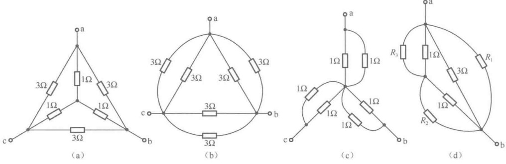

图2-12 例2-3图
 

例2-4 试求如图2-13（a）所示电路的等效电阻 $ R_{ab} $
 

解：图2-13（a）是一个含有电桥的电阻电路，根据电阻值可以判断出电桥处于不平衡状态，无法直接运用电阻串、并联等效化简求等效电阻。而只能依靠Y-△等效变换解决问题。电路中有3种Y形连接、2种△形连接，可以选用以端子c、d、e间的△形连接等效变换为Y形连接，如图2-13（b）所示，这时增加了一个新的节点f。根据△形连接电阻电路等效变换为Y形连接电阻电路的电阻换算公式，得

 $$ R_{1}=\frac{10\times10}{10+10+5}=4\Omega\;;\quad R_{2}=\frac{10\times5}{10+10+5}=2\Omega\;;\quad R_{3}=\frac{10\times5}{10+10+5}=2\Omega $$ 

再根据电阻串、并联等效化简，图2-13（b）等效为图2-13（c）和（d），最后求得等效电阻为

 $$ R_{ab}=8/2+26=30\Omega $$ 

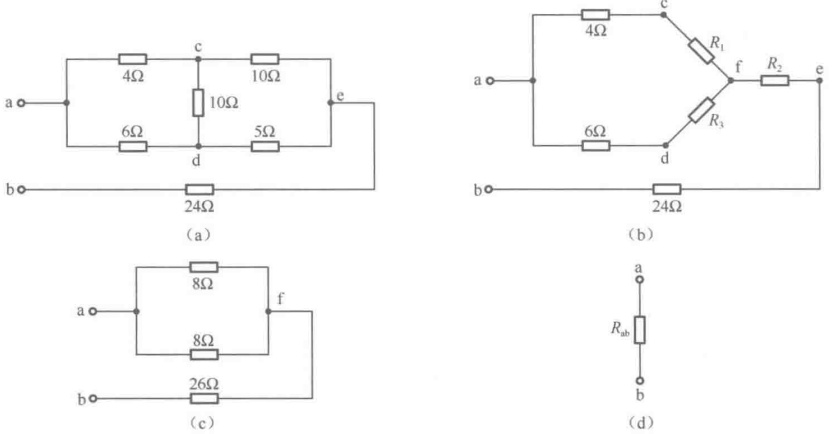

图2-13 例2-4图
 

### 2.4 利用对称电路的特点求等效电阻

对于有些无源的仅含电阻的单口网络，由于电路结构及元件参数的特殊性，相对于端口会具有某

<!-- page: 45 -->

种对称性，使得若在端口施加电源激励，则在电路内部将会有一些节点是等电位点，或者有些支路电流为零。根据等电位点之间的电压为零，可作短路处理；根据支路电流为零，可作开路处理。经过这些处理，再运用电阻串、并联等效化简及Y- $ \triangle $等效变换的方法，可以容易地求出等效电阻。

无源单口网络相对于端口的对称性有两种形式，即“传递对称”与“平衡对称”，具体情况可以从端口进行观察判断。

#### 2.4.1 “传递对称” 单口网络

对某一无源单口网络，如果用通过端口AB的平面直劈过去，可以把它劈开成左、右两半完全相同的部分，如图2-14（a）所示，或劈开成上、下两半完全相同的部分，如图2-14（b）所示，那么这样的无源单口网络称为对端口是“传递对称”的，即“传递对称”单口网络。这个直劈面积为传递对称面或称中分面，用 $ o-o' $表示。

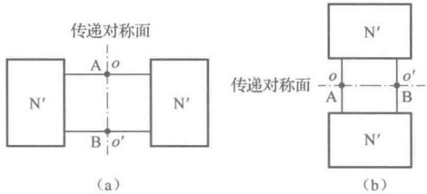

在 “传递对称” 单口网络中，与传递对称面对

图2-14 “传递对称”单口网络
 

称的点称为传递对称点。每一对传递对称点分别为等电位点。这样在求端口的等效电阻时，可分别将各对传递对称点短接后，再运用电阻串、并联等效化简及Y- $ \triangle $等效变换的方法求出等效电阻。

#### 2.4.2 “平衡对称” 单口网络

对某一无源单口网络，如果用垂直于端口 AB 的平面横切过去，可将其切成上下完全相同的两部分，且上下两部分之间没有交叉连接的支路，如图 2-15（a）所示，或切成左右完全相同的两部分，且左右两部分之间没有交叉连接的支路，如图 2-15（b）所示，那么这样的无源单口网络称为对端口是“平衡对称”的，即“平衡对称”单口网络。该横切面积为平衡对称面，用  $ o-o' $ 表示。

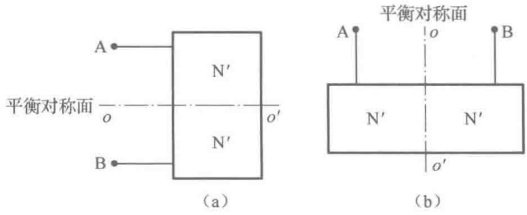

图2-15 “平衡对称” 单口网络
 

在 “平衡对称” 单口网络中，平衡对称面把单口网络分成上、下（或左、右）两个完全相同的部分，且两部分之间只有对接支路穿过平衡对称面，对接支路落在平衡对称面上的点是等电位点。在求端口的等效电阻时，可以将这些等电位点短接起来，再运用电阻串、并联等效化简及 Y- $ \triangle $ 等效变换的方法求出等效电阻。

例2-5 求图2-16（a）所示电路的等效电阻 $ R_{ab} $。

解：（1）方法一：利用传递对称性求解。

在图 2-16（a）中，通过端口 ab 的平面  $ o-o' $ 为传递对称面，被传递对称面劈到的电阻 R 可看成两个 2R 的并联。c、d 是一对传递对称点为等电位点，可将 c、d 两点短接，利用电阻并联等效化简得到图 2-16（b），再利用 Y-△等效变换将 3 个 R/2 的 Y 形连接等效变换为 3 个 3R/2 的△形连接得到图 2-16（c），最后求得

 $$ R_{\mathrm{ab}}=\frac{\frac{6}{5}R\times\frac{3}{2}R}{\frac{6}{5}R+\frac{3}{2}R}=\frac{2}{3}R $$

<!-- page: 46 -->

（2）方法二：利用平衡对称性求解。

在图 2-16（a）中，垂直于端口 ab 的平面  $ o''-o''' $ 为平衡对称面，被平衡对称面切到的电阻 R 可看成两个 2R 的并联。c、d、e 三点落在平衡对称面上，是等电位点，将它们短接得到图 2-16（d），可求得

 $$ R_{ab}=2\times R/3=2R/3 $$ 

正由于 c、d、e 三点是等电位点，c、d 间以及 d、e 间的电阻上无电流，因此又可断开得到图 2-16（e），从而可求得

 $$ R_{ab}=2R/3 $$ 

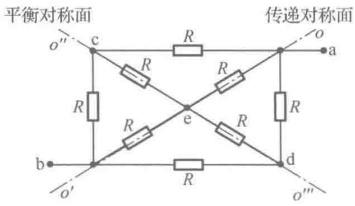

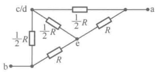

(a)
 

(b)
 

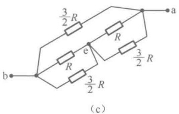

(c)
 

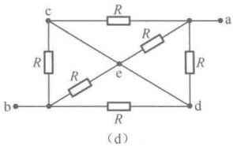

图2-16 例2-5图
 

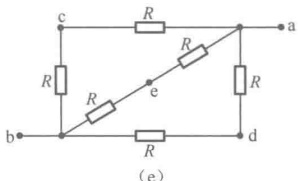

(e)
 

由前面的分析可知，如果一个无源单口网络  $ N_0 $ 内部仅含电阻，则运用电阻串、并联等效化简、Y- $ \Delta $ 等效变换及对称性等方法，可以求得它的等效电阻  $ R_{eq} $。如果一个无源单口网络  $ N_0 $ 内部除电阻以外还有受控源，则上述求等效电阻的方法就不一定行得通，这时就要借助于用求输入电阻的方法获得等效电阻。

### 2.5 无源单口网络  $ N_{0} $ 的输入电阻

如图 2-17（a）所示为一个无源单口网络  $ N_{0} $，不论其内部如何复杂，都有端口电压 u 与端口电流 i 成正比的关系，其比值被定义为无源单口网络  $ N_{0} $ 的输入电阻  $ R_{in} $，即

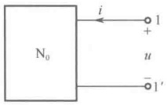

(a)
 

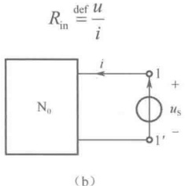

(b)
 

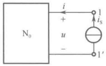

(c)
 

图2-17  $ N_{0} $ 的输入电阻
 

显然，无源单口网络  $ N_{0} $ 的输入电阻在数值上等于其等效电阻，即  $ R_{in} = R_{eq} $，二者均反映  $ N_{0} $

<!-- page: 47 -->

口电压、电流的关系，但两者的含义不同， $ R_{in} $ 表示从端口看进去的电阻，而  $ R_{eq} $ 的意义在于用  $ R_{eq} $ 构造的电路就是  $ N_{0} $ 的等效电路，更着重于  $ R_{eq} $ 对外电路的作用。求端口输入电阻的一般方法称为外施电源法，即在端口施加电压源  $ u_{S} $，然后求出端口电流 i，如图 2-17（b）所示；或在端口施加电流源  $ i_{S} $，然后求出端口电压 u，如图 2-17（c）所示。再根据式（2-17），得

$$  R_{in}=\frac{u_{S}}{i}=\frac{u}{i_{S}}   \tag*{（2-18）}$$

如果  $ N_{0} $ 是封装起来的黑箱电路，则可以用此方法测得其输入电阻。当  $ N_{0} $ 是明确的电路时，可以对图 2-17（a）采用求外特性方程的方法，得到其输入电阻。

例 2-6 含受控源的无源单口网络如图 2-18（a）所示，试求其输入电阻  $ R_{in} $。

解：百先简要分析，由分流规则知 $ i_{2}=i_{1}/2 $，而且3Ω与6Ω两个电阻不能进行电阻并联等效化简，否则控制变量 $ i_{1} $消失，使CCVS无意义。由此看来，对含受控源电源电路进行分析时，控制支路一般要始终保留不动。

下面再对单口网络列写电路方程，求其外特性方程。

将 KCL 应用到节点 $ ^{①} $得

将 KVL 应用到回路 l 得

 $$ \begin{aligned}&i=i_{1}+i_{2}=3i_{1}/2\\&u=6i_{1}+3i_{1}=9i_{1}\\ \end{aligned} $$ 

联立求解得单口网络的外特性方程为

最后根据输入电阻的定义，得

 $$ R_{in}=\frac{u}{i}=6\Omega=R_{eq} $$ 

由此可见，一个含受控源及电阻的无源单口网络与一个只含电阻的无源单口网络一样，也可以等效为一个电阻，这是一般规律。

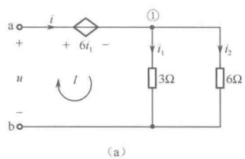

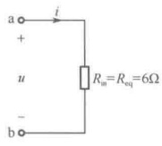

图2-18 例2-6图
 

### 2.6 电压源、电流源的串联、并联和转移

#### 2.6.1 电压源的串联

如图 2-19（a）所示为 n 个电压源串联组成的含源单口网络，对任意外电路，可等效化简为如图 2-19（b）所示的单个电压源电路，等效条件是它们具有相同的外特性方程，即由元件性能方程及 KVL 可得

$$  \begin{align*}u=u_{\rm S}=u_{{\rm S}_1}+u_{{\rm S}_2}+\cdots+u_{{\rm S}_n}=\sum_{k=1}^n u_{{\rm S}_k}\end{align*}   \tag*{(2-19)}$$

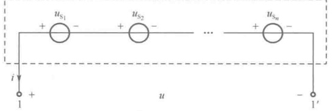

(a)
 

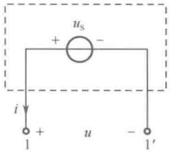

(b)
 

图 2-19 电压源的串联及等效电路
 

<!-- page: 48 -->

$ u_{s} $ 称为等效电压源，当  $ u_{S_{k}} $ 的参考方向与 u 的参考方向一致时，式（2-19）中  $ u_{S_{k}} $ 前面取 “+” 号，不一致时取 “-” 号。

#### 2.6.2 电压源的并联与转移

当且仅当 n 个电压源的电压大小相等，且给定方向也一致时，方可并联，否则就要违反 KVL。

如图 2-20（a）所示，n 个符合并联条件的电压源相并联，对任意外电路，可等效化简为如图 2-20（b）所示的单个电压源电路，等效条件为它们具有相同的外特性方程，即由元件性能方程及 KVL 可得

$$  u=u_{S}=u_{S_{1}}=u_{S_{2}}=\cdots=u_{S_{k}}=\cdots=u_{S_{n}}   \tag*{（2-20）}$$

 $ u_{s} $ 称为等效电压源，尽管数值上为其中任一电压源的电压  $ u_{s_{k}} $，但其电流是端口电流 i，而不是电压为  $ u_{s_{k}} $ 的电压源的电流  $ i_{k} $。

运用逆向思维，单个电压源 $ u_{s} $也能等效为n个完全相同的电压源的并联，称为电压源分裂，常运用于电压源转移中，给进一步计算带来方便。

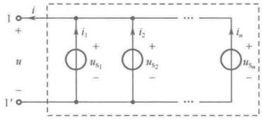

(a)
 

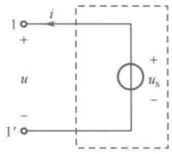

(b)
 

图 2-20 电压源的并联及等效电路
 

在图 2-21（a）所示电路中，节点①与②之间连接单个电压源  $ u_{s} $，可将单个电压源等效（分裂）为两个完全相同的电压源的并联，同时将节点①分裂为两个等电位点，如图 2-21（b）所示。由于电压源的电流可取任意值，故可按  $ i_{1} $、 $ i_{2} $ 分配给这两个电压源得到图 2-21（c），这意味着可将单个电压源  $ u_{s} $ 转移到与节点①相连的所有支路中并与各支路中的电阻相串联，而此时节点①不再作为独立节点。同理，还可将单个电压源  $ u_{s} $ 转移到与节点②相连的所有支路中并与各支路中的电阻相串联，如图 2-21（d）所示，节点②也不再作为独立节点。由于每一步变换都没有破坏电压源的特性以及节点

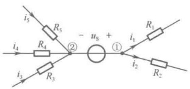

(a)
 

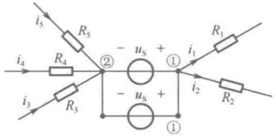

（b）
 

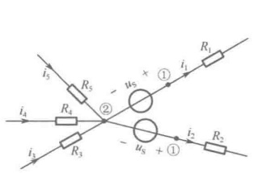

(c)
 

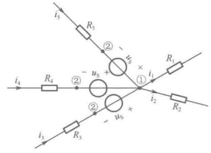

(d)
 

图 2-21 电压源转移
 

<!-- page: 49 -->

的 KCL 约束和回路的 KVL 约束，因此保证了电压源转移前后的等效性。注意：转移后的各个电压源应与原有的单个电压源具有相同的极性，因为要保证相关回路的 KVL 方程不变。

#### 2.6.3 电流源的并联

如图 2-22（a）所示为 n 个电流源并联组成的含源单口网络，对任意外电路，可等效化简为如图 2-22（b）所示的单个电流源电路，等效条件为它们具有相同的外特性方程，即由元件性能方程及 KCL 可得

$$  i=i_{\mathrm{S}}=i_{\mathrm{S}_{1}}+i_{\mathrm{S}_{2}}+\cdots+i_{\mathrm{S}_{n}}=\sum_{k=1}^{n}i_{\mathrm{S}_{k}}   \tag*{（2-21）}$$

 $ i_{s} $ 称为等效电流源，当  $ i_{s} $ 的参考方向与 i 的参考方向一致时， $ i_{s} $ 前面取 “+” 号，不一致时取 “-” 号。

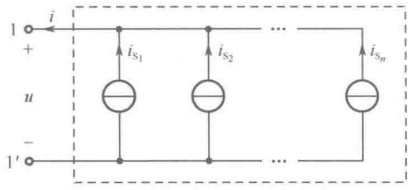

(a)
 

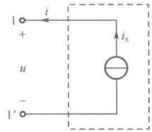

（b）
 

图 2-22 电流源的并联及等效电路
 

#### 2.6.4 电流源的串联与转移

当且仅当 n 个电流源的电流大小相等，且给定方向也一致时，方可串联，否则就要违反 KCL。

如图 2-23（a）所示，n 个符合串联条件的电流源相串联，对任意外电路，可等效化简为如图 2-23（b）所示的单个电流源电路，等效条件为它们具有相同的外特性方程，即由元件性能方程及 KCL 可得

$$  i=i_{S}=i_{S_{1}}=i_{S_{2}}=\cdots=i_{S_{k}}=\cdots=i_{S_{n}}   \tag*{(2-22)}$$

 $ i_{s} $ 称为等效电流源，尽管数值上为其中任一电流源的电流  $ i_{s_{k}} $，但其电压是端口电压 u，而不是电流为  $ i_{s_{k}} $ 的电流源的电压  $ u_{k} $。

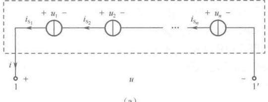

(a)
 

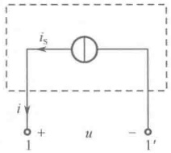

(b)
 

图 2-23 电流源的串联及等效电路
 

运用逆向思维，单个电流源 $ i_{s} $也能等效为n个完全相同的电流源的串联，称为电流源分裂，常运用于电流源转移中，给进一步计算带来方便。

在图 2-24（a）所示电路中，节点①与②之间连接单个电流源  $ i_{s} $，可将单个电流源等效（分裂）为两个完全相同的电流源的串联，如图 2-24（b）所示。由于电流源本身对其电压无限制，可取任意值。因此可将两个电流源之间的节点电位选为节点③的电位，从而使两电流源分别与电阻  $ R_{1} $、 $ R_{2} $ 并联得到图 2-24（c），这意味着可将单个电流源  $ i_{s} $ 转移跨接到与其共处同一回路  $ l_{1} $ 的其他每条支

<!-- page: 50 -->

路的两端。同理，还可将单个电流源  $ i_{s} $ 转移跨接到与其共处同一回路  $ l_{2} $ 的其他每条支路的两端，如图2-24（d）所示。由于每一步变换都没有破坏电流源的特性以及节点的KCL约束和回路的KVL约束，因此保证了电流源转移前后的等效性。注意：若原有的单个电流源的方向相对于某个回路为顺（逆）时针方向，则转移后的各个电流源的方向应为逆（顺）时针方向，因为要保证相关节点的KCL方程不变。

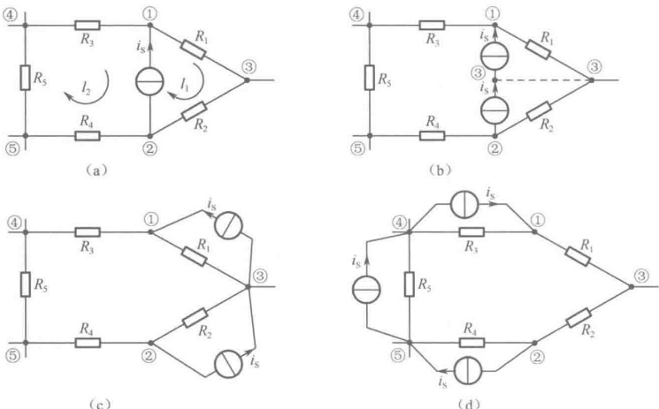

图2-24 电流源转移
 

### 2.7 含源支路的等效变换

#### 2.7.1 实际电源的两种电路模型

理想电源实际上并不存在。当实际电源接入外电路（负载 $ R_{L} $）后，其端口电压、电流关系（或称外特性）通常与负载 $ R_{L} $的变化有关，原因是实际电源有内阻存在。

如图 2-25（a）所示为一个实际电源的外特性测量电路，测得的外特性曲线如图 2-25（b）所示，它既不同于理想电压源的外特性，也不同于理想电流源的外特性。由此外特性曲线可以明显地看出，实际电源在向任意外电路供电时，因存在内阻而会出现电源端电压或端电流减小的情况。实际电源的端电压在 i=0 时为最大，即开路电压  $ u_{oc} $，之后随着端电流的增大而减小，可看成内阻的分压作用所致；实际电源的端电流在 u=0 时为最大，即短路电流  $ i_{sc} $，之后随着端电压的增大而减小，可看成内阻的分流作用所致。

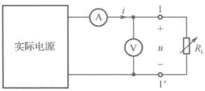

（a）实际电源的外特性测量电路
 

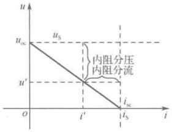

（b）外特性曲线
 

图 2-25 实际电源的外特性曲线
 

<!-- page: 51 -->

根据对实际电源外特性曲线的分析，可以构造两种形式的电路模型：一是从电压角度出发，将开路电压  $ u_{oc} $ 当作理想电压源  $ u_S $，内阻的分压作用使用一个与  $ u_S $ 串联的电阻  $ R $ 来表示，这就是电压源  $ u_S $ 串联内阻  $ R $ 的形式，如图 2-26（a）所示。这时实际电源的端电压  $ u $ 等于  $ u' $ 而不等于  $ u_S $，并且  $ u' \leq u_S $。二是从电流角度出发，将短路电流  $ i_{sc} $ 当作理想电流源  $ i_S $，内阻的分流作用使用一个与  $ i_S $ 并联的电阻  $ R $ 来表示，这就是电流源并联内阻  $ R $ 的形式，如图 2-26（b）所示。这时实际电源的端电流  $ i $ 等于  $ i' $ 而不等于  $ i_S $，并且  $ i' \leq i_S $。

这两种形式的电路模型常被视为复合支路，因其含有独立电源，故又称为含源支路。这两种含源支路各自本身无法再进行等效化简，但当它们相互之间满足一定的条件时，使得双方的外特性方程完全相同，相互之间就可以进行等效变换，这就是下面要研究的含源支路等效变换问题。

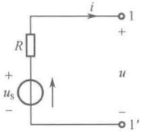

（a）串联形式
 

#### 2.7.2 含独立源支路的等效变换

（b）并联形式
 

图 2-26 实际电源的两种电路模型
 

由图2-26（a）得，串联含源支路的外特性方程为

 $$ u=u_{S}-Ri $$ 

或

$$  i=\frac{u_{S}}{R}-\frac{u}{R}   \tag*{(2-24)}$$

由图2-26（b）得，并联含源支路的外特性方程为

$$  i=i_{S}-\frac{u}{R}   \tag*{(2-25)}$$

或

$$  u=R i_{S}-R i   \tag*{(2-26)}$$

根据等效概念，比较式（2-23）、式（2-26），或比较式（2-24）、式（2-25），显然，如果满足

 $$ u_{\mathrm{s}}=R i_{\mathrm{s}} $$ 

或

$$  i_{\mathrm{S}}=\frac{u_{\mathrm{S}}}{R}   \tag*{(2-27)}$$

那么，这两种含源支路的外特性方程就完全相同，是相互等效的，可以相互进行等效变换。

在这种等效变换过程中，除了要满足式（2-27）的条件，还要注意电压源电压极性与电流源电流方向的关系。电压源 $ u_{s} $由“-”极性端到“+”极性端的指向应与电流源 $ i_{s} $的方向一致，电流源 $ i_{s} $的方向应与电压源 $ u_{s} $由“-”极性端到“+”极性端的指向一致。

这两种含源支路相互进行等效变换是建立在它们双方的外特性方程完全相同之上的，即它们双方对外电路的作用是一样的。但它们的内部情况却完全不同，例如在图2-26中，当端口1-1′开路时，两电路对外的输出电流均为零且不发出功率，但此时串联支路中电压源发出的功率为零，而并联支路中电流源发出的功率为 $ Ri_{S}^{2} $。同理，当端口1-1′短路时，两电路对外的输出电压均为零且不发出功率，但此时串联支路中电压源发出的功率为 $ u_{S}^{2}/R $，而并联支路中电流源发出的功率为零。由此可知，等效电路只是用来计算其端口以外电路的电压、电流及功率，而等效电路内部的电压、电流及功率并不能表示原未经等效变换电路部分的情况，一般对等效电路内部的电压、电流及功率不必细究。

例 2-7 试求图 2-27（a）所示电路中的电流 i。

解：图2-27（a）经过4步等效变换，化简为图2-27（e）所示电路。

由图2-27（e）可求得电流为

 $$ i=\frac{1}{3+2}=0.2A $$

<!-- page: 52 -->

(a)
 

(b)
 

(c)
 

(d)
 

图2-27 例2-7图
 

(e)
 

#### 2.7.3 含受控源支路的等效变换

受控电压源和电阻的串联组合如图2-28（a）所示，受控电流源和电阻的并联组合如图2-28（b）所示，这两种支路可以仿照上述的含独立源支路的等效变换方法进行等效变换。

(b)
 

(c)
 

图 2-28 两种含受控源支路及控制支路
 

它们相互等效变换的条件为

 $$ \beta i_{1}=r i_{1}\;/\;R\;\Big] $$ 

$$  gu_{1}=\mu u_{1}/R   \tag*{(2-28)}$$

或

$$  \left.\begin{array}{r}{r{i}_{1}=R\beta{i}_{1}}\\ {\mu{u}_{1}=R{g}{u}_{1}}\end{array}\right\}   \tag*{(2-29)}$$

在这种等效变换中，值得注意的是，如图2-28（c）所示的控制支路在电路中应要始终保留不动，以免控制量 $ u_{1} $或 $ i_{1} $消失，使受控源无意义。

例 2-8 试求图 2-29（a）所示电路的输入电阻  $ R_{in} $

解：首先利用等效变换将图 2-29（a）化简为图 2-29（c），其中第一步是将图 2-29（a）中的电流控制电流源  $ \beta i_{1} $ 和电阻  $ R_{2} $ 的并联组合等效变换为电流控制电压源  $ R_{2}\beta i_{1} $ 和电阻  $ R_{2} $ 的串联组合，得到图 2-29（b）；第二步是将图 2-29（b）中  $ R_{1} $ 与  $ R_{2} $ 的串联组合等效化简为一个电阻  $ (R_{1}+R_{2}) $。

然后，对图2-29（c）运用外施电源法求输入电阻。对图2-29（c）所示电路应用KVL，得

 $$ \begin{aligned}\boldsymbol{u}=&(\boldsymbol{R}_{1}+\boldsymbol{R}_{2})\boldsymbol{i}_{1}+\boldsymbol{R}_{2}\boldsymbol{\beta}\boldsymbol{i}_{1}=[\boldsymbol{R}_{1}+(1+\boldsymbol{\beta})\boldsymbol{R}_{2}]\boldsymbol{i}_{1}\\&\boldsymbol{R}_{\mathrm{in}}=\frac{\boldsymbol{u}}{\boldsymbol{i}_{1}}=\boldsymbol{R}_{1}+(1+\boldsymbol{\beta})\boldsymbol{R}_{2}\end{aligned} $$

<!-- page: 53 -->

(a)
 

(b)
 

图2-29 例2-8图
 

(c)
 

### 2.8 含外虚内实元件单口网络的等效变换

在电路分析中，有4种单口网络值得注意。下面分别讨论这4种单口网络的外特性方程，并以此构造其等效电路，从中会发现这些单口网络内有一个元件具有双重身份，表现为对外电路不起作用，而只对单口网络内部起作用，称之为外虚内实的元件。

如图 2-30（a）、（b）所示电路，这两种单口网络的外特性方程都可写为

$$  u=u_{S}\quad( 对任意的电流 i\text{)}   \tag*{(2-30)}$$

由式（2-30）构造的等效电路如图2-30（c）所示。在等效电路中， $ u_{s} $ 的电流并非原并联电路中的电流 $ i' $，而是端口电流 $ i $。从对外等效来看，在图2-30（a）、（b）中与电压源并联的电流源 $ i_{s} $（或电阻R）是多余的，形同虚设，这是因为 $ i_{s} $（或R）的存在与否并不影响端口电压u的大小，端口电压u总是等于电压源的电压 $ u_{s} $。电流源 $ i_{s} $（或电阻R）的存在价值在于会影响电压源的电流 $ i' $，因为在图2-30（a）中， $ i'=i-i_{s} $，而在图2-30（b）中， $ i'=i+u_{s}/R $，由此可见，对这两种单口网络内部而言，电流源 $ i_{s} $（或电阻R）又是一个实实在在的元件。综合以上两方面情况，将与电压源 $ u_{s} $并联的电流源 $ i_{s} $（或电阻R）称为外虚内实的元件。在电路分析时，若要求单口网络外部的电压或电流，则可将电流源 $ i_{s} $（或电阻R）作为外虚元件断开并去除。但在求电压源的电流 $ i' $时，则要将电流源 $ i_{s} $（或电阻R）作为内实元件保留不动。

图 2-30 电压源与  $ i_{S} $ （或 R）并联及等效电路
 

如图 2-31（a）、（b）所示电路，这两种单口网络的外特性方程都可写为

$$  i=i_{S}\quad( 对任意的电压 u)   \tag*{（2-31）}$$

由式（2-31）构造的等效电路如图2-31（c）所示。在等效电路中， $ i_{s} $ 的端电压并非串联电路中的电压 $ u' $，而是端口电压 $ u $。从对外等效来看，在图2-31（a）、（b）中与电流源 $ i_{s} $ 串联的电压源 $ u_{s} $（或电阻R）是多余的，形同虚设，这是因为电压源 $ u_{s} $（或电阻R）的存在与否并不影响端口电流i 的大小，端口电流i 总是等于电流源的电流 $ i_{s} $。电压源 $ u_{s} $（或电阻R）的存在价值在于会影响电流源的端电压 $ u' $，因为在图2-31（a）中， $ u'=u-u_{s} $，而在图2-31（b）中， $ u'=u+Ri_{s} $，由此可见，对这两种单口网络内部而言，电压源 $ u_{s} $（或电阻R）又是一个实实在在的元件。综合以上两方面

<!-- page: 54 -->

情况，将与电流源  $ i_{S} $ 串联的电压源  $ u_{S} $ （或电阻 R）称为外虚内实的元件。在电路分析时，若要求单口网络外部的电压或电流，可将电压源  $ u_{S} $ （或电阻 R）作为外虚元件短路并去除。但在求电流源的端电压  $ u^{\prime} $ 时，则要将电压源  $ u_{S} $ （或电阻 R）作为内实元件保留不动。

(a)
 

(b)
 

(c)
 

图2-31 电流源与 $ u_{S} $（或R）串联及等效电路
 

例 2-9 求图 2-32(a) 所示电路中每个元件发出或吸收的功率, 已知  $ U_{s}=6V $,  $ I_{s}=1A $,  $ R_{1}=3\Omega $,  $ R_{2}=1\Omega $,  $ R_{3}=2\Omega $。

(a)
 

（b）
 

图2-32 例2-9图
 

(c)
 

解：（1）在计算U时， $ R_{1} $ 是外虚元件可断开并去除， $ R_{2} $ 及 $ R_{3} $ 是内实元件保留不动，等效电路如图2-32（b）所示。

由图2-32（b），对回路l应用KVL得

 $$ \begin{aligned}U=&(R_{2}+R_{3})I_{S}+U_{S}=(1+2)\times1+6=9V\\p_{I_{S}}=&U\times I_{S}=9\times1=9W,\quad 发出 9W\end{aligned} $$ 

（2）在计算 I 时， $ R_{2} $、 $ R_{3} $ 是外虚元件可短路并去除， $ R_{1} $ 是内实元件保留不动，等效电路如图 2-32（c）所示。对节点①应用 KCL 得

 $$ \begin{aligned}I&=\frac{U_{S}}{R_{1}}-I_{S}=\frac{6}{3}-1=1A\\p_{U_{S}}&=U_{S}\times I=6\times1=6W\ , 发出 6W 功率 \\p_{R_{1}}&=\frac{U_{S}^{2}}{R_{1}}=\frac{6^{2}}{3}=12W\ , 吸收 12W 功率 \\p_{R_{2}+R_{3}}&=(R_{2}+R_{3})I_{S}^{2}=(1+2)\times1^{2}=3W\ , 吸收 3W 功率 \\5W&=n\cdot12\div2-15W\cdot n\div n 功率平衡 \end{aligned} $$ 

 $$ p_{ 发出 }=9+6=15W；p_{ 吸收 }=12+3=15W；p_{ 吸收 }=p_{ 发出 },\quad 功率平衡 $$ 

通过前面一系列分析总结出了一些规律和结论，现在就可以运用电阻电路的等效变换（包括电阻、电源、含源支路、含外虚内实元件的等效变换等），将一个复杂的单口网络变成最简单的等效电路，进而方便、快捷地求解与单口网络相连的外电路的电压、电流及功率。这种分析电路的方法称为电路的等效变换法。

<!-- page: 55 -->

电路的等效变换法应用于电路分析中的具体操作流程为：首先用分解方法将电路分解为两个单口网络的组合，如图 2-33（a）所示， $ N_1 $ 是一个复杂单口网络，其中的电压、电流不需要求解。将  $ N_2 $ 看成  $ N_1 $ 的外电路，其中的电压、电流是需要求解的。然后运用电阻电路的等效变换对  $ N_1 $ 进行等效化简，得到其对应的等效电路  $ N_1' $，如图 2-33（b）所示。 $ N_1' $ 的形式不外乎是图 2-33（c）所示的 5 种形式之一，这时再由图 2-33（b）求  $ N_2 $ 内的电压、电流及功率就会十分方便和快捷。当然，这样做也付出了代价，即在对  $ N_1 $ 进行等效化简过程中，要画一系列的等效化简电路图，每画一步图，电路问题的复杂性就降低一点，直到最后一步降到最低点。这时整个电路有可能变成一个只有单回路或两个节点的简单电路，只需要写一个 KVL 方程或 KCL 方程便可求解电路，从而避免了对原电路直接列写电路方程组和解方程组的烦琐求解过程。

图 2-33 电路的等效变换法操作流程图
 

### 2.9 综合示例

例 2-10 如图 2-34（a）所示电路，求  $ R = 8\Omega $ 电阻消耗的功率。

解：首先将图2-34（a）所示电路分解成两个单口网络的组合，虚线以左为 $ N_{1} $，虚线以右为 $ N_{2} $， $ N_{2} $为所求支路构成的单口网络保留不动。对 $ N_{1} $逐步等效化简依次得到图2-34（b）、（c）、（d）、（e）、（f）。注意，在第一步等效变换中，电路中与3A电流源串联的12V电压源是外虚元件，可短路去除，同时与8V电压源并联的10V电压源和9Ω电阻相串联的含源支路属于外虚支路，可断开去除。

最后由图2-34（f）得

 $$ I=\frac{12}{4+R}=\frac{12}{4+8}=1A；\quad p_{R}=RI^{2}=8\times1^{2}=8W $$ 

例 2-11 利用含源支路的等效变换，求图 2-35（a）所示电路中的电压比  $ u_{0}/u_{S} $，已知  $ R_{1}=R_{2}=2\Omega $， $ R_{3}=R_{4}=1\Omega $。

解：首先利用含源支路的等效变换，将图2-35（a）逐步等效化简依次得到图2-35（b）、（c）。注意控制量 $ u_{3} $所在支路要始终保留不动，以免控制量消失，使受控源无意义。

<!-- page: 56 -->

(a)
 

（b）
 

(c)
 

(d)
 

(e)
 

(f)
 

图2-34 例2-10图
 

再由图2-35（c）列写电路方程： $ u_{3}=1\times i $

l回路的KVL方程：

 $$ (1+1+1)i+2u_{3}=\frac{u_{S}}{2} $$ 

 $$ u_{o}=1\times i+2u_{3} $$ 

联立求解得

 $$ \mathrm{\frac{u_{o}}{u_{s}}} = \frac{3}{10} $$ 

(a)
 

(b)
 

(c)
 

图2-35 例2-11图
 

### 2.10 计算机仿真

例 2-12 利用惠斯通电桥可以精确地测量电阻的阻值。在图 2-36 所示的仿真电路中，电阻 R1、R2、R3 和 R4 是电桥的 4 个臂，U1 为检流计（也可以用高灵敏度数字万用表代替），可以检

<!-- page: 57 -->

查 A、B 两点之间有无电流通过，检流计相当于“桥”。当检流计中无电流通过时，称电桥达到平衡。电桥平衡时 4 个臂的阻值满足  $ R_{1}/R_{2}=R_{3}/R_{4} $。

如图 2-37 所示，A、B 两点是 “桥” 的两个支撑点，在 A 和 B 上分别放置 “测量探针”，仿真结果显示这两点电位相等，无论开关 “断开” 还是 “闭合”，都不会改变这两个点的电位和流过这两点的电流。

图 2-36 电桥平衡条件仿真电路
 

图 2-37 电桥平衡特点仿真电路
 

图2-38是应用电桥测量电阻的电路，图中的Rp1是高精度电阻箱，这里用“电阻值增量”为1%的可变电阻代替，R9和R10采用高精度电阻，Rx是被测电阻。调节可变电阻阻值，当检流计读数为0时，表明电桥达到平衡状态，根据电桥平衡公式即可计算出Rx的阻值。

例 2-13 如图 2-39 所示，三个电阻的星形（Y 形）连接等效变换为三角形（△形）连接。图 2-39（a）中 Y 形连接的 Ra、Rb、Rc 分别为  $ 15\Omega $、 $ 10\Omega $、 $ 6\Omega $，根据等效变换公式，可以算出图 2-39（b）中△形连接的相应电阻值 Rab、Rbc、Rac 分别为  $ 50\Omega $、 $ 20\Omega $ 和  $ 30\Omega $。

图 2-38 利用电桥测量电阻仿真电路
 

图 2-39 电阻 Y 形连接与△形连接的等效变换
 

根据等效的概念，两个等效的网络的内部结构可以相同也可以不同，但对外部而言，若在网络端口外部接相同电路时，外电路中的电压、电流分布情况完全一样。在图2-40中将等效变换前后的两种接法的三个端子A、B、C外接相同的电源和负载电阻，在A、B、C三个端子放置“测量探针”。仿真结果显示，等效变换前后，A、B、C端子上的电压、电流相同，即两个电阻网络的外电路中的电压、电流的分布情况完全一样，说明图2-39中的两个网络是等效的。

图2-40 电阻Y形连接与△形连接等效验证
 

<!-- page: 58 -->

例 2-14 理想电压源和理想电流源直接不能等效变换，但是含有内阻的实际电压源和实际电流源之间可以进行等效变换。如图 2-41 所示，左边的实际电压源与右边的实际电流源满足等效变换关系，在实际电源的外电路，即  $ 100\Omega $ 电阻支路上设置“测量探针”，仿真结果表明这两个实际电源的输出电压与输出电流完全相同，左边的实际电压源与右边的实际电流源等效。

图 2-41 实际电源等效变换验证
 

### 思考题

2-1 什么是单口网络？什么是含源单口网络？什么是无源单口网络？

2-2 单口网络的外特性方程表示什么意义？单口网络的外特性方程与外电路有关系吗？

2-3 如何求出单口网络的外特性方程？

2-4 等效、等效电路、等效变换的概念是如何定义的？

2-5 两个单口网络  $ N_{1} $ 和  $ N_{2} $ 的伏安特性处处重合，这时两个单口网络  $ N_{1} $ 和  $ N_{2} $ 是否等效？

2-6 两个含源单口网络  $ N_{1} $ 和  $ N_{2} $ 各接  $ 100\Omega $ 负载时，流经负载的电流及负载两端电压均相等，两个网络  $ N_{1} $ 和  $ N_{2} $ 是否等效？

2-7 一个含有受控源及电阻的单口网络，总可以等效化简为一个什么元件？

2-8 当无源单口网络内含有受控源时，必须用外施电源法求输入电阻，这时电路中受控源的控制支路应如何考虑？

2-9 有哪两种含源支路？两种含源支路等效变换的条件是什么？

2-10 利用等效变换计算出外电路的电流、电压后，如何计算被变换的部分电路的电流、电压？

### 习题

2-1 试求题 2-1 图所示各电路 ab 端的等效电阻  $ R_{ab} $ 。

题2-1 图
 

2-2 试求题 2-2 图所示各电路 a、b 两点间的等效电阻  $ R_{ab} $。

2-3 试计算题 2-3 图所示电路在开关 S 打开和闭合两种状态时的等效电阻  $ R_{ab} $

<!-- page: 59 -->

(a)
 

（b）
 

题2-2图
 

(a)
 

(b)
 

题2-3 图
 

2-4 试求题2-4图（a）所示电路的电流I及题2-4图（b）所示电路的电压U。

(a)
 

（b）
 

题2-4 图
 

2-5 试求题 2-5 图所示各电路 ab 端的等效电阻  $ R_{ab} $，其中  $ R_{1}=R_{2}=1\Omega $。

(a)
 

（b）
 

题2-5 图
 

2-6 计算题 2-6 图所示电路中 a、b 两点间的等效电阻。

(a)
 

(b)
 

题2-6 图
 

(c)
 

2-7 对题 2-7 图所示电路，应用 Y- $ \triangle $ 等效变换求电路 ab 端的等效电阻  $ R_{ab} $、对角线电压 U 及总电压  $ U_{ab} $。

2-8 试求题 2-8 图所示电路的输入电阻  $ R_{in} $

<!-- page: 60 -->

题2-7图
 

(a)
 

(b)
 

题2-8 图
 

(c)
 

2-9 将题 2-9 图所示各电路化简为最简形式的等效电路。

2-10 利用含源支路等效变换，求题 2-10 图所示电路中的电流 I。

(a)
 

（b）
 

题2-9 图
 

题2-10 图
 

2-11 试求题 2-11 图所示电路中的电流 i，已知  $ R_{1}=2\Omega $， $ R_{2}=4\Omega $， $ R_{3}=R_{4}=1\Omega $。

2-12 题 2-12 图所示电路中的全部电阻均为  $ 1 \Omega $，试求电路中的电流 i。

题2-11 图
 

题2-12 图
 

2-13 利用含源支路等效变换，求题 2-13 图所示电路中电压  $ u_{0} $。已知  $ R_{1}=R_{2}=2\Omega $， $ R_{3}=R_{4}=1\Omega $， $ i_{S}=10A $。

2-14 题 2-14 图所示电路中  $ R_{1}=R_{3}=R_{4} $， $ R_{2}=2R_{1} $，CCVS 的电压为  $ u_{d}=4R_{1}i_{1} $，利用含源支路等效变换求电路中的电压比  $ u_{0}/u_{S} $。

题2-13 图
 

题2-14 图
 

2-15 将题 2-15 图所示各电路化简为最简形式的等效电路。

2-16 求题2-16图所示各电路的最简等效电路。

<!-- page: 61 -->

(a)
 

(b)
 

题2-15 图
 

(a)
 

(b)
 

题2-16图
 

2-17 求题2-17图所示二端网络的端口伏安特性。

2-18 已知题 2-18 图所示电路消耗的总功率为 200W，求 R 的值。

题2-17 图
 

题2-18 图
 

2-19 在题 2-19 图所示电路中，已知  $ U_{s}=8V $， $ R_{1}=4\Omega $， $ R_{2}=3\Omega $， $ I_{s}=3A $。试求电源输出的功率和电阻吸收的功率。

2-20 试求题 2-20 图所示电路中的电压 U 。

2-21 电路如题 2-21 图所示，已知  $ U_S = 10\text{V} $， $ R_1 = 1\text{k}\Omega $， $ R_2 = 3.3\text{k}\Omega $， $ R_3 = 1\text{k}\Omega $， $ R_4 = 2.2\text{k}\Omega $，若电压表 V 的读数为 5.24V，请判断哪个电阻发生了开路或短路故障。

题2-19 图
 

题2-20图
 

题2-21 图
 

