# 03-第3章 电阻电路的一般分析方法

[返回全书目录](../../README.md)

> PDF 页码：62–92

<!-- page: 62 -->

### 第3章 电阻电路的一般分析方法

第1章详细介绍了电路的基本规律包括电路的个体规律——元件性能和电路的整体规律——KCL、KVL，并运用基本规律解决了一些简单电路的分析问题。第2章详细讨论了电路的等效变换法，运用这种方法可以方便、快捷地求解电路中某一部分的电压、电流和功率。但是，电路的等效变换法在求解电路过程中改变了电路的结构。如果要求在不改变电路结构的情况下，对电路做一般性的分析；或者由于电路结构复杂、规模太大，不便于运用电路的等效变换法进行求解，那么，就希望有一种能够对一般电路都适用的分析方法，即电路的一般分析方法。

本章以线性电阻电路为对象，展开对电路的一般分析方法的研究，研究成果可以推广应用到任何集中参数的线性电路分析中，包括正弦稳态电路的相量分析及线性动态电路的复频域分析。

电路的一般分析方法的思路是：首先选择一组合适的电路变量，根据电路基本规律列出该组变量的独立方程组（电路方程），然后从方程中求解出电路变量。对于线性电阻电路，电路方程是一组线性代数方程，可以用克莱姆法则或高斯消去法进行求解。

电路的一般分析方法的主要工作是列写电路方程并求解方程，故又将电路的一般分析方法称为电路的方程法。根据所选择的变量不同，可形成不同的分析方法，如支路法、支路电流法、支路电压法、网孔分析法、回路分析法、节点分析法及割集分析法等。

所有这些分析方法都有一个基本宗旨，就是力图减少求解电路所需的电路方程的数目，即通过选择合适的电路变量，根据电路的基本规律，建立一组数目最少的独立的电路方程。要达到这个目的，首先要解决KCL方程和KVL方程的独立性问题。为此本章首先介绍一些有关图论的初步知识，利用图论的研究方法来讨论电路的拓扑性质，从而得到独立节点、独立KCL方程、独立回路、独立KVL方程这四个重要的概念。

图论在电路分析中的应用又称为网络图论，网络图论为电路分析建立了严密的数学基础，并提供了系统化的表达方式，更为利用计算机辅助分析、设计大规模电路奠定了基础。

### 3.1 电路的图

由第1章可知，KCL和KVL与支路的元件性质无关，这两个定律反映了电路结构对电路中的支路电流、支路电压的约束，这是一种拓扑约束。因此，在对电路列写KCL、KVL方程时，没有必要画出电路元件的具体内容，可暂时撇开元件的性质，将电路中的一条支路（简单支路或复合支路）用一条线段（直线或曲线）来表示，在图论中，称其为一条拓扑支路，简称支路。电路中两条及两条以上的支路的连接点以黑点表示，称为拓扑节点，简称节点。于是，可以使用线段和黑点画出与电路相对应的足以表示拓扑结构的支路与节点相互连接的线图，称为电路的拓扑图，简称电路的图，以符号G表示。这样，就可将图论引入电路分析中，为利用图论的相关理论讨论KCL、KVL方程的独立性创造了条件。

根据图论理论，一个图 G 是具有给定连接关系的支路与节点的集合，其中每条支路的两端都必须连接到相应的节点上；移去某条支路并不把与它相连的节点移去；而移去某节点则要把与该节点相连的所有支路同时移去。所以，图 G 中不会有不与节点相连的支路，但可以有孤立的节点，此节点表示一个与外界不发生联系的“事物”。图论中的支路和节点的概念与电路图中的支路和节点的概念是有差别的，在电路图中，支路是实体，节点是由两条及两条以上的支路相互连接而形

<!-- page: 63 -->

成的连接点，没有了支路也就不存在节点，但这个差别不影响用图论理论来研究电路问题。

图3-1（a）是一个具有6个电阻元件和2个独立电源的电路，如果按照简单支路处理，则该电路具有8条支路和5个节点，图3-1（b）就是按照简单支路处理后的该电路的拓扑图。如果按照复合支路处理，则该电路具有6条支路和4个节点，相应的电路的拓扑图如图3-1（c）所示。由此可见，用不同的元件结构定义电路的一条支路时，该电路的拓扑图以及它的支路数和节点数将随之不同。

在电路分析时，通常要指定每条支路的电压、电流的参考方向，且二者一般取一致（关联）参考方向。将这种方向赋予电路的图中的每条支路就得到了所谓的有向图，图3-1（c）就是有向图，而图3-1（b）是无向图。有向图中每条支路的方向代表了该支路电压、电流的参考方向，根据有向图可以简单明了地列写KCL、KVL方程，这也是将图论引入电路分析中的意义所在。

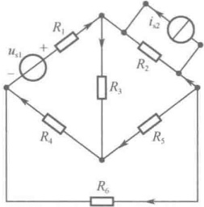

（a）电路图
 

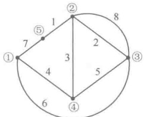

(b) 无向图
 

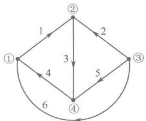

(c) 有向图
 

图3-1 电路图及电路的图
 

### 3.2 KCL 和 KVL 方程的独立性

#### 3.2.1 KCL 方程的独立性

图3-2 是一个电路的有向图，对图中节点①、②、③、④可列出4个KCL方程

$$  \begin{aligned}& 节点\textcircled{1}\text{：}i_{1}-i_{4}-i_{6}=0\\& 节点\textcircled{2}\text{：}-i_{1}-i_{2}+i_{3}=0\\& 节点\textcircled{3}\text{：}i_{2}+i_{5}+i_{6}=0\\& 节点\textcircled{4}\text{：}-i_{3}+i_{4}-i_{5}=0\end{aligned}   \tag*{（3-1）}$$

上述方程中，每一支路电流都只出现两次，一次为正，一次为负。这是必然的，因为在有向图中，每一条支路均连接在两个节点之间，这意味着每一个支路电流只能出现在相关的两个节点的KCL方程中，绝不可能出现在其他节点的KCL方程中，而且每一个支路电流对一个节点为流

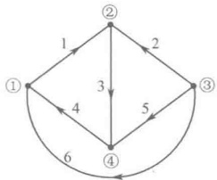

图3-2 有向图
 

出（设为 $ i_{j} $）时，对另一个节点必定为流入（设为 $ -i_{j} $）。所有4个节点的KCL方程之和为

$$  \sum_{k=1}^{4}\left(\sum i\right)_{k}=\sum_{j=1}^{6}\left[\left(+i_{j}\right)+\left(-i_{j}\right)\right]\equiv0   \tag*{（3-2）}$$

这一结果表明，这4个方程是非独立的（线性相关的）。

但是，如果从这4个方程中去掉任意一个方程，则余下的3个方程一定是相互独立的。因为去掉一个节点的KCL方程后，去掉的节点的KCL方程中的支路电流在余下的方程中就只可能出

<!-- page: 64 -->

现一次，这时若把余下的3个节点的KCL方程相加，就会出现支路电流不可能完全抵消，相加的结果不可能恒为零的情况，因此这3个节点的KCL方程是相互独立的。独立方程所对应的节点称为独立节点，而被去掉的那个节点的KCL方程是非独立的，故对应的节点称为非独立节点。当然，独立节点、非独立节点是可以任意选择的。

一般来说，对于一个具有 n 个节点的电路，可以任选其中  $ (n-1) $ 个节点作为独立节点，对应地可列出  $ (n-1) $ 个独立的 KCL 方程，而余下的那个非独立节点正好可以作为电路的参考节点或称为电路的“地”（零电位点）。

#### 3.2.2 KVL 方程的独立性

根据回路的概念，可判断出图 3-2 共有 7 个回路，如图 3-3 所示。对于回路  $ l_{1} $、 $ l_{2} $、 $ l_{3} $，可列出 KVL 方程为

$$  \begin{aligned}&\left.\begin{aligned}\\ & 回路 l_{1：}u_{1}+u_{3}+u_{4}=0\\& 回路 l_{2：}-u_{2}-u_{3}+u_{5}=0\\& 回路 l_{3：}-u_{4}-u_{5}+u_{6}=0\\ &\end{aligned}\right\}\\ \end{aligned}   \tag*{(3-3)}$$

同样，还可以列出回路 $ l_{4} $、 $ l_{5} $、 $ l_{6} $、 $ l_{7} $的KVL方程。观察式（3-3）可发现，每个方程中均有一个支路电压在另外两个方程中未出现过。将这3个方程相加的结果不可能恒为零，因此这3个KVL方程是互相独立的，所对应的回路称为独立回路。

独立回路的特征是：至少包含一条其他回路所没有的新支路。例如，回路 $ l_{1} $中的支路1、回路 $ l_{2} $中的支路2、回路 $ l_{3} $中的支路6都是相对于其他两个回路所没有的新支路，回路 $ l_{1} $、 $ l_{2} $、 $ l_{3} $构成了一组独立回路。

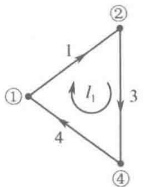

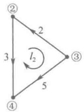

(a)
 

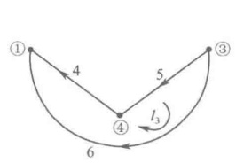

(b)
 

(c)
 

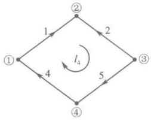

(d)
 

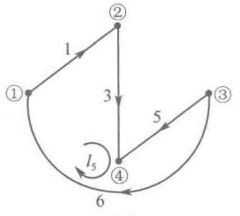

(e)
 

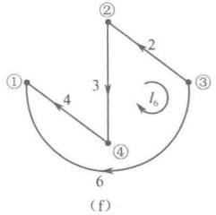

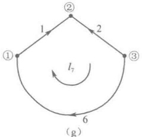

(g)
 

图3-3 图3-2有向图的7个回路
 

一个电路的 KVL 独立方程数等于它的独立回路数。一般来说，一个电路的回路数很多，而独立回路数却远少于总的回路数。若电路图中有 b 条支路和 n 个节点，则独立回路数为  $ l = b - n + 1 $ 个。如何确定电路的一组独立回路不是一件容易的事，必须寻求有效、可靠的方法。

借助于图论中“树”的概念，可以方便、快捷地确定一个图G的一组独立回路，从而得到一组独立的KVL方程。

<!-- page: 65 -->

当图 G 的任意两个节点之间至少存在一条路径时，则图 G 就称为连通图。例如，图 3-4（a）所示是连通图。从图 G 中去掉某些支路和某些节点所形成的图  $ G_{1} $，称为图 G 的子图。显然子图  $ G_{1} $ 的所有支路和节点都包含在图 G 中。由子图的定义可知，一个图 G 可以有多个子图，如图 3-4 中  $ G_{1} $、 $ G_{2} $、 $ G_{3} $、 $ G_{4} $、 $ G_{5} $ 均为图 G 的子图。

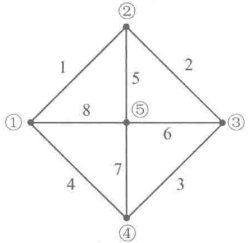

（a）连通图G
 

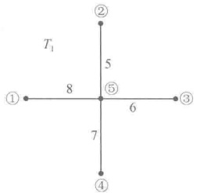

（b）子图 $ G_{1} $
 

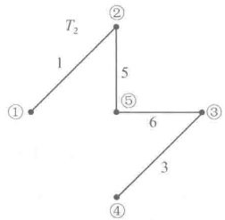

(c) 子图 $ G_{2} $
 

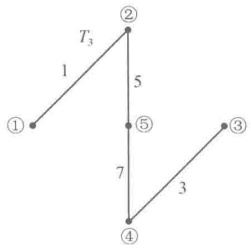

（d）子图 $ G_{3} $
 

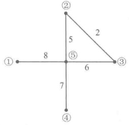

（e）子图 $ G_{4} $
 

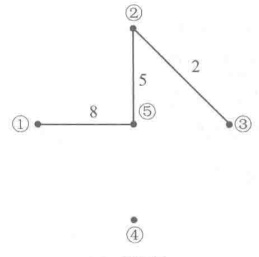

(f) 子图 $ G_{3} $
 

图3-4 连通图 G 和它的 5 个子图
 

“树”是图论中常用到的重要概念，它的定义可叙述为：对于连通图G，包含图G中所有节点，但不包含回路的连通子图，称为图G的树。一个连通图可以有多种树，图3-4（b）、（c）、（d）就符合树的定义，是图3-4（a）连通图G的三种树。图3-4（e）中包含了回路，它只是子图而非树，图3-4（f）是非连通的子图，同样也不是树。

对于连通图 G，当选定一种树后，树中的支路称为“树支”，连通图 G 中除树支之外的支路称为“连支”。不同的树有不同的树支，相应地也有不同的连支。如图 3-4（b）所示的树  $ T_{1} $，它的树支支路为  $ \{5,6,7,8\} $，相应的连支支路为  $ \{1,2,3,4\} $；如图 3-4（c）所示的树  $ T_{2} $，它的树支支路为  $ \{1,3,5,6\} $，相应的连支支路为  $ \{2,4,7,8\} $。观察发现支路 8 在  $ T_{1} $ 中是树支，而在  $ T_{2} $ 中却是连支。

一个具有 n 个节点和 b 条支路的连通图 G，其任何一种树的树支数（用符号 t 表示）一定为

 $$ t=n-1 $$ 

这是因为，若把连通图 G 的 n 个节点连接成一种树时，第一条支路连接 2 个节点，此后每增加 1 条新支路就连接上一个新节点，直到把 n 个节点连接成树，所需的支路数恰好是  $ (n-1) $ 条。如图 3-5 所示，图中①、②、⋯、⑦为节点序号；1、2、⋯、 $ (n-1) $ 为支路序号。

显然，对应于任意一种树的连支数（用符号 $ \overline{t} $表示）必为

$$  \overline{t}=b-t=b-n+1   \tag*{(3-5)}$$

可以发现： $ (n-1) $ 条树支是连接连通图 G 中全部节点形成一种树所需要的最少的支路集合，如果少一条，子图不连通；如果多一条，子图就会出现回路，这都不符合树的定义。因此，对于连通图

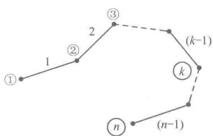

图3-5 说明树支数与节点数关系 用图
 

<!-- page: 66 -->

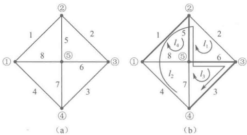

G 的任意一种树，每加入（连接上）一条连支，就会有一个回路出现，并且此回路除所加入的一条连支外其他均为相应的树支，这种回路称为单连支回路或基本回路。对于图 3-6（a）所示的图 G，选取支路  $ \{1,5,6,3\} $ 为树支，在图 3-6（b）中以粗实线表示，相应的连支为  $ \{2,4,7,8\} $，在图 3-6（b）中以细实线表示，对应于这种树的基本回路分别是  $ l_{1} $、 $ l_{2} $、 $ l_{3} $、 $ l_{4} $。

图 3-6 基本回路
 

以上每一个基本回路除相应树支外仅含一条连支，并且每条连支都只出现在各自的基本回路中，而不会出现在其他基本回路中，这样每条连支都是其他基本回路所没有的新支路，因此基本回路就是一种独立回路。由于连支数 $ \overline{t}=b-n+1=l $恰好是一个图G的独立回路数，因此由图G的一种树的全部连支所确定的基本回路就构成了图G的一组独立回路。选择不同的树，可以得到不同的基本回路组。

根据一种树所对应的基本回路所列出的 KVL 方程是一组独立方程。以图 3-7 所示电路的有向图为例，选取支路  $ \{2,3,6\} $ 为树支，在图 3-7 中以粗实线表示，相应的连支为  $ \{1,4,5\} $，在图 3-7 中以细实线表示。对应于这种树的基本回路分别是  $ l_1 $、 $ l_2 $、 $ l_3 $，选择回路的绕行方向与所在回路的单连支方向相同，按图中各支路电压的参考方向，可以列出 KVL 方程

$$  \begin{aligned}&\left.\begin{aligned}\\ & 回路 l_{1}：u_{1}-u_{2}+u_{6}=0\\& 回路 l_{2}：u_{2}+u_{3}+u_{4}-u_{6}=0\\& 回路 l_{3}：-u_{2}-u_{3}+u_{5}=0\\ &\end{aligned}\right\}\\ \end{aligned}   \tag*{(3-6)}$$

这是一组独立的 KVL 方程。

在电路问题的分析中遇到的大多数电路都属于平面电路（画在平面上的电路中，除了节点，再没有任何支路互相交叉），例如，图3-8（a）是一个平面图，而图3-8（b）是一个非平面图。对于平面图，可以引入网孔的概念。

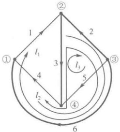

图 3-7 基本回路的 KVL 方程用图
 

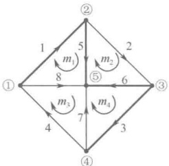

（a）平面图
 

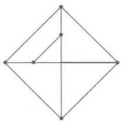

（b）非平面图
 

图 3-8 平面图与非平面图
 

平面图的一个网孔是它的一个自然“孔”，网孔所限定的区域内不再有支路。网孔用符号  $ m_k $ 表示，下标 k 是序号。对于图 3-8（a）所示的平面图，共有 4 个网孔，分别为  $ m_1 $、 $ m_2 $、 $ m_3 $、 $ m_4 $。平面图的网孔数为  $ m = b - n + 1 = l $，恰好等于独立回路数，所以，平面图的全部网孔是一组独立回路，按网孔所列写的 KVL 方程都是相互独立的。正因为如此，在分析平面电路时可以省去选树和确定连支及基本回路这一过程，直接按网孔列写出数量足够又相互独立的 KVL 方程即可。以图 3-8（a）所示的平面图为例，选择网孔的绕行方向一律为顺时针方向，按图中各支路电压的

<!-- page: 67 -->

参考方向，可以列出KVL方程

$$  \left.\begin{array}{l} 网孔 m_{1}：u_{1}+u_{5}-u_{8}=0\\  网孔 m_{2}：u_{2}-u_{5}+u_{6}=0\\  网孔 m_{3}：u_{4}-u_{7}+u_{8}=0\\  网孔 m_{4}：u_{3}-u_{6}+u_{7}=0\end{array}\right\}   \tag*{(3-7)}$$

这是一组独立的 KVL 方程。

### 3.3 支路法

以支路电压和/或支路电流为电路变量列写电路方程并进行求解的方法称为支路法。

#### 3.3.12b 法

对于一个具有 b 条支路、n 个节点的电路，当选择支路电压和支路电流作为电路变量列写电路方程时，共有 2b 个未知变量。从 3.2 节讨论的内容可以知道，根据 KCL 可以列写出  $ (n-1) $ 个独立的节点电流方程，根据 KVL 可列写出  $ (b-n+1) $ 个独立的回路电压方程，再根据元件的性能关系，又可列写出 b 个支路电压、支路电流关系方程（支路特性方程），因为 b 条支路各异，所以列写出的 b 个支路特性方程相互独立。这样，一共可以列写出 2b 个以支路电压和支路电流为电路变量的数量足够、且相互独立的电路方程，联立求解这组方程可以得到 b 个支路电压和 b 个支路电流。这种求解电路的方法称为 2b 法，下面举例来说明用 2b 法求解电路的具体过程。

对于图3-9（a）所示电路，设各支路电压与支路电流为关联参考方向，图3-9（b）为图3-9（a）的有向图，其中有6条支路（4条简单支路、2条复合支路）、4个节点。选节点①、②、③为独立节点，可列写出3个独立的KCL方程

$$  \left.\begin{array}{l} 节点\textcircled{1}：-i_{1}+i_{2}+i_{6}=0\\ 节点\textcircled{2}：-i_{2}+i_{3}+i_{4}=0\\ 节点\textcircled{3}：-i_{4}+i_{5}-i_{6}=0\end{array}\right\}   \tag*{（3-8）}$$

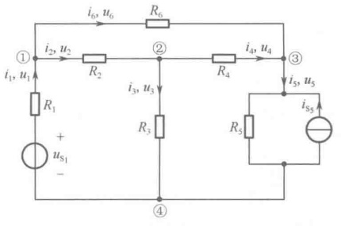

（a）电路图
 

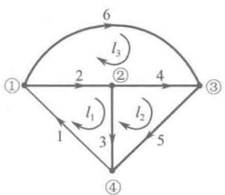

（b）有向图
 

图 3-9 2b 法示例
 

因本例电路为平面电路，可以省去选树、确定连支及基本回路这一过程。以平面图的网孔作为独立回路，且回路绕行方向一律为顺时针方向，分别标示在图3-9（b）中，对回路 $ l_{1} $、 $ l_{2} $、 $ l_{3} $列写出3个独立的KVL方程

<!-- page: 68 -->

回路 $ l_{1} $:  $ u_{1}+u_{2}+u_{3}=0 $

回路 $ l_{2} $:  $ -u_{3}+u_{4}+u_{5}=0 $

回路 $ l_{3} $:  $ -u_{2}-u_{4}+u_{6}=0 $

根据图3-9（a）所示电路中各支路具体的结构与元件参数值，可列出各支路特性方程

$$  \left.\begin{array}{r}{u_{1}=R_{1}i_{1}-u_{\mathrm{S}_{1}}}\\ {u_{2}=R_{2}i_{2}}\\ {u_{3}=R_{3}i_{3}}\\ {u_{4}=R_{4}i_{4}}\\ {u_{5}=R_{5}(i_{5}+i_{\mathrm{S}_{5}})}\\ {u_{6}=R_{6}i_{6}}\end{array}\right\}\left.\begin{array}{l}{u_{k}=f_{k}(i_{k})}\\ {k=1,2,\cdots,6}\end{array}\right.   \tag*{（3-10）}$$

或者

$$  \left.\begin{array}{l}{i_{1}=G_{1}(u_{\mathrm{S}_{1}}+u_{1})}\\ {i_{2}=G_{2}u_{2}}\\ {i_{3}=G_{3}u_{3}}\\ {i_{4}=G_{4}u_{4}}\\ {i_{5}=G_{5}u_{5}-i_{\mathrm{S}_{5}}}\\ {i_{6}=G_{6}u_{6}}\end{array}\right\}\left.\begin{array}{l}{i_{k}=g_{k}(u_{k})}\\ {k=1,2,\cdots,6}\end{array}\right.   \tag*{（3-11）}$$

联立式（3-8）、式（3-9）、式（3-10）或式（3-11）所表示的12个方程，就可以求解出各支路电压和支路电流。

在上述求解过程中，列写 KCL、KVL 方程相对容易些，而列写支路特性方程的难度要大。针对这一问题，将线性电阻电路分析中可能遇到的支路类型汇集在表 3-1 中，其中对于各种类型支路给出了两种形式的支路特性方程以供参考。

表3-1 各种类型支路的特性方程
 

<table border=1 style='margin: auto; word-wrap: break-word;'><tr><td style='text-align: center; word-wrap: break-word;'>支路类型</td><td colspan="2">支路特性方程</td></tr><tr><td style='text-align: center; word-wrap: break-word;'></td><td style='text-align: center; word-wrap: break-word;'>$ u_k = R_k i_k $</td><td style='text-align: center; word-wrap: break-word;'>$ i_k = G_k u_k $</td></tr><tr><td style='text-align: center; word-wrap: break-word;'>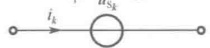 +  $ u_k $ +</td><td style='text-align: center; word-wrap: break-word;'>$ u_k = \pm u_{S_k} $ 式中的 \pm 号取决于 $ u_k $的参考方向与 $ u_{S_k} $的方向是否一致</td><td style='text-align: center; word-wrap: break-word;'>$ i_k = ? $</td></tr><tr><td style='text-align: center; word-wrap: break-word;'>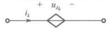 +  $ u_k $ +</td><td style='text-align: center; word-wrap: break-word;'>$ u_k = \pm u_{d_k} = \begin{cases} r_{kj} i_j \\ \mu_{kj} u_j \end{cases} $ 式中的 \pm 号取决于 $ u_k $的参考方向与 $ u_{d_k} $的方向是否一致</td><td style='text-align: center; word-wrap: break-word;'>$ i_k = ? $</td></tr><tr><td style='text-align: center; word-wrap: break-word;'>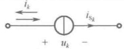</td><td style='text-align: center; word-wrap: break-word;'>$ u_k = ? $</td><td style='text-align: center; word-wrap: break-word;'>$ i_k = \pm i_{S_k} $ 式中的 \pm 号取决于 $ i_k $的参考方向与 $ i_{S_k} $的方向是否一致</td></tr><tr><td style='text-align: center; word-wrap: break-word;'>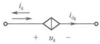</td><td style='text-align: center; word-wrap: break-word;'>$ u_k = ? $</td><td style='text-align: center; word-wrap: break-word;'>$ i_k = \pm i_{d_k} = \begin{cases} \beta_{kj} i_j \\ g_{kj} u_j \end{cases} $ 式中的 \pm 号取决于 $ i_k $的参考方向与 $ i_{d_k} $的方向是否一致</td></tr></table>

<!-- page: 69 -->

续表
 

<table border=1 style='margin: auto; word-wrap: break-word;'><tr><td style='text-align: center; word-wrap: break-word;'>支路类型</td><td colspan="2">支路特性方程</td></tr><tr><td style='text-align: center; word-wrap: break-word;'>+ u_{o}. - 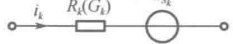 + u_{k} -</td><td style='text-align: center; word-wrap: break-word;'>u_{k}=R_{k}i_{k}+u_{S_{k}}</td><td style='text-align: center; word-wrap: break-word;'>i_{k}=G_{k}(u_{k}-u_{S_{k}})</td></tr><tr><td style='text-align: center; word-wrap: break-word;'>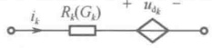 + u_{k} -</td><td style='text-align: center; word-wrap: break-word;'>u_{k}=R_{k}i_{k}+u_{d_{k}}</td><td style='text-align: center; word-wrap: break-word;'>i_{k}=G_{k}(u_{k}-u_{d_{k}})</td></tr><tr><td style='text-align: center; word-wrap: break-word;'>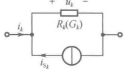</td><td style='text-align: center; word-wrap: break-word;'>u_{k}=R_{k}(i_{k}+i_{S_{k}})</td><td style='text-align: center; word-wrap: break-word;'>i_{k}=G_{k}u_{k}-i_{S_{k}}</td></tr><tr><td style='text-align: center; word-wrap: break-word;'>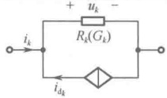</td><td style='text-align: center; word-wrap: break-word;'>u_{k}=R_{k}(i_{k}+i_{d_{k}})</td><td style='text-align: center; word-wrap: break-word;'>i_{k}=G_{k}u_{k}-i_{d_{k}}</td></tr></table>

从概念上来说，2b法是很重要的，它是各种电路分析方法的基础，可称为电路分析方法之源。在电路分析中，2b法也是最通用的一种方法，它既不受电路结构的限制，又不受元件性质的限制，在建立方程和求解过程方面非常规范，而且解的结果也直观明了。这些优点使得2b法在计算机辅助分析大规模电路时备受重视。不过，从上面的示例也会发现，2b法的方程数较多，手工解算2b个联立方程时会有些困难。为此，针对手工解算电路情况，需要寻求减少联立方程数目的其他电路分析方法。

#### 3.3.2 b 法

在 2b 法中，不仅要列出  $ (n-1) $ 个独立的 KCL 方程和  $ (b-n+1) $ 个独立的 KVL 方程，还要列写出 b 个支路特性方程  $ u_{k}=f_{k}(i_{k}) $ 或  $ i_{k}=g_{k}(u_{k}) $。

支路特性方程  $ u_{k}=f_{k}(i_{k}) $ 或  $ i_{k}=g_{k}(u_{k}) $ 表明：支路电压  $ u_{k} $ 与支路电流  $ i_{k} $ 可以相互表示，利用这一点，如果将  $ u_{k}=f_{k}(i_{k}) $ 代入独立的 KVL 方程中，就能得到以支路电流来表示的 KVL 方程，称为支路特性与 KVL 相结合的方程。连同支路电流表示的 KCL 方程，可得到以支路电流为电路变量的 b 个电路方程，联立求解这 b 个方程即可先得到 b 个支路电流，再利用支路特性方程  $ u_{k}=f_{k}(i_{k}) $，又可求出 b 个支路电压，将这样的方法称为支路电流法。

同埋，如果将 $ i_{k}=g_{k}(u_{k}) $代入独立的KCL方程中，就能得到以支路电压表示的KCL方程，称为支路特性与KCL相结合的方程。连同支路电压表示的KVL方程，可得到以支路电压为电路变量的b个电路方程，联立求解这b个方程即可先得到b个支路电压，再利用支路特性方程 $ i_{k}=g_{k}(u_{k}) $，又可求出b个支路电流，将这样的方法称为支路电压法。

支路电流法及支路电压法统称为 b 法，它们都是在 2b 法的基础上改进得到的，这种改进使电路方程数目从 2b 个减少至 b 个。显然，手工解算 b 个方程比解算 2b 个方程要容易些，但 b 法将电路求解分成了两步进行，可以说利弊参半。

下面仍以图 3-9（a）所示电路为例，说明用支路电流法和支路电压法分析的过程。仍选节点①、②、③为独立节点，列写 KCL 方程；仍选网孔作为独立回路，列写 KVL 方程。

用支路电流法列写出的全部电路方程

<!-- page: 70 -->

$$  \begin{aligned}& 节点\textcircled{1}:-i_{1}+i_{2}+i_{6}=0\\& 节点\textcircled{2}:-i_{2}+i_{3}+i_{4}=0\\& 节点\textcircled{3}:-i_{4}+i_{5}-i_{6}=0\\& 回路 l_{1}\text{：}R_{1}i_{1}+R_{2}i_{2}+R_{3}i_{3}=u_{S_{1}}\\& 回路 l_{2}\text{：}-R_{3}i_{3}+R_{4}i_{4}+R_{5}i_{5}=-R_{5}i_{S_{5}}\\& 回路 l_{3}\text{：}-R_{2}i_{2}-R_{4}i_{4}+R_{6}i_{6}=0\end{aligned}   \tag*{（3-12）}$$

式（3-12）中的支路特性与KVL相结合的方程可归纳为

$$  \left.\begin{array}{r l}&{\displaystyle\sum_{l_{j}}R_{k}i_{k}=\displaystyle\sum_{l_{j}}u_{\mathrm{S}_{k}}(R_{k}i_{\mathrm{S}_{k}})}\\ &{j=1,2,3}\end{array}\right\}   \tag*{（3-13）}$$

式中， $ R_{k}i_{k} $ 是独立回路  $ l_{j} $ 中第 k 条支路电阻上的电压，且沿回路绕行方向，电压降为正，电压升为负；式中  $ u_{S_{k}}(R_{k}i_{S_{k}}) $ 是独立回路  $ l_{j} $ 中第 k 条支路电压源电压（或经含源支路等效变换将电流源与电阻并联变换成电压源与电阻串联所得到的等效电压源的电压），且沿回路绕行方向，电压升为正，电压降为负。因此，上式的物理意义是：对任意独立回路，沿回路绕行方向，电阻电压降的代数和等于电压源电压升的代数和。依据此规律，对电路中任意独立回路，可方便、快捷地列出这种形式的回路电压平衡方程。

用支路电压法列出的全部电路方程

$$  \begin{aligned}& 回路 l_{1}：u_{1}+u_{2}+u_{3}=0\\& 回路 l_{2}：-u_{3}+u_{4}+u_{5}=0\\& 回路 l_{3}：-u_{2}-u_{4}+u_{6}=0\\& 节点\textcircled{1}：-G_{1}u_{1}+G_{2}u_{2}+G_{6}u_{6}=G_{1}u_{S_{1}}\\& 节点\textcircled{2}：-G_{2}u_{2}+G_{3}u_{3}+G_{4}u_{4}=0\\& 节点\textcircled{3}：-G_{4}u_{4}+G_{5}u_{5}-G_{6}u_{6}=i_{S_{5}}\end{aligned}   \tag*{（3-14）}$$

式（3-14）中的支路特性与KCL相结合的方程可归纳为

$$  \left.\begin{array}{l}\displaystyle\sum_{n_{j}}G_{k}u_{k}=\sum_{n_{j}}i_{\mathrm{S}_{k}}(G_{k}u_{\mathrm{S}_{k}})\\ j=1,2,3\end{array}\right\}   \tag*{（3-15）}$$

式中， $ G_{k}u_{k} $ 是与独立节点  $ n_{j} $ 相连的第 k 条支路中电阻上的电流，且流出为正，流入为负； $ i_{S_{k}}(G_{k}u_{S_{k}}) $ 是与独立节点  $ n_{j} $ 相连的第 k 条支路中电流源电流（或经含源支路等效变换将电压源与电阻串联变换成电流源与电阻并联所得到的等效电流源的电流），且流入为正，流出为负。因此，上式的物理意义是：对任意独立节点，电阻流出节点电流的代数和等于电流源流入节点电流的代数和。依据此规律，对电路中任意独立节点可方便、快捷地列出这种形式的节点电流平衡方程。

在支路电流法中，支路特性方程必须是  $ u_{k}=f_{k}(i_{k}) $ 的形式，才能够得到如式（3-13）所示的以支路电流来表示的 KVL 方程。如果电路中的第 k 条支路是单一电流源或单一受控电流源，如图 3-10（a）、（b）所示，由于支路电压  $ u_{k} $ 无法以支路电流  $ i_{k} $ 来表示，因此不能直接运用支路电流法列写电路方程，这时需在原支路电流法的基础上做一些相应的处理，从而产生改进的支路电流法。

处理方法如下：

（1）将 $ u_{k} $作为新增电路变量保留在相关独立回路的回路电压平衡方程的左边，且电压降为正，电压升为负；

<!-- page: 71 -->

（2）将 $ i_{k}=i_{S_{k}} $或 $ i_{k}=i_{d_{k}} $作为增补方程代入相关独立节点的KCL方程中。

在支路电压法中，支路特性方程必须是  $ i_{k} = g_{k}(u_{k}) $ 的形式，才能够得到如式（3-15）所示的以支路电压来表示的KCL方程。如果电路中的第k条支路是单一电压源或单一受控电压源，如图3-11（a）、（b）所示，由于支路电流  $ i_{k} $ 无法以支路电压  $ u_{k} $ 来表示，因此不能直接运用支路电压法列写电路方程，这时需在原支路电压法的基础上做一些相应的处理，从而产生改进的支路电压法。

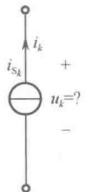

（a）单一电流源支路
 

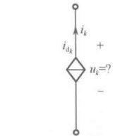

（b）单一受控电流源支路
 

图3-10 单一电流源支路及单一受控电流源支路
 

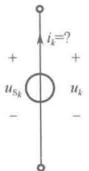

（a）单一电压源支路
 

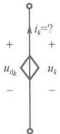

（b）单一受控电压源支路
 

图3-11 单一电压源支路及单一受控电压源支路
 

处理方法如下：

（1）将 $ i_{k} $作为新增电路变量保留在相关独立节点的节点电流平衡方程的左边，且流出为正，流入为负；

（2）将 $ u_{k}=u_{S_{k}} $或 $ u_{k}=u_{d_{k}} $作为增补方程代入相关独立回路KVL方程中。

例 3-1 试用支路电流法求解图 3-12（a）所示电路中的电压  $ u_{1} $

解：电路中含有单一电流源支路及单一受控电流源支路，在运用支路电流法时要做一些相应的处理。处理方法是增设新的电路变量、再增补方程。具体操作如下：

KCL 方程为①： $ i_{2}+i_{4}+i_{6}=0 $

 $$ \textcircled{2}：i_{1}-i_{4}+i_{5}=0 $$ 

 $$ \textcircled{3}：i_{3}-i_{5}-i_{6}=0 $$ 

KVL 和支路特性相结合形成的回路电压平衡方程为

 $$ l_{1}:~~32i_{1}+24i_{4}=20\quad l_{2}:~~-32i_{1}+u_{3}+8i_{5}=0\quad l_{3}:~~-24i_{4}-8i_{5}+u_{6}=0 $$ 

增补方程： $ i_{6}=0.15A $， $ i_{3}=0.05u_{1} $

控制量用支路电流表示： $ u_{1}=32i_{1} $

上述方程合并整理为

 $$ \begin{aligned}i_{2}+i_{4}&=-0.15\\i_{1}-i_{4}+i_{5}&=0\\1.6i_{1}-i_{5}&=0.15\\32i_{1}+24i_{4}&=20\\-32i_{1}+u_{3}+8i_{5}&=0\\-24i_{4}-8i_{5}+u_{6}&=0\end{aligned} $$ 

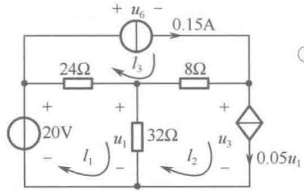

（a）电路图
 

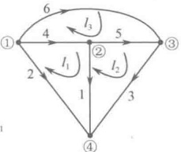

（b）有向图
 

##### 进一步整理为

图3-12 例3-1图
 

 $$ \begin{cases}2.6i_{1}-i_{4}=0.15\\32i_{1}+24i_{4}=20\end{cases} $$ 

最后联立求解得

 $$ i_{1}=0.25A,\quad u_{1}=32i_{1}=8V $$ 

例 3-2 试用支路电压法求解图 3-13（a）所示电路中的电压  $ u_{x} $

解：电路中含有单一电压源支路及单一受控电压源支路，在运用支路电压法时要做一些相应

<!-- page: 72 -->

的处理。处理方法是增设新的电路变量、再增补方程。具体操作如下：

KVL 方程为  $ l_{1} $:  $ u_{1}-u_{2}+u_{4}=0 $  $ l_{2} $:  $ -u_{1}+u_{3}+u_{5}=0 $  $ l_{3} $:  $ -u_{4}-u_{5}+u_{6}=0 $

KCL 和支路特性相结合形成的节点电流平衡方程为

①： $ \frac{u_{2}}{6}+\frac{u_{4}}{2}+i_{6}=0 $ ②： $ -\frac{u_{4}}{2}+i_{1}+\frac{u_{5}}{3}=0 $ ③： $ -\frac{u_{5}}{3}-i_{6}=2 $

增补方程： $ u_{6}=6V $， $ u_{1}=-6u_{x} $

控制量用支路电压表示： $ u_{x}=u_{5} $

上述方程合并整理为

 $$ \left\{\begin{aligned}-u_{2}+u_{4}-6u_{5}&=0\\ u_{3}+7u_{5}&=0\\ -u_{4}-u_{5}&=-6\\ \frac{u_{2}}{6}+\frac{u_{4}}{2}+i_{6}&=0\\ i_{1}-\frac{u_{4}}{2}+\frac{u_{5}}{3}&=0\\ -\frac{u_{5}}{3}-i_{6}&=2\end{aligned}\right. $$ 

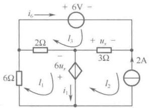

（a）电路图
 

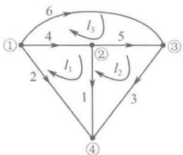

（b）有向图
 

图3-13 例3-2图
 

##### 进一步整理为

 $$ \begin{cases}4u_{4}-8u_{5}=12\\-u_{4}-u_{5}=-6\end{cases} $$ 

最后联立求解得

 $$ u_{5}=u_{x}=1V $$ 

b 法需要求解 b 个联立方程，如果电路较复杂，支路数较多，则手工解算 b 个联立方程也会相当复杂。为了使求解电路的联立方程数目进一步减少，即使求解的未知量进一步减少，需要寻求一些新的电流变量或电压变量，其个数要比支路数少，而且必须是既独立又完备的，根据这些变量可以建立数目较少的联立方程并易于求解。下面将讨论的网孔分析法、回路分析法、节点分析法等方法正是基于这种想法而产生的。

### 3.4 网孔分析法和回路分析法

#### 3.4.1 网孔分析法

对于一个具有 b 条支路、n 个节点的电路，b 个支路电流受  $ (n-1) $ 个独立的 KCL 方程约束，这意味着独立的支路电流只有  $ (b-n+1) $ 个，而且给定  $ (b-n+1) $ 个支路电流即能确定余下的  $ (n-1) $ 个支路电流，这为我们寻找新的电流变量提供了理论依据。

图3-14（a）所示为平面电路，图3-14（b）是该电路的有向图，该电路有3条支路、2个节点及2个网孔，网孔的绕行方向一律取顺时针方向。

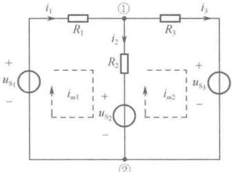

（a）电路图
 

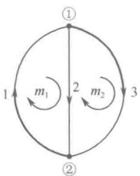

（b）有向图
 

图 3-14 网孔分析法用图
 

<!-- page: 73 -->

选节点 $ ^{①} $为独立节点，应用KCL有

 $$ \begin{aligned}-i_{1}+i_{2}+i_{3}&=0\\i_{2}&=i_{1}-i_{3}\end{aligned} $$ 

或

可见  $ i_2 $ 不是独立的，它是  $ i_1 $、 $ i_3 $ 的线性组合。 $ i_2 $ 可看成是由两部分电流所组成的，一部分是  $ i_1 $，因与  $ i_2 $ 的方向相同故在方程中为正项；另一部分是  $ i_3 $，因与  $ i_2 $ 的方向相反故在方程中为负项。如果用  $ (i_1 - i_3) $ 来代替  $ i_2 $，则整个电路内就好像只存在两个电流，一个是  $ i_1 $，沿着网孔 1 的边界流动，经过支路 2；另一个是  $ i_3 $，沿着网孔 2 的边界流动，也经过支路 2。这种假想的沿着网孔的边界流动的电流称为网孔电流，即图 3-14（a）中用虚线标出的  $ i_{m1} $、 $ i_{m2} $，网孔电流的方向一般取网孔的绕行方向。对于一个具有 b 条支路、n 个节点的平面电路来说，共有  $ m = b - n + 1 $ 个网孔，因此也有相同数目的网孔电流，它们用符号  $ i_{mk} $ 表示，下标  $ k = 1, 2, \cdots, m $ 表示网孔电流的序号。显然，网孔电流的数目少于支路数，这就是要寻找的新的电流变量。

从图3-14（a）不难看出，每一网孔电流沿着网孔的边界流动，当它流经某节点时，从该节点流入，同时又从该节点流出，它本身自动满足KCL。例如对节点①，以网孔电流为变量列出的KCL方程为 $ -i_{m1}+i_{m1}-i_{m2}+i_{m2}=0 $，因此不能通过节点KCL方程将各网孔电流约束起来，就KCL而言，各网孔电流是线性无关的，因此网孔电流可作为电路的一组独立的电流变量。

从图 3-14（a）还可清楚地看出，电路中所有的支路电流都可以用网孔电流的线性组合来表示。这是因为电路中任何一条支路一定属于一个或两个网孔，如果某支路只属于某一网孔，那么这条支路上只有一个网孔电流流过，支路电流就等于该网孔电流，如  $ i_{1}=i_{m1} $， $ i_{3}=i_{m2} $；如果某支路属于两个网孔所共有，则根据 KCL，该支路上的电流就等于流经该支路的两个网孔电流的代数和，与支路电流方向相同的网孔电流取正号，反之取负号，如  $ i_{2}=i_{m1}-i_{m2} $。可见，一旦求得了网孔电流，所有支路电流就可随之而定，进而可以求得所有支路电压及功率。因此，网孔电流是一组完备的电流变量。

那么，如何建立求解网孔电流所需要的联立方程呢？首先对每一个网孔列写出 KVL 方程；然后对每一条支路列写出支路特性方程  $ u_{k} = f_{k}(i_{k}) $，并将其中的支路电流  $ i_{k} $ 用相应的网孔电流的线性组合表示；最后将用网孔电流表示的支路电压  $ u_{k} $ 代入每一个网孔的 KVL 方程中，就得到了一组以网孔电流为变量的方程组，称为网孔电流方程。它们必然与待求的网孔电流变量数目相同而且是独立的，求解这组方程可得到各网孔电流，进而利用已求得的网孔电流可求出各支路电流、电压及功率，这种求解电路的方法称为网孔分析法（简称网孔法）。

应用网孔法分析电路的关键是如何简便、快捷、正确地列出网孔电流方程，下面以图3-14（a）所示电路为示例，列写网孔电流方程，并从中归纳总结出列写网孔电流方程的一般方法。

对于图3-14（b）所示的有向图，列出各网孔的KVL方程

$$  \left.\begin{array}{l} 网孔 m_{1}：u_{1}+u_{2}=0\\  网孔 m_{2}：-u_{2}+u_{3}=0\end{array}\right\}   \tag*{（3-16）}$$

再对图3-14（a）所示电路列写出支路特性方程，并将其中的支路电流用相应的网孔电流的线性组合来表示，得到

$$  \left.\begin{aligned}&u_{1}=-u_{\mathrm{S}_{1}}+R_{1}i_{1}=-u_{\mathrm{S}_{1}}+R_{1}i_{m1}\\ &u_{2}=u_{\mathrm{S}_{2}}+R_{2}i_{2}=u_{\mathrm{S}_{2}}+R_{2}(i_{m1}-i_{m2})\\ &u_{3}=u_{\mathrm{S}_{3}}+R_{3}i_{m3}=u_{\mathrm{S}_{3}}+R_{3}i_{m2}\\ \end{aligned}\right\}   \tag*{（3-17）}$$

最后将式（3-17）代入式（3-16）中，整理得

<!-- page: 74 -->

$$  \left.\begin{array}{l} 网孔 m_{1}:(R_{1}+R_{2})i_{m1}-R_{2}i_{m2}=u_{S_{1}}-u_{S_{2}}\\  网孔 m_{2}:-R_{2}i_{m1}+(R_{2}+R_{3})i_{m2}=u_{S_{2}}-u_{S_{3}}\end{array}\right\}   \tag*{（3-18）}$$

式（3-18）就是以网孔电流为变量的网孔电流方程。此方程的物理意义是：在各网孔电流共同作用下，沿一个网孔的电阻电压降的代数和等于沿该网孔的电压源电压升的代数和。因此，网孔电流方程的实质是网孔电压平衡方程。

观察式（3-18），可从中发现一些规律。（ $ R_{1} + R_{2} $）恰好是网孔  $ m_{1} $ 内所有电阻之和，称为网孔  $ m_{1} $ 的自阻，以符号  $ R_{11} $ 表示；（ $ R_{2} + R_{3} $）恰好是网孔  $ m_{2} $ 内所有电阻之和，称为网孔  $ m_{2} $ 的自阻，以符号  $ R_{22} $ 表示。由于网孔电流的参考方向与网孔的绕行方向一致，网孔电流在自阻上产生的电压都是沿网孔的电压降，在网孔电压方程的左边总是正项，因此自阻  $ R_{11} $ 和  $ R_{22} $ 总是正值。（ $ -R_{2} $）是网孔  $ m_{1} $ 和网孔  $ m_{2} $ 公共支路上电阻的负值，称为网孔  $ m_{1} $ 和网孔  $ m_{2} $ 的互阻，以符号  $ R_{12} $（或  $ R_{21} $）表示，且  $ R_{12} = R_{21} $。如果在公共支路电阻上的两网孔电流方向相同，意味着其中一网孔电流产生的电压沿另一网孔是电压降，那么这个电压在另一网孔电流方程的左边为正项；如果在公共支路电阻上的两网孔电流方向相反，意味着其中一网孔电流产生的电压沿另一网孔是电压升，那么这个电压在另一网孔电流方程的左边为负项。为了使方程形式整齐，把这类电压前的“+”号或“-”号放在有关的互阻中。这样，当通过两个网孔公共支路电阻上的两个网孔电流方向相同时，互阻为正；反之为负。显然，如果两个网孔之间没有公共支路，或者公共支路上没有电阻（如公共支路是单一电压源），则互阻为零。（ $ u_{S_1} - u_{S_2} $）是沿网孔  $ m_1 $ 所有电压源电压升的代数和（电压升为正，电压降为负），用符号  $ u_{S11} $ 表示；（ $ u_{S_2} - u_{S_3} $）是沿网孔  $ m_2 $ 所有电压源电压升的代数和（电压升为正，电压降为负），用符号  $ u_{S22} $ 表示，即

 $$ \begin{aligned}\boldsymbol{R}_{11}=\boldsymbol{R}_{1}+\boldsymbol{R}_{2},\quad\boldsymbol{R}_{22}=\boldsymbol{R}_{2}+\boldsymbol{R}_{3}\\\boldsymbol{R}_{12}=\boldsymbol{R}_{21}=-\boldsymbol{R}_{2}\\u_{\mathrm{S}11}=u_{\mathrm{S}_{1}}-u_{\mathrm{S}_{2}},\quad u_{\mathrm{S}22}=u_{\mathrm{S}_{2}}-u_{\mathrm{S}_{3}}\end{aligned} $$ 

由以上分析，可以归纳总结出具有2个网孔电路的网孔电流方程的通式（一般式）为

$$  \left.\begin{array}{r}R_{11}i_{m1}+R_{12}i_{m2}=u_{S11}\\ R_{21}i_{m1}+R_{22}i_{m2}=u_{S22}\end{array}\right\}   \tag*{（3-19）}$$

如果平面电路具有 m=b-n+1 个网孔，并设各网孔电流分别为  $ i_{m1} $， $ i_{m2} $，…， $ i_{mm} $，不难推出网孔电流方程的通式为

$$  \left.\begin{array}{c}R_{11}i_{m1}+R_{12}i_{m2}+\cdots+R_{1m}i_{mm}=u_{\mathrm{S}11}\\ R_{21}i_{m1}+R_{22}i_{m2}+\cdots+R_{2m}i_{mm}=u_{\mathrm{S}22}\\ \vdots\quad\vdots\quad\vdots\quad\vdots\\ R_{m1}i_{m1}+R_{m2}i_{m2}+\cdots+R_{mm}i_{mm}=u_{\mathrm{S}mm}\end{array}\right\}   \tag*{(3-20)}$$

式（3-20）中具有相同下标的电阻  $ R_{11} $、 $ R_{22} $、…、 $ R_{kk} $ ( $ k=1,2,\cdots,m $) 等是各网孔的自阻，且自阻总是正的；有不同下标的电阻  $ R_{12}=R_{21} $、…、 $ R_{kj}=R_{jk} $ ( $ k=j=1,2,\cdots,m $) 等是两个网孔的互阻，且互阻可以是正的、负的，或零。方程右边的  $ u_{S11} $、 $ u_{S22} $、…、 $ u_{Skk} $ ( $ k=1,2,\cdots,m $) 等分别为各网孔中所有电压源电压升的代数和，求和时各电压源电压升的方向与网孔电流的方向一致时，该电压源的电压前取“+”号，反之取“-”号。

有了方程通式，只需标出网孔电流，观察电路，写出自阻、互阻及各网孔电压源电压升代数和并代入通式（3-20），即可迅速得到按网孔电流顺序排列的相互独立的方程组，具体电路各有不同，其区别只是各个自阻 $ R_{kk} $、互阻 $ R_{kj}(R_{jk}) $及各网孔电压源电压升代数和 $ u_{Skk} $的具体内容不同。

<!-- page: 75 -->

下面通过具体例子，说明用网孔法分析电路的具体步骤。

例 3-3 如图 3-15（a）所示的平面电路，已知： $ u_{S_1} = 21\text{V} $， $ u_{S_2} = 14\text{V} $， $ u_{S_3} = 6\text{V} $， $ u_{S_4} = 2\text{V} $， $ u_{S_5} = 2\text{V} $， $ R_1 = 3\Omega $， $ R_2 = 2\Omega $， $ R_3 = 3\Omega $， $ R_4 = 6\Omega $， $ R_5 = 2\Omega $， $ R_6 = 1\Omega $，求各支路电流。

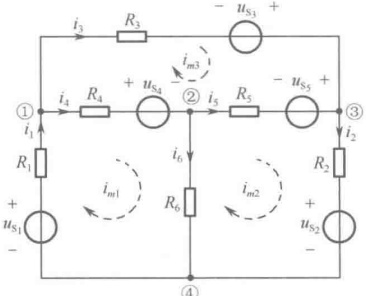

（a）电路图
 

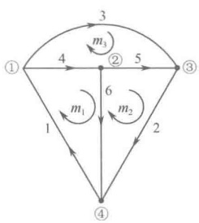

（b）有向图
 

图3-15 例3-3图
 

解：该平面电路有6条支路、4个节点及3个网孔，假定网孔电流的方向一律为顺时针方向，如图3-15（a）所示。

观察电路，写出各自阻、互阻及网孔电压源电压升代数和如下：

 $$ R_{11}=R_{1}+R_{4}+R_{6}=3+6+1=10\Omega $$ 

 $$ R_{22}=R_{2}+R_{5}+R_{6}=2+2+1=5\Omega $$ 

 $$ R_{33}=R_{3}+R_{4}+R_{5}=3+6+2=11\Omega $$ 

 $$ R_{12}=R_{21}=-R_{6}=-1\Omega $$ 

 $$ R_{13}=R_{31}=-R_{4}=-6\Omega $$ 

 $$ R_{23}=R_{32}=-R_{5}=-2\Omega $$ 

 $$ u_{\mathrm{S}11}=u_{\mathrm{S}_{1}}-u_{\mathrm{S}_{4}}=21-2=19\mathrm{V} $$ 

 $$ u_{S22}=-u_{S_{2}}+u_{S_{5}}=-14+2=-12\mathrm{V} $$ 

 $$ u_{S33}=u_{S_{3}}+u_{S_{4}}-u_{S_{5}}=6+2-2=6\mathrm{V} $$ 

将上述数据代入网孔电流方程的通式，可得该电路的网孔电流方程为

 $$ \begin{array}{l}10i_{m1}-i_{m2}-6i_{m3}=19\\-i_{m1}+5i_{m2}-2i_{m3}=-12\\-6i_{m1}-2i_{m2}+11i_{m3}=6\end{array} $$ 

解方程组，求得各网孔电流分别为

 $$ i_{m1}=3\mathrm{A},\quad i_{m2}=-1\mathrm{A},\quad i_{m3}=2\mathrm{A} $$ 

最后，由网孔电流求出各支路电流如下：

 $$ \begin{aligned}i_{1}&=i_{m1}=3\mathrm{A}\quad&i_{4}&=i_{m1}-i_{m3}=1\mathrm{A}\\i_{2}&=i_{m2}=-1\mathrm{A}\quad&i_{5}&=i_{m2}-i_{m3}=-3\mathrm{A}\\i_{3}&=i_{m3}=2\mathrm{A}\quad&i_{6}&=i_{m1}-i_{m2}=4\mathrm{A}\end{aligned} $$ 

在求解中发现，对平面电路而言，两个网孔的公共支路至多一条，而且如果网孔电流的方向一律为顺时针方向，那么互阻全为负值，这是因为在两网孔的公共支路电阻上的两个网孔电流的方向恰好相反。

<!-- page: 76 -->

网孔分析法仅适用于平面电路，有其局限性，有必要将网孔分析法引申到回路分析法，从而产生一种适用性强、应用更为广泛的分析方法。

#### 3.4.2 回路分析法

回路分析法（简称回路法）是一种以回路电流为变量列写电路方程求解电路的方法。在网孔电流这一概念的基础上，很容易构造出回路电流。回路电流是一种假想的沿着独立回路的边界流动的电流，其参考方向一般取独立回路的绕行方向。一个具有 b 条支路、n 个节点的电路共有  $ l = b - n + 1 $ 个独立回路，因此也有相同数目的回路电流，它们用符号  $ i_{lk} $ 表示，下标  $ k = 1, 2, \cdots, l $ 表示回路电流的序号。显然，回路电流的数目少于支路数。

独立回路的选择有多种途径，对于连通的平面电路，可选择全部网孔作为一组独立回路，也可选择一种树所确定的基本回路作为一组独立回路；对非平面电路，可按独立回路的特征，找到一组独立回路。可见，回路电流的适用范围更广，它可以是平面电路的网孔电流，或者是基本回路的回路电流，也可以是非平面电路的一组独立回路的回路电流。实际上回路电流包含了网孔电流，网孔电流是回路电流的特殊情况，因此回路分析法包含了网孔分析法且更具一般性，它不仅适用于分析平面电路，而且适用于分析非平面电路。

下面以图 3-16（a）所示电路为例，说明回路电流的确定。图 3-16（b）为图 3-16（a）电路的有向图，如果选支路  $ \{4, 5, 6\} $ 为树支（在图中用粗实线表示），则支路  $ \{1, 2, 3\} $ 为连支（在图中用细实线表示），由这三条连支可确定三个基本回路，它们是一组独立回路。基本回路的绕行方向习惯上规定为单连支方向，如图 3-16（b）中所标出的  $ l_1 $、 $ l_2 $、 $ l_3 $，相应的回路电流如图 3-16（a）中用虚线标出的  $ i_{l1} $、 $ i_{l2} $、 $ i_{l3} $。这种回路电流的参考方向一般取基本回路的绕行方向，这样各连支电流就是相应的基本回路的回路电流。

从图3-16（a）不难看出，每个回路电流沿着回路的边界流动，对于流经的任意节点都有流入等于流出的关系，自动满足了KCL。并且各回路电流之间不受KCL的约束，这是因为由树的定义可知，对连通图中任意一个节点，与它相连的所有支路中一定有一条树支，不可能全是连支。这样，想由节点的KCL方程把各连支电流的关系联系起来是不可能的。因此，就KCL而言，各回路电流线性无关、相互独立，回路电流是一组独立的电流变量。

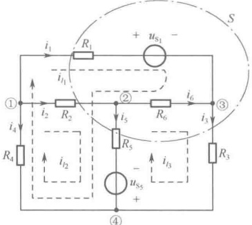

（a）电路图
 

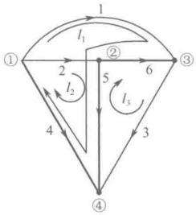

（b）有向图
 

图 3-16 回路分析法用图
 

从图3-16（a）还可清楚地看出，电路中所有的支路电流都可以用回路电流的线性组合来表示。这是因为各连支电流就是相应的回路电流，如

 $$ i_{1}=i_{l1},\quad i_{2}=i_{l2},\quad i_{3}=i_{l3} $$

<!-- page: 77 -->

而树支电流则通过节点或广义节点的 KCL 方程可由回路电流求得。对节点 $ ^{①} $应用 KCL 得

 $$ i_{4}=-i_{1}-i_{2}=-i_{l1}-i_{l2} $$ 

对广义节点（用虚线表示的封闭曲面）S应用KCL得

 $$ \begin{aligned}\boldsymbol{i}_{5}&=\boldsymbol{i}_{1}+\boldsymbol{i}_{2}-\boldsymbol{i}_{3}=\boldsymbol{i}_{l1}+\boldsymbol{i}_{l2}-\boldsymbol{i}_{l3}\\\boldsymbol{i}_{6}&=-\boldsymbol{i}_{1}+\boldsymbol{i}_{3}=-\boldsymbol{i}_{l1}+\boldsymbol{i}_{l3}\end{aligned} $$ 

对节点③应用KCL得

可见，一旦求得了回路电流，所有支路电流就可根据KCL随之而定，进而可以求得所有支路电压及支路功率。因此，回路电流是一组完备的电流变量。

那么，如何建立求解回路电流所需的联立方程呢？以回路电流为变量的电路方程的形式又是怎样的呢？由于网孔分析法是回路分析法的特殊情况，借鉴网孔分析法列方程的过程以及以网孔电流为变量的网孔电流方程的通式，不难得到以回路电流为变量的回路电流方程的通式。

如果一个电路具有 $ l=b-n+1 $个独立回路，并设各回路电流分别为 $ i_{l1} $， $ i_{l2} $，…， $ i_{ll} $，则回路电流方程的通式为

$$  \left.\begin{array}{c}{R_{11}i_{l1}+R_{12}i_{l2}+\cdots+R_{1l}i_{l l}=u_{\mathrm{S}11}}\\ {R_{21}i_{l1}+R_{22}i_{l2}+\cdots+R_{2l}i_{l l}=u_{\mathrm{S}22}}\\ {\vdots\quad\vdots\quad\vdots\quad\vdots}\\ {R_{l1}i_{l1}+R_{l2}i_{l2}+\cdots+R_{l l}i_{l l}=u_{\mathrm{S}l l}}\\ \end{array}\right\}   \tag*{（3-21）}$$

式中具有相同下标的电阻  $ R_{11} $、 $ R_{22} $、…、 $ R_{kk} $ ( $ k=1,2,\cdots,l $) 等是各回路的自阻，即各回路所有电阻之和，且自阻总是正的；有不同下标的电阻  $ R_{12}=R_{21} $、…、 $ R_{kj}=R_{jk} $ ( $ k=j=1,2,\cdots,l $) 等是两个回路的互阻，互阻取正还是取负，要由两个回路之间公共支路电阻上的两个回路电流的方向是否相同来决定，相同时取正，相反时取负。显然，若两个回路之间没有公共支路，或者公共支路上没有电阻（如公共支路是单一电压源），则相应的互阻为零。应当注意到，用回路分析法写互阻时，可能会遇到有些支路是多个独立回路的公共支路；两个独立回路的公共支路又是由多条支路组成的情况，这时写互阻要格外细心谨慎，既要注意到互阻取正还是取负，又不要缺项。方程右边的  $ u_{S11} $、 $ u_{S22} $、…、 $ u_{Skk} $ ( $ k=1,2,\cdots,l $) 等分别为各回路中所有电压源电压升的代数和，求和时各电压源电压升的方向与回路电流的方向一致时，该电压源的电压前取“+”号；反之取“-”号。

有了方程通式，只需设出回路电流，观察电路，写出自阻、互阻及各回路电压源电压升代数和，即可迅速得到按回路电流顺序排列的相互独立的方程组。由此可解得各回路电流，进而求得各支路电流、电压及功率。下面通过具体例子说明用回路法分析电路的具体步骤。

例 3-4 电路如图 3-16（a）所示，其中  $ R_{1}=R_{2}=R_{3}=1\Omega $， $ R_{4}=R_{5}=R_{6}=2\Omega $， $ u_{S_{1}}=4V $， $ u_{S_{2}}=2V $。试选择一组独立回路，并列出回路电流方程。

解：电路的有向图如图3-16（b）所示，粗实线支路为树支，细实线支路为连支，3个基本回路分别为 $ l_{1} $、 $ l_{2} $、 $ l_{3} $，相应的回路电流 $ i_{l1} $、 $ i_{l2} $、 $ i_{l3} $，在图3-16（a）中用虚线标出。观察电路，写出各自阻、互阻及回路电压源电压升代数和如下：

 $$ \begin{aligned}R_{11}&=R_{1}+R_{6}+R_{5}+R_{4}=7\Omega\quad&R_{12}&=R_{21}=R_{4}+R_{5}=4\Omega\\R_{22}&=R_{2}+R_{5}+R_{4}=5\Omega\quad&R_{13}&=R_{31}=-(R_{5}+R_{6})=-4\Omega\\R_{33}&=R_{3}+R_{5}+R_{6}=5\Omega\quad&R_{23}&=R_{32}=-R_{5}=-2\Omega\end{aligned} $$ 

 $$ u_{\mathrm{S}11}=-u_{\mathrm{S}_{1}}+u_{\mathrm{S}_{5}}=-2\mathrm{V} $$ 

 $$ u_{S22}=u_{S_{5}}=2\mathrm{V} $$ 

 $$ u_{S33}=-u_{S_{5}}=-2\mathrm{V} $$ 

将上述数据代入回路电流方程的通式，可得到该电路的一组回路电流方程为

<!-- page: 78 -->

$$ \left\{\begin{array}{l}7i_{l1}+4i_{l2}-4i_{l3}=-2\\4i_{l1}+5i_{l2}-2i_{l3}=2\\-4i_{l1}-2i_{l2}+5i_{l3}=-2\end{array}\right. $$ 

回路分析法（包含网孔分析法）是在支路电流法的基础上演变发展而来的，其优点是电路变量由 $b$ 个支路电流减少到 $(b-n+1)$ 个回路电流，列写电路方程的数目少了很多，求解更为容易。一旦求出了回路电流，根据 KCL 就能确定各支路电流，再根据支路特性方程可确定支路电压，进而确定支路功率。而且以回路电流为电路变量的回路电流方程的形式十分简单，各项物理意义极强，可以通过观察电路，按规律写出回路电流方程。这是因为在推导回路电流方程时，要求电路中所有的支路特性方程必须写成 $u_k = f_k(i_k)$ 的形式。实际上，对如图 3-17（a）～（d）所示的支路类型，可以写出 $u_k = f_k(i_k)$ 形式的支路特性方程。其中，图 3-17 （d）表示的电流源和电阻的并联组合，可经等效变换成为图 3-17（c）表示的电压源和电阻的串联组合。当电路中仅含有这些类型的支路时，可以通过观察电路，按规律写出回路电流方程。

而对如图 3-18 (a)～(c) 所示的这样一些支路，却不能写出  $ u_{k} = f_{k}(i_{k}) $ 形式的支路特性方程，因此也就无法按规律写出回路电流方程。这就是回路分析法所付出的代价，它以限制支路类型为代价换取方程数目的减少。如果电路中出现这样一些支路，就需要做一些相应的处理才能写出相应的回路电流方程，并且方程的形式与之前相比会稍有不同。

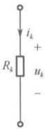

(a)
 

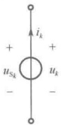

(b)
 

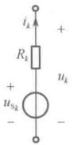

(c)
 

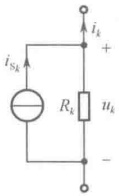

（d）
 

图 3-17 能够写出  $ u_{k} = f_{k}(i_{k}) $ 的支路类型
 

(a)
 

(b)
 

(c)
 

图 3-18 不能够写出  $ u_{k} = f_{k}(i_{k}) $ 的支路类型
 

电路中出现如图 3-18（a）所示的受控电压源支路，在用回路分析法列写回路电流方程时，可对其做如下处理：

（1）暂将CCVS（或VCVS）当作独立电压源 $ u_{S} $，按规律直接列出初步的回路电流方程：

（2）控制量 $ i_{j} $（或 $ u_{j} $）用相应的回路电流表示；

（3）对初步的回路电流方程进行移项合并整理，得到最终的回路电流方程。

下面通过具体例子说明上述处理过程。

例 3-5 用回路分析法求图 3-19 所示电路中的电流  $ I_{x} $ 及电压  $ U_{ab} $

解：选网孔作为独立回路，回路电流 $ i_{l1} $、 $ i_{l2} $的参考方向一律为顺时针方向，如图3-19所示。

图3-19 例3-5图
 

暂将 CCVS 当作独立电压源，按规律直接列出初步的回路电流方程为

 $$ \begin{align*}(10+2)i_{l1}-2i_{l2}&=6-8I_{x}\\-2i_{l1}+(2+4)i_{l2}&=8I_{x}-4\end{align*} $$ 

控制量 $ I_{x} $用回路电流表示为

 $$ I_{x}=i_{l2} $$ 

最后移项合并整理，得到最终的回路电流方程为

<!-- page: 79 -->

$$ \left\{\begin{array}{l}12i_{l1}+6i_{l2}=6\\ -2i_{l1}-2i_{l2}=-4\end{array}\right. $$ 

解方程得

 $$ i_{l1}=-1A\ ,\ i_{l2}=3A $$ 

 $$ I_{x}=i_{l2}=3A $$ 

 $$ U_{ab}=8I_{x}+2(i_{l1}-i_{l2})=8\times3+2\times(-4)=16V $$ 

如果电路中出现如图3-18（b）所示的单一电流源支路，该如何处理？根据电流源特性可知，它的端电压 $ u_{k} $与外电路有关，在电路未求解出之前是不知道的。而回路电流方程实质上是以回路电流表示的回路电压平衡方程，当单一电流源支路出现在某一独立回路中时，该独立回路的回路电流方程中应该具有其端电压 $ u_{k} $信息的表示，而电压 $ u_{k} $是未知的。如果选网孔作为独立回路，那么单一电流源支路有可能出现在一个独立回路中，当然也可能是两个独立回路的公共支路。针对这些情况，在对单一电流源支路所相关的独立回路写回路电流方程时，可将单一电流源的端电压 $ u_{k} $作为新增电路变量，放在方程的左边，且沿回路绕行方向的电压降为正项，电压升为负项。因为引入了单一电流源的端电压 $ u_{k} $这个未知量，必须增补一个方程，这个方程也是不难找到的，这就是单一电流源电流用相关的回路电流的线性组合来表示的方程。这样，方程数与变量数相等，联立求解得到回路电流及单一电流源的端电压。如果以基本回路作为独立回路，有意将单一电流源支路选为连支，这样单一电流源支路就只可能出现在一个独立回路中，而且这个独立回路的回路电流就是单一电流源电流（为已知的），这时不必再对这个独立回路写回路电流方程，从而回避了 $ u_{k} $是未知的问题。这是一种简便的方法，既减少了回路电流变量个数，也减少了列写方程个数。下面通过具体例子说明上述两种处理方法。

例 3-6 列出图 3-20 所示电路的回路电流方程。

(a)
 

(b)
 

(c)
 

图3-20 例3-6图
 

(d)
 

解：（1）处理方法一：选网孔作为独立回路，如图3-20（b）所示，3个回路电流 $ i_{l_{1}} $、 $ i_{l_{2}} $、 $ i_{l_{3}} $如图3-20（a）所示，设 $ u_{2} $为新增电路变量。列写出回路电流方程为

 $$ l_{1}:\quad R_{1}i_{l1}+u_{2}=-u_{\mathrm{S}_{1}} $$ 

 $$ l_{2}:\quad(R_{3}+R_{4})i_{l2}-R_{4}i_{l3}-u_{2}=0 $$

<!-- page: 80 -->

$$ \begin{aligned}l_{3}:&-R_{4}i_{l2}+(R_{4}+R_{5})i_{l3}=-u_{\mathrm{S}_{5}}\\ &\quad-i_{l1}+i_{l2}=i_{\mathrm{S}_{2}}\end{aligned} $$ 

增补一个方程：

（2）处理方法二：选基本回路作为独立回路，如图3-20（d）所示，其中粗实线 $ \{1,4\} $表示树支，细实线 $ \{2,3,5\} $表示连支，而且回路 $ l_{1} $的方向取连支2的方向。3个回路电流 $ i_{l1} $、 $ i_{l2} $、 $ i_{l3} $如图3-20（c）所示。列出回路电流方程为

 $$ \begin{aligned}&l_{1}:\quad i_{l1}=i_{\mathrm{S}_{2}}\\&l_{2}:\quad-R_{1}i_{l1}+(R_{1}+R_{3}+R_{4})i_{l2}-R_{4}i_{l3}=-u_{\mathrm{S}_{1}}\\&l_{3}:\quad-R_{4}i_{l2}+(R_{4}+R_{5})i_{l3}=-u_{\mathrm{S}_{5}}\\ \end{aligned} $$ 

如果电路中出现如图 3-18（c）所示的单一受控电流源支路，又该如何处理？这时可暂将受控电流源当作独立电流源，上述的两种处理方法都可用来列写初步的回路电流方程，同时将受控源的控制量  $ i_{j} $ （或  $ u_{j} $ ）用相应的回路电流来表示，最后经移项合并整理得到最终的回路电流方程。

例 3-7 电路如图 3-21（a）所示，试求电流  $ I_{1} $。

解：该电路有5条支路（其中3条复合支路、2条简单支路）、3个节点，故树支数为2，连支数为3。有意选控制量 $ I_{1} $所在支路、4A电流源支路， $ 1.5I_{1} $受控电流源支路为连支，如图3-19（b）中细实线所示（粗实线表示树支，细实线表示连支），由此确定的3个基本回路 $ l_{1} $、 $ l_{2} $、 $ l_{3} $的绕行方向分别取相应连支方向。显然3个回路电流分别为4A， $ 1.5I_{1} $及 $ I_{1} $如图3-19（a）所示，因此，实际上只有一个未知量 $ I_{1} $。对 $ I_{1} $流经的回路 $ l_{1} $按规律写出回路电流方程为

 $$ (2+4)\times4-4\times1.5I_{1}+(4+2+5)I_{1}=-30-25+19 $$ 

由方程解得

 $$ I_{1}=-12A $$ 

图3-21 例3-7图
 

### 3.5 节点分析法

对于一个具有 b 条支路、n 个节点的电路，b 个支路电压受  $ (b-n+1) $ 个独立的 KVL 方程约束，这意味着独立的支路电压只有  $ (n-1) $ 个，而且给定  $ (n-1) $ 个支路电压即能确定余下的  $ (b-n+1) $ 个支路电压，这为寻找新的电压变量提供了理论依据。

图 3-22（a）所示电路有 6 条支路、4 个节点，图 3-22（b）是该电路的有向图。每个节点都有一个相对于某一基准点而言的电位，分别用  $ u_{n1} $、 $ u_{n2} $、 $ u_{n3} $、 $ u_{n4} $ 表示。在 4 个节点中，若选节点①、②、③为独立节点，则节点④就为非独立节点。如果令  $ u_{n4} = 0 $，那么节点④就成为基准点或称为参考节点，用ⓐ表示。这时其他 3 个独立节点的电位就是它们与参考节点之间的电压，称为节点电压，节点电压的参考方向是由独立节点指向参考节点的。显然，一个具有 n 个节点的电路有（n-1）个节点电压，用符号  $ u_{nk} $ 表示，下标  $ k = 1,2,\cdots,(n-1) $ 表示节点电压的序号。显然，

<!-- page: 81 -->

节点电压的数目少于支路数，这就是要寻找的新的电压变量。

(a)
 

(b)
 

图 3-22 节点分析法用图
 

各节点电压不能用 KVL 相联系，这是因为，节点电压在同一个回路内会相互抵消。例如对回路  $ l_{1} $，以节点电压为变量列出的 KVL 方程为  $ u_{n1} - u_{n2} + u_{n2} - u_{n1} \equiv 0 $，所以不能通过 KVL 方程把各节点电压间的关系联系起来。就 KVL 而言，各节点电压是线性无关的，因此节点电压可作为电路的一组独立的电压变量。

电路中所有支路电压都可以用节点电压的线性组合来表示。电路中的支路或接在独立节点与参考节点之间，或接在两独立节点之间。对前一种支路，其支路电压值就是相应的节点电压，如

 $$ u_{1}=u_{n1},\quad u_{2}=u_{n2},\quad u_{3}=u_{n3} $$ 

而后一种支路，支路电压通过回路 KVL 方程由节点电压求得。例如，对回路  $ I_{1} $ 应用 KVL 得

 $$ u_{4}=u_{1}-u_{2}=u_{n1}-u_{n2} $$ 

对回路 $ I_{2} $应用KVL得对回路 $ I_{3} $应用KVL得

 $$ u_{5}=u_{2}-u_{3}=u_{n2}-u_{n3} $$ 

 $$ u_{6}=u_{1}-u_{3}=u_{n1}-u_{n3} $$ 

可见，一旦求得了节点电压，所有支路电压就可随之而定，进而可以求得所有支路电流及支路功率，因此节点电压是一组完备的电压变量。

当然，参考节点选择的不同，电路中各节点的节点电压（电位值）会有所不同，各节点电位的高低是相对于参考节点而言的。但是电路中任意两节点间的电压值却与参考节点的选择无关，不会因参考节点选择的不同而有所改变。

那么，如何建立求解节点电压所需的联立方程？首先对每一个独立节点列写出 KCL 方程；然后对每一条支路列写出支路特性方程  $ i_{k} = g_{k}(u_{k}) $，并将其中的支路电压  $ u_{k} $ 用相应的节点电压的线性组合来表示；最后将用节点电压表示的支路电流  $ i_{k} $ 代入每一个独立节点的 KCL 方程中，就得到了一组以节点电压为变量的方程组，称为节点电压方程，它们必然与待求变量数目相同而且是独立的。求解这组方程可得到各节点电压，进而可求得各支路电压、电流及功率，这种求解电路的方法称为节点分析法（简称节点法）。

应用节点法分析电路的关键是如何简便、快捷、正确地列写出节点电压方程。下面以图3-22（a）所示电路为例，列写节点电压方程，并从中归纳总结出列写节点电压方程的一般方法。

对图 3-22（b）所示的有向图列写出各独立节点的 KCL 方程

$$  \begin{aligned}& 节点\textcircled{1}：i_{1}+i_{4}+i_{6}=0\\& 节点\textcircled{2}：i_{2}-i_{4}+i_{5}=0\\& 节点\textcircled{3}：i_{3}-i_{5}-i_{6}=0\end{aligned}   \tag*{(3-22)}$$

<!-- page: 82 -->

再对图3-22（a）所示电路列出支路特性方程，并将其中的支路电压用相应的节点电压的线性组合来表示，得到

$$  \left.\begin{aligned}&i_{1}=G_{1}u_{1}-i_{S_{1}}=G_{1}u_{n1}-i_{S_{1}}\\ &i_{2}=G_{2}u_{2}-i_{S_{2}}=G_{2}u_{n2}-i_{S_{2}}\\ &i_{3}=G_{3}u_{3}-i_{S_{3}}=G_{3}u_{n3}-i_{S_{3}}\\ &i_{4}=G_{4}u_{4}=G_{4}(u_{n1}-u_{n2})\\ &i_{5}=G_{5}u_{5}=G_{5}(u_{n2}-u_{n3})\\ &i_{6}=G_{6}u_{6}+i_{S_{6}}=G_{6}(u_{n1}-u_{n3})+i_{S_{6}}\\ \end{aligned}\right\}   \tag*{(3-23)}$$

最后将式（3-23）代入式（3-22）中，整理得

节点 $ ^{①} $:

节点 $ ^{②} $:

 $$ \left.\begin{aligned}&\left(G_{1}+G_{4}+G_{6}\right)u_{n1}-G_{4}u_{n2}-G_{6}u_{n3}=i_{\mathrm{S}_{1}}-i_{\mathrm{S}_{6}}\\ &-G_{4}u_{n1}+\left(G_{2}+G_{4}+G_{5}\right)u_{n2}-G_{5}u_{n3}=i_{\mathrm{S}_{2}}\\ &-G_{6}u_{n1}-G_{5}u_{n2}+\left(G_{3}+G_{5}+G_{6}\right)u_{n3}=i_{\mathrm{S}_{3}}+i_{\mathrm{S}_{6}}\end{aligned}\right\} $$ 

节点 $ ^{③} $:

式（3-24）就是以节点电压为变量的节点电压方程。此方程的物理意义是：在各节点电压共同作用下，由一个节点流出的电阻电流的代数和等于流入该节点的电流源电流的代数和。节点电压方程的实质是节点电流平衡方程。

观察式（3-24），从中可以发现一些规律。 $ (G_{1}+G_{4}+G_{6}) $ 恰好是与节点①相连的各支路电导之和，称为节点①的自导，以符号  $ G_{11} $ 表示； $ (G_{2}+G_{4}+G_{5}) $ 恰好是与节点②相连的各支路电导之和，称为节点②的自导，以符号  $ G_{22} $ 表示； $ (G_{3}+G_{5}+G_{6}) $ 恰好是与节点③相连的各支路电导之和，称为节点③的自导，以符号  $ G_{33} $ 表示。 $ (-G_{4}) $ 是节点①与节点②之间公共支路上电导的负值，称它为节点①与节点②的互导，以符号  $ G_{12} $ （或  $ G_{21} $ ）表示，且  $ G_{12}=G_{21} $ ； $ (-G_{6}) $ 是节点①与节点③之间公共支路上电导的负值，称它为节点①与节点③的互导，以符号  $ G_{13} $ （或  $ G_{31} $ ）表示，且  $ G_{13}=G_{31} $ ； $ (-G_{5}) $ 是节点②与节点③之间公共支路上电导的负值，称之为节点②与节点③的互导，以符号  $ G_{23} $ （或  $ G_{32} $ ）表示，且  $ G_{23}=G_{32} $ 。因为各节点电压的参考方向总是由独立节点指向参考节点的，各节点电压在与各节点相连的各支路电导上产生的电流总是流出节点的，这类电流在方程的左边为正项，因此自导总是正的。而各节点电压在公共支路电导上产生的电流总是流入另一节点，这类流入节点的电流在方程的左边为负项。为了使方程简单、整齐，将公共支路电导上电流的负号归入互导中，因此互导总是负的。如果两节点之间无公共电导支路，则互导为零。 $ (i_{S_{1}}-i_{S_{6}}) $ 是流入节点①的电流源电流的代数和，以符号  $ i_{S11} $ 表示， $ (i_{S_{2}}) $ 是流入节点②的电流源电流的代数和，以符号  $ i_{S22} $ 表示； $ (i_{S_{3}}+i_{S_{6}}) $ 是流入节点③的电流源电流的代数和，以符号  $ i_{S33} $ 表示。即

 $$ \begin{aligned}G_{11}&=G_{1}+G_{4}+G_{6},\quad G_{22}=G_{2}+G_{4}+G_{5},\quad G_{33}=G_{3}+G_{5}+G_{6}\\&G_{12}=G_{21}=-G_{4},\quad G_{13}=G_{31}=-G_{6},\quad G_{23}=G_{32}=-G_{5}\\&\quad i_{\mathrm{S}11}=i_{\mathrm{S}_{1}}-i_{\mathrm{S}_{6}},\quad i_{\mathrm{S}22}=i_{\mathrm{S}_{2}},\quad i_{\mathrm{S}33}=i_{\mathrm{S}_{3}}+i_{\mathrm{S}_{6}}\end{aligned} $$ 

由以上分析，可以归纳总结出具有3个独立节点电路的节点电压方程的通式（一般式）为

$$  \left.\begin{aligned}&G_{11}u_{n1}+G_{12}u_{n2}+G_{13}u_{n3}=i_{S11}\\ &G_{21}u_{n1}+G_{22}u_{n2}+G_{23}u_{n3}=i_{S22}\\ &G_{31}u_{n1}+G_{32}u_{n2}+G_{33}u_{n3}=i_{S33}\\ \end{aligned}\right\}   \tag*{（3-25）}$$

如果电路有 $ (n-1) $独立节点，并设各节点电压分别为 $ u_{n1},u_{n2},\cdots,u_{n(n-1)} $，不难推出相应的节点电压方程式为

<!-- page: 83 -->

$$  \left.\begin{array}{r r r r r}G_{11}u_{n1}&+G_{12}u_{n2}&+\cdots&+G_{1(n-1)}u_{n(n-1)}&=i_{\mathrm{S}11}\\ G_{21}u_{n1}&+G_{22}u_{n2}&+\cdots&+G_{2(n-1)}u_{n(n-1)}&=i_{\mathrm{S}22}\\ \vdots&\vdots&\vdots&\vdots&\vdots\\ G_{(n-1)1}u_{n1}&+G_{(n-1)2}u_{n2}&+\cdots&+G_{(n-1)(n-1)}u_{n(n-1)}&=i_{\mathrm{S}(n-1)(n-1)}\end{array}\right\}   \tag*{(3-26)}$$

式中具有相同下标的电导  $ G_{11}, G_{22}, \cdots, G_{kk} $ ( $ k=1,2,\cdots,n-1 $) 等是各独立节点的自导，且自导总是正的；具有不同下标的电导  $ G_{12}=G_{21}, \cdots, G_{kj}=G_{jk} $ ( $ k=j=1,2,\cdots,n-1 $) 等是两个独立节点间的互导，且互导总是负的或为零，方程右边的  $ i_{S11}, i_{S22}, \cdots, i_{Skk} $ ( $ k=1,2,\cdots,n-1 $) 等分别为流入各节点的电流源电流的代数和，求和时各电流源电流的参考方向若为流入节点，则该电流源的电流前取“+”号；反之取“-”号。

有了方程通式，只需选定参考节点，设出各节点电压，观察电路，写出自导、互导及流入各节点电流源电流的代数和，并代入通式（3-26），即可迅速得到按节点电压顺序排列的相互独立的方程组。下面通过具体例子，说明用节点分析法求解电路的具体步骤。

例 3-8 电路如图 3-23（a）所示，用节点分析法求各支路功率。

（a）原始电路
 

（b）等效电路
 

(c) 有向图
 

图3-23 例3-8图
 

解：本电路有6条支路、4个节点。其中支路1为电压源与电阻的串联组合，在用节点分析法列写节点电压方程时，将其等效变换为电阻与电流源的并联组合，如图3-23（b）所示，这样便于写自导、互导及流入节点电流源电流的代数和。图3-23（c）为该电路的有向图，且假定各支路电压、电流取关联参考方向。

（1）选节点④为参考节点，设独立节点①、②、③的节点电压分别为 $ u_{n1} $， $ u_{n2} $， $ u_{n3} $。

（2）观察电路，写出自导、互导和流入节点电流源电流的代数和，代入通式得到节点电压方程。

节点①： $ \left(\frac{1}{3}+\frac{1}{6}+\frac{1}{2}\right)u_{n1}-\left(\frac{1}{3}+\frac{1}{6}\right)u_{n2}=-5 $

节点②： $ -\left(\frac{1}{3}+\frac{1}{6}\right)u_{n1}+\left(\frac{1}{3}+\frac{1}{6}+\frac{1}{2}\right)u_{n2}-\frac{1}{2}u_{n3}=5+10-5 $

节点③： $ -\frac{1}{2}u_{n2}+\left(\frac{1}{2}+\frac{1}{2}\right)u_{n3}=5 $

将上述方程整理得

 $$ \begin{aligned}&u_{n1}-0.5u_{n2}=-5\\&-0.5u_{n1}+u_{n2}-0.5u_{n3}=10\\&-0.5u_{n2}+u_{n3}=5\\ \end{aligned} $$

<!-- page: 84 -->

（3）解方程，求得各节点电压

 $$ u_{n1}=5\mathrm{V},u_{n2}=20\mathrm{V},u_{n3}=15\mathrm{V} $$ 

（4）根据 KVL 确定各支路电压

 $$ u_{1}=u_{n1}-u_{n2}=5-20=-15\mathrm{V}\quad u_{4}=u_{n2}-u_{n3}=20-15=5\mathrm{V} $$ 

 $$ u_{2}=u_{n2}-u_{n1}=20-5=15\mathrm{V}\quad u_{5}=u_{n3}=15\mathrm{V} $$ 

 $$ u_{3}=u_{n1}=5\mathrm{V} $$ 

 $$ u_{6}=-u_{n2}=-20\mathrm{V} $$ 

（5）根据支路特性求出各支路电流

 $$ i_{1}=\frac{u_{1}}{3}+5=\frac{-15}{3}+5=0\quad i_{4}=\frac{u_{4}}{2}+5=\frac{5}{2}+5=7.5A $$ 

 $$ i_{2}=\frac{u_{2}}{6}=\frac{15}{6}=2.5A\quad i_{5}=\frac{u_{5}}{2}=\frac{15}{2}=7.5A $$ 

 $$ i_{3}=\frac{u_{3}}{2}=\frac{5}{2}=2.5A\quad i_{6}=10A $$ 

（6）根据计算功率的公式，得

 $$ p_{1}=u_{1}\times i_{1}=(-15)\times0=0 傢傢 p_{4}=u_{4}\times i_{4}=5\times7.5=37.5W $$ 

 $$ p_{2}=u_{2}\times i_{2}=15\times2.5=37.5\mathrm{W}\qquad u_{5}=u_{5}\times i_{5}=15\times7.5=112.5\mathrm{W} $$ 

 $$ p_{3}=u_{3}\times i_{3}=5\times2.5=12.5\mathrm{W}\quad p_{6}=u_{6}\times i_{6}=(-20)\times10=-200\mathrm{W} $$ 

 $$ p_{ 吸收 }=p_{1}+p_{2}+p_{3}+p_{4}+p_{5}=200\mathrm{W} $$ 

 $$ p_{ 发出 }=-p_{6}=200W $$ 

 $$ p_{ 吸收 }=p_{ 发出 },\  整个电路功率平衡 $$ 

节点分析法是在支路电压法的基础上演变发展而来的，其优点是电路变量由$b$个支路电压减少到$(n-1)$个节点电压，列写电路方程的数目少了很多，求解更为容易。一旦求出了节点电压，根据KVL就能确定各支路电压，再根据支路特性方程确定支路电流，进而确定支路功率。而且以节点电压为电路变量的节点电压方程的形式十分简单，各项物理意义极强，可以通过观察电路按规律写出节点电压方程。这是因为在推导节点电压方程时，要求电路中所有的支路特性方程必须写成$i_k = g_k(u_k)$的形式。实际上，对如图3-24（a）～（d）所示的支路类型，可以写出这种形式的支路特性方程。其中，图3-24（d）表示的电压源与电阻的串联组合，可经等效变换成为图3-24（c）表示的电流源与电阻的并联组合。当电路中仅含有这些类型的支路时，可以通过观察电路按规律写出节点电压方程。

而对如图 3-25（a）～（c）所示的这类支路，却不能写出  $ i_{k} = g_{k}(u_{k}) $ 形式的支路特性方程，因此也就无法按规律写出节点电压方程。这就是节点分析法所付出的代价，它以限制支路类型为代价换取方程数目的减少。如果电路中出现这些支路，需要做一些相应的处理，才能写出相应的节点电压方程，并且方程形式与之前相比会稍有不同。

(a)
 

（b）
 

(c)
 

(d)
 

图 3-24 能够写出  $ i_{k}=g_{k}(u_{k}) $ 的支路类型
 

(a)
 

（b）
 

(c)
 

图 3-25 不能够写出  $ i_{k}=g_{k}(u_{k}) $ 的支路类型
 

<!-- page: 85 -->

如果电路中出现如图 3-25（a）所示的受控电流源支路，在用节点分析法列写节点电压方程时，可对其做如下处理：

（1）暂将 CCCS（或 VCCS）当作独立电流源  $ i_{S} $，按规律直接列出初步的节点电压方程；

（2）将控制量 $ i_{j} $（或 $ u_{j} $）用相应的节点电压表示；

（3）对初步的节点电压方程进行移项合并整理，得到最终的节点电压方程。

下面通过具体例子说明上述处理过程。

例 3-9 列写出如图 3-26（a）所示电路的节点电压方程。

(a)
 

(b)
 

图3-26 例3-9图
 

解：该电路有5条支路、3个节点。可选择3个节点中的某一个作为参考节点。尽管从理论上讲参考节点的选择是任意的，但实际上常将较多支路相连的节点当作参考节点，如图3-26（a）所示。设独立节点①、②的节点电压分别为 $ u_{n1} $、 $ u_{n2} $。

在列写节点电压方程之前，需对电路进行适当的等效化简，即与电流源  $ i_{S_{1}} $ 串联的电阻  $ R_{4} $ 以及与受控电流源  $ i_{d} $ 串联的电阻  $ R_{5} $ 都属于外虚内实元件，它们对其端口以外的电路变量（如  $ u_{n1} $、 $ u_{n2} $）而言都是多余的外虚元件，可以短接去除，因此图 3-26（a）可等效化简为图 3-26（b）。

对图3-26（b）中出现的单一受控电流源 $ i_{d} $，暂将其当作独立电流源，按规律直接列写出初步的节点电压方程为

 $$  节点\textcircled{1}：\left(\frac{1}{R_{1}}+\frac{1}{R_{2}}\right)u_{n1}-\frac{1}{R_{2}}u_{n2}=i_{S_{1}}\quad 节点\textcircled{2}：-\frac{1}{R_{2}}u_{n1}+\left(\frac{1}{R_{2}}+\frac{1}{R_{3}}\right)u_{n2}=g u_{R_{2}} $$ 

控制量用节点电压表示为

 $$ u_{R_{2}}=u_{n1}-u_{n2} $$ 

最后移项合并整理得最终的节点电压方程为

 $$  节点\textcircled{1}：\left(\frac{1}{R_{1}}+\frac{1}{R_{2}}\right)u_{n1}-\frac{1}{R_{2}}u_{n2}=i_{S_{1}}\qquad 节点\textcircled{2}：-\left(\frac{1}{R_{2}}+g\right)u_{n1}+\left(\frac{1}{R_{2}}+\frac{1}{R_{3}}+g\right)u_{n2}=0 $$ 

如果电路中出现如图 3-25（b）所示的单一电压源支路，该如何处理？根据电压源特性，它的电流  $ i_{k} $ 与外电路有关，在电路未求解出之前是不知道的。而节点电压方程的实质是以节点电压表示的节点电流平衡方程。如果单一电压源支路连接在两个独立节点之间，则这两个独立节点的节点电压方程中应该有其电流  $ i_{k} $ 信息的表示，而这个电流  $ i_{k} $ 是未知的。针对这种情况，在对单一电压源支路所相关的节点列写节点电压方程时，可将单一电压源的电流  $ i_{k} $ 作为新增电路变量放在方程的左边，且电流的参考方向以流出节点为正项，反之为负项。因为引入了单一电压源的电流  $ i_{k} $ 这个未知量，必须增补一个方程，这个方程也是不难找到的，这就是单一电压源电压用相关的两节点电压之差来表示的方程。这样方程数与变量数相等，联立求解得到节点电压及单一电压源的电流。如果有意选择单一电压源的负极性端作为参考节点，那么单一电压源就接在独立节点与参考节点之间，该独立节点的节点电压就是电压源电压（为已知的），这时不必再对这个节点列写节点

<!-- page: 86 -->

电压方程，从而回避了 $ i_{k} $是未知的问题。这是一个简便的方法，但由于参考节点只有一个，因此这种方法只能解决一个单一电压源支路问题。下面通过具体例子说明上述两种处理方法。

例 3-10 列出图 3-27 所示电路的节点电压方程。

(a)
 

（b）
 

图3-27 例3-10图
 

解：（1）处理方法一：若选图3-27（a）所示的参考节点，必须考虑单一电压源 $ u_{S_{1}} $的电流 $ i_{1} $是未知的问题，设 $ i_{1} $为新增电路变量，列写出的节点电压方程为

 $$  节点\textcircled{1}：(G_{1}+G_{2})u_{n1}-G_{1}u_{n2}-i_{1}=-i_{S_{2}}\qquad 节点\textcircled{2}：-G_{1}u_{n1}+(G_{1}+G_{3})u_{n2}+i_{1}=0 $$ 

增补一个方程：

 $$ \mathcal{U}_{n1}-\mathcal{U}_{n2}=\mathcal{U}_{\mathrm{S}_{i}} $$ 

（2）处理方法二：若选图 3-27（b）所示的参考节点，不必考虑单一电压源  $ u_{S_{1}} $ 的电流  $ i_{1} $ 是未知的问题，列写出的节点电压方程为

节点 $ ^{①} $:  $ u_{n1}=u_{S_{1}} $

 $$ -G_{2}u_{n1}+(G_{2}+G_{3})u_{n2}=i_{\mathrm{S}_{2}} $$ 

显然，方法二要优于方法一，既减少了节点电压变量的个数，也减少了列写方程的个数。另外注意到，与单一电压源  $ u_{S_{1}} $ 并联的电导  $ G_{1} $ 是一个外虚内实的元件，在处理方法一中，因要求  $ i_{1} $ 这个未知量， $ G_{1} $ 作为内实元件存在于方程中；而在处理方法二中， $ G_{1} $ 对节点电压  $ u_{n1} $、 $ u_{n2} $ 而言是多余的外虚元件，可以开路去除，因此方程中不会出现  $ G_{1} $。

如果电路中出现如图 3-25（c）所示的单一受控电压源支路，又该如何处理？这时可暂将受控电压源当作独立电压源，上述的两种处理方法都可用来列写初步的节点电压方程；同时将受控源的控制量  $ i_{j} $ （或  $ u_{j} $ ）用相应的节点电压表示，最后经移项合并整理得到最终的节点电压方程。

例 3-11 用节点分析法求解如图 3-28 所示电路中的电压 U。

图3-28 例3-11图
 

解：选电路中所示的参考节点，列出的节点电压方程为

节点 $ ^{①} $： $ U_{n1}=50 $

节点②： $ -\frac{1}{5}U_{n1}+\left(\frac{1}{5}+\frac{1}{20}+\frac{1}{4}\right)U_{n2}-\frac{1}{4}U_{n3}=0 $

节点③： $ U_{n3}=15I $

控制量用节点电压表示为

 $$ I=\frac{U_{n2}}{20} $$ 

联立上述方程组，求解得节点电压

 $$ U_{n2}=32\mathrm{V},\ U_{n3}=24\mathrm{V} $$ 

再根据支路电压与节点电压关系得

 $$ U=U_{n2}=32\mathrm{V} $$ 

回路分析法和节点分析法相对于 b 法而言都能减少联立电路方程的个数，这是它们共同的优

<!-- page: 87 -->

点。从列写电路方程的个数的多少来看，当电路的独立回路数少于独立节点数时，用回路分析法比较方便。当电路的独立节点数比独立回路数少时，用节点分析法比较方便。其次，如果以求解电路中的电流为目的，可选择回路分析法，列写出回路电流方程，从中解出回路电流，再根据KCL便可确定支路电流。如果以求解电路中的电压为目的，可选择节点分析法，列写出节点电压方程，从中解出节点电压，再根据KVL便可确定支路电压。因此，在进入求解过程之前，应当先考虑可供使用的各种不同的分析方法，在这些分析方法中选择更为有效的方法。

### 3.6 计算机仿真

例 3-12 支路电流法的仿真验证。利用支路电流法对如图 3-29 所示电路进行求解。图中共有6条支路，其参考方向和回路绕行方向如图中箭头所示，联立方程如下（U 为 5A 电流源的端电压）：

 $$ \begin{aligned}&I_{1}+I_{2}+I_{3}=0\\&I_{4}-I_{3}-I_{5}=0\\&I_{6}-I_{1}-I_{4}=0\\&-10I_{1}+U+5I_{3}-50+20I_{4}=0\\&20I_{2}-20-5I_{3}-U=0\\&-20I_{4}+50+20-10-20I_{6}=0\end{aligned} $$ 

求解可得  $ I_{1}=-3.5A,\ I_{2}=-1.5A,\ I_{3}=5A,\ I_{4}=-3.25A,\ I_{5}=1.75A,\ I_{6}=-0.25A,\ U=-75V $

下面利用虚拟电流表和测量探针（Probe）分别对图3-29（a）中的各支路电流进行仿真测量，如图3-29（b）、（c）所示，电流表与探针的方向均按图3-29（a）所示的参考方向设置。测量结果与手工求解方程组得到的结果一致。

（a）原始电路
 

（b）电流表测量电路
 

（c）测量探针测量电路
 

图 3-29 支路电流法仿真
 

<!-- page: 88 -->

例 3-13 网孔电流法的仿真验证。如图 3-30（a）所示电路，选择网孔电流  $ I_{m1} $ 和  $ I_{m2} $，其参考方向均为顺时针，则网孔电流方程如下：

网孔1： $ (R_{1}+R_{2})I_{m1}-R_{2}I_{m2}=U_{s1}-U_{s2} $

网孔2： $ -R_{2}I_{m1}+(R_{2}+R_{3})I_{m2}=U_{s2}-U_{s3} $

解方程可得  $ I_{m1}=0.158A,\ I_{m2}=-0.368A $

图 3-30 网孔电流法仿真
 

下面利用虚拟电流表和测量探针分别对图3-30（a）中的各支路电流进行仿真测量，如图3-30（b）、（c）所示，电流表与探针的方向均按图3-30（a）所示的参考方向设置。测量结果与手工求解方程组得到的结果一致。

例 3-14 节点电压法的仿真验证。如图 3-31（a）所示电路，选择节点电压  $ U_{a} $ 和  $ U_{b} $，则节点电压方程如下：

节点 a:  $ (1/R_{1}+1/R_{2}+1/R_{3}+1/R_{4})U_{a}-(1/R_{3}+1/R_{4})U_{b}=U_{s1}/R_{1}-U_{s2}/R_{3} $

节点 b： $ -\left(1/R_{3}+1/R_{4}\right)U_{a}+\left(1/R_{3}+1/R_{4}+1/R_{5}\right)U_{b}=U_{s2}/R_{3}-I_{s} $

解方程可得  $ U_{a}=3.532V $， $ U_{b}=6.936V $

 $$ I_{1}=3.23A\quad I_{2}=-0.851A $$ 

下面利用虚拟电压表和测量探针分别对图3-31（a）中的a、b节点电压及支路电流进行仿真测量，如图3-31（b）、（c）所示，电压表与探针的方向均按图3-31（a）所示的参考方向设置。测量结果与手工求解方程组得到的结果一致。

图 3-31 节点电压法仿真
 

### 思考题

3-1 如何由电路图得到电路的有向图？

<!-- page: 89 -->

3-2 什么是独立节点？如何确定独立节点？

3-3 什么是独立回路？如何确定独立回路？

3-4 网孔电流的概念是怎样引出来的？为什么说网孔电流是一组独立、完备的电流变量？

3-5 列写网孔电流方程的依据是什么？网孔电流方程的实质又是

3-6 回路电流的概念是怎样引出来的？为什么说回路电流是一组独立、完备的电流变量？

3-7 回路电流方程中各项的物理含义是什么？为什么说自阻总是正的，而互阻可能为正，也可能为负，或者为零？

3-8 节点电压的概念是怎样引出来的？为什么说节点电压是一组独立、完备的电压变量？

3-9 列写节点电压方程的依据是什么？节点电压方程的实质又是什么？

3-10 节点电压方程中各项的物理含义是什么？为什么说自导总是正的，而互导总是负的？

3-11 如果电路中出现受控电压源时，应该做何处理来列写相应的回路电流方程？

3-12 如果电路中出现单一电流源支路或单一受控电流源支路时，应该做何处理来列写相应的回路电流方程？

3-13 如果电路中出现受控电流源时，应该做何处理来列写相应的节点电压方程？

3-14 如果电路中出现单一电压源支路或单一受控电压源支路时，应该做何处理来列写相应的节点电压方程？

### 习题

3-1 在以下两种情况下，画出题3-1图所示电路的图，并说明其节点数和支路数各为多少？KCL、KVL 独立方程数各为多少？

（1）每个元件作为一条支路处理；

（2）电压源（独立或受控）和电阻的串联组合，电流源和电阻的并联组合作为一条支路处理。

(a)
 

题3-1 图
 

3-2 试画出题3-2图所示4点全图的全部树。

3-3 如题3-3图所示的有向图，在以下两种情况下列出独立的KVL方程。

（1）任选一树并确定其基本回路组作为独立回路：

（2）选网孔作为独立回路。

3-4 题 3-4 图所示电路中， $ R_{1}=R_{2}=10\Omega,\ R_{3}=4\Omega,\ R_{4}=R_{5}=8\Omega,\ R_{6}=2\Omega,\ u_{S_{3}}=10V,\ i_{S_{6}}=10A $，试列出支路法、支路电流法及支路电压法所需的方程。

3-5 电路如题 3-5 图所示，试用支路电流法求支路电流  $ I_{1} $、 $ I_{2} $、 $ I_{3} $。

3-6 电路如题 3-6 图所示，试用网孔分析法求电流  $ I_{3} $ 及两个电压源的功率。

<!-- page: 90 -->

题3-2图
 

题3-3 图
 

题3-4 图
 

3-7 试用回路分析法求解题 3-7 图所示电路中的电流 I。

题3-5图
 

题3-6 图
 

题3-7图
 

3-8 试按给定的回路电流方向，写出题 3-8 图所示电路的回路电流方程。

3-9 试用回路分析法求解题 3-9 图所示电路中的电流  $ I_{1} $

3-10 电路如题 3-10 图所示，试用回路分析法求电流  $ I_{A} $，并求受控电流源的功率。

题3-8图
 

题3-9图
 

题3-10图
 

3-11 试按给定的回路电流方向，写出题 3-11 图所示电路的回路电流方程。

3-12 试用回路分析法求解：

（1）题3-12图（a）所示电路中的电压 $ U_{1} $。

（2）题3-12图（b）所示电路中的电流 $ I_{x} $

题3-11 图
 

题3-12 图
 

<!-- page: 91 -->

3-13 电路如题 3-13 图所示，（1）用网孔分析法求 i 和 u；（2）用回路分析法求 i 和 u。

3-14 试用节点分析法求题 3-14 图所示电路中的电压  $ U_{12} $

3-15 按给定的节点序号，写出题3-15图所示电路的节点电压方程。

题3-13 图
 

题3-14 图
 

题3-15图
 

3-16 试用节点分析法求题 3-16 图所示电路中①、②两节点的节点电压，进而求出两电源的功率。

3-17 试用节点分析法求题 3-17 图所示电路中的电流  $ I_{s} $ 及  $ I_{0} $

题3-16图
 

题3-17图
 

3-18 试用节点分析法求题 3-18 图所示电路中的电流 i。

3-19 试用节点分析法求题 3-19 图所示电路中的电压  $ U_{1} $ 及电流  $ I_{2} $ 。

题3-18 图
 

题3-19 图
 

3-20 按给定的节点序号，写出题3-20图所示电路的节点电压方程。

3-21 试求题 3-21 图所示电路中的电压  $ u_{x} $

题3-20图
 

题3-21 图
 

<!-- page: 92 -->

3-22 如题 3-22 图所示电路，试求电压  $ u_{x} $ 、电流  $ i_{x} $

3-23 电路如题 3-23 图所示，已知其节点电压方程为  $ \left\{\begin{aligned}&11U_{n1}-5U_{n2}=3\\ &-U_{n1}+4U_{n2}=0\end{aligned}\right. $，求 VCCS 的控制系数 g。

题3-22 图
 

题3-23 图
 

3-24 求题 3-24 图所示电路中的电流 I。

3-25 电路如题 3-25 图所示，欲使电流源的端电压  $ U_{I_{c}} = 13 \, V $，试确定电流源  $ I_{s} $ 的值。

题3-24 图
 

题3-25 图
 

