# 04-第4章 电路定理

[返回全书目录](../../README.md)

> PDF 页码：93–126

<!-- page: 93 -->

### 第4章 电路定理

本章以线性电阻电路为对象进行深入分析和研究，进而得出一些具有普遍适用性或在一定范围内适用的结论，这些结论称为电路定理。电路定理是电路基本性质的体现，学习电路定理不仅可以加深对电路内在规律的认识，而且还能把这些定理直接应用于电路的求解或对一些结论进行证明。在求解电路问题时，常常把电路的等效变换、电路的一般分析法及应用电路定理求解这三种类型的方法综合起来，灵活地运用，使电路问题得到最优、最简捷的求解，达到事半功倍的效果。

本章讨论的内容有叠加定理、替代定理、戴维宁定理和诺顿定理、最大功率传输定理、特勒根定理、互易定理、对偶原理。

### 4.1 叠加定理

由线性元件及独立电源组成的电路称为线性电路。线性电路中的独立电源（ $ u_{s} $、 $ i_{s} $）是电路的输入，对电路起着激励的作用，而线性电路中任意一处的电压、电流（ $ u_{k} $、 $ i_{k} $、 $ u_{nk} $、 $ i_{lk} $）则是由激励引起的响应（也称电路的输出）。在线性电路中，响应与激励之间将存在着线性关系，这个结论可通过下述具体例子予以说明。

图4-1 所示为一单输入（激励）的线性电阻电路，若以 $ R_{1} $的电流 $ i_{1} $及 $ R_{2} $的电压 $ u_{2} $为输出（响

应)，则可求得

$$  \begin{aligned}&i_{1}=\frac{U_{\mathrm{S}}}{R_{1}+\frac{R_{2}\times R_{3}}{R_{2}+R_{3}}}=\frac{R_{2}+R_{3}}{R_{1}R_{2}+R_{1}R_{3}+R_{2}R_{3}}U_{\mathrm{S}}\\&u_{2}=\frac{R_{3}}{R_{2}+R_{3}}i_{1}\times R_{2}=\frac{R_{2}R_{3}}{R_{1}R_{2}+R_{1}R_{3}+R_{2}R_{3}}U_{\mathrm{S}}\\ \end{aligned}   \tag*{（4-1）}$$

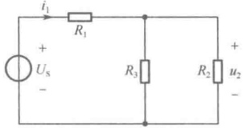

图4-1 单激励线性电阻电路
 

若令

$$  \left.\begin{array}{l}\alpha=\frac{R_{2}+R_{3}}{R_{1}R_{2}+R_{1}R_{3}+R_{2}R_{3}}\\ \beta=\frac{R_{2}R_{3}}{R_{1}R_{2}+R_{1}R_{3}+R_{2}R_{3}}\end{array}\right\}   \tag*{（4-2）}$$

由于  $ R_{1} $、 $ R_{2} $、 $ R_{3} $ 为常数，因此  $ \alpha $、 $ \beta $ 是由电路结构、电阻元件参数及激励和响应的种类、位置决定的常数。于是式（4-1）可表示为如下线性关系：

$$  \left.\begin{array}{l}{i_{\mathrm{l}}=\alpha U_{\mathrm{s}}}\\ {u_{2}=\beta U_{\mathrm{s}}}\end{array}\right\}   \tag*{(4-3)}$$

显然，若 $ U_{S} $增大K倍，则 $ i_{1} $、 $ u_{2} $也随之增大K倍，即在单激励线性电路中响应与激励成正比。这样的性质，在数学中称为齐次性，在电路理论中称为“比例性”，它是线性电路中响应与激励之间存在着线性关系中的“线性”在单激励线性电路中的表现形式。比例性是线性电路的一个基本性质，利用这个性质可以简化电路的计算。

下面再以图 4-2（a）所示的双输入（激励）电路为例来讨论在多输入（激励）线性电路中，响应与激励的关系又是如何表示的。

<!-- page: 94 -->

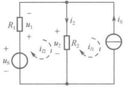

（a）原始电路
 

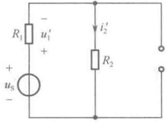

（b）电压源 $ u_{s} $单独激励电路
 

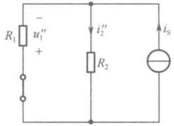

（c）电流源 $ I_{s} $单独激励电路
 

图 4-2 双激励线性电阻电路
 

对图 4-2（a）所示电路采用回路分析法求解电压响应  $ u_{1} $ 及电流响应  $ i_{2} $，设回路电流  $ i_{l1} $ 和  $ i_{l2} $ 如图 4-2（a）所示，列出回路电流方程为

$$  \left.\begin{array}{l l l}{l_{1}:}&{}&{\quad i_{l1}=-i_{\mathrm{S}}}\\ {}&{}&{}\\ {l_{2}:}&{}&{\quad-R_{2}i_{l1}+(R_{1}+R_{2})i_{l2}=u_{\mathrm{S}}}\\ \end{array}\right\}   \tag*{（4-4）}$$

求解得

$$  \left.\begin{aligned}u_{1}&=R_{1}i_{l2}=\frac{R_{1}}{R_{1}+R_{2}}u_{\mathrm{S}}-\frac{R_{1}R_{2}}{R_{1}+R_{2}}i_{\mathrm{S}}\\ i_{2}&=-i_{l1}+i_{l2}=\frac{1}{R_{1}+R_{2}}u_{\mathrm{S}}+\frac{R_{1}}{R_{1}+R_{2}}i_{\mathrm{S}}\end{aligned}\right\}   \tag*{(4-5)}$$

式（4-5）就是响应 $ u_{1} $及 $ i_{2} $与两个激励 $ u_{s} $、 $ i_{s} $之间的关系式。若令

$$  \left.\begin{aligned}\alpha_{1}&=\frac{R_{1}}{R_{1}+R_{2}}\\ \alpha_{2}&=-\frac{R_{1}R_{2}}{R_{1}+R_{2}}\\ \alpha_{3}&=\frac{1}{R_{1}+R_{2}}\\ \alpha_{4}&=\frac{R_{1}}{R_{1}+R_{2}}\end{aligned}\right\}   \tag*{(4-6)}$$

由于  $ R_{1} $ 、  $ R_{2} $ 为常数，因此  $ \alpha_{1} $ 、  $ \alpha_{2} $ 、  $ \alpha_{3} $ 、  $ \alpha_{4} $ 是由电路结构、电阻元件参数及激励和响应的种类、位置决定的常数。于是式（4-5）可表示为如下线性组合关系：

$$  \left.\begin{array}{l}u_{1}=\alpha_{1}u_{\mathrm{S}}+\alpha_{2}i_{\mathrm{S}}\\ i_{2}=\alpha_{3}u_{\mathrm{S}}+\alpha_{4}i_{\mathrm{S}}\end{array}\right\}   \tag*{(4-7)}$$

从式（4-7）可以看出，每一个响应都由两项组成，而每一项又只与某一个激励成比例。若令

$$  \left.\begin{aligned}&u_{1}^{^{\prime}}=\alpha_{1}u_{S}\\ &u_{1}^{^{\prime \prime}}=\alpha_{2}i_{S}\\ &i_{2}^{^{\prime}}=\alpha_{3}u_{S}\\ &i_{2}^{^{\prime \prime}}=\alpha_{4}i_{S}\\ \end{aligned}\right\}   \tag*{（4-8）}$$

式中， $ u_{1}^{\prime} $ 及  $ i_{2}^{\prime} $ 正比于  $ u_{S} $，可看作图 4-2（a）所示电路在  $ i_{S}=0 $ （电流源视为开路），仅由  $ u_{S} $ 单独作用时产生的响应，如图 4-2（b）所示； $ u_{1}^{\prime\prime} $ 及  $ i_{2}^{\prime\prime} $ 正比于  $ i_{S} $，可看作图 4-2（a）所示电路在  $ u_{S}=0 $ （电压源视为短路），仅由  $ i_{S} $ 单独作用时产生的响应，如图 4-2（c）所示。于是式（4-7）又可写为

<!-- page: 95 -->

$$  \left.\begin{array}{c}{u_{1}=u_{1}^{^{\prime}}+u_{1}^{^{\prime \prime}}}\\ {i_{2}=i_{2}^{^{\prime}}+i_{2}^{^{\prime \prime}}}\end{array}\right\}   \tag*{（4-9）}$$

式（4-9）表明：由两个激励共同作用于线性电路所产生的响应等于每一激励单独作用时产生的响应之和。这样的性质，在数学中称为“可加性”，在电路理论中称为“叠加性”，它是线性电路中响应与激励之间存在着线性关系中的“线性”在多激励线性电路中的表现形式，叠加性也是线性电路的一个基本性质，利用这个性质可以更进一步简化电路的计算。

线性电路的叠加性以叠加定理的形式来表达，其内容为：在任何由线性电阻、线性受控源及独立电源组成的电路中，每一元件的电流或电压可以看作每一个独立电源单独作用于电路时在该元件上所产生的电流或电压的代数和。

可以通过任意具有 b 条支路、n 个节点的电路来论述叠加定理的正确性。设电路各节点电压分别为  $ u_{n1}, u_{n2}, \cdots, u_{n(n-1)} $，则该电路的节点电压方程为

$$  \left.\begin{array}{c c c c c}G_{11}u_{n1}&+G_{12}u_{n2}&+\cdots+&G_{1(n-1)}u_{n(n-1)}&=&i_{\mathrm{S}11}\\ G_{21}u_{n1}&+G_{22}u_{n2}&+\cdots+&G_{2(n-1)}u_{n(n-1)}&=&i_{\mathrm{S}22}\\ \vdots&\vdots&\vdots&\vdots&\vdots\\ G_{(n-1)1}u_{n1}&+G_{(n-1)2}u_{n2}&+\cdots+&G_{(n-1)(n-1)}u_{n(n-1)}&=i_{\mathrm{S}(n-1)(n-1)}\end{array}\right\}   \tag*{（4-10）}$$

根据克莱姆法则，任一节点电压可表示为

$$  u_{nj}=\frac{\Delta_{1j}}{\Delta}i_{\mathrm{S}11}+\frac{\Delta_{2j}}{\Delta}i_{\mathrm{S}22}+\cdots+\frac{\Delta_{ij}}{\Delta}i_{\mathrm{S}ii}+\cdots+\frac{\Delta_{(n-1)j}}{\Delta}i_{\mathrm{S}(n-1)(n-1)},\ j=1,2,\cdots,n-1   \tag*{（4-11）}$$

式（4-11）中， $ \Delta $为方程组的系数行列式，它仅取决于电路的结构和电阻元件的参数； $ \Delta_{ij} $为 $ \Delta $中第i行第j列元素对应的代数余子式， $ i=1,2,\cdots,n-1 $， $ j=1,2,\cdots,n-1 $， $ \Delta_{ij}/\Delta $是具有电阻量纲的常数。 $ i_{Si} $是流入节点 $ n_i $的电流源电流（包括等效电流源电流）的代数和，可表示为

$$  i_{\mathrm{S}i i}=\sum_{n_{i}}i_{\mathrm{S}k}(G_{k}u_{\mathrm{S}k}),\quad i=1,2,\cdots,n-1   \tag*{（4-12）}$$

即  $ i_{Sii} $ 是与节点  $ n_{i} $ 相关的独立电源的线性组合，将式（4-12）代入式（4-11）中，就得到节点电压可表示为电路中所有激励源的线性组合。当电路中有 g 个电压源和 h 个电流源时，任一节点电压都可以写为以下形式：

$$  \begin{align*}u_{_{nj}}&=k_{_{j1}}u_{_{\mathrm{S}1}}+k_{_{j2}}u_{_{\mathrm{S}2}}+\cdots+k_{_{jg}}u_{_{\mathrm{S}g}}+r_{_{j1}}i_{_{\mathrm{S}1}}+r_{_{j2}}i_{_{\mathrm{S}2}}+\cdots+r_{_{jh}}i_{_{\mathrm{Sh}}}\\&=\sum_{m=1}^{g}k_{_{jm}}u_{_{\mathrm{Sm}}}+\sum_{m=1}^{h}r_{_{jm}}i_{_{\mathrm{Sm}}}\quad,\qquad j=1,2,\cdots,n-1\end{align*}   \tag*{（4-13）}$$

其中每一项又只与某一激励成比例，可看作该激励源单独作用于电路时产生的节点电压响应，故式（4-13）又可写为

$$  u_{n j}=u_{n j}^{^{\prime}}+u_{n j}^{^{\prime \prime}}+\cdots+u_{n j}^{(g)}+u_{n j}^{(g+1)}+\cdots+u_{n j}^{(g+h)},\qquad j=1,2,\cdots,n-1   \tag*{（4-14）}$$

上式表明，每一节点电压都可以看作电路中各个激励源分别单独作用时所产生的节点电压的代数和。由于支路电压通过KVL这一线性约束与节点电压联系在一起，因此支路电压也具有以上规律性；又因为每一支路电流与支路电压线性相关，所以电路中的电压或电流响应都可表示为所有激励源的线性组合，或者电路中各激励源分别单独作用时所产生的电压或电流的代数和。由此可见，对于任意线性电路而言，叠加定理总是成立的。

叠加定理是分析线性电路的基础，可用它来简化电路的计算。如图4-3所示，在分析计算多激励的复杂电路时，可先将这个复杂电路分解为多个分电路的组合，其中每一个分电路对应于一个电源或一组电源单独起作用，分别计算各分电路中的电流响应 $ i^{(k)} $或电压响应 $ u^{(k)} $，最后对各分

<!-- page: 96 -->

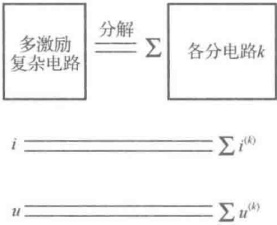

电路中的电流响应 $ i^{(k)} $或电压响应 $ u^{(k)} $求代数和，就得到原复杂电路中的电流响应i或电压响应u。由于各分电路中不起作用的电压源置零短路，不起作用的电流源置零开路，因此分电路的结构可能会变得很简单，求解也容易得多，这样就可通过对多个简单电路的计算代替原本复杂电路的计算。

图 4-3 叠加定理应用示意图
 

应用叠加定理求解电路，其实与科学研究中经常使用的分解与合成的方法是一致的。如高等数学中的泰勒级数、傅里叶级数等，其过程都是先分解后合成。分解是为了看清事物中每个单元的特点和作用，合成是为了表示每个单元共同作用后的总体特性。因此，将电路分解为各个分电路，从各个分电路的响应中可以看清各个电源单独作用时产生的响应情况，最后通过对各个分电路的响应求和进行合成，又可以得到所有电源共同作用时产生的响应情况。

在应用叠加定理时，应注意以下几点：

（1）叠加定理仅适用于线性电路，不适用于非线性电路。

（2）当令某一激励源单独作用时，其他激励源都不起作用，应置零，即不起作用的独立电压源置零用短路替代，不起作用的独立电流源置零用开路替代。

（3）电路中的受控源不能单独作用。因为受控源的电压或电流不是电路的激励，所以受控源与电阻元件一样要保留在各分电路中，并且要注意各分电路中控制量的变化情况。

（4）对各激励源单独作用产生的电流响应或电压响应叠加时要注意按参考方向求其代数和。

（5）在计算元件的功率时，应先用叠加定理计算出该元件上的总电压和总电流，再用 p=ui 计算出总的功率。

下面以图4-2所示电路为例说明功率的计算。设流过 $ R_{2} $的电流为 $ i_{2} $，其两端电压为 $ u_{2} $，根据叠加定理可分别表示为

 $$ i_{2}=i_{2}^{^{\prime}}+i_{2}^{^{\prime \prime}},\quad u_{2}=u_{2}^{^{\prime}}+u_{2}^{^{\prime \prime}} $$ 

 $ R_{2} $上的功率应为

 $$ p_{_{R_{2}}}=u_{_{2}}i_{_{2}}=(u_{_{2}}^{^{\prime}}+u_{_{2}}^{^{\prime \prime}})(i_{_{2}}^{^{\prime}}+i_{_{2}}^{^{\prime \prime}})=u_{_{1}}^{^{\prime}}i_{_{2}}^{^{\prime}}+u_{_{1}}^{^{\prime \prime}}i_{_{2}}^{^{\prime \prime \prime}}+u_{_{1}}^{^{\prime}}i_{_{2}}^{^{\prime \prime \prime}}+u_{_{1}}^{^{\prime \prime}}i_{_{2}}^{^{\prime \prime}}\neq u_{_{1}}^{^{\prime}}i_{_{2}}^{^{\prime \prime}}+u_{_{1}}^{^{\prime \prime}}i_{_{2}}^{^{\prime \prime \prime}} $$ 

由此可见，原电路的功率不等于按各分电路计算所得的功率的叠加。如果直接用叠加定理来计算，将失去“交叉乘积”项，即由一个电源所产生的电压与由另一个电源所产生的电流相互作用所产生的功率项。

例 4-1 如图 4-4（a）所示电路，试用叠加定理求电压 U。

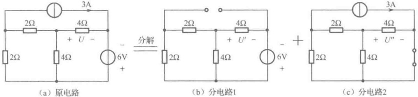

（b）分电路1
 

(c) 分电路2
 

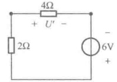

(d) 分电路1的等效电路
 

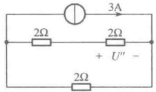

（e）分电路2的等效电路
 

图4-4 例4-1图
 

<!-- page: 97 -->

解：当 6V 电压源单独作用于电路时，如图 4-4（b）分电路 1 所示，等效化简为图 4-4（d），求得

 $$ U^{\prime}=\frac{4}{2+4}\times6=4V $$ 

当3A电流源单独作用于电路时，如图4-4（c）分电路2所示，等效化简为图4-4（e），求得

 $$ U^{\prime \prime}=-2\times\frac{2}{(2+2)+2}\times3=-2V $$ 

根据叠加定理，可得

 $$ U=U^{\prime}+U=4-2=2V $$ 

例4-2 如图4-5（a）所示的电路，求电流i、电压u和2Ω电阻消耗的功率 $ p_{2\Omega} $。

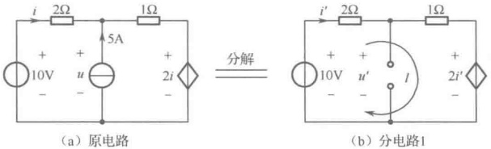

（b）分电路1
 

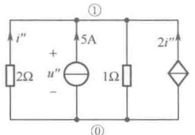

（d）分电路2的等效电路
 

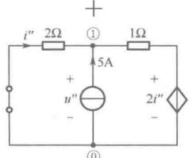

（c）分电路2
 

图4-5 例4-2图
 

解：应用叠加定理求解 i 及 u 。图 4-5（a）分解为两个分电路之和，如图 4-5（b）、（c）所示。当 10V 电压源单独作用于电路时，如图 4-5（b）分电路 1 所示，对回路 l 列出 KVL 方程有

 $$ (2+1)i^{\prime}+2i^{\prime}=10 $$ 

解得

 $$ i^{\prime}=2\mathrm{A},\quad u^{\prime}=1\times i^{\prime}+2i^{\prime}=6\mathrm{V} $$ 

当 5A 电流源单独作用于电路时，如图 4-5（c）分电路 2 所示，经等效变换为图 4-5（d），应用节点分析法列出节点电压方程有

 $$ \left(\frac{1}{2}+\frac{1}{1}\right)u_{n1}=5+2i^{n} $$ 

控制量用节点电压表示

 $$ i^{\prime \prime}=-\frac{u_{n1}}{2} $$ 

联立求解得

 $$ u_{n1}=2\mathrm{V},\quad i^{\prime \prime}=-1\mathrm{A},\quad u^{\prime \prime}=u_{n1}=2\mathrm{V} $$ 

根据叠加定理，可得

 $$ i=i^{\prime}+i^{\prime \prime}=2-1=1A\text{，}u=u^{\prime}+u^{\prime \prime}=6+2=8V $$ 

2 $ \Omega $ 电阻消耗的功率

 $$ p_{2\Omega}=2i^{2}=2\mathrm{W} $$ 

在求解过程中，既应用了叠加定理，又运用了含源支路等效变换及节点分析法，使电路问题的求解过程更加简捷。

例 4-3 如图 4-6（a）所示的电路，试用叠加定理求电流 i。

 $$ u_{S} $$ 

 $$ i_{1}^{\prime}=\frac{u_{\mathrm{s}}}{2}=\frac{2}{2}=1\mathrm{A},\quad i^{\prime}=5i_{1}^{\prime}=5\times1=5\mathrm{A} $$

<!-- page: 98 -->

当 $ i_{s} $单独作用于电路时，如图4-6（c）分电路2所示，求得

 $$ i_{1}^{~}^{\prime\prime}=0~,\quad5i_{1}^{~}^{\prime\prime}=0~,\quad i^{\prime\prime}=-i_{\mathrm{S}}=-1\mathrm{A} $$ 

根据叠加定理，可得

 $$ i=i^{\prime}+i^{\prime \prime}=5-1=4A $$ 

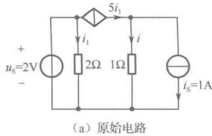

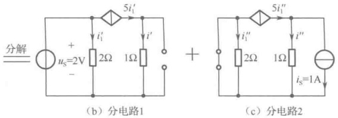

图4-6 例4-3图
 

例 4-4 如图 4-7 所示的电路，其中  $ N_0 $ 为线性电阻网络。已知当  $ u_S = 4V $， $ i_S = 1A $ 时， $ u = 0 $；当  $ u_S = 2V $， $ i_S = 0 $ 时， $ u = 1V $。试求当  $ u_S = 10V $， $ i_S = 1.5A $ 时， $ u $ 为多少？

解：该电路中只有两个独立电源，根据叠加定理，响应是各激励源的线性组合，应有

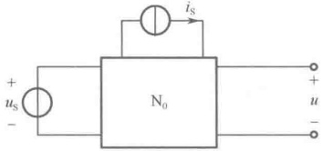

图4-7 例4-4图
 

 $$ u=\alpha_{1}u_{S}+\alpha_{2}i_{S} $$ 

代入已知条件，得

解得

 $$ \left\{\begin{aligned}4\times\alpha_{1}+1\times\alpha_{2}&=0\\ 2\times\alpha_{1}+0\times\alpha_{2}&=1\end{aligned}\right. $$ 

 $$ \alpha_{1}=\frac{1}{2},\alpha_{2}=-2 $$ 

最后得

 $$ u=\alpha_{1}u_{S}+\alpha_{2}i_{S}=\frac{1}{2}\times10+(-2)\times1.5=2V $$ 

### 4.2 替代定理

替代定理是集中参数电路理论中很重要的一个定理。从理论上讲，对具有唯一解的任何电路（线性或非线性），替代定理都是成立的，不过在线性电路的分析中，替代定理应用得更加普遍。

替代定理叙述如下：给定任意一个具有唯一解的线性电阻电路，若其中第 k 条支路的电压  $ u_{k} $ 和电流  $ i_{k} $ 已知，那么这条支路就可以用大小和方向与  $ u_{k} $ 相同的电压源替代，或用大小和方向与  $ i_{k} $ 相同的电流源替代，而对整个电路的各个电压、电流不产生影响，即替代后电路中全部电压和电流均将保持原值。

图 4-8 为替代定理示意图，其中第 k 条支路可以认为是一个广义支路，它可以是无源支路，也可以是含源支路（如电压源和电阻的串联支路，或电流源和电阻的并联支路），还可以是无源单口网络、含源单口网络，甚至还可以是非线性元件支路或动态元件支路。如果第 k 条支路是单口网络，其内部受控源的控制量应不在 N 内，同理，N 内受控源的控制量也应不在该单口网络内，即作为 k 条支路的单口网络与电路的其他部分不应有电耦合关系。

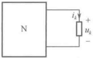

(a)
 

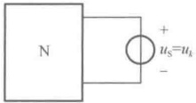

(b)
 

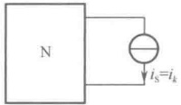

(c)
 

图 4-8 替代定理示意图
 

<!-- page: 99 -->

如果某支路的电压 u 和电流 i（设为关联参考方向）均已知，则该支路也可用电阻值 R = u/i 的电阻替代。

替代定理的一般性证明较烦琐，可以用如图 4-9 所示的特性曲线给出直观性说明。如果第 k 条支路用  $ u_{s}=u_{k} $ 电压替代，其特性曲线为一条平行于 i 轴的直线；如果第 k 条支路用  $ i_{s}=i_{k} $ 电流源替代，其特性曲线为一条平行于 u 轴的直线。在 u-i 平面上，两种替代元件的特性曲线都经过点  $ (i_{k},u_{k}) $，而 k 支路的特性曲线也必将通过这一点，因此，对特性曲线上这一特定的点  $ (i_{k},u_{k}) $，替代是有效的、正确的，它保证了第 k 条支路端口伏安特性在特定的点  $ (i_{k},u_{k}) $ 上保持不变，从而保证了 N 内的电压、电流不变。

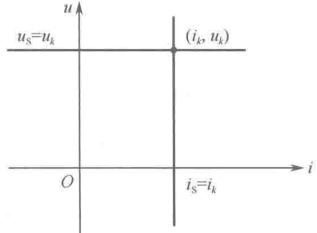

图 4-9 替代定理正确性的直观性说明图
 

替代定理的正确性还可以用以下简单的事实来说明。对给定的具有唯一解的线性电阻电路，可以列出回路电流方程或节点电压方程，而第 k 条支路的电压或电流必然会以回路电流形式（或以节点电压形式）出现在电路方程中，现将第 k 条支路的已知电压或电流用电压源或电流源替代后，相当于将电路方程中某未知量用其解替代，这样肯定不会引起方程中其他未知量的解在数值上的改变。

图 4-10 为替代定理应用的实例。对图 4-10（a）所示电路，先应用节点分析法计算支路电压  $ u_{3} $ 和支路电流  $ i_{1} $、 $ i_{2} $、 $ i_{3} $，列出节点电压为

 $$ \left(\frac{1}{1}+\frac{1}{2}\right)u_{n1}=8-\frac{4}{2} $$ 

解得

 $$ u_{3}=u_{n1}=4\mathrm{V},\quad i_{1}=8\mathrm{A},\quad i_{2}=\frac{u_{3}}{1}=\frac{4}{1}=4\mathrm{A},\quad i_{3}=i_{1}-i_{2}=4\mathrm{A} $$ 

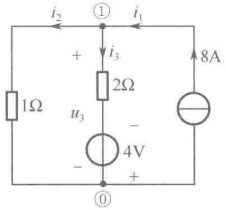

(a)
 

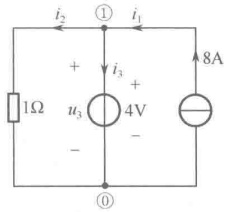

（b）
 

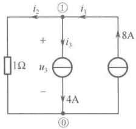

(c)
 

图 4-10 替代定理应用示例
 

（1）将4V与2 $ \Omega $串联的支路用4V独立电压源替代，如图4-10（b）所示，由该图可求得

 $$ u_{3}=4\mathrm{V},\quad i_{1}=8\mathrm{A},\quad i_{2}=\frac{u_{3}}{1}=\frac{4}{1}=4\mathrm{A},\quad i_{3}=i_{1}-i_{2}=4\mathrm{A} $$ 

（2）将4V与2 $ \Omega $串联的支路用4A独立电流源替代，如图4-10（c）所示，由该图可求得

 $$ i_{1}=8\mathrm{A},\quad i_{3}=4\mathrm{A},\quad i_{2}=i_{1}-i_{3}=4\mathrm{A},\quad u_{3}=1\times i_{2}=4\mathrm{V} $$ 

可见，在两种替代后的电路中，所计算出的支路电压  $ u_{3} $ 和支路电流  $ i_{1} $、 $ i_{2} $、 $ i_{3} $ 与替代前的原电路是完全相同的。

例 4-5 如图 4-11（a）所示电路，已知 i=10A，试求电压 u。

解：根据替代定理，可将含源单口网络  $ N_{s} $ 用 10A 电流源替代，如图 4-11（b）所示，注意电流源的参考方向应与 i 给定方向相同。设定参考节点，列出节点电压方程为

<!-- page: 100 -->

$$ \left(\frac{1}{2}+\frac{1}{6}+\frac{1}{3}\right)u_{n1}=\frac{40}{2}-\frac{30}{3}+10 $$ 

解得

 $$ u=u_{n1}=20\mathrm{V} $$ 

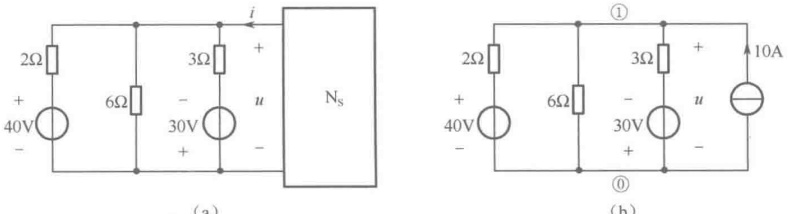

(a)
 

(b)
 

图4-11 例4-5图
 

替代定理的用途很多，在推导其他线性电路定理时可能会用到，也可用它对电路进行化简，从而使电路易于分析或计算。在非线性电路分析中，若确定了非线性元件上的电压、电流响应，代之以电压源或电流源，则电路中其他的电压、电流响应的分析计算便可按线性电路处理。同理，在动态电路分析中，若确定了动态元件上的电压、电流响应，代之以电压源或电流源，则电路中其他的电压、电流响应的分析计算便可按线性电阻电路处理。

值得注意的是，虽然“替代”与第2章的“等效变换”都简化了电路分析，但它们是两个不同的概念。“替代”是在给定被替代部分以外的电路的情况下，用独立电源替代已知端口电压或电流的单口网络，如果被替代部分以外的电路发生变化，相应的被替代的单口网络的电压或电流也随之发生变化，这样，对于不同的外电路，替代单口网络的独立电源值是不同的。因此，替代的电压源或电流源是依赖于外电路的，它们只对特定已知的外电路有效；而“等效变换”是两个具有相同外特性的单口网络之间的相互置换，与变换以外的电路无关。等效电路对任意外电路都有效，而不是对某一特定的外电路有效。因此，等效电路是独立于外电路的。

### 4.3 戴维宁定理和诺顿定理

在第 2 章中描述了电阻电路的等效变换问题，通过求出单口网络的外特性方程，由等效的定义来构造其等效电路，并形成这样一个共识：对于任何一个含电阻和受控源的无源单口网络  $ N_{0} $，其等效电路为一个电阻支路。那么对一个既含独立电源又含电阻和受控源的含源单口网络  $ N_{s} $，它的最简等效电路是什么形式呢？用什么方法可以既方便又快捷地求出最简等效电路呢？下面介绍的戴维宁定理和诺顿定理圆满地回答了这些问题。

戴维宁定理是法国电报工程师 L. C. Thevenin 于 1883 年提出的，其内容为：任何一个含源单口网络  $ N_s $，对外电路而言，可以用一个电压源和电阻串联的支路作为等效电路。其电压源电压等于含源单口网络  $ N_s $ 的开路电压  $ u_{oc} $，其串联电阻等于将含源单口网络  $ N_s $ 内全部独立电源置零时所得的无源单口网络  $ N_0 $ 的等效电阻  $ R_{eq} $。戴维宁定理可用图 4-12 表示。

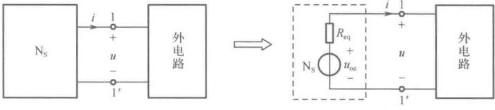

(b)
 

图 4-12 戴维宁定理示意图
 

<!-- page: 101 -->

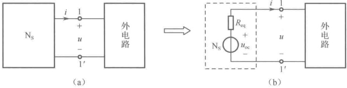

图4-12 戴维宁定理示意图（续）
 

图4-12（b）中的电压源 $ u_{oc} $与电阻 $ R_{eq} $串联支路被称为戴维宁等效电路。

诺顿定理是在戴维宁定理发表50年后由美国贝尔实验室工程师E.L.Norton提出的，其内容为：任何一个含源单口网络 $ N_{s} $，对外电路而言，可以用一个电流源和电阻并联的支路作为等效电路。其电流源电流等于含源单口网络 $ N_{s} $的短路电流 $ i_{sc} $，其并联电阻等于将含源单口网络 $ N_{s} $内全部独立电源置零时所得无源单口网络 $ N_{0} $的等效电阻 $ R_{eq} $。诺顿定理可用图4-13表示。

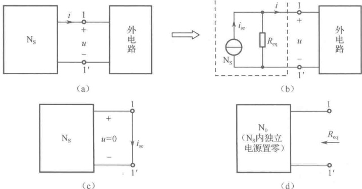

图 4-13 诺顿定理示意图
 

图4-13（b）中的电流源 $ i_{sc} $与电阻 $ R_{eq} $并联支路被称为诺顿等效电路。

戴维宁定理和诺顿定理都可用替代定理和叠加定理来证明。

对图4-12（b）的戴维宁等效电路而言，其端口1-1'的外特性方程为

$$  u=u_{oc}-R_{eq}i   \tag*{（4-15）}$$

因此，根据等效的概念，只需证明含源单口网络  $ N_s $ 端口 1-1' 的外特性方程与式（4-15）完全相同，即可证明戴维宁定理是成立的。

对图 4-12（a）所示的电路，根据替代定理可将外电路用电流源 i 替代，得到图 4-14（a）所示电路。根据叠加定理，电压 u 可以看成仅由  $ N_s $ 内所有独立电源作用 [电流源 i 置零用开路代替，见图 4-14（b）] 产生的电压  $ u' $ 与电流源 i 单独作用  $ [N_s $ 内所有独立电源置零， $ N_s $ 变为  $ N_0 $，见图 4-14（c）] 产生的电压  $ u'' $ 之和，即

$$  u=u^{\prime}+u^{\prime \prime}   \tag*{（4-16）}$$

由图4-14（b）可见， $ u' $ 就是  $ N_s $ 的开路电压  $ u_{oc} $，即

$$  u^{\prime}=u_{oc}   \tag*{(4-17)}$$

由图 4-14（c）可见，单口网络  $ N_0 $ 可等效为一个电阻  $ R_{eq} $， $ i'' = i_S = i $ 且  $ u'' $ 与  $ i $ 对  $ N_0 $ 而言取非关联参考方向，因此，根据欧姆定律，有

<!-- page: 102 -->

$$  u^{}=-R_{eq}i   \tag*{（4-18）}$$

将 $ u' $、 $ u'' $代入式（4-16）中，得含源单口网络 $ N_{s} $端口1-1'的外特性方程为

$$  u=u_{oc}-R_{eq}i   \tag*{(4-19)}$$

式（4-19）与式（4-15）完全相同，从而戴维宁定理得证。

诺顿定理的证明过程与戴维宁定理的证明过程相似，这里不再叙述。

一般而言，含源单口网络  $ N_{s} $ 的戴维宁等效电路和诺顿等效电路都存在。根据含源支路的等效变换，戴维宁等效电路与诺顿等效电路之间又可以进行等效变换，如图4-15所示。

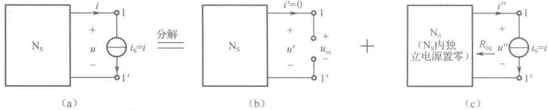

图4-14 戴维宁定理的证明图示
 

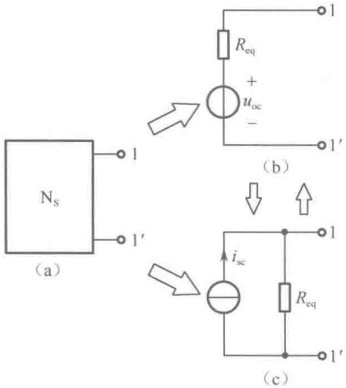

开路电压 $ u_{oc} $、短路电流 $ i_{sc} $和等效电阻 $ R_{eq} $三者之间的关系为

$$  i_{sc}=\frac{u_{oc}}{R_{eq}}   \tag*{(4-20)}$$

或

$$  u_{oc}=R_{eq}i_{sc}   \tag*{（4-21）}$$

图 4-15 戴维宁等效电路与诺顿等效电路的等效变换
 

从而

$$  R_{eq}=\frac{u_{oc}}{i_{sc}}   \tag*{（4-22）}$$

式（4-22）给出了求 $ R_{eq} $的另一种方法，这种方法简称为开路短路法。

如果含源单口网络  $ N_{s} $ 内部仅有独立电源和电阻，没有受控源，则戴维宁等效电路或诺顿等效电路可由第2章所述的方法逐步等效化简得到。

 $$ \mathrm{N}_{\mathrm{s}} $$ 

 $$ \mathrm{N}_{s} $$ 

电阻  $ R_{eq} $ 有可能为零或无限大。如果  $ R_{eq} = 0 $ 而开路电压  $ u_{oc} $ 为有限值，此时含源单口网络  $ N_S $ 存在戴维宁等效电路且仅为单一电压源支路，但因  $ G_{eq} $ 与  $ i_{sc} $ 均趋于无限大，故不存在诺顿等效电路。如果求得  $ R_{eq} $ 为无限大（或  $ G_{eq} = 0 $）而短路电流  $ i_{sc} $ 为有限值，此时含源单口网络  $ N_S $ 存在诺顿等效电路且仅为单一电流源支路，但因  $ R_{eq} $ 与  $ u_{oc} $ 均趋于无限大，故不存在戴维宁等效电路。

 $$ \mathrm{N}_{0} $$ 

应用戴维宁定理和诺顿定理的关键是求出含源单口网络  $ N_{s} $ 的开路电压  $ u_{oc} $ （或短路电流  $ i_{sc} $）和等效电阻  $ R_{eq} $ 。有很多方法可用来计算  $ u_{oc} $ 或  $ i_{sc} $，而求解  $ R_{eq} $ 的方法灵活多样，下面对求  $ R_{eq} $ 的方法做以下归纳：

（1）等效变换法 若含源单口网络  $ N_{s} $ 中无受控源，当  $ N_{s} $ 内所有独立电源置零时所得到的  $ N_{0} $ 将是一个纯电阻电路，大多数情况下，利用电阻的串并联关系逐步等效化简，可非常方便地求出  $ R_{eq} $ 。若遇到电阻的 Y、 $ \triangle $形连接，可先进行 Y- $ \triangle $等效互换，再利用电阻的串并联关系求出  $ R_{eq} $ 。

（2）外施电源法 若含源单口网络  $ N_{s} $ 中含受控源，当  $ N_{s} $ 内所有独立电源置零时所得到的  $ N_{0} $ 将含有受控源，这时只能用求输入电阻的方法（外施电源法）求其等效电阻，如图4-16所示。在

<!-- page: 103 -->

u 与 i 对  $ N_{0} $ 取关联参考方向的条件下， $ N_{0} $ 的输入电阻  $ R_{in} $ 为

 $$ R_{\mathrm{in}}=\frac{u}{i}=R_{\mathrm{eq}} $$ 

（3）开路短路法 求出  $ N_{s} $ 的开路电压  $ u_{oc} $ 和短路电流  $ i_{sc} $ （注意  $ u_{oc} $ 和  $ i_{sc} $ 参考方向的设定），根据式（4-22），有

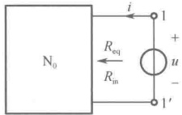

 $$ R_{eq}=\frac{u_{oc}}{i_{sc}} $$ 

图 4-16 外施电源法求  $ R_{eq} $ 图示
 

应用戴维宁定理和诺顿定理时还应注意以下问题：

（1）所要等效的含源单口网络  $ N_{s} $ 必须为线性电路，因为在证明戴维宁定理和诺顿定理时用到了叠加定理。至于外电路则没有限制，它甚至可以是非线性电路。

（2）在将整个电路分解为含源单口网络  $ N_{s} $ 与外电路两部分的组合时，要注意这两部分内的受控源的控制量可以是公共端口上的电压或电流，但不能是相互内部的电压或电流。

在电路分析中，有时只需要分析求解电路中某一支路的电压、电流或功率。这时应用戴维宁定理（或诺顿定理）会很有效。具体操作方法是：将电路中除这条支路以外的其余部分看成一个含源单口网络 $ N_{s} $，求出其戴维宁等效电路（或诺顿等效电路），最后由等效电路可方便快捷地得出待求支路的电压、电流和功率。下面举例进一步说明戴维宁定理和诺顿定理的应用。

例 4-6 如图 4-17（a）所示电路，试用诺顿定理求电流 i。

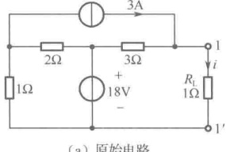

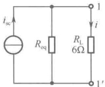

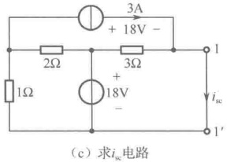

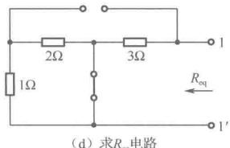

图4-17 例4-6图
 

解：根据诺顿定理，图4-17（a）所示电路中除 $ R_{L} $之外，其余部分所构成的含源单口网络 $ N_{s} $可以等效化简为诺顿等效电路，如图4-17（b）所示。

为求得 $ i_{sc} $，应将该含源单口网络 $ N_{s} $的1-1'短路，如图4-17（c）所示，显然，有

 $$ i_{sc}=3+18/3=9A $$ 

为求得  $ R_{eq} $，应将该含源单口网络  $ N_S $ 内部的独立电压源置零用短路替代，独立电流源置零用开路替代，得到无源单口网络  $ N_0 $ 如图 4-17（d）所示。显然，有

 $$ R_{eq}=3\Omega $$ 

最后，由图4-17（b）可求得电流  $ i=\frac{R_{\mathrm{eq}}}{R_{\mathrm{eq}}+R_{\mathrm{L}}}i_{\mathrm{sc}}=\frac{3}{3+6}\times9=3A $

<!-- page: 104 -->

例 4-7 如图 4-18（a）所示电路，试用戴维宁定理求  $ U_{0} $

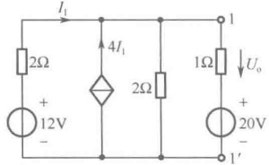

（a）原始电路
 

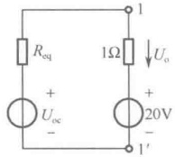

（b）等效电路
 

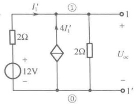

(c) 求 $ U_{oc} $电路
 

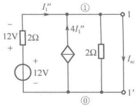

(d) 求 $ I_{x} $电路
 

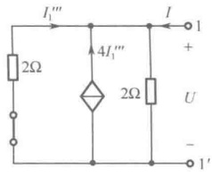

(e) 求 $ R_{eq} $电路
 

图4-18 例4-7图
 

解：根据戴维宁定理，图4-18（a）所示电路中1-1′端口左边部分所构成的含源单口网络 $ N_{s} $可以化简为戴维宁等效电路，如图4-18（b）所示。

求 $ u_{oc} $ 的电路如图4-18（c）所示，列写出节点电压方程为

 $$ \left(\frac{1}{2}+\frac{1}{2}\right)U_{n1}=\frac{12}{2}+4I_{1}^{\prime} $$ 

控制量用节点电压表示

 $$ I_{1}^{^{\prime}}=\frac{12-U_{n1}}{2} $$ 

联立求解得

 $$ U_{oc}=U_{n1}=10V $$ 

求 $ I_{sc} $ 的电路如图4-18（d）所示，显然有

 $$ I_{1}^{^{\prime \prime}}=\frac{12}{2}=6A,\quad I_{sc}=I_{1}^{^{\prime \prime}}+4I_{1}^{^{\prime \prime}}=5I_{1}^{^{\prime \prime}}=30A $$ 

根据开路短路法，可求得等效电阻  $ R_{eq} $ 为

 $$ R_{eq}=\frac{U_{oc}}{I_{sc}}=\frac{10}{30}=\frac{1}{3}\Omega $$ 

等效电阻  $ R_{eq} $ 还可以由图 4-18（e），用外施电源法求出。对图 4-18（e）列写出电路方程，有

 $$ I=-I_{1}^{m}-4I_{1}^{m}+\frac{U}{2} $$ 

 $$ I_{1}^{m}=-\frac{U}{2}\quad\left\{\begin{array}{l}\end{array}\right. $$ 

联立求解得

 $$ R_{eq}=\frac{U}{I}=\frac{1}{3}\Omega $$ 

最后，由图4-18（b）可求得电压

 $$ U_{o}=\frac{U_{oc}-20}{R_{eq}+1}\times1=\frac{10-20}{\frac{1}{3}+1}\times1=-\frac{30}{4}\mathrm{V} $$

<!-- page: 105 -->

### 4.4 最大功率传输定理

在实际电子电路中，常常要求负载电阻  $ R_{L} $ 从给定的线性含源单口网络  $ N_{s} $ 中获得最大功率，这就是最大功率传输问题。

如图4-19（a）所示，给定的一线性含源单口网络 $ N_s $，接在它两端的负载电阻 $ R_L $不同，从含源单口网络 $ N_s $传输给负载电阻 $ R_L $的功率也不同。在什么条件下，负载电阻 $ R_L $能得到的功率为最大呢？为了分析方便，应用戴维宁定理或诺顿定理对含源单口网络 $ N_s $进行等效化简，如图4-19（b）、（c）所示。由于含源单口网络 $ N_s $内部的电路结构和元件参数是确定的，因此戴维宁等效电路（或诺顿等效电路）中的 $ u_{oc} $（或 $ i_{sc} $）和 $ R_{eq} $为定值。负载电阻 $ R_L $所吸收的功率 $ p_L $只随电阻 $ R_L $的变化而变化。

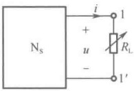

(a)
 

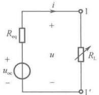

（b）
 

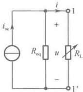

(c)
 

图 4-19 最大功率传输图示
 

由图4-19（b），可写出 $ R_{L} $为任意值时的功率 $ p_{L} $

$$  p_{\mathrm{L}}=R_{\mathrm{L}}i^{2}=R_{\mathrm{L}}\left(\frac{u_{\mathrm{oc}}}{R_{\mathrm{eq}}+R_{\mathrm{L}}}\right)^{2}=f(R_{\mathrm{L}})   \tag*{(4-23)}$$

要使  $ p_{L} $ 为最大，应使  $ \frac{dp_{L}}{dR_{L}} = 0 $，即

$$  \frac{\mathrm{d}p_{\mathrm{L}}}{\mathrm{d}R_{\mathrm{L}}}=u_{\mathrm{oc}}^{2}\left[\frac{\left(R_{\mathrm{eq}}+R_{\mathrm{L}}\right)^{2}-2\left(R_{\mathrm{eq}}+R_{\mathrm{L}}\right)R_{\mathrm{L}}}{\left(R_{\mathrm{eq}}+R_{\mathrm{L}}\right)^{4}}\right]=u_{\mathrm{oc}}^{2}\frac{\left(R_{\mathrm{eq}}-R_{\mathrm{L}}\right)}{\left(R_{\mathrm{eq}}+R_{\mathrm{L}}\right)^{3}}=0   \tag*{(4-24)}$$

由此可得

$$  R_{L}=R_{eq}   \tag*{(4-25)}$$

又由于

$$  \frac{\mathrm{d}^{2}p_{\mathrm{L}}}{\mathrm{d}R_{\mathrm{L}}^{2}}\bigg|_{R_{\mathrm{L}}=R_{\mathrm{eq}}}=-\frac{u_{\mathrm{oc}}^{2}}{8R_{\mathrm{eq}}^{3}}<0   \tag*{(4-26)}$$

因此，式（4-25）即为使  $ p_{L} $ 为最大的条件。因此，由线性含源单口网络  $ N_{s} $ 传输给可变负载电阻  $ R_{L} $ 的功率为最大的条件是：负载电阻  $ R_{L} $ 与戴维宁（或诺顿）等效电阻  $ R_{eq} $ 相等。此即最大功率传输定理。满足  $ R_{L} = R_{eq} $ 时，称为最大功率匹配，此时负载电阻  $ R_{L} $ 所获得的最大功率为

$$  p_{L max}=\frac{u_{oc}^{2}}{4R_{eq}}   \tag*{(4-27)}$$

如用诺顿等效电路，因 $ u_{oc}=R_{eq}i_{sc} $，则 $ p_{Lmax}=\frac{i_{sc}^{2}}{4}R_{eq} $

在分析计算从给定电源向负载传输功率时，还有一个传输效率问题。对于通信系统和测量系统，往往着眼于传输功率的大小问题，即如何从给定的信号源（产生通信信号或测量信号的“源”）获得尽可能大的信号功率。而对于交、直流电力传输网络，传输的电功率巨大，使得传输引起的

<!-- page: 106 -->

损耗、传输效率成为首要考虑的问题。下面分别从含源单口网络 $ N_{s} $内部独立电源及戴维宁等效电路中等效电压源两种角度来定义在负载电阻获得最大功率时的传输效率。

由图 4-20（a），含源单口网络  $ N_{s} $ 内部独立电源发出的功率可表示为

$$  p_{S}=p_{R}+p_{L max}   \tag*{(4-29)}$$

式（4-29）中  $ p_{R} $ 表示  $ N_{s} $ 内部消耗的功率，这时传输效率为

$$  \eta_{s}=\frac{p_{Lmax}}{p_{s}}\times100\%   \tag*{(4-30)}$$

由图4-20（b），含源单口网络 $ N_{s} $的戴维宁等效电路中等效电压源 $ u_{oc} $发出的功率可表示为

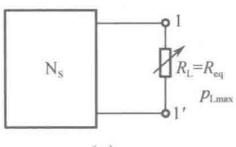

 $$ p_{u_{oc}}=p_{R_{eq}}+p_{L_{max}}=2p_{L_{max}} $$ 

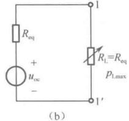

这时传输效率为

图 4-20 两种传输效率图示
 

$$  \eta_{u_{oc}}=\frac{p_{Lmax}}{p_{u_{oc}}}\times100\%=50\%   \tag*{(4-32)}$$

由于含源单口网络  $ N_S $ 和它的戴维宁等效电路就其内部功率而言是不等效的，即  $ p_R \neq p_{R_{eq}} $，因此  $ \eta_S \neq \eta_{u_{oc}} $。

例4-8 如图4-21（a）所示电路。

（1）求 $ R_{L} $获得最大功率时的值；

（2）当 $ R_{L} $获得最大功率时，求9V电压源传输给负载 $ R_{L} $的功率传输效率 $ \eta_{s} $为多少？

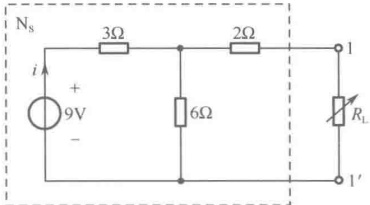

（a）原始电路
 

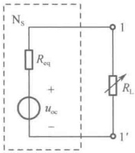

（b）等效电路
 

图4-21 例4-8图
 

解：（1）求 $ N_{s} $的戴维宁等效电路。由图4-21（a），容易得

 $$ u_{oc}=\frac{6}{6+3}\times9=6V,\quad R_{eq}=\frac{3\times6}{3+6}+2=4\Omega $$ 

根据最大功率传输定理，当  $ R_{L}=R_{eq}=4\Omega $ 时， $ R_{L} $ 可获得最大功率，其最大功率为

 $$ p_{L max}=\frac{u_{oc}^{2}}{4R_{eq}}=\frac{6^{2}}{4\times4}=\frac{9}{4}W $$ 

这时等效电压源 $ u_{oc} $ 传输给负载 $ R_{L} $ 的功率传输效率为

 $$ \eta_{u_{oc}}=\frac{P_{Lmax}}{P_{u_{oc}}}\times100\%=50\% $$ 

（2）当 $ R_{L}=R_{eq}=4\Omega $时，由图4-21（a），容易求出9V电压源上的电流为

 $$ i=\frac{9}{3+\frac{6\times(2+4)}{6+(2+4)}}=\frac{3}{2}A $$

<!-- page: 107 -->

所以 9V 电压源发出的功率为

 $$ p_{s}=9\times i=9\times\frac{3}{2}=\frac{27}{2}W $$ 

这时 9V 电压源传输给负载  $ R_{L} $ 的功率传输效率为

 $$ \eta_{s}=\frac{p_{L\max}}{p_{s}}\times100\%=\frac{9/4}{27/2}\times100\%=16.6\% $$ 

例 4-9 如图 4-22（a）所示电路，设负载  $ R_{L} $ 可变，问  $ R_{L} $ 为多大时，它可获得最大功率？此时最大功率  $ p_{L\max} $ 为多少？

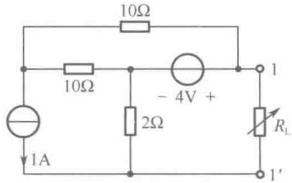

（a）原始电路
 

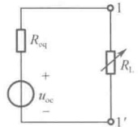

（b）等效电路
 

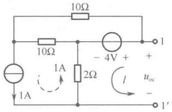

(c) 求  $ u_{oc} $ 电路
 

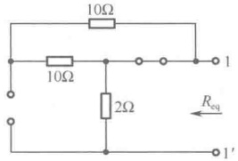

（d）求 $ R_{eq} $电路
 

图4-22 例4-9图
 

解：将图4-22（a）所示电路中除 $ R_{L} $以外的含源单口网络 $ N_{s} $等效化简为戴维宁等效电路，如图4-22（b）所示。由图4-22（c），容易得

 $$ u_{oc}=4-2\times1=2V $$ 

由图4-22（d），容易得

 $$ R_{eq}=2\Omega $$ 

根据最大功率传输定理，当  $ R_{L}=R_{eq}=2\Omega $ 时， $ R_{L} $ 可获得最大功率，其最大功率为

 $$ p_{\mathrm{Lmax}}=\frac{u_{\mathrm{oc}}^{2}}{4R_{\mathrm{eq}}}=\frac{2^{2}}{4\times2}=\frac{1}{2}\mathrm{W} $$ 

例 4-10 在图 4-23（a）所示的电路中，问  $ R_{L} $ 为何值时，它可获得最大功率，并求此最大功率。

解：将图4-23（a）所示电路中除 $ R_{L} $以外的含源单口网络 $ N_{s} $等效化简为戴维宁等效电路，如图4-23（b）所示。为了方便求解，首先将 $ N_{s} $内 $ 4i_{1} $与50Ω电阻的并联支路等效变换为 $ 200i_{1} $与50Ω电阻的串联支路，如图4-23（c）所示。

求 $ u_{oc} $电路如图4-23（d）所示，对回路l应用KVL，有

解得

 $$ \begin{aligned}&(50+50+100)i_{1}^{^{\prime}}=40-200i_{1}^{^{\prime}}\\&i_{1}^{^{\prime}}=0.1A,\quad u_{oc}=100i_{1}^{^{\prime}}=10V\\ \end{aligned} $$ 

求 $ i_{sc} $电路如图4-23（e）所示，容易得

 $$ i_{1}^{^{\prime \prime}}=0\ ,\quad200i_{1}^{^{\prime \prime}}=0\ ,\quad i_{sc}=\frac{40}{50+50}=0.4A $$ 

利用开路短路法，求得等效电阻 $ R_{eq} $为

<!-- page: 108 -->

$$ R_{eq}=\frac{u_{oc}}{i_{sc}}=\frac{10}{0.4}=25\Omega $$ 

根据最大功率传输定理，当  $ R_{L}=R_{eq}=25\Omega $ 时， $ R_{L} $ 可获得最大功率，其最大功率为

 $$ p_{Lmax}=\frac{u_{oc}^{2}}{4R_{eq}}=\frac{10^{2}}{4\times25}=1W\quad 或 \quad p_{Lmax}=\frac{i_{sc}^{2}}{4}R_{eq}=\frac{0.4^{2}}{4}\times25=1W $$ 

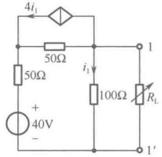

（a）原始电路
 

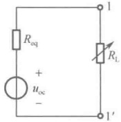

（b）最简等效电路
 

（c）等效电路
 

(d) 求  $ u_{oc} $
 

(e) 求 $ i_{sc} $电路
 

图4-23 例4-10图
 

### 4.5 特勒根定理

特勒根定理是在基尔霍夫定律的基础上发展起来的一个重要的网络定理，它在电路理论、电路的灵敏度分析和计算机辅助设计中有着广泛的应用。特勒根定理有两种形式。

#### 4.5.1 特勒根定理 I

特勒根定理 I：对于任意一个具有 b 条支路、n 个节点的集中参数电路 N，设各支路电压、电流分别为  $ u_k $、 $ i_k $ ( $ k=1,2,\cdots,b $)，且各支路电压与电流均取关联参考方向，则对任何时间 t，有

$$  \sum_{k=1}^{b}u_{k}i_{k}=0   \tag*{（4-33）}$$

 $$ \sum_{k=1}^{b}p_{k}=0 $$ 

即

特勒根定理 I 表明：电路中各支路吸收功率的代数和恒为零。显然，该定理是电路功率守恒的具体体现，故又称为功率守恒定理。

下面用图4-24（a）所示的一个一般性电路来验证特勒根定理Ⅰ的正确性。

由图4-24（b），对独立节点①、②、③列写出KCL方程，有

$$  \left.\begin{aligned}i_{1}+i_{2}-i_{4}&=0\\ -i_{2}+i_{3}+i_{5}&=0\\ -i_{3}+i_{4}+i_{6}&=0\end{aligned}\right\}   \tag*{(4-35)}$$

<!-- page: 109 -->

（a）电路N
 

（b）电路N的有向图G
 

图 4-24 特勒根定理 I 验证之图
 

由图 4-24（a），应用 KVL 将各支路电压用相应的节点电压表示为

$$  \left.\begin{array}{l}{u_{1}=u_{n1}}\\ {u_{2}=u_{n1}-u_{n2}}\\ {u_{3}=u_{n2}-u_{n3}}\\ {u_{4}=u_{n3}-u_{n1}}\\ {u_{5}=u_{n2}}\\ {u_{6}=u_{n3}}\end{array}\right\}   \tag*{(4-36)}$$

将式（4-36）代入式（4-33），有

 $$ \begin{aligned}\sum_{k=1}^{6}u_{k}i_{k}&=u_{n1}i_{1}+(u_{n1}-u_{n2})i_{2}+(u_{n2}-u_{n3})i_{3}+(u_{n3}-u_{n1})i_{4}+u_{n2}i_{5}+u_{n3}i_{6}\\&=u_{n1}(i_{1}+i_{2}-i_{4})+u_{n2}(-i_{2}+i_{3}+i_{5})+u_{n3}(-i_{3}+i_{4}+i_{6})\end{aligned} $$ 

再将式（4-35）代入上式，可得

 $$ \sum_{k=1}^{6}u_{k}i_{k}=0 $$ 

从而验证了式（4-33）。上述论证过程可推广到任意具有b条支路、n个节点的电路。

在对特勒根定理Ⅰ验证过程中，只对电路N的有向图应用了基尔霍夫定律，并不涉及各支路元件本身的性质，因此，该定理普遍适用于任何集中参数电路。

#### 4.5.2 特勒根定理Ⅱ

特勒根定理Ⅱ：对于任意两个具有 $b$ 条支路、$n$ 个节点的集中参数电路 $N$ 和 $\hat{N}$，它们各自的支路组成不同，但二者的拓扑结构完全相同。设 $N$ 和 $\hat{N}$ 中各支路电压、电流分别为 $u_k$、$i_k$ 和 $\hat{u}_k$、$\hat{i}_k$ ($k=1,2,\cdots,b$)，且各支路电压与电流均取关联参考方向，则对任何时间 $t$，有

$$  \sum_{k=1}^{b}u_{k}\hat{i}_{k}=0   \tag*{(4-37)}$$

$$  \sum_{k=1}^{b}\hat{u}_{k}i_{k}=0   \tag*{(4-38)}$$

以上两个求和式中的每一项是一个电路N的支路电压和另一个电路 $ \hat{N} $ 相对应支路的支路电流的乘积。它虽具有功率的量纲，但并未形成真实的功率，称为似功率，故特勒根定理Ⅱ有时也称为似功率守恒定理。

下面用两个一般性的电路来验证特勒根定理Ⅱ的正确性。

如图4-25（a）、（b）所示是两个不同的电路N和N，支路可由任意元件构成，但两个电路具有完全相同的拓扑结构，设定各支路电压与电流取关联参考方向。N和N的有向图分别为G和 $ \hat{G} $，如图4-25（c）、（d）所示，显然G和 $ \hat{G} $是完全相同的。

<!-- page: 110 -->

（a）电路N
 

(b) 电路 $ \hat{N} $
 

（c）电路N的有向图G
 

(d) 电路 $ \dot{N} $的有向图 $ \dot{G} $
 

图 4-25 特勒根定理Ⅱ验证之图
 

由图4-25（c），应用KVL将各支路电压用相应的节点电压表示为

$$  \left.\begin{array}{l}{u_{1}=u_{n1}}\\ {u_{2}=u_{n1}-u_{n2}}\\ {u_{3}=u_{n2}-u_{n3}}\\ {u_{4}=u_{n3}-u_{n1}}\\ {u_{5}=u_{n2}}\\ {u_{6}=u_{n3}}\end{array}\right\}   \tag*{(4-39)}$$

由图4-25（d），对独立节点①，②，③列写出KCL方程，有

$$  \left.\begin{array}{r}{\hat{i}_{1}+\hat{i}_{2}-\hat{i}_{4}=0}\\ {-\hat{i}_{2}+\hat{i}_{3}+\hat{i}_{5}=0}\\ {-\hat{i}_{3}+\hat{i}_{4}+\hat{i}_{6}=0}\end{array}\right\}   \tag*{（4-40）}$$

将式（4-39）代入式（4-37），有

 $$ \begin{aligned}\sum_{k=1}^{6}u_{k}\widehat{i}_{k}&=u_{n1}\widehat{i}_{1}+(u_{n1}-u_{n2})\widehat{i}_{2}+(u_{n2}-u_{n3})\widehat{i}_{3}+(u_{n3}-u_{n1})\widehat{i}_{4}+u_{n2}\widehat{i}_{5}+u_{n3}\widehat{i}_{6}\\&=u_{n1}(\widehat{i}_{1}+\widehat{i}_{2}-\widehat{i}_{4})+u_{n2}(-\widehat{i}_{2}+\widehat{i}_{3}+\widehat{i}_{5})+u_{n3}(-\widehat{i}_{3}+\widehat{i}_{4}+\widehat{i}_{6})\\ 代入上式 ,& 可得 \quad\sum^{6}u_{k}\widehat{i}_{k}=0\end{aligned} $$ 

再将式（4-40）代入上式，可得

从而验证了式（4-37），同理也可验证式（4-38）。

显然，特勒根定理Ⅰ是特勒根定理Ⅱ在N和 $ \hat{N} $为同一电路条件下的特例。特勒根定理Ⅱ比特勒根定理Ⅰ更令人关注，这是因为特勒根定理Ⅱ将原本看上去没有直接联系的两个电路联系到了一起，即只要它们的拓扑结构完全相同，且相应支路的电压、电流参考方向相同，则一个电路的支路电压与另一个电路的支路电流就可以用似功率守恒的数学式联系起来，这种联系导致了网络理论研究上的某些突破。

<!-- page: 111 -->

例 4-11 如图 4-26（a）、（b）所示是两个不同的电路 N 和  $ \hat{N} $，但它们具有完全相同的拓扑结构，各支路电压、电流取关联参考方向，试验证特勒根定理Ⅱ中的式（4-37）。

（a）电路N
 

（b）电路 $ \hat{N} $
 

图4-26 例4-11图
 

解：将电路 N 的各支路电压  $ u_k $ ( $ k=1,2,\cdots,9 $) 值和电路  $ \hat{N} $ 的各支路电流  $ \hat{i}_k $ ( $ k=1,2,\cdots,9 $) 值列写成表 4-1，支路排序由上而下、从左到右。

表4-1 N 的支路电压值和  $ \hat{N} $ 的支路电流值
 

<table border=1 style='margin: auto; word-wrap: break-word;'><tr><td style='text-align: center; word-wrap: break-word;'>支路</td><td style='text-align: center; word-wrap: break-word;'>1</td><td style='text-align: center; word-wrap: break-word;'>2</td><td style='text-align: center; word-wrap: break-word;'>3</td><td style='text-align: center; word-wrap: break-word;'>4</td><td style='text-align: center; word-wrap: break-word;'>5</td><td style='text-align: center; word-wrap: break-word;'>6</td><td style='text-align: center; word-wrap: break-word;'>7</td><td style='text-align: center; word-wrap: break-word;'>8</td><td style='text-align: center; word-wrap: break-word;'>9</td></tr><tr><td style='text-align: center; word-wrap: break-word;'>N</td><td style='text-align: center; word-wrap: break-word;'>-2V</td><td style='text-align: center; word-wrap: break-word;'>6V</td><td style='text-align: center; word-wrap: break-word;'>4V</td><td style='text-align: center; word-wrap: break-word;'>-4V</td><td style='text-align: center; word-wrap: break-word;'>3V</td><td style='text-align: center; word-wrap: break-word;'>-9V</td><td style='text-align: center; word-wrap: break-word;'>5V</td><td style='text-align: center; word-wrap: break-word;'>-2V</td><td style='text-align: center; word-wrap: break-word;'>7V</td></tr><tr><td style='text-align: center; word-wrap: break-word;'>$ \hat{N} $</td><td style='text-align: center; word-wrap: break-word;'>-5A</td><td style='text-align: center; word-wrap: break-word;'>-4A</td><td style='text-align: center; word-wrap: break-word;'>3A</td><td style='text-align: center; word-wrap: break-word;'>1A</td><td style='text-align: center; word-wrap: break-word;'>-1A</td><td style='text-align: center; word-wrap: break-word;'>-2A</td><td style='text-align: center; word-wrap: break-word;'>3A</td><td style='text-align: center; word-wrap: break-word;'>-2A</td><td style='text-align: center; word-wrap: break-word;'>-4A</td></tr></table>

 $$ \begin{aligned}\sum_{k=1}^{9}u_{k}\hat{i}_{k}&=u_{1}\hat{i}_{1}+u_{2}\hat{i}_{2}+u_{3}\hat{i}_{3}+u_{4}\hat{i}_{4}+u_{5}\hat{i}_{5}+u_{6}\hat{i}_{6}+u_{7}\hat{i}_{7}+u_{8}\hat{i}_{8}+u_{9}\hat{i}_{9}\\&=[(-2)\times(-5)+6\times(-4)+4\times3+(-4)\times1+3\times(-1)+(-9)\times(-2)+5\times3+(-2)\times(-2)+7\times(-4)]\\&=0\end{aligned} $$ 

### 4.6 互易定理

互易定理的内容可概述如下：对于一个仅由线性电阻组成的无源（既无独立电源，又无受控源）的具有两个端口的网络 $ N_{R} $，在单一激励情况下，当激励端口与响应端口相互易换位置而网络 $ N_{R} $内部的电路结构和元件参数不变时，同一数值的激励所产生的响应在数值上将不会改变。互易定理具有以下三种形式。

# 1. 第一种形式

如图4-27所示电路， $ N_R $是只含线性电阻的具有两个端口的网络。当电压源 $ u_S $接在 $ N_R $的 $ 1-1' $端口时，在 $ N_R $的 $ 2-2' $端口的响应为短路电流 $ i_2 $；若将电压源 $ u_S $移到 $ N_R $的 $ 2-2' $端口，而在 $ N_R $的 $ 1-1' $端口的响应为短路电流 $ \hat{i}_1 $，如图4-27（b）所示，按照互易定理有 $ \hat{i}_1 = \hat{i}_2 $。

(a)
 

图4-27 互易定理第一种形式
 

<!-- page: 112 -->

# 2. 第二种形式

如图 4-28 所示电路， $ N_R $ 是只含线性电阻的具有两个端口的网络。图 4-28（a）中  $ 1-1' $ 端口接入电流源  $ \hat{i}_S $（注意，电流源电流  $ i_S $ 的方向与  $ i_1 $ 的参考方向相反）， $ 2-2' $ 端口开路，其开路电压  $ u_2 $ 为响应；图 4-28（b）中  $ 2-2' $ 端口接入电流源  $ \hat{i}_S $（注意，电流源电流  $ i_S $ 的方向与  $ \hat{i}_2 $ 的参考方向相反）， $ 1-1' $ 端口开路，其开路电压  $ \hat{u}_1 $ 为响应，按照互易定理有  $ \hat{u}_1 = u_2 $。

图 4-28 互易定理第二种形式
 

# 3. 第三种形式

如图 4-29 所示电路， $ N_R $ 是只含线性电阻的具有两个端口的网络。图 4-29（a）中  $ 1-1' $ 端口接入电流源  $ i_S $（注意，电流源电流  $ i_S $ 的方向与  $ i_1 $ 的参考方向相反）， $ 2-2' $ 端短路，其短路电流  $ i_2 $ 为响应；图 4-29（b）中  $ 2-2' $ 端口接入电压源  $ u_S $， $ 1-1' $ 端口开路，其开路电压  $ \hat{u}_1 $ 为响应；若数值上有  $ u_S = i_S $，按照互易定理在数值上有  $ \hat{u}_1 = i_2 $。

图 4-29 互易定理第三种形式
 

上述互易定理的三种形式可用特勒根定理Ⅱ来证明。

设图 4-27（a）、（b）分别有 b 条支路，1-1′ 端口和 2-2′ 端口分别为支路 1 和支路 2，其余（b-2）条支路在  $ N_{R} $ 内部。将互易前的电路看作电路 N，互易后的电路看作  $ \hat{N} $，显然 N 与  $ \hat{N} $ 具有完全相同的拓扑结构，设各支路电压和电流均取关联参考方向，根据特勒根定理Ⅱ，有

 $$ u_{1}\hat{i}_{1}+u_{2}\hat{i}_{2}+\sum_{k=3}^{b}u_{k}\hat{i}_{k}=0,\quad\hat{u}_{1}i_{1}+\hat{u}_{2}i_{2}+\sum_{k=3}^{b}\hat{u}_{k}i_{k}=0 $$ 

由于  $ N_R $ 内部的  $ (b-2) $ 条支路均为线性电阻，故有  $ u_k = R_k i_k $， $ \hat{u}_k = R_k \hat{i}_k $（ $ k=3,4,\cdots,b $）。将它们分别代入以上两式后，有

 $$ u_{1}\hat{i}_{1}+u_{2}\hat{i}_{2}+\sum_{k=3}^{b}R_{k}i_{k}\hat{i}_{k}=0,\hat{u}_{1}i_{1}+\hat{u}_{2}i_{2}+\sum_{k=3}^{b}R_{k}\hat{i}_{k}i_{k}=0 $$ 

以上两式中，第三项相同，两式相减并移项整理，得

$$  u_{1}\hat{i}_{1}+u_{2}\hat{i}_{2}=\hat{u}_{1}i_{1}+\hat{u}_{2}i_{2}   \tag*{（4-41）}$$

对于图 4-27 (a)，有  $ u_1 = u_S $， $ u_2 = 0 $；对于图 4-27 (b)，有  $ \hat{u}_1 = 0 $， $ \hat{u}_2 = u_S $；代入式 (4-41) 得  $ \hat{i}_1 = i_2 $。互易定理第一种形式得证。

同理，对于图4-28（a），有 $ i_1 = -i_S $， $ i_2 = 0 $；对于图4-28（b），有 $ \hat{i}_1 = 0 $， $ \hat{i}_2 = -i_S $；代入式（4-41）得 $ \hat{u}_1 = u_2 $。互易定理第二种形式得证。

同理，对于图4-29(a)，有 $ i_{1}=-i_{s} $， $ u_{2}=0 $；对于图4-29(b)，有 $ \hat{i}_{1}=0 $， $ \hat{u}_{2}=u_{s} $；代入式(4-41)

<!-- page: 113 -->

得 $ \hat{u}_{1}=i_{2} $。互易定理第三种形式得证。

应用互易定理可简化电路问题的求解过程，只是要注意，互易定理只适用于一个独立电源激励的无受控源的线性电阻电路。在激励端口与响应端口相互易换位置时，网络  $ N_{R} $ 内部的电路结构和元件参数应保持不变，而且网络  $ N_{R} $ 外部1-1'端口和2-2'端口上的激励与响应的参考方向是由互易定理给定的，不得擅自改动。对于多个独立电源激励的无受控源的线性电阻电路，可先应用叠加定理进行分解，再在单个电源激励的分电路中应用互易定理。

例4-12 如图4-30（a）所示电路，求电流I。

(a)
 

(b)
 

图4-30 例4-12图
 

解：本题可选用互易定理第一种形式进行求解。将1-1'端口的8V电压源移到2-2'端口，而将2-2'端口上的短路电流I移到1-1'端口，如图4-30（b）所示。

对于图4-30（b），容易得

 $$ I_{1}=-\frac{8}{2+\frac{4\times2}{4+2}+\frac{1\times2}{1+2}}=-2A $$ 

再经分流得

 $$ I_{2}=\frac{2}{4+2}I_{1}=-\frac{2}{3}\mathrm{A},\quad I_{3}=\frac{2}{1+2}I_{1}=-\frac{4}{3}\mathrm{A} $$ 

最后由KCL得

 $$ I=I_{2}-I_{3}=\frac{2}{3}A $$ 

例 4-13 如图 4-31（a）所示，网络  $ N_{R} $ 有一对输入端 1-1' 和一对输出端 2-2'。当输入端电压为 9V 时，输入电流为 4.5A，而输出端的短路电流为 1A。如把电压源移到输出端，同时在输入端跨接 2Ω 电阻，如图 4-31（b）所示，求 2Ω 电阻上的电压  $ U_{n} $。

(a)
 

（b）
 

(c)
 

(d)
 

(e)
 

图4-31 例4-13图
 

(f)
 

解：图 4-31（b）电路中除  $ 2\Omega $ 电阻以外的部分可看成一个含源单口网络  $ N_{s} $，可应用戴

<!-- page: 114 -->

维宁定理或诺顿定理化简为戴维宁等效电路或诺顿等效电路，如图 4-31（c）、（d）所示。这样，求  $ U_{o} $ 转变为求  $ U_{oc} $ （或  $ I_{sc} $）和  $ R_{eq} $，而求解  $ U_{oc} $ （或  $ I_{sc} $）和  $ R_{eq} $ 的信息由图 4-31（a）提供。

图 4-31（a）电路中除9V电压源以外的部分可看成一个无源单口网络 $ N_{0} $，这个 $ N_{0} $恰好是图4-31（b）中 $ N_{s} $内部9V独立电压源置零时所得的无源单口网络。根据外施电源法， $ N_{0} $的等效电阻为

 $$ R_{eq}=\frac{U}{I}=\frac{9}{4.5}=2\Omega $$ 

根据互易定理的第一种形式，对照图4-31（a），容易求出图4-31（e）中的短路电流为

 $$ I_{sc}=1A $$ 

根据互易定理的第三种形式及线性电路的齐次性，对照图4-31（a），容易求出图4-31（f）中的开路电压为

 $$ U_{oc}=2\times1=2V $$ 

最后由图4-31（c）得

 $$ U_{o}=\frac{2}{2+R_{eq}}\times U_{oc}=\frac{2}{2+2}\times2=1V $$ 

或由图4-31（d）得

 $$ U_{o}=\frac{R_{eq}}{2+R_{eq}}\times I_{sc}\times2=\frac{2}{2+2}\times1\times2=1V $$ 

### 4.7 对偶原理

自然界中许多物理现象都是以对偶形式出现的，在电路中也不例外。回顾前面的内容可以发现，从电路变量、电路元件、电路结构，到电路定律和电路定理及电路分析方法、电路方程都存在着相类似的一一对应关系，这种关系称为电路的对偶关系。例如，电阻 R 的电压和电流关系为  $ u = Ri $，电导 G 的电流和电压关系为  $ i = Gu $。在这两种关系中，如果把电压 u 与电流 i 互换，电阻 R 与电导 G 互换，则两个关系式可以相互转换，形成对偶关系式，这些互换元素就称为对偶元素。

图4-32（a）为n个电阻的串联电路N，图4-32（b）为n个电导的并联电路 $ \overline{N} $。根据第2章的分析，可得到一系列公式。

（a）n个电阻的串联电路N
 

(b) n个电导的并联电路 $ \overline{N} $
 

图4-32 电阻串联与电导并联的对偶
 

对电路N，有

端口电压： $ u=\sum_{k=1}^{n}u_{k} $

等效电阻： $ R_{eq} = \sum_{k=1}^{n} R_{k} $

端口电流： $ i=\frac{u}{R_{eq}} $

分压公式： $ u_{k}=\frac{R_{k}}{R_{eq}}u $

<!-- page: 115 -->

对电路 $ \overline{N} $，有

$$  \begin{aligned}& 端口电流：i=\sum_{k=1}^{n}i_{k}\\& 等效电导：G_{eq}=\sum_{k=1}^{n}G_{k}\\& 端口电压：u=\frac{i}{G_{eq}}\\& 分流公式：i_{k}=\frac{G_{k}}{G_{eq}}i\end{aligned}   \tag*{（4-43）}$$

可见，这两组公式存在类似的一一对应关系，只要将电压u与电流i互换，电阻R与电导G互换，就可由电路N中的公式得到电路 $ \overline{N} $中的公式，反之亦然。串联与并联、电压与电流、电阻R与电导G都是对偶元素，式（4-42）与式（4-43）是对偶关系式，而电路N与电路 $ \overline{N} $称为对偶电路。

图4-33（a）、（b）所示的两个平面电路N和 $ \overline{N} $，在给定网孔电流与节点电压的参考方向下，N的网孔电流方程与 $ \overline{N} $的节点电压方程分别为

$$  \left.\begin{array}{c}(R_{1}+R_{2})i_{m1}-R_{2}i_{m2}=u_{\mathrm{S}_{1}}\\ -R_{2}i_{m1}+(R_{2}+R_{3})i_{m2}=u_{\mathrm{S}_{2}}\\ (\overline{G}_{1}+\overline{G}_{2})\overline{u}_{n1}-\overline{G}_{2}\overline{u}_{n2}=\overline{i}_{\mathrm{S}_{1}}\\ -\overline{G}_{2}\overline{u}_{n1}+(\overline{G}_{2}+\overline{G}_{3})\overline{u}_{n2}=\overline{i}_{\mathrm{S}_{2}}\end{array}\right\}   \tag*{(4-44)}$$

可见，这两组方程也存在着类似的一一对应关系，只要将  $ R $ 与  $ \overline{G} $ 互换， $ u_S $ 与  $ \overline{i_S} $ 互换， $ i_m $ 与  $ \overline{u_n} $ 互换，则上述两组方程也可以彼此相互转换。网孔与节点、网孔电流与节点电压都是对偶元素，式（4-44）与式（4-45）是对偶关系式， $ N $ 与  $ \overline{N} $ 这两个平面电路称为对偶电路。

电路中某些元素之间的关系（或方程）用它们的对偶元素对应地互换后，所得新关系（或新方程）也一定存在，后者和前者互为对偶，这就是对偶原理。

(a) 平面电路N
 

(b) 平面电路 $ \overline{N} $
 

图 4-33 互为对偶的两个平面电路
 

根据对偶原理，如果导出某一关系式和结论，就等于解决了和它对偶的另一个关系式和结论。在电路问题分析求解中，可以将对偶原理作为电路分析的新工具，若已知某一电路的结构、电路方程及电路解答，通过对偶元素的互换，可直接得到其对偶电路的结构、电路方程及电路解答，这就是对偶方法。对偶方法是非常重要的，它不但为电路分析和计算提供了新途径，使原有的电路计算公式、计算方法的记忆工作减少一半，而且为寻找新的电路开拓了广阔的道路，因为在寻找对偶电路、对偶电路特性时常会导致新的发现并预见到有用的新电路。对偶方法是值得提倡的一种科学思维方式，掌握了这种思维方式，可以达到事半功倍的效果。表4-2中列出了一部分电路分析中的对偶关系，以供参考使用。

<!-- page: 116 -->

表4-2 电路分析中的对偶关系
 

<table border=1 style='margin: auto; word-wrap: break-word;'><tr><td colspan="2">电路变量对偶</td></tr><tr><td style='text-align: center; word-wrap: break-word;'>电压 u</td><td style='text-align: center; word-wrap: break-word;'>电流 i</td></tr><tr><td style='text-align: center; word-wrap: break-word;'>节点电压  $ u_{nk} $</td><td style='text-align: center; word-wrap: break-word;'>网孔电流  $ i_{mk} $</td></tr><tr><td colspan="2">电路元件对偶</td></tr><tr><td style='text-align: center; word-wrap: break-word;'>电阻元件 R</td><td style='text-align: center; word-wrap: break-word;'>电导元件 G</td></tr><tr><td style='text-align: center; word-wrap: break-word;'>独立电压源  $ u_S $</td><td style='text-align: center; word-wrap: break-word;'>独立电流源  $ i_S $</td></tr><tr><td style='text-align: center; word-wrap: break-word;'>短路</td><td style='text-align: center; word-wrap: break-word;'>开路</td></tr><tr><td colspan="2">电路结构对偶</td></tr><tr><td style='text-align: center; word-wrap: break-word;'>电阻串联</td><td style='text-align: center; word-wrap: break-word;'>电导并联</td></tr><tr><td style='text-align: center; word-wrap: break-word;'>节点</td><td style='text-align: center; word-wrap: break-word;'>网孔</td></tr><tr><td colspan="2">电路定律、电路定理及电路方程对偶</td></tr><tr><td style='text-align: center; word-wrap: break-word;'>KVL  $ \sum u=0 $</td><td style='text-align: center; word-wrap: break-word;'>KCL  $ \sum i=0 $</td></tr><tr><td style='text-align: center; word-wrap: break-word;'>戴维宁定理</td><td style='text-align: center; word-wrap: break-word;'>诺顿定理</td></tr><tr><td style='text-align: center; word-wrap: break-word;'>节点电压方程</td><td style='text-align: center; word-wrap: break-word;'>网孔电流方程</td></tr></table>

### 4.8 计算机仿真

##### 例4-14 叠加定理的仿真

如图 4-34（a）所示的电路中有两个独立源，一个是电压源，另一个是电流源，试求各支路电流及两电源的功率。根据叠加定理，将图 4-34（a）转换为两个独立源单独作用的电路。

图4-34（b）是6A电流源单独作用的电路，用电流表和电压表测量出各支路电流和电流源电压分别为： $ I_{1}^{\prime}=3A $， $ I_{2}^{\prime}=3A $， $ I_{3}^{\prime}=4A $， $ I_{4}^{\prime}=2A $，电压源电流 $ I_{5}^{\prime}=-1A $，电流源点电压 $ U^{\prime}=15V $。

图 4-34（c）是电压源单独作用的电路，此时测量得到各支路电流和电流源电压分别为： $ I_{1}^{\prime\prime} = -9A $， $ I_{2}^{\prime\prime} = 9A $， $ I_{3}^{\prime\prime} = 2A $， $ I_{4}^{\prime\prime} = -2A $，电压源电流  $ I_{5}^{\prime\prime} = -11A $，电流源点电压  $ U_{1}^{\prime\prime} = -3V $。

图4-34（b）和（c）中电流、电压的方向一致，可叠加得到：各支路电流为  $ I_{1}=I_{1}^{\prime}+I_{1}^{\prime\prime}=-6A $， $ I_{2}=I_{2}^{\prime}+I_{2}^{\prime\prime}=12A $， $ I_{3}=I_{3}^{\prime}+I_{3}^{\prime\prime}=6A $， $ I_{4}=I_{4}^{\prime}+I_{4}^{\prime\prime}=0A $，电压源电流  $ I_{5}=I_{5}^{\prime}+I_{5}^{\prime\prime}=-12A $，电流源电压  $ U=U_{1}^{\prime}+U_{1}^{\prime\prime}=12V $，这与图4-34（d）中电压源和电流源同时作用的结果完全相同。

（a）分析电路
 

（b）电流源单独作用电路
 

图 4-34 叠加定理验证仿真
 

<!-- page: 117 -->

（c）电压源单独作用电路
 

（d）叠加电路
 

图 4-34 叠加定理验证仿真（续）
 

##### 例4-15 替代定理的仿真

如图 4-35（a）所示的电路，利用电路中放置的测量探针，测量出各支路的电流和电压，可得  $ U_{AB}=2.5V $，流过电阻 R1 的电流为 2.5A。

将电阻 R1 和电压源 U_s 所在支路用 2.5V 独立电压源替代，如图 4-35（b）所示，其余各支路电流和电压均保持不变。

将电阻 R1 和电压源 U_s 所在支路用 2.5A 独立电流源替代，如图 4-35（c）所示，其余各支路电流和电压均保持不变。

将电阻 R1 和电压源 U_s 所在支路用 1Ω 电阻替代，如图 4-35（d）所示，其余各支路电流和电压均保持不变。

以上仿真验证了替代定理的正确性。

（a）分析电路
 

（b）用2.5V恒压源替代的电路
 

图 4-35 替代定理验证仿真
 

<!-- page: 118 -->

（c）用4A恒流源替代的电路
 

（d）用电阻替代的电路
 

图 4-35 替代定理验证仿真（续）
 

##### 例4-16 戴维宁定理和诺顿定理的仿真

如图4-36（a）所示电路，按虚线框将电路划分为含源一端口和负载 $ R_{L} $，A、B为端口的两个端点。如图4-36（b）所示，将负载 $ R_{L} $去掉，电压表测量AB端口的开路电压 $ U_{oc}=13.75V $。接着利用图4-36（c）测量戴维宁等效电阻，将图4-36（a）中的电压源短接、电流源开路，用欧姆表接在AB端口上测量电阻，欧姆表读数为2.25Ω。将13.75V电压源和2.25Ω电阻串联（电压源的极性由图4-36（b）中的测量值确定，这里是正极在上、负极在下）得到含源一端口的戴维宁等效电路，如图4-36（d）所示。最后，将戴维宁等效电路与负载 $ R_{L} $相连，测得流过负载的电流为2.2A，与图4-36（a）中的原电路一致。

（a）分析电路
 

（b）端口开路电压测量电路
 

（c）一端口等效电阻测量电路
 

（d）戴维宁等效电路
 

图 4-36 戴维宁定理验证仿真
 

接下来继续使用图4-36（a）所示电路进行诺顿定理的验证仿真。如图4-37（a）所示，将负载RL去掉，电流表测量AB端口的短路电流 $ I_{SC}=6.111A $。接着利用图4-37（b）测量等效电阻，将原图中的电压源短接、电流源开路，用欧姆表接在AB端口上测量电阻，欧姆表读数为 $ 2.25\Omega $。将6.111A电流源和2.25Ω电阻并联得到含源一端口的诺顿等效电路，如图4-37（c）所示。最后，将诺顿等效电路与负载RL相连，测得流过负载的电流为2.2A，与图4-36（a）中的原电路一致，如图4-37（d）所示。

<!-- page: 119 -->

（a）分析电路
 

（b）端口短路电流测量电路
 

（c）一端口等效电阻测量电路
 

（d）诺顿等效电路
 

图 4-37 诺顿定理验证仿真
 

##### 例4-17 含受控源电路的戴维宁定理和诺顿定理的仿真

如图4-38（a）所示电路，包含一个电流控制的电压源，受控源的电压为V1，控制量为流过3Ω电阻的电流，转移电阻为6Ω。按虚线框将电路划分为含源一端口和负载RL，A、B为端口的两个端点。如图4-38（b）所示，将负载RL去掉，电流表测量AB端口的短路电流 $ U_{oc}=9V $。接着利用图4-38（c）测量等效电阻，将原图中的电压源短接，用欧姆表接在AB端口上测量电阻，欧姆表读数为6Ω。将9V电压源和6Ω电阻串联得到含源一端口的戴维宁等效电路，如图4-38（d）所示。最后，将戴维宁等效电路与负载RL相连，测得流过负载的电流为0.9A，与图4-38（a）中的原电路一致。

（a）分析电路
 

（b）端口开路电压测量电路
 

（c）一端口等效电阻测量电路
 

（d）戴维宁等效电路
 

图 4-38 含受控源电路的戴维宁定理验证仿真
 

<!-- page: 120 -->

接下来继续使用图 4-38（a）所示电路，进行诺顿定理的验证仿真。如图 4-39（a）所示，将负载 RL 去掉，电流表测量 AB 端口的短路电流  $ I_{sc} = 1.5A $。接着利用图 4-39（b）测量等效电阻，将原图中的电压源短接，用欧姆表接在 AB 端口上测量电阻，欧姆表读数为  $ 6\Omega $。将 1.5A 电流源和  $ 6\Omega $ 电阻并联得到含源一端口的诺顿等效电路，如图 4-39（c）所示。最后，将诺顿等效电路与负载 RL 相连，测得流过负载的电流为 0.9A，与图 4-38（a）中的原电路一致。

（a）端口短路电流测量
 

（b）一端口等效电阻测量电路
 

（c）诺顿等效电路
 

图 4-39 含受控源电路的诺顿定理验证仿真
 

##### 例4-18 最大功率传输定理的仿真

最大功率传输问题可归结为含源一端口向负载传输最大功率的问题，在此，对例4-8进行最大功率传输仿真。根据例4-8的运算分析，含源一端口的戴维宁等效电路为6V电压源串联4Ω电阻。

如果用平面坐标系的横轴表示负载电阻的阻值，纵轴表示对应的负载电阻获得的功率，用描点法可以画出一条曲线，当  $ R_{L}=R_{eq} $ 时曲线达到最高点。

下面对图 4-40（a）进行“参数扫描分析”，得到负载电阻的功率曲线。执行菜单命令 Simulate→Analysis→Parameter Sweep，在弹出的对话框中，选择负载电阻“RL”为扫描对象，选择扫描变换类型为 Linear，电阻的起始值为  $ 1\Omega $，终止值为  $ 30\Omega $，电阻的增量为  $ 1\Omega $，最后确定扫描类型为 DC Operating Point（直流工作点分析），如图 4-40（b）所示。接着，单击 Output 标签，选择负载电阻的功率“P(RL)”为输出项，如图 4-40（c）所示。单击 Simulate 按钮，可以得到负

（a）分析电路
 

载电阻的输出功率曲线如图 4-40（d）所示，拖动游标指针，当  $ R_L = R_{eq} $ 时，输出功率为 2.2494W，该点为曲线的最高点。

图4-40 最大功率传输定理验证仿真
 

通过仿真分析发现，在最大功率传输的情况下，电路中负载吸收的功率和电源内阻消耗的功率相等，即传输效率为50%。对于通信网络，信号源的功率一般较小，为了从微弱的信号源中获得最大功率，一般选择负载电阻等于信号源内阻，即不看重电源的效率高低。但是在电力传输系统中，必须把效率放在首位，不允许电源内阻消耗太多的功率，即负载内阻必须远大于电源的内阻。

<!-- page: 121 -->

（b）参数扫描设置
 

（c）参数扫描输出设置
 

(d) 输出功率曲线
 

图4-40 最大功率传输定理验证仿真（续）
 

例4-19 互易定理的仿真
 

图 4-41（a）、（b）的仿真实验结果可以表述为：在只含一个独立电压源的线性电阻电路中，如果 j 支路的电压源在 k 支路产生的电流为  $ I_{k} $；则当电压源移至 k 支路，且电压源电压方向与原  $ I_{k} $ 方向一致（相反）时，其在 j 支路产生的电流  $ I_{j} $ 与原电流  $ I_{k} $ 相等，方向与原电压方向相同（相反）。

(a) 互易定理实验1
 

（b）互易定理实验2
 

图 4-41 互易定理验证仿真 1
 

图 4-42（a）、（b）的仿真实验结果可以表述为：在只含一个独立电流源的线性电阻电路中，如果 A、B 两点间的电流源在 C、D 两点间产生的电压为  $ U_{CD} $；则当电流源移至 C、D 两点间，且方向与原电压  $ U_{AB} $ 方向相反时，其在 A、B 两点间产生的电压与原  $ U_{CD} $ 相等。

<!-- page: 122 -->

（a）互易定理实验1
 

（b）互易定理实验2
 

图 4-42 互易定理验证仿真 2
 

线性电路的互易特性表明，从甲方向乙方传输信号的效果（电压源产生的电流，或电流源产生的电压）与从乙方向甲方传输信号的效果相同，这就是信号传递的双向性。在电路测量中，互易定理意味着电压源与内阻近似为零的电流表（如数字电流表）的连接位置互换后，电流表的读数不变。

### 思考题

4-1 对含有受控源的线性电阻电路，在应用叠加定理求解时，受控源应做什么处理？它能否像独立电源一样分别单独作用计算其分响应？

4-2 “替代”与第2章的“等效变换”都能简化电路分析，但它们是两个不同的概念，“替代”与“等效变换”的区别是什么？

4-3 什么是开路电压？如何求含源单口网络的开路电压？在求开路电压时要注意些什么？

4-4 什么是短路电流？如何求含源单口网络的短路电流？在求短路电流时要注意些什么？

4-5 在应用戴维宁定理或诺顿定理求等效电阻  $ R_{eq} $ 时要注意些什么？有哪些方法可用来求等效电阻  $ R_{eq} $？

4-6 对含有受控源的含源单口网络，如何应用戴维宁定理或诺顿定理？应注意些什么问题？

4-7 含有受控源的含源单口网络若存在戴维宁（或诺顿）等效电路，则一定有诺顿（或戴维宁）等效电路吗？

4-8 在应用特勒根定理时，若电路中某一支路电压、电流取非关联参考方向，应做何处理？

4-9 在互易定理的三种形式中，网络  $ N_{R} $ 外部1-1'端口和2-2'端口上的激励与响应的参考方向是如何指定的？

4-10 对于多个独立电源激励的线性电阻电路，能否应用互易定理进行求解？

### 习题

4-1 试用叠加定理求题 4-1 图（a）、（b）所示电路中的电压 u 和电流 i。

题4-1 图
 

<!-- page: 123 -->

4-2 试用叠加定理求题 4-2 图所示电路中的电流  $ I_{x} $

4-3 如题 4-3 图所示电路，已知  $ u_s = 9\text{V} $， $ i_s = 3\text{A} $，试用叠加定理求电流  $ i $。

题4-2图
 

题4-3图
 

4-4 试用叠加定理求题 4-4 图所示电路中的电压 U。

4-5 试用叠加定理求题 4-5 图所示电路中的电压  $ U_{x} $

题4-4 图
 

题4-5图
 

4-6 如题 4-6 图所示电路，试用叠加定理求电压源  $ U_{s} $ 取何值时，电阻  $ R_{1} $ 和  $ R_{2} $ 的功率比为  $ P_{R_{1}}/P_{R_{2}}=2 $ 。

4-7 如题 4-7 图所示电路，试用叠加定理求当电压源  $ U_{S} $ 增加 2V 时，i 为多少？

题4-6图
 

题4-7图
 

4-8 如题 4-8 图所示电路，N 为不含独立电源的线性电阻电路。已知：当  $ u_s = 12V $， $ i_s = 4A $ 时， $ u = 0V $；当  $ u_s = -12V $， $ i_s = -2A $ 时， $ u = -1V $；求当  $ u_s = 9V $， $ i_s = -1A $ 时的电压 u。

4-9 如题 4-9 图所示，N_{S} 为线性含源网络，已知 U_{S}=1V，I_{S}=2A 时，U_{x}=9V；U_{S}=6V，I_{S}=4A 时，U_{x}=20V；U_{S}=0V，I_{S}=3A 时，U_{x}=11V。求当 U_{S}=3V，I_{S}=7A 时，U_{x}=?

4-10 如题 4-10 图所示电路。（1）试求从 a、b 两端往右看的等效电阻  $ R_{ab} $ 及电压  $ U_{ab} $；（2）设法利用替代定理求解电压  $ U_{0} $。

题4-8图
 

题4-9 图
 

题4-10图
 

<!-- page: 124 -->

4-11 求题4-11图（a）、（b）所示各电路的戴维宁或诺顿等效电路。

(a)
 

(b)
 

题4-11图
 

4-12 求题4-12图（a）、（b）所示各电路的戴维宁或诺顿等效电路。

（b）
 

4-13 求题4-13图（a）、（b）所示各电路的戴维宁或诺顿等效电路。

(b)
 

题4-13 图
 

4-14 利用戴维宁定理求题 4-14 图所示电路中  $ 6\Omega $ 电阻上的电流 I。

4-15 利用诺顿定理求题 4-15 图所示电路中  $ 20\Omega $ 电阻上的电压 U。

题4-14图
 

题4-15图
 

4-16 题 4-16（a）图所示电路中的 N 为线性时不变含源网络，其端口伏安特性为  $ u = 2i + 5 $ 。将外电路与网络 N 相接后得题 4-13 图（b）所示电路，求题 4-13 图（b）中 N 的端口电压 U。

(a)
 

(b)
 

题4-16图
 

<!-- page: 125 -->

4-17 电路如题 4-17 图所示，负载  $ R_{L} $ 为何值时能获得最大功率？最大功率是多少？

4-18 电路如题 4-18 图所示，问  $ R_{L} $ 为何值时它能获得最大功率？最大功率是多少？

题4-17图
 

题4-18图
 

4-19 电路如题 4-19 图所示，负载  $ R_{L} $ 为何值时能获得最大功率？最大功率是多少？

4-20 电路如题 4-20 图所示，试求  $ R_{L} $ 为何值时可以获得最大功率，最大功率为多少？

题4-19 图
 

题4-20图
 

4-21 电路如题 4-21 图所示，负载电阻  $ R_{L} $ 可变，试问  $ R_{L} $ 为何值时它吸收的功率最大？最大功率  $ P_{L\max} $ 等于多少？

4-22 如题 4-22 图所示电路  $ N_R $ 仅由线性电阻组成，已知当  $ u_S = 6V $， $ R_2 = 2\Omega $ 时， $ i_1 = 2A $， $ u_2 = 2V $；当  $ u_S = 10V $， $ R_2 = 4\Omega $ 时， $ i_1 = 3A $，求此时的电压  $ u_2 $。

题4-21 图
 

题4-22图
 

4-23 线性无源电阻网络 N 如题 4-23 图（a）所示，若  $ u_S = 100V $ 时得  $ u_2 = 20V $，求当电路改为题 4-23 图（b）所示时的  $ i $。

(a)
 

(b)
 

题4-23 图
 

4-24 题 4-24 图（a）所示电路为互易双口网络，当  $ I_{S_1}=1A $ 时，测得  $ U_1=2V $， $ U_2=1V $。若将电路改接为题 4-24 图（b），试求当  $ U_{S_1}=20V $， $ I_{S_2}=10A $ 时的电流  $ I_1 $。

<!-- page: 126 -->

(a)
 

题4-24 图
 

(b)
 

4-25 题 4-25 图（a）所示电路中， $ N_{R} $ 为线性无源电阻网络，当输入端 1-1′ 接 2A 电流源时，测得输入端电压为 10V，输出端 2-2′ 的开路电压为 5V；若把电流源接在输出端 2-2′，同时在输入端 1-1′ 接电阻 5Ω，如题 4-25 图（b）所示，求流过 5Ω 电阻的电流  $ \hat{i}_{t} $ 为多少？

(a)
 

（b）
 

题4-25图
 

