# 05-第5章 含有运算放大器的电阻电路

[返回全书目录](../../README.md)

> PDF 页码：127–137

<!-- page: 127 -->

### 第5章 含有运算放大器的电阻电路

本章主要介绍运算放大器的图形符号、外特性及电路模型，运算放大器在理想条件下具有的特点，以及含有理想运算放大器的电阻电路的分析，为后续课程中有关运算放大器电路的分析打下初步基础。

### 5.1 运算放大器

运算放大器（简称运放）是用集成电路（IC）技术制作的一种多端器件，它包含一小片硅片，在其上制作了许多相连接的晶体管、电阻、二极管，封装后成为一个对外具有多个端子的电路器件。早期，将运放外接适当的其他电路元件，就可以完成对信号的加、减、微分、积分等多种运算，故称其为运算放大器。现在，运放的应用已远超出这一范围，可以用于对信号的处理，如信号幅度的比较和选择、信号的滤波、放大、整形等。目前，运算放大器已成为现代电子技术中应用广泛的一种电路器件。

运算放大器有各种各样的型号，其内部结构也不相同，但从电路分析的角度出发，只是把它作为一种电路元件看待，需要关注的是运算放大器的图形符号、外特性及电路模型，图 5-1（a）给出了运放的图形符号。运放有两个输入端 a、b 和一个输出端 o，电源端子  $ E^{+} $ 和  $ E^{-} $连接直流偏置电压，以维持运放内部晶体管的正常工作。 $ E^{+} $ 电压相对地（参考节点）是正电压， $ E^{-} $ 电压相对地（参考节点）是负电压。在分析运放的输出与输入关系时，可以不考虑运放内部工作所需要的直流偏置电压，即图 5-1（a）可简单地描述为图 5-1（b），但实际上直流偏置电压是存在的。

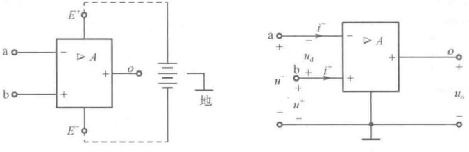

(a)
 

(b)
 

图 5-1 运放的图形符号
 

在图5-1（b）中， $ i^- $、 $ i^+ $ 分别表示从 a、b 端子流入运放的电流， $ u^- $、 $ u^+ $、 $ u_0 $ 分别是运放相应端子对地（参考节点）的电压， $ A $ 表示运放的电压增益（电压放大倍数）。标注“-”号的输入端 a 称为反相输入端，这是因为当  $ u^- $ 单独施加于 a 端子时，b 端子接地（ $ u^+ $ = 0），这时运放输入电压  $ u_d = -u^- $，输出电压  $ u_0 = -Au^- $，即输出电压与输入电压相对地来说是反向（反相）的；标注“+”的输入端 b 称为同相输入端，这是因为当  $ u^+ $ 单独施加于 b 端子时，a 端子接地（ $ u^- $ = 0），这时运放输入电压  $ u_d = u^+ $，输出电压  $ u_0 = Au^+ $，即输出电压与输入电压相对地来说是同向（同相）的；当 a、b 端子都有输入电压时，称为差动输入，这时运放的输入电压  $ u_d = u^+ $ -  $ u^- $，输出电压  $ u_0 = A(u^++u^-) $。符号“▷”表示运放是一种单向性器件，即它的输出电压受输入电压的控制，但输入电压却不受输出电压的影响。

运放的外特性即为运放输出电压 $ u_{0} $与输入电压 $ u_{d} $之间关系的特性，称为转移特性。以差动输

<!-- page: 128 -->

入为例，运放的转移特性曲线示于图 5-2。当  $ u_d $ 在  $ [-ε, ε] $（ε 是很小的）范围内变化时， $ u_o = Au_d $，转移特性曲线是一条通过原点的直线。运算放大器作为一个线性元件，相当于一个电压放大器，它将输入电压放大  $ A $ 倍后输出；当  $ |u_d| > ε $ 时，输出电压趋于饱和，其饱和值为  $ \pm U_{sat} $，这时运算放大器是一个非线性元件。运算放大器由输入电压  $ u_d $ 的范围决定工作时是作为线性元件使用，还是作为非线性元件使用，这里主要考虑作为线性元件使用的情况。

图5-3表示线性运放的电路模型，它实际上是一个电压放大器。模型中 $ R_{in} $为运放的输入电阻，为 $ 10^6\sim10^{13}\Omega $， $ R_0 $为运放的输出电阻，为 $ 10\sim100\Omega $。 $ A $为运放的电压增益，为 $ 10^5\sim10^7 $。因此，运算放大器是一种高增益、高输入电阻和低输出电阻的电压放大器。

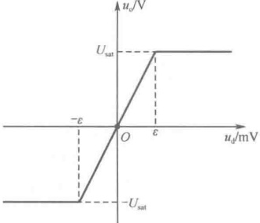

图 5-2 运放的转移特性曲线
 

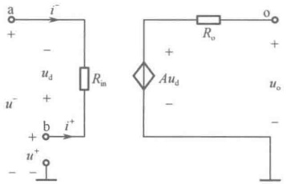

图 5-3 线性运放的电路模型
 

### 5.2 理想运算放大器

理想运算放大器是实际运算放大器的理想化描述，即理想地认为运算放大器的电压增益  $ A \to \infty $，输入电阻  $ R_{in} \to \infty $，输出电阻  $ R_{o} \to 0 $。理想运算放大器无法用电路模型来描述，只能用

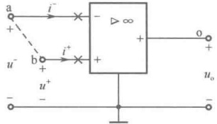

图 5-4 理想运算放大器的图形符号
 

图5-4所示的图形符号来表示。实际运放完全满足这三个条件是做不到的，但在一定的使用条件下，在允许的工程误差范围内，可以在进行电路分析时将实际运放当作理想运放对待，这给分析和计算会带来很大的方便。

下面来分析理想运算放大器具有什么特点。首先，当  $ R_0 \to 0 $ 时，由图 5-3 得  $ u_0 = A u_d $，而运算放大器的输出电压为有限值，所以当  $ A \to \infty $ 时，其输入电压  $ u_d = u^+ - u^- \to 0 $，即  $ u^+ \doteq u^- $，即  $ u^+ $ 与  $ u^- $ 对地来说几乎相等，a、b 两端子几乎为等电位，a、b 两端子间可做 “虚短路”（似短路又非真短路）处理，如图 5-4 中虚线所示。这样在列写有关  $ u_d $ 的 KVL 方程时，在数值上可舍弃  $ u_d $ 的作用。作为差动输入的两种特殊情况，反相输入  $ (u^+ = 0) $ 或同相输入  $ (u^- = 0) $，上述的 a、b 端子间的 “虚短路” 将导致 a 端子为 “虚地”  $ (u^- \doteq u^+ = 0) $ 或 b 端子为 “虚地”  $ (u^+ \doteq u^- = 0) $。其次，当  $ R_{in} \to \infty $ 及  $ u_d \to 0 $ 时，由图 5-3 可得  $ i^+ = -i^- = u_d / R_{in} \to 0 $，即从 a、b 两个端子流入运算放大器的电流非常小（几乎为零），a、b 两端子又可做 “虚开路”（似开路又非真开路）处理，如图 5-4 中 “×” 号所示。这样在列写有关  $ i^- $、 $ i^+ $ 的 KCL 方程时，在数值上可舍弃  $ i^- $、 $ i^+ $ 的作用。以上分析结果可归纳为理想运算放大器的如下两个特点：

（1）输入电压 $ u_{d} $趋于零， $ u^{+}\doteq u^{-} $，可做“虚短路”（或“虚短”）、“虚地”处理；

（2）输入端子电流趋于零， $ i^{+} = -i^{-} \doteq 0 $，可做“虚开路”（或“虚断”）处理。

<!-- page: 129 -->

这两个特点对一个理想运算放大器来说，必须同时满足，而且这两个特点对于分析含理想运算放大器的电路极为有用。

### 5.3 含有理想运算放大器的电阻电路分析

节点分析法特别适用于分析含运放的电路。在分析含理想运放的电路时，要注意以下两点：

（1）在理想运放的输出端应设一个节点电压，但不必为该节点列写节点电压方程，因此理想运放的输出电流在求解前是不明确的。

（2）在列写节点电压方程时，注意运用理想运放的“虚短”和“虚断”两个特点以减少未知量的数目。

例 5-1 如图 5-5（a）所示为反相比例器，试求输出电压  $ u_{0} $ 与输入电压  $ u_{in} $ 之间的关系。

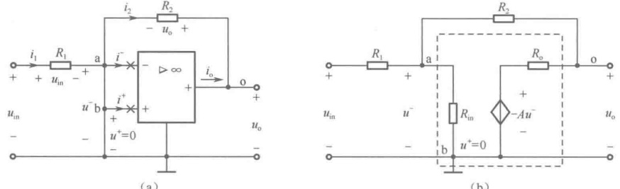

(b)
 

图5-5 例5-1图
 

解：如果把如图5-5（a）所示电路中的运放当作一般实际运放，可画出如图5-5（b）所示的电路模型。该电路有两个独立节点a、o，分别列出节点电压方程为

 $$ \left(\frac{1}{R_{1}}+\frac{1}{R_{2}}+\frac{1}{R_{\mathrm{i n}}}\right)u_{\mathrm{n a}}-\frac{1}{R_{2}}u_{\mathrm{o}}=\frac{u_{\mathrm{i n}}}{R_{1}} $$ 

 $$ -\frac{1}{R_{2}}u_{\mathrm{na}}+\left(\frac{1}{R_{2}}+\frac{1}{R_{0}}\right)u_{0}=\frac{-Au^{-}}{R_{0}} $$ 

控制量用节点电压表示为联立求解上述方程，得

 $$ u^{-}=u_{\mathrm{n a}} $$ 

 $$ \frac{u_{\mathrm{o}}}{u_{\mathrm{in}}}=-\frac{R_{2}}{R_{1}}\cdot\frac{1}{1+\frac{\left(1+\frac{R_{\mathrm{o}}}{R_{2}}\right)\left(1+\frac{R_{2}}{R_{1}}+\frac{R_{2}}{R_{\mathrm{in}}}\right)}{A-\frac{R_{\mathrm{o}}}{R_{2}}}} $$ 

将理想运放的条件  $ A \to \infty $， $ R_{in} \to \infty $， $ R_{0} \to 0 $ 代入上式，则有

 $$ u_{o}/u_{in}=-R_{2}/R_{1}=K_{u} $$ 

从分析结果可以看出，利用如图5-5（a）所示电路可以使输出电压 $ u_o $与输入电压 $ u_{in} $之比按 $ -R_2/R_1 $来确定，而不会由于理想运放的性能稍有改变而使 $ u_o/u_{in} $的比值受到影响。显然，选择不同的 $ R_1 $和 $ R_2 $值，就可获得不同的 $ u_o/u_{in} $值，所以图5-5（a）所示电路具有比例器的作用。又由于电路中理想运放的输出电压 $ u_o $通过电阻 $ R_2 $反馈到反相输入端，输出电压 $ u_o $与输入电压 $ u_{in} $反向（反相），因此图5-5（a）所示电路又称为反相比例器，而比值 $ -R_2/R_1 $称为运放的闭环增益，用 $ K_u $表示。

<!-- page: 130 -->

还可以直接应用节点分析法对图5-5（a）所示电路进行求解。节点a、o作为两个独立节点，由于运放的输出电流 $ i_{o} $在求解前是不明确的，故不必对节点o列写节点电压方程，只需对节点a列写节点电压方程，同时考虑到 $ \bar{i}=0 $，即“虚开路”这一特点，有

 $$ \left(\frac{1}{R_{1}}+\frac{1}{R_{2}}\right)u_{\mathrm{na}}-\frac{1}{R_{2}}u_{\mathrm{o}}=\frac{u_{\mathrm{in}}}{R_{1}} $$ 

还要考虑到 $ u^{-}=u^{+}=0 $，即“虚地”这一特点，有补充约束方程

 $$ u_{\mathrm{na}}=u^{-}\doteq0 $$ 

最后整理得

 $$ -\frac{1}{R_{2}}u_{o}=\frac{u_{in}}{R_{1}} $$ 

 $$ \frac{u_{0}}{u_{in}}=-\frac{R_{2}}{R_{1}} $$ 

即

此题还有更简便的求解方法，在图5-5(a)所示电路上做“虚地”“虚开路”处理，由 $ u^{-}=u^{+}=0 $，即“虚地”可知电阻 $ R_{1} $上的电压为 $ u_{in} $，而电阻 $ R_{2} $上的电压为 $ u_{0} $，根据电阻元件性能方程得

 $$ i_{1}=\frac{u_{in}}{R_{1}},\quad i_{2}=-\frac{u_{o}}{R_{2}} $$ 

再由 $ i^{-} \doteq 0 $，即“虚开路”，以及对节点a应用KCL，有

 $$ i_{1}=i_{2} $$ 

这样也可以求得

 $$ \frac{u_{o}}{u_{in}}=-\frac{R_{2}}{R_{1}} $$ 

例 5-2 如图 5-6 所示电路为加法器，试求输出电压  $ u_{0} $ 与输入电压  $ u_{1} $、 $ u_{2} $、 $ u_{3} $ 之间的关系。

解：在如图5-6所示电路上做“虚地”“虚开路”处理。由 $ u^{-}=u^{+}=0 $，即“虚地”得

 $$ i_{1}=\frac{u_{1}}{R_{1}},\quad i_{2}=\frac{u_{2}}{R_{2}},\quad i_{3}=\frac{u_{3}}{R_{3}},\quad i_{\mathrm{f}}=-\frac{u_{\mathrm{o}}}{R_{\mathrm{f}}} $$ 

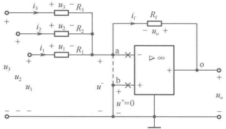

再由 $ i^{-}=0 $，即“虚开路”，以及对节点a应用KCL，有

图 5-6 加法器
 

 $$ i_{\mathrm{f}}=i_{1}+i_{2}+i_{3} $$ 

整理得

 $$ -\frac{u_{0}}{R_{f}}=\frac{u_{1}}{R_{1}}+\frac{u_{2}}{R_{2}}+\frac{u_{3}}{R_{3}} $$ 

即

 $$ u_{o}=-\left(\frac{R_{f}}{R_{1}}u_{1}+\frac{R_{f}}{R_{2}}u_{2}+\frac{R_{f}}{R_{3}}u_{3}\right) $$ 

令 $ R_{1}=R_{2}=R_{3}=R_{f} $，有

 $$ u_{o}=-(u_{1}+u_{2}+u_{3}) $$ 

上式表明，输出信号等于各路输入信号相加取负号，这就是加法器命名的依据。

例 5-3 如图 5-7 所示电路为减法器，试求输出电压  $ u_{0} $ 与输入电压  $ u_{1} $ 、  $ u_{2} $ 之间的关系。

解：在如图 5-7 所示电路上做 “虚短路” “虚开路” 处理，应用节点分析法进行求解。节点 a、b、o 作为三个独立节点，由于运放的输出电流  $ i_{0} $ 在求解前是不明确的，故不必对节点 o 列写节点电压方程，只需对节点 a、b 列写节点电压方程，同时考虑到  $ i^{-} = 0 $ 、  $ i^{+} = 0 $ ，即 “虚开路” 这一特点，有

<!-- page: 131 -->

$$ \left.\begin{array}{l}\left(\frac{1}{R_{1}}+\frac{1}{R_{2}}\right)u_{\mathrm{na}}-\frac{1}{R_{2}}u_{\mathrm{o}}=\frac{u_{1}}{R_{1}}\\ \left.\left(\frac{1}{R_{1}}+\frac{1}{R_{2}}\right)u_{\mathrm{nb}}=\frac{u_{2}}{R_{1}}\right.\end{array}\right\} $$ 

还要考虑到  $ u^{-} \doteq u^{+} $，即“虚短路”这一特点，有补充约束方程

 $$ u_{\mathrm{na}}\doteq u_{\mathrm{nb}} $$ 

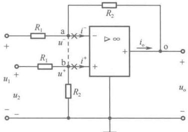

将上式代入节点电压方程中得

 $$ \frac{u_{2}}{R_{1}}-\frac{1}{R_{2}}u_{0}=\frac{u_{1}}{R_{1}} $$ 

图 5-7 减法器
 

整理得

 $$ u_{_{0}}=\frac{R_{2}}{R_{1}}(u_{2}-u_{1}) $$ 

例 5-4 如图 5-8（a）所示电路为同相放大器，试求输出电压  $ u_{0} $ 与输入电压  $ u_{in} $ 之间的关系。

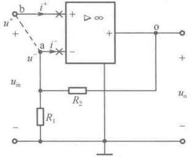

（a）同相放大器
 

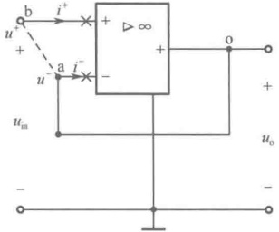

（b）电压跟随器
 

图5-8 例5-4图
 

解：在如图 5-8（a）所示电路上做“虚短路”“虚开路”处理。由  $ u^{-} \doteq u^{+} $，即“虚短路”这一特点，得

 $$ u^{-}=u_{in} $$ 

再由 $ i^{-}=0 $，即“虚开路”这一特点，可将 $ R_{1} $、 $ R_{2} $视为串联，经分压得

 $$ u^{-}=\frac{R_{1}}{R_{1}+R_{2}}u_{o} $$ 

整理得

 $$ \frac{u_{o}}{u_{in}}=1+\frac{R_{2}}{R_{1}} $$ 

选择不同的  $ R_{1} $ 和  $ R_{2} $，可以获得不同  $ u_{0}/u_{in} $ 值，而该值一定大于 1，同时又是正值，说明输出电压  $ u_{0} $ 与输入电压  $ u_{in} $ 同向（同相），故称为同相放大器。

如果  $ R_{1}=\infty $ （开路处理）， $ R_{2}=0 $ （短路处理），则图 5-8 (a) 变成图 5-8 (b)。这时

 $$ \begin{aligned}\frac{u_{o}}{u_{in}}&=1\\u_{o}&=u_{in}\end{aligned} $$ 

即

输出电压  $ u_{0} $ 与输入电压  $ u_{in} $ 完全相同，故称为电压跟随器。而且由于  $ i^{-} \doteq 0 $， $ i^{+} \doteq 0 $，即“虚开路” $ (R_{in} \to \infty) $ 这一特点，当它插入两电路之间时，可对两个电路起隔离作用，又不影响信号电压的传递。例如，在图 5-9（a）所示的分压电路中，当输出端没有接负载（空载）时，输出电压为

 $$ u_{2}=\frac{R_{2}}{R_{1}+R_{2}}u_{1} $$

<!-- page: 132 -->

但是，当输出端接上负载 $ R_{L} $后（用虚线表示），输出电压将变为

 $$ u_{2}^{\prime}=\frac{\frac{R_{2}R_{\mathrm{L}}}{R_{2}+R_{\mathrm{L}}}}{R_{1}+\frac{R_{2}R_{\mathrm{L}}}{R_{2}+R_{\mathrm{L}}}}u_{1} $$ 

显然  $ u_{2}^{\prime} < u_{2} $，这就是所谓的“负载效应”，负载  $ R_{L} $ 的接入影响了输出电压的大小。如果在负载  $ R_{L} $ 与分压电路之间插入一个电压跟随器，如图 5-9（b）所示，由于电压跟随器的输入电流为零，它的插入并不会影响分压电路的分压关系，只是将  $ R_{L} $ 与分压电路隔离开，这时  $ R_{L} $ 两端的电压仍为  $ u_{2} = \frac{R_{2}}{R_{1} + R_{2}} u_{1} $。

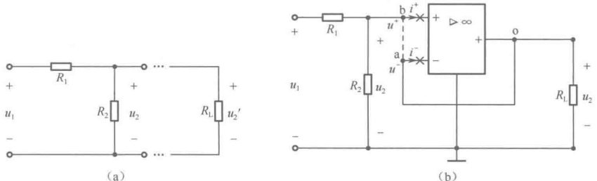

图 5-9 电压跟随器隔离作用说明图
 

例 5-5 如图 5-10 所示电路中含有两个理想运放，试求电压比值  $ u_{0}/u_{in} $。

解：在如图 5-10 所示电路上做 “虚地” “虚短路” 及 “虚开路” 处理。应用节点分析法进行求解，节点①、②、③、o' 及 o 作为 5 个独立节点，由于两个运放的输出电流  $ i_{0} $ 及  $ i_{0} $ 在求解前是不明确的，故不必对节点 o' 及 o 列写节点电压方程，只需对节点①、②、③列写节点电压方程，同时考虑到 “虚开路” 这一特点，有

 $$ \left.\begin{aligned}&\left(\frac{1}{R_{1}}+\frac{1}{2R_{1}}+\frac{1}{4R_{1}}\right)u_{\mathrm{n}1}-\frac{1}{2R_{1}}u_{\mathrm{o}^{\prime}}-\frac{1}{4R_{1}}u_{\mathrm{o}}=\frac{u_{\mathrm{i n}}}{R_{1}}\Bigg\}\\ &\quad-\frac{1}{R_{2}}u_{\mathrm{o}^{\prime}}+\left(\frac{1}{R_{2}}+\frac{1}{2R_{2}}\right)u_{\mathrm{n}2}=0\quad\\ &\quad\left(\frac{1}{R_{2}}+\frac{1}{2R_{2}}\right)u_{\mathrm{n}3}-\frac{1}{2R_{2}}u_{\mathrm{o}}=0\end{aligned}\right\} $$ 

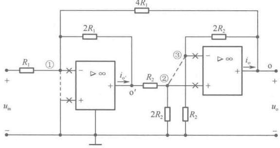

图 5-10 例 5-5 图
 

还要考虑到“虚地”“虚短路”这些特点，有补充约束方程

 $$ u_{n1}=0,\ u_{n2}=u_{n3} $$ 

将上述两式代入节点电压方程中整理得

 $$ \left.\begin{array}{l}-\frac{1}{2R_{1}}u_{o^{\prime}}-\frac{1}{4R_{1}}u_{o}=\frac{u_{in}}{R_{1}}\\ -\frac{1}{R_{2}}u_{o^{\prime}}+\frac{1}{2R_{2}}u_{o}=0\end{array}\right\} $$ 

消去 $ u_{0} $得  $ -\frac{u_{0}}{2}=u_{in} $ 即  $ \frac{u_{0}}{u_{in}}=-2 $

<!-- page: 133 -->

### 5.4 计算机仿真

##### 例 5-6 由理想运算放大器组成的反相比例放大器

构建如图 5-11 所示的仿真电路，设置好元件参数，在运放的反相输入端放置万用表 XMM1，在运放输出端放置万用表 XMM2。

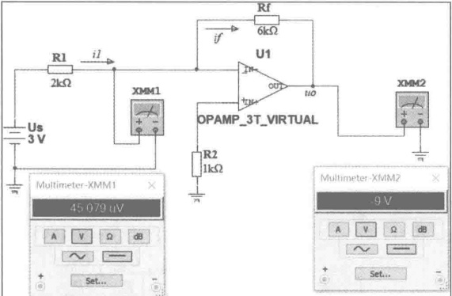

图 5-11 反相比例放大器仿真
 

根据理想运放的性质，有如下运算关系：

虚短： $ u^{-}=u^{+}=0V $;

虚断： $ i_{1}=i_{f} $；可得  $ u_{0}=-\frac{R_{f}}{R_{1}}U_{S} $。

运行仿真程序，测得反相输入端的电压为  $ 45.079\mu V $，此电压值可以近似视为 0V，运放的同相输入端接地，因此，运放的同相输入端与反相输入端的电位相等，说明“虚短”成立。运放输出端的万用表 XMM2 显示的电压值为 -9V，仿真结果与理论计算结果一致，说明此电路达到了反相放大的效果。

##### 例 5-7 由理想运算放大器组成的同相比例放大器

构建如图 5-12 所示的仿真电路，设置好元件参数，在运放的反相输入端放置万用表 XMM1，在同相输入端放置万用表 XMM2，在运放输出端放置万用表 XMM3。

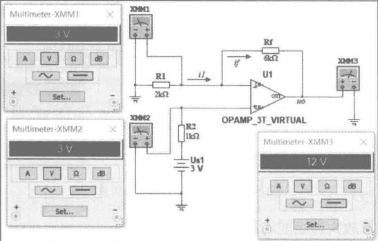

图 5-12 同相比例放大器仿真
 

<!-- page: 134 -->

根据理想运放的性质，有如下运算关系：

虚短： $ u^{-} = u^{+} = 3V $；

虚断： $ i^{-}=i^{+}=0 $， $ i_{1}=i_{f} $；可得 $ u_{0}=\left(1+\frac{R_{f}}{R_{1}}\right)U_{S}=(1+3)\times3=12V $。

运行仿真程序，测得反相输入端的电压为 3V，运放的同相输入端的电压为 3V，因此，运放的同相输入端与反相输入端的电位相等，说明“虚短”成立。运放输出端的万用表 XMM3 显示的电压值为 12V，仿真结果与理论计算结果一致，说明此电路达到了同相放大的效果。

##### 例 5-8 由理想运算放大器组成的模拟加法器

构建如图 5-13 所示的仿真电路，设置好元件参数，在运放的输出端放置万用表 XMM1。

根据理想运放的性质，有如下运算关系：

虚短： $ u^{-}=u^{+} $;

虚断： $ i^{-}=i^{+}=0 $； $ \frac{U_{S1}-u^{+}}{R_{1}}+\frac{U_{S2}-u^{+}}{R_{2}}+\frac{U_{S3}-u^{+}}{R_{3}}=\frac{u^{+}}{R_{4}} $

 $ i_{1}=i_{f} $，即 $ \frac{-u^{-}}{R_{5}}=\frac{u^{-}-u_{0}}{R_{f}} $，有

 $$ u_{o}=\left(1+\frac{R_{\mathrm{f}}}{R_{5}}\right)u^{-}=\left(1+\frac{R_{\mathrm{f}}}{R_{5}}\right)\frac{\frac{U_{\mathrm{S}1}}{R_{1}}+\frac{U_{\mathrm{S}2}}{R_{2}}+\frac{U_{\mathrm{S}3}}{R_{3}}}{\frac{1}{R_{1}}+\frac{1}{R_{2}}+\frac{1}{R_{3}}+\frac{1}{R_{4}}} $$ 

若令

 $$ R_{1}=R_{2}=R_{3}=R_{4} $$ 

则有

 $$ u_{o}=\frac{1}{4}\left(1+\frac{R_{f}}{R_{5}}\right)(U_{S1}+U_{S2}+U_{S3}) $$ 

按电路设定参数可以算出运放输出端电压为

 $$ u_{o}=\frac{1}{4}\times(1+2)\times(1+2+3)=4.5V $$ 

运行仿真程序，测得运放输出端的电压值为4.5V，仿真结果与理论计算结果一致，说明此电路达到了同相输入信号进行加法运算的效果。

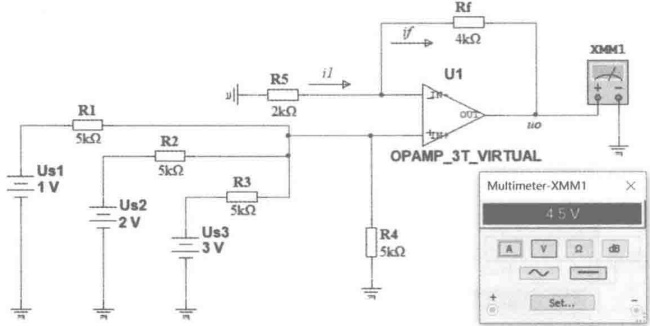

图 5-13 同相输入加法器仿真
 

##### 例 5-9 由理想运算放大器组成的差分信号放大器

构建如图 5-14 所示的仿真电路，设置好元件参数，在运放的反相输入端放置万用表 XMM1，在同相输入端放置万用表 XMM3，在运放输出端放置万用表 XMM2。

<!-- page: 135 -->

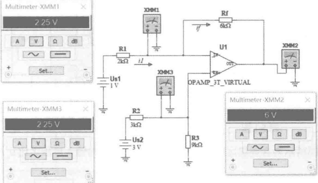

图 5-14 差分信号放大器仿真
 

根据理想运放的性质，有如下运算关系：

虚短： $ u^{-}=u^{+}=\frac{R_{3}}{R_{2}+R_{3}}U_{S2}=\frac{3}{4}U_{S2} $;

虚断： $ i_{1}=i_{f} $；可得  $ u_{0}=\frac{R_{3}}{R_{2}+R_{3}}\left(1+\frac{R_{f}}{R_{1}}\right)U_{S2}-\frac{R_{f}}{R_{1}}U_{S1}=3(U_{S2}-U_{S1}) $。

运行仿真程序，测得反相输入端的电压为2.25V，运放的同相输入端的电压为2.25V，因此，运放的同相输入端与反相输入端的电位相等，说明“虚短”成立。运放输出端的万用表XMM2显示的电压值为6V，仿真结果与理论计算结果一致，说明此电路实现了对差分输入电压放大的效果。

### 思考题

5-1 在运放的图形符号中，为什么将标注“-”号的输入端 a 称为反相输入端？而将标注“+”号的输入端 b 称为同相输入端？

5-2 运放的外特性是如何描述的？什么物理量可以决定运算放大器工作时是作为线性元件使用，还是作为非线性元件使用？

5-3 为什么说运算放大器是一种高增益、高输入电阻和低输出电阻的电压放大器？

5-4 理想运放的三个条件是什么？

5-5 “虚短路”概念是怎样引出来的？在含理想运算放大器电路分析中如何运用？

5-6 “虚开路”概念是怎样引出来的？在含理想运算放大器电路分析中如何运用？

5-7 在用节点分析法对含理想运算放大器电路列写节点电压方程时，为什么不必对理想运放的输出端所在节点 o 列写节点电压方程？

5-8 为什么说电压跟随器具有隔离作用？

#### 习题

5-1 题 5-1 图所示为含理想运放的电路，试求输出电压与输入电压之比  $ u_{0}/u_{1} $

5-2 试求题 5-2 图所示含理想运放的电路的输出电压  $ u_{0} $

5-3 题 5-3 图所示为含理想运放的电路，试求电流 i 。

<!-- page: 136 -->

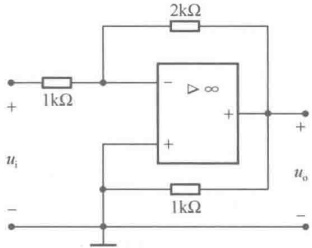

题5-1 图
 

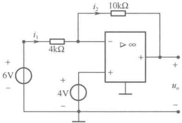

题5-2图
 

5-4 题 5-4 图所示为含理想运放的电路，试求输出电压与输入电压之比  $ u_{0}/u_{s} $。

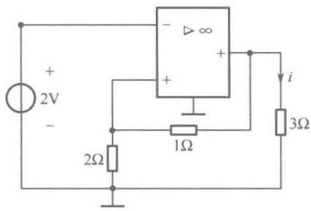

题5-3图
 

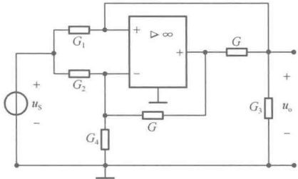

题5-4图
 

5-5 题 5-5 图所示为含理想运放的电路，试求输入电阻  $ R_{in} = u_{1}/i_{1} $ 为多少？

5-6 题 5-6 图所示为含理想运放的电路，试求输出电压与输入电压之比  $ u_{2}/u_{1} $

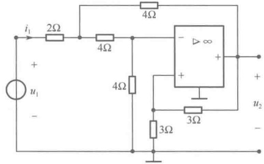

题5-5 图
 

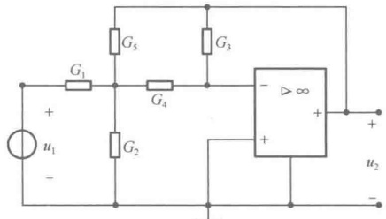

题5-6图
 

5-7 题 5-7 图所示为含理想运放的电路，试求输出电压  $ u_{0} $ 与输入电压  $ u_{S_{1}} $ 、  $ u_{S} $ 之间的关系。

5-8 电路如题 5-8 图所示，当  $ u_{i}=3V $ 时，求负载电阻中的电流 i。

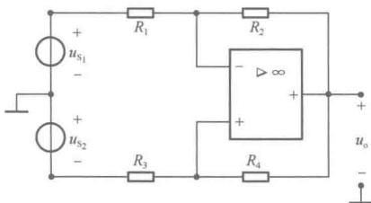

题5-7图
 

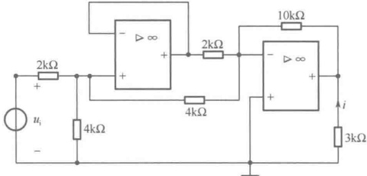

题5-8图
 

<!-- page: 137 -->

5-9 题 5-9 图所示为含两个理想运放的电路，试求输出电压与输入电压之比  $ u_{o}/u_{i} $

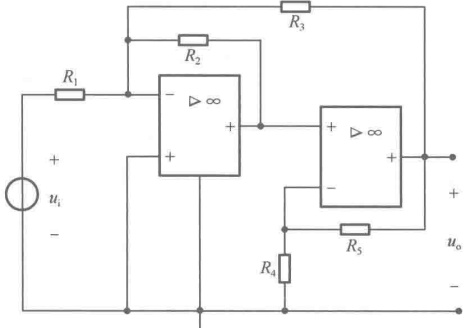

题5-9图
 

