# 06-第6章 简单非线性电阻电路分析

[返回全书目录](../../README.md)

> PDF 页码：138–162

<!-- page: 138 -->

### 第6章 简单非线性电阻电路分析

严格地说，实际电路都是非线性的。只不过有些电路在一定的工作范围内其元件参数的非线性特征可以被忽略，可将其看成线性电路来分析。而有些电路，其某些元件参数的非线性特征不能被忽略，否则，就无法解释电路中发生的物理现象。非线性电路的分析要比线性电路的分析复杂得多，求得的解也不一定是唯一的。本章主要讨论含有非线性电阻的电路分析，为学习电子电路及进一步学习非线性电路理论提供基础。

分析非线性电阻电路的基本依据仍然是基尔霍夫定律与元件的伏安关系，但是，线性电路分析中的叠加定理、互易定理等均不成立，必须采用其他方法，常见的方法有解析法、图解法、折线近似法和小信号分析法等。

### 6.1 非线性元件与非线性电路的基本概念

本书前面各章所讨论的电路均为线性电路，其中的元件除独立源之外均为线性元件，这类元件的参数不随其端电压或电流（电路变量）而发生变化。当元件的参数值随其端电压或端电流的数值或方向发生变化时，这样的元件就是非线性元件，非线性元件的伏安特性不再是通过坐标原点的直线。具有非线性u-i特性的电阻元件是非线性电阻元件，仅由非线性电阻元件、线性电阻元件、独立电源和受控源等组成的电路称为非线性电阻电路。非线性电阻电路在非线性电路中占有重要的地位，它不仅可以构成许多实际电路的合理模型，其分析方法也是研究含有非线性电容元件、非线性电感元件的非线性动态电路的基础。

严格地说，任何实际的电路元器件在一定程度上都是非线性的。在工程分析计算中，对于那些非线性程度较弱的元器件，在其电压和电流的一定工作范围内将它们作为线性元件来处理，既不会产生太大的误差，又可以简化电路的分析计算，是可行的。但是，大量的非线性元件实际上具有很强的非线性，这时，如果忽略其非线性特性来进行分析计算，则必然会使得计算结果与实际数据相差甚远，有时还会产生本质上的差异，以至于根本无法正确解释电路中所发生的物理现象。因此，对于这类非线性元件必须采用相应的分析方法，所以分析研究非线性元件和非线性电路具有重要的实际意义。

非线性元件也分为二端元件和多端元件，以及时变元件和时不变元件，本章仅讨论非线性时不变二端电阻元件及其所构成的电路。

### 6.2 非线性电阻

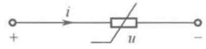

图6-1 非线性电阻的电路符号
 

线性电阻的伏安特性可以用欧姆定律，即 $ u=R_{i} $来表示，它在u-i平面上是一条通过坐标原点的直线。不满足欧姆定律的电阻元件，即其伏安特性不能用通过坐标原点的直线来表示的电阻元件，称为非线性电阻元件，其电路符号如图6-1所示。

#### 6.2.1 非线性电阻的分类

实际中的绝大多数非线性电阻的伏安特性由于其固有的复杂性，一般无法用数学解析式描述

<!-- page: 139 -->

而只能用曲线或实验数据来表示。非线性电阻按其伏安特性可以分为三大类，即非单调型电阻、单调型电阻和多值电阻。

# 1. 非单调型电阻

顾名思义，所谓非单调型电阻就是其电压与电流的函数关系呈现非单调性，或者说其伏安特性在u-i平面上表现为一条非单调曲线。按照其自变量的选取不同，非单调电阻又可以分为流控电阻（current-controlled resistor）和压控电阻（voltage-controlled resistor）两类。

（1）流控电阻。若非线性电阻的端电压u可以表示为其端电流i的单值函数，即

$$  u=f(i),\  单值函数   \tag*{（6-1）}$$

则称为电流控制型非线性电阻，简称流控电阻。若以电压为横轴，电流为纵轴，则一种典型的流控电阻的伏安特性曲线如图6-2所示（图中只画出了u>0，i>0的部分）。由该曲线可以看到：对于任一电流值i，有且仅有一个电压值u与之相对应，如 $ i_{1} $对应 $ u_{1} $， $ i_{2} $对应 $ u_{2} $……即u为i的单值函数；而对于某一电压值u，却可能有多个电流值i与之对应，如电压 $ u_{2} $，有 $ i_{2} $、 $ i_{4} $、 $ i_{5} $这3个电流值与之对应，即端电流i不能表示为端电压u的单值函数。充气二极管就是具有流控电阻元件特性的一种典型器件，其伏安特性曲线如图6-2所示，这种曲线呈S形，在一段曲线内，电压随电流增加而下降 $ \left(\frac{du}{di}<0\right) $，各点斜率均为负，称具有这类伏安特性的电阻为S形（微分）负阻，若需通过实验测得其全部伏安特性曲线，只能通过外加电流（自变量）测量电压（因变量）。

（2）压控电阻。若非线性电阻的端电流i可以表示为其端电压u的单值函数，即

$$  i=g(u), 单值函数   \tag*{（6-2）}$$

则称为电压控制型非线性电阻，简称压控电阻。一种典型的压控电阻的伏安特性曲线如图 6-3 所示（图中只画出了 u > 0，i > 0 的部分）。由该曲线可以看到：对于任一电压值 u，有且只有一个电流值 i 与之相对应，如  $ u_1 $ 对应  $ i_1, u_2 $ 对应  $ i_2 $ ……即 i 为 u 的单值函数；而对于某一电流值 i，与之对应的电压值 u 却可能有多个，如电流  $ i_2 $，有  $ u_2 $、 $ u_4 $、 $ u_5 $ 这 3 个电压值与之对应，因此，端电压 u 不能表示为端电流 i 的单值函数。隧道二极管就是具有压控电阻元件特性的一种典型器件，其伏安特性曲线如图 6-3 所示。这种曲线呈 N 形，在一段曲线内，电流随电压增加而下降，各点斜率均为负，称具有这类伏安特性的电阻为 N 形（微分）负阻，若需通过实验测得其全部伏安特性曲线，只能通过外加电压（自变量）来测量电流（因变量）。实际上，电压控制型的含义就是用连续地改变加在元件两端电压的方法来获得该元件的完整特性曲线。

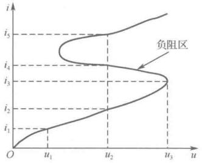

图 6-2 流控电阻的典型伏安特性曲线
 

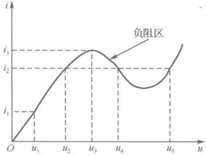

# 2. 单调型电阻

若非线性电阻的端电压 u 可以表示为其端电流 i 的单值函数，端电流 i 又可以表示为其端电压 u 的单值函数，即

$$  u=f(i),\  单值函数   \tag*{(6-3a)}$$

<!-- page: 140 -->

$$  i=g(u), 单值函数   \tag*{(6-3b)}$$

同时成立，且 f 和 g 互为反函数，则可称为单调型电阻。这说明，单调型电阻既是流控电阻又是压控电阻，其伏安特性曲线为严格单调增或严格单调减的。PN 结二极管是最为典型的单调型电阻，其伏安特性方程为

$$  i=I_S(e^{\frac{qu}{kT}}-1)   \tag*{（6-4）}$$

式中， $ I_S $为一常数，称为反向饱和电流， $ q $是电子的电荷 $ (1.6\times10^{-19}\text{C}) $， $ k $是玻尔兹曼常数 $ (1.38\times10^{-23}\text{J/K}) $， $ T $为热力学温度。在 $ T=300\text{K} $（室温下）时，

 $$ \frac{q}{kT}=40(J/C)^{-1}=40V^{-1} $$ 

因此，式（6-4）可以表示为

 $$ i=I_{S}(e^{40u}-1) $$ 

由式（6-4）可以求出其反函数为

 $$ u=\frac{kT}{q}\ln\left(\frac{1}{I_{\mathrm{s}}}i+1\right) $$ 

图6-4（a）给出了PN结二极管的电路符号，图6-4（b）中的粗实线定性地表示了PN结二极管的伏安特性曲线，图6-4（c）为用折线分段替代曲线近似表示了PN结二极管的伏安特性曲线。

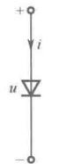

（a）电路符号
 

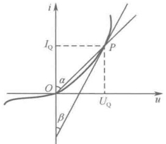

（b）伏安特性曲线
 

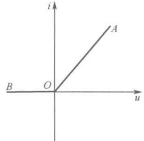

（c）用折线近似的伏安特性曲线
 

图 6-4 PN 结二极管的电路符号与伏安特性曲线
 

# 3. 多值电阻

若非线性电阻的某些端电流对应于多个端电压值，而某些电压又对应于多个端电流值，则称为多值电阻。理想二极管就是一种典型的多值电阻，其伏安特性为

 $$ \left.\begin{aligned}&u=0,i>0( 导通 )\\ &i=0,u<0( 截止 )\end{aligned}\right\} $$ 

与此式对应的伏安特性曲线如图 6-5 所示，它由 u-i 平面上两条直线段组成，即电压负轴和电流正轴。这表明，当电压为正向（i>0）时，理想二极管处于导通状态（实际二极管呈现的电阻很

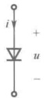

（a）电路模型
 

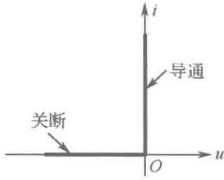

（b）伏安特性曲线
 

小，因而近似作短路处理)，电压为零，相当于短路，此刻的伏安特性曲线为图6-5（b）中的垂直部分；当电压为反向（u<0）时，理想二极管处于截止状态（不导通，实际二极管呈现的电阻很大，因而近似作开路处理），电流为零，相当于开路，这时的伏安特性曲线为图6-5（b）中的水平部分。图6-5（b）中的坐标原点（u=0,i=0）称为转折点。

图 6-5 理想二极管的电路模型与伏安特性曲线
 

显然，多值电阻既不能将电压表示成电流的单值函数，也不能将电流表示成电压的单值函数，或者说，它既非流控电阻又非压控电阻。

由图6-4（c）可知，一个实际二极管的伏安特性可以用其中的折线 $ \overline{BOA} $近似逼近。因此，实

<!-- page: 141 -->

际二极管的模型可以用一个理想二极管和一个线性电阻串联组成。当对一个实际二极管外加正向电压时，由于其模型中理想二极管处于导通（开启）状态，电压为零（短路），因此实际二极管相当于一个线性电阻，其伏安特性可以用直线 $ \overline{OA} $表示；当外加反向电压时，由于其模型中理想二极管处于截止（关断）状态，电流为零（开路），其伏安特性可以用直线 $ \overline{BO} $表示。

电阻元件存在双向性和单向性的差异。伏安特性曲线对称于坐标原点的电阻，称为双向性电阻，所有线性电阻均为双向性电阻。伏安特性曲线非对称于坐标原点的电阻，称为单向性电阻。大多数非线性电阻都属于单向性电阻，如各种晶体二极管。对于单向性电阻，当加在其两端的电压方向不同时，流过它的电流完全不同，因而其特性曲线也就不对称于坐标原点。在工程实际中，非线性电阻的单向导电性可作整流之用。

#### 6.2.2 静态电阻与动态电阻

由于非线性电阻的伏安特性曲线并非过坐标原点的直线，因此不能像线性电阻那样用常数表示其电阻值并应用欧姆定律进行分析。因此，需要引入静态工作点、静态电阻  $ R_{Q} $ 和动态电阻  $ R_{d} $ 的概念。所谓静态，是指非线性电阻电路在直流电源作用下的工作状态，此时非线性电阻上的电压值和电流值为 u-i 平面上一个确定的点，该点即称为静态工作点，此点所对应的电压值和电流值称为静态电压和静态电流。

非线性电阻在某一工作状态下 [如图 6-4（b）中 PN 结二极管特性曲线上某一工作点  $ P(u,i) $] 的静态电阻  $ R_{Q} $ 定义为该点电压  $ U_{Q} $ 与  $ I_{Q} $ 的比值，即

 $$ R_{Q}=\frac{U_{Q}}{I_{Q}} $$ 

由图 6-4（b）可见， $ R_{Q} $ 正比于  $ \tan\alpha $，且随着静态工作点 P 的不同而相异，即随着加在该电阻上的电压或电流数值的不同而不同，显然，它对恒定的电压和电流才有意义。

非线性电阻在某一工作状态下 [如图 6-4（b）中的曲线上某一工作点  $ P(u,i) $] 的动态电阻  $ R_{d} $ 定义为该点电压对电流的导数值，即

 $$ R_{\mathrm{d}}=\frac{\mathrm{d}u}{\mathrm{d}i}\bigg|_{P} $$ 

由图 6-4（b）可见， $ R_{d} $ 正比于  $ \tan\beta $，为 P 点切线斜率的倒数，虽然它也随着工作点 P 的不同而不同，但它对 P 点附近变化的电压和电流才有意义。 $ R_{d} $ 所表征的精确度与 P 点附近电压和电流的变化幅度及 P 点附近曲线的形状有关，是分析交流小信号电路的一个线性化参数。

例 6-1 一流控非线性电阻的伏安特性为  $ u = f(i) = 3i - 4i^3 $; （1）试分别求出  $ i_1 = 0.05A $,  $ i_2 = 0.5A $,  $ i_3 = 5A $ 时对应的电压  $ u_1 $、 $ u_2 $、 $ u_3 $ 的值; （2）试求  $ i = \sin \omega t $ 时对应的电压 u 的值; （3）试求  $ u_{12} = f(i_1 + i_2) $，并验证在一般情况下  $ u_{12} \ne u_1 + u_2 $。

解：（1） $ i_1 = 0.05\text{A} $ 时， $ u_1 = [3 \times 0.05 - 4 \times (0.05)^3]\text{V} = (0.15 - 5 \times 10^{-4})\text{V} $， $ i_2 = 0.5\text{A} $ 时， $ u_2 = [3 \times 0.5 - 4 \times (0.5)^3]\text{V} = 1\text{V} $， $ u_3 = [3 \times 5 - 4 \times (5)^3]\text{V} = (15 - 4 \times 125)\text{V} = -485\text{V} $，可见，若将该非线性电阻作为3Ω的线性电阻处理，不同的电流输入引起的输出电压误差是不同的，电流值较小时，产生的误差也小。

（2） $ i = \sin \omega t $ 时， $ u = 3 \sin \omega t - 4 (\sin \omega t)^3 = \sin 3 \omega t $，可见输出电压也是正弦波，但其频率却为输入频率的 3 倍，所以此流控非线性电阻实为一变频器。实际上，电阻元件的作用已经远超出了“将电能转化为热能”的范围。在现代电子技术中，非线性电阻和线性时变电阻被广泛地应用于整流、变频、调制、限幅等信号处理的众多方面。

<!-- page: 142 -->

（3）利用  $ u = f(i) = 3i - 4i^{3} $，可以求出

 $$ \begin{align*}u_{12}&=f(i_{1}+i_{2})=3(i_{1}+i_{2})-4(i_{1}+i_{2})^{3}=3(i_{1}+i_{2})-4(i_{1}^{3}+i_{2}^{3})-12i_{1}i_{2}(i_{1}+i_{2})\\&=u_{1}+u_{2}-12i_{1}i_{2}(i_{1}+i_{2})\end{align*} $$ 

由于在一般情况下， $ (i_{1}+i_{2})\neq0 $，因此有 $ u_{12}\neq u_{1}+u_{2} $。

可见，叠加原理不适用于非线性电路。

### 6.3 非线性电阻电路方程的建立

非线性元件的参数不为常数这一特点决定了非线性电路与线性电路的一个根本区别，即前者不具有线性性质，因而不能应用依据线性性质推出的各种定理，如叠加原理、戴维宁定理、诺顿定理等。因此，分析非线性电路的基本依据是KCL、KVL及元件的VCR（电压电流关系）。由于KCL和KVL与元件特性无关，因此将这两个定律应用于非线性电路与线性电路分析时不存在任何差异。但是，线性电阻满足欧姆定律，而非线性电阻的伏安关系一般为高次函数，故建立线性电阻电路方程与建立非线性电阻电路方程时的不同点来源于非线性电阻元件与线性电阻元件之间的上述差异。因此，在采用第4章介绍的各种建立电路方程的方法来建立非线性电阻电路方程时，需要根据非线性电阻元件伏安特性的不同情况而采用相应的方法，否则在应用某一方法来建立电路方程时会遇到困难，有时甚至得不出所要列写的电路方程。类似于线性电阻电路，本节所介绍的列写方程方法属于利用手工建立较为简单的非线性电阻电路方程时采用的“观察法”，对于复杂非线性电阻电路，一般采用适宜计算机分析的“系统法”。

#### 6.3.1 节点法

对于简单的非线性电阻电路，可以先采用 2b 法，即直接列写独立的 KCL、KVL 及元件的 VCR，再通过将 VCR 方程代入 KCL、KVL 方程中消去尽可能多的电流、电压变量，从而最终得到方程数目最少的电路方程，这种方法称为代入消元法，可用于既有压控型又有流控型非线性电阻的非线性电路。

例 6-2 在如图 6-6 所示的非线性电路中，已知  $ I_S = 2A $， $ R_1 = 2\Omega $， $ R_2 = 6\Omega $， $ U_S = 7V $，非线性电阻是流控型的，有  $ u_3 = (2i_3^2 + 1)V $，试求  $ u_R $ 的值。

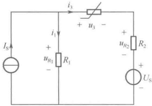

解：（1）电路元件（非线性电阻、线性电阻）的特性方程为

 $$ u_{3}=2i_{3}^{2}+1\ ,\quad u_{R_{1}}=R_{1}i_{1}=2i_{1}\ ,\quad u_{R_{2}}=R_{2}i_{3}=6i_{3} $$ 

（2）KCL 与 KVL 分别为

图6-6 例6-2图
 

 $$ i_{3}=I_{\mathrm{S}}-i_{1},\quad u_{R1}=u_{3}+u_{R_{2}}+U_{\mathrm{S}} $$ 

将电路元件方程代入所列 KCL 与 KVL 方程可得

$$  i_{3}=2-\frac{1}{2}u_{R_{1}}   \tag*{（6-5）}$$

$$  u_{R_{1}}=2i_{3}^{2}+6i_{3}+8   \tag*{（6-6）}$$

将式（6-5）代入式（6-6）可得  $ u_{R_1}^2 - 16u_{R_1} + 56 = 0 $。解得  $ u_{R_1} = 10.828\text{V} $ 或  $ u_{R_1} = 5.172\text{V} $，由此可见，非线性电路的解不是唯一的，有时在某种情况下还可能出现无穷多组解。此外，若非线性电阻是压控型，例如此题中，如果  $ i_3 = (2u_3^2 + 1)\text{V} $，则电路方程就要复杂些，而且求解也较困难。

若电路中的非线性电阻均为压控型电阻或单调电阻，则宜选用节点法写非线性电阻电路方程。当电路中既有压控型电阻又有流控型电阻时，直接建立节点电压方程的过程就会比较复杂。

<!-- page: 143 -->

例 6-3 写出如图 6-7 所示电路的节点电压方程，假设各电路中非线性电阻的伏安特性为  $ i_{1}=u_{1}^{3} $， $ i_{2}=u_{2}^{2} $， $ i_{3}=u_{3}^{3/2} $。

解：对节点 $ ^{①} $和 $ ^{②} $分别运用KCL可得

$$  \left.\begin{array}{r}i_{1}+i_{2}=12\\ -i_{2}+i_{3}=4\end{array}\right\}   \tag*{（6-7）}$$

应用 KVL 将非线性电阻支路的电压表示为节点电压的代数和，可得  $ u_{1}=u_{n1} $， $ u_{2}=u_{n1}-u_{n2} $， $ u_{3}=u_{n3} $，再将它们分别代入各非线性电阻的伏安特性方程得

 $$ i_{1}=u_{\mathrm{n}1}^{3},\qquad i_{2}=(u_{\mathrm{n}1}-u_{\mathrm{n}2})^{2},\qquad i_{3}=u_{\mathrm{n}3}^{3/2} $$ 

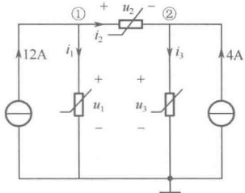

将式（6-8）代入式（6-7）可得

图6-7 例6-3 图
 

 $$ \left\{\begin{aligned}u_{\mathrm{n}1}^{3}+(u_{\mathrm{n}1}-u_{\mathrm{n}2})^{2}&=12\\ -(u_{\mathrm{n}1}-u_{\mathrm{n}2})^{2}+u_{\mathrm{n}3}^{3/2}&=4\end{aligned}\right. $$ 

#### 6.3.2 回路法

若电路中的非线性电阻均为流控型电阻或单调电阻，则宜选用回路法或网孔法列写非线性电阻电路方程。当电路中既有流控型电阻又有压控型电阻时，建立回路方程的过程就会比较复杂。

例6-4 在图6-8所示的非线性电阻电路中，已知两非线性电阻的伏安特性分别为

 $$ u_{3}=a_{3}i_{3}^{1/2},\quad u_{4}=a_{4}i_{4}^{1/3} $$ 

 $$ \dot{l}_{3} $$ 

 $$ \dot{l}_{4} $$ 

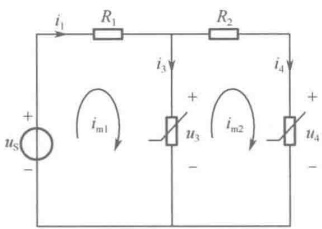

解：设网孔电流分别为 $ i_{m1} $ 和 $ i_{m2} $，列写网孔电流方程为

 $$ \left.\begin{array}{l}R_{1}i_{m1}+u_{3}=u_{s}\\ R_{2}i_{m2}+u_{4}=u_{3}\end{array}\right\} $$ 

图6-8 例6-4图
 

将 $ i_{m1}=i_{3}+i_{4} $， $ i_{m2}=i_{4} $， $ u_{3}=a_{3}i_{3}^{1/2} $， $ u_{4}=a_{4}i_{4}^{1/3} $代入式（6-9），可得关于 $ i_{3} $和 $ i_{4} $的方程，即

 $$ \left\{\begin{aligned}a_{3}\boldsymbol{i}_{3}^{1/2}+R_{1}\boldsymbol{i}_{3}+R_{1}\boldsymbol{i}_{4}=&\boldsymbol{u}_{s}\\ -a_{3}\boldsymbol{i}_{3}^{1/2}+R_{2}\boldsymbol{i}_{4}+a_{4}\boldsymbol{i}_{4}^{1/3}=&0\end{aligned}\right. $$ 

可以看出，依据 KCL 和 KVL 两类基本约束对于非线性电阻电路所建立的方程是一个非线性代数方程组，其一般形式可以表示为

$$  \left.\begin{aligned}f_{1}(x_{1},x_{2},\cdots,x_{n},t)=0\\ f_{2}(x_{1},x_{2},\cdots,x_{n},t)=0\\ \vdots\\ f_{n}(x_{1},x_{2},\cdots,x_{n},t)=0\end{aligned}\right\}   \tag*{（6-10）}$$

式中， $ x_{1}, x_{2}, \cdots, x_{n} $ 是 n 个独立的电压或/和电流变量。若讨论的电路中含有时变电源，则式（6-10）中就将显示含时间参变量 t，而当电路中仅含直流电源（为一直流非线性电阻电路）时，式（6-10）中将不含时间参变量 t。由于时变电阻电路在任一瞬时  $ t_{k} $ 可被看作一个直流电阻电路，因此若能求出后者的解，则必可求出前者的解，只是所需计算量要大一些。由于非线性电阻电路所建立的非线性代数方程组一般难以得到其解析解，因此需要在计算机上用数值方法求解。

### 6.4 非线性电阻电路的基本分析法

本节介绍分析非线性电阻电路时常用的基本方法，其依据依然是 KCL、KVL 和元件的 VCR。

<!-- page: 144 -->

由 KCL、KVL 所列写的拓扑方程与线性电阻电路中的一样仍为代数方程组，但是由于非线性电阻的 VCR 不同于线性电阻的 VCR，一般是高次函数关系，因此使得分析非线性电阻电路的方法有其特殊性，不能套用线性电阻电路的各种分析方法。

#### 6.4.1 图解法

由于非线性电阻伏安关系的固有复杂性，在很多情况下无法获得这种伏安关系的解析表达式，只得借助于元件的伏安特性曲线来对其进行描述。因此，图解法就构成了分析计算非线性电阻电路的一种非常重要的常用方法，可运用图解法来求解非线性电阻电路的工作点、DP 图（驱动点图）和 TC 图（转移特性图）。下面介绍非线性电阻电路直流工作点和非线性电阻串联、并联所得网络的 DP 图。

# 1. 求非线性电阻电路直流工作点的图解法

（1）直流工作点。直流电阻电路的解称为该电路的直流工作点或静态工作点，简称工作点。对于直流非线性电阻电路来说，电路的解，即电路方程式（6-10）的解  $ x_1, x_2, \cdots, x_n $ 称为该电路的直流工作点。从几何的角度而言，式（6-10）中的任意方程均是  $ n $ 个曲面的交点。由于这些曲面可能有一个、多个或无限多个交点甚至不存在交点，因此电路也就相应地可能有一个、多个或无限多个工作点或者没有工作点。这种工作点的多样性可以用图6-9（b）加以说明。当  $ U_S = U_{S_1} $ 时， $ U_S $ 和电阻  $ R $ 串联组成的一端口电路的伏安特性曲线（ $ u = U_S - R_i $）与压控型非线性电阻的伏安特性曲线  $ [i = g(u)] $ 只有一个交点，即电路只有一个工作点；当  $ U_S = U_{S_3} $ 时，电路有两个工作点；当  $ U_S = U_{S_2} $ 时，电路有三个工作点；当  $ U_S = U_{S_4} $ 时，两条伏安特性无交点，此时电路无工作点。显然，两条伏安特性曲线具有多个交点，即电路同时具有多个工作点的现象是由非线性电阻的多值性造成的。但是，任何一个实际电路在任意时刻总可以有一个而且只能有一个工作点，因为一个电路不可能同时工作在两种不同状态。一个电路出现有多个、无限多个或者没有工作点的不合理情况在于电路理论所研究的对象是模型而不是实际装置，当模型取得过分简单或近似时就会造成图解结果与实际不符，但只要通过改善模型即可解决。

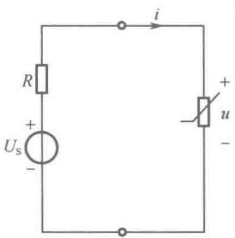

（a）非线性电阻电路
 

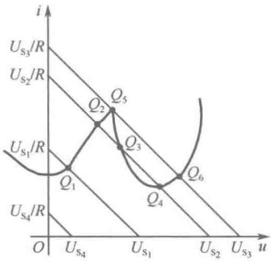

（b）非线性电阻电路直流工作点
 

图 6-9 非线性电阻电路直流工作点多样性图示
 

（2）非线性电阻电路工作点的图解法。当非线性电阻的VCR可以表示为函数式时，一般可以利用上述列写电路方程的解析法建立方程，最终解出非线性电阻的端电压和端电流，即求得非线性电阻电路的工作点。而当非线性电阻的VCR无法表示为函数式时，解析法就无能为力了，这时通常采用图解法（曲线相交法或分段性线化解析法）来确定非线性电阻电路的工作点，这里仅介绍前者，如图6-9（b）所示。

例 6-5 非线性电阻电路如图 6-10（a）所示，其中非线性电阻的伏安特性曲线如图 6-10（c）

<!-- page: 145 -->

所示，试用图解法求该电路的工作点。

解：对于仅含有一个非线性电阻的电路，通常先将非线性电阻以外部分的线性一端口电路用戴维宁等效电路替代 [见图 6-10（b）]。一般将端口伏安特性曲线较为简单地视为负载，相应的伏安特性曲线称为负载线。据此，将端口 a-a' 以左部分视为一个非线性电阻负载，则负载线方程为

 $$ u=\frac{4}{3}--\frac{2}{3}i $$ 

在同一坐标系下绘出非线性电阻的伏安特性曲线和负载线，如图6-10（c）所示，两条曲线有两个交点，即该电路共有两个工作点 $ Q_{1} $和 $ Q_{2} $，其坐标分别为 $ Q_{1}(0.64,1.04) $， $ Q_{2}(-3.1,6.7) $。由于在正常工作条件下，负载线应限制于第一象限，因此在图6-10（c）中，工作点 $ Q_{1} $是合理的，即电路将工作在该点，而工作点 $ Q_{2} $是不合理的。在电子线路中，图6-10（b）中的线性电阻R通常表示负载，因此，图6-10（c）中的直线在习惯上被称为负载线，故而这种求工作点的方法又称为负载线法。

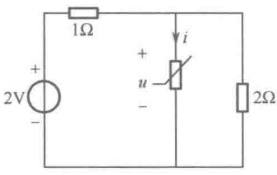

（a）非线性电阻电路
 

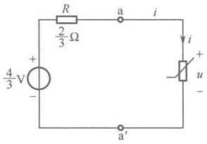

（b）戴维宁等效电路
 

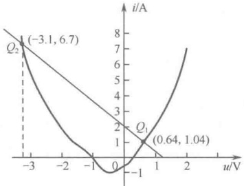

图 6-10 例 6-5 图
 

（c）非线性电阻电路的工作点
 

例 6-5 表明，对于仅含有一个非线性电阻但结构较复杂的非线性电阻电路，可以自非线性电阻两端断开，所剩电路为一线性含源一端口电路，对它进行戴维宁等效，就得到与图 6-10（b）类似的单回路电路，再采用图解法（若非线性电阻的伏安关系可以表示为方程式，则可用解析法）即可求解出非线性电阻的端电压 u 或端电流 i，如果所求的不是非线性电阻的端电压或端电流，仍需通过上述过程先求得非线性电阻的端电压 u 值或端电流 i 值，再应用替代定理将原始电路中非线性电阻替代成数值为 u 的独立电压源或数值为 i 的独立电流源，替代后的电路为一线性电路，再用线性电路的各种分析方法求出欲求的电路变量，包括功率等。对于通常的非线性电路大都可以求出多个解，解的个数取决于非线性电阻的 VCR 函数的次数。

对于含有多个非线性电阻的一端口电路（其中还可以含有线性电阻），这时应用非线性电阻与线性电阻的串、并联等效及非线性电阻的串、并联等效，可将该一端口电路等效为一个非线性电阻，并将剩下的线性有源一端口电路应用戴维宁定理进行等效，即可得出类似于图6-10（b）所示的电路，对此电路，按上述的方法便可求出所求电量。

# 2. 求 DP 图的图解法

表征任意一个含有电阻的一端口电路（单个电阻或仅由电阻构成的网络为其特例）的端口伏安特性曲线称为该一端口电路的驱动点特性图，简称 DP 图。下面讨论如何利用单个非线性电阻的 DP 图通过图解法得出由这些非线性电阻串联、并联与混联电路构成的非线性电阻一端口电路的 DP 图，即求出这种电路的非线性等效电阻的 DP 图。

（1）非线性电阻的串联、并联与混联等效概念。类似于线性无源一端口电路可以等效为一个电阻，非线性无源一端口电阻电路也可以等效为一个电阻，等效的定义仍然是两者在端口上具有

<!-- page: 146 -->

相同的电压电流关系。

非线性电阻串联、并联、混联所构成的一端口电路的等效不像线性电阻那样简单，也没有固定的公式可以套用。当非线性电阻串联或并联时，只有所有非线性电阻的控制类型相同时，才有可能得出其等效电阻伏安特性的解析表达式。但是，由于大多数的非线性电阻往往只知道它们的伏安特性曲线，而对有些曲线却难以写出或无法写出其具体的函数关系式，因此不可能应用两类基本约束解析得出非线性电阻串联、并联或混联时其等效电阻的伏安特性表达式。因此，在一般情况下，非线性电阻串联、并联与混联等效只能借助于图解法即利用DP图进行，这时需要利用两类基本约束。

（2）非线性电阻串联时的DP图。图6-11（a）表示伏安特性分别为 $ u_{1}=f_{1}(i_{1}) $和 $ u_{2}=f_{2}(i_{2}) $的两个流控或单调型非线性电阻串联构成的一端口电路，各电压、电流的参考方向如图6-11（a）所示。根据KCL可知

$$  i=i_{1}=i_{2}   \tag*{（6-11）}$$

应用 KVL 及式（6-11），并将两个非线性电阻的伏安特性代入，可得

$$  u=u_{1}+u_{2}=f_{1}(i_{1})+f_{2}(i_{2})=f_{1}(i)+f_{2}(i)=f(i)   \tag*{（6-12）}$$

式（6-12）表示了图 6-11（a）所示两串联非线性电阻的伏安特性方程与等效非线性电阻的伏安特性方程之间的关系。设两电阻的伏安特性曲线如图 6-11（b）所示，由式（6-12）可知，只要将同一电流值 i 所对应的曲线  $ f_1(i_1) $、 $ f_2(i_2) $ 上的电压值  $ u_1 $ 和  $ u_2 $ 相加，即得该电流值所对应的等效电阻的电压值 u。取不同的 i 值便可逐点描绘出等效电阻的伏安特性曲线  $ u = f(i) $，如图 6-11（b）所示。由此可以得出非线性电阻串联的等效电阻模型，如图 6-11（c）所示，该等效电阻也是流控或单调型非线性电阻。这表明，两个流控或单调型非线性电阻串联，其等效电阻也是一个流控或单调型非线性电阻。

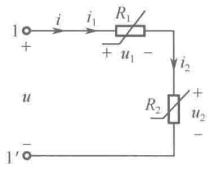

（a）两个非线性电阻串联
 

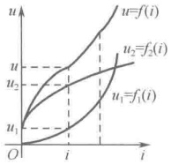

（b）串联DP图
 

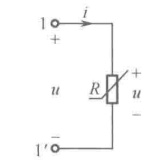

（c）等效非线性电阻
 

图 6-11 图解法求非线性电阻串联电路的 DP 图示例
 

以上讨论均假定电阻是流控的或单调型的。若串联的电阻中有一个是压控电阻，由于在电流值的某范围内电压是多值的，因此式（6-12）所对应的解析形式的分析法就不便使用，难以写出其等效一端口电路的伏安特性 $ u = f(i) $的解析式，但可使用图解法得到等效电阻的伏安特性曲线，这种方法可推广于多个非线性电阻串联的情况。

（3）非线性电阻并联时的DP图。非线性电阻的并联是非线性电阻串联的对偶情况。图6-12（a）表示伏安特性分别为 $ i_{1}=g_{1}(u_{1}) $和 $ i_{2}=g_{2}(u_{2}) $的两个压控或单调型非线性电阻并联构成的一端口电路，各电压、电流的参考方向如图6-12（a）所示。根据KVL有

$$  u=u_{1}=u_{2}   \tag*{（6-13）}$$

应用 KCL 及式（6-13），并将两个非线性电阻的伏安特性代入，可得

$$  i=i_{1}+i_{2}=g_{1}(u_{1})+g_{2}(u_{2})=g_{1}(u)+g_{2}(u)=g(u)   \tag*{（6-14）}$$

式（6-14）表示了图6-12（a）所示两个并联非线性电阻的伏安特性方程与等效非线性电阻的伏安特性方程之间的关系。设两电阻的伏安特性曲线如图6-12（b）所示，由式（6-14）可知，只

<!-- page: 147 -->

要将同一电压值 u 所对应的曲线  $ g_1(u) $、 $ g_2(u) $ 上的电流值  $ i_1 $ 和  $ i_2 $ 相加，即得该电压值所对应的等效电阻的电流值 i。取不同的 u 值便可逐点描绘出等效电阻的伏安特性曲线  $ i = g(u) $，如图 6-12（b）所示，该等效电阻也是压控或单调型非线性电阻，由此可以得出非线性电阻并联的等效电阻的模型，如图 6-12（c）所示。这表明，两个压控或单调型非线性电阻相并联，其等效电阻也是一个压控或单调型非线性电阻。

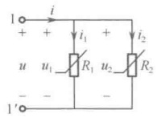

（a）两个非线性电阻并联
 

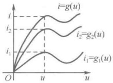

（b）并联DP图
 

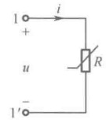

（c）等效非线性电阻
 

图 6-12 图解法求非线性电阻并联电路的 DP 图示例
 

与串联时的情况对偶，若相并联的电阻中有一个是流控电阻，则难以得到解析式 $ i=f(u) $，但却可以使用图解法得到等效电阻的伏安特性曲线。

显然，上述方法可以推广到任意多个非线性电阻（其中可以有线性电阻）的串联或并联电路。对于由非线性电阻（其中可以有线性电阻）串联和并联形成的混联电路，也可以运用串联和并联相互之间的关系，根据连接情况，逐步用图解法进行等效得到混联等效电阻的伏安特性。例如，在一个非线性电路中，电路末端两个非线性电阻并联后再与靠近电路始端的第三个非线性电阻串联，可以按先求并联部分等效伏安特性曲线的方法，即取一系列不同的电压值，将同一电压值下两伏安特性曲线的电流坐标值相加从而得到并联部分端口（等效电阻）的伏安特性曲线，这时整个电路变为两个非线性电阻串联，再按求串联部分等效伏安特性曲线的方法，即取一系列不同的电流值，将同一电流值下两伏安特性曲线的电压坐标值相加从而得到整个电路端口（等效电阻）的伏安特性曲线。这种逐级等效的思想完全类似于由线性电阻构成的一端口电路，从离端口的最远处开始，逐级按串联或并联向端口处等效的过程。

应该指出的是，用图解法逐点描述求等效非线性电阻的 DP 图（端口伏安特性）较复杂。在大多数实际场合，在允许存在一定工程误差的条件下，常对实际中非线性电阻的 DP 图使用折线作近似简化处理。

上面介绍的对非线性电阻串联、并联及混联作 DP 图的图解法称为曲线相加法。这种方法普遍适用于流控电阻、压控电阻及单调型电阻的串联、并联及混联，这些电阻连接的电路中也可以含有线性电阻，但最终等效电阻一般必为一非线性电阻。

TC 图是非线性电阻构成的二端口电路中两个端口的激励与响应之间的关系曲线，其求取方法除了图解法，还有分段线性化解析法。限于篇幅，本书不做介绍。

#### 6.4.2 分段线性化解析法

分段线性化解析法又称折线近似法，是目前分析非线性电路的一种非常重要的解析法。其基本思想是，在允许一定工程误差的条件下，将非线性元件复杂的伏安特性曲线用若干直线段构成的折线近似替代，即所谓分段线性化。由于各直线段所对应的线性区段分别对应一个线性电路，因此可以采用线性电路的分析计算方法，将非线性电路的求解转化为若干（直线段的个数）结构和元件相同而参数各异的线性电路的求解。用分段线性函数表示强非线性函数具有很多优点，一是在线性段内，原电路变为一个线性电路，可以利用线性电路的分析方法求解；二是非线性特性通常由测量数据用拟合法求得，如果用分段线性逼近，则很容易写出分段线性函数。分段线性化

<!-- page: 148 -->

解析法实质上是一种近似等效方法。

对于含有多个非线性电阻的电路，可以将其中每一非线性电阻元件的伏安特性曲线用若干直线段近似表示，而对每一条直线段总可以得出其对应的一个戴维宁等效电路或诺顿等效电路，因此可以在该直线段范围内，用所得到的戴维宁等效电路或诺顿等效电路替代对应的非线性电阻元件，在对每一非线性电阻元件都进行这样的替代后，原非线性电阻电路就变为线性电阻电路，对后者计算便可得到前者的解。由于每一非线性电阻的特性曲线都由若干条直线段组成，因此通常需要计算所有直线段组合所对应的电路才能确定电路的解。假设电路中共有 n 个非线性电阻元件，而每一个非线性电阻元件的伏安特性曲线由  $ m_k $ 条直线段组成，将所有这些非线性电阻特性曲线的各直线段进行组合，可以得出需要计算的线性电阻电路共有  $ m_1 \cdot m_2 \cdots m_k \cdots m_n $ 个，即可求出每一个线性电路中对应于非线性电阻的每一条等效支路的电压和电流。

由于非线性电阻元件的工作状态（电压值和电流值）不能超过该替代直线段的范围，而在求解电路过程中，并没有考虑每一个非线性电阻元件确切的工作范围，因此，需要在得出计算结果后检验每一个线性电路计算结果的合理性。由于非线性电阻的每一条直线段都位于一个电压和电流的取值区间，因此当用一条直线段对应的戴维宁或诺顿等效电路来替代该非线性电阻时，即给定了该电阻的电压和电流的取值范围（直线段的电压和电流的取值区间），因此，若由此直线段对应的等效电路计算得出的电压值和电流值都落在所给定的电压和电流的取值范围内，则该计算结果就是正确的，即是电路的真实解；所计算出的电压值和电流值中只要有一个不在给定的电压和电流的取值范围内，则该计算结果就是不合理的，即不是电路的真实解，应剔除。这种检验过程对于含有单个非线性电阻元件或多个非线性电阻元件的电路都是必需的。一旦求得非线性电阻上的电压值或电流值，即可利用含戴维宁或诺顿等效电路的线性化电路求出原非线性电路中任意支路的电压值和电流值。

由于在整个计算过程中所用的任意线性电路的拓扑结构都是相同的，唯一改变的是戴维宁或诺顿等效电路中的参数，因此可以用迭代的方法进行计算，计算的工作量和准确程度取决于对曲线划分的折线段数的多少，段数越多，折线越接近原曲线，分析计算的准确度越高。

例 6-6 对图 6-13（a）中的非线性电阻  $ R_{1} $、 $ R_{2} $ 的伏安特性曲线分别用折线逼近，如图 6-13（b）和（c）所示。试求  $ I_{1} $ 和  $ U_{2} $。

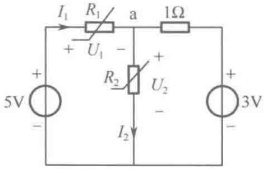

（a）原电路
 

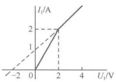

（b） $ R_{1} $的伏安特性曲线
 

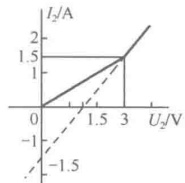

（c） $ R_{2} $的伏安特性曲线
 

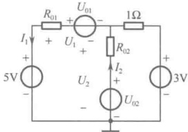

（d）戴维宁等效电路
 

图 6-13 例 6-6 图
 

解：由图 6-13（b）和（c）可知， $ R_{1} $、 $ R_{2} $ 在某一电压、电流区间可等效为一个线性电阻；在另一电压、电流区间可等效为一个戴维宁电路。为便于分析，分别用两个戴维宁电路替代图 6-13（a）中的非线性电阻元件  $ R_{1} $、 $ R_{2} $，得到的等效电路如图 6-13（d）所示。

（1）首先分别根据  $ R_{1} $、 $ R_{2} $ 的伏安特性曲线讨论其对应的戴维宁电路中各元件的参数。由图 6-13（b）可知，对  $ R_{1} $ 而言，当  $ 0 < I_{1} \leq 2A $ 时， $ R_{1} $ 为线性电阻，有

 $$ R_{01}=1\Omega\;,\quad U_{01}=0 $$ 

当 $ I_{1}\geq2A $时， $ R_{1} $为戴维宁电路，有

<!-- page: 149 -->

$$  R_{01}=2\Omega\;,\quad U_{01}=-2\mathrm{V}   \tag*{（6-15b）}$$

由图6-13（c）可知，对 $ R_{2} $而言，当 $ 0<U_{2}\leq3V $时， $ R_{2} $为线性电阻，有

$$  R_{02}=2\Omega\;,\quad U_{02}=0   \tag*{（6-15c）}$$

当 $ U_{3} \geq 3V $时， $ R_{2} $为戴维宁电路，有

$$  R_{02}=1\Omega\ ,\qquad U_{02}=1.5\mathrm{V}   \tag*{（6-15d）}$$

（2）对图6-13（d）中的电路分别列写节点方程和回路方程，有

$$  U_{2}=\frac{\displaystyle\frac{5-U_{01}}{R_{01}}+\frac{U_{02}}{R_{02}}+\frac{3}{1}}{\displaystyle\frac{1}{R_{01}}+\frac{1}{R_{02}}+1}   \tag*{（6-16）}$$

$$  I_{1}=\frac{5-U_{01}-U_{2}}{R_{01}}   \tag*{（6-17）}$$

（3）分别对  $ R_{1} $、 $ R_{2} $ 伏安特性各直线段组合求解。首先将式（6-15a）代入式（6-16），将式（6-15c）代入式（6-17）中，求得

 $$ U_{2}=\frac{\frac{5}{1}+\frac{3}{1}}{1+\frac{1}{2}+1}=3.2V,\qquad I_{1}=\frac{5-3.2}{1}=1.8A $$ 

因为 $ U_{2} $超出了式（6-15c）成立的范围，所以不是解；再将式（6-15b）代入式（6-16），将式（6-15d）代入式（6-17）中，求得

 $$ U_{2}=\frac{\frac{5}{1}+\frac{1.5}{1}+\frac{3}{1}}{1+1+1}\approx3.17V,\quad I_{1}=1.83A $$ 

这两个值在式（6-15a）、式（6-15d）成立的范围内，故是所求解；又将式（6-15b）、式（6-15c）代入式（6-16）、式（6-17）中，求得

 $$ U_{2}=\frac{\frac{7}{2}+\frac{3}{1}}{\frac{1}{2}+\frac{1}{2}+1}=3.25V\ ,\ I_{1}=1.875A $$ 

因为 $ U_{2} $超出了式（6-15c）成立的范围，所以不是解；最后将式（6-15b）、式（6-15d）代入式（6-16）、式（6-17）中，求得

 $$ U_{2}=\frac{\frac{7}{2}+\frac{1.5}{1}+3}{\frac{1}{2}+1+1}=3.2V,\quad I_{1}=1.9A $$ 

由于 $ I_{1} $不在式（6-15b）成立  $ F_{1} $ 的范围内，因此不是解。

综上所述，可知所求解为 $ I_{1}=1.83A $， $ U_{2}\approx3.17V $。

#### 6.4.3 小信号分析法

在分段线性化解析法中，输入信号变动的范围较大，因此必须考虑非线性元件特性曲线的全部。若电路中电压、电流变化范围较小，则可以采用小信号分析法，它所涉及的仅是非线性元件特性曲线的某个局部，即按照工作点附近局部线性化的概念，用非线性元件伏安特性在工作点处的切线（其斜率为动态电导）将非线性元件线性化，建立起局部的线性模型，并据此分析由小信

<!-- page: 150 -->

号引起的电流增量或电压增量。但是，这两种方法具有一个共同点，即在某一范围内，用一段直线来近似非线性元件特性曲线，以便用熟知的线性电路的求解方法在工程实际允许的误差范围内近似地分析非线性电路问题。小信号分析法共有两种，即非线性电阻电路的小信号分析法和非线性动态电路的小信号分析法，其基本原理是完全相同的，这里仅讨论前者。

小信号分析法是分析非线性电路的重要常用方法，特别是电子电路中有关放大器的分析、设计就是以小信号分析为基础的。

小信号是一个相对的概念，它通常是指电路中某一时变电量相对某一直流电量而言，其幅值很小。例如，图 6-14（a）所示为一非线性电阻电路，其中  $ U_s $ 为直流电压源（常称为偏置电源），输入电压源  $ u_s(t) $ 是时变的（一般为正弦交流信号源），且满足  $ \left|u_s(t)\right| \ll U_s $，即  $ u_s(t) $ 的变化幅度很小（例如， $ U_s $ 为伏数量级， $ u_s(t) $ 为微伏数量级），则称  $ u_s(t) $ 为小信号电压源。 $ R_s $ 为线性电阻，非线性电阻为压控型的，其伏安特性方程为  $ i = g(u) $，伏安特性曲线如图 6-14（b）所示。下面利用小信号分析法求解非线性电阻的端电压  $ u(t) $ 和端电流  $ i(t) $。

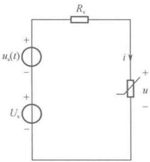

（a）非线性电路
 

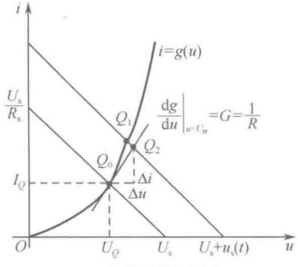

（b）伏安特性曲线
 

图 6-14 小信号分析法原理图示
 

在图 6-14（a）所示电路中，应用 KVL 列写回路方程，可得

$$  R_{s}i+u=U_{s}+u_{s}(t)   \tag*{（6-18）}$$

而

$$  i=g(u)   \tag*{（6-19）}$$

首先设电路中并无时变电源，即  $ u_{s}(t)=0 $，仅  $ U_{s} $

$$  R_{\mathrm{s}}i+u=U_{\mathrm{s}}   \tag*{（6-20）}$$

根据式（6-20）在图6-14（b）中画出负载线，采用图解法求出此时电路的静态工作点 $ Q_{0}(U_{Q}, I_{Q}) $，该点满足式（6-19）和式（6-20），即有 $ I_{O}=g(U_{O}) $和 $ R_{s}I_{O}+U_{O}=U_{s} $。

若图6-14（a）所示的电路中 $ u_s(t) \neq 0 $，即 $ U_s $和 $ u_s(t) $共同作用于电路。这时在直流电源 $ U_s $上叠加了时变电源 $ u_s(t) $，由于所加 $ u_s(t) $的振幅非常小 $ (|u_s(t)| \ll U_s) $，因此在任意时刻，电路中各支路的电压、电流的变化范围均在静态工作点 $ Q_0(U_Q, I_Q) $附近。例如，在图6-14（b）中， $ Q_1 $即为直流电压源 $ U_s $和小信号电压源 $ u_s(t) $共同作用下电路在时刻 $ t $的工作点，它位于 $ Q_0 $点附近。由于 $ u_s(t) $的变化幅度甚小，因此可以在静态工作点（直流工作点） $ Q_0(U_Q, I_Q) $处作非线性电阻伏安特性曲线的切线，它将与同一时刻 $ t $的负载线相交于 $ Q_2 $点。由于 $ |u_s(t)| $足够小， $ Q_2 $与 $ Q_1 $之间相差极其细微，因此，可以用 $ Q_0 $处的切线（直线段）来近似代替 $ Q_0 \sim Q_1 $的非线性电阻伏安特性曲线（ $ Q_0Q_1 $曲线段），即可以用 $ Q_2 $处的电压和电流作为 $ Q_1 $处电压和电流真值解的近似。由图6-14（b）可知， $ Q_2 $点的电压 $ u $、电流 $ i $可以分别表示为 $ U_Q $、 $ I_Q $与增量 $ \Delta u $、 $ \Delta i $之和的形式，从而近似求出 $ Q_1 $点的真解，即

<!-- page: 151 -->

$$  u=U_{Q}+\Delta u   \tag*{(6-21a)}$$

$$  i=I_{Q}+\Delta i   \tag*{（6-21b）}$$

式中的 $ U_Q $、 $ I_Q $分别是静态工作点 $ Q_0 $对应的电压和电流，即 $ u $和 $ i $的直流分量；而 $ \Delta u $、 $ \Delta i $分别是在小信号 $ u_s(t) $作用下在静态工作点 $ Q(U_Q, I_Q) $附近所引起的电压增量与电流增量，它们在任意时刻相对于 $ U_Q $和 $ I_Q $均是很小的量，即 $ |\Delta u| \ll U_Q $及 $ |\Delta i| \ll I_Q $。

将式（6-21）代入式（6-19）可得

$$  I_{Q}+\Delta i=g(U_{Q}+\Delta u)   \tag*{（6-22）}$$

由于 $ \Delta u $很小，可以将式（6-22）右边在 $ Q_{0}(U_{O},I_{O}) $点附近用泰勒级数展开，即

$$  I_{Q}+\Delta i\approx g(U_{Q})+\frac{\mathrm{d}g}{\mathrm{d}u}\bigg|_{u=U_{Q}}\cdot\Delta u+\frac{1}{2!}\frac{\mathrm{d}^{2}g}{\mathrm{d}^{2}u}\bigg|(\Delta u)^{2}+\cdots   \tag*{（6-23）}$$

式中， $ \left.\frac{dg}{du}\right|_{u=U_{Q}} $ 是非线性电阻伏安特性曲线在静态工作点  $ Q_{0}(U_{Q}, I_{Q}) $ 处切线的斜率，如图 6-14(b) 所示。由于  $ \Delta u $ 足够小，因此可忽略式（6-23）中含  $ \Delta u $ 的大于或等于二次方的项（仅取其前两项作为近似表示），可得

$$  I_{Q}+\Delta i\approx g(U_{Q})+\frac{\mathrm{d}g}{\mathrm{d}u}\bigg|_{U_{Q}}\cdot\Delta u   \tag*{(6-24)}$$

由此可见，将式（6-22）的右边近似为式（6-24）的右边，实际上就是用静态工作点 $ Q_{0}(U_{Q}, I_{Q}) $处非线性电阻伏安特性曲线的切线（直线）近似代表该点附近的曲线。在式（6-24）中考虑到 $ I_{Q}=g(U_{Q}) $，可得

$$  \Delta i=\frac{\mathrm{d}g}{\mathrm{d}u}\bigg|_{U_{Q}}\cdot\Delta u   \tag*{（6-25）}$$

式中， $ \left.\frac{dg}{du}\right|_{U_{Q}} $ 可以表示为

$$  \left.\frac{\mathrm{d}g}{\mathrm{d}u}\right|_{U_{Q}}=\left.\frac{\mathrm{d}i}{\mathrm{d}u}\right|_{U_{Q}}=G_{d}=\frac{1}{R_{d}}   \tag*{（6-26）}$$

根据动态电阻的定义可知， $ \left.\frac{dg}{du}\right|_{U_{Q}} $ 为非线性电阻在静态工作点  $ Q_{0}(U_{Q}, I_{Q}) $ 处的动态电导或动态电阻  $ R_{d} $ 的倒数。于是，式（6-25）可写为

$$  \Delta i=G_{d}\Delta u\qquad 或 \qquad\Delta u=R_{d}\Delta i   \tag*{（6-27）}$$

式（6-27）表明，对于由小信号电压  $ u_s(t) $ 作用而引起的电压增量  $ \Delta u $ 与电流增量  $ \Delta i $ 而言，非线性电阻可以用一个线性电导  $ G_d $ 或线性电阻  $ R_d $ 作为它的模型。将式（6-21）及  $ R_s I_Q + U_Q = U_s $ 代入式（6-18）可得

$$  R_{s}(I_{Q}+\Delta i)+U_{Q}+\Delta u=R_{s}I_{Q}+U_{Q}+u_{s}(t)   \tag*{（6-28）}$$

 $$ R_{\mathrm{s}}\Delta i+\Delta u=u_{\mathrm{s}}(t) $$ 

整理式（6-28）可得

将式（6-27）代入式（6-29）可得

$$  R_{s}\Delta i+R_{d}\Delta i=u_{s}(t)   \tag*{（6-30）}$$

<!-- page: 152 -->

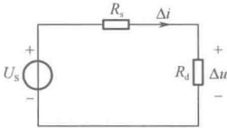

式（6-30）是一个线性代数方程，据此可以得出其电路模型（图6-15所示的线性电路），它是非线性电阻元件在静态工作点 $ Q_{0}(U_{Q},I_{Q}) $处的增量模型，由于从该电路中可以求出小信号电压源 $ u_{s}(t) $对非线性电阻元件静态工作点在 $ Q_{0}(U_{Q},I_{Q}) $处所引起的电压增量 $ \Delta u $与电流增量 $ \Delta i $，故称其为非线性电阻在静态工作点 $ Q_{0}(U_{Q},I_{Q}) $处的小信号等效电路，简称小信号等效电路。它是一个与原非线性电路具有相同拓扑结构的线性电路，

图 6-15 小信号等效电路
 

区别仅在于将原电路中的直流电源置零并将非线性电阻用其在直流工作点处的动态电阻替代。显然，对于给定的非线性电路，仅改变其中直流电源就能得到不同的小信号等效电路。由图6-15所示的线性电路可以求得

 $$ \Delta i=\frac{u_{\mathrm{s}}(t)}{R_{\mathrm{s}}+R_{\mathrm{d}}}\;,\quad\Delta u=R_{\mathrm{d}}\Delta i=\frac{R_{\mathrm{d}}u_{\mathrm{s}}(t)}{R_{\mathrm{s}}+R_{\mathrm{d}}} $$ 

因此，可以求出在图6-14（a）所示非线性电路中由直流电源与小信号电源共同作用下，工作点 $ Q_{2} $处，即非线性电阻的端电压和端电流（工作点 $ Q_{1} $处的电压值与电流值）的近似值为

$$  \left.\begin{array}{l}u=U_{Q}+\Delta u\\ i=I_{Q}+\Delta i\end{array}\right\}   \tag*{（6-31）}$$

注意，式（6-31）并非是应用叠加原理的结果，因此非线性电路不满足叠加原理。以上分析方法也适用于非线性电阻为流控型的非线性电路。

例 6-7 在图 6-16（a）所示的电路中，已知非线性电阻的伏安特性为  $ u = \begin{cases} i^2 + 2i, & i \geq 0 \\ 0, & i < 0 \end{cases} $， $ R_1 = 0.4\Omega $， $ R_2 = 0.6\Omega $， $ i_S(t) = 4.5\sin(\omega t + 20^\circ)\text{A} $， $ U_S = 18\text{V} $，试求电路中电压  $ u(t) $ 和电流  $ i(t) $。

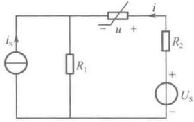

（a）原电路
 

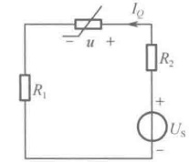

（b）求静态工作点的电路
 

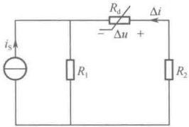

图 6-16 例 6-7 图
 

（c）小信号等效电路
 

解：（1）先求电路的静态工作点。设静态工作点为  $ Q_{0}(U_{Q}, I_{Q}) $，令  $ i_{s}(t)=0 $，求静态工作点的电路如图 6-16（b）所示，列出该电路的回路方程为

 $$ U_{Q}+(R_{1}+R_{2})I_{Q}=U_{S} $$ 

将 $ U_{\varrho}=I_{\varrho}^{2}+2I_{\varrho} $及已知数据代入上式，可得 $ I_{\varrho}^{2}+3I_{\varrho}-18=0 $。解之可得 $ I_{\varrho1}=3A $， $ I_{\varrho2}=-6A $（不合题意故舍去），即 $ U_{\varrho}=15V $， $ I_{\varrho}=3A $。

（2）求 $ Q_{0}(U_{Q},I_{Q}) $处非线性电阻的动态电阻 $ R_{d} $，有

 $$ R_{d}=\frac{du}{di}\bigg|_{Q_{0}}=2I_{Q}+2=8\Omega $$ 

（3）画出小信号等效电路，如图 6-16（c）所示，由该电路求出小信号电源引起的电压增量  $ \Delta u $ 和电流增量  $ \Delta i $ 分别为

<!-- page: 153 -->

$$ \Delta i=-\frac{R_{\mathrm{l}}}{R_{\mathrm{l}}+R_{2}+R_{\mathrm{d}}}i_{\mathrm{s}}=-0.2\sin(\omega t+20^{\circ})\mathrm{A},\qquad\Delta u=R_{\mathrm{d}}\Delta i=-1.6\sin(\omega t+20^{\circ})\mathrm{V} $$ 

（4）工作点处的解与小信号等效电路的解之和为所求解，即

 $$ i=I_{Q}+\Delta i=3-0.2\sin(\omega t+20^{\circ})\mathrm{A},\qquad u=U_{Q}+\Delta u=15-1.6\sin(\omega t+20^{\circ})\mathrm{V} $$ 

### 6.5 计算机仿真

例6-8 半波整流电路。如图6-17（a）所示为一个半波整流电路，其包含一个非线性元件二极管，是一个简单的非线性电路。从元件库中选择电阻、二极管、正弦波电压源、地、双踪示波器，按图6-17（a）连接，二极管可以选择型号，也可以利用元件库中的理想二极管模型，不需要提供其他参数。计算机仿真分析后，由示波器输出的仿真波形如图6-17（b）所示，图中连续的正弦波曲线是整流电路输入的正弦波电压波形，与正弦波正半周基本重合（略低）的曲线是电阻R1上的电压波形，可以看出，其分析结果与理论分析结果一致。半波整流是利用二极管单向导通特性，在输入为标准正弦波的情况下，在R1上获得正弦波的正半周波形，整流电路将正弦交流电信号转变为只有大小没有方向变化的单向信号，实现了半波整流。

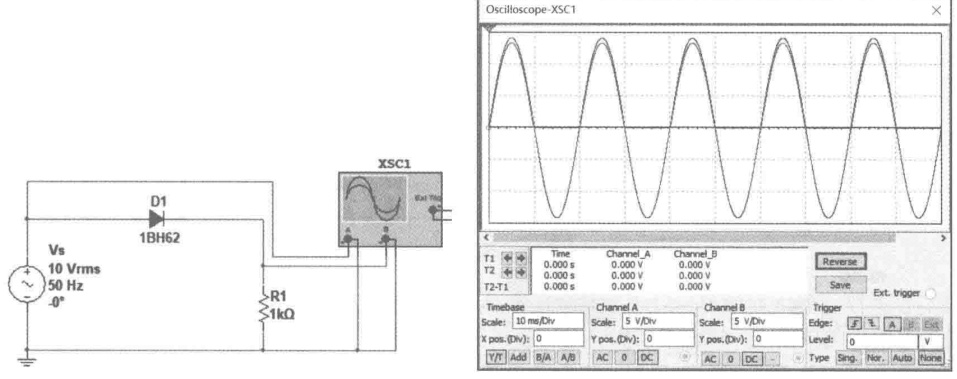

（a）仿真电路
 

（b）二极管半波整流输出电压波形
 

图 6-17 半波整流电路仿真
 

注意，从图6-17（b）所示的仿真波形可以看出，输入电压正半周与输出电压的波形并不完全重合，存在少许差异。根据理论分析，如果是理想二极管，则正半周的两个波形应完全重合。如果在计算机仿真中没有选择理想二极管，而选择实际二极管，当二极管正向导通时，其具有一定的电阻不能用电阻为零的短路线替代，反向截止用“开路”替代。因此实际二极管在正向导通时，输出电阻上的电压略低于输入电压。

例 6-9 全波整流电路。如图 6-18（a）所示为一个全波整流电路。例 6-8 分析的半波整流电路效率不高，失去了一半波形，因此在实际应用中，大多采用全波整流。全波整流的方式很多，常见的有图 6-18（a）所示的利用 2 个二极管构成的全波整流电路，也有如图 6-18（c）所示的由 4 个二极管构成的桥式整流电路。

在图 6-18（a）中，选取两个二极管、两个交流电压源、一个负载电阻、地和一台双踪示波器，按图所示进行连接并按图中标注的参数进行设置。该电路的工作原理如下：当输入为正弦波的正半周时，二极管 D1 正向导通，D2 反向截止，有电流流过 R1，R1 获得正半周电压。当输入为正弦波的负半周时，二极管 D2 正向导通，D1 反向截止，有电流流过 R1，R1 上获得负半周电压。

<!-- page: 154 -->

全波整流电路与半波整流电路不同，负载 R1 正负半周均有电流通过，只是一个将完整输入正弦波的负半周改变了电流方向，全波整流与半波整流后的波形有所不同，全波整流利用了交流的两个半波，这样提高了整流器的效率，输出脉动直流的脉动比半波小得多，这使得整流后的电流更平滑，获得的直流更加稳定，纹波更小。全波整流电路也是一个简单、典型、应用非常广泛的电路。整流后的波形如图 6-18（b）所示。

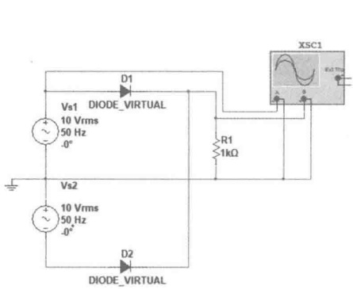

（a）双二极管构成的全波整流电路
 

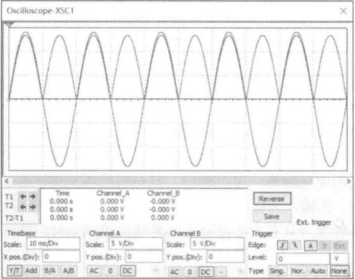

（b）双二极管全波整流输出电压波形
 

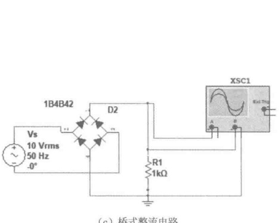

（c）桥式整流电路
 

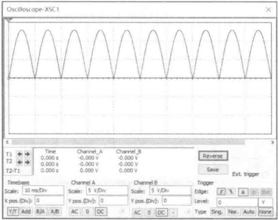

（d）桥式整流电路输出电压波形
 

图 6-18 全波整流电路仿真
 

双二极管构成的全波整流器需要两组电源，或者其电源变压器必须有中心抽头，而图6-18（c）所示的由4个二极管构成的桥式整流电路可以克服这一缺点。由于桥式整流电路应用广泛，在Multisim软件元件库中有设计好的全桥，也称桥堆，可以直接选取使用。经过桥堆整流后的波形可以参见图6-18（d）。

例 6-10 隧道二极管特性分析。隧道二极管是一种非线性器件，也称非线性电阻。其电压-电流曲线比较特殊，大致可以由图 6-19 所示的曲线来描述，可以看到其中有一段为负电阻率，负电阻基于电子的量子力学隧道效应，开关速度达皮秒量级，工作频率高达 100GHz。

隧道二极管具有开关特性好、速度快、工作频率高的优点。一般应用于低噪声高频放大器及高频振荡器中，也可以应用于高速开关电路中。

如果设计的电路中将隧道二极管的工作点设置在负电阻区（见图6-20中的Q点），在其工作点附近叠加一个小信号（如一个正弦波小信号），对于该正弦波小信号，隧道二极管就表现出负电阻特性。

<!-- page: 155 -->

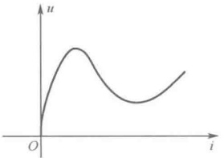

图 6-19 隧道二极管非线性电阻特性
 

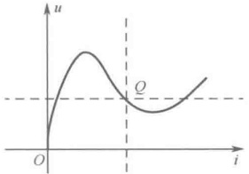

图 6-20 工作点选择在负电阻区
 

Multisim 软件中的 IV Analyzer 是一种专门用于分析元件伏安特性的虚拟仪器。直接将隧道二极管接入，如图 6-21（a）所示。可以得到隧道二极管的伏安特性曲线如图 6-21（b）所示。水平方向是电流，最大为 2mA，垂直方向是电压，最大为 0.6V。正向电压在 60～350mV 区间出现随电压增大电流减小的工作区间，该区间内交流等效电阻为负数，即隧道二极管呈现负阻效应。

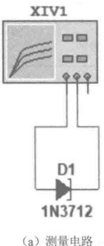

（a）测量电路
 

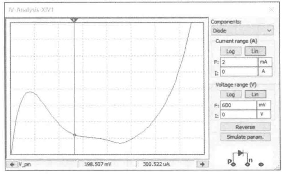

（b）隧道二极管伏安特性
 

图 6-21 工作点选择在负电阻区
 

例 6-11 含非线性元件单口网络特性分析。如果单口网络中包含非线性元件，则其端口的电压-电流关系将复杂得多。因为其端口特性一般不再是一条直线，无法用一个简单的电阻来等效，在工程应用中，也不能通过万用表的欧姆挡简单测量来获得一个单纯的电阻值，而是需要用端口VCR 特性曲线来表示。

可以通过外加激励法来分析单口网络的伏安特性，采用独立直流电压源（或直流电流源）作为单口网络的激励，通过 DC Sweep 扫描不同端口电压情况下的端口电流得到单口网络的特性曲线，也可以使用 Multisim 软件中的 IV Analyzer 虚拟仪器分析。

##### 1）电阻与二极管串联

如图 6-22（a）所示电路，先分析电阻与二极管各自的伏安特性，在  $ 1\Omega $ 电阻与二极管两端分别施加电压，得到特性曲线如图 6-22（b）、（c）所示。再分析电阻与二极管串联单口网络特性曲线。电阻与二极管串联后的单口网络特性曲线可以认为是电阻的特性曲线和二极管的特性曲线在电流相等处逐点叠加电压后得到的。由基尔霍夫定律可知，电阻和二极管串联支路电流相等，总电压是电阻端电压和二极管端电压之和。因此可在电流相等处，逐点令电压相加，得到总的伏安特性曲线，如图 6-22（d）所示，而电流不等处无意义。

电阻和二极管串联后的曲线是两段直线，通过简单分析可以证明曲线与实际工作情况是相吻合的。

当加到串联支路上的电压为负值时，二极管因施加反向电压而截止，串联支路电流为零，无论电阻大小，其电流均为零；当加到串联支路上的电压为正值，但电压小于二极管的截止电压时，

<!-- page: 156 -->

二极管仍然截止，串联支路电流仍为零，无论电阻大小，其电流均为零。综合以上两种情况，串联支路伏安特性的这一段就是二极管的伏安特性曲线，即图6-22（d）中的水平直线段（在其电压变化区间，电流均为零）。当加到串联支路上的电压为正值，且电压大于二极管的截止电压时，二极管导通（等效为一段导线），串联支路电流由电阻和电源电压决定，串联支路伏安特性就是电阻的伏安特性，即图6-22（d）中的倾斜直线段。

因此，将电阻与二极管的特性叠加，就得到电阻和二极管串联单口网络的伏安特性，如图6-22（d）所示，也即利用DC Sweep逐点扫描所得的仿真特性。

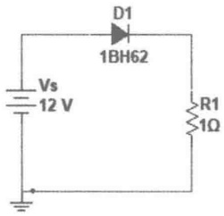

（a）分析电路
 

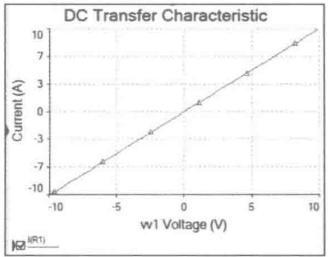

（b）电阻伏安特性
 

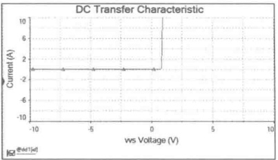

（c）二极管伏安特性
 

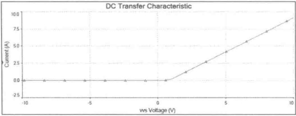

（d）电阻与二极管串联伏安特性
 

图 6-22 二极管与电阻串联端口特性分析
 

##### 2）电阻与二极管并联

电阻与二极管的开联电路如图 6-23（a）所示，由基尔霍夫定律可知，并联支路中的电阻和二极管端电压始终相等，端口总电流为电阻支路和二极管支路电流之和。故可在电压相等处，逐点令电流相加，得到电阻与二极管并联支路总的伏安特性曲线如图 6-23（b）所示，而电压不等处无意义。

电阻与二极管并联后的曲线也是两段直线，可以证明曲线与实际工作情况是相吻合的。

当加到并联支路上的电压为正值，且电压大于二极管的截止电压时，二极管导通，等效为一段导线，二极管将电源短路，二极管和电阻两端电压始终被钳制在截止电压，无论电阻值为多少，二极管等效“短路”，理论上电流可以为无穷大。因此，并联后的这一段曲线就是二极管的正向曲线，即图6-23（b）中的垂直直线段。

当加到并联支路上的电压为负值时，二极管截止，相当于“开路”，并联支路电流由电阻和电源电压决定，故并联支路伏安特性就是电阻的伏安特性。

当加到并联支路上的电压为正值，但电压小于二极管的截止电压时，二极管仍然截止，并联支路总电流仍由电阻和电源电压决定。故这一小段并联支路的伏安特性也是电阻的伏安特性。综合可以得到图6-23（b）中的倾斜直线段。

因此，将电阻和二极管的特性按电压相等逐点叠加，就得到电阻与二极管并联端口网络的伏安特性，如图6-23（b）所示，也即利用DC Sweep逐点扫描所得的仿真特性。

<!-- page: 157 -->

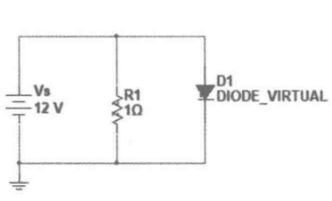

（a）分析电路
 

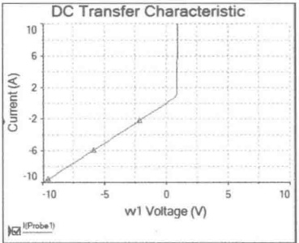

（b）电阻与二极管并联伏安特性
 

图 6-23 二极管与电阻并联端口特性分析
 

如图 6-24 所示，在 “DC Sweep Analysis” 的状态下，设置电源、扫描电源的电压起始值、终值和扫描步长等参数。

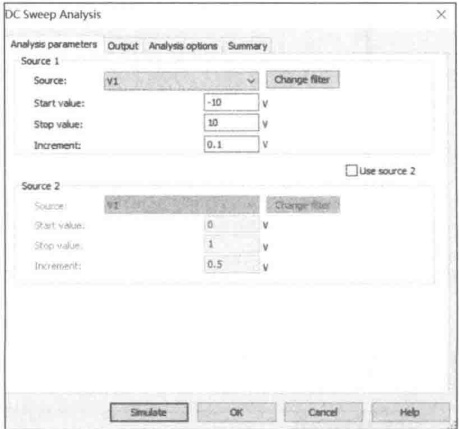

图 6-24 DC Sweep 参数设置
 

除了可以用 DC Sweep 仿真器，还可以利用 IV Analyzer 虚拟仪器来显示特性曲线。其仿真原理是一致的，都是利用端口的电压和电流关系来表达。虚拟仪器不需要外接电源，直接利用虚拟仪器内部的电源扫描来获得端口特性。以下利用 IV Analyzer 虚拟仪器再次获得电阻与二极管串联、并联的特性，分别如图 6-25～图 6-28 所示。

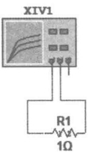

（a）分析电路
 

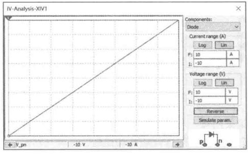

（b）线性电阻的伏安特性
 

图 6-25 利用 IV Analyzer 仿真线性电阻特性
 

<!-- page: 158 -->

（a）分析电路
 

（b）二极管伏安特性
 

图 6-26 利用 IV Analyzer 仿真二极管特性
 

(a) 分析电路
 

（b）电阻与二极管串联伏安特性
 

图 6-27 利用 IV Analyzer 仿真电阻与二极管串联特性
 

（a）分析电路
 

（b）电阻与二极管并联伏安特性
 

图 6-28 利用 IV Analyzer 仿真电阻与二极管并联特性
 

注意，无论采用哪一种方式进行单口网络特性分析，建议将界面的横、纵坐标轴设置为一样的，方便对各个曲线的图形进行观察和比较。

<!-- page: 159 -->

### 思考题

6-1 什么是非线性电阻元件？

6-2 线性电阻与非线性电阻的伏安特性的区别是什么？

6-3 非线性电阻按其伏安特性可以分为哪些类型？

6-4 什么是非线性电阻电路？

6-5 什么是静态电阻？什么是动态电阻？

6-6 分析非线性电路的基本依据是什么？

6-7 非线性电阻电路的直流工作点怎样确定？

6-8 分段线性化解析法的原理是什么？

6-9 小信号分析法的原理和适用情况是什么？

### 习题

6-1 已知非线性电阻的电流为  $ \sin\omega t(A) $，要使该电阻两端电压的角频率为  $ 2\omega $，电阻应具有什么样的伏安特性？

6-2 某非线性电阻的 u-i 特性为  $ u=i^{3} $，如果通过非线性电阻的电流为  $ i=\cos\omega t(A) $，则该电阻的端电压中将含有哪些频率分量？

6-3 某非线性电阻的伏安特性为  $ u = f(i) = 30i + 5i^{3} $ （ $ i $ 、 u 的单位分别为 A 和 V）。

（1）求 $ i_{1}=1A $， $ i_{2}=2A $时所对应的电压 $ u_{1} $、 $ u_{2} $；

（2）求 $ i=2\sin(100t) $（A）时所对应的电压u；

（3）设 $ u_{12}=f(i_{1}+i_{2}) $，试问 $ u_{12} $是否等于 $ (u_{1}+u_{2}) $？

6-4 已知非线性电阻的 u-i 关系为  $ u = i + 2i^{3} $，求：（1）i=1 处的静态电阻和动态电阻；（2） $ i = \sin \omega t $ (A) 时电阻两端的电压。

6-5 在题 6-5 图所示电路中，非线性电阻的伏安特性为

 $$ u=f(i)=\left\{\begin{aligned}&i^{2},&i>0\\ &0,&i<0\end{aligned}\right. $$ 

试用分段线性化解析法求出电路的静态工作点，并求出工作点处的动态电阻 $ R_{d} $

6-6 如题 6-6 图所示的电路，若非线性电阻 R 的伏安特性为  $ i_{R}=f(u_{R})=u_{R}^{2}-3u_{R}+1 $ 。

（1）求一端口电路N的伏安特性；

（2）若 $ U_{s}=3V $，求u和 $ i_{R} $。

题6-6图
 

6-7 在题 6-7 图所示电路中，非线性电阻 R 的伏安特性为  $ U = I^{2} - 5I - 3 (I > 0) $。试求 (1) a-b 端口左侧电路的戴维宁等效电路；（2）通过非线性电阻 R 的电流 I。

<!-- page: 160 -->

6-8 在题 6-8 图所示电路中，非线性电阻的伏安特性为  $ U = I^{2} - 9I + 6(I > 0) $。求（1）除去非线性电阻 R 外，从 m-n 端口看进去的戴维宁等效电路；（2）通过非线性电阻 R 的电流 I。

题6-7图
 

题6-8图
 

6-9 电路如题 6-9 图所示，非线性电阻  $ R_{1} $ 和  $ R_{2} $ 的伏安关系分别为  $ i_{1}=f_{1}(u_{1}) $， $ i_{2}=f_{2}(u_{2}) $，试列出非线性电路方程。

6-10 电路如题 6-10 图所示，其中非线性电阻的伏安特性为  $ i = u^{2} - u + 1.5 $ （i、u 的单位分别为 A、V），试求 u 和 i。

题6-9图
 

题6-10图
 

6-11 求题 6-11 图所示的电路中各节点电压和通过电压源的电流  $ I_{3} $，其中非线性电阻元件的伏安特性为  $ i = 0.1 (e^{40u} - 1) $，其中 i 、u 的单位分别为 A、V。

6-12 在题 6-12 图所示电路中，非线性电阻的伏安特性为  $ i = \frac{5}{2} u^3 A $，用图解法求  $ u $。

题6-11图
 

题6-12图
 

6-13 如题 6-13 图（a）所示电路中的非线性电阻具有方向性，其特性如题 6-13 图（b）所示，当正向连接（a 与 c 连接，b 与 d 连接）时，测得 I = 2A，求反向连接（a 与 d 连接，b 与 c 连接）时的电流 I = ?

6-14 非线性电阻的混联电路如题 6-14 图（a）所示，电路中 3 个非线性电阻的伏安特性分别为题 6-14 图（b）中的曲线  $ f_{1} $、 $ f_{2} $ 和  $ f_{3} $，试画出端口的 DP 图。若端口电压  $ u = U_{0} = 5V $，求各非线性电阻的电压和电流。

<!-- page: 161 -->

(a)
 

(b)
 

题6-13 图
 

6-15 含理想二极管的电路如题 6-15 图所示。试画出 a-b 端口的伏安特性曲线。

(a)
 

(b)
 

题6-14图
 

题6-15图
 

6-16 非线性电阻  $ R_{1} $ 和  $ R_{2} $ 串联 [见题 6-16 图(a)]，它们各自的伏安特性分别如题 6-16 图(b)、(c) 所示，求端口的伏安特性。

(a)
 

（b）
 

题6-16图
 

(c)
 

6-17 试用分段线性化解析法求解题 6-17 图（a）所示电路，其中非线性电阻的特性如题 6-17 图（b）所示。

(a)
 

(b)
 

题6-17图
 

6-18 在题6-18图（a）所示电路中，非线性电阻R的伏安特性如题6-18图（b）所示。

（1）求 $ u_{s}=0V $、2V、4V时的u和i；

<!-- page: 162 -->

（2）若输入信号 $ u_{s} $的波形如题6-18图（c）所示，求电流i和电压u。

(a)
 

(b)
 

题6-18 图
 

(c)
 

6-19 在题 6-19 图（a）所示电路中，其中两个非线性电阻的伏安特性如题 6-19 图（b）和（c）所示。求  $ u_{1} $、 $ i_{1} $ 和  $ u_{2} $、 $ i_{2} $。

(a)
 

（b）
 

题6-19图
 

(c)
 

6-20 在题 6-20 图（a）所示电路中，非线性电阻的伏安特性如题 6-20 图（b）所示。

（1）若 $ u_{s}(t)=10V $，求直流工作点及工作点处的动态电阻；

（2）若 $ u_{s}(t)=10+\cos t(V) $，求工作点位于特性曲线中负斜率段时的电压u。

(a)
 

（b）
 

题6-20图
 

6-21 在题6-21图所示电路中，直流电流源 $ I_{s}=10A $， $ R_{s}=1/3\Omega $，小信号电流源 $ i_{s}(t)=0.5\sin t(A) $，非线性电阻为电压控制型，其伏安特性的解析式为（i、u的单位分别为A、V）

 $$ i=g(u)=\left\{\begin{aligned}&u^{2},&u>0\\ &0,&u<0\end{aligned}\right. $$ 

试用小信号分析法求 $ u(t) $和 $ i(t) $。

6-22 在题 6-22 图所示电路中，已知  $ I_{0}=5A $， $ R_{s}=4\Omega $， $ R_{1}=6\Omega $， $ u_{s}=0.02\sin(100t)(V) $， $ i=0.5u^{2} $（ $ u>0 $），用小信号分析法求电流  $ i $。

题6-21 图
 

题6-22图
 

