# 07-第7章 储能元件

[返回全书目录](../../README.md)

> PDF 页码：163–179

<!-- page: 163 -->

### 第7章 储能元件

本章介绍电容、电感两种储能元件，并讨论其定义，以及元件的伏安关系、功率及能量表达式，同时引入初始时刻、动态、记忆等概念，为动态电路的分析奠定基础。

### 7.1 电容元件

#### 7.1.1 电容器与电容元件

两片金属极板用电介质隔开，就可构成一个简单的电容器，如图7-1所示。在外电源作用下，两片金属极板上会分别聚集等量、异性的电荷，电荷聚集的过程伴随着电场的建立，电场中具有电场能量。如果撤走外电源，两片金属极板上的等量异性电荷依靠电场力的作用互相吸引，而又因电介质绝缘不能中和，所以极板上的电荷能长久地储存下去。因此，电容器是一种能够储存电荷，或者说能够储存电场能量的元件。如果忽略漏电等次要因素，则可用理想电容元件作为反映电容器储能特性的理想化电路模型。

电容元件分为线性和非线性的、时变的和时不变的，本书只讨论线性时不变电容元件（简称电容元件），其图形符号如图7-2（a）所示。电容元件的定义描述如下：它是一个二端元件，当电压参考极性与极板储存电荷的极性一致时，元件的特性为

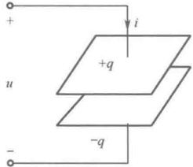

 $$ q=C u $$ 

图 7-1 平板电容器
 

式中，C 是电容元件的参数，称为电容，它是一个正实常数。在国际单位制中，当电荷和电压的单位分别为 C（库仑）和 V（伏特）时，电容的单位为 F（法拉，简称法）。但因 F（法）这个单位太大，所以通常采用  $ \mu $F（微法）或 pF（皮法）作为电容的单位，并且

$$  \left.\begin{array}{l}1\mu\mathrm{F}=10^{-6}\mathrm{F}\\ 1\mathrm{pF}=10^{-12}\mathrm{F}\end{array}\right\}   \tag*{（7-2）}$$

线性时不变电容元件的特性曲线是 q-u 平面上一条不随时间变化的通过原点的直线，直线的斜率就是电容 C，如图 7-2（b）所示。

实际电容器除了具有储存电能的主要特性，还存在漏电现象，这是由于电介质不可能完全绝缘，或多或少存在导电而造成的。在这种情况下，电容器的电路模型中除了上述电容元件，还应增加电阻元件与之并联，如图7-3所示。

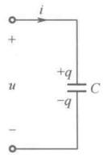

（a）图形符号
 

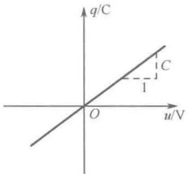

（b）特性曲线
 

图 7-2 线性时不变电容元件
 

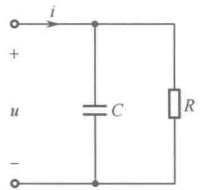

图 7-3 实际电容器的电路模型
 

<!-- page: 164 -->

对一个电容器，除标出它的电容 C，还需标明它的额定工作电压，因为每个电容器允许承受的电压是有限度的，电压过高，电介质就会被击穿，从而丧失电容器的作用。因此，使用电容器时不应超过它的额定工作电压。

#### 7.1.2 电容元件的伏安关系

在电路分析中，最关心的是电容元件的电压与电流之间的关系，即元件的伏安关系。

设电容元件的电压、电流取关联参考方向，如图 7-2（a）所示。当电容两端电压发生变化时，电容极板上的电荷 q = Cu 也相应地发生变化，从而导致连接电容的引线上有电荷移动，形成传导电流，同时在电容极板间的电介质中，随时间变化的电场产生位移电流，可以证明，此位移电流恰好等于电容元件引线上的传导电流，从而保持了电容电路中电流的连续性。考虑到  $ i = \frac{dq}{dt} $，故流过电容的电流为

$$  i=C\frac{d u}{d t}   \tag*{(7-3)}$$

上式称为电容元件伏安关系的微分形式。它表明：流过电容的电流与其端电压的变化率成正比。如果电压不随时间变化，则 $ \frac{du}{dt} $为零，此时虽有电压，但电流为零。因此电容元件在直流稳态下因其两端电压恒定不变而相当于开路，这说明电容有隔断直流的作用。电容电压变化越快，即 $ \frac{du}{dt} $越大，电流也就越大。对电容而言，只有变动的电压才能产生电流，这一特性称为电容元件的动态特性，故电容元件属于动态元件。

还可以把电容元件的电压 u 表示为电流 i 的函数，对式（7-3）积分可得

$$  u(t)=\frac{1}{C}\int_{-\infty}^{t}i(t^{\prime})\mathrm{d}t^{\prime}   \tag*{(74)}$$

上式称为电容元件伏安关系的积分形式。它表明：在某一时刻t，电容的电压值取决于从 $ -\infty $到t所有时刻的电流值，也就是说，电容电压与电流已往的全部历史有关。这是因为电容是聚集电荷的元件，电容电压的大小反映了电容聚集电荷的多少，而电荷的聚集是电流从 $ -\infty $到t长期作用的结果。即使某一时刻电流变为零，但电容两端的电压依然存在，因为过去曾有电流作用过。电容能将已往每时每刻电流的作用点点滴滴地记忆下来，因此，电容元件又属于记忆元件。

研究电路问题的时间起点称为初始时刻 $ t_{0} $，如果只想分析某一初始时刻 $ t_{0} $（通常取 $ t_{0}=0 $）以后电容电压的情况，可将式（7-4）改写为

$$  u(t)=\frac{1}{C}\int_{-\infty}^{t_{0}}i(t^{\prime})\mathrm{d}t^{\prime}+\frac{1}{C}\int_{t_{0}}^{t}i(t^{\prime})\mathrm{d}t^{\prime}   \tag*{(7-5)}$$

若令

$$  u(t_{0})=\frac{1}{C}\int_{-\infty}^{t_{0}}i(t^{\prime})\mathrm{d}t^{\prime}   \tag*{（7-6）}$$

则

$$  u(t)=u(t_{0})+\frac{1}{C}\int_{t_{0}}^{t}i(t^{\prime})\mathrm{d}t^{\prime},\quad t\geq t_{0}   \tag*{(7-7)}$$

 $ u(t_{0}) $ 称为电容的初始电压，它反映了初始时刻  $ t_{0} $ 以前电流的全部历史情况对现在  $ t_{0} $ 以及未来  $ t \geq t_{0} $ 的电压所产生的影响。如果已知电容的初始电压  $ u(t_{0}) $ 以及从初始时刻  $ t_{0} $ 开始作用的电流  $ i(t) $，就能由式（7-7）确定  $ t \geq t_{0} $ 时的电容电压  $ u(t) $。因此，在含有电容元件的动态电路分析中，电容的初始电压  $ u(t_{0}) $ 是一个常需具备的已知条件。这样，对一个线性时不变电容元件，只有当它的电容值 C 和初始电压  $ u(t_{0}) $ 给定时，才是一个确定的电路元件。

<!-- page: 165 -->

根据式（7-7），具有初始电压 $ u(t_{0}) $的电容元件可以等效为一个电压等于该电容的初始电压 $ u(t_{0}) $的电压源和初始电压等于零的相同电容值的电容元件相串联的电路，如图7-4所示。这一等效处理相当于使 $ u(t_{0}) $对电路的作用“从幕后走向前台”，会对动态电路的分析带来方便。

应该注意，电容元件的伏安关系式（7-3）、式（7-4）和式（7-7）都要求电容元件的电压、电流取关联参考方向。若电容元件的电压、电流取非关联参考方向，如图7-5所示，则电容元件的伏安关系应为

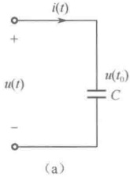

 $$ \left.\begin{aligned}&i=-C\frac{\mathrm{d}u}{\mathrm{d}t}\\ &u(t)=-\frac{1}{C}\int_{-\infty}^{t}i(t^{\prime})\mathrm{d}t^{\prime}\\ &u(t)=u(t_{0})-\frac{1}{C}\int_{t_{0}}^{t}i(t^{\prime})\mathrm{d}t^{\prime},\quad t\geq t_{0}\\ \end{aligned}\right\} $$ 

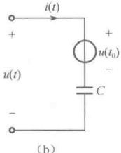

图 7-4 具有初始电压  $ u(t_{0}) $ 的电容元件及其等效电路
 

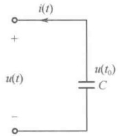

图 7-5 电容元件的电压、电流取非关联参考方向
 

#### 7.1.3 电容元件的功率与能量

在电容元件的电压、电流取关联参考方向的情况下，任意时刻电容元件吸收的瞬时功率为

$$  p(t)=u(t)i(t)   \tag*{（7-9）}$$

如果选用电容元件伏安关系的微分形式

 $$ i=C\frac{d u}{d t} $$ 

则电容元件吸收的瞬时功率又可表示为

$$  p(t)=C u(t)\frac{\mathrm{d}u}{\mathrm{d}t}   \tag*{（7-10）}$$

当  $ p(t) $ 为正值时，表明电容元件从外电路吸收功率（作为电场能量储存起来），而当  $ p(t) $ 为负值时，表明电容元件对外电路释放功率（将储存的电场能量释放出来送还给外电路），可见电容元件与外电路之间有能量的往返交换现象。

设在时间间隔 $ [t_{0},t] $ 内，电容电压由  $ u(t_{0}) $ 变到  $ u(t) $，电容元件吸收的能量可用定积分计算如下：

$$  \begin{align*}W_{C}[t_{0},t]=&\int_{t_{0}}^{t}p(t^{\prime})\mathrm{d}t^{\prime}=\int_{t_{0}}^{t}Cu(t^{\prime})\frac{\mathrm{d}u}{\mathrm{d}t^{\prime}}\mathrm{d}t^{\prime}=\int_{u(t_{0})}^{u(t)}Cu\mathrm{d}u\\=&\frac{1}{2}Cu^{2}(t)-\frac{1}{2}Cu^{2}(t_{0})=W_{C}(t)-W_{C}(t_{0})\end{align*}   \tag*{(7-11)}$$

由式（7-11）可知，在 $ t_{0} $到t期间，电容吸收的能量只与两个时间端点的电压值 $ u(t_{0}) $和 $ u(t) $有关，而与在此期间的其他电压值无关。式中， $ W_{c}(t)=\frac{1}{2}Cu^{2}(t) $表示t时刻电容所储存的电场能量，而 $ W_{c}(t_{0})=\frac{1}{2}Cu^{2}(t_{0}) $表示 $ t_{0} $时刻电容所储存的电场能量，即从 $ t_{0} $到t期间电容吸收的能量是用来改变电容的储能状况的，这是由电容元件是一个储能元件的本质决定的。

如果电容元件在初始时刻  $ t_{0} $ 未曾充电，即  $ u(t_{0})=0 $，同时电场能量  $ W_{C}(t_{0})=0 $，则在任意瞬时 t，电场中储存的电场能量  $ W_{C}(t) $ 就等于电容元件在时间间隔  $ [t_{0},t] $ 内吸收的能量  $ W_{C}[t_{0},t] $，即

<!-- page: 166 -->

$$  W_{C}(t)=W_{C}[t_{0},t]=\frac{1}{2}Cu^{2}(t)   \tag*{（7-12）}$$

此即电容储能公式。可见，电容电压决定了电容的储能状态，电容在任意时刻的储能总是非负的，故电容属于无源元件。

例 7-1 电路如图 7-6（a）所示，已知 C=1F，且  $ u_{c}(0)=0 $，若  $ u(t) $ 的波形如图 7-6（b）所示，求电路元件上电流  $ i(t) $、瞬时功率  $ p(t) $，以及在 t 时刻的储能  $ W_{c}(t) $。

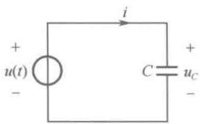

(a)
 

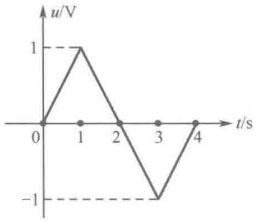

(b)
 

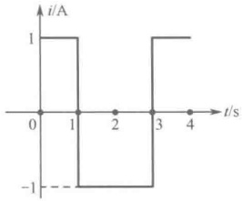

(c)
 

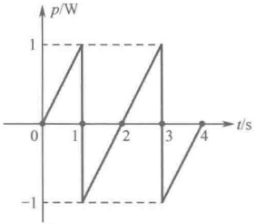

(d)
 

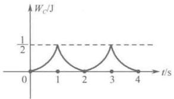

(e)
 

图 7-6 例 7-1 图
 

解：用分段的方式写出 $ u(t) $的数学表达式

 $$ u(t)=\left\{\begin{aligned}&t,&0\leq t\leq1\\ &-(t-2),&1\leq t\leq3\\ &t-4,&3\leq t\leq5\end{aligned}\right. $$ 

由 $ i=C\frac{du}{dt} $得

 $$ i(t)=\left\{\begin{aligned}&1,&\quad&0<t<1\\ &-1,&\quad&1<t<3\\ &1,&\quad&3<t<5\end{aligned}\right. $$ 

电流  $ i(t) $ 的波形如图 7-6（c）所示。在充电过程中， $ \frac{du}{dt}>0 $， $ i(t)>0 $，即充电电流的实际方向与其参考方向相同；在放电过程中， $ \frac{du}{dt}<0 $， $ i(t)<0 $，即放电电流的实际方向与其参考方向相反。

由  $ n=u(t)i(t) $ 得

 $$ p(t)=\left\{\begin{aligned}&t,&0<t<1\\ &t-2,&1<t<3\\ &t-4,&3<t<5\end{aligned}\right. $$ 

功率  $ p(t) $ 的波形如图 7-6（d）所示。可见，电容元件的功率有时为正，有时为负。当功率为正时，表明电容吸收能量，并以电场能量的形式储存在电容中；当功率为负时，表明电容释放原

<!-- page: 167 -->

先储存的能量。在电压  $ u(t) $ 变化的一个周期内，其平均功率  $ P = \frac{1}{T} \int_{0}^{T} p(t) dt $ 等于零。这说明电容元件在充电时吸收并储存起来的能量一定在放电完毕时全部释放出来，因此，电容元件仅是一个能量存储器，它既不能提供额外的能量，也不消耗能量，即电容元件是无损的无源元件。

由 $ W_{c}(t)=\frac{1}{2}Cu^{2}(t) $得

 $$ W_{C}(t)=\left\{\begin{aligned}&\frac{1}{2}t^{2},&\quad&0\leq t\leq1\\&\frac{1}{2}(t-2)^{2},&\quad&1\leq t\leq3\\&\frac{1}{2}(t-4)^{2},&\quad&3\leq t\leq5\end{aligned}\right. $$ 

储能 $ W_{c}(t) $的波形如图7-6（e）所示。电容上的储能总是非负的，而且在充电时，电容吸收能量导致储能增加；在放电时，电容释放能量导致储能减少。

### 7.2 电感元件

#### 7.2.1 电感线圈与电感元件

在工程上，广泛应用各种电感线圈建立磁场，储存磁能。图 7-7 为实际电感线圈的示意图，当电流  $ i(t) $ 流过电感线圈时，在线圈周围空间激发出磁场，产生磁通  $ \Phi(t) $ （其方向与电流方向符合右手螺旋法则），与线圈交链的总磁通称为磁链，记为  $ \Psi(t) $。若线圈密绕且有 N 匝，则磁链  $ \Psi(t)=N\Phi(t) $。由于该磁通和磁链是由线圈本身的电流所产生的，因此又称为自感磁通和自感磁链。磁场中具有磁场能量，因此，电感线圈是一种能够储存磁场能量的元件。如果忽略导线耗能等次要因素，则可用理想电感元件作为反映电感线圈储能特性的理想化电路模型。

电感元件分为线性的和非线性的、时变的和时不变的，本书只讨论线性时不变电感元件（简称电感元件），其图形符号如图7-8（a）所示。电感元件的定义描述如下：它是一个二端元件，当电流参考方向与自感磁链的方向符合右手螺旋法则时，元件的特性为

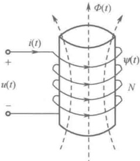

图 7-7 电感线圈
 

$$  \Psi(t)=Li(t)   \tag*{（7-13）}$$

式中，L 是电感元件的参数，称为电感，它是一个正实常数。在国际单位制中，当磁链和电流的单位分别为 Wb（韦伯）和 A（安培）时，电感的单位为 H（亨利，简称亨），电感也常用 mH（毫亨）或  $ \mu $H（微亨）作单位，并且

$$  \left.\begin{array}{l}1\mathrm{mH}=10^{-3}\mathrm{H}\\ 1\mu\mathrm{H}=10^{-6}\mathrm{H}\end{array}\right\}   \tag*{(7-14)}$$

线性时不变电感元件的特性曲线是 $ \psi-i $平面上一条不随时间变化且通过原点的直线，直线的斜率就是电感L，如图7-8（b）所示。

实际电感线圈除具有储存磁能的主要特性外，还会有能量损耗，这是由于绕制线圈的导线或多或少存在电阻。因此，电感线圈的电路模型中除了上述电感元件，还应串联一个小电阻R，如图7-9所示。

<!-- page: 168 -->

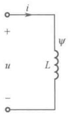

（a）图形符号
 

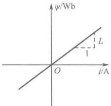

（b）特性曲线
 

图 7-8 线性时不变电感元件
 

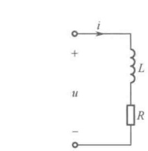

图 7-9 实际电感线圈的电路模型
 

对一个实际电感线圈，除标出它的电感值 L 外，还需标明它的额定工作电流值，因为线圈中的导线允许承受的电流是有限制的，电流过大，会使线圈过热，甚至烧毁线圈。

#### 7.2.2 电感元件的伏安关系

在电路分析中，最关心的是电感元件的电压与电流之间的关系，即元件的伏安关系。

当流过电感的电流发生变化时，磁链  $ \Psi(t)=Li(t) $ 也相应发生变化，且电流与磁链的参考方向符合右手螺旋法则。根据电磁感应定律，感应电压等于磁链的变化率。当感应电压参考方向与磁链的参考方向也符合右手螺旋法则时，可得  $ u=\frac{d\psi}{dt} $，这样电感元件的电压与电流恰好为关联参考方向，且有

$$  u=L\frac{\mathrm{d}i}{\mathrm{d}t}   \tag*{（7-15）}$$

上式称为电感元件伏安关系的微分形式。它表明：电感的端电压与其流过的电流的变化率成正比。如果电流不随时间变化，则 $ \frac{di}{dt} $为零，此时虽有电流，但电压为零，因此电感元件在直流稳态下因其流过的电流恒定不变而相当于短路。电感电流变化越快，即 $ \frac{di}{dt} $越大，电压也就越大。对电感而言，只有变动的电流才能产生电压，这一特性称为电感元件的动态特性，故电感元件属于动态元件。

还可以把电感元件的电流 i 表示为电压 u 的函数，对式（7-15）积分可得

$$  i(t)=\frac{1}{L}\int_{-\infty}^{t}u(t^{\prime})\mathrm{d}t^{\prime}   \tag*{（7-16）}$$

上式称为电感元件伏安关系的积分形式。它表明：在某一时刻t，电感的电流值取决于从 $ -\infty $到t所有时刻的电压值，也就是说，与电压已往的全部历史有关。电感能将已往每时每刻电压的作用点点滴滴地记忆下来，因此，电感元件属于记忆元件。

在任意选取初始时刻 $ t_{0} $以后，式（7-16）可表示为

$$  i(t)=\frac{1}{L}\int_{-\infty}^{t_{0}}u(t^{\prime})\mathrm{d}t^{\prime}+\frac{1}{L}\int_{t_{0}}^{t}u(t^{\prime})\mathrm{d}t^{\prime}   \tag*{(7-17)}$$

若令

$$  i(t_{0})=\frac{1}{L}\int_{-\infty}^{t_{0}}u(t^{\prime})\mathrm{d}t^{\prime}   \tag*{（7-18）}$$

则

$$  i(t)=i(t_{0})+\frac{1}{L}\int_{t_{0}}^{t}u(t^{\prime})\mathrm{d}t^{\prime},\quad t\geq t_{0}   \tag*{(7-19)}$$

 $ i(t_{0}) $ 称为电感的初始电流，它反映了初始时刻  $ t_{0} $ 以前电压的全部历史情况对现在  $ t_{0} $ 以及未来  $ t \geq t_{0} $ 的电流所产生的影响。如果已知电感的初始电流  $ i(t_{0}) $ 及从初始时刻  $ t_{0} $ 开始作用的电压  $ u(t) $，就能由式（7-19）确定  $ t \geq t_{0} $ 时的电感电流  $ i(t) $。因此，在含有电感元件的动态电路分析中，电感

<!-- page: 169 -->

的初始电流 $ i(t_{0}) $是一个常需具备的已知条件。这样，对一个线性时不变电感元件，只有当它的电感值L和初始电流 $ i(t_{0}) $给定时，才是一个确定的电路元件。

根据式（7-19），具有初始电流  $ i(t_{0}) $ 的电感元件可以等效为一个电流等于该电感的初始电流  $ i(t_{0}) $ 的电流源和初始电流等于零的相同电感值的电感元件相并联的电路，如图7-10所示。这一等效处理相当于使  $ i(t_{0}) $ 对电路的作用“从幕后走向前台”，对动态电路的分析带来方便。

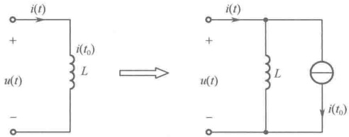

图 7-10 具有初始电流  $ i(t_{0}) $ 的电感元件及其等效电路
 

应注意，电感元件的伏安关系式（7-15）、式（7-16）和式（7-19）都要求电感元件的电压、电流取关联参考方向。若电感元件的电压、电流取非关联参考方向，如图7-11所示，则电感元件的伏安关系应为

$$  \left.\begin{aligned}&u=-L\frac{\mathrm{d}i}{\mathrm{d}t}\\ &i(t)=-\frac{1}{L}\int_{-\infty}^{t}u(t^{\prime})\mathrm{d}t^{\prime}\\ &i(t)=i(t_{0})-\frac{1}{L}\int_{t_{0}}^{t}u(t^{\prime})\mathrm{d}t^{\prime},\quad t\geq t_{0}\\ \end{aligned}\right\}   \tag*{（7-20）}$$

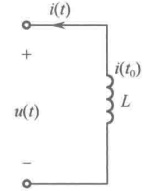

图 7-11 电感元件的电压、电流取非关联参考方向
 

#### 7.2.3 电感元件的功率与能量

在电感元件的电压、电流取关联参考方向的情况下，任意时刻电感元件吸收的瞬时功率为

$$  p(t)=u(t)i(t)   \tag*{（7-21）}$$

如果选用电感元件伏安关系的微分形式

 $$ u=L\frac{\mathrm{d}i}{\mathrm{d}t} $$ 

则电感元件吸收的瞬时功率又可表示为

$$  p(t)=Li(t)\frac{\mathrm{d}i}{\mathrm{d}t}   \tag*{（7-22）}$$

当  $ p(t) $ 为正值时，表明电感元件从外电路吸收能量并储存在磁场中；而当  $ p(t) $ 为负值时，表明电感元件释放能量送还给外电路。可见，电感元件与外电路之间也有能量的往返交换现象。

设在时间间隔 $ [t_{0},t] $内，电感电流由 $ i(t_{0}) $变到 $ i(t) $，电感元件吸收的能量可用定积分计算如下：

$$  \begin{align*}W_{L}[t_{0},t]=&\int_{t_{0}}^{t}p(t^{\prime})\mathrm{d}t^{\prime}=\int_{t_{0}}^{t}Li(t^{\prime})\frac{\mathrm{d}i}{\mathrm{d}t^{\prime}}\mathrm{d}t^{\prime}=\int_{i(t_{0})}^{i(t)}L i\mathrm{d}i\\=&\frac{1}{2}Li^{2}(t)-\frac{1}{2}Li^{2}(t_{0})=W_{L}(t)-W_{L}(t_{0})\end{align*}   \tag*{（7-23）}$$

由式（7-23）可知，从 $ t_{0} $到t期间，电感吸收的能量是用来改变电感的储能状况的，电感元件也是一个储能元件。

如果电感元件在初始时刻  $ t_{0} $ 没有电流，即  $ i(t_{0})=0 $，同时磁场能量  $ W_{L}(t_{0})=0 $，则在任意瞬时 t，磁场中储存的磁场能量  $ W_{L}(t) $ 就是电感元件在时间间隔  $ [t_{0},t] $ 内吸收的能量  $ W_{L}[t_{0},t] $，即

<!-- page: 170 -->

$$  W_{L}(t)=W_{L}[t_{0},t]=\frac{1}{2}Li^{2}(t)   \tag*{(7-24)}$$

此即电感储能公式。可知，电感电流决定了电感的储能状态。电感在任意时刻的储能总是非负的，故电感也属于无源元件。

例 7-2 在如图 7-12 所示电路中，已知在初始时刻  $ t_{0}=0 $ 时，电容储存的电场能量为 1J，且  $ i_{C}(t)=2e^{-2t} $ A  $ (t\geq0) $，求  $ t\geq0 $ 时的电压  $ u(t) $。

解：由 $ W_{C}(0)=\frac{1}{2}Cu_{C}^{2}(0)=1\mathrm{J} $，得 $ u_{C}(0)=2\mathrm{V} $。

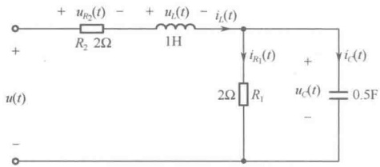

图7-12 例7-2图
 

根据电容元件伏安关系的积分形式，得

 $$ \begin{aligned}u_{C}(t)&=u_{C}(0)+\frac{1}{C}\int_{0}^{t}i_{C}(t^{\prime})\mathrm{d}t^{\prime}=2+\frac{1}{0.5}\int_{0}^{t}2\mathrm{e}^{-2t^{\prime}}\mathrm{d}t^{\prime}\\&=2-2(\mathrm{e}^{-2t}-1)=4-2\mathrm{e}^{-2t}\left(\mathrm{V}\right)\end{aligned} $$ 

 $$ i_{R_{1}}(t)=\frac{u_{C}(t)}{R_{1}}=\frac{4-2\mathrm{e}^{-2t}}{2}=2-\mathrm{e}^{-2t}\left(\mathrm{A}\right) $$ 

利用 KCL，求得电感电流

 $$ i_{L}(t)=i_{R_{1}}(t)+i_{C}(t)=(2-\mathrm{e}^{-2t})+2\mathrm{e}^{-2t}=2+\mathrm{e}^{-2t}(\mathrm{A}) $$ 

根据电感元件伏安关系的微分形式，得

 $$ u_{L}(t)=L\frac{\mathrm{d}i_{L}}{\mathrm{d}t}=-2\mathrm{e}^{-2t}\left(\mathrm{V}\right) $$ 

 $$ u_{R_{2}}(t)=R_{2}i_{L}(t)=2(2+\mathrm{e}^{-2t})=4+2\mathrm{e}^{-2t}(\mathrm{V}) $$ 

最后，利用 KVL 得

 $$ u(t)=u_{R_{2}}(t)+u_{L}(t)+u_{C}(t)=(4+2\mathrm{e}^{-2t})+(-2\mathrm{e}^{-2t})+(4-2\mathrm{e}^{-2t})=8-2\mathrm{e}^{-2t}(\mathrm{V}) $$ 

### 7.3 电容、电感的串、并联等效

本节根据 KCL、KVL 以及电容和电感的伏安关系，讨论电容、电感的串、并联等效问题。

#### 7.3.1 电容的串、并联等效

下面分别就初始电压为零和初始电压不为零两种情况进行讨论。

# 1. 初始电压为零的情况

图 7-13（a）为 n 个初始电压为零的电容的串联电路。端口 1-1′ 上电压  $ u(t) $ 与  $ i(t) $ 取关联参考方向，由 KCL、KVL 及电容元件伏安关系的积分形式，得

 $$ \begin{align*}u(t)&=u_{1}(t)+u_{2}(t)+\cdots+u_{n}(t)\\&=\frac{1}{C_{1}}\int_{t_{0}}^{t}i(t^{\prime})\mathrm{d}t^{\prime}+\frac{1}{C_{2}}\int_{t_{0}}^{t}i(t^{\prime})\mathrm{d}t^{\prime}+\cdots+\frac{1}{C_{n}}\int_{t_{0}}^{t}i(t^{\prime})\mathrm{d}t^{\prime}\\&=\left(\frac{1}{C_{1}}+\frac{1}{C_{2}}+\cdots+\frac{1}{C_{n}}\right)\int_{t_{0}}^{t}i(t^{\prime})\mathrm{d}t^{\prime}\\&=\frac{1}{C_{eq}}\int_{t_{0}}^{t}i(t^{\prime})\mathrm{d}t^{\prime}\\&\quad\frac{1}{C_{eq}}=\left(\frac{1}{C_{1}}+\frac{1}{C_{2}}+\cdots+\frac{1}{C_{n}}\right)=\sum_{k=1}^{n}\frac{1}{C_{k}}\end{align*} $$ 

式中，

<!-- page: 171 -->

即

$$  C_eq=\frac{1}{\sum_{k=1}^{n}\frac{1}{C_k}}   \tag*{(7-26)}$$

 $ C_{eq} $称为n个电容串联的等效电容。根据等效的概念，用 $ C_{eq} $构造的电路如图7-13（b）所示，即为图7-13（a）的等效电路。

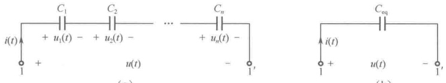

(a)
 

(b)
 

图 7-13 初始电压为零的电容串联及其等效电路
 

图 7-14（a）为 n 个初始电压为零的电容的并联电路。端口 1-1′ 上电压  $ u(t) $ 与电流  $ i(t) $ 取关联参考方向，由 KCL、KVL 及电容元件伏安关系的微分形式，得

$$  i(t)=i_{1}(t)+i_{2}(t)+\cdots+i_{n}(t)=C_{1}\frac{\mathrm{d}u}{\mathrm{d}t}+C_{2}\frac{\mathrm{d}u}{\mathrm{d}t}+\cdots+C_{n}\frac{\mathrm{d}u}{\mathrm{d}t}=C_{\mathrm{eq}}\frac{\mathrm{d}u}{\mathrm{d}t}   \tag*{(7-27)}$$

式中，

$$  C_{eq}=C_{1}+C_{2}+\cdots+C_{n}=\sum_{k=1}^{n}C_{k}   \tag*{（7-28）}$$

 $ C_{eq} $称为n个电容并联的等效电容。根据等效的概念，用 $ C_{eq} $构造的电路如图7-14（b）所示，即为图7-14（a）的等效电路。

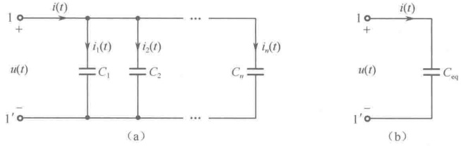

图 7-14 初始电压为零的电容并联及其等效电路
 

由以上分析结果不难发现，电容的串、并联等效电容的计算公式与电导的串、并联等效电导的计算公式相似。这样对照便于记忆。

# 2. 初始电压不为零的情况

图 7-15（a）为 n 个初始电压不为零的电容的串联电路。将每个具有初始电压的电容都等效成一个电压等于该电容的初始电压的电压源和初始电压为零的相同电容值的电容元件相串联，如图 7-15（b）所示。将各个串联的电压源合并成一个等效电压源，其电压为

 $$ U=\sum_{k=1}^{n}u_{k}(t_{0}) $$ 

将各个串联的初始电压为零的电容元件合并成一个等效电容元件，其等效电容为

 $$ C_{eq}=\frac{1}{\sum\limits_{k=1}^{n}\frac{1}{C_{k}}} $$ 

于是得到如图 7-15（c）所示的等效电路。图 7-15（c）所示电路还可以等效为一个初始电压为 U 、电容值为  $ C_{eq} $ 的电容元件，如图 7-15（d）所示。

<!-- page: 172 -->

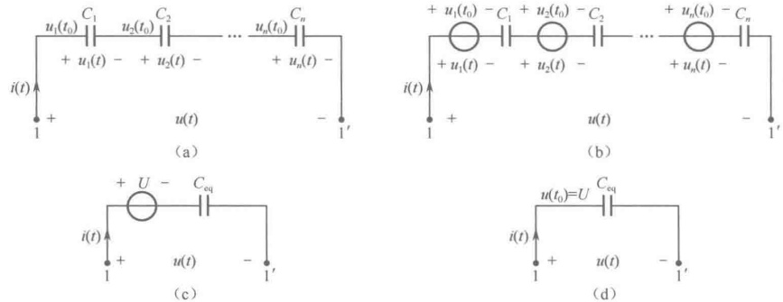

(a)
 

(b)
 

(c)
 

(d)
 

图 7-15 初始电压不为零的电容串联及其等效电路
 

图 7-16（a）为 n 个初始电压相同（但不为零）的电容的并联电路。将每个具有初始电压的电容都等效成一个电压等于该电容的初始电压的电压源和初始电压为零的相同电容值的电容元件相串联，如图 7-16（b）所示。由于图 7-16（b）中节点①、②、…、⑦各点是等电位的，故可把它们短接，如图 7-16（c）所示。在图 7-16（c）中，将各个并联的电压源合并成一个等效电压源，其电压为

 $$ U=u_{1}(t_{0})=u_{2}(t_{0})=\cdots=u_{n}(t_{0}) $$ 

将各个并联的初始电压为零的电容元件合并成一个等效电容元件，其等效电容为

 $$ C_{eq}=\sum_{k=1}^{n}C_{k} $$ 

于是得到如图 7-16（d）所示的等效电路。图 7-16（d）所示电路还可以等效为一个初始电压为 U 、电容值为  $ C_{eq} $ 的电容元件，如图 7-16（e）所示。

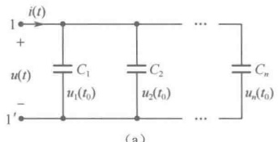

(a)
 

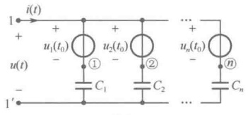

（b）
 

图 7-16 初始电压相同（但不为零）的电容并联及其等效电路
 

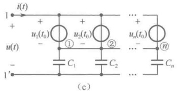

(c)
 

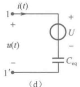

(d)
 

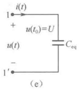

图 7-16 初始电压相同（但不为零）的电容并联及其等效电路（续）
 

#### 7.3.2 电感的串、并联等效

下面分别就初始电流为零和初始电流不为零两种情况进行讨论。

# 1. 初始电流为零的情况

图 7-17（a）为 n 个初始电流为零的电感的串联电路。端口 1-1′ 上电压  $ u(t) $ 与电流  $ i(t) $ 取关联参考方向，由 KCL、KVL 及电感元件伏安关系的微分形式，得

<!-- page: 173 -->

$$  \begin{aligned}u(t)&=u_{1}(t)+u_{2}(t)+\cdots+u_{n}(t)\\&=L_{1}\frac{\mathrm{d}i}{\mathrm{d}t}+L_{2}\frac{\mathrm{d}i}{\mathrm{d}t}+\cdots+L_{n}\frac{\mathrm{d}i}{\mathrm{d}t}=(L_{1}+L_{2}+\cdots+L_{n})\frac{\mathrm{d}i}{\mathrm{d}t}\\&=L_{\mathrm{eq}}\frac{\mathrm{d}i}{\mathrm{d}t}\\ \end{aligned}   \tag*{(7-29)}$$

式中，

$$  L_{eq}=L_{1}+L_{2}+\cdots+L_{n}=\sum_{k=1}^{n}L_{k}   \tag*{（7-30）}$$

 $ L_{eq} $称为n个电感串联的等效电感，根据等效的概念，用 $ L_{eq} $构造的电路如图7-17（b）所示，即为图7-17（a）的等效电路。

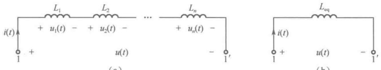

(a)
 

(b)
 

图 7-17 初始电流为零的电感串联及其等效电路
 

图 7-18（a）为 n 个初始电流为零的电感的并联电路。端口 1-1′ 电压  $ u(t) $ 与电流  $ i(t) $ 取关联参考方向，由 KCL、KVL 及电感元件伏安关系的积分形式，得

$$  \begin{aligned}i(t)&=i_{1}(t)+i_{2}(t)+\cdots+i_{n}(t)\\&=\frac{1}{L_{1}}\int_{t_{0}}^{t}u(t^{\prime})\mathrm{d}t^{\prime}+\frac{1}{L_{2}}\int_{t_{0}}^{t}u(t^{\prime})\mathrm{d}t^{\prime}+\cdots+\frac{1}{L_{n}}\int_{t_{0}}^{t}u(t^{\prime})\mathrm{d}t^{\prime}\\&=\left(\frac{1}{L_{1}}+\frac{1}{L_{2}}+\cdots+\frac{1}{L_{n}}\right)\int_{t_{0}}^{t}u(t^{\prime})\mathrm{d}t^{\prime}\\&=\frac{1}{L_{eq}}\int_{t_{0}}^{t}u(t^{\prime})\mathrm{d}t^{\prime}\end{aligned}   \tag*{（7-31）}$$

式中，

 $$ \begin{aligned}\frac{1}{L_{eq}}=&\frac{1}{L_{1}}+\frac{1}{L_{2}}+\cdots+\frac{1}{L_{n}}=\sum_{k=1}^{n}\frac{1}{L_{k}}\\&L_{eq}=\frac{1}{\sum_{k=1}^{n}\frac{1}{L_{k}}}\end{aligned} $$ 

即

 $ L_{eq} $称为n个电感并联的等效电感。根据等效的概念，用 $ L_{eq} $构造的电路如图7-18（b）所示，即为图7-18（a）的等效电路。

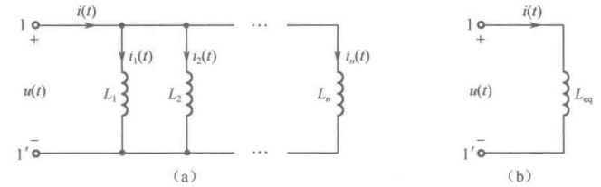

(a)
 

(b)
 

图 7-18 初始电流为零的电感并联及其等效电路
 

由以上分析结果不难发现，电感的串、并联等效电感的计算公式与电阻的串、并联等效电阻的计算公式相似。这样对照便于记忆。

<!-- page: 174 -->

# 2. 初始电流不为零的情况

图 7-19（a）为 n 个初始电流相同（但不为零）的电感的串联电路。将每个具有初始电流的电感都等效成一个电流等于该电感的初始电流的电流源和初始电流为零的相同电感值的电感元件相并联，如图 7-19（b）所示。由于图 7-19（b）中各个电流源的大小和方向都相同，故图 7-19（b）又可等效为图 7-19（c）。在图 7-19（c）中，将各个串联的电流源合并成一个等效电流源，其电流为

 $$ I=i_{1}(t_{0})=i_{2}(t_{0})=\cdots=i_{n}(t_{0}) $$ 

将各个串联的初始电流为零的电感元件合并成一个等效电感元件，其等效电感为

 $$ L_{eq}=\sum_{k=1}^{n}L_{k} $$ 

于是得到如图 7-19（d）所示的等效电路。图 7-19（d）所示电路还可以等效为一个初始电流为 I 、电感值为  $ L_{eq} $ 的电感元件，如图 7-19（e）所示。

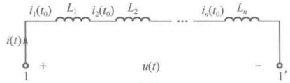

(a)
 

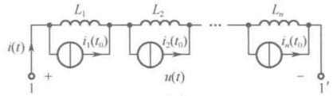

(b)
 

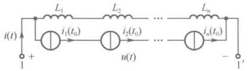

(c)
 

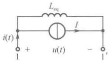

(d)
 

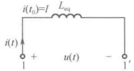

(e)
 

图 7-19 初始电流相同（但不为零）的电感串联及其等效电路
 

图 7-20（a）为 n 个初始电流不为零的电感的并联电路。将每个具有初始电流的电感都等效成一个电流等于该电感的初始电流的电流源和初始电流为零的相同电感值的电感元件相并联，如图 7-20（b）所示。在图 7-20（b）中，将各个并联的电流源合并成一个等效电流源，其电流为

 $$ I=\sum_{k=1}^{n}i_{k}(t_{0}) $$ 

将各个并联的初始电流为零的电感元件合并成一个等效电感元件，其等效电感为

 $$ L_{eq}=\frac{1}{\sum\limits_{k=1}^{n}\frac{1}{L_{k}}} $$ 

于是得到如图 7-20（c）所示的等效电路。图 7-20（c）所示电路还可以等效为一个初始电流为 I 、电感值为  $ L_{eq} $ 的电感元件，如图 7-20（d）所示。

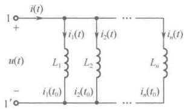

(a)
 

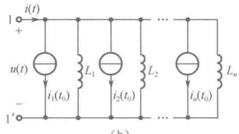

(b)
 

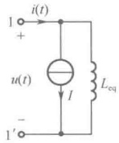

(c)
 

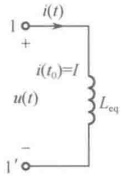

(d)
 

图 7-20 初始电流不为零的电感并联及其等效电路
 

<!-- page: 175 -->

### 7.4 计算机仿真

例 7-3 电容元件的 VCR。如图 7-21（a）所示，进入元件选择界面后，从 Group 组的下拉列表中选择 Sources，选中 SIGNAL_VOLTAGE_SOURCES，然后在右侧的 Component 区选择 TRIANGULAR_VOLTAGE，按照图 7-21（b）设置三角波电压源参数。

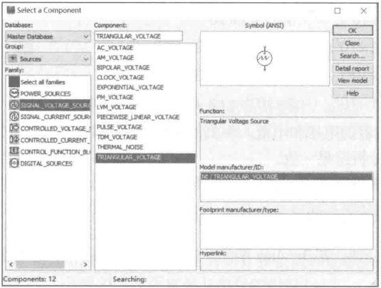

（a）选择三角波电压源
 

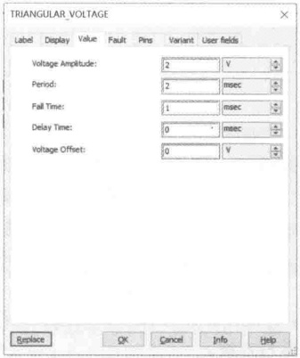

（b）三角波电压源参数设置
 

图 7-21 三角波电压源设置
 

构建如图 7-22（a）所示电路，将三角波电压源作用于  $ 0.5\mu F $ 的电容元件两端，分析流过电容元件的电流变化规律，并通过仿真加以验证。

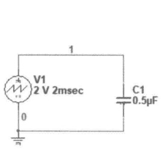

(a) 电容电路
 

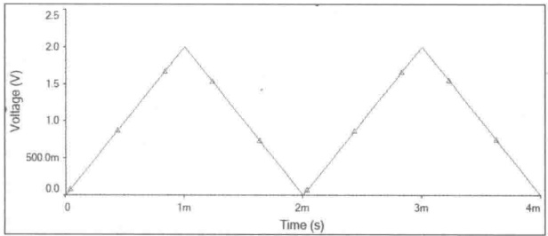

（b）电容电压波形
 

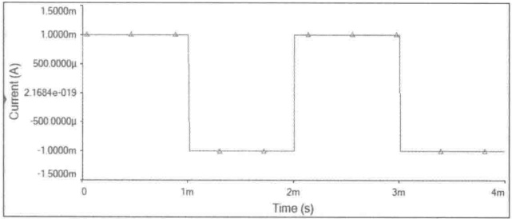

（c）电容电流波形
 

图 7-22 电容元件 VCR 仿真
 

<!-- page: 176 -->

解：根据图7-22（b），三角波电压u表示为

 $$ u(t)=\left\{\begin{aligned}&2\times10^{3}t,&0\leq t<1\times10^{-3}\\ &-2\times10^{3}t+4,&1\times10^{-3}\leq t<2\times10^{-3}\\ &2\times10^{3}t-4,&2\times10^{-3}\leq t<3\times10^{-3}\\ &-2\times10^{3}t+8,&3\times10^{-3}\leq t\leq4\times10^{-3}\end{aligned}\right. $$ 

流过电容的电流  $ i_{C} $：由图7-22（a）可知，u、 $ i_{C} $ 为关联参考方向，根据元件特性，有

 $$ i_{C}(t)=C\frac{\mathrm{d}u}{\mathrm{d}t}=\left\{\begin{aligned}&1\times10^{3}t,&0\leq t<1\times10^{-3}\\ &-1\times10^{3}t,&1\times10^{-3}\leq t<2\times10^{-3}\\ &1\times10^{3}t,&2\times10^{-3}\leq t<3\times10^{-3}\\ &-1\times10^{3},&3\times10^{-3}\leq t\leq4\times10^{-3}\end{aligned}\right. $$ 

利用 Multisim 中的瞬态仿真分析，观察电容的电压和电流，得到的仿真波形图分别如图 7-22（b）和图 7-22（c）所示，可以看出，与理论分析结果一致。

由电容元件的 VCR 可知，流过电容的电流  $ i_{C} $ 与其端电压 u 的变化率成正比。当电容电压的变化率  $ \frac{du}{dt} $ 恒定时，电容电流也恒定，所以在电容电压波形的 0～1ms 期间， $ i_{C} $ 为 1mA；在 1～2ms 期间， $ i_{C} $ 为 0mA；在 2～3ms 期间， $ i_{C} $ 为 1mA；在 3～4ms 期间， $ i_{C} $ 为 0mA。因此，得到电容电流  $ i_{C} $ 波形为方波。

例 7-4 电感元件的 VCR。构建如图 7-23（a）所示电路，将三角波电压源作用于 0.5mH 的电感元件两端，分析流过电感元件的电流变化规律，并通过仿真加以验证。

流过电感的电流 i:

 $$ i(t)=\frac{1}{L}\int_{-\infty}^{t}\nu(\xi)\mathrm{d}\xi=2\times10^{3}\xi\mathrm{d}\xi=2\times10^{6}t^{2},\quad0\leq t<1\times10^{-3} $$ 

 $$ \begin{align*}i(t)&=i(1\times10^{-3})+2\times10^{3}\int_{1\times10^{-3}}^{t}(-2\times10^{3}\xi+4)\mathrm{d}\xi\\&=-2\times10^{6}t^{2}+8\times10^{3}t-4,\quad1\times10^{-3}\leq t<2\times10^{-3}\end{align*} $$ 

 $$ \begin{align*}i(t)&=i(2\times10^{-3})+2\times10^{3}\int_{2\times10^{-3}}^{t}(2\times10^{3}\xi-4)\mathrm{d}\xi\\&=2\times10^{6}t^{2}-8\times10^{3}t+12,\quad2\times10^{-3}\leq t<3\times10^{-3}\end{align*} $$ 

 $$ \begin{align*}i(t)&=i(3\times10^{-3})+2\times10^{3}\int_{3\times10^{-3}}^{t}(-2\times10^{3}\xi+8)\mathrm{d}\xi\\&=-2\times10^{6}t^{2}+16\times10^{3}t-24,\quad3\times10^{-3}\leq t<4\times10^{-3}\end{align*} $$ 

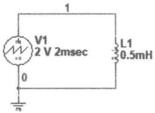

(a) 电感电路
 

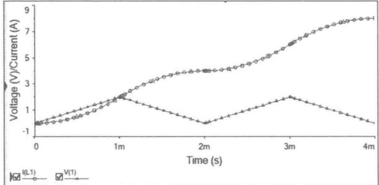

（b）电感电压与电流仿真波形
 

图 7-23 电感元件 VCR 仿真
 

<!-- page: 177 -->

利用 Multisim 中的瞬态仿真分析，观察电感的电压和电流，得到的仿真波形如图 7-23（b）所示，其中，圆圈标记的曲线为电感电流，三角形标记的折线为电感电压，可以看出，与理论分析结果一致。

由电感元件的 VCR 可知，流过电感的电流  $ i_{L} $ 与其端电压 u 对时间的积分成正比。当端电压随时间以三角波变化时，端电流  $ i_{L} $ 以时间二次函数的规律随之积累。可以看出，经过 4ms 的时间，端电流  $ i_{L} $ 的值从 0 增加到 8A。若 4ms 后 u 的波形延续，则端电流  $ i_{L} $ 的波形将按照之前的变化规律继续攀升；若 4ms 后 u 为零，则电感电流将保持 8A 不变。

### 思考题

7-1 为什么说电容、电感元件是动态元件？电容、电感在直流稳态时分别怎样处理？

7-2 为什么说电容、电感元件是记忆元件？电容的初始电压  $ u(t_{0}) $ 、电感的初始电流  $ i(t_{0}) $ 各具有什么意义？

7-3 当电容（或电感）元件的电压、电流取非关联参考方向时，元件的伏安关系应如何变动？

7-4 为什么说电容（或电感）元件与外电路之间有能量的往返交换现象，这种现象是由元件的什么性质决定的？

7-5 电容的串、并联等效电容的计算公式与电导的串、并联等效电导的计算公式相似，那么电容的分压、分流公式是否也是与电导的相似？

7-6 电感的串、并联等效电感的计算公式与电阻的串、并联等效电阻的计算公式相似，那么电感的分压、分流公式是否也是与电阻的相似？

7-7 将电容元件的定义式、伏安关系、储能公式、串并联等效电容的计算公式与电感元件的定义式、伏安关系、储能公式、串并联等效电感的计算公式进行比较，会发现什么规律？

### 习题

7-1 电容元件与电感元件的电压、电流参考方向如题 7-1 图所示，已知  $ u_{C}(0)=0 $， $ i_{L}(0)=0 $。

（1）写出电压用电流表示的性能方程：

（2）写出电流用电压表示的性能方程。

7-2 题 7-2 图（a）中 C=2F 且  $ u_{C}(0)=0 $，电容电流  $ i_{C} $ 的波形如题 7-2 图（b）所示。试求  $ t=1s $、 $ t=2s $ 和  $ t=4s $ 时电容电压  $ u_{C} $。

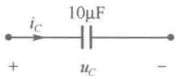

(a)
 

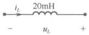

(b)
 

题7-1 图
 

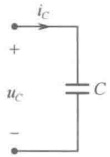

(a)
 

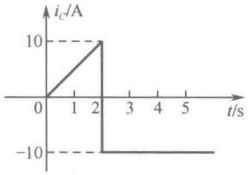

(b)
 

题7-2图
 

7-3 题 7-3 图（a）中 C=2F 且  $ u_{c}(0)=0 $，电容电流  $ i_{c} $ 的波形如题 7-3 图（b）所示。

（1）求 $ t\geqslant0 $时电容电压 $ u_{c}(t) $，并画出其波形；

（2）计算t=2s时电容吸收的功率p(2);

（3）计算t=2s时电容的储能 $ W_{c}(2) $。

<!-- page: 178 -->

7-4 有一电感元件如题 7-4 图（a）所示，已知  $ L=10\,\text{mH} $，通过的电流  $ i_L(t) $ 的波形如图 7-4 图（b）所示，求电感  $ L $ 两端的电压，并画出  $ u_L(t) $ 的波形。

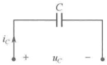

(a)
 

题7-3图
 

(b)
 

(a)
 

（b）
 

题7-4图
 

7-5 题 7-5 图（a）中 L=4H 且  $ i_{L}(0)=0 $，电感电压  $ u_{L} $ 的波形如题 7-5 图（b）所示。试求 t=1s、t=2s、t=3s 和 t=4s 时电感电流  $ i_{L} $。

7-6 题 7-6 图（a）中 L=4H 且  $ i_{L}(0)=0 $，电感电压  $ u_{L} $ 的波形如题 7-6 图（b）所示。

（1）求 $ t \geqslant 0 $时电感电流 $ i_{L}(t) $，并画出其波形；

（2）计算t=2s时电感吸收的功率p(2);

（3）计算t=2s时电感的储能 $ W_{L}(2) $。

(a)
 

(b)
 

题7-5图
 

(a)
 

（b）
 

题7-6图
 

7-7 电路如题 7-7 图所示，已知  $ i_{L}(t)=5(1-\mathrm{e}^{-10t})\mathrm{A} $ （ $ t\geqslant0 $），求  $ t\geqslant0 $ 时电容电流  $ i_{C}(t) $ 和电压源电压  $ u_{S}(t) $。

7-8 电路如题 7-8 图所示，其中  $ L=1\mathrm{H} $， $ C_{2}=1\mathrm{F} $。设  $ u_{S}(t)=U_{m}\cos(\omega t)(\mathrm{V}) $， $ i_{S}(t)=I\mathrm{e}^{-\alpha t}(\mathrm{A}) $，试求  $ u_{L}(t) $ 和  $ i_{C_{2}}(t) $。

题7-7图
 

题7-8图
 

7-9 电路如题 7-9 图所示，已知电感电压  $ u_L(t) = 2e^{-t} $ (V) ( $ t \geq 0 $)，电感的初始电流  $ i_L(0) = 1\text{A} $，电容的初始电压  $ u_C(0) = 2\text{V} $。求  $ t \geq 0 $ 时电感电流  $ i_L(t) $、电容电压  $ u_C(t) $ 及电压源电压  $ u_S(t) $。

7-10 电路如题 7-10 图（a）所示，若要求  $ u_{c}(t) $ 的波形如题 7-10 图（b）所示，求所需电压源电压  $ u_{s}(t) $ 的波形。

<!-- page: 179 -->

题7-9图
 

(a)
 

（b）
 

题7-10图
 

7-11 电路如题 7-11 图所示，已知  $ u_S(t) = 6e^{-2t} $ (V)， $ R = 3\Omega $， $ L = 2\text{H} $，设  $ i_L(0) = 0\text{A} $。

(1) 求  $ i(t) $,  $ t \geq 0 $;

（2）求 $ t=1s $、 $ t=2s $及 $ t=3s $时电感的储能。

7-12 电路如题 7-12 图所示，求各电路 a-b 端的等效电容。

题7-11图
 

(a)
 

(b)
 

题7-12图
 

7-13 电路如题 7-13 图所示，求各电路 a-b 端的等效电感。

(b)
 

题 7-13 图
 

7-14 电路如题 7-14 图所示，设各电感的初始电流为零。

（1）求端口的等效电感：

（2）若端口电压 $ u(t)=8e^{-2t}V $（ $ t\geqslant0 $），求各电感电流及电压 $ u_2 $和 $ u_3 $。

题7-14图
 

