# 08-第8章 动态电路的时域分析

[返回全书目录](../../README.md)

> PDF 页码：180–244

<!-- page: 180 -->

### 第8章 动态电路的时域分析

含有电容及电感这一类动态元件的电路称为动态电路。因为电容及电感的伏安关系是微分形式或积分形式，所以描述动态电路的方程为微分方程或微积分方程。本章采用微分方程的经典解法分析一阶动态电路响应随时间的变化规律，且整个分析过程都是在时间域进行的，故称其为时域分析。在分析中还将介绍过渡过程、换路、时间常数、零输入响应、零状态响应、全响应、自由分量、暂态分量、强制分量、稳态分量、阶跃响应、冲激响应等重要概念。

### 8.1 动态电路的方程及其初始条件

#### 8.1.1 过渡过程与换路

动态电路的分析与过渡过程紧密联系，所以首先来研究什么是过渡过程。

一个变化的物理过程在每一时刻都处在一种不同的状况、形态或姿态，可统称为状态，所谓变化是指状态的变化，或可用状态来表征。事物的变化和运动又可分为“稳定状态”和“过渡状态”。例如，启动发动机时，发动机的转速从零开始逐渐升高，经过一定的时间便达到某一额定数值，以后转速便保持在这个额定的数值上。发动机的最初转速为零（静态状态）和后来的转速为某一额定数值（额定运行状态）都是发动机的稳态状态，只是从时间上有旧、新之分。发动机由静止到额定转速之间所经历的过程，就是发动机运行的过渡过程。由此可见，过渡过程就是从一个稳定状态进入另一个稳定状态所经历的中间过程，而在过渡过程中每时每刻的状态即为过渡状态。过渡过程或过渡状态是一种物理现象，它广泛地存在于自然界的大量事物中。

动态电路也是一种物理系统，往往也有稳定状态和过渡状态这两种工作状态，动态电路的工作状态是用电路的各支路电压、电流来表示的。如果各支路电压、电流是恒定不变的（包括等于零的情况），则电路处于一种直流稳定状态；如果各支路电压、电流随时间按正弦函数的规律周期性地变化，则电路处在一种正弦稳定状态。动态电路从一种旧的稳定状态进入另一种新的稳定状态，常常也需要一个中间过程，这就是动态电路的过渡过程。

在图 8-1（a）所示的简单的 RC 串联电路中，开关 S 合上前， $ t<0 $ 时，i=0，由于电容 C 原先未充电， $ u_{C}(0)=0 $，这是一种旧的稳定状态。开关 S 合上后， $ t\geq0 $ 时，直流电压源  $ U_{S} $ 通过电阻 R 向电容 C 充电。电容电压  $ u_{C} $ 由零逐渐上升，一直上升到等于电源的电压  $ U_{S} $ 为止，这时电流 i=0，电路进入另一个新的稳定状态。电容电压由零上升到  $ U_{S} $ 的过程（电容的充电过程）就是电路的过渡过程。

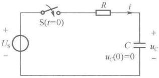

(a)
 

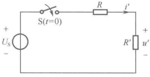

（b）
 

图 8-1 说明电路的过渡过程之图
 

<!-- page: 181 -->

动态电路的过渡过程是由电路条件的骤然改变引起的，在电路理论中，把电路条件的骤然改变称为换路，例如，电源的接入、切除，元件参数的骤然改变，以及电压源的电压或电流源的电流的骤然改变等都是换路。一般通过开关的闭合或打开来实现换路，在图8-1（a）所示的电路中，开关S的闭合将电压源突然接入电路中就是一种换路。

换路是引起动态电路过渡过程的外因，而动态电路内部的储能元件（电容、电感）的存在是动态电路出现过渡过程的内因。这是因为在动态电路中，当电容元件两端有电压 u 时，储有  $ \frac{1}{2}Cu^{2} $ 的电场能量；当电感元件上流过电流 i 时，储有  $ \frac{1}{2}Li^{2} $ 的磁场能量。这些能量都不能发生跃变，只能渐变。如果能量跃变，意味着  $ p = \frac{\mathrm{d}W}{\mathrm{d}t} \to \infty $，这在实际中是不可能的。因此电容 C 上的电压在换路时是连续的，它不能从 0 立刻跃变为稳态值  $ U_{s} $，而必须经历一个过渡过程，逐渐上升至  $ U_{s} $。如果用电阻  $ R' $ 替换图 8-1（a）中的电容 C，即图 8-1（b）所示的线性电阻电路，那么，开关 S 合上后，电阻  $ R' $ 上的电压  $ u' $ 立刻从 0 跃变为稳态值  $ \frac{R'}{R+R'} $  $ U_{s} $，即换路后电路立即进入新的稳态而没有过渡过程。这是因为电阻是无记忆元件，电路中不具备能产生过渡过程的内因，此时，线性电阻电路中的响应与激励是一种即时关系。

在实际的动态电路中，过渡过程是一个很快的过程，其持续时间常常仅为十几分之一秒、几百分之一秒，甚至几万分之一秒。因此，常称为暂态过程（或瞬态过程），在电子技术中需要广泛利用动态电路瞬态过程的规律。但是，动态电路瞬态过程也会出现不利的情况，这就是在动态电路瞬态过程中，可能出现比稳态值高出很多的过电压或过电流现象，从而使电气设备或器件遭受损害。因此，分析动态电路瞬态过程具有十分重要的意义。动态电路的瞬态分析就是对从换路前电路旧的稳定状态至换路后电路新的稳定状态全过程的研究。

在电路及系统理论中，状态变量是指一组最少的变量，若已知它们在  $ t_{0} $ 时的数值以及所有在  $ t \geq t_{0} $ 时的输入（激励），就能确定在  $ t \geq t_{0} $ 时电路中的任何电路变量。状态变量在任何时刻的值构成了该时刻电路的状态，由于电容在某一时刻的电压反映了该时刻储存的电场能量，而电感在某一时刻的电流反映了该时刻储存的磁场能量，因此，电容电压  $ u_{C}(t) $ 和电感电流  $ i_{L}(t) $ 在动态电路分析中占有特别重要的地位，它们可作为电路的状态变量。在  $ t_{0} $ 时刻的电容电压  $ u_{C}(t_{0}) $ 或/和电感电流  $ i_{L}(t_{0}) $ 就构成了  $ t_{0} $ 时刻电路的状态，本章将在随后的动态电路瞬态分析中将电容电压和电感电流作为主要的分析对象进行研究。

在动态电路分析中，一般以换路发生的时刻作为计算时间的起点（初始时刻）。假设换路是在t=0时发生的，为了分析方便，把换路前的最后一个瞬时表示为 $ t=0_{-} $，即t为负值趋于零的极限；把换路后的第一个瞬时表示为 $ t=0_{+} $，即t为正值趋于零的极限，如图8-2所示。

在  $ t=0_{-} $ 时，电路处于原有的旧稳定状态，此时  $ u_{C}(0_{-}) $ 或/和  $ i_{L}(0_{-}) $ 构成了电路的原始状态，反映了动态元件的原始储能。原始状态为零的动态元件称为零状态元件，若电路中所有动态元件的原始状态均为零，则电路称为零状态电路。在  $ t=0_{+} $ 时， $ u_{C}(0_{+}) $ 或/和  $ i_{L}(0_{+}) $ 构成了电路的初始状态，反映了动态元件的初始储能，电路从  $ t=0_{+} $ 时开始经过过渡过程最终达到新的稳态。采用  $ 0_{-} $ 和  $ 0_{+} $ 的表示，有助于理解换路的全过程，使换路前后电路的状态更明确，而且还可以准确地表达电路中某些变量在换路时刻 t=0 时发生跃变的情况，如图 8-3 所示的电压波形，其电压变化情况可表示为

$$  \begin{cases}u(0_{-})=0\mathrm{V}\\u(0_{+})=1\mathrm{V}\end{cases}   \tag*{（8-1）}$$

<!-- page: 182 -->

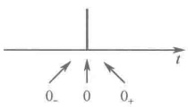

图8-2 换路前与换路后时间概念的划分
 

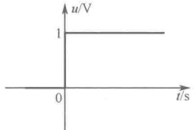

图 8-3 t=0 时发生跃变的电压波形
 

#### 8.1.2 动态电路的方程及其解

建立动态电路方程的基本依据是基尔霍夫定律和元件的伏安关系，下面通过一个例子说明动态电路微分方程的建立过程。

图 8-4 表示一个 RLC 串联电路在 t=0 时接入电压源  $ u_{s}(t) $，当开关 S 在 t=0 时闭合后，建立以  $ u_{c}(t) $ 为响应的电路方程。

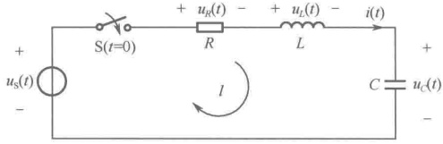

图 8-4 RLC 串联电路在 t=0 时接入电压源  $ u_{s}(t) $
 

换路后 $ t \geqslant 0_{+} $时，根据KVL列写出回路l的电压平衡方程，有

若选择 $ u_{c}(t) $为响应变量，将元件的伏安关系

$$  u_{R}(t)+u_{L}(t)+u_{C}(t)=u_{S}(t),\quad t\geq0_{+}   \tag*{（8-2）}$$

 $$ u_{_{R}}=R i,\qquad u_{_{L}}=L\frac{\mathrm{d}i}{\mathrm{d}t},\quad i=C\frac{\mathrm{d}u_{_{C}}}{\mathrm{d}t} $$ 

代入式（8-2）中，经整理得

$$  LC\frac{\mathrm{d}^{2}u_{C}(t)}{\mathrm{d}t^{2}}+RC\frac{\mathrm{d}u_{C}(t)}{\mathrm{d}t}+u_{C}(t)=u_{\mathrm{S}}(t),\quad t\geq0_{+}   \tag*{(8-3)}$$

若选择 $ i(t) $为响应变量，将元件的伏安关系

 $$ u_{_{R}}=R i,\qquad u_{_{L}}=L\frac{\mathrm{d}i}{\mathrm{d}t},\qquad u_{_{C}}(t)=\frac{1}{C}\int_{-\infty}^{t}i(t^{\prime})\mathrm{d}t^{\prime} $$ 

代入式（8-2）中，经整理得

$$  LC\frac{\mathrm{d}^{2}i(t)}{\mathrm{d}t^{2}}+RC\frac{\mathrm{d}i(t)}{\mathrm{d}t}+i(t)=C\frac{\mathrm{d}u_{\mathrm{S}}(t)}{\mathrm{d}t},\quad t\geq0_{+}   \tag*{（8-4）}$$

可以看出，电路方程是线性常系数二阶微分方程，这是因为电路中含有两个动态元件，这类电路称为二阶电路。如果电路中只含一个动态元件，建立的电路方程将是一阶微分方程，相应的电路称为一阶电路。电路中所含动态元件越多，方程的阶数就越高。含有n个独立动态元件的电路称为n阶电路，若将响应变量（u或i）用 $ v(t) $表示，n阶电路的微分方程可写成下列一般形式：

$$  a_{n}\frac{\mathrm{d}^{n}y(t)}{\mathrm{d}t^{n}}+a_{n-1}\frac{\mathrm{d}^{n-1}y(t)}{\mathrm{d}t^{n-1}}+\cdots+a_{1}\frac{\mathrm{d}y(t)}{\mathrm{d}t}+a_{0}y(t)=f(t),\quad t\geq0_{+}   \tag*{（8-5）}$$

对于线性时不变动态电路，上式中的系数  $ a_{n}, a_{n-1}, \cdots, a_{1}, a_{0} $ 都是取决于电路结构和元件参数的常数； $ f(t) $ 称为激励函数，它与外施激励  $ (u_{s} $ 或  $ i_{s} $ ) 及选择的响应变量有关。如上例中选择  $ u_{c} $ 或 i 作为响应变量，列写出的微分方程的右边项  $ f(t) $ 是不同的。

由微分方程的经典解法可知，线性常系数微分方程的完全解由两部分组成，即

$$  y(t)=y_{\mathrm{h}}(t)+y_{\mathrm{p}}(t)   \tag*{（8-6）}$$

式中， $ y_{h}(t) $ 是相应齐次微分方程的通解， $ y_{p}(t) $ 是非齐次微分方程的一个特解。对线性常系数微分方程完全解的求解过程包括以下三步。

<!-- page: 183 -->

# 1. 求相应齐次微分方程的通解

式（8-5）的相应齐次微分方程为

$$  a_{n}\frac{\mathrm{d}^{n}y(t)}{\mathrm{d}t^{n}}+a_{n-1}\frac{\mathrm{d}^{n-1}y(t)}{\mathrm{d}t^{n-1}}+\cdots+a_{1}\frac{\mathrm{d}y(t)}{\mathrm{d}t}+a_{0}y(t)=0   \tag*{（8-7）}$$

齐次线性常系数微分方程的通解可由指数函数构成，设

$$  y_{\mathrm{h}}(t)=A\mathrm{e}^{st}   \tag*{（8-8）}$$

把上式代入式（8-7），得到相应的特征方程为

 $$ a_{n}s^{n}+a_{n-1}s^{n-1}+\cdots+a_{1}s+a_{0}=0 $$ 

特征方程的特征根  $ s_{1}, s_{2}, \cdots, s_{n} $ 称为式（8-7）所示的微分方程的特征根，若特征根均为单根，则式（8-7）的通解为

$$  y_{\mathrm{h}}(t)=A_{1}\mathrm{e}^{s_{1}t}+A_{2}\mathrm{e}^{s_{2}t}+\cdots+A_{n}\mathrm{e}^{s_{n}t}   \tag*{（8-10）}$$

式中， $ A_{1}, A_{2}, \cdots, A_{n} $ 为待定积分常数，将在式（8-6）的完全解中由电路微分方程的初始条件确定。

由于相应齐次微分方程不包含激励函数  $  f(t)  $，因此它的通解  $  y_{h}(t)  $ 的变化规律是由特征根决定的指数形式，与激励形式无关。而特征根是由电路的结构和元件参数决定的，反映了电路的固有特性。因此，通解  $  y_{h}(t)  $ 又称为响应的自由分量。

# 2. 求非齐次微分方程的特解

特解的函数形式取决于激励的函数形式，可认为是在激励的“强迫”下电路所做出的响应，故特解也称为强迫响应，或称为响应的强制分量。表8-1中列出了常用激励形式所对应特解的形式。表中的 $ Q_{i}(i=0,1,2,\cdots,m) $为待定常数，将特解 $ y_{p}(t) $代入式（8-5），再对方程左右两边进行平衡，用比较系数法就可确定特解中的待定常数。

表8-1 常用激励形式所对应特解的形式
 

<table border=1 style='margin: auto; word-wrap: break-word;'><tr><td style='text-align: center; word-wrap: break-word;'>激励f(t)的形式</td><td style='text-align: center; word-wrap: break-word;'>特解y_p(t)的形式</td></tr><tr><td style='text-align: center; word-wrap: break-word;'>常数（直流）</td><td style='text-align: center; word-wrap: break-word;'>Q_0</td></tr><tr><td style='text-align: center; word-wrap: break-word;'>B\cos(\omega t+\theta)</td><td style='text-align: center; word-wrap: break-word;'>Q_1\cos(\omega t+Q_0)</td></tr><tr><td style='text-align: center; word-wrap: break-word;'>e^{\omega t}</td><td style='text-align: center; word-wrap: break-word;'>Q_0e^{\omega t}（当\alpha 不等于特征根时）（Q_1t+Q_0)e^{\omega t}（当\alpha 等于特征单根时）（Q_2t^2+Q_1t+Q_0)e^{\omega t}（当\alpha 等于特征重根时）</td></tr><tr><td style='text-align: center; word-wrap: break-word;'>t^m</td><td style='text-align: center; word-wrap: break-word;'>Q_m t^{m_1}+Q_{m-1}t^{m-1_1}+\cdots+Q_1t^t+\cdots+Q_1t+Q_0</td></tr></table>

# 3. 求非齐次微分方程的完全解

将齐次微分方程的通解与非齐次微分方程的特解相加，即可得到非齐次微分方程的完全解，即

$$  y(t)=y_{\mathrm{h}}(t)+y_{\mathrm{p}}(t)=A_{1}\mathrm{e}^{s_{1}t}+A_{2}\mathrm{e}^{s_{2}t}+\cdots+A_{n}\mathrm{e}^{s_{n}t}+y_{\mathrm{p}}(t)   \tag*{（8-11）}$$

这里的积分常数  $ A_1, A_2, \cdots, A_n $ 需要用电路微分方程的初始条件（简称电路的初始条件）来决定。电路的初始条件是电路中所求的响应变量及其 1 阶至  $ (n-1) $ 阶导数在  $ t = 0_+ $ 时的值，也称为初始值，即  $ y(0_+) $， $ \left.\frac{dy}{dt}\right|_{t=0_+} $， $ \left.\frac{d^2y}{dt^2}\right|_{t=0_+} $， $ \cdots $， $ \left.\frac{d^{(n-1)}y}{dt^{(n-1)}}\right|_{t=0_+} $。其中电容电压  $ u_C(0_+ $ 或/和电感电流  $ i_L(0_+ $ ) 称为独立的初始条件；其余响应变量的初始值称为非独立的初始条件。下面要解决的问题是如何求出电路的初始条件。

#### 8.1.3 换路定则与电路初始条件的求解

在对动态电路进行瞬态分析时，往往已知 $ t=0 $ 时的电路条件及原有的旧稳态，根据这些信息

<!-- page: 184 -->

可以确定电路的原始状态，用 $ u_{C}(0_{-}) $或/和 $ i_{L}(0_{-}) $来表示，再根据换路定则便可确定独立的初始条件 $ u_{C}(0_{+}) $或/和 $ i_{L}(0_{+}) $。

换路定则包括下述两条内容：

① 在电容元件的电流为有限值的条件下，换路瞬间 $  (0,0_{+})  $电容元件的端电压保持不变。

② 在电感元件的电压为有限值的条件下，换路瞬间 $  (0,0_{+})  $电感元件的电流保持不变。

换路定则可用数学形式表示为

$$  u_{C}(0_{+})=u_{C}(0_{-})   \tag*{（8-12）}$$

$$  i_{_{L}}(0_{+})=i_{_{L}}(0_{-})   \tag*{（8-13）}$$

以上两式可以根据电容元件、电感元件伏安关系的积分形式推导而得到。

对于电容元件，有

$$  u_{C}(t)=\frac{1}{C}\int_{-\infty}^{t}i_{C}(t^{\prime})\mathrm{d}t^{\prime}=\frac{1}{C}\int_{-\infty}^{0_{-}}i_{C}(t^{\prime})\mathrm{d}t^{\prime}+\frac{1}{C}\int_{0_{-}}^{t}i_{C}(t^{\prime})\mathrm{d}t^{\prime}=u_{C}(0_{-})+\frac{1}{C}\int_{0_{-}}^{t}i_{C}(t^{\prime})\mathrm{d}t^{\prime}   \tag*{（8-14）}$$

根据上式， $ t=0_{+} $ 时刻的电容电压可表示为

$$  u_{C}(0_{+})=u_{C}(0_{-})+\frac{1}{C}\int_{0_{-}}^{0_{+}}i_{C}(t^{\prime})\mathrm{d}t^{\prime}   \tag*{（8-15）}$$

在 $ i_{C}(t') $为有限值的条件下，上式右端第二项积分为零，于是得到式（8-12）。

对于电感元件，有

$$  i_{L}(t)=\frac{1}{L}\int_{-\infty}^{t}u_{L}(t^{\prime})\mathrm{d}t^{\prime}=\frac{1}{L}\int_{-\infty}^{0_{-}}u_{L}(t^{\prime})\mathrm{d}t^{\prime}+\frac{1}{L}\int_{0_{-}}^{t}u_{L}(t^{\prime})\mathrm{d}t^{\prime}=i_{L}(0_{-})+\frac{1}{L}\int_{0_{-}}^{t}u_{L}(t^{\prime})\mathrm{d}t^{\prime}   \tag*{（8-16）}$$

根据上式， $ t=0_{+} $ 时刻的电感电流可表示为

$$  i_{L}(0_{+})=i_{L}(0_{-})+\frac{1}{L}\int_{0_{-}}^{0_{+}}u_{L}(t^{\prime})\mathrm{d}t^{\prime}   \tag*{（8-17）}$$

在 $ u_{L}(t^{\prime}) $为有限值的条件下，上式右端第二项积分为零，于是得到式（8-13）。

根据换路定则可知，电路的初始状态即为电路的原始状态，动态元件的初始储能即为动态元件的原始储能。

当求得独立的初始条件  $ u_{C}(0_{+}) $ 或和  $ i_{L}(0_{+}) $ 之后，就可以着手求解其余的非独立的初始条件。由于在  $ t=0_{+} $ 时刻，电容电压或/和电感电流已知，根据替代定理，电容元件可用电压为  $ u_{C}(0_{+}) $ 的电压源替代，电感元件可用电流为  $ i_{L}(0_{+}) $ 的电流源替代，独立电源均取  $ t=0_{+} $ 时刻的值。因此，在  $ t=0_{+} $ 时刻的电路就变成一个直流的电阻电路，称为  $ t=0_{+} $ 时的等效电路，由该电路并利用电阻电路的分析方法就可方便地求出  $ t=0_{+} $ 时各元件电压和电流的初始值，这些初始值是由电路的外施激励在  $ t=0_{+} $ 时的值和储能元件的初始状态共同作用产生的。

例 8-1 如图 8-5（a）所示的零状态电路，设开关 S 在 t=0 时闭合。求在开关 S 闭合后，各电压和电流的初始值。

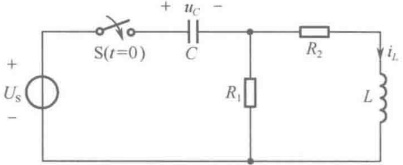

（a）原始电路
 

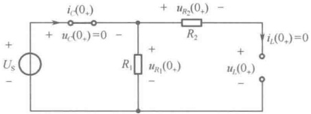

(b) $ t=0 $时等效电路
 

图8-5 例8-1图
 

<!-- page: 185 -->

解：因为换路前的电路是零状态电路，即  $ u_{C}(0_{-})=0 $ 和  $ i_{L}(0_{-})=0 $。根据换路定则，有  $ u_{C}(0_{+})=u_{C}(0_{-})=0 $，所以在  $ t=0_{+} $ 时刻电容相当于短路；又有  $ i_{L}(0_{+})=i_{L}(0_{-})=0 $，所以在  $ t=0_{+} $ 时刻电感相当于开路。据此画出  $ t=0_{+} $ 时的等效电路，如图 8-5（b）所示，然后由  $ t=0_{+} $ 时等效电路求出各电压和电流的初始值。

 $$ i_{C}(0_{+})=\frac{U_{S}}{R_{1}},\quad u_{L}(0_{+})=u_{R_{1}}(0_{+})=U_{S},\quad u_{R_{2}}(0_{+})=0 $$ 

例 8-2 电路如图 8-6（a）所示，开关 S 打开前，电路处于稳态。在 t=0 时开关 S 打开，求初始值  $ i_{C}(0_{+}) $、 $ u_{L}(0_{+}) $ 和  $ i_{R_{1}}(0_{+}) $。

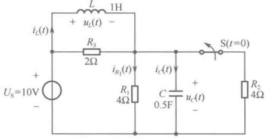

（a）原始电路
 

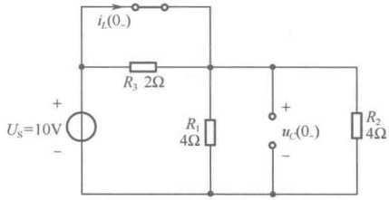

（b）t=0 时等效电路（原直流稳态电路）
 

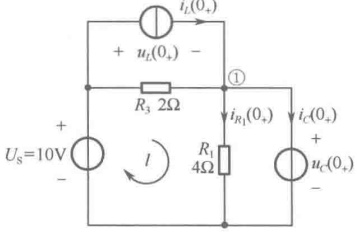

(c)  $ t=0 $ 时等效电路
 

图8-6 例8-2图
 

解：（1）计算 $ u_{C}(0_{-}) $和 $ i_{L}(0_{-}) $。由于t<0时电路已达直流稳态，可将电容视为开路，将电感视为短路，由此画出t=0_时等效电路（原直流稳态电路），如图8-6（b）所示。由该电路可求得

 $$ u_{C}(0_{-})=U_{S}=10\mathrm{V},\quad i_{L}(0_{-})=\frac{U_{S}}{\frac{R_{1}\times R_{2}}{R_{1}+R_{2}}}=\frac{10}{2}=5\mathrm{A} $$ 

（2）根据换路定则，可得独立的初始条件为

 $$ u_{C}(0_{+})=u_{C}(0_{-})=10\mathrm{V},\quad i_{L}(0_{+})=i_{L}(0_{-})=5\mathrm{A} $$ 

（3）计算非独立初始条件。开关 S 打开后  $ t=0_{+} $ 时，将电容用电压值为  $ u_{C}(0_{+})=10V $ 的电压源替代，将电感用电流值为  $ i_{L}(0_{+})=5A $ 的电流源替代，得到如图 8-6（c）所示的  $ t=0_{+} $ 时等效电路，由此可求得

 $$ i_{R_{1}}(0_{+})=\frac{u_{C}(0_{+})}{R_{1}}=\frac{10}{4}=2.5A $$ 

对节点①应用 KCL，得  $ i_{C}(0_{+})=i_{L}(0_{+})-i_{R_{1}}(0_{+})=5-2.5=2.5A $

对回路l应用KVL，得  $ u_{L}(0_{+})=U_{S}-u_{C}(0_{+})=10-10=0 $

图 8-6（a）所示电路是一个二阶电路，描述电路的方程是线性常系数二阶微分方程。如果选

<!-- page: 186 -->

择  $ u_{C}(t) $ 为响应变量，则电路微分方程的初始条件应为  $ u_{C}(0_{+}) $ 和  $ \left.\frac{du_{C}}{dt}\right|_{t=0_{+}} $ ；如果选择  $ i_{L}(t) $ 为响应变量，则电路微分方程的初始条件应为  $ i_{L}(0_{+}) $ 和  $ \left.\frac{di_{L}}{dt}\right|_{t=0_{+}} $ 。在求出  $ i_{C}(0_{+}) $ 、 $ u_{L}(0_{+}) $ 的基础上，根据电容元件和电感元件伏安关系的微分形式，可求出  $ \left.\frac{du_{C}}{dt}\right|_{t=0} $ 及  $ \left.\frac{di_{L}}{dt}\right|_{t=0} $ 。

由 $ i_{C}=C\frac{du_{C}}{dt} $，得

 $$ \frac{\mathrm{d}u_{c}}{\mathrm{d}t}\bigg|_{t=0_{+}}=\frac{i_{c}(0_{+})}{C}=\frac{2.5}{0.5}=5\mathrm{V/s} $$ 

由 $ u_{L}=L\frac{di_{L}}{dt} $，得

 $$ \frac{\mathrm{d}i_{L}}{\mathrm{d}t}\bigg|_{t=0_{+}}=\frac{u_{L}(0_{+})}{L}=\frac{0}{1}=0\mathrm{A/s} $$ 

由上例可归纳出计算电路初始条件的具体步骤如下：

（1）根据换路前电路的具体情况画出 $ t=0_{\_} $时等效电路，求出 $ u_{C}(0_{-}) $、 $ i_{L}(0_{-}) $；

（2）根据换路定则确定 $ u_{C}(0_{+}) $、 $ i_{L}(0_{+}) $;

（3）画出 $ t=0_{+} $时等效电路，计算各电压、电流的初始值。

### 8.2 一阶电路的零输入响应

动态电路换路后，在无外施激励（输入为零）的情况下，仅由动态元件初始储能（初始状态）所产生的响应称为零输入响应，其变化规律仅由电路的结构和元件参数决定，反映了电路本身所具有的特性，所以零输入响应也称为电路的自然响应或固有响应。

图 8-7（a）所示为一种典型的一阶 RC 零输入响应电路，先从物理概念上对该电路进行定性分析。

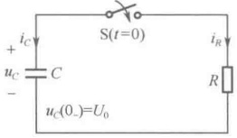

（a）原始电路
 

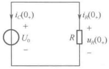

(b) $ t=0 $时等效电路
 

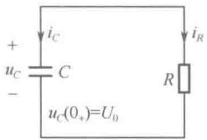

(c)  $ t \geq 0 $ 时电路
 

图 8-7 一阶 RC 电路的零输入响应用图
 

开关 S 闭合前，电容 C 已具有电压  $ u_{c}(0_{-})=U_{0} $，构成电路的原始状态，反映出电容的原始储能为  $ W_{C}(0_{-})=\frac{1}{2}CU_{0}^{2} $。开关 S 闭合后，根据换路定则，有  $ u_{C}(0_{+})=u_{C}(0_{-})=U_{0} $，构成电路的初始状态，反映出电容的初始储能为  $ W_{C}(0_{+})=\frac{1}{2}CU_{0}^{2} $。由图 8-7（b）所示的  $ t=0_{+} $ 时等效电路，得

$$  u_{R}(0_{+})=U_{0}   \tag*{（8-18）}$$

$$  i_{R}(0_{+})=\frac{U_{0}}{R}   \tag*{（8-19）}$$

$$  i_{C}(0_{+})=-i_{R}(0_{+})=-\frac{U_{0}}{R}   \tag*{（8-20）}$$

且

$$  \frac{\mathrm{d}u_{C}}{\mathrm{d}t}\bigg|_{t=0_{+}}=\frac{i_{C}(0_{+})}{C}=-\frac{U_{0}}{RC}<0   \tag*{（8-21）}$$

<!-- page: 187 -->

式（8-21）说明，换路后 $ t \geqslant 0_{+} $时电压 $ u_{C} $要下降，即电容C通过电阻R放电，电压 $ u_{C} $从 $ U_{0} $值逐渐减小，最后降为零。放电电流 $ i_{R} $也相应地从 $ \frac{U_{0}}{R} $值逐渐减小，最后降为零。放电结束，电路进入新的稳态。也就是说，在 $ t \geqslant 0_{+} $时电路中虽无外施激励，但在电容元件初始储能的作用下，仍可以有电压、电流存在，构成了电路的零输入响应。

下面通过数学分析来研究在  $ t \geq 0 $ 时电路的零输入响应情况，按图 8-7（c）所示的  $ t \geq 0 $ 时电路列写电路方程，根据基尔霍夫定律和元件的伏安关系容易列出以  $ u_C(t) $ 为响应变量的电路方程为

$$  \begin{cases}RC\frac{\mathrm{d}u_{C}}{\mathrm{d}t}+u_{C}=0,\quad t\geq0_{+}\\u_{C}(0_{+})=U_{0}\end{cases}   \tag*{（8-22）}$$

这是一阶线性常系数齐次微分方程，其特征根为

 $$ s=-\frac{1}{RC} $$ 

方程的解为

 $$ u_{C}(t)=A\mathrm{e}^{s t}=A\mathrm{e}^{\frac{t}{RC}} $$ 

根据电路的初始条件 $ u_{C}(0_{+})=U_{0} $，确定上式中的待定积分常数A，有

 $$ u_{c}(0_{+})=A=U_{0} $$ 

故得 $ u_{c} $的零输入响应为

$$  u_{C}(t)=u_{C}(0_{+})\mathrm{e}^{\frac{t}{RC}}=U_{0}\mathrm{e}^{\frac{t}{RC}},\quad t\geq0_{+}   \tag*{（8-23）}$$

在求得电容电压  $ u_{c}(t) $ 后，电路中其他元件上的电压和电流可以根据换路后  $ t \geq 0_{+} $ 时的电路直接求得，而不必再通过列写电路的微分方程来求解。

$$  i_{C}(t)=C\frac{\mathrm{d}u_{C}}{\mathrm{d}t}=-\frac{U_{0}}{R}\mathrm{e}^{-\frac{t}{RC}}=i_{C}(0_{+})\mathrm{e}^{-\frac{t}{RC}},\quad t\geq0_{+}   \tag*{(8-24)}$$

$$  u_{R}(t)=u_{C}(t)=U_{0}\mathrm{e}^{\frac{t}{RC}}=u_{R}(0_{+})\mathrm{e}^{\frac{t}{RC}},\quad t\geq0_{+}   \tag*{（8-25）}$$

$$  i_{R}(t)=-i_{C}(t)=\frac{U_{0}}{R}\mathrm{e}^{-\frac{t}{RC}}=i_{R}(0_{+})\mathrm{e}^{-\frac{t}{RC}},\quad t\geq0_{+}   \tag*{（8-26）}$$

 $ u_C(t) $、 $ i_C(t) $的变化曲线如图 8-8 所示，从图中可以看出，电压  $ u_C(t) $ 在换路前后是连续的，而电流  $ i_C(t) $ 在换路时发生了跃变。换路后，随着时间  $ t $ 的增大，一阶 RC 电路的零输入响应均由各自的初始值开始按同样的指数规律逐渐衰减， $ t \to \infty $ 时，它们衰减到零，达到新的稳定状态，这一变化过程称为一阶 RC 电路的过渡过程或暂态过程。一阶 RC 电路的零输入响应衰减快慢取决于指数式中的 RC 乘积常数，它具有时间的量纲  $ [\Omega \cdot F = (V/A) \cdot (C/V) = C/(C/s) = s] $，称为一阶 RC 电路的时间常数，用  $ \tau $ 表示，即

$$  \tau=R C   \tag*{(8-27)}$$

特征根s与时间常数 $ \tau $的关系为

$$  s=-\frac{1}{RC}=-\frac{1}{\tau}   \tag*{（8-28）}$$

可见，特征根的量纲为  $ s^{-1} $（Hz），故电路微分方程的特征根称为电路的固有频率。对于一阶 RC 电路而言，其固有频率是负实数，

(a)
 

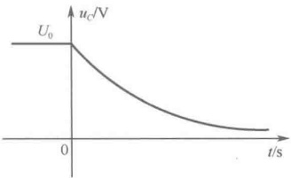

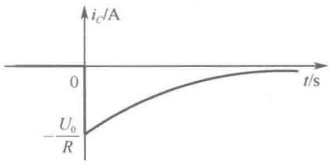

图 8-8  $ u_{C}(t) $、 $ i_{C}(t) $ 零输入响应变化曲线
 

(b)
 

<!-- page: 188 -->

表明一阶 RC 电路的零输入响应总是按指数规律衰减到零。

在引入了 $ \tau $后，一阶RC电路的零输入响应可以分别表示为

$$  \left\{\begin{aligned}&u_{C}(t)=U_{0}\mathrm{e}^{\frac{t}{\tau}}\\ &i_{C}(t)=-\frac{U_{0}}{R}\mathrm{e}^{\frac{t}{\tau}}\\ &u_{R}(t)=U_{0}\mathrm{e}^{\frac{t}{\tau}}\\ &i_{R}(t)=\frac{U_{0}}{R}\mathrm{e}^{\frac{t}{\tau}}\end{aligned}\right.,\quad t\geq0_{+}   \tag*{（8-29）}$$

时间常数  $ \tau $ 是反映一阶 RC 电路放电快慢的一个重要参数，时间常数越大，衰减越慢，放电过程越长；时间常数越小，衰减越快，放电过程越短。这从物理概念上容易理解，在同样的初始电压  $ U_{0} $ 下，C 越大，电容的电场所储存的初始能量就越大，放电过程就越长；R 越大，放电电流就越小，使得放电的过程相对减缓。图 8-9 中给出了 3 个不同时间常数  $ \tau $ 下的  $ u_{c}(t) $ 的变化曲线。

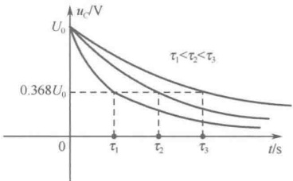

对于式（8-29）中的 $ u_{C}(t) $，令 $ t=\tau $，可得

图 8-9 三种不同时间常数下的  $ u_{c}(t) $ 的变化曲线
 

 $$ u_{c}(\tau)=U_{0}\mathrm{e}^{-\frac{\tau}{\tau}}=U_{0}\mathrm{e}^{-1}=0.368U_{0} $$ 

即电容电压在 $ t=\tau $时衰减到初始值的 $ e^{-1}=36.8\% $，所以电路的时间常数即为过渡过程中各零输入响应衰减到初始值的36.8%所需的时间，如图8-9所示。

表8-2给出了部分在 $ \tau $的整数倍时刻上用 $ \frac{u_{c}(t)}{U_{0}} $的值来表示 $ u_{c}(t) $的衰减程度。

表8-2 不同t时 $ u_{C}(t) $的衰减程度
 

<table border=1 style='margin: auto; word-wrap: break-word;'><tr><td style='text-align: center; word-wrap: break-word;'>t</td><td style='text-align: center; word-wrap: break-word;'>0</td><td style='text-align: center; word-wrap: break-word;'>$ \tau $</td><td style='text-align: center; word-wrap: break-word;'>2 $ \tau $</td><td style='text-align: center; word-wrap: break-word;'>3 $ \tau $</td><td style='text-align: center; word-wrap: break-word;'>4 $ \tau $</td><td style='text-align: center; word-wrap: break-word;'>5 $ \tau $</td><td style='text-align: center; word-wrap: break-word;'>...</td><td style='text-align: center; word-wrap: break-word;'>$ \infty $</td></tr><tr><td style='text-align: center; word-wrap: break-word;'>$ \frac{u_c(t)}{U_0} $</td><td style='text-align: center; word-wrap: break-word;'>1</td><td style='text-align: center; word-wrap: break-word;'>0.368</td><td style='text-align: center; word-wrap: break-word;'>0.135</td><td style='text-align: center; word-wrap: break-word;'>0.05</td><td style='text-align: center; word-wrap: break-word;'>0.018</td><td style='text-align: center; word-wrap: break-word;'>0.007</td><td style='text-align: center; word-wrap: break-word;'>...</td><td style='text-align: center; word-wrap: break-word;'>0</td></tr></table>

由表8-2可见，在理论上要经过无限长的时间， $ u_{c} $ 才能衰减为零，但从实际工程应用的角度来看，当 $ t=5\tau $ 时， $ u_{c} $ 已衰减到初始值的0.7%，可以近似地认为放电结束。因此，工程上一般认为，经过 $ 3\sim5\tau $ 的时间后，过渡过程结束。

时间常数 $ \tau $还可以从 $ u_{c}(t) $的变化曲线上用几何方法求得。将 $ \tau=RC $代入式（8-22），得

 $$ \begin{aligned}\tau\frac{\mathrm{d}u_{_{C}}}{\mathrm{d}t}+u_{_{C}}&=0\\\tau&=-\frac{u_{_{C}}}{\underbrace{\mathrm{d}u_{_{C}}}_{\mathrm{d}t}}\end{aligned} $$ 

即

式（8-30）说明，由 $ u_{c}(t) $曲线上的任意一点，以该点的斜率直线式地衰减，经过时间 $ \tau $后就衰减到零，或者说， $ u_{c}(t) $曲线上的任意一点的次切距长度就等于时间常数 $ \tau $，如图8-10所示。

在整个放电过程中，电阻R上消耗的能量为

<!-- page: 189 -->

$$  \begin{align*}W_{R}=&\int_{0_{+}}^{\infty}Ri_{R}{}^{2}(t)\mathrm{d}t=\int_{0_{+}}^{\infty}R\Bigg(\frac{U_{0}}{R}\mathrm{e}^{-\frac{t}{\tau}}\Bigg)^{2}\mathrm{d}t\\=&\frac{U_{0}^{2}}{R}\int_{0_{+}}^{\infty}\mathrm{e}^{-\frac{2t}{\tau}}\mathrm{d}t=\frac{U_{0}^{2}}{R}\Bigg(-\frac{\tau}{2}\Bigg)\mathrm{e}^{-\frac{2t}{\tau}}\Bigg|_{0_{+}}^{\infty}\\=&\frac{U_{0}^{2}}{R}\cdot\frac{\tau}{2}=\frac{1}{2}CU_{0}^{2}\end{align*}   \tag*{（8-31）}$$

正好等于电容的初始储能，即在放电过程中，电容的初始储能不断释放出来并以热能形式全部消耗在电阻上了。

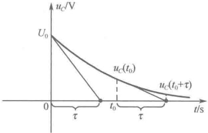

图 8-10 时间常数  $ \tau $ 的几何意义
 

图 8-11（a）所示为另一种典型的一阶 RL 零输入响应电路，下面来研究它的零输入响应。

换路前，开关 S 合于 1，且电路处于直流稳态，将电感视为短路，可画出  $ t=0_{\perp} $ 时等效电路，（原直流稳态电路）如图 8-11（b）所示，容易求得  $ i_{L}(0_{-})=U_{S}/R_{0}=I_{0} $，构成电路的原始状态，反映出电感的原始储能为  $ W_{L}(0_{-})=LI_{0}^{2}/2 $。在 t=0 时换路，开关 S 由 1 切换到 2，根据换路定则，有  $ i_{L}(0_{+})=i_{L}(0_{-})=I_{0} $，构成电路的初始状态，反映出电感的初始储能为  $ W_{L}(0_{+})=LI_{0}^{2}/2 $。由图 8-11（c）所示的  $ t=0_{+} $ 时等效电路，得

$$  i_{R}(0_{+})=-i_{L}(0_{+})=-I_{0}   \tag*{（8-32）}$$

$$  u_{L}(0_{+})=u_{R}(0_{+})=R i_{R}(0_{+})=-R I_{0}   \tag*{（8-33）}$$

且

$$  \frac{\mathrm{d}i_{L}}{\mathrm{d}t}\bigg|_{t=0_{+}}=\frac{u_{L}(0_{+})}{L}=-\frac{RI_{0}}{L}<0   \tag*{（8-34）}$$

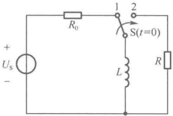

（a）原始电路
 

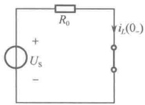

（b）t=0 时等效电路
 

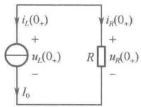

(c)  $ t=0 $ 时等效电路
 

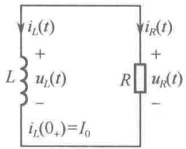

(d) $ t \geqslant 0 $时电路
 

图 8-11 一阶 RL 电路的零输入响应用图
 

式（8-34）说明，换路后 $ t \geqslant 0_{+} $时电流 $ i_{L} $要变小，即电感L通过电阻R放电，电流 $ i_{L} $从 $ I_{0} $值逐渐减小，直至为零。这就是在电感初始储能作用下，电路产生的零输入响应。由图8-11（d）所示的 $ t \geqslant 0_{+} $时电路，根据基尔霍夫定律和元件的伏安关系容易列出以 $ i_{L}(t) $为响应变量的电路方程为

$$  \begin{cases}\displaystyle\frac{L}{R}\frac{\mathrm{d}i_{L}}{\mathrm{d}t}+i_{L}=0,&t\geq0_{+}\\ i_{L}\left(0_{+}\right)=I_{0}\end{cases}   \tag*{（8-35）}$$

这也是一阶线性常系数齐次微分方程，与前面的求法相同，可求出方程的解为

$$  i_{L}(t)=i_{L}(0_{+})\mathrm{e}^{-\frac{R}{L}t}=I_{0}\mathrm{e}^{-\frac{t}{\tau}},\quad t\geq0_{+}   \tag*{（8-36）}$$

式中，

$$  \tau=\frac{L}{R}   \tag*{(8-37)}$$

称为一阶 RL 电路的时间常数， $ \tau $ 的单位为秒 $ [H/\Omega = (\mathrm{Wb/A})(\mathrm{V/A}) = \mathrm{Wb/V} = s] $。

在求得电感电流  $ i_{L}(t) $ 后，根据换路后  $ t \geq 0 $ 时电路，可以方便地求得电路中其他零输入响应  $ u_{L}(t) $、 $ i_{R}(t) $ 及  $ u_{R}(t) $ 分别为

<!-- page: 190 -->

$$  \left\{\begin{aligned}u_{L}(t)&=L\frac{\mathrm{d}i_{L}}{\mathrm{d}t}=-RI_{0}\mathrm{e}^{-t/\tau}=u_{L}(0_{+})\mathrm{e}^{-t/\tau}\\ i_{R}(t)&=-i_{L}(t)=-I_{0}\mathrm{e}^{-t/\tau}=i_{R}(0_{+})\mathrm{e}^{-t/\tau}\\ u_{R}(t)&=u_{L}(t)=-RI_{0}\mathrm{e}^{-t/\tau}=u_{R}(0_{+})\mathrm{e}^{-t/\tau}\end{aligned}\right.\quad,\quad\quad t\geq0_{+}   \tag*{（8-38）}$$

 $ i_{L}(t) $、 $ u_{L}(t) $ 的变化曲线如图 8-12 所示，从图中可以看出，电流  $ i_{L}(t) $ 在换路前后是连续的，而电压  $ u_{L}(t) $ 在换路时发生了跃变。换路后，随着时间 t 的增大，一阶 RL 电路的零输入响应均由各自的初始值开始按同样的指数规律衰减到零，过渡过程结束，达到新的稳定状态。

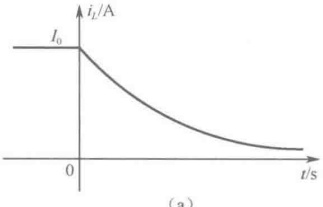

(a)
 

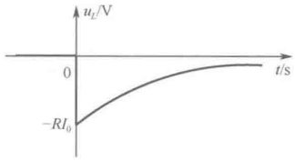

（b）
 

图 8-12  $ i_{L}(t) $、 $ u_{L}(t) $ 零输入响应变化曲线
 

一阶 RL 电路的时间常数  $ \tau = L/R $ 与一阶 RC 电路中的时间常数  $ \tau = RC $ 具有相同的物理意义，时间常数  $ \tau $ 越小，电流、电压衰减越快，反之则越慢。可以从物理概念上理解这一结论，对同样的初始电流  $ I_{0} $，L 越小就意味着储能越小，放电过程就越短；R 越大，电阻的功率也越大，因此，储能也就较快地被电阻消耗掉。

在整个放电过程中，电阻上消耗的能量为

$$  \begin{align*}W_{R}&=\int_{0_{+}}^{\infty}Ri_{R}^{2}(t)\mathrm{d}t=\int_{0_{+}}^{\infty}R\left(-I_{0}\mathrm{e}^{-\frac{t}{\tau}}\right)^{2}\mathrm{d}t\\&=RI_{0}^{2}\int_{0_{+}}^{\infty}\mathrm{e}^{-\frac{2t}{\tau}}\mathrm{d}t=RI_{0}^{2}\left(-\frac{\tau}{2}\right)\mathrm{e}^{-\frac{2t}{\tau}}\Bigg|_{0_{+}}^{\infty}\\&=RI_{0}^{2}\cdot\frac{\tau}{2}=\frac{1}{2}LI_{0}^{2}\end{align*}   \tag*{(8-39)}$$

正好等于电感的初始储能，即在放电过程中，电感的初始储能不断释放出来并以热能形式全部消耗在电阻上了。

通过对以上两个典型的一阶电路的分析可知，电路的零输入响应是在换路后无外施激励（输入为零）情况下，仅由电路初始储能的释放引起的，并且随着时间 t 的增大，均从初始值开始按指数规律衰减到零，这是因为电路中的原有储能总是要被电阻逐渐耗尽。如果用  $ y_{zi}(t) $ 表示电路的零输入响应（下标 zi 是英文 zero input 的缩写），其初始值为  $ y_{zi}(0_{+}) $，则上述两个典型的一阶电路的零输入响应可统一表示为

$$  \begin{aligned}&\left\{\begin{aligned}\\ &y_{zi}(t)=y_{zi}(0_{+})e^{\frac{t}{\tau}},\quad&t\geq0_{+}\\&\tau=\left\{\begin{aligned}&RC\\&\frac{L}{R}\end{aligned}\right.\\ &\end{aligned}\right.\\ \end{aligned}   \tag*{（8-40）}$$

由式（8-29）、式（8-36）及式（8-38）还可以看出，若初始状态  $ [u_{C}(0_{+})=U_{0}\text{ 或 }i_{L}(0_{+})=I_{0}] $ 增大 K 倍，则电路的零输入响应也随之增大 K 倍，这表明一阶电路的零输入响应与初始状态满足

<!-- page: 191 -->

齐次性（比例性），这是线性动态电路响应与激励呈线性关系的体现，初始状态可以看作电路的内部激励。

对于一般的一阶零输入响应电路 [见图 8-13（a）或（b）]，求解零输入响应的一般方法是，选择某一响应变量（u 或 i）用  $ y_{zi}(t) $ 表示，根据基尔霍夫定律和元件的伏安关系列出电路方程

$$  \begin{cases}a_{\mathrm{l}}\frac{y_{\mathrm{zi}}}{\mathrm{d}t}+a_{0}y_{\mathrm{zi}}=0,&\quad t\geq0_{+}\\y_{\mathrm{zi}}(0_{+})\end{cases}   \tag*{（8-41）}$$

式中， $ y_{zi}(0_{+}) $ 为零输入响应变量的初始值，可由  $ t=0_{+} $ 时等效电路计算出，是由初始状态  $ u_{C}(0_{+}) $ 或  $ i_{L}(0_{+}) $ 产生的。

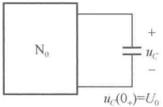

(a)
 

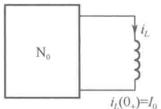

(b)
 

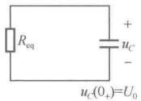

(c)
 

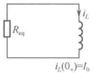

(d)
 

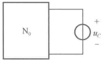

(e)
 

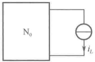

(f)
 

图 8-13 一般的一阶零输入响应电路求解用图
 

采用微分方程的经典解法，上述方程的解为

$$  y_{zi}(t)=y_{zi}(0_{+})\mathrm{e}^{st}=y_{zi}(0_{+})\mathrm{e}^{-\frac{t}{\tau}}   \tag*{（8-42）}$$

式中，

$$  \tau=-\frac{1}{s}=\frac{a_{1}}{a_{0}}   \tag*{（8-43）}$$

 $ \tau $ 为一阶电路的时间常数，它是由电路的结构和元件参数决定的体现电路特性的一个重要的电路参数。因此，可以认为电路的零输入响应取决于电路的初始状态和电路的特性。如果电路结构复杂，列写电路方程以及计算  $ y_{zi}(0_{+}) $ 都是十分不容易的事，这时零输入响应的求解更倾向于先应用求无源单口网络等效电阻的方法将图 8-13（a）或（b）等效化简为如图 8-13（c）或（d）所示的典型的一阶电路。根据式（8-40），由图 8-13（c）可求得

$$  \begin{cases}u_{C}(t)=u_{C}(0_{+})\mathrm{e}^{\frac{t}{\tau}},&\quad t\geq0_{+}\\\tau=R_{\mathrm{eq}}C\end{cases}   \tag*{(8-44)}$$

同理，由图8-13（d）可求得

$$  \left\{\begin{aligned}&i_{L}(t)=i_{L}(0_{+})\mathrm{e}^{\frac{t}{\tau}},\quad&t\geqslant0_{+}\\ &\tau=\frac{L}{R_{\mathrm{eq}}}\\ \end{aligned}\right.   \tag*{（8-45）}$$

求得  $ u_{C}(t) $ 或  $ i_{L}(t) $ 后，再应用替代定理，可将图 8-13（a）中的电容用电压为  $ u_{C}(t) $ 的电压源替代，如图 8-13（e）所示，或将图 8-13（b）中的电感用电流为  $ i_{L}(t) $ 的电流源替代，如图 8-13（f）所示，这样只需用电阻电路分析方法即可求得  $ N_{0} $ 内部其他变量的零输入响应。这种方法免去了列写微分

<!-- page: 192 -->

方程及求解  $ y_{zi}(0_{+}) $ 的繁杂工作量，充分利用电路的等效变换及现有规律求解出一般的一阶电路的零输入响应。

例 8-3 如图 8-14（a）所示的电路，换路前（开关未打开时）电路已工作了很长时间，求换路后（开关已打开）的零输入响应电流  $ i(t) $ 和电压  $ u_{o}(t) $。

解：（1）计算 $ u_{c}(0_{-}) $。由于换路前电路已达直流稳态，将电容视为开路，可画出 $ t=0_{-} $时等效电路，如图8-14（b）所示。由该电路求得

 $$ u_{c}(0_{-})=\frac{60}{40+60}\times200=120V $$ 

 $$ u_{c}(0_{+})=u_{c}(0_{-})=120\mathrm{V} $$ 

根据换路定则，有

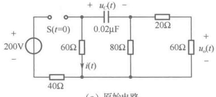

（a）原始电路
 

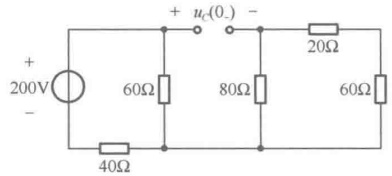

(b) t=0 时等效电路
 

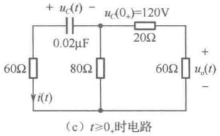

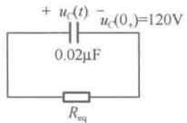

(d) $ t \geq 0 $时等效电路
 

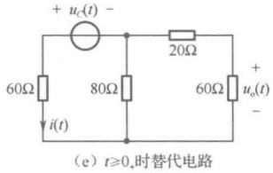

图 8-14 例 8-3 图
 

（2）画出  $ t \geqslant 0 $ 时的电路，如图 8-14（c）所示，应用求无源单口网络等效电阻的方法将其等效化简为如图 8-14（d）所示的电路，其中

 $$ R_{eq}=60+\frac{80\times(20+60)}{80+(20+60)}=100\Omega $$ 

 $$ \tau=R_{eq}C=100\times0.02\times10^{-6}=2\times10^{-6}s $$ 

 $$ u_{C}(t)=u_{C}(0_{+})\mathrm{e}^{-\frac{t}{\tau}}=120\mathrm{e}^{-\frac{t}{2\times10^{-6}}}(\mathrm{V}),\quad t\geq0_{+} $$ 

（3）画出 $ t \geqslant 0 $。时的替代电路，如图8-14（e）所示，容易求得

 $$ i(t)=\frac{u_{C}(t)}{60+\frac{80\times(20+60)}{80+(20+60)}}=1.2\mathrm{e}^{-\frac{t}{2\times10^{-6}}}(\mathrm{A}),\quad t\geq0_{+} $$ 

 $$ u_{0}(t)=-60\times\frac{i(t)}{2}=-36e^{-\frac{t}{2\times10^{-6}}}(\mathrm{V}),\quad t\geq0_{+} $$ 

### 8.3 一阶电路的零状态响应

电路在零原始状态下，仅由换路后 $ t \geq 0_{+} $时外施激励产生的响应称为零状态响应，显然零状态响应与输入及电路本身的特性都有关。本节讨论在直流电源激励下，一阶电路的零状态响应。

图 8-15（a）所示为零状态 RC 串联电路在 t=0 时接通直流电压源，在求解此电路的零状态响

<!-- page: 193 -->

应之前，先从物理概念上定性阐述开关闭合后 $ u_{C} $变化的趋势。根据换路定则，有 $ u_{C}(0_{+})=u_{C}(0_{-})=0 $，构成电路的零初始状态。由图8-15（b）所示的 $ t=0_{+} $时等效电路，得

$$  i(0_{+})=\frac{U_{s}}{R}   \tag*{(8-46)}$$

 $$ \frac{\mathrm{d}u_{C}}{\mathrm{d}t}\bigg|_{t=0_{+}}=\frac{i(0_{+})}{C}=\frac{U_{\mathrm{S}}}{RC}>0 $$ 

且

式（8-47）说明，换路后  $ t \geq 0_+ $ 时电容电压  $ u_C $ 要增大，即在如图 8-15（c）所示的  $ t \geq 0_+ $ 时电路中，直流电压源通过电阻  $ R $ 向电容  $ C $ 充电。随着时间  $ t $ 的增大，电容电压  $ u_C $ 从零逐渐增大，电阻电压  $ u_R $ 相应地减小，其充电电流  $ i $ 也随之减小。当  $ t \to \infty $ 时， $ u_C(\infty) = U_S $，充电电流  $ i(\infty) = 0 $，电容视同开路，充电停止，电路进入了直流稳态，直流稳态电路如图 8-15（d）所示。

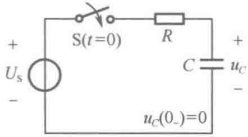

（a）原始电路
 

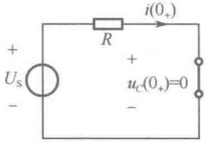

(b) $ t=0 $,时等效电路
 

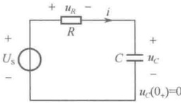

(c)  $ t \geq 0 $ 时电路
 

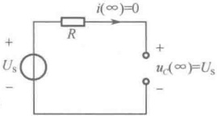

（d）直流稳态电路
 

图 8-15 一阶 RC 电路的零状态响应用图
 

下面通过数学分析来研究在  $ t \geqslant 0 $ 时电路的零状态响应情况，按图 8-15（c）所示的  $ t \geqslant 0 $ 时电路列写电路方程，根据基尔霍夫定律和元件的伏安关系容易列出以  $ u_{c}(t) $ 为响应变量的电路方程为

$$  \begin{cases}RC\frac{\mathrm{d}u_{c}}{\mathrm{d}t}+u_{c}=U_{\mathrm{s}},&t\geq0_{+}\\u_{c}(0_{+})=0\end{cases}   \tag*{（8-48）}$$

这是一个线性常系数非齐次微分方程。采用微分方程的经典解法，其解为

 $$ u_{C}(t)=u_{Ch}(t)+u_{Cp}(t) $$ 

式中， $ u_{\mathrm{Ch}}(t) $ 为齐次微分方程的通解； $ u_{\mathrm{Cp}}(t) $ 为非齐次微分方程的特解。

齐次微分方程的通解为

 $$ u_{\mathrm{Ch}}(t)=A\mathrm{e}^{st}=A\mathrm{e}^{\frac{t}{RC}}=A\mathrm{e}^{\frac{t}{\tau}} $$ 

式中， $ \tau = RC $ 为该电路的时间常数，仍与零输入响应相同。

特解与激励具有相同的函数形式，当激励为直流时，特解就是电路的直流稳态响应，即

 $$ u_{Cp}(t)=u_{C}(\infty)=U_s $$ 

于是，方程的完全解为

 $$ u_{C}(t)=u_{Ch}(t)+u_{Cp}(t)=A\mathrm{e}^{-\frac{t}{\tau}}+U_{S} $$ 

将电路的初始条件  $ u_{c}(0_{+})=0 $ 代入上式，得

解得

 $$ \begin{aligned}u_{C}(0_{+})&=A+U_{S}=0\\A&=-U_{S}\end{aligned} $$ 

故

$$  u_{C}(t)=-U_{S}\mathrm{e}^{-\frac{t}{\tau}}+U_{S}=U_{S}(1-\mathrm{e}^{-\frac{t}{\tau}}),\qquad t\geq0_{+}   \tag*{(8-49)}$$

求得电容电压  $ u_{C}(t) $ 后，根据换路后  $ t \geqslant 0 $ 时电路，可以方便地求得电路中其他零状态响应  $ i(t) $ 及  $ u_{R}(t) $ 分别为

<!-- page: 194 -->

$$  i(t)=C\frac{\mathrm{d}u_{c}}{\mathrm{d}t}=\frac{U_{s}}{R}\mathrm{e}^{-\frac{t}{\tau}},\qquad t\geq0_{+}   \tag*{（8-50）}$$

$$  u_{R}(t)=R i(t)=U_{S}\mathrm{e}^{\frac{t}{\tau}},\qquad t\geq0_{+}   \tag*{（8-51）}$$

 $ u_{C}(t) $ 的变化曲线如图 8-16 所示，电容电压  $ u_{C}(t) $ 从零开始按指数规律上升至稳态值  $ U_{S} $。其中， $ u_{Cp}(t)=U_{S} $ 与外施激励的变化规律有关，所以又称为响应的强制分量。当外施激励为直流时，其强制分量也为直流，且强制分量在电路过渡过程结束后达到新稳态时，单独存在于电路中，所以又称为响应的稳态分量。而  $ u_{Ch}(t)=-U_{S}e^{-t/\tau} $ 由于其变化规律取决于特征根而与外施激励无关，因此称为响应的自由分量。自由分量按指数规律衰减，最终趋于零，所以又称为响应的暂态分量。

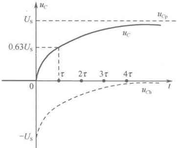

在整个充电过程，直流电压源提供的能量为

 $$ \begin{align*}W_{U_{\mathrm{s}}}=&\int_{0_{+}}^{\infty}U_{\mathrm{s}}i\mathrm{d}t=\int_{0_{+}}^{\infty}U_{\mathrm{s}}\frac{U_{\mathrm{s}}}{R}\mathrm{e}^{\frac{t}{\tau}}\mathrm{d}t\\=&\frac{U_{\mathrm{s}}^{2}}{R}(-\tau)\mathrm{e}^{\frac{t}{\tau}}\Bigg|_{0_{-}}^{\infty}=C U_{\mathrm{s}}^{2}\end{align*} $$ 

图 8-16  $ u_{c}(t) $ 零状态响应变化曲线
 

电容储能从零不断增大，直到 $ W_{c}=\frac{1}{2}CU_{s}^{2} $，电阻上消耗的能量为

$$  \begin{align*}W_{R}=&\int_{0_{+}}^{\infty}Ri^{2}\mathrm{d}t=\int_{0_{+}}^{\infty}R\Bigg(\frac{U_{\mathrm{S}}}{R}\mathrm{e}^{-\frac{t}{\tau}}\Bigg)^{2}\mathrm{d}t\\=&\frac{U_{\mathrm{S}}^{2}}{R}\int_{0_{+}}^{\infty}\mathrm{e}^{-\frac{2t}{\tau}}\mathrm{d}t=\frac{U_{\mathrm{S}}^{2}}{R}\cdot\Bigg(-\frac{\tau}{2}\Bigg)\mathrm{e}^{-\frac{2t}{\tau}}\Bigg|_{0_{+}}^{\infty}=\frac{1}{2}CU_{\mathrm{S}}^{2}\end{align*}   \tag*{(8-53)}$$

故有

$$  W_{U_{r}}=W_{C}+W_{R}   \tag*{（8-54）}$$

式（8-54）表明，在充电过程中，不论 R、C 为何值，电源提供的能量只有一半转变成电场能量储存在电容中，而另一半则被电阻所消耗，充电效率只有50%。

图 8-17（a）所示为零状态 RL 并联电路在 t=0 时接通直流电流源。在求解此电路的零状态响应之前，先从物理概念上定性地阐述开关打开后  $ i_{L} $ 变化的趋势。根据换路定则，有  $ i_{L}(0_{+})=i_{L}(0_{-})=0 $ ，构成电路的零初始状态。由图 8-17（b）所示的  $ t=0_{+} $ 时等效电路，得

$$  u_{L}(0_{+})=R I_{\mathrm{s}}   \tag*{（8-55）}$$

且

$$  \frac{\mathrm{d}i_{L}}{\mathrm{d}t}\bigg|_{t=0_{+}}=\frac{u_{L}(0_{+})}{L}=\frac{RI_{\mathrm{S}}}{L}>0   \tag*{（8-56）}$$

式（8-56）说明，换路后 $ t \geqslant 0_{+} $时电感电流 $ i_{L} $要增大，在如图8-17（c）所示的 $ t \geqslant 0_{+} $时电路中，随着电感电流 $ i_{L} $的逐渐增大，电阻电流 $ i_{R} $应逐渐减小。电阻电压 $ u_{R} $也相应地逐渐减小，意味着电感电流变化率 $ \frac{di_{L}}{dt} $也要减小，因此，电感电流 $ i_{L} $的增大将越来越缓慢，最后 $ \frac{di_{L}}{dt}=0 $，电感电压几乎为零，电感视同短路，这时，直流电流源的电流全部流过电感，电感电流为 $ i_{L}(\infty)=I_{S} $， $ u_{L}(\infty)=0 $，电路进入了直流稳态，直流稳态电路如图8-17（d）所示。

对图 8-17（c）所示的  $ t \geqslant 0 $ 时电路应用类似前面一阶 RC 电路零状态响应的求解步骤，可得出

$$  i_{L}(t)=-I_{\mathrm{S}}\mathrm{e}^{\frac{t}{\tau}}+I_{\mathrm{S}}=I_{\mathrm{S}}(1-\mathrm{e}^{\frac{t}{\tau}}),\qquad t\geq0_{+}   \tag*{（8-57）}$$

在求得电感电流 $ i_{L}(t) $后，根据换路后 $ t\geq0_{+} $时电路，可以方便地求得电路中其他零状态响应

<!-- page: 195 -->

$ u_{L}(t) $ 及  $ i_{R}(t) $ 分别为

$$  u_{L}=L\frac{\mathrm{d}i_{L}}{\mathrm{d}t}=R I_{\mathrm{S}}\mathrm{e}^{\frac{t}{\tau}},\qquad\quad t\geq0_{+}   \tag*{（8-58）}$$

$$  i_{_{R}}=\frac{u_{_{L}}}{R}=I_{S}\mathrm{e}^{\frac{t}{\tau}},\qquad\quad t\geq0_{+}   \tag*{（8-59）}$$

式中， $ \tau = L/R $ 为该电路的时间常数，仍与零输入响应相同。

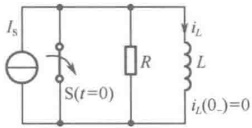

（a）原始电路
 

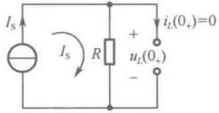

(b) $ t=0 $时等效电路
 

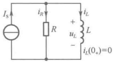

(c)  $ t \geqslant 0 $ 时电路
 

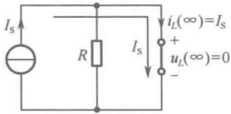

（d）直流稳态电路
 

图 8-17 一阶 RL 电路的零状态响应用图
 

 $ i_L(t) $ 的变化曲线如图 8-18 所示，电感电流  $ i_L(t) $ 从零开始按指数规律上升至稳态值  $ I_S $。其中  $ i_{Lp}(t) = I_S $ 称为响应的强制分量（稳态分量）， $ i_{Lh}(t) = -I_S e^{-t/\tau} $ 称为响应的自由分量（暂态分量）。

以上讨论了两个典型的一阶电路在直流激励下的零状态响应。这时电路中的物理过程实质上是电路中动态元件的储能从无到有的逐渐增长、建立的过程，表现为电容电压或电感电流从最初的零值按指数规律上升到其稳定值，上升的速度由时间常数 $ \tau $决定。对于直流激励的一阶RC电路，电容电压零状态响应的一般形式可表示为

$$  \left\{\begin{aligned}&u_{C}(t)=u_{C}(\infty)(1-\mathrm{e}^{\frac{t}{\tau}}),\quad&t\geq0_{+}\\ &\tau=R C\\ \end{aligned}\right.   \tag*{（8-60）}$$

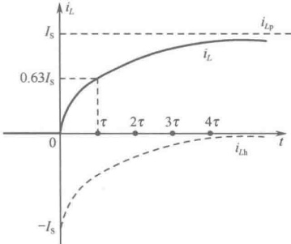

对于直流激励的一阶 RL 电路，电感电流零状态响应的一般形式可表示为

图 8-18  $ i_{L}(t) $ 零状态响应变化曲线
 

$$  \begin{cases}i_{L}(t)=i_{L}(\infty)(1-\mathrm{e}^{\frac{t}{\tau}}),&\quad t\geq0_{+}\\\tau=\frac{L}{R}\end{cases}   \tag*{（8-61）}$$

由式（8-49）～式（8-51）和式（8-57）～式（8-59）还可以看出，若外施激励 $ U_{s} $或 $ I_{s} $增大K倍，则电路的零状态响应也增大K倍，这表明一阶电路的零状态响应与外施激励满足齐次性（比例性），这也是线性动态电路响应与激励呈线性关系的体现。如果有多个独立电源共同作用于电路，可以运用叠加定理求出电路的零状态响应。

对于一般的一阶零状态响应电路，如图 8-19（a）或（b）所示，求解零状态响应的一般方法是选择某一响应变量（u 或 i）用  $ y_{zs}(t) $ （下标 zs 是英文 zero state 缩写）表示，根据基尔霍夫定律和元件的伏安关系列出电路方程为

$$  \begin{cases}a_{1}\frac{y_{zs}}{\mathrm{d}t}+a_{0}y_{zs}=f(t),&\quad t\geq0_{+}\\y_{zs}(0_{+})\end{cases}   \tag*{（8-62）}$$

式中， $ y_{zs}(0_{+}) $ 是零状态响应变量的初始值，可由  $ t=0_{+} $ 时等效电路计算出，它是由外施激励  $ (u_{S} $ 或  $ i_{s} $ ) 产生的。

<!-- page: 196 -->

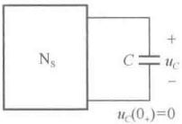

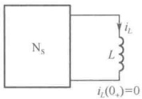

(a)
 

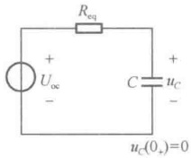

(b)
 

(c)
 

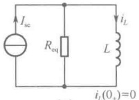

(d)
 

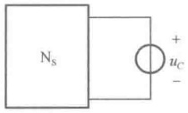

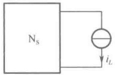

(e)
 

(f)
 

图 8-19 一般的一阶电路零状态响应求解用图
 

采用微分方程的经典解法，方程组（8-62）的解为

$$  \begin{aligned}y_{zs}(t)=&\underbrace{[y_{zs}(0_{+})-y_{p}(0_{+})]e^{\frac{t}{\tau}}}_{ 通解 +\underbrace{y_{p}(t)}_{ 特解 }}\\&\mathrm{ 自由分量 }\quad\mathrm{ 强制分量 }\\&\mathrm{ 暂态分量 }\quad\mathrm{ 稳态分量 }\end{aligned}   \tag*{（8-63）}$$

式中，

$$  \tau=-\frac{1}{s}=\frac{a_{1}}{a_{0}}   \tag*{(8-64)}$$

$\tau$ 仍为一阶电路的时间常数，它也是由电路的结构和元件参数决定的体现电路特性的一个重要的电路参数。因此，可以认为电路的零状态响应是由外施激励和电路的特性共同决定的。如果电路结构复杂，列写电路方程以及计算 $y_{zs}(0_{+})$ 都是十分不容易的事，这时零状态响应的求解往往更倾向于先应用戴维宁定理或诺顿定理将图 8-19（a）或（b）等效化简为如图 8-19（c）或（d）所示的典型的一阶电路。根据式（8-60），由图 8-19（c）可求得

$$  \begin{cases}u_{C}(t)=U_{oc}(1-e^{\frac{t}{\tau}}),&\quad t\geq0_{+}\\\tau=R_{eq}C\end{cases}   \tag*{（8-65）}$$

同理，根据式（8-61），由图8-19（d）可求得

$$  \left\{\begin{aligned}&i_{L}(t)=I_{\mathrm{s c}}(1-\mathrm{e}^{\frac{t}{\tau}}),\quad&t\geq0_{+}\\ &\tau=\frac{L}{R_{\mathrm{e q}}}\\ \end{aligned}\right.   \tag*{(8-66)}$$

在求得  $ u_C(t) $ 或  $ i_L(t) $ 后，再应用替代定理得到图 8-19（e）或（f），这时只需用电阻电路分析方法即可求得  $ N_S $ 内部其他变量的零状态响应。

例 8-4 电路如图 8-20（a）所示，在 t=0 时开关打开，打开前电路无原始储能，求  $ t \geq 0_{+} $ 时的  $ u_{L}(t) $ 和电压源发出的功率  $ p_{10V}(t) $。

解：根据换路定则，有 $ i_{L}(0_{+})=i_{L}(0_{-})=0 $。画出 $ t\geq0_{+} $时的电路如图8-20（b）所示，应用诺顿定理将图8-20（b）等效化简为如图8-20（c）所示电路。由图8-20（b）容易求得

 $$ U_{oc}=10+2\times2=14V,\quad R_{eq}=2+3+5=10\Omega $$ 

从而有

<!-- page: 197 -->

$$ I_{sc}=\frac{U_{oc}}{R_{eq}}=\frac{14}{10}=1.4A,\quad\tau=\frac{L}{R_{eq}}=\frac{0.2}{10}=\frac{1}{50}s $$ 

由图8-20（c），根据式（8-66），可求得

 $$ i_{L}(t)=I_{\mathrm{s c}}(1-\mathrm{e}^{-\frac{t}{\tau}})=1.4(1-\mathrm{e}^{-50t})\mathrm{A},\qquad t\geq0_{+} $$ 

 $$ u_{L}(t)=L\frac{\mathrm{d}i_{L}}{\mathrm{d}t}=14\mathrm{e}^{-50t}\mathrm{V},\qquad t\geq0_{+} $$ 

在图 8-20（d）中，与  $ i_{L} $ 电流源相串联的两个电阻（3Ω 和 5Ω）对于计算 i 是外虚元件，可用短路处理将其去除（图中用虚线表示）。对节点①应用 KCL，得

 $$ i=-2+i_{L}=-2+1.4(1-\mathrm{e}^{-50t})=-(0.6+1.4\mathrm{e}^{-50t})\mathrm{A},\quad t\geq0_{+} $$ 

 $$ p_{10\mathrm{V}}=10\times i=-(6+14\mathrm{e}^{-50t})\mathrm{W},\quad t\geq0_{+} $$ 

由于  $ p_{10V}(t)<0 $ ，说明 10V 电压源始终在吸收功率。

（a）原始电路
 

(c)  $ t \geq 0 $ 时等效电路
 

(b) $ t \geq 0 $,时电路
 

(d) $ t \geqslant 0 $,时替代电路
 

图 8-20 例 8-4 图
 

例 8-5 电路如图 8-21（a）所示，在 t=0 时开关 S 闭合，闭合前电路无原始储能，求  $ t \geqslant 0 $。时电容电压  $ u_{C}(t) $ 及受控电流源两端电压  $ u(t) $。

（a）原始电路
 

(b) $ t \geq 0 $ 时电路
 

(c)  $ t \geq 0 $ 时等效电路
 

（d）求 $ U_{总} $电路
 

(e) 求  $ I_{总} $ 电路
 

图 8-21 例 8-5 图
 

(f) $ t \geq 0 $.时替代电路
 

<!-- page: 198 -->

解：根据换路定则，有  $ u_{C}(0_{+})=u_{C}(0_{-})=0 $ 。画出  $ t\geq0_{+} $ 时电路如图 8-21（b）所示，应用戴维宁定理将图 8-21（b）等效化简为图 8-21（c）所示电路。由图 8-21（d）容易求得

 $$ U_{oc}=2V $$ 

由图 8-21（e），应用节点分析法列出节点电压方程为

 $$ \begin{aligned}&\left\{\begin{aligned}&\left(\frac{1}{1}+\frac{1}{2}\right)u_{n1}=\frac{2}{1}+4i_{1}^{n}\\&i_{1}^{n}=-\frac{u_{n1}}{2}\end{aligned}\right.\\ \end{aligned} $$ 

 $$ I_{sc}=-i_{1}^{^{\prime \prime}}=\frac{2}{7}A $$ 

解得

根据开路短路法得

 $$ R_{\mathrm{eq}}=\frac{U_{\mathrm{oc}}}{I_{\mathrm{sc}}}=\frac{2}{\frac{2}{7}}=7\Omega,\quad\tau=R_{\mathrm{eq}}C=7\times3\times10^{-6}=21\times10^{-6}\mathrm{s} $$ 

由图8-21（c），根据式（8-65），可求得

 $$ u_{C}=U_{oc}(1-e^{-\frac{t}{\tau}})=2(1-e^{-\frac{10^6}{21}t})V,\quad t\geq0_{+} $$ 

 $$ i_{C}=C\frac{\mathrm{d}u_{C}}{\mathrm{d}t}=\frac{2}{7}\mathrm{e}^{-\frac{10^{6}}{21}t}\mathrm{A},\quad t\geq0_{+} $$ 

由图 8-21（f），对回路  $ I_{1} $ 应用 KVL 得

 $$ u=2i_{C}+u_{C}=2\times\frac{2}{7}\mathrm{e}^{-\frac{10^{6}}{21}t}+2(1-\mathrm{e}^{-\frac{10^{6}}{21}t})=2-\frac{10}{7}\mathrm{e}^{-\frac{10^{6}}{21}t}\mathrm{V},\quad t\geq0_{+} $$ 

或由图8-21（f）得

 $$ i_{1}=-i_{C}=-\frac{2}{7}\mathrm{e}^{-\frac{10^{6}}{21}t}\mathrm{A},\quad t\geq0_{+} $$ 

对节点 $ ^{①} $应用KCL得

 $$ i=-i_{1}-4i_{1}=-5i_{1}=\frac{10}{7}\mathrm{e}^{-\frac{10^{6}}{21}t}\mathrm{A},\quad t\geq0_{+} $$ 

对回路 $ I_{2} $应用KVL得

 $$ u=-1\times i+2=2-\frac{10}{7}\mathrm{e}^{-\frac{10^{6}}{21}t}\mathrm{V},\qquad t\geq0_{+} $$ 

### 8.4 一阶电路的全响应

电路在外施激励和动态元件的初始储能（初始状态）共同作用下产生的响应称为全响应。

图 8-22（a）所示为具有非零原始状态的 RC 串联电路在 t=0 时接通直流电压源  $ U_s $。根据换路定则，有  $ u_C(0_+) = u_C(0_-) = U_0 $，构成非零初始状态，反映出电容的初始储能为  $ W_C(0_+) = CU_0^2/2 $。因此，在换路后  $ t \geq 0_+ $ 时电路如图 8-22（b）所示，该电路中既有直流电压源外部激励，又有初始状态内部激励。为求得全响应  $ u_C(t) $，可列写电路方程为

$$  \left\{\begin{aligned}&R C\frac{\mathrm{d}u_{C}}{\mathrm{d}t}+u_{C}=U_{\mathrm{s}},\quad&t\geq0_{+}\\ &u_{C}(0_{+})=U_{0}\end{aligned}\right.   \tag*{(8-67)}$$

这是一个线性常系数非齐次微分方程，采用微分方程的经典解法，其解为

 $$ u_{C}(t)=u_{Ch}(t)+u_{Cp}(t) $$ 

式中， $ u_{\mathrm{Ch}}(t) $ 为齐次微分方程的通解； $ u_{\mathrm{Cp}}(t) $ 为非齐次微分方程的特解。

<!-- page: 199 -->

齐次微分方程的通解为

 $$ u_{\mathrm{Ch}}(t)=A\mathrm{e}^{st}=A\mathrm{e}^{\frac{t}{RC}}=A\mathrm{e}^{\frac{t}{\tau}} $$ 

式中， $ \tau=RC $ 为该电路的时间常数。

特解就是电路的直流稳态响应，即

 $$ u_{c_p}(t)=u_c(\infty)=U_s $$ 

于是，方程的完全解为

 $$ u_{C}(t)=u_{Ch}(t)+u_{Cp}(t)=A\mathrm{e}^{-\frac{t}{\tau}}+U_{S} $$ 

将电路的初始条件 $ u_{C}(0_{+})=U_{0} $代入上式，得

解得

 $$ \begin{aligned}u_{C}(0_{+})&=A+U_{S}=U_{0}\\A&=U_{0}-U_{S}\\u_{C}(t)=&\underbrace{(U_{0}-U_{S})e^{\frac{t}{\tau}}}_{\underbrace{}_{ 辎砥 }}\underbrace{}_{ 辎砥 }+U_{S},\quad t\geq0_{+}\\& 通解 u_{Ch}(t)\quad 特解 u_{Cp}(t)\end{aligned} $$ 

故有

自由分量 强制分量

暂态分量 稳态分量

（a）原始电路
 

(b) $ t\geq0 $,时全响应电路
 

(c)  $ t \geqslant 0 $ 时零输入响应电路
 

(d) $ t\geq0 $.时零状态响应电路
 

图 8-22 一阶 RC 全响应用图
 

从式（8-68）可以看出，一阶 RC 电路的全响应  $ u_{c}(t) $ 可分解为两个分量。等式右边第一项对应的是电路微分方程的通解，它的变化规律取决于特征根，与外施激励无关，所以称为响应的自由分量，自由分量随着时间 t 的增长按指数规律逐渐衰减为零，一般可以认为在  $ t=4\tau $ 后消失，所以又称为响应的暂态分量；等式右边第二项对应的是电路微分方程的特解，其变化规律与外施激励形式相同，所以称为响应的强制分量。当激励为直流或正弦周期函数时，强制分量分别是直流稳态响应或正弦稳态响应，所以强制分量又称为响应的稳态分量。但当激励是一个衰减的指数函数时，强制分量将以相同规律衰减的指数函数，这时强制分量就不能称为稳态分量了。因此，稳态分量的含义较窄，仅存在于直流稳态或正弦稳态情况。

如果将式（8-68）重新组合，改写为

$$  \begin{aligned}u_{C}(t)=&\underbrace{U_{0}\mathrm{e}^{\frac{t}{\tau}}}_{\mathrm{ 滘 }}+\underbrace{U_{\mathrm{S}}(1-\mathrm{e}^{\frac{t}{\tau}})}_{\mathrm{ 滘 }},\quad&t\geq0_{+}\\& 零输入响应 u_{C\mathrm{zi}}(t)\quad& 零状态响应 u_{C\mathrm{zs}}(t)\end{aligned}   \tag*{(8-69)}$$

可得一阶 RC 电路全响应的另一种分解形式。等式右边第一项与式（8-23）相同，是电路在外施激励为零的情况下，仅由电路初始储能引起的零输入响应，如图 8-22（c）所示；等式右边第二项与

<!-- page: 200 -->

式（8-49）相同，是电路在零状态情况下，仅由外施激励引起的零状态响应，如图8-22（d）所示。因此，线性动态电路的全响应是由来自初始状态内部激励和来自电源外施激励分别作用于电路时产生的响应之和，也就是说，全响应是零输入响应和零状态响应之和。这一结论源于线性电路的叠加性而又为动态电路所独有，称为线性动态电路的叠加定理。

通过上述分析可知，既可以将全响应分解为自由分量（暂态分量）与强制分量（稳态分量），也可以将全响应分解为零输入响应与零状态响应，即可从两种不同的角度来认识全响应。前一种分解着眼于看清电路从旧稳态到新稳态通常要经历一个过渡过程；后一种分解则着眼于看清电路中的因果关系，即线性动态电路的响应与激励之间具有可加性（叠加性）。 $ u_{c} $ 的两种分解变化曲线如图 8-23（a）和（b）所示。

图 8-23  $ u_{c} $ 的两种分解变化曲线
 

可将线性动态电路的各种响应之间的关系用如图8-24所示的框图表示。

图 8-24 线性动态电路的各种响应之间关系框图
 

对于一般的一阶全响应电路，如图 8-25（a）或（b）所示，求解全响应的一般方法是选择某一响应变量（u 或 i）用  $ y(t) $ 表示，根据基尔霍夫定律和元件的伏安关系列出电路方程

$$  \begin{cases}a_{1}\frac{\mathrm{d}y}{\mathrm{d}t}+a_{0}y=f(t),&t\geq0_{+}\\y(0_{+})=y_{\mathrm{zi}}(0_{+})+y_{\mathrm{zs}}(0_{+})\end{cases}   \tag*{（8-70）}$$

式中， $ y(0_{+}) $ 是全响应变量的初始值，可由  $ t=0_{+} $ 时等效电路计算出，是由初始状态和外施激励共同作用产生的。

采用微分方程的经典解法，上述方程的解为

$$  \begin{aligned}y(t)=&[\underbrace{y(0_{+})-y_{p}(0_{+})]e^{\frac{t}{\tau}}}_{ 通解 }+\underbrace{y_{p}(t)}_{ 特解 }\\& 自由分量 \quad 强制分量 \\& 暂态分量 \quad 稳态分量 \end{aligned}   \tag*{（8-71）}$$

<!-- page: 201 -->

式中，

$$  \tau=-\frac{1}{s}=\frac{a_{1}}{a_{0}}   \tag*{(8-72)}$$

将  $ y(0_{+})=y_{zi}(0_{+})+y_{zs}(0_{+}) $ 代入式（8-71），整理得

$$  \begin{aligned}y(t)=\underbrace{y_{zi}(0_{+})e^{\frac{t}{\tau}}}_{ 零输入响应 }+\underbrace{[y_{zs}(0_{+})-y_{p}(0_{+})]e^{\frac{t}{\tau}}+y_{p}(t)}_{ 零状态响应 }y_{zs}\end{aligned}   \tag*{(8-73)}$$

式（8-71）和式（8-72）分别表示了全响应的两种分解形式。注意到，在式（8-71）中， $ y(t) $ 代表一阶电路的任意变量的响应（含零输入响应、零状态响应及全响应）， $ \tau $ 是电路的时间常数， $ y(0_{+}) $ 是响应变量的初始值， $ y_{p}(t) $ 是与激励形式相同的强制分量，且  $ y_{p}(0_{+}) = y_{p}(t)\Big|_{t=0_{+}} $。这表明， $ \tau $、 $ y(0_{+}) $ 和  $ y_{p}(t) $ 是求解一阶电路响应的三个要素，通过分析计算这三个要素就能确定一阶电路中任意响应的方法，称为三要素法。

(a)
 

(b)
 

(c)
 

(d)
 

(e)
 

(f)
 

图 8-25 一般的一阶电路全响应求解用图
 

如果换路后电路的外施激励是直流电源，强制分量等于电路的直流稳态响应，即  $ y_{p}(t) = y_{p}(0_{+}) = y(\infty) $，则式（8-71）又可简写为

$$  y(t)=[y(0_{+})-y(\infty)]\mathrm{e}^{\frac{t}{\tau}}+y(\infty)   \tag*{(8-74)}$$

式中， $ y(0_+) $ 为响应变量的初始值，由  $ t = 0_+ $ 时等效电路求出； $ y(\infty) $ 为直流稳态响应，由  $ t \to \infty $ 时直流稳态电路求出，此时将电容视为开路，电感视为短路； $ \tau $ 为电路的时间常数，一阶 RC 电路的时间常数  $ \tau = R_{\text{eq}}C $；一阶 RL 电路的时间常数  $ \tau = \frac{L}{R_{\text{eq}}} $。 $ R_{\text{eq}} $ 是从电路中的动态元件两端看进去的戴维宁或诺顿等效电路的等效电阻。

式（8-74）称为三要素公式。只要分析计算出  $ y(0_{+}) $、 $ y(\infty) $ 和  $ \tau $ 这三个要素，就可以根据式（8-74）直接写出一阶电路在直流激励下的全响应，从而免去了在动态电路分析中建立微分方程、解微分方程、确定积分常数这一繁杂的演算过程。此外，三要素法不仅适用于一阶电路换路后在直流激励下的全响应或零状态响应的求解，还适用于一阶电路零输入响应的求解，因此，三要素法在瞬态分析中具有重要意义。

除了用三要素法求解一阶电路的全响应，还可以应用戴维宁定理或诺顿定理将图8-25（a）或（b）等效化简为如图8-25（c）或（d）所示的典型的一阶电路，根据动态电路叠加定理，对图8-25（c）求

<!-- page: 202 -->

$$  \begin{cases}u_{C}(t)=U_{0}\mathrm{e}^{\frac{t}{\tau}}+U_{\mathrm{oc}}(1-\mathrm{e}^{\frac{t}{\tau}}),&\quad t\geq0_{+}\\\tau=R_{\mathrm{eq}}C\end{cases}   \tag*{(8-75)}$$

对图8-25（d）求

$$  \left\{\begin{aligned}&i_{L}(t)=I_{0}\mathrm{e}^{\frac{t}{\tau}}+I_{\mathrm{sc}}(1-\mathrm{e}^{\frac{t}{\tau}}),\quad&t\geq0_{+}\\ &\tau=\frac{L}{R_{\mathrm{eq}}}\\ \end{aligned}\right.   \tag*{(8-76)}$$

在求得 $ u_{C}(t) $或 $ i_{L}(t) $后，再应用替代定理得到图8-25（e）或（f），这时只需用电阻电路方法即可求得 $ N_{s} $内部其他变量的全响应。

例 8-6 如图 8-26(a) 所示电路，在 t=0 时开关 S 由 a 投向 b，试求  $ t \geqslant 0_{+} $ 时电流  $ i_{L}(t) $ 和  $ i(t) $，并绘出  $ i_{L}(t) $、 $ i(t) $ 的变化曲线。假定换路前电路处于稳态。

（a）原始电路
 

(b) $ t \geq 0 $时等效电路
 

(c)  $ t \geq 0 $ 时等效电路
 

(d)  $ t \geq 0 $ 时电路
 

(e)  $ t \rightarrow \infty $ 时直流稳态电路
 

图 8-26 例 8-6 图
 

(f)  $ i_{L}(t) $、 $ \dot{i}(t) $ 的变化曲线
 

解： $ t \geqslant 0_{+} $ 时电流  $ i_{L}(t) $、 $ i(t) $ 属于一阶电路在直流激励下的全响应，选用三要素法进行求解。

（1）求 $ i_{L}(0_{+}) $和 $ i(0_{+}) $。换路前 $ t=0_{-} $时，电路处于直流稳态，将电感视为短路，画出 $ t=0_{-} $时等效电路，如图8-26（b）所示，容易求得

 $$ i_{L}(0_{-})=-\frac{3}{2+\frac{2\times2}{2+2}}\times\frac{1}{2}=-\frac{1}{2}A $$ 

根据换路定则，有

 $$ i_{L}(0_{+})=i_{L}(0_{-})=-\frac{1}{2}\mathrm{A} $$ 

画出 $ t=0_{+} $时等效电路，如图8-26（c）所示，用回路分析法列出电路方程为

 $$ \begin{cases}i_{L}(0_{+})=-\frac{1}{2}\ $ 2+2)i(0_{+})-2i_{L}(0_{+})=6\end{cases} $$ 

解得

 $$ i(0_{+})=\frac{5}{4}A $$ 

（2）求  $ \tau $ 。换路后  $ t \geqslant 0 $ 时电路如图 8-26（d）所示，从电感两端看进去的诺顿等效电路的等效电阻为

<!-- page: 203 -->

$$ R_{eq}=\frac{2\times2}{2+2}+2=3\Omega\ ,\quad\tau=\frac{L}{R_{eq}}=\frac{3}{3}=1s $$ 

（3）求 $ i_{L}(\infty) $和 $ i(\infty) $。当 $ t\to\infty $时，电路再次达到直流稳态，电感视为短路，如图8-26（e）所示，可求得

 $$ i(\infty)=\frac{6}{2+\frac{2\times2}{2+2}}=2A,\quad i_{L}(\infty)=\frac{1}{2}i(\infty)=1A $$ 

（4）将以上三个要素代入式（8-74），得

 $$ i_{L}(t)=[i_{L}(0_{+})-i_{L}(\infty)]\mathrm{e}^{-\frac{t}{\tau}}+i_{L}(\infty)=\left[-\frac{1}{2}-1\right]\mathrm{e}^{-t}+1=1-\frac{3}{2}\mathrm{e}^{-t}\mathrm{A},\quad t\geq0_{+} $$ 

 $$ i(t)=[i(0_{+})-i(\infty)]\mathrm{e}^{-\frac{t}{\tau}}+i(\infty)=\left[\frac{5}{4}-2\right]\mathrm{e}^{-t}+2=2-\frac{3}{4}\mathrm{e}^{-t}\mathrm{A},\quad t\geq0_{+} $$ 

例 8-7 如图 8-27（a）所示电路，开关 S 闭合前电路已达稳态，在 t=0 时，开关 S 闭合，求  $ t \geq 0_{+} $ 时电容电压  $ u_{C} $。

（a）原始电路
 

（b）t=0 时等效电路
 

(c)  $ t \geq 0 $ 时电路
 

(d) $ t\geq0 $时等效电路
 

(e) 求  $ U_{\infty} $ 电路
 

(f) 求  $ R_{eq} $ 电路
 

图 8-27 例 8-7 图
 

解：换路前  $ t=0 $ 时，电路处于直流稳态，将电容视为开路，画出  $ t=0 $ 时等效电路，如图 8-27（b）所示，对该电路应用节点分析法列写出电路方程为

 $$ \begin{cases}\left(\frac{1}{2}+\frac{1}{4}\right)u_{1}^{\prime}-\frac{1}{4}u_{C}(0_{-})=1\\\ -\frac{1}{4}u_{1}^{\prime}+\frac{1}{4}u_{C}(0_{-})=1.5u_{1}^{\prime}\end{cases} $$ 

解得

 $$ u_{c}(0_{-})=-7\mathrm{V} $$ 

根据换路定则，有

 $$ u_{c}(0_{+})=u_{c}(0_{-})=-7\mathrm{V} $$ 

换路后 $ t \geqslant 0 $，时电路如图8-27（c）所示，注意到在原始电路中，当开关S闭合后，与2V电

<!-- page: 204 -->

压源并联的1A电流源作为外虚元件被开路去除了，而与2V电压源并联的2Ω电阻尽管也是外虚元件，但由于其电压 $ u_{1} $是控制量，必须保留。下面应用戴维宁定理将如图8-27（c）所示电路等效化简为如图8-27（d）所示电路。由图8-27（e）可求得

 $$ u_{1}^{~}^{\prime\prime}=2\mathrm{V}~,\quad U_{\mathrm{o c}}^{~}=4\times1.5u_{1}^{~}+2=14\mathrm{V} $$ 

再由图8-27（f）可求得

 $$ u_{1}^{m}=0,\quad1.5u_{1}^{m}=0 $$ 

 $$ R_{eq}=\frac{u}{i}=4\Omega,\quad\tau=R_{eq}C=4\times0.5=2s $$ 

最后，由图8-27（d）可求得

 $$ u_{C\mathrm{z i}}(t)=u_{C}(0_{+})\mathrm{e}^{-\frac{t}{\tau}}=-7\mathrm{e}^{-0.5t}\mathrm{V},\qquad t\geq0_{+} $$ 

 $$ u_{C z s}(t)=U_{o c}(1-\mathrm{e}^{-\frac{t}{\tau}})=14(1-\mathrm{e}^{-0.5t})\mathrm{V},\qquad t\geq0_{+} $$ 

再根据线性动态电路的叠加定理，可求得

 $$ \begin{aligned}u_{C}(t)&=u_{Cz i}(t)+u_{C z s}(t)\\&=-7\mathrm{e}^{-0.5t}+14(1-\mathrm{e}^{-0.5t})\\&\underbrace{=14}_{u_{C p}} 特解 -\underbrace{21\mathrm{e}^{-0.5t}\mathrm{V}}_{u_{C h} 通解 },\quad t\geq0_{+}\\& 强制分量 \quad 自由分量 \\& 稳态分量 \quad 暂态分量 \end{aligned} $$ 

例 8-8 如图 8-28(a) 所示电路，在 t<0 时，电路已处于稳态，在 t=0 时开关 S 闭合，求  $ t \geqslant 0 $ 时开关上的电流 i(t)。

（a）原始电路
 

(b) t=0 时等效电路
 

(c)  $ t \geq 0 $ 时电路
 

图 8-28 例 8-8 图
 

解：换路前  $ t=0 $ 时，电路处于直流稳态，将电容视为开路，电感视为短路，画出  $ t=0 $ 时等效电路，如图 8-28（b）所示，容易求得

 $$ i_{L}(0_{-})=\frac{12}{4+2}=2A,\quad u_{C}(0_{-})=\frac{2}{4+2}\times12=4V $$ 

根据换路定则，有

 $$ i_{L}(0_{+})=i_{L}(0_{-})=2\mathrm{A},\quad u_{C}(0_{+})=u_{C}(0_{-})=4\mathrm{V} $$ 

换路后  $ t \geqslant 0 $ 时电路如图 8-28（c）所示，电路中有电感和电容两个动态元件，似乎是二阶电路，但开关支路是短路支路（与其并联的  $ 2\Omega $ 电阻被去掉了），于是把电路分解为两个独立的一阶电路，开关支路左边为一阶 RL 全响应电路，右边是一阶 RC 零输入响应电路。

<!-- page: 205 -->

对左边一阶 RL 全响应电路，可求得

 $$ \tau_{_{L}}=\frac{2}{4}=\frac{1}{2}\mathrm{s},\qquad i_{_{L}}(\infty)=\frac{12}{4}=3\mathrm{A} $$ 

 $$ i_{L}(t)=[i_{L}(0_{+})-i_{L}(\infty)]\mathrm{e}^{\frac{i}{\tau_{L}}}+i_{L}(\infty)=[2-3]\mathrm{e}^{-2\tau}+3=3-\mathrm{e}^{-2t}\mathrm{A},\qquad t\geq0_{+} $$ 

对右边一阶 RC 零输入响应电路，可求得

 $$ \tau_{c}=4\times1=4s $$ 

 $$ u_{C}(t)=u_{C}(0_{+})\mathrm{e}^{\frac{t}{\tau_{c}}}=4\mathrm{e}^{\frac{t}{4}}\mathrm{V},\quad t\geq0_{+} $$ 

 $$ i_{C}(t)=C\frac{\mathrm{d}u_{C}}{\mathrm{d}t}=-\mathrm{e}^{-\frac{t}{4}}\mathrm{A},\qquad t\geq0_{+} $$ 

最后对节点 $ ^{①} $应用KCL，得

 $$ i(t)=i_{L}(t)-i_{C}(t)=(3-\mathrm{e}^{-2t}+\mathrm{e}^{-\frac{t}{4}})\mathrm{A},\qquad t\geq0_{+} $$ 

在动态电路分析中，常需引用两种很有用的单位奇异函数，即单位阶跃函数和单位冲激函数，应用这两个函数可以很方便地描述动态电路的激励和响应。当电路的激励（输入电压信号或输入电流信号）是具有任意波形的复杂函数时，可以把复杂的激励波形分解成若干个甚至无限多个单位奇异函数（主要是阶跃函数和冲激函数）的线性组合，分别计算这些奇异函数激励电路的零状态响应并将它们叠加，就可求得原来具有复杂激励波形的激励电路的零状态响应。因此，研究单位奇异函数激励电路的零状态响应是研究任意波形电信号激励电路所产生的零状态响应的基础，下面的内容主要研究一阶电路在单位阶跃函数激励下的零状态响应（阶跃响应）及在单位冲激函数激励下的零状态响应（冲激响应）。

### 8.5 一阶电路的阶跃响应

#### 8.5.1 阶跃函数

单位阶跃函数是一种奇异函数，用符号 $ \varepsilon(t) $表示，其定义式如下：

$$  \varepsilon(t)=\left\{\begin{aligned}&0,&\quad t\leq0_{-}\\ &1,&\quad t\geq0_{+}\end{aligned}\right.   \tag*{(8-77)}$$

其波形如图8-29（a）所示，它在t=0处发生了单位阶跃，阶跃点的函数值可不给定义。

在 $ t=t_{0} $处发生了单位阶跃的函数称为延迟的单位阶跃函数，记为 $ \varepsilon(t-t_{0}) $，可表示为

$$  \varepsilon(t-t_{0})=\left\{\begin{aligned}&0,\quad&t\leqslant t_{0_{-}}\\ &1,\quad&t\geqslant t_{0_{+}}\end{aligned}\right.   \tag*{（8-78）}$$

其波形如图 8-29（b）所示， $ \varepsilon(t-t_{0}) $ 可看作是把  $ \varepsilon(t) $ 在时间轴上向右平移（延时） $ t_{0} $ 后的结果。

同理，还可以定义阶跃函数  $ K\varepsilon(t) $，如图 8-29（c）所示，以及延时的阶跃函数  $ K\varepsilon(t-t_{0}) $，如图 8-29（d）所示。

(a)
 

(b)
 

(c)
 

图 8-29 阶跃函数
 

(d)
 

<!-- page: 206 -->

单位阶跃函数可用来“起始”任意一个函数  $ f(t) $，设给定如图 8-30（a）所示的电信号  $ f(t) $，若要求  $ f(t) $ 在  $ t \geq 0_{+} $ 时刻开始起作用，可以用  $ f(t) $ 乘以  $ \varepsilon(t) $，如图 8-30（b）所示， $ f(t)\varepsilon(t) $ 只存在于  $ t \geq 0_{+} $ 的区间；若要求  $ f(t) $ 在  $ t \geq 0_{+} $ 时刻开始起作用，可以用  $ f(t) $ 乘以  $ \varepsilon(t - t_{0}) $，如图 8-30（c）所示， $ f(t)\varepsilon(t - t_{0}) $ 只存在于  $ t \geq 0_{+} $ 的区间。

(a)
 

(b)
 

(c)
 

由于单位阶跃函数所具有的起始作用，阶跃函数的应用之一是描述动态电路中的开关动作。例如，在 t=0 或  $ t=t_{0} $ 时，将直流电压源或直流电流源接入电路，如图 8-31（a）和（c）所示，此时电路的输入电压或输入电流可方便地用阶跃函数或延时的阶跃函数来表示。图 8-31（a）所示电路的输入电压可表示为

$$  u(t)=U_s\varepsilon(t)   \tag*{(8-79)}$$

 $ U_{s}\varepsilon(t) $ 称为阶跃电压，图 8-31（a）可等效为图 8-31（b）。图 8-31（c）所示电路的输入电流可表示为

$$  i(t)=I_{\mathrm{S}}\varepsilon(t-t_{0})   \tag*{（8-80）}$$

 $ I_{S}\varepsilon(t-t_{0}) $ 称为延时的阶跃电流，图 8-30（c）可等效为图 8-30（d）。可见，单位阶跃函数可作为开关动作的数学模型，因此， $ \varepsilon(t) $ 也称为开关函数。

图 8-31 用阶跃函数表示直流电源接入电路
 

阶跃函数的另一个重要应用是可以方便地表示某些电信号。在电子技术问题中，电路中的激励常常是如图8-32所示的电信号，这类电信号称为分段常量信号。

(b)
 

图 8-32 分段常量信号举例
 

<!-- page: 207 -->

应用阶跃函数和延时的阶跃函数，通过分解的方法，可将这些分段常量信号表示为一系列阶跃信号之和。例如，图8-33（a）所示矩形脉冲信号可分解为两个阶跃信号之和，即

$$  f(t)=A\varepsilon(t-t_{1})-A\varepsilon(t-t_{2})=A[\varepsilon(t-t_{1})-\varepsilon(t-t_{2})]   \tag*{（8-81）}$$

（a）原始波形
 

（b）分解波形之一
 

(c) 分解波形之二
 

图 8-33 用阶跃函数表示矩形脉冲信号
 

图 8-34 所示的分段常量信号可表示为

$$  \begin{aligned}f(t)&=3[\varepsilon(t-1)-\varepsilon(t-3)]-1[\varepsilon(t-3)-\varepsilon(t-4)]+2[\varepsilon(t-4)-\varepsilon(t-6)]\\&=3\varepsilon(t-1)-4\varepsilon(t-3)+3\varepsilon(t-4)-2\varepsilon(t-6)\end{aligned}   \tag*{（8-82）}$$

图 8-34 用阶跃函数表示分段常量信号
 

将分段常量信号分解为一系列阶跃信号之和称为信号分解，实质上是将复杂信号变成一系列简单信号的线性组合，这在线性时不变动态电路分析中具有十分重要的实际意义。分段常量信号激励于电路的零状态响应等同于一系列阶跃信号共同激励于电路的零状态响应，根据叠加定理，各阶跃信号单独激励于电路的零状态响应之和即为该分段常量信号激励于电路的零状态响应。如果电路的初始状态不为零，只需再叠加上电路的零输入响应，即可求得电路在分段常量信号激励下的全响应。

#### 8.5.2 阶跃响应

电路在单位阶跃电压或单位阶跃电流激励下的零状态响应称为单位阶跃响应，简称阶跃响应，用 $ s(t) $表示。

图 8-35（a）表示由单位阶跃电压激励的零状态 RC 串联电路，该电路与在 t=0 时将直流电压源接入零状态 RC 串联电路的情况一样，即与图 8-35（b）所示电路等效。根据先前的讨论可知，图 8-35（b）电路的零状态响应为

$$  u_{C\mathrm{b}}(t)=(1-\mathrm{e}^{-\frac{t}{RC}})\mathrm{V},\qquad t\geq0_{+}   \tag*{（8-83）}$$

参照这个结果，可以容易地得到图8-35（a）电路的阶跃响应

 $$ u_{C a}(t)=s(t)=(1-\mathrm{e}^{-\frac{t}{R C}})\varepsilon(t)\mathrm{V} $$ 

式（8-84）中用 $ \varepsilon(t) $简明扼要地表示了阶跃响应的时间范围。

电路的阶跃响应相当于单位直流电源（1V 或 1A）在 t=0 时接入电路的零状态响应，因此，对于一阶电路，可用三要素法求解电路的阶跃响应。

<!-- page: 208 -->

对于线性动态电路，零状态响应与外施激励满足线性性质（齐次性、可加性）。即，若激励  $ f_{1}(t) $ 单独作用于电路产生的零状态响应为  $ y_{zs1}(t) $，激励  $ f_{2}(t) $ 单独作用于电路产生的零状态响应为  $ y_{zs2}(t) $，对任意常数  $ A_{1} $、 $ A_{2} $，则激励  $ A_{1}f_{1}(t)+A_{2}f_{2}(t) $ 作用于电路产生的零状态响应为  $ A_{1}y_{zs1}(t)+A_{2}y_{zs2}(t) $。因此，若单位阶跃信号  $ \varepsilon(t) $ 产生的零状态响应为  $ s(t) $，则根据零状态响应的齐次性可知， $ A\varepsilon(t) $ 产生的零状态响应为  $ As(t) $。

图 8-35 一阶 RC 电路阶跃响应用图
 

如果电路结构和元件参数均不随时间变化，则称该电路为时不变电路。对于时不变电路，其零状态响应的变化规律与激励接入电路的时间无关，即激励  $ f(t) $ 引起的零状态响应为  $ y_{zs}(t) $，则激励  $ f(t-t_0) $ 引起的零状态响应为  $ y_{zs}(t-t_0) $，这一性质称为电路零状态响应的时不变性。因此，若电路在单位阶跃信号  $ \varepsilon(t) $ 作用下的零状态响应为  $ s(t) $，则根据时不变性，电路在延时的单位阶跃信号  $ \varepsilon(t-t_0) $ 作用下的零状态响应为  $ s(t-t_0) $。 $ s(t-t_0) $ 响应曲线的变化规律应与  $ s(t) $ 响应曲线的完全相同，仅仅是在时间上延迟  $ t_0 $。图 8-35（a）所示电路的激励信号  $ \varepsilon(t) $ 与阶跃响应  $ u_C(t) $ 的曲线示于图 8-36（a）与图 8-36（b）中，根据时不变性，可得延迟的单位阶跃电压  $ \varepsilon(t-t_0) $ 激励于同一电路的零状态响应为

$$  u_{C}(t-t_{0})=(1-\mathrm{e}^{\frac{-t-t_{0}}{RC}})\varepsilon(t-t_{0})\mathrm{V}   \tag*{（8-85）}$$

 $ \varepsilon(t-t_{0}) $ 与  $ u_{C}(t-t_{0}) $ 的曲线示于图 8-36（c）与图 8-36（d）中。

图 8-36 电路时不变性的应用示例
 

电路的阶跃响应反映了电路的基本动态特性。如果知道一个电路的阶跃响应，利用线性时不变动态电路零状态响应的线性、时不变性，就能很方便地求出各种分段常量信号激励电路所产生的零状态响应。阶跃响应的进一步应用示意框图如图8-37所示。

图 8-37 阶跃响应的进一步应用示意框图
 

<!-- page: 209 -->

例8-9 求如图8-38(a)所示一阶 RL 电路在矩形脉冲电压  $ u_s(t) $ 作用下的零状态响应电流  $ i(t) $，并画出其波形图。已知  $ L = 1H $， $ R = 1\Omega $。

(a)
 

(b)
 

(c)
 

 $ i(t) $
 

(d)
 

(e)
 

图 8-38 例 8-9 图
 

(f)
 

解：

 $$ \tau=\frac{L}{R}=\frac{1}{1}=1\mathrm{s} $$ 

（1）方法一：从信号分解的角度利用线性、时不变性进行求解。

图 8-38（a）中电流  $ i(t) $ 的阶跃响应为

 $$ s_{i}(t)=\frac{1}{R}(1-\mathrm{e}^{-\frac{t}{\tau}})\varepsilon(t)=(1-\mathrm{e}^{-t})\varepsilon(t)\mathrm{A} $$ 

矩形脉冲电压 $ u_{s}(t) $可分解为两个阶跃电压之和，即

 $$ u_{\mathrm{S}}(t)=2\varepsilon(t)-2\varepsilon(t-t_{0}) $$ 

根据零状态响应的可加性， $ u_{s}(t) $ 产生的零状态响应是  $ 2\varepsilon(t) $ 产生的零状态响应与  $ -2\varepsilon(t-t_{0}) $ 产生的零状态响应相叠加的结果。

根据零状态响应的齐次性，可得 $ 2\varepsilon(t) $产生的零状态响应为

 $$ i^{\prime}(t)=2s_{i}(t)=2(1-\mathrm{e}^{-t})\varepsilon(t)\mathrm{A} $$ 

根据零状态响应的齐次性、时不变性，可得 $ -2\varepsilon(t-t_{0}) $产生的零状态响应为

 $$ i^{\prime \prime}(t)=-2s_{i}(t-t_{0})=-2[1-\mathrm{e}^{-(t-t_{0})}]\varepsilon(t-t_{0})\mathrm{A} $$ 

故待求的零状态响应 $ i(t) $的完整表达式为

 $$ i(t)=i'(t)+i''(t)=\{2(1-\mathrm{e}^{-t})\varepsilon(t)-2[1-\mathrm{e}^{-(t-t_0)}]\varepsilon(t-t_0)\}\mathrm{A} $$ 

 $ i(t) $ 的波形如图 8-38（c）所示。 $ i'(t) $ 的存在区间是  $ [0_{+},\infty) $； $ i''(t) $ 的存在区间是  $ [t_{0_{+}},\infty) $。这意味着在  $ [0_{+},t_{0_{-}}) $ 区间只有  $ i'(t) $ 存在；而在  $ [t_{0_{+}},\infty) $ 区间， $ i'(t) $ 与  $ i''(t) $ 同时存在。

（2）方法二：作为按序换路分区间进行求解。

设置一个双置开关来回转换，可以实现矩形脉冲电压  $ u_{s}(t) $ 对电路的作用。如图 8-38（d）和（e）所示，电路在  $ (0,\infty) $ 区间发生了两次换路，称为按序换路。对于按序换路分区间响应的求解有两个关键性问题，一是要明确每次换路时电路的原始状态，以确定换路后的初始状态；二是要明确每个时间段对应的电路是属于哪一种响应。

<!-- page: 210 -->

图8-38（d）所示电路在 $ 0_{+}\leq t\leq t_{0} $时为一阶RL电路的零状态响应，则

 $$ i(t)=\frac{2}{R}(1-\mathrm{e}^{-\frac{t}{\tau}})=2(1-\mathrm{e}^{-t})\mathrm{A},\quad i(t_{0})=2(1-\mathrm{e}^{-t_{0}})\mathrm{A} $$ 

图8-38（e）所示电路在 $ t_{0}\leq t<\infty $时为一阶RL电路的零输入响应，根据换路定则，有

 $$ i(t_{0_{+}})=i(t_{0_{-}})=2(1-\mathrm{e}^{-t_{0}})\mathrm{A} $$ 

 $$ i(t)=i(t_{0_{+}})\mathrm{e}^{\frac{(t-t_{0})}{\tau}}=[2(1-\mathrm{e}^{-t_{0}})\mathrm{e}^{-(t-t_{0})}]\mathrm{A} $$ 

 $ i(t) $ 的波形图如图 8-38（f）所示。波形由两段组成，前一段在  $ [0_{+}, t_{0_{-}}) $ 区间是零状态响应；后一段在  $ [t_{0_{+}},\infty) $ 区间是零输入响应。

对比两种方法可知，方法一较简单，且可推广到求解更为复杂的激励信号产生的零状态响应；方法二的物理意义更明确。

例 8-10 如图 8-39（a）所示电路，已知  $ R_{1}=3\Omega $， $ R_{2}=6\Omega $，C=0.5F，以  $ u_{c}(t) $ 为输出。

（1）求电路的阶跃响应。

（2）若激励 $ u_{s} $的波形如图8-39（b）所示，且 $ u_{c}(0)=4V $，求 $ u_{c}(t) $的全响应。

(a)
 

(b)
 

图 8-39 例 8-10 图
 

解：（1）应用三要素法求解一阶电路的阶跃响应 $ s(t) $。

电路的阶跃响应相当于1V直流电压源在t=0时接入电路的零状态响应。这时 $ u_{c}(t) $的稳态值为

 $$ u_{C}(\infty)=\frac{R_{2}}{R_{1}+R_{2}}\times1=\frac{6}{3+6}=\frac{2}{3}\mathrm{V} $$ 

电路的时间常数为

 $$ \tau=\frac{R_{1}\times R_{2}}{R_{1}+R_{2}}C=\frac{3\times6}{3+6}\times0.5=1s $$ 

 $$ u_{C}(t)=u_{C}(\infty)\left(1-\mathrm{e}^{-\frac{t}{\tau}}\right)=\frac{2}{3}(1-\mathrm{e}^{-t})\mathrm{V},\quad t\geq0_{+} $$ 

即

 $$ s(t)=\frac{2}{3}(1-\mathrm{e}^{-t})\varepsilon(t)\mathrm{V} $$ 

（2）利用线性动态电路叠加定理求全响应 $ u_{c} $

先求零输入响应 $ u_{Czi} $。根据换路定则，有

 $$ u_{C}(0_{+})=u_{C}(0_{-})=4\mathrm{V},\quad u_{C\mathrm{z i}}(t)=u_{C}(0_{+})\mathrm{e}^{-\frac{t}{\tau}}=4\mathrm{e}^{-t}\varepsilon(t)\mathrm{V} $$ 

再求零状态响应 $ u_{Czs} $。将激励 $ u_{S} $用阶跃信号表示为

 $$ u_s=3\varepsilon(t-1)-3\varepsilon(t-2) $$ 

根据电路零状态响应的线性、时不变性，可求得 $ u_{s} $作用于电路所产生的零状态响应 $ u_{Czs} $为

<!-- page: 211 -->

$$ \begin{aligned}u_{C\mathrm{z s}}(t)&=3s(t-1)-3s(t-2)\\&=\{2[1-\mathrm{e}^{-(t-1)}]\varepsilon(t-1)-2[1-\mathrm{e}^{-(t-2)}]\varepsilon(t-2)\}\mathrm{V}\end{aligned} $$ 

最后得

 $$ \begin{aligned}u_{C}(t)&=u_{C\mathrm{z i}}(t)+u_{C\mathrm{z s}}(t)\\&=\{4\mathrm{e}^{-t}\varepsilon(t)+2[1-\mathrm{e}^{-(t-1)}]\varepsilon(t-1)-2[1-\mathrm{e}^{-(t-2)}]\varepsilon(t-2)\}\mathrm{V}\end{aligned} $$ 

### 8.6 一阶电路的冲激响应

#### 8.6.1 冲激函数

在介绍冲激函数之前，先来看一个普通函数演变的例子。

图 8-40（a）所示为一单位脉冲函数  $ p_{\Delta}(t) $，它是宽度为  $ \Delta $ 、高度为  $ \frac{1}{\Delta} $ 、面积 A=1 的普通脉冲信号，可表示为

$$  p_{\Delta}(t)=\frac{1}{\Delta}\left[\varepsilon\left(t+\frac{\Delta}{2}\right)-\varepsilon\left(t-\frac{\Delta}{2}\right)\right]   \tag*{(8-86)}$$

若单位脉冲的宽度减小为  $ \Delta/2 $，高度增大为  $ 2/\Delta $，其面积  $ A $ 仍为 1，如图 8-40（b）所示。极限情况下，当宽度  $ \Delta \to 0 $，高度  $ 1/\Delta \to \infty $，而面积  $ A = 1 $，这时  $ p_{\Delta}(t) $ 就变成一个宽度为无穷小、高度为无穷大、面积仍为 1 的极窄脉冲。为了研究方便，英国物理学家狄拉克（P. M. Dirac）把上述极限结果抽象为一个理想函数，并称其为单位冲激函数，记为  $ \delta(t) $，定义式如下：

$$  \begin{cases}\delta(t)=0,\quad&t\neq0\\\displaystyle\int_{-\infty}^{\infty}\delta(t)\mathrm{d}t=1\end{cases}   \tag*{（8-87）}$$

 $ \delta(t) $ 的波形如图 8-40（c）所示。上述定义表明，t=0 瞬间为  $ \delta(t) $ 的出现时刻，在  $ t\neq0 $ 处，它始终为零。而积分（面积）称为冲激函数的强度，单位冲激函数的含义是强度为 1 个单位的冲激函数。

(a)
 

（b）
 

(c)
 

图 8-40 从脉冲函数到冲激函数的演变
 

如果单位冲激出现在 $ t=t_{0} $时刻，则称为延时的单位冲激函数，记为 $ \delta(t-t_{0}) $，表达式如下：

$$  \left\{\begin{aligned}\delta(t-t_{0})&=0,\qquad t\neq t_{0}\\ \int_{-\infty}^{\infty}\delta(t-t_{0})\mathrm{d}t&=1\end{aligned}\right.   \tag*{（8-88）}$$

其波形如图 8-41（a）所示， $ \delta(t-t_{0}) $ 可看作是把  $ \delta(t) $ 在时间轴上向右平移（延时） $ t_{0} $ 后的结果。

同理，还可定义强度为 A 的冲激函数  $ A\delta(t) $，如图 8-41（b）所示，以及延时的冲激函数  $ A\delta(t-t_{0}) $，如图 8-41（c）所示。

<!-- page: 212 -->

(a)
 

(b)
 

图 8-41 三种冲激函数
 

(c)
 

根据  $ \delta(t) $ 的定义，可以建立单位阶跃函数与单位冲激函数之间的关系。因  $ \delta(t) $ 只在 t=0 时存在，所以

 $$ \begin{aligned}\int_{-\infty}^{\infty}\delta(t)\mathrm{d}t&=\int_{0_{-}}^{0_{+}}\delta(t)\mathrm{d}t=1\\\int_{-\infty}^{t}\delta(t^{\prime})\mathrm{d}t^{\prime}&=\left\{\begin{aligned}&1,&t\geq0_{+}\\&0,&t\leq0_{-}\end{aligned}\right.\end{aligned} $$ 

故有

将上述结果与 $ \varepsilon(t) $的定义对照，即有

$$  \varepsilon(t)=\int_{-\infty}^{t}\delta(t^{\prime})\mathrm{d}t^{\prime}   \tag*{（8-89）}$$

上式表明，单位冲激函数的积分为单位阶跃函数；反过来，单位阶跃函数的导数应为单位冲激函数

$$  \delta(t)=\frac{\mathrm{d}\varepsilon(t)}{\mathrm{d}t}   \tag*{（8-90）}$$

冲激函数具有筛分性质，这是因为由  $ \delta(t) $ 的定义可知， $ \delta(t) $ 除 t=0 外处处为零，故若将  $ \delta(t) $ 与另一连续时间函数  $ f(t) $ 相乘，则乘积  $ f(t)\delta(t) $ 也必将是除 t=0 外处处为零。而在 t=0 时，有  $ f(t)=f(0) $，故有

$$  f(t)\delta(t)=f(0)\delta(t)   \tag*{（8-91）}$$

再将上式两边同时积分，有

$$  \begin{align*}\int_{-\infty}^{\infty}f(t)\delta(t)\mathrm{d}t&=\int_{-\infty}^{\infty}f(0)\delta(t)\mathrm{d}t\\&=f(0)\int_{-\infty}^{\infty}\delta(t)\mathrm{d}t=f(0)\end{align*}   \tag*{（8-92）}$$

同理可得

$$  \int_{-\infty}^{\infty}f(t)\delta(t-t_{0})\mathrm{d}t=f(t_{0})   \tag*{（8-93）}$$

这说明，冲激函数能把函数  $ f(t) $ 在冲激出现时刻的函数值筛选分离出来，如图8-42所示。如果令  $ f(t) $ 乘以一系列出现在不同时刻的冲激函数，再积分，就可以将  $ f(t) $ 在各个时间点上的函数值筛选分离出来（也称采样值），这就是采样的基本原理。

(a)
 

(b)
 

(c)
 

图 8-42 冲激函数的筛分性质图示
 

如果电路中的一个脉冲电信号的幅度非常大，持续时间与电路的时间常数相比又非常小，那么可以近似地用冲激函数来表示这个脉冲。

当一个线性动态电路的激励是冲激函数（冲激电流信号或冲激电压信号）时，冲激信号对电

<!-- page: 213 -->

路的作用是用冲激的强度而不是用它的幅度来表示的，作用的效果相当于在极短的时间内对电路提供了能量，从而改变了动态元件的储能状况。

如图 8-43（a）所示电路为一个单位冲激电流  $ \delta_{i}(t) $ 激励零状态且 C=1F 的电容， $ \delta_{i}(t) $ 对电容的作用可通过电容电压  $ u_{c} $ 的变化来看。

$$  \begin{aligned}u_{C}(0_{-})&=0\\u_{C}(0_{+})=&\underbrace{\frac{1}{C}\int_{0_{-}}^{0_{+}}\delta_{i}(t)d t}_{ 冲激电流的强度 }=\underbrace{\frac{1}{1\mathrm{F}}1\mathrm{A}\cdot\mathrm{s}}_{1\mathrm{C}}=\mathrm{1V}\end{aligned}   \tag*{（8-94）}$$

这表明，单位冲激电流  $ \delta_{i}(t) $ 在 t=0 的瞬间把强度为 1C 的电荷转移到 1F 的电容上，从而使电容电压从零跃变到 1V，因此对单位冲激电流的理解应为：在极短时间内存在、幅度为无穷大、强度为 1C 的冲激电流。

 $ \delta_{i}(t) $ 对电路提供的能量，即电容储存的电场能量为

$$  W_{C}(0_{+})=\frac{1}{2}Cu_{C}{}^{2}(0_{+})=\frac{1}{2}\mathrm{J}   \tag*{（8-95）}$$

同理，如图8-44（a）所示电路是将一个单位冲激电压 $ \delta_{u}(t) $施加到零状态且L=1H的电感上， $ \delta_{u}(t) $对电感的作用可通过电感电流 $ i_{L} $的变化来看。

$$  \begin{aligned}i_{L}(0_{-})&=0\\i_{L}(0_{+})=&\underbrace{\frac{1}{L}\int_{0_{-}}^{0_{+}}\delta_{u}(t)d t}_{ 冲激电压的强度 }=\underbrace{\frac{1}{1\mathrm{H}}1\mathrm{V}\cdot\mathrm{s}}_{1\mathrm{Wb}}\end{aligned}   \tag*{(8-96)}$$

这表明单位冲激电压  $ \delta_{u}(t) $ 在 t=0 的瞬间把强度为 1Wb 的磁通建立在 1H 的电感上，从而使电感电流从零跃变到 1A。因此对单位冲激电压的理解应为：在极短时间存在而幅度为无穷大，但强度为 1Wb 的冲激电压。

 $ \delta_{u}(t) $ 对电路提供的能量，即电感储存的磁场能量为

 $$ W_{L}(0_{+})=\frac{1}{2}L i_{L}{}^{2}(0_{+})=\frac{1}{2}\mathrm{J} $$ 

图 8-43 单位冲激电流作用于电容
 

图 8-44 单位冲激电压作用于电感
 

通过这两个例子可以发现，若电容上有冲激电流流过时，则电容电压要发生跃变；若电感两端有冲激电压时，则电感电流也要发生跃变。

#### 8.6.2 冲激响应

电路在单位冲激电压或单位冲激电流激励下的零状态响应称为单位冲激响应，简称冲激响应，用 $ h(t) $表示。

<!-- page: 214 -->

因为 $ \delta(t) $仅在 $ t=0 $瞬间起作用，而在 $ t\geq0_{+} $后为零（消失），所以在求冲激响应时，应将电路的动态过程分成两个阶段来研究。（1）在 $ t=0_{-} $到 $ t=0_{+} $瞬间，冲激信号对电路的作用是对电路中的储能元件提供能量，表现为电容电压、电感电流从零原始状态跃变到非零初始状态（具有一定的初始值）；（2）在 $ t\geq0_{+} $时，由于 $ \delta(t)=0 $，即外界输入为零，这时电路等效为一个具有非零初始状态的零输入电路，这一阶段的响应相当于由非零初始状态引起的零输入响应。因此求冲激响应的关键在于如何确定 $ t=0_{+} $时电容电压及电感电流的初始值。

图 8-45（a）表示一个单位冲激电流激励下的一阶 RC 并联电路，下面将着重研究这个电路的冲激响应  $ u_{c} $ 和  $ i_{c} $ 的变化规律。

（a）原始电路
 

(b) t=0 时等效电路
 

(c)  $ t \geq 0 $ 时等效电路
 

图 8-45 单位冲激电流激励下的一阶 RC 并联电路
 

（1）t=0 （或者说t由0到 $ 0_{+} $）时，由于零状态电容元件相当于短路，可画出t=0时的等效电路如图8-45（b）所示，来自电流源的冲激电流全部流过电容。

对于冲激电流全部流过电容也可理解如下：如果冲激电流流过电阻，则在电阻两端必定产生冲激电压，从而在电容两端出现冲激电压，这样，电容电流将成为冲激偶电流，无法满足KCL。因此，冲激电流不能流过电阻，只能全部流过电容。

单位冲激电流  $ \delta(t) $ 流过电容支路，对电容充电，使电容电压发生跃变，充电结束  $ (t=0_{+}) $ 时，电容电压为

$$  u_{C}(0_{+})=\frac{1}{C}\int_{0_{-}}^{0_{+}}\delta(t)\mathrm{d}t=\frac{1}{C}   \tag*{（8-98）}$$

（2） $ t \geqslant 0_{+} $ 时， $ \delta(t)=0 $，单位冲激电流源相当于开路，画出  $ t \geqslant 0_{+} $ 时的等效电路如图 8-45（c）所示，已充电的电容通过电阻放电。这时电路的响应  $ u_{C}(t) $ 是仅由非零初始状态  $ u_{C}(0_{+}) $ 产生的零输入响应

$$  u_{C}(t)=u_{C}(0_{+})\mathrm{e}^{-\frac{t}{\tau}}=\frac{1}{C}\mathrm{e}^{-\frac{t}{RC}},\qquad t\geq0_{+}   \tag*{(8-99)}$$

在整个时间域内电容电压的冲激响应为

$$  h_{u}(t)=u_{C}(t)=\frac{1}{C}\mathrm{e}^{-\frac{t}{RC}}\varepsilon(t)   \tag*{（8-100）}$$

从电容电压的冲激响应 $ h_{u}(t) $可以推出电容电流的冲激响应 $ h_{i}(t) $为

 $$ \begin{align*}h_{i}(t)=i_{C}(t)=C\frac{\mathrm{d}u_{C}}{\mathrm{d}t}=C\frac{\mathrm{d}}{\mathrm{d}t}\left[\frac{1}{C}\mathrm{e}^{-\frac{t}{RC}}\varepsilon(t)\right]=\mathrm{e}^{-\frac{t}{RC}}\delta(t)-\frac{1}{RC}\mathrm{e}^{-\frac{t}{RC}}\varepsilon(t)\\\mathrm{e}^{-\frac{t}{RC}}\delta(t)=\mathrm{e}^{-\frac{t}{RC}}\Bigg|_{t=0}\times\delta(t)=\delta(t)\\h_{i}(t)=i_{C}(t)=\underbrace{\delta(t)}_{}\sim-\underbrace{\frac{1}{RC}\mathrm{e}^{-\frac{t}{RC}}\varepsilon(t)}_{}\end{align*} $$ 

因为

所以

 $ (0,0_{+}) $ 时充电电流  $ t \geq 0_{+} $ 时放电电流

<!-- page: 215 -->

电容电流在电容充电瞬间是一个单位冲激电流，随后变成绝对值按指数规律衰减的放电电流。电容电压和电容电流的冲激响应变化曲线如图8-46（a）和（b）所示。

(a)
 

（b）
 

图 8-46 一阶 RC 并联电路的冲激响应变化曲线
 

图 8-47（a）表示一个单位冲激电压激励下的一阶 RL 串联电路，下面将着重研究这个电路的冲激响应  $ i_{L} $ 和  $ u_{L} $ 的变化规律。

（a）原始电路
 

(b) t=0时等效电路
 

(c)  $ t \geq 0 $ 时等效电路
 

图 8-47 单位冲激电压激励下的一阶 RL 串联电路
 

（1）在 t=0 （或者说 t 由 0 到  $ 0_{+} $）时，由于零状态电感元件相当于开路，可画出 t=0 时等效电路如图 8-47（b）所示，电压源的冲激电压全部出现在电感两端。

对于冲激电压全部出现在电感两端也可理解如下：如果冲激电压出现在电阻上，则在电阻中将产生冲激电流，因而电感中也将有冲激电流，这样，电感电压将成为冲激偶电压，无法满足KVL。因此，冲激电压不能出现在电阻上，只能出现在电感两端。

出现在电感两端的冲激电压使电感电流发生跃变。在 $ t=0_{+} $时，电感电流为

$$  i_{L}(0_{+})=\frac{1}{L}\int_{0_{-}}^{0_{+}}\delta(t)\mathrm{d}t=\frac{1}{L}   \tag*{（8-102）}$$

（2）在 $ t\geq0_{+} $时， $ \delta(t)=0 $，单位冲激电压源相当于短路，画出 $ t\geq0_{+} $时等效电路如图8-47（c）所示，这时电路的响应 $ i_{L}(t) $是仅由非零初始状态 $ i_{L}(0_{+}) $产生的零输入响应

$$  i_{L}(t)=i_{L}(0_{+})\mathrm{e}^{\frac{t}{\tau}}=\frac{1}{L}\mathrm{e}^{\frac{R}{L}t},\quad t\geq0_{+}   \tag*{（8-103）}$$

在整个时间域内电感电流的冲激响应为

$$  h_{i}(t)=i_{L}(t)=\frac{1}{L}\mathrm{e}^{-\frac{R}{L}t}\varepsilon(t)   \tag*{（8-104）}$$

从电感电流的冲激响应  $ h_{i}(t) $ 可以推出电感电压的冲激响应  $ h_{u}(t) $ 为

 $$ h_{u}(t)=u_{L}(t)=L\frac{\mathrm{d}i_{L}}{\mathrm{d}t}=L\frac{\mathrm{d}}{\mathrm{d}t}\left[\frac{1}{L}\mathrm{e}^{-\frac{R}{L}t}\varepsilon(t)\right]=\delta(t)-\frac{R}{L}\mathrm{e}^{-\frac{R}{L}t}\varepsilon(t) $$ 

电感电流和电感电压的冲激响应变化曲线如图8-48（a）和（b）所示。

根据对偶原理，单位冲激电流激励下的一阶 RC 并联电路与单位冲激电压激励下的一阶 RL

<!-- page: 216 -->

串联电路互为对偶电路，因而各对偶变量 $ (u_{C} $ 与 $ i_{L} $， $ i_{C} $ 与 $ u_{L} $）的解式和曲线也分别互为对偶关系。

(a)
 

（b）
 

图 8-48 一阶 RL 串联电路的冲激响应变化曲线
 

#### 8.6.3 冲激响应与阶跃响应之间的关系

单位冲激函数与单位阶跃函数之间存在如下关系：

$$  \left\{\begin{aligned}\delta(t)&=\frac{\mathrm{d}\varepsilon(t)}{\mathrm{d}t}\\ \varepsilon(t)&=\int_{-\infty}^{t}\delta(t^{\prime})\mathrm{d}t^{\prime}\end{aligned}\right.   \tag*{（8-106）}$$

一个线性时不变电路的冲激响应与阶跃响应之间也存在类似的依从关系，即

$$  \left\{\begin{aligned}h(t)&=\frac{\mathrm{d}s(t)}{\mathrm{d}t}\\ s(t)&=\int_{-\infty}^{t}h(t^{\prime})\mathrm{d}t^{\prime}\end{aligned}\right.   \tag*{（8-107）}$$

由此可以得到求冲激响应的另一种方法，即先求出阶跃响应 $ s(t) $，再求出阶跃响应的导数，便可得到冲激响应 $ h(t) $。例如，已知一阶RC并联电路电容电压 $ u_{C}(t) $的阶跃响应为

$$  u_{C}(t)=s_{u}(t)=R\left(1-\mathrm{e}^{\frac{t}{RC}}\right)\varepsilon(t)   \tag*{（8-108）}$$

则冲激响应为

$$  \begin{align*}h_{u}(t)=\frac{\mathrm{d}s_{u}(t)}{\mathrm{d}t}&=\frac{\mathrm{d}}{\mathrm{d}t}\Bigg[R\Bigg(1-\mathrm{e}^{-\frac{t}{RC}}\Bigg)\varepsilon(t)\Bigg]\\&=R\Bigg(1-\mathrm{e}^{-\frac{t}{RC}}\Bigg)\delta(t)-R\Bigg(-\frac{1}{RC}\mathrm{e}^{-\frac{t}{RC}}\Bigg)\varepsilon(t)\\&=\frac{1}{C}\mathrm{e}^{-\frac{t}{RC}}\varepsilon(t)\end{align*}   \tag*{（8-109）}$$

 $$ A\delta(t)\xrightarrow{ 齐次性 }Ah(t) $$ 

 $$ \delta(t-t_{0})\xrightarrow{ 时不变性 }h(t-t_{0}) $$ 

 $$ \sum_{k=1}^{\infty}A_{k}\delta(t-t_{0_{k}})\xrightarrow{ 线性、时不变性 }\sum_{k=1}^{\infty}A_{k}h(t-t_{0_{k}}) $$ 

图 8-49 冲激响应的进一步应用示意框图
 

结果与式（8-100）相同，但求解过程要容易得多。

电路的冲激响应也反映了电路的基本动态特性。如果知道一个电路的冲激响应，利用线性时不变动态电路零状态响应的线性、时不变性，就能方便地求出各种复杂信号激励电路的零状态响应。冲激响应的进一步应用示意框图如图8-49所示。

例 8-11 在如图 8-50（a）所示的电路中，已知  $ R_{1}=6\Omega $， $ R_{2}=4\Omega $， $ L=100mH $。求零状态响应  $ i_{L}(t) $ 及  $ i(t) $。

<!-- page: 217 -->

（a）原始电路
 

（b）戴维宁等效电路
 

图 8-50 例 8-11 图
 

（c）替代电路
 

解：（1）应用戴维宁定理将图8-50（a）等效化简为图8-50（b）。

 $$ U_{oc}=\frac{R_{2}}{R_{1}+R_{2}}\times10\delta(t)=\frac{4}{6+4}\times10\delta(t)=4\delta(t)\mathrm{V} $$ 

 $$ R_{eq}=\frac{R_{1}\times R_{2}}{R_{1}+R_{2}}=\frac{6\times4}{6+4}=2.4\Omega $$ 

（2）应用三要素法求解图8-50（b）所示电路中的 $ i_{L}(t) $对应的阶跃响应 $ s_{i}(t) $。

 $$ i_{L}(\infty)=\frac{1}{R_{\mathrm{eq}}}=\frac{1}{2.4}\mathrm{A},\quad\tau=\frac{L}{R_{\mathrm{eq}}}=\frac{0.1}{2.4}=\frac{1}{24}\mathrm{s} $$ 

 $$ s_{i}(t)=i_{L}(t)=i_{L}(\infty)\left(1-\mathrm{e}^{-\frac{t}{\tau}}\right)\varepsilon(t)=\frac{1}{2.4}(1-\mathrm{e}^{-24t})\varepsilon(t)\mathrm{A} $$ 

（3）利用冲激响应与阶跃响应之间的关系求出 $ i_{L}(t) $的冲激响应 $ h_{i}(t) $。

 $$ \begin{align*}h_{i}(t)=&\frac{\mathrm{d}s_{i}(t)}{\mathrm{d}t}=\frac{\mathrm{d}}{\mathrm{d}t}\bigg[\frac{1}{2.4}(1-\mathrm{e}^{-24t})\varepsilon(t)\bigg]\\=&\frac{1}{2.4}(1-\mathrm{e}^{-24t})\delta(t)-\frac{1}{2.4}\times(-24)\mathrm{e}^{-24t}\varepsilon(t)=10\mathrm{e}^{-24t}\varepsilon(t)\mathrm{A}\end{align*} $$ 

（4）利用线性性质求图8-50（b）中 $ U_{oc} $激励下的零状态响应 $ i_{L}(t) $及 $ u_{L}(t) $。

 $$ U_{oc}=4\delta(t)\xrightarrow{ 齐次性 }i_{L}(t)=4h_{i}(t)=40\mathrm{e}^{-24t}\varepsilon(t)\mathrm{A} $$ 

 $$ \begin{align*}u_{_{L}}(t)=&L\frac{\mathrm{d}i_{_{L}}}{\mathrm{d}t}=0.1\frac{\mathrm{d}}{\mathrm{d}t}[40\mathrm{e}^{-24t}\varepsilon(t)]=4\mathrm{e}^{-24t}\delta(t)+4\times(-24)\mathrm{e}^{-24t}\varepsilon(t)\\=&[4\delta(t)-96\mathrm{e}^{-24t}\varepsilon(t)]\mathrm{V}\end{align*} $$ 

（5）利用替代定理得到图8-50（c），对节点①应用KCL，可求得 $ i(t) $。

 $$ \begin{aligned}i(t)&=i_{L}(t)+\frac{u_{L}(t)}{R_{2}}=40\mathrm{e}^{-24t}\varepsilon(t)+\frac{4\delta(t)-96\mathrm{e}^{-24t}\varepsilon(t)}{4}\\&=[\delta(t)+16\mathrm{e}^{-24t}\varepsilon(t)]\mathrm{A}\end{aligned} $$ 

### 8.7 正弦激励下一阶电路的全响应

实际电路中，除了直流电源，还有一类常用的电源——正弦电源。正弦电源激励电路的瞬态分析是有实际意义的，下面以一阶 RL 电路为例，分析在正弦电源激励下电路的全响应。

图 8-51（a）所示为具有非零原始状态的 RL 串联电路在 t=0 时接通正弦电压源  $ u_S $。根据换路定则，有  $ i_L(0_+) = i_L(0_-) = I_0 $。正弦电压源的电压  $ u_S = U_m \cos(\omega t + \psi_u) $，其中  $ \psi_u $ 为正弦电压源接通电路时的初相角，它取决于电路的接通时刻，所以又称为接入相位角或开关闭合时的合闸角。

在 $ t\geqslant0_{+} $时，根据基尔霍夫定律和元件的伏安关系，可列出正弦电压源接通电路后以 $ i_{L}(t) $为响应变量的电路方程

<!-- page: 218 -->

(a)
 

(b)
 

图 8-51 正弦电源激励下的一阶 RL 电路
 

$$  \begin{cases}L\frac{\mathrm{d}i_{L}}{\mathrm{d}t}+Ri_{L}=U_{m}\cos(\omega t+\psi_{u})\\i_{L}(0_{+})=I_{0}\end{cases}   \tag*{（8-110）}$$

上述方程的解由通解和特解两部分组成，即

 $$ \begin{aligned}&i_{L}\left(t\right)=i_{L\mathrm{h}}\left(t\right)+i_{L\mathrm{p}}\left(t\right)\\&i_{L\mathrm{h}}\left(t\right)=A\mathrm{e}^{s t}=A\mathrm{e}^{\frac{R}{L}t}\\ \end{aligned} $$ 

通解为

式中，A 为待定常数。其特解应为与外施激励的频率相同的正弦函数，即

$$  i_{L\mathrm{p}}(t)=I_{m}\cos(\omega t+\psi_{i})   \tag*{(8-111)}$$

式中， $ I_{m} $ 和  $ \psi_{i} $ 为待定常数。为了确定这两个常数，将式（8-111）代入式（8-110），有

$$  \begin{aligned}&L\frac{\mathrm{d}}{\mathrm{d}t}[I_{m}\cos(\omega t+\psi_{i})]+R[I_{m}\cos(\omega t+\psi_{i})]=U_{m}\cos(\omega t+\psi_{u})\\&\quad I_{m}[R\cos(\omega t+\psi_{i})-\omega L\sin(\omega t+\psi_{i})]=U_{m}\cos(\omega t+\psi_{u})\\&\frac{R}{\sqrt{R^{2}+(\omega L)^{2}}}\cos(\omega t+\psi_{i})-\frac{\omega L}{\sqrt{R^{2}+(\omega L)^{2}}}\sin(\omega t+\psi_{i})\\ \end{aligned}   \tag*{（8-112）}$$

构造一个直角三角形，如图8-51（b）所示，有

$$  \begin{aligned}&\left\{\begin{aligned}\\ &\tan\varphi=\frac{\omega L}{R}\\&\sin\varphi=\frac{\omega L}{\sqrt{R^{2}+\left(\omega L\right)^{2}}}\\&\cos\varphi=\frac{R}{\sqrt{R^{2}+\left(\omega L\right)^{2}}}\\ &\end{aligned}\right.\\ \end{aligned}   \tag*{（8-113）}$$

将式（8-113）代入式（8-112），有

$$  I_{m}\sqrt{R^{2}+(\omega L)^{2}}[\cos\varphi\cos(\omega t+\psi_{i})-\sin\varphi\sin(\omega t+\psi_{i})]=U_{m}\cos(\omega t+\psi_{u})   \tag*{（8-114）}$$

利用三角公式  $ \cos\alpha\cos\beta-\sin\alpha\sin\beta=\cos(\alpha+\beta) $，式（8-114）可写为

 $$ I_{m}\sqrt{R^{2}+\left(\omega L\right)^{2}}\cos(\omega t+\psi_{i}+\varphi)=U_{m}\cos(\omega t+\psi_{u}) $$ 

将上式左右两边平衡，可得到

 $$ \begin{aligned}I_{m}\sqrt{R^{2}+\left(\omega L\right)^{2}}=U_{m}\\\psi_{i}+\varphi=\psi_{u}\end{aligned} $$ 

因此，可求得待定常数为

$$  \left\{\begin{aligned}I_{m}&=\frac{U_{m}}{\sqrt{R^{2}+\left(\omega L\right)^{2}}}\\ \psi_{i}&=\psi_{u}-\varphi\end{aligned}\right.   \tag*{（8-115）}$$

从而有

<!-- page: 219 -->

$$  \begin{aligned}i_{L\mathrm{p}}(t)&=\frac{U_{m}}{\sqrt{R^{2}+(\omega L)^{2}}}\cos(\omega t+\psi_{u}-\varphi)\\i_{L}(t)&=i_{L\mathrm{h}}(t)+i_{L\mathrm{p}}(t)\\&=A\mathrm{e}^{-\frac{R}{L}t}+\frac{U_{m}}{\sqrt{R^{2}+(\omega L)^{2}}}\cos(\omega t+\psi_{u}-\varphi)\end{aligned}   \tag*{（8-117）}$$

利用初始条件 $ i_{L}(0_{+})=I_{0} $ 确定待定常数A，即

 $$ i_{L}(0_{+})=A+\frac{U_{m}}{\sqrt{R^{2}+(\omega L)^{2}}}\cos(\psi_{u}-\varphi)=I_{0} $$ 

解得

 $$ A=I_{0}-\frac{U_{m}}{\sqrt{R^{2}+\left(\omega L\right)^{2}}}\cos(\psi_{u}-\varphi) $$ 

将 A 代入式（8-117），得到全响应  $ i_{L}(t) $ 为

$$  \begin{aligned}i_{L}(t)=&\underbrace{\left[I_{0}-\frac{U_{m}}{\sqrt{R^{2}+(\omega L)^{2}}}\cos(\psi_{u}-\varphi)\right]}_{ 通解 i_{Lh}(t)}\mathrm{e}^{-\frac{R}{L}t}+\underbrace{\frac{U_{m}}{\sqrt{R^{2}+(\omega L)^{2}}}\cos(\omega t+\psi_{u}-\varphi)}_{ 特解 i_{Lp}(t)}\\&\quad 自由分量 \quad 强制分量 \\&\quad 暂态分量 \quad 稳态分量 \end{aligned}   \tag*{（8-118）}$$

式（8-118）表明，自由分量随时间 t 的增长趋于零，一般认为经历  $ 3\tau \sim 5\tau $ 的时间，电路的过渡过程结束，电路进入正弦稳态，通常将工作在正弦稳态下的电路称为正弦稳态电路，这时电路的响应中只剩下强制分量，强制分量是与外施激励的频率相同的正弦函数，故又称为正弦稳态响应。

从式（8-118）还可看出自由分量与电感的初始状态和开关闭合（合闸）的时刻有关。

如果  $ I_{0}=\frac{U_{m}}{\sqrt{R^{2}+(\omega L)^{2}}}\cos(\psi_{u}-\varphi) $，则自由分量为零，电路无过渡过程，直接进入正弦稳态。

如果  $ i_{L}(0_{+})=i_{L}(0_{-})=I_{0}=0 $，且在开关闭合时， $ \psi_{u}-\varphi=\pm\pi/2 $，即  $ \psi_{u}=\varphi\pm\pi/2 $，则自由分量也为零，电路也无过渡过程，直接进入正弦稳态。

如果  $ i_{L}(0_{+})=i_{L}(0_{-})=I_{0}=0 $，且在开关闭合时， $ \psi_{u}-\varphi=\left\{\begin{aligned}&0,\\ &\pi\end{aligned}\right. $，则

 $$ i_{L}(t)=\mp\frac{U_{m}}{\sqrt{R^{2}+\left(\omega L\right)^{2}}}\mathrm{e}^{-\frac{R}{L}t}+\frac{U_{m}}{\sqrt{R^{2}+\left(\omega L\right)^{2}}}\cos\left(\omega t+\left\{\begin{matrix}0\\ \pi\end{matrix}\right.\right) $$ 

这时，自由分量的幅值达到最大，其作用也最强烈，因而电路的过渡过程最明显。如果电路的时间常数  $ \tau $ 很大，则  $ i_{Lh}(t) $ 衰减会极其缓慢，在这种情况下，大约在换路后的半个周期时刻，电路中将会出现最大的瞬时电流，称为过电流，过电流在量值上可能接近但不会超过电感电流稳态分量振幅值的2倍，即  $ i_{Lmax} < 2I_{m} $。

当正弦电源激励一阶 RC 电路时，用相同的分析方法可得到与上述结论相对偶的结论。一阶 RC 电路也会在换路后的半周期时刻出现最大的瞬时电压，称为过电压。这种过电流、过电压是线性动态电路在正弦电源激励下的过渡过程中出现的一种物理现象，它将导致电路的工作状态不正常，甚至产生很大危害，在实际工程中要注意这个问题。

如果电路为二阶甚至高阶电路，采用微分方程的经典解法求解正弦稳态响应将十分烦琐，因此需要寻求一种求解正弦稳态响应的简便、快捷方法，这就是第9章将要介绍的相量法。

<!-- page: 220 -->

### 8.8 计算机仿真

##### 例 8-12 一阶 RC 电路的零输入响应

##### （1）示波器法

一阶 RC 电路的零输入响应是指已经储存有电荷的电容器通过电阻放电的物理过程，如图 8-52（a）所示电路，开关 J1 原来接于触点 1，电源通过电阻 Rs 对电容充电，使其电压达到 10V。在 t=0 时（注：实际仿真时，开关动作发生在 t=20ms 时，为表述简洁，仍将开关动作的时刻表示为 t=0），开关由触点 1 切换到触点 2，已经充电的电容与电阻 R1 连接构成放电回路。

根据理论分析，换路前， $ u_C(0) = 10\text{V} $，换路后的瞬间，即  $ t = 0\text{s} $ 时刻，电容电压仍为 10V，即没有发生跃变，但是电容上的电流由 0mA 跃变为 10mA。换路后，时间常数为  $ \tau = 10\text{ms} $，随着时间的增加，电容电压按指数规律衰减为  $ u_C(t) = 10e^{-t/\tau} = 10e^{-100\tau}\text{V} $，经过一段时间，电容电压达到 0V。而电容电流的变换规律为  $ i_C = 0.01e^{-100\tau}\text{A} $，由 10mA 按指数规律下降为 0mA，电路达到新的稳定状态。

图 8-52（b）为放电过程中电容电压随时间变化的曲线。为方便比对，图 8-52（c）给出了放电过程中电容电压和电容电流随时间变化的曲线，其中上半部分表示电容电压，下半部分表示电容电流。拖动示波器屏幕上的读数指针，可以读出不同时刻电容电压的数值和 RC 电路的时间常数  $ \tau $。t=0 时， $ u_C(0)=10\mathrm{V} $; t= $ \tau=10\mathrm{ms} $ 时， $ u_C(\tau)=3.36\mathrm{V} $; t=2 $ \tau=20\mathrm{ms} $ 时， $ u_C(2\tau)=1.35\mathrm{V} $; t=3 $ \tau=30\mathrm{ms} $ 时， $ u_C(3\tau)=0.5\mathrm{V} $; t=4 $ \tau=40\mathrm{ms} $ 时， $ u_C(4\tau)=0.18\mathrm{V} $; t=5 $ \tau=50\mathrm{ms} $ 时， $ u_C(5\tau)=0.068\mathrm{V} $。一阶 RC 放电电路在经历了 5 $ \tau $ 后，电容电压近似为 0，流过电容器的电流也几乎为 0，放电过程基本结束。通过对 RC 放电过程的仿真实验，可以发现电容电压不能跃变，但是流过电容的电流可以跃变。

（b）一阶 RC 电路的零输入响应  $ u_{c} $
 

（c）一阶 RC 电路的零输入响应  $ i_{c} $
 

图 8-52 示波器观察一阶 RC 电路的零输入响应
 

<!-- page: 221 -->

##### （2）瞬态分析法与参数扫描法

如图 8-53（a）所示为对 RC 放电过程进行瞬态分析的仿真电路，在电路中放置了一个“测量探针”（Probe 1）。双击电容的符号，在弹出的电容参数设置对话框中，选中 Initial conditions（初始条件），将电容端电压设置为 10V，如图 8-53（b）所示。执行菜单命令 Simulate→Analysis→Transient Analysis，在弹出的对话框中打开 Analysis parameters 选项卡，在初始条件中选择 Set to zero，分析的起始时间默认为 0s，分析的终止时间为 0.06s，如图 8-53（c）所示。接着弹出 Output 选项卡，选择 V（Probe 1）为输出变量，如图 8-53（d）所示，单击对话框下方的 Simulate 按钮，得到电容器端电压的零输入响应曲线，如图 8-53（e）所示。若在 Output 选项卡中选择 I（Probe 1）为输出变量，则会得到 RC 电路电流的零输入响应曲线，如图 8-53（f）所示。瞬态分析结果和用示波器测量的结果完全一致。

（b）电容器初始状态设置
 

（c）瞬态分析参数设置
 

（d）输出项设置
 

图 8-53 瞬态分析法分析一阶 RC 电路的零输入响应
 

<!-- page: 222 -->

（e）一阶 RC 电路电压的零输入响应
 

（f）一阶 RC 电路电流的零输入响应
 

图 8-53 瞬态分析法分析一阶 RC 电路的零输入响应（续）
 

##### （3）参数扫描法

一阶 RC 电路放电过程的快慢取决于电路的时间常数  $ \tau $，在图 8-54（a）所示的仿真电路中，通过改变电容 C 的电容值来观察其对过渡过程快慢的影响。执行菜单命令 Simulate→Analysis→Parameter Sweep（参数扫描），在弹出的对话框中打开 Analysis parameters 选项卡，选择 Capacitor（电容）作为扫描对象，Sweep variation type（扫描参数变化类型）选择 List（列表）方式，在 Value list（数值列表）框中输入电容量分别为  $ 10\,\mu\text{F} $、 $ 20\,\mu\text{F} $ 和  $ 30\,\mu\text{F} $ 三种情况。然后确定扫描分析类型（Analysis to sweep），在下拉列表中选择 Transient Analysis（瞬态分析），如图 8-54（b）所示。单击 Edit analysis 按钮，设置“瞬态分析”的初始条件，如图 8-54（c）所示。初始条件为 Set to zero，分析的起始时间默认为 0s，分析的终止时间为 0.15s。接着弹出 Output 选项卡，选择 V（Probe 1）为输出变量，如图 8-54（d）所示，单击对话框下方的 Simulate 按钮，得到不同电容值的电容器端电路零输入响应曲线，如图 8-54（e）所示。图中有三条曲线，自上而下分别为电容值为  $ 10\,\mu\text{F} $、 $ 20\,\mu\text{F} $ 和  $ 30\,\mu\text{F} $ 三种情况的电容放电电压变化曲线，它们放电到 0V 的过渡过程分别为 50ms、100ms 和 150ms。该仿真结果说明，RC 电路充电过程的快慢取决于时间常数  $ \tau $， $ \tau $ 只与电路参数 R 和 C 有关，与电源电压大小无关。在保持电容值不变的情况下，也可以通过改变 R 来改变时间常数  $ \tau $。

若在 Output 选项卡中选择 I（Probe 1）为输出变量，则会得到不同电容值的 RC 电路电流的零输入响应曲线，如图 8-54（f）所示。图中有三条曲线，自上而下分别为电容值为  $ 10\mu F $、 $ 20\mu F $ 和  $ 30\mu F $ 三种情况的电容放电电流变化曲线，电容值越大， $ \tau $ 越大，电流衰减越慢；电容值越小， $ \tau $ 越小，电流衰减越快。

（a）一阶RC放电电路
 

（b）扫描参数设置
 

图 8-54 参数扫描法分析一阶 RC 电路的零输入响应
 

<!-- page: 223 -->

（c）瞬态分析参数设置
 

（d）输出项设置
 

（e）不同电容值的放电电压曲线
 

（f）不同电容值的放电电流曲线
 

图 8-54 参数扫描法分析一阶 RC 电路的零输入响应（续）
 

因工作需要，有时需要对电容进行人工放电。例如，电器中的开关电源都是直接将 220V 的交流电进行整流再经过电容滤波，获得 300V 的直流电压。滤波电容大多选用 100μF、耐压值为 450V 的电解电容。当电源不工作时，电容器仍然储存有电荷，当检修这种电源时，为防止人体不小心碰到电解电容器的电极而造成伤害，应事先对电容器进行人工放电。低电压小容量电容可以直接将两个电极短路放电。但是大容量或充电电压较高的电容器，直接将两极短路放电是不安全的，需要在短路线之间串联一个几十欧姆到几百欧姆的电阻，这样可以减小放电电流的初始值。

##### 例 8-13 一阶 RL 电路的零输入响应

##### （1）示波器法

如图 8-55（a）所示的一阶 RL 电路，开关 J1 原来接于触点 1，电感线圈储存了一定的磁场能量，电感在此过程中达到稳态时的电流为 1A，电感的端电压为 0V。在 t=0 时，开关迅速由位置“1”拨到“2”，电感线圈与电阻 R1 串联，通过电阻 R1 释放其储存的磁场能量。

利用示波器观察一阶 RL 电路的零输入响应时，电感电压接示波器的 A 通道，电感电流由电流探针 XCP1 接入示波器的 B 通道。为了更好地显示电感电流，右键单击 XCP1，在弹出的快捷菜单中选择属性菜单，在如图 8-55（b）所示的设置界面中，设定探针的电压电流比，单击 Accept 按钮，然后双击示波器，弹出如图 8-55（c）所示的仿真界面，显示有放电过程中电感电流和电感电压随时间变化的曲线，横轴上方的曲线是电感电流，横轴下方的曲线是电感电压。示波器的波形还可以通过菜单 View→Grapher 得到，如图 8-55（d）所示。

<!-- page: 224 -->

（a）一阶RL电路
 

（b）设置电流探针的电压电流比
 

（c）一阶 RL 电路的零输入响应示波器
 

（d）一阶 RL 电路的零输入响应波形图
 

图 8-55 示波器观察一阶 RL 电路的零输入响应
 

换路前， $ i_L(0) = 1\text{A} $， $ u_L(0) = 0\text{V} $，换路后的瞬间，即  $ t = 0\text{+} $ 时刻，电感电流仍为  $ 1\text{A} $，即没有发生跃变，但是电感上的电压由  $ 0\text{V} $ 跃变为  $ -10\text{V} $。换路后，随着时间的增加，电感电流按指数规律衰减，即  $ i_L(t) = i_L(0_+) e^{-t/\tau} = e^{-10t}\text{A} $。根据理论分析，放电过程的时间常数为  $ \tau = L/R = 0.1\text{s} $。经过  $ 5\tau $，即  $ 500\text{ms} $，电感电流基本达到  $ 0\text{A} $，磁场能量释放完毕，电路达到新的稳定状态。

电感电压换路前， $ u_L(0-)=0\mathrm{V} $， $ u_L(0+)=-10\mathrm{V} $，电感电压发生跃变， $ u_L $ 按指数规律变化，即  $ u_L(t)=u_L(0_+)e^{-t/\tau}=-10e^{-10t}\mathrm{V} $，经过  $ 5\tau $，基本衰减为  $ 0\mathrm{V} $，变化的快慢取决于时间常数  $ \tau(\tau=L/R) $， $ \tau $ 越大，电路变量衰减越慢，过渡过程就越长。

##### （2）瞬态分析法

用瞬态分析法对一阶 RL 电路的零输入响应进行分析。图 8-56（a）是被分析的电路，首先进行“瞬态分析”，各项设置如图 8-56（b）～（d）所示，分析结果如图 8-56（e）和（f）所示，测得的数据与用示波器测量的数据完全一致。

（a）一阶RL放电电路
 

（b）电感线圈初始状态设置
 

图 8-56 瞬态分析法分析一阶 RL 电路的零输入响应
 

<!-- page: 225 -->

（c）瞬态分析参数设置
 

（d）输出项设置
 

（e）电感电流和电感电压的零输入响应
 

图 8-56 瞬态分析法分析一阶 RL 电路的零输入响应（续）
 

##### （3）参数扫描法

图 8-57 是参数扫描法分析的过程，保持 R1 的阻值不变，改变电感参数，当电感分别为 1H、1.5H 和 2H 时，电流响应曲线明显不同，从中可以看出，电感量越大，时间常数越大，过渡过程需要的时间也越长。

（a）扫描参数设置
 

（b）瞬态分析参数设置
 

图 8-57 参数扫描法分析一阶 RL 电路的零输入响应
 

<!-- page: 226 -->

（c）不同电感值的电流曲线
 

（d）不同电感值的电感电压曲线
 

图 8-57 参数扫描法分析一阶 RL 电路的零输入响应（续）
 

##### 例 8-14 一阶 RC 电路的零状态响应仿真

##### （1）示波器法

如图 8-58（a）所示为直流电压源激励的 RC 充电电路，电容器的初始储能为零，在 t=0 时，开关迅速由位置“2”拨到“1”，RC 串联电路与直流电压源相连，电压源通过电阻向电容充电。换路前， $ u_C(0)=0\mathrm{V} $， $ i_C(0)=0\mathrm{A} $，换路后的瞬间，即  $ t=0_+ $时刻，电容电压仍然为 0V，即没有发生跃变，但是电容上的电流由 0mA 跃变为 10mA。换路后，电路时间常数为  $ \tau=RC=10\mathrm{ms} $，随着时间的增加，电容电压按指数规律增大  $ u_C(t)=u_C(\infty)(1-\mathrm{e}^{-t/\tau})=10(1-\mathrm{e}^{-100t})\mathrm{V} $，经过一段时间，电容电压达到 10V。而电流由 10mA 按指数规律  $ i_C(t)=0.01\mathrm{e}^{-100t}\mathrm{A} $，逐渐下降为 0mA，电路达到新的稳定状态。

图 8-58（b）所示为充电过程中，电容电压和电容电流随时间变化的曲线。拖动示波器屏幕上的读数指针，可以读出不同时刻电容电压的数值和 RC 电路的时间常数  $ \tau $。 $ t=0 $ 时， $ u_C(0)=0V $； $ t=\tau=10ms $ 时， $ u_C(\tau)=6.27V $； $ t=2\tau=20ms $ 时， $ u_C(2\tau)=8.63V $； $ t=3\tau=30ms $ 时， $ u_C(3\tau)=9.5V $； $ t=4\tau=40ms $ 时， $ u_C(4\tau)=9.82V $； $ t=5\tau=50ms $ 时， $ u_C(5\tau)=9.932V $； $ t=8\tau=80ms $ 时， $ u_C(8\tau)=9.997V $；而此时充电电流  $ i_C(8\tau)=0.0034mA $。当  $ t=\infty $ 时， $ u_C(\infty)=10V $， $ i_C(\infty)=0A $。一阶 RC 充电电路在经历了  $ 5\tau $ 后，电容电压近似等于  $ 10V $，流过电容器的电流也几乎为 0，电路呈现出另一种新的稳定状态，即  $ u_C(\infty)=10V $， $ i_C(\infty)=0A $。

（a）一阶RC充电电路
 

（b）一阶 RC 电路的零状态响应
 

图 8-58 示波器观察一阶 RC 电路的零状态响应
 

<!-- page: 227 -->

##### （2）瞬态分析法

如图 8-59（a）所示为对 RC 电路充电过程进行瞬态分析的仿真电路，在电容前放置了一个“测量探针”（Probe 1）。双击电容的符号，在弹出的电容参数设置对话框中选中 Initial conditions（初始条件），将电容端电压设置为 0V，如图 8-59（b）所示。执行菜单命令 Simulate→Analysis→Transient Analysis，在弹出的对话框中打开 Analysis parameters 选项卡，在初始条件中选择 Set to zero，分析的起始时间默认为 0s，分析的终止时间为 0.08s，如图 8-59（c）所示。接着弹出 Output 选项卡，选择 V（Probe 1）为输出变量，如图 8-59（d）所示，单击对话框下方的 Simulate 按钮，得到电容器端电压的零状态响应曲线，如图 8-59（e）所示。若在 Output 选项卡中选择 I（Probe 1）为输出变量，则会得到 RC 电路电流的零状态响应曲线，如图 8-59（f）所示。瞬态分析结果和用示波器测量的结果完全一致。

（a）一阶RC充电电路
 

（b）电容器初始状态设置
 

（c）瞬态分析参数设置
 

（d）输出项设置
 

（e）一阶 RC 电路电压的零状态响应
 

(f) 一阶 RC 电路电流的零状态响应
 

图 8-59 瞬态分析法分析一阶 RC 电路的零状态响应
 

<!-- page: 228 -->

##### （3）参数扫描法

一阶 RC 电路充电过程的快慢取决于电路的时间常数  $ \tau $ ( $ \tau = RC $)，在图 8-60 (a) 所示的仿真电路中，通过改变电容 C 的电容值来观察其对过渡过程快慢的影响。执行菜单命令 Simulate→ Analysis→Parameter Sweep（参数扫描），在弹出的对话框中打开 Analysis parameters 选项卡，选择 Capacitor（电容）作为扫描对象，Sweep variation type（扫描参数变化类型）可以选择 List（列表）方式，如图 8-60 (b) 所示，在 Value list（数值列表）框中输入电容量分别为  $ 10\mu F $、 $ 20\mu F $、 $ 30\mu F $ 和  $ 40\mu F $ 四种情况；也可以按图 8-60 (c) 所示选择 Linear（自动按线性增加）方式改变电容参数。然后确定扫描分析类型（Analysis to sweep），在下拉列表中选择 Transient Analysis（瞬态分析），如图 8-60 (c) 所示。单击 Edit analysis 按钮，设置“瞬态分析”的初始条件，如图 8-60 (d) 所示。初始条件为 Set to zero，分析的起始时间默认为 0s，终止时间为 0.2s。接着弹出 Output 选项卡，选择 V（Probe 1）为输出变量，如图 8-60 (e) 所示，单击对话框下方的 Simulate 按钮，得到不同电容值的电容器端电压零状态响应曲线，如图 8-60 (f) 所示。图中有 4 条曲线，自上而下分别为电容值为  $ 10\mu F $、 $ 20\mu F $、 $ 30\mu F $ 和  $ 40\mu F $ 四种情况的电容充电电压变化曲线，它们充电到 10V 的过渡过程分别为 50ms、100ms、150ms 和 200ms。该仿真结果说明，RC 电路充电过程的快慢取决于时间常数  $ \tau $， $ \tau $ 只与电路参数 R 和 C 有关，与电源电压大小无关。在保持电容

常数 $ \tau $， $ \tau $只与电路参数R和C有关，与电源电压大小无关值不变的情况下，也可以通过改变R来改变时间常数 $ \tau $。

若在 Output 选项卡中选择 I（Probe 1）为输出变量，则会得到不同电容值的 RC 电路电流的零状态响应曲线，如图 8-60（g）所示。图中有 4 条曲线，自上而下分别为电容值为 10μF、20μF、30μF 和 40μF 四种情况的电容充电电流变化曲线，电容值越大，τ 越大，电流衰减越慢；电容值越小，τ 越小，电流衰减越快。

（a）一阶RC充电电路
 

（b）扫描参数设置（参数列表方式）
 

（c）扫描参数设置（自动按线性增加方式）
 

图 8-60 参数扫描法分析一阶 RC 电路的零状态响应
 

<!-- page: 229 -->

（d）瞬态分析参数设置
 

(e) 输出项设置
 

（f）不同电容值的充电电压曲线
 

（g）不同电容值的充电电流曲线
 

图 8-60 参数扫描法分析一阶 RC 电路的零状态响应（续）
 

##### 例 8-15 一阶 RL 电路的零状态响应

##### （1）示波器法

如图 8-61（a）所示为直流电压源激励的 RL 充电电路，电感线圈的初始储能为零，在  $ t=0 $ 时，开关迅速由位置“2”拨到“1”，RL 串联电路与直流电压源相连，电压源通过电阻向电感线圈充电。由理论分析可知，换路前， $ i_L(0)=0\text{A} $， $ u_L(0)=0\text{V} $，换路后的瞬间，即  $ t=0\text{s} $ 时刻，电感电流仍然为 0A，即没有发生跃变，但是电感上的电压由 0V 跃变为 10V。换路后，时间常数  $ \tau=L/R=0.1\text{s} $，随着时间的增加，电感电流按指数规律增大，即  $ i_L(t)=i_L(\infty)(1-\mathrm{e}^{-t/\tau})=1-\mathrm{e}^{-10t}\text{A} $，经过一段时间，约为  $ 5\tau $，即 0.5s，电感电流达到 1A。而电压由 10V 按指数规律  $ u_L(t)=10\mathrm{e}^{-10t}\text{V} $ 下降为 0V，电路达到新的稳定状态。

图 8-61（b）所示为充电过程中，电感电流和电感电压随时间变化的曲线。拖动示波器屏幕上的读数指针，可以读出不同时刻电感电流和电感电压的数值。经计算，RL 电路的时间常数  $ \tau = L/R = 1/10 = 0.1\text{s} = 100\text{ms} $。 $ t = 0 $ 时， $ i_L(0) = 0\text{A} $； $ t = \tau = 100\text{ms} $ 时， $ i_L(\tau) = 0.626\text{mA} $； $ t = 2\tau = 200\text{ms} $ 时， $ i_L(2\tau) = 0.861\text{mA} $； $ t = 3\tau = 300\text{ms} $ 时， $ i_L(3\tau) = 0.949\text{mA} $； $ t = 4\tau = 40\text{ms} $ 时， $ i_L(4\tau) = 0.981\text{mA} $； $ t = 5\tau = 500\text{ms} $ 时， $ i_L(5\tau) = 0.993\text{mA} $； $ t = 8\tau = 80\text{ms} $ 时， $ i_L(8\tau) = 0.999\text{mA} $。从上述数据可以看出，一阶 RL 电路在经历了  $ 5\tau $ 后，过渡过程基本结束，电感电流近似等于 1A，电感的电压也几乎为 0V，电路呈现出另一种新的稳定状态，即  $ i_L(\infty) = 1\text{A} $， $ u_L(\infty) = 0\text{V} $。

##### （2）瞬态分析法

用瞬态分析法对一阶 RL 电路的零状态响应进行分析。图 8-62 a）是被分析的电路，首先进

<!-- page: 230 -->

行“瞬态分析”，各项设置如图8-62（b）～（d）所示，分析结果如图8-62（e）和（f）所示，测得的数据与用示波器测量的数据完全一致。

(a) 一阶 RL 电路
 

（b）一阶 RL 电路的零状态响应
 

图 8-61 示波器观察一阶 RL 电路的零状态响应
 

（a）一阶RL充电电路
 

（b）电感线圈初始状态设置
 

（c）瞬态分析参数设置
 

（d）输出项设置
 

（e）电感电流的零状态响应
 

（f）电感电压的零状态响应
 

图 8-62 瞬态分析法分析一阶 RL 电路的零状态响应
 

<!-- page: 231 -->

##### （3）参数扫描法

图 8-63 所示为参数扫描法分析的过程，保持 R2 的阻值不变，按图 8-63（a）和（b）设置扫描参数，改变电感参数，当电感分别为 1H、2H、3H 和 4H 时，得到不同电感值的电流曲线，如图 8-63（c）所示，电流响应曲线自上而下分别对应 1H、2H、3H 和 4H 电感，4 条曲线明显不同，从中可以看出，电感量越大，时间常数越大，曲线越平缓，意味着过渡过程需要的时间也越长。图 8-63（d）中的电感电压响应曲线自下而上分别对应 1H、2H、3H 和 4H 电感，4 条曲线也明显不同，从中可以看出，电感量越大，时间常数越大，曲线越平缓，意味着过渡过程需要的时间也越长。

（a）扫描参数设置
 

（b）瞬态分析参数设置
 

（c）不同电感值的电流曲线
 

（d）不同电感值的电感电压曲线
 

图 8-63 参数扫描法分析一阶 RL 电路的零状态响应
 

##### 例 8-16 一阶 RC 电路的全响应

##### （1）示波器法

① 电源电压大于电容器的初始电压。如图 8-64（a）所示，开关 J1 最初位于触点 1，即电容的初始稳态电压为 2V，电流为 0A。当 t=0 时，开关由触点 1 切换到触点 2，电容的端电压由 2V 开始按指数规律增大，即  $ u_C(t) = u_C(\infty) + [u_C(0_+) - u_C(\infty)] e^{-t/\tau} = 10 - 8e^{-10t}V $，经过一段时间充电至 10V，示波器上显示电容的端电压没有发生跃变。充电电流  $ i_C(0_+) = 0V $， $ i_C(0_+) = 8mA $，电流发生跃变，随后充电电流按指数规律  $ i_C(t) = 0.008e^{-10t}A $ 衰减至 0A，电容达到另一个稳定状态， $ u_C(\infty) = 10V $， $ i_C(\infty) = 0A $，如图 8-64（b）所示。

② 电源电压小于电容器的初始电压。如图 8-65（a）所示，开关 J1 最初位于触点 2，即电容的初始稳态电压为 10V，电流为 0A。当 t=0 时，开关由触点 2 切换到触点 1，电容开始放电，其过渡过程可以在示波器上看到，端电压  $ u_{C}(0_{+})=u_{C}(0_{-})=10V $，电容电压从 10V 开始按指数规律

<!-- page: 232 -->

$ u_C(t) = u_C(\infty) + [u_C(0_+) - u_C(\infty)] e^{-t/\tau} = 2 + 8e^{-10t} $ V 下降到 2V，并维持 2V 不变。 $ i_C(0) = 0\text{V} $， $ i_C(0_+) = -8\text{mA} $，电流发生跃变，电流按指数规律  $ i_C(t) = -0.008e^{-10t} $ A 衰减。电流为负，表明在过渡过程中始终在放电，当电容电压下降到 2V 时，电容电流也下降到 0A，过渡过程结束，这时，电路转换为另一个稳定状态， $ u_C(\infty) = 5\text{V} $， $ i_C(\infty) = 0\text{A} $，如图 8-65（b）所示。

（a）一阶 RC 全响应电路
 

（b）电压、电流的全响应
 

图 8-64 示波器观察一阶 RC 电路的全响应 1
 

（a）一阶 RC 全响应电路
 

（b）电压、电流的全响应
 

图 8-65 示波器观察一阶 RC 电路的全响应 2
 

③ 电源电压等于电容器的初始电压。电容不存在充放电，不发生过渡过程，换路后立即进入稳定状态，其原因在于换路前后电容中的电场能量没有发生变化。

##### （2）瞬态分析法

图 8-66（a）是使用瞬态分析法对一阶 RC 电路进行分析的电路图，图 8-66（b）是瞬态分析的设置，在 output 标签页将变量设置为 “V(Probe1)”，单击 Simulate 按钮后得到如图 8-66（c）所示的瞬态分析结果，电压由初始值 2V 按指数规律上升到 10V。在 output 标签页将变量设置为 “I(Probe1)”，单击 Simulate 按钮后得到如图 8-66（d）所示的瞬态分析结果，电流由初始值 8mA 按指数规律下降到 0A，与示波器观察法中的图 8-64（b）所示全响应结果完全一致。

##### （3）参数扫描法

图 8-67（a）为“参数扫描”分析电路，电源电压为 10V。执行参数扫描分析命令，在弹出的对话框中选择电容器 C1 的初始储能 ic（Initial capacitor voltage）为分析对象，电容器 C1 的初始电压用线性增加的方法设置为 2V、6V、10V、14V、18V 五种情况，然后设置“分析类型”为“瞬态分析”，

<!-- page: 233 -->

如图 8-67（b）所示。单击 Edit analysis 按钮，设置“瞬态分析”的条件，初始条件选择 User-defined（用户自定义初始条件），开始时间为 0s，结束时间为 0.5s，如图 8-67（c）所示。单击 Output 标签，确定输出变量，这里既可以选择 V（Probe 1），也可以选择 I（Probe 1）为输出项，如图 8-67（d）所示。选择 V（Probe 1）为输出变量，得到如图 8-67（e）所示的 5 种情况下的电容电压全响应曲线。如果选择 I（Probe 1）为输出变量，则得到如图 8-67（f）所示的 5 种情况下的电容电流全响应曲线。

（a）一阶 RC 全响应电路
 

（b）瞬态分析参数设置
 

(c) 电压的全响应
 

（d）电流的全响应
 

图 8-66 一阶 RC 电路全响应的瞬态分析
 

（a）一阶 RC 参数扫描电路
 

（b）参数扫描设置
 

图 8-67 参数扫描法分析一阶 RC 电路的全响应
 

<!-- page: 234 -->

（c）瞬态分析参数设置
 

（d）输出项设置
 

（e）不同初始状态下的电容电压曲线
 

（f）不同初始状态下的电容电流曲线
 

图 8-67 参数扫描法分析一阶 RC 电路的全响应（续）
 

##### 例 8-17 一阶 RL 电路的全响应

##### （1）示波器法

在如图 8-68（a）所示的电路中，电压源  $ U_{S1} $ 的电压为 10V，电压源  $ U_{S2} $ 的电压为 2V。换路前，开关 J1 位于触点 1，电路处于第一个稳定状态，电感具有初始储能， $ i_{L}(0)=1A $。当 t=0 时，将开关 J1 从触点 1 切换到触点 2，电感开始将储存的磁场能量释放回电路。换路后，通过电感的电流  $ i_{L} $ 及电感的端电压  $ u_{L} $ 是在独立源和电感的初始储能共同作用下产生，因此是全响应。

图8-68（b）是用示波器观察到的 $i_L$ 和 $u_L$ 的全响应曲线，$i_L(0)=1$A。换路后，电路的时间常数 $\tau = L/R = 0.1/10 = 0.01$s，$i_L$ 以 1A 为起点，按指数规律 $i_L(t) = i_L(\infty) + [i_L(0_+) - i_L(\infty)]e^{-t/\tau} = 0.2 + 0.8e^{-10t}$A 逐渐减小至 $i_C(\infty) = 0.2$A。换路开始的一瞬间，$u_L$ 由 0V 跃变为 -8V，接着又从 -8V 开始按指数规律 $u_L(t) = -0.8e^{-10t}$V 增大至 $u_C(\infty) = 0$V，电路进入另一个新的稳定状态。

若在电路达到稳定状态后，再次将开关 J1 从触点 2 切换到触点 1，则电感又开始在电压源 U_{S1} 的作用下储存磁场能量。图 8-68（c）是用示波器观察到的  $ i_L $ 和  $ u_L $ 的全响应曲线， $ i_L(0-) = 0.2A $，换路后电路的时间常数  $ \tau = L/R = 0.1/10 = 0.01s $， $ i_L $ 以 0.2A 为起点，按指数规律  $ i_L(t) = i_L(\infty) + [i_L(0_+) - i_L(\infty)]e^{-t/\tau} = 1 - 0.8e^{-10t} $ A 逐渐增大至  $ i_C(\infty) = 1A $。换路开始的一瞬间， $ u_L $ 由 0V 跃变为 8V，接着又从 8V 开始按指数规律  $ u_L(t) = 0.8e^{-10t} $ V 减小至  $ u_C(\infty) = 0V $，电路进入下一个新的稳定状态。

<!-- page: 235 -->

（a）一阶 RL 全响应电路
 

（b）第一次换路电压、电流的全响应
 

（c）第二次换路电压、电流的全响应
 

图 8-68 示波器观察一阶 RL 电路的全响应
 

##### （2）瞬态分析法

下面用瞬态分析法分析 RL 电路的全响应。图 8-69（a）为一阶 RL 瞬态分析电路，按图 8-69（b）设定电感的初始条件为电流  $ i_{L}(0)=0.2A $，图 8-69（c）是瞬态分析的条件设置。图 8-69（d）是电感电流  $ i_{L} $ 的全响应曲线，图 8-69（e）是电感电压  $ u_{L} $ 的全响应曲线，分析结果和用示波器观察图 8-68（b）的结果完全一致。

（a）一阶 RL 瞬态分析电路
 

（b）电感初始条件设置
 

（c）瞬态分析参数设置
 

图 8-69 瞬态分析法分析一阶 RL 电路的全响应
 

<!-- page: 236 -->

（d）电感电流全响应曲线
 

（e）电感电压全响应曲线
 

图 8-69 瞬态分析法分析一阶 RL 电路的全响应（续）
 

##### 例 8-18 一阶电路的阶跃响应

电路在阶跃激励下的零状态响应称为阶跃响应。当电路的激励为  $ \varepsilon(t)\mathrm{V} $ 或  $ \varepsilon(t)\mathrm{A} $ 时，相当于将电路在  $ t=0 $ 时接通电压值为  $ 1\mathrm{V} $ 的直流电压源或电流值为  $ 1\mathrm{A} $ 的直流电流源。因此单位阶跃响应与直流激励作用下的零状态响应相同。图 8-70（a）为一阶 RC 电路，开关 J1 位于触点 1，此时电容的电压为  $ 0\mathrm{V} $。在  $ t=0 $ 时刻，开关 J1 由触点 1 切换到触点 2，幅度为  $ 10\ (\mathrm{V} $ 或  $ \mathrm{A}) $ 的阶跃信号  $ 10\varepsilon(t) $ 开始通过 R1 对零状态的电容 C1 充电，图 8-70（b）是激励信号的波形和电容电压的响应曲线，电容端电压按指数规律  $ u_{C}(t)=10(1-\mathrm{e}^{-100t})\mathrm{V} $ 上升。

（a）一阶 RC 阶跃响应电路
 

（b）一阶 RC 阶跃响应波形
 

图 8-70 示波器观察一阶 RC 电路的阶跃响应
 

图 8-71 (a) 为单位阶跃信号作用下的 RL 零状态电路，阶跃函数设置如下：将方波信号的频率设置为 0.00005Hz，占空比为 100%，幅度为 1V。图 8-71 (b) 是单位阶跃激励信号的波形和电感电流的响应曲线，在 t=0 时，输入电压由 0V 跃变为 1V，之后按指数规律  $ u_L(t) = e^{-t_L t} $ V 逐渐下降到 0V，电感电流按指数规律  $ i_L(t) = i_L(\infty) + [i_L(0_+) - i_L(\infty)] e^{-t/\tau} = 1 - e^{-10t} $ A 上升，最后达到 1A 并保持不变。

<!-- page: 237 -->

（a）一阶 RL 阶跃响应电路
 

（b）一阶 RL 电路的阶跃响应
 

图 8-71 示波器观察一阶 RL 电路的阶跃响应
 

##### 例 8-19 一阶电路的冲激响应

工程上把脉冲宽度趋于零、幅度趋于无穷大的电压或电流信号称为冲激信号。在冲激信号作用下的零状态响应称为冲激响应。

图 8-72(a)为 RC 电路的冲激响应仿真电路，信号源的参数设置如下：选择 CLOCK_VOLTAGE 作为冲激信号源，频率为 0.0001Hz，占空比为 0.00001%，幅度为 10V。将电容 C1 的初始状态设为 0V。示波器的 A 通道为电压源的电压波形，即冲激电压，电容电压接入示波器的 B 通道。图 8-72（b）所示为该冲激响应的波形，可以看出，在冲激电压作用下，电容端电压发生了跃变。

（a）一阶 RC 冲激响应仿真电路
 

（b）一阶 RC 电路的冲激响应
 

图 8-72 示波器观察一阶 RC 电路的冲激响应
 

图 8-73（a）为 RL 电路的冲激响应仿真电路，冲激信号源的参数设置同上，并将电感 L1 的初始状态设为 0A。示波器的 A 通道为电压源的电压波形，即冲激电压，探针测得电感 L1 的电流接入示波器的 B 通道。图 8-73（b）为输入电压与电感电流的冲激响应波形，可以看出，在冲激电压的作用下，电感的电流发生了跃变。

大量的仪器仪表、通信系统、计算机、雷达系统等都采用脉冲信号来控制系统的运行、数据传输，脉冲信号在电子技术中起着非常重要的作用，下面来讨论在脉冲信号激励下的 RC 一阶电路响应问题。

<!-- page: 238 -->

（a）一阶 RL 冲激响应仿真电路
 

（b）一阶 RL 电路的冲激响应
 

图 8-73 示波器观察一阶 RL 电路的冲激响应
 

##### 例 8-20 一阶 RC 微分电路仿真

微分电路是一种波形变换电路，当输入为矩形脉冲时，输出为一对正负相间的指数形脉冲。此电路的输出波形只反映输入波形的突变部分，即只有输入波形发生突变的瞬间才有输出：在矩形脉冲上升沿，输出正尖脉冲波；在矩形脉冲下降沿，输出负尖脉冲波；而对恒定部分则没有输出。输出的尖脉冲波形的宽度与电路的时间常数  $ \tau $ 有关， $ \tau $ 越小，尖脉冲波形越尖，反之则宽。 $ \tau $ 必须小于输入波形的宽度，否则就失去了波形变换的作用，而变为一般的 RC 耦合电路。RC 电路作为微分电路有两个条件：（1）以电阻电压作为输出；（2）时间常数  $ \tau $ 远小于脉冲持续时间  $ t_p $（脉冲宽度） $ \tau \ll t_p $，通常需要  $ (5\sim10)\tau \leq t_p $。

如图 8-74(a) 所示的微分电路，电阻电压作为输出，输入脉冲信号的幅度为 5V，频率为 1kHz，占空比为 50%，周期为  $ T=1/f=1ms $， $ t_P=T/2=0.5ms $。微分电路的时间常数  $ \tau=50\times1\times10^{-6}=5\times10^{-2}ms $， $ \frac{t_P}{\tau}=\frac{0.5}{0.05}=10 $，满足微分电路的条件。将脉冲信号接入示波器的 A 通道，电阻电压接入示波器的 B 通道，图 8-74（b）所示为示波器上观察到的输入与输出波形。

（a）一阶RC微分电路
 

（b）一阶 RC 微分电路的激励与响应波形
 

图 8-74 示波器观察一阶 RC 微分电路的响应
 

在输入脉冲上升沿到来的瞬间，因 C1 两端电压不能突变（此时充电电流最大，电压降落在电阻 R1 两端），输出电压接近输入信号峰值。因电路时间常数较小，在输入脉冲信号的前段，C1 已经充满电，R1 因无充电电流流过，电压降为 0V，输出信号快速衰减至零电位，直至输入脉冲信号下降沿时刻。脉冲下降沿到来时，C1 所充电荷经 R1 释放。此时 C1 左端相当于接地，因电容两

<!-- page: 239 -->

端电压不能突变，其右端瞬间出现反向最大电平（其绝对值接近输入信号电压峰值）。C1 储存的电荷经 R1 很快释放完毕，R1 因无充电电流流过，电压降为 0V，输出反向电压快速升至零电位，直到下一个脉冲的上升沿再度到来。

在实际工程中，微分电路主要用于脉冲电路、模拟计算机和测量仪器中，以获取蕴含在脉冲前沿和后沿中的信息，如提取时基标准信号等。

##### 例 8-21 一阶 RC 积分电路仿真

积分电路是使输出信号与输入信号的时间积分值成比例的电路。最简单的积分电路就是以 RC 串联电路的电容电压作为输出的电路。当输入为矩形脉冲时，输出为锯齿波。RC 电路作为积分电路有两个条件：（1）以电容电压作为输出；（2）时间常数远大于脉冲持续时间，即  $ \tau \gg t_p $，通常需要  $ \tau \geq (5 \sim 10)t_p $。

如图 8-75(a) 所示的积分电路，电容电压作为输出，输入脉冲信号的幅度为 5V，频率为 1kHz，占空比为 50%，周期为  $ T=1/f=1ms $， $ t_P=T/2=0.5ms $。积分电路的时间常数  $ \tau=1\times10^3\times5\times10^{-6}=5ms $， $ \frac{t_P}{\tau}=\frac{0.5}{5}=0.1 $，满足积分电路的条件。将脉冲信号接入示波器的 A 通道，电阻电压接入示波器的 B 通道，图 8-75（b）所示为示波器上观察到的输入与输出波形。

（a）一阶RC积分电路
 

（b）一阶 RC 积分电路的输入输出波形
 

图 8-75 示波器观察一阶 RC 积分电路的响应
 

因 C1 两端电压不能突变，在输入脉冲持续阶段，输入信号通过 R1 对 C1 充电，C1 两端电压因充电电荷的逐渐积累而缓慢上升；在输入信号的下降沿及低电平时刻，C1 通过 R1 放电，电容电压逐渐降低。由于 RC 时间常数远大于脉冲持续时间，所以电容电压的变化较为迟缓，忽视了信号的突变部分，从而达到了波形变换的目的。

积分电路可用于产生精密锯齿波电压或线性增长电压，主要用于波形变换、放大电路失调电压的消除及反馈控制中的积分补偿等场合。其主要用途有：在电子开关中用于延迟、波形变换；在A/D转换中，将电流量变为时间量、移相。

### 思考题

8-1 动态电路与电阻电路有什么不同？

8-2 什么是换路？

8-3 根据换路前电路的具体情况画出 t=0 时等效电路，可求出  $ u_{C}(0) $、 $ i_{L}(0) $，其他电路变量在 t=0 时的值是否有必要求？

<!-- page: 240 -->

8-4 采用0和0表示有什么意义？

8-5 什么是电路的状态变量，为什么 $ u_{C}(t) $、 $ i_{L}(t) $可作为电路的状态变量？

8-6 换路定则在什么情况下成立？

8-7 什么是电路的原始状态，什么是电路的初始状态，它们之间存在什么关系？

8-8 电路初始条件是如何定义的？怎样求解电路的初始条件？

8-9 时间常数  $ \tau $ 与特征方程的特征根 s 之间是什么关系？它们是由什么决定的？时间常数  $ \tau $ 对电路的过渡过程有什么影响？

8-10 电路的零输入响应是如何定义的？

8-11 电路的零状态响应是如何定义的？

8-12 电路的全响应是如何定义的？

8-13 为什么说自由分量是暂态分量？强制分量在什么情况下是稳态分量？

8-14 一阶电路的全响应有哪两种分解形式？每一种分解的意义是什么？

8-15 用三要素法能求一阶电路的哪些响应？如何求这些响应？

8-16 电路的阶跃响应和冲激响应是如何定义的？研究阶跃响应和冲激响应意义又是什么？

8-17 如何利用阶跃响应或/和冲激响应求电路在复杂信号激励下的零状态响应？

8-18 当电路接入阶跃或冲激电源时，如果电路的原始状态不为零，则电路的全响应如何求解？

### 习题

8-1 如题 8-1 图所示电路，t<0 时已处于稳态。当 t=0 时开关 S 打开，试求电路的初始值  $ u_{C}(0_{+}) $ 和  $ i_{C}(0_{+}) $。

8-2 如题 8-2 图所示电路，t<0 时已处于稳态。当 t=0 时开关 S 由 1 合向 2，试求电路的初始值  $ i_{L}(0_{+}) $ 和  $ u_{L}(0_{+}) $。

题8-1图
 

题8-2图
 

8-3 如题 8-3 图所示电路，t<0 时已处于稳态。当 t=0 时开关 S 闭合，试求电路的初始值  $ u_{L}(0_{+}) $、 $ i_{C}(0_{+}) $ 和  $ i(0_{+}) $。

8-4 如题 8-4 图所示电路，换路前电路已处于稳态，试求开关 S 由 1 合向 2 时的  $ i(0_{+}) $。

题8-3 图
 

题8-4图
 

<!-- page: 241 -->

8-5 如题 8-5 图所示电路，t<0 时已处于稳态。当 t=0 时开关 S 由 1 合向 2，试求  $ t \geq 0_{+} $ 时的  $ i(t) $。

8-6 如题8-6图所示电路，t<0时已处于稳态。当t=0时开关S由1合向2，试求 $ t\geq0_{+} $时的 $ i_{L}(t) $和 $ u_{L}(t) $。

题8-5图
 

题8-6图
 

8-7 如题 8-7 图所示电路，t<0 时已处于稳态。当 t=0 时开关 S 闭合，试求  $ t \geqslant 0 $ 时的电流 i(t)。

8-8 如题 8-8 图所示电路，t<0 时已处于稳态。当 t=0 时开关 S 由 1 合向 2，试求  $ t \geqslant 0_{+} $ 时的  $ i_{L}(t) $ 和  $ u_{L}(t) $。

题8-7图
 

题8-8 图
 

8-9 如题8-9图所示电路，电容的原始储能为零，当t=0时开关S闭合，试求 $ t\geq0_{+} $时的 $ u_{C}(t) $、 $ i_{C}(t) $和 $ u(t) $。

8-10 如题 8-10 图所示电路，电感的原始储能为零，当 t=0 时开关 S 闭合，试求  $ t \geq 0_{+} $ 时的  $ i_{L}(t) $。

题8-9图
 

题8-10图
 

8-11 如题 8-11 图所示电路，电容的原始储能为零，当 t=0 时开关 S 闭合，试求  $ t \geq 0_{+} $ 时的电压  $ u_{c}(t) $ 和电流  $ i_{c}(t) $。

8-12 如题 8-12 图所示电路，已知  $ i_{L}(0_{-})=0 $ ，当 t=0 时开关 S 闭合，试求  $ t \geq 0_{+} $ 时的电流  $ i_{L}(t) $ 和电压  $ u_{L}(t) $ 。

8-13 如题 8-13 图所示电路，t<0 时已处于稳态。当 t=0 时开关 S 闭合，试求  $ t \geq 0 $ 时的电压  $ u_{C}(t) $ 和电流  $ i(t) $，并区分零输入响应和零状态响应。

8-14 如题 8-14 图所示电路，t<0 时开关 S 位于 1，电路已处于稳态。当 t=0 时开关 S 由 1

<!-- page: 242 -->

合向2，试求 $ t\geqslant0_{+} $时的电流 $ i_{L}(t) $和电压 $ u(t) $，并区分零输入响应和零状态响应。

题8-11 图
 

题8-12图
 

题8-13图
 

题8-14图
 

8-15 如题 8-15 图所示电路，t<0 时已处于稳态。当 t=0 时开关 S 打开，试求  $ t \geq 0_{+} $ 时的电流  $ i_{L}(t) $ 和电压  $ u_{L}(t) $。

8-16 如题 8-16 图所示电路，t<0 时已处于稳态。当 t=0 时开关 S 闭合，试求  $ t \geq 0_{+} $ 时的电流 i(t)。

题8-15图
 

题8-16图
 

8-17 如题 8-17 图所示电路，t<0 时已处于稳态。当 t=0 时开关 S 打开，试求开关打开后的电压 u(t)。

8-18 如题 8-18 图所示电路，t<0 时开关 S 位于 1，电路已处于稳态。当 t=0 时开关 S 由 1 合向 2，试求  $ t \geqslant 0 $ 时的电压  $ u_{C}(t) $。

题8-17图
 

题8-18 图
 

<!-- page: 243 -->

8-19 已知电流的波形如题 8-19 图所示，试用阶跃函数表示该电流。

8-20 如题 8-20 图（a）所示电路，已知  $ i_{L}(0_{-})=0 $， $ u_{S}(t) $ 的波形如题 8-20 图（b）所示，试求电流  $ i_{L}(t) $。

（b）
 

题8-19图
 

题8-20图
 

（b）
 

8-21 如题 8-21 图（a）所示 RC 电路，已知  $ R = 1000\Omega $， $ C = 10\mu F $，且  $ u_C(0_-) = 0 $。外施激励  $ u_S $ 的波形如题 8-21 图（b）所示，试求电容电压  $ u_C(t) $，并用以下方式表示  $ u_C(t) $：

（1）用分段形式写出：

（2）用一个表达式写出。

8-22 如题 8-22 图（a）所示电路，已知  $ i_{L}(0_{-})=0 $， $ u_{S} $ 的波形如题 8-22 图（b）所示，试求电流  $ i(t) $。

题8-21 图
 

题8-22图
 

8-23 如题 8-23 图所示电路，已知  $ u_{C}(0_-) = 2V $ 。试求  $ t \geq 0_+ $ 时的电压  $ u_C(t) $ 。

8-24 电路如题 8-24 图（a）所示，已知  $ L=1H $，且  $ i_{L}(0_{-})=2A $ 。试求在如题 8-24 图（b）所示  $ u_{s} $ 作用下  $ i_{L} $ 的全响应。

题8-23 图
 

(b)
 

题8-24 图
 

8-25 如题 8-25 图（a）所示电感，已知  $ i_{L}(0_-) = 0 $， $ u_L $ 的波形如题 8-25 图（b）所示，试画出  $ i_L $ 的波形。

8-26 电路如题 8-26 图所示，试求  $ u_{C}(0_{+}) $ 和  $ i_{L}(0_{+}) $。

<!-- page: 244 -->

（b）
 

题8-25图
 

题8-26图
 

8-27 如题 8-27 图所示电路，已知  $ i_L(0_-) = 0 $，外施激励  $ u_S(t) = [50\varepsilon(t) + 2\delta(t)]V $，试求  $ t \geq 0_+ $ 时的电流  $ i_L(t) $。

8-28 电路如题 8-28 图所示，当  $ i_S = [\varepsilon(t) + 3\delta(t - 2)]\mathrm{A} $， $ u_C(0_-) = 2\mathrm{V} $ 时，求电路响应  $ u_C(t) $。

题8-27图
 

题8-28图
 

8-29 如题 8-29 图所示为汽车点火电路，由汽车电池  $ U_{s} $，开关 S，螺线管电阻 R、点火线圈电感 L 和火花塞组成。火花塞有一对电极，两电极间有一定的空气隙。若电极间产生一个高达几千伏的高电压，击穿火花塞两极间空气，产生电火花，则汽车气缸中的燃料空气混合体将被点燃，汽车发动机启动。若图中螺线管的电阻值为  $ 4\Omega $，自感系数为  $ 6mH $，汽车电池供电电压为 12V，开关 S 在 t=0 时断开，断开时间为  $ 1\mu s $，断开前电路已处于稳态，试求：（1）开关断开前线圈完全充电所需时间；（2）线圈中存储的能量；（3）开关断开时火花塞的气隙电压值。

8-30 某电子闪光灯如题 8-30 图所示，高压直流电压源为  $ U_S = 240\,\text{V} $，限流电阻  $ R_1 = 6\,\text{k}\Omega $，电容  $ C = 2000\,\mu\text{F} $，放电电阻  $ R_2 = 12\,\Omega $。当开关处于位置 1 时，电源通过限流电阻  $ R_1 $ 为闪光灯电容充电，充电完成大约为 5 个时间常数。开关处于位置 2 时，闪光灯电容通过电阻  $ R_2 $ 放电，放电也持续大约 5 个时间常数。若开关在  $ t = 0 $ 时刻拨到位置 1，之前闪光灯已放电完毕。试求：

（1）闪光灯电容充电时的电压  $ u_{C}(t) $ 及充电电流  $ i_{C}(t) $

（2）电容完全充电需要的时间；

（3）充电完毕后，将开关置于位置2，电容的放电电压 $ u_{C}(t) $及放电电流 $ i_{C}(t) $;

（4）电容完全放电需要的时间；

（5）闪光灯放电时的平均功率。

题8-29 图
 

题8-30 图
 

