# 09-第9章 正弦量与相量

[返回全书目录](../../README.md)

> PDF 页码：245–265

<!-- page: 245 -->

### 第9章 正弦量与相量

正弦激励信号是由正弦交流电源发出的信号。正弦稳态电路分析就是研究和讨论线性时不变电路在某一特定频率的正弦交流信号激励下的稳态响应。

正弦稳态电路分析并不是直接进行时域分析，而是借助于相量进行间接分析。相量是一种复矢量，它是将时间域的正弦信号变换到频域后的一种表示。

本章将从正弦交流信号的基本概念入手，描述将正弦交流信号变换为相量的过程，并给出电路定律和电路元件的相量模型，引出相量法的概念。

### 9.1 正弦交流电的基本概念

#### 9.1.1 正弦交流电

交流电（简称交流，用 AC 表示）一般指大小和方向随时间做周期性变化的电压或电流。在实际使用中，交流电用符号“~”表示。交流电随时间变化的形式可以是多种多样的，不同变化形式的交流电其应用范围和产生的效果也是不同的。

现代发电厂发出的都是正弦交流电，正弦交流电也是交流电最基本的形式，其他周期性变化的非正弦交流电一般都可以经过数学处理后转化成正弦交流电的叠加。

交流电变化 1 周所用的时间称为周期（用字母 T 表示），单位是 s（秒）。在 1s 内交流电变化的周数称为频率（用字母 f 表示），单位是 Hz（赫兹，简称赫），有时也用周/秒（俗称周波或周）表示频率的单位。我国、俄罗斯及欧洲各国交流电供电的标准频率（简称工频）规定为 50Hz，美国为 60Hz，日本的电力系统并用 50Hz 和 60Hz。频率 f 与周期 T 互为倒数，即

$$  f=1/T 或 T=1/f   \tag*{（9-1）}$$

交流电的角频率  $ \omega $ 是角位移与所经历的时间之比，它表示交流电每秒所经过的电角度。交流电变化 1 周，相当于变化了  $ 2\pi $ 弧度。角频率的单位是 rad/s（弧度/秒），它与周期、频率的关系为

$$  \omega=2\pi/T=2\pi f   \tag*{（9-2）}$$

#### 9.1.2 正弦量的瞬时表达式

为了叙述方便，将正弦交流电压和正弦交流电流统称为正弦量。正弦量瞬时表达式的标准形式有  $ \sin $ 和  $ \cos $ 两种，目前，我国的相关教材基本都采用与欧美等国相一致的  $ \cos $ 表述形式。例如，正弦电压和正弦电流的瞬时表达式为

$$  u(t)=U_{m}\cos(\omega t+\varphi_{u})   \tag*{（9-3）}$$

$$  i(t)=I_{m}\cos(\omega t+\varphi_{i})   \tag*{（9-4）}$$

正弦电流的波形如图9-1所示。

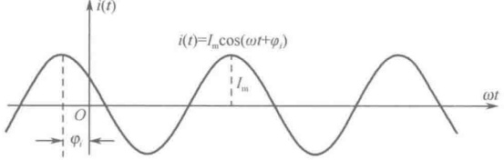

图 9-1 按正弦规律变化的交流电流
 

<!-- page: 246 -->

通常规定正弦量的瞬时值一律采用小写的英文字母表示，如 $ u(t) $或u。不同的电压、电流用下标加以区别，如 $ u_{1}(t) $、 $ u_{2}(t) $或 $ u_{1} $、 $ u_{2} $，以及 $ i_{1}(t) $、 $ i_{2}(t) $或 $ i_{1} $、 $ i_{2} $等。

#### 9.1.3 正弦量的三要素

在正弦量的瞬时表达式中出现的 $ U_{m} $、 $ \omega $和 $ \varphi_{u} $三个量，称为正弦交流电压的三要素；或者 $ I_{m} $、 $ \omega $和 $ \varphi_{i} $三个量，称为正弦交流电流的三要素；它们统称为正弦量的三要素。从正弦量的瞬时表达式可知，只要知道了正弦量的三要素，该正弦量就被唯一地确定了。

# 1. 幅值

式（9-3）中， $ U_{m} $ 为正弦电压的振幅值或最大值，其单位为 V（伏），它表示正弦电压变化的范围为  $ \pm U_{m} $。式（9-4）中， $ I_{m} $ 为正弦电流的振幅值或最大值，其单位为 A（安），它表示正弦电流变化的范围为  $ \pm I_{-} $。

# 2. 角频率

式（9-3）中，角频率  $ \omega $ 反映了正弦电压变化的快慢，其单位为 rad/s（弧度/秒）。

式（9-4）中，角频率  $ \omega $ 反映了正弦电流变化的快慢，其单位为 rad/s（弧度/秒）。

# 3. 相位与初相位

式（9-3）中， $ (\omega t + \varphi_{u}) $ 称为正弦电压的相位，它决定了正弦电压的状态，即正弦电压在交变过程中瞬时值的大小和正负。相位随时间的变化而变化，t=0 时的相位  $ \varphi_{u} $ 称为正弦电压的初相位，其大小取决于计时起点的位置。

式（9-4）中，（ $ \omega t + \varphi_{i} $）称为正弦电流的相位，它决定了正弦电流的状态，即正弦电流在交变过程中瞬时值的大小和正负。相位随时间的变化而变化，t=0 时的相位  $ \varphi_{i} $ 称为正弦电流的初相位，其大小取决于计时起点的位置。

对同一个正弦量，计时起点不同，初相位也就不同。相位或初相位的单位为 rad（弧度），有时为了方便，也用 “度” 作为相位或初相位的单位。

#### 9.1.4 同频率正弦量的相位差及超前与滞后的概念

# 1. 相位差

两个同频率止弦量的相位之差称为两个正弦量的相位差，只有同频率的两个正弦量之间的相位差才有意义，不同频率的两个正弦量之间无法比较相位。

设

 $$ u_{1}(t)=U_{m1}\cos(\omega t+\varphi_{1}) $$ 

$$  u_{2}(t)=U_{m2}\cos(\omega t+\varphi_{2})   \tag*{（9-5）}$$

即两个正弦量的相位分别为 $ (\omega t+\varphi_{1}) $和 $ (\omega t+\varphi_{2}) $，则这两个正弦量的相位差为

 $$ \boldsymbol{\varphi}=\left(\boldsymbol{\omega}\boldsymbol{t}+\boldsymbol{\varphi}_{1}\right)-\left(\boldsymbol{\omega}\boldsymbol{t}+\boldsymbol{\varphi}_{2}\right)=\boldsymbol{\varphi}_{1}-\boldsymbol{\varphi}_{2} $$ 

注意，在计算正弦量的相位差时，所有的正弦量都必须统一表述为  $ \cos $ 形式，或者统一表述为  $ \sin $ 形式。

# 2. 超前与滞后

若两个同频率正弦量  $ u_{1}(t) $ 和  $ u_{2}(t) $ 的相位差  $ \varphi = \varphi_{1} - \varphi_{2} > 0 $，即  $ \varphi_{1} > \varphi_{2} $，则称  $ u_{1}(t) $ 超前于  $ u_{2}(t) $。其含义是：沿着瞬时值增大的方向，电压  $ u_{1}(t) $ 比  $ u_{2}(t) $ 先达到最大值。

若两个同频率正弦量 $ u_{1}(t) $和 $ u_{2}(t) $的相位差 $ \varphi=\varphi_{1}-\varphi_{2}<0 $，即 $ \varphi_{1}<\varphi_{2} $，则称 $ u_{1}(t) $滞后于 $ u_{2}(t) $。若两个同频率正弦量 $ u_{1}(t) $和 $ u_{2}(t) $的相位差 $ \varphi=\varphi_{1}-\varphi_{2}=0 $，即 $ \varphi_{1}=\varphi_{2} $，则称 $ u_{1}(t) $与 $ u_{2}(t) $同相。若两个同频率正弦量 $ u_{1}(t) $和 $ u_{2}(t) $的相位差 $ \varphi=\varphi_{1}-\varphi_{2}=\pi/2 $，即 $ \varphi_{1}=\varphi_{2}+\pi/2 $，则称 $ u_{1}(t) $与 $ u_{2}(t) $正交。

<!-- page: 247 -->

若两个同频率正弦量 $ u_{1}(t) $和 $ u_{2}(t) $的相位差 $ \varphi=\varphi_{1}-\varphi_{2}=\pi $，即 $ \varphi_{1}=\varphi_{2}+\pi $，则称 $ u_{1}(t) $与 $ u_{2}(t) $反相。

值得强调的是，两个同频率正弦量的相位差与计时起点的选择无关。

事实上，正弦量的超前与滞后具有一定的相对性，下面举例说明。

例 9-1 已知  $ u_1(t) = U_{m1} \cos\left(\omega t + \frac{3\pi}{4}\right) $， $ u_2(t) = U_{m2} \cos\left(\omega t - \frac{\pi}{2}\right) $，问哪一个电压超前？

解：按照定义，可知两个电压的相位差 $ \varphi=\frac{3\pi}{\Delta}-\left(-\frac{\pi}{2}\right)=\frac{5\pi}{\Delta} $，即电压 $ u_{1}(t) $超前于 $ u_{2}(t) $的角度

为 $ \frac{5\pi}{4} $rad，波形如图9-2所示。

注意，从波形上看，似乎也可以说电压 $ u_2(t) $超前于 $ u_1(t) $的角度为 $ \frac{3\pi}{4} $rad。这两种说法到底取哪一种呢？通常，为了避免“超前”与“滞后”的含混，约定采用“主值” $ |\varphi| \leq \pi $作为超前与滞后的比较范围，即在 $ -\pi \leq \varphi \leq \pi $的主值范围内来描述正弦量的超前与滞后。按照这样的规

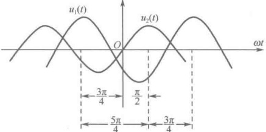

图 9-2 正弦量的超前与滞后的波形图
 

定， $ \frac{5\pi}{4} $ rad 显然不在主值范围内，所以，此例的答案应该是：电压  $ u_{2}(t) $ 超前于  $ u_{1}(t)\frac{3\pi}{4} $ rad。

#### 9.1.5 正弦量的有效值

# 1. 有效值的定义

正弦量随着时间不断变化，不同时刻其大小和方向都不同。因此，很难从整体上知道一个随时间不断变化的交流电到底有多大。为了解决这个问题，人们通过引入交流电在一个周期内流过一个电阻 R 产生的热量，与一个直流电在相同时间内在同一电阻上产生的热量相等的关系，即用后者作为一个参照物来描述这个交流电的大小。

一个周期为 T 的正弦电流  $ i(t) $ 流过电阻 R 时，该电阻吸收的电能为

 $ \int_{0}^{t}Ri^{2}(t)dt $

若这些电能全部转化成为了热能  $ Q_{1} $，则  $ Q_{1}=\int_{0}^{T}Ri^{2}(t)dt $ 。

而当一个量值为I的直流电流也流过这个电阻R时，在相同的时间T内，该电阻吸收的能量为 $ RI^{2}T $，假设这些电能也全部转化成为了热能 $ Q_{2} $，则 $ Q_{2}=RI^{2}T $。

如果令这两个热能相等，即 $ Q_{1}=Q_{2} $，则可得到

$$  I=\sqrt{\frac{1}{T}\int_{0}^{T}i^{2}(t)\mathrm{d}t}   \tag*{（9-8）}$$

式中的电流 I 称为正弦交流电流  $ i(t) $ 的有效值。式（9-8）表明，有效值等于瞬时值的方均根。这时，就找到了一个参照量，即用与一个与正弦量对应的有效值来从整体上描述这个正弦量的大小。

注意，在本章以下的表述中，采用小写字母表示正弦量的瞬时值，采用大写字母表示正弦量的有效值，采用大写字母加下标 m 表示正弦量的幅值，不要混用符号。

# 2. 正弦量的有效值与幅值的关系

设正弦电压  $ u(t)=U_{m}\cos(\omega t+\varphi_{u}) $，则其有效值为

$$  U=\sqrt{\frac{1}{T}\int_{0}^{T}U_{\mathrm{m}}^{2}\cos^{2}(\omega t+\varphi_{u})\mathrm{d}t}=\frac{U_{\mathrm{m}}}{\sqrt{2}}   \tag*{（9-9）}$$

<!-- page: 248 -->

结论：一个正弦量的幅值是其有效值的 $ \sqrt{2} $倍。

在日常生活中，照明使用的 220V 电压就是指的有效值。在工程应用中，各种电气设备铭牌上的额定值、电压（流）表及万用表等仪表所显示的测量值均为有效值。

引入有效值的概念后，正弦电压和正弦电流的瞬时表达式就可以改写为

$$  u(t)=U_{m}\cos(\omega t+\varphi_{u})=\sqrt{2}U\cos(\omega t+\varphi_{u})   \tag*{（9-10）}$$

$$  i(t)=I_{m}\cos(\omega t+\varphi_{i})=\sqrt{2}I\cos(\omega t+\varphi_{i})   \tag*{（9-11）}$$

#### 9.1.6 正弦量的叠加问题

在电路的分析计算中，理论依据是基尔霍夫电流定律和基尔霍夫电压定律。然而，当电压和电流均为正弦量时，在运用基尔霍夫定律时将会遇到若干正弦量叠加的问题，即

 $$ \sum_{k=1}^{n-1}i_{k}(t)=0,\qquad\sum_{l=1}^{m}u_{l}(t)=0 $$ 

采用三角函数中的和差化积是解决多个正弦量叠加计算的方法之一，但是，当叠加的项数较多时，这种方法并不可取。

还有一种方法称为图解法。在一个坐标系中描绘出各个正弦量的曲线，然后对应于不同时刻的点进行叠加。这种方法难以用来定量地计算多个正弦量的叠加，但是它提供了一种思路，即函数分析可以转化成图形分析。

沿着这样的思路，可以将正弦量  $ i(t)=I_{m}\cos(\omega t+\varphi_{i}) $ 用一个矢量进行图示，即用矢量的模表示正弦量的幅值，用矢量与横轴的夹角表示正弦量的相位角，如图 9-3 所示。

显然，随着时间的连续变化，这个矢量将逆时针旋转。或者说，它将以角速度  $ \omega $ 逆时针旋转，矢量箭头的轨迹是一个以幅值  $ I_{m} $ 为半径的圆。

于是，可以将这个旋转矢量与正弦量对应起来，如图9-4所示。当正弦曲线上的一点沿着 $ \omega t $的正方向向前行进时，左边对应的矢量将逆时针旋转。

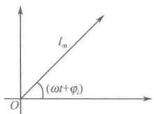

图 9-3 正弦量表示成为矢量
 

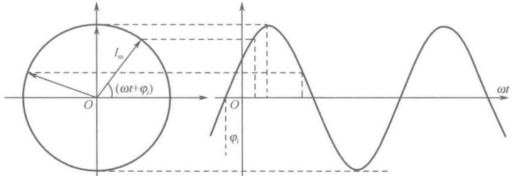

图 9-4 旋转矢量与正弦量的对应  $ [i(t)=I_{\mathrm{m}}\sin(\omega t+\varphi_{i})] $
 

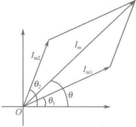

假设有两个频率相同的正弦量： $ i_1(t)=I_{m1}\cos(\omega t+\phi_1) $ 和  $ i_2(t)=I_{m2}\cos(\omega t+\phi_2) $，将它们在同一坐标系中表示为两个矢量后，在同一时刻将其叠加，矢量的叠加可按照平行四边形法则，如图 9-5 所示。在进行这种叠加时，利用了一个相关的数学知识：频率相同的正弦量叠加后频率不变。

图 9-5 正弦量表示成矢量后的叠加
 

在图 9-5 中， $ \theta_{1}=\omega t+\varphi_{1} $， $ \theta_{2}=\omega t+\varphi_{2} $， $ \theta=\omega t+\varphi $，图中的叠加符合下列关系：

 $$ i(t)=i_{1}(t)+i_{2}(t)=I_{m1}\cos(\omega t+\varphi_{1})+I_{m2}\cos(\omega t+\varphi_{2})=I_{m}\cos(\omega t+\varphi) $$ 

显然，直接使用矢量叠加法进行多个正弦量的叠加是得不偿失

<!-- page: 249 -->

的。那么，到底采用什么方法才能有效地计算多个正弦量的叠加？下面先来观察复数。

### 9.2 正弦量的相量表示

#### 9.2.1 复数的表示与运算

一个复数 A 可以表示为

 $$ \boldsymbol{A}=\boldsymbol{a}+\mathrm{j}\boldsymbol{b} $$ 

式中，复数的实部  $ a $ 和虚部  $ b $ 均为实数， $ j = \sqrt{-1} $ 是虚数单位。式（9-12）的表示形式称为复数的代数表达式，可在复坐标系中将其表示为一个矢量，如图 9-6 所示。

从图9-6中可以发现，如果这个矢量与横轴的夹角为 $ \varphi $，则

 $$ a=|A|\cos\varphi\qquad b=|A|\sin\varphi $$ 

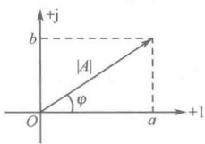

将其代入式（9-12）可得

$$  A=\left|A\right|(\cos\varphi+\mathrm{j}\sin\varphi)   \tag*{（9-13）}$$

图 9-6 复数的矢量表示
 

式（9-13）的表示形式称为复数的三角函数表达式。其中，复数  $ A $ 的模  $ |A| $（或幅值）和夹角  $ \varphi $（或幅角）与实部  $ a $ 和虚部  $ b $ 的关系为

 $$ \left|A\right|=\sqrt{a^{2}+b^{2}} $$ 

$$  \varphi=\arctan\frac{b}{a}   \tag*{（9-14）}$$

根据欧拉公式

 $$ \cos\varphi+\mathrm{j}\sin\varphi=\mathrm{e}^{\mathrm{j}\varphi} $$ 

可以将式（9-13）变为

$$  \boldsymbol{A}=\left|\boldsymbol{A}\right|\mathrm{e}^{\mathrm{j}\varphi}   \tag*{（9-15）}$$

式（9-16）的这种表示形式称为复数的指数表达式。

此外，工程上还常常把复数的指数表达式简洁地表示为

$$  A=\left|A\right|\angle\varphi   \tag*{（9-17）}$$

并且将这种表示形式称为复数的极坐标表达式。

利用复数的几种表达式的关系，可以很方便地进行复数的加减乘除运算。例如，有两个复数

 $$ A_{1}=a_{1}+\mathrm{j}b_{1},\quad A_{2}=a_{2}+\mathrm{j}b_{2} $$ 

则有

 $$ \boldsymbol{A}_{1}\pm\boldsymbol{A}_{2}=(\boldsymbol{a}_{1}+\mathrm{j}\boldsymbol{b}_{1})\pm(\boldsymbol{a}_{2}+\mathrm{j}\boldsymbol{b}_{2})=(\boldsymbol{a}_{1}\pm\boldsymbol{a}_{2})+\mathrm{j}(\boldsymbol{b}_{1}\pm\boldsymbol{b}_{2}) $$ 

 $$ A_{1}\cdot A_{2}=\left|A_{1}\right|\mathrm{e}^{\mathrm{j}\varphi_{1}}\cdot\left|A_{2}\right|\mathrm{e}^{\mathrm{j}\varphi_{2}}=\left|A_{1}\right|\cdot\left|A_{2}\right|\mathrm{e}^{\mathrm{j}(\varphi_{1}+\varphi_{2})}=\left|A_{1}\right|\cdot\left|A_{2}\right|\angle(\varphi_{1}+\varphi_{2}) $$ 

 $$ \frac{A_{1}}{A_{2}}=\frac{\left|A_{1}\right|\mathrm{e}^{\mathrm{j}\varphi_{1}}}{\left|A_{2}\right|\mathrm{e}^{\mathrm{j}\varphi_{2}}}=\frac{\left|A_{1}\right|}{\left|A_{2}\right|}\mathrm{e}^{\mathrm{j}(\varphi_{1}-\varphi_{2})}\quad 或 \quad\frac{A_{1}}{A_{2}}=\frac{\left|A_{1}\right|\angle\varphi_{1}}{\left|A_{2}\right|\angle\varphi_{2}}=\frac{\left|A_{1}\right|}{\left|A_{2}\right|}\angle(\varphi_{1}-\varphi_{2}) $$ 

#### 9.2.2 复数与相量

前面讲到，一个复数  $ A = |A| e^{i\varphi} $ 可以在复坐标系中表示为一个矢量。从图 9-6 可以看出，当  $ \varphi $ 角从小到大连续变化时，该矢量也发生逆时针旋转。事实上，复数  $ e^{i\varphi} $ 本身就是一个模为 1、幅角为  $ \varphi $ 的旋转因子，任意一个矢量乘以  $ e^{i\varphi} $，就等于将该复数逆时针旋转了角度  $ \varphi $。另外，由式 (9-15) 可知，当  $ \varphi = \pm \frac{\pi}{2} $ 时， $ e^{j(\pm\pi/2)} = \pm j $，即  $ \pm j $ 是  $ \pm 90^\circ $ 的旋转因子；当  $ \varphi = \pi $ 时， $ e^{j(\pi)} = -1 $，即 -1 是  $ 180^\circ $ 的旋转因子。

<!-- page: 250 -->

那么，这个复数旋转矢量 $ |A|e^{j\varphi} $与9.2.1节中用来表示正弦量的旋转矢量有何差异？

通过观察可发现，这两个旋转矢量的差别在于，表示正弦量的旋转矢量是随着 $ (\omega t + \phi) $的变化发生旋转的，它与时间和角频率有关；而表示复数的旋转矢量则是随着 $ \phi $角的变化发生旋转的，它与时间和角频率无关。

但是，复数既然可以表示为旋转矢量，同时又具有简洁的加减乘除运算关系，可否很好地利用它呢？

试想，如果给复数矢量的  $ \varphi $ 角附加上一个  $ \omega t $，使其随着  $ (\omega t + \varphi) $ 角的变化发生旋转，那么，上述两个旋转矢量的差异不就消除了吗！

观察两个复数  $ A = |A| e^{j\varphi} $ 和  $ e^{j\omega t} $，按照复数的乘法规则，可将复数  $ A $ 乘以一个旋转因子  $ e^{j\omega t} $，即

$$  \begin{array}{r}{A\mathrm{e}^{\mathrm{j}\omega t}=\left|A\right|\mathrm{e}^{\mathrm{j}\varphi}\mathrm{e}^{\mathrm{j}\omega t}=\left|A\right|\mathrm{e}^{\mathrm{j}(\omega t+\varphi)}}\end{array}   \tag*{（9-18）}$$

显然，这个新构造的复数可以表示成一个以 $ |A| $为模、以 $ (\omega t + \varphi) $为角度的旋转矢量。如果令模 $ |A| $与正弦量的幅值相等，那么，矢量 $ Ae^{j\omega t} $就必定与前面用来描述正弦量的旋转矢量之间存在着密切的内在关系。

根据欧拉公式，展开复矢量  $ A e^{j\omega t} $，可得

$$  A\mathrm{e}^{\mathrm{j}\omega t}=\left|A\right|\mathrm{e}^{\mathrm{j}(\omega t+\varphi)}=\left|A\right|\cos(\omega t+\varphi)+\mathrm{j}\left|A\right|\sin(\omega t+\varphi)   \tag*{（9-19）}$$

这时可以发现，这个复矢量的实部就是正弦量。换句话说，正弦量可以用复矢量  $ Ae^{j\omega t} $ 来表示。例如，正弦量  $ u_1(t)=100\cos(\omega t+60^\circ) $ 可用复矢量表示为  $ 100e^{j(\omega t+60^\circ)} $，正弦量  $ u_2(t)=200\cos(\omega t-30^\circ) $ 可用复矢量表示为  $ 200e^{j(\omega t-30^\circ)} $。注意，这里仅仅是“表示”，二者并不相等，正弦量只是与复矢量的实部相等。

如果采用符号 Re[ $ \cdot $]来表示“取实部”的意思，那么，正弦量与上述复矢量的关系可以用一个等式表示为

$$  |A|\cos(\omega t+\varphi)=\operatorname{Re}[A\mathrm{e}^{\mathrm{j}\omega t}]   \tag*{（9-20）}$$

因为复数的实部与虚部之间被一条“分水岭”——j相隔，在进行复数的叠加运算时其实部和虚部永远不会交叉。所以从应用的角度看，前面提出的多个同频率正弦量叠加的问题可以这样来解决：先将各正弦量表示为复矢量，再将这些复矢量转化为复数的代数表达形式，而后进行复矢量的叠加，即实部与实部相加，虚部与虚部相加。将所得叠加结果再从复数的代数表达式转换为三角函数表达形式，其实部即为正弦量叠加后的结果。

例 9-2 已知  $ u_{1}(t)=100\cos(\omega t+60^{\circ}) $， $ u_{2}(t)=200\cos(\omega t-30^{\circ}) $，求  $ u_{1}(t)+u_{2}(t) $。

解：（1）将各正弦量表示为复矢量

 $ u_{1}(t)=100\cos(\omega t+60^{\circ}) $ 用复矢量表示为

 $$ 100\mathrm{e}^{\mathrm{j}\left(\omega t+60^{\circ}\right)}=100\mathrm{e}^{\mathrm{j}60^{\circ}}\mathrm{e}^{\mathrm{j}\omega t} $$ 

 $ u_{2}(t)=200\cos(\omega t-30^{\circ}) $ 用复矢量表示为

 $$ 200\mathrm{e}^{\mathrm{j}(\omega t-30^{\circ})}=200\mathrm{e}^{-\mathrm{j}30^{\circ}}\mathrm{e}^{\mathrm{j}\omega t} $$ 

（2）转化为复数的代数表达形式，即

 $$ \begin{align*}100\mathrm{e}^{\mathrm{j}(\omega t+60^{\circ})}&=100\mathrm{e}^{\mathrm{j}60^{\circ}}\mathrm{e}^{\mathrm{j}\omega t}=(50+\mathrm{j}86.6)\mathrm{e}^{\mathrm{j}\omega t}\\200\mathrm{e}^{\mathrm{j}(\omega t-30^{\circ})}&=200\mathrm{e}^{-\mathrm{j}30^{\circ}}\mathrm{e}^{\mathrm{j}\omega t}=(173.2-\mathrm{j}100)\mathrm{e}^{\mathrm{j}\omega t}\end{align*} $$ 

（3）进行复矢量的叠加，即

 $$ \begin{aligned}&100\mathrm{e}^{\mathrm{j}(\omega t+60^{\circ})}+200\mathrm{e}^{\mathrm{j}(\omega t-30^{\circ})}=(50+\mathrm{j}86.6)\mathrm{e}^{\mathrm{j}\omega t}+(173.2-\mathrm{j}100)\mathrm{e}^{\mathrm{j}\omega t}\\ &=[(50+173.2)+\mathrm{j}(86.6-100)]\mathrm{e}^{\mathrm{j}\omega t}\\ \end{aligned} $$

<!-- page: 251 -->

$$ \begin{aligned}&=(223.2-j13.4)\mathrm{e}^{\mathrm{j}\omega t}=\sqrt{223.2^{2}+13.4^{2}}\angle\left(\arctan\frac{-13.4}{223.2}\right)\mathrm{e}^{\mathrm{j}\omega t}\\&=223.6\angle(-3.43^{\circ})\mathrm{e}^{\mathrm{j}\omega t}\end{aligned} $$ 

（4）根据欧拉公式，将其转换为三角函数形式，即

 $$ \begin{aligned}&100\mathrm{e}^{\mathrm{j}(\omega t+60^{\circ})}+200\mathrm{e}^{\mathrm{j}(\omega t-30^{\circ})}=223.6\angle(-3.43^{\circ})\mathrm{e}^{\mathrm{j}\omega t}=223.6\mathrm{e}^{-3.43^{\circ}}\mathrm{e}^{\mathrm{j}\omega t}\\&=223.6\mathrm{e}^{\mathrm{j}(\omega t-3.43^{\circ})}=223.6\cos(\omega t-3.43^{\circ})+\mathrm{j}223.6\sin(\omega t-3.43^{\circ})\\ \end{aligned} $$ 

取其实部可得

 $$ u_{1}(t)+u_{2}(t)=\mathrm{Re}[223.6\mathrm{e}^{\mathrm{j}(\omega t-3.43^{\circ})}]=223.6\cos(\omega t-3.43^{\circ}) $$ 

从此例可以看到，多个同频率正弦量叠加的问题转化成了复数的代数叠加问题，其有效性不言而喻。

但在例 9-2 的整个演算过程中会发现，复数  $ e^{\mathrm{j}\omega t} $ 并未参与运算，它只是在运算的开始和结束时用于描述，这其实正是因为“频率相同的正弦量叠加后频率不变”的缘故。而真正参与运算的实际上是复数  $ A(|A|e^{\mathrm{j}\varphi}) $，因此，索性就可用复数  $ A=|A|e^{\mathrm{j}\varphi} $ 来表示正弦量。但由于这个复数与普通复数并不一样，它背后还隐含了  $ e^{\mathrm{j}\omega t} $，因此，将这个特殊的复数称为“相量”，并在字母的上端加上一个圆点“·”，以表示此量为相量，而不是普通复数。例如，相量

$$  \dot{A}=|A|\mathrm{e}^{\mathrm{j}\varphi}   \tag*{（9-21）}$$

对于正弦交流电压和正弦交流电流，由于它们存在式（9-10）和式（9-11）所描述的幅值表示法和有效值表示法，因此正弦交流电压和正弦交流电流在用相量表示时也有幅值相量（如 $ \dot{I}_m $、 $ \dot{U}_m $）和有效值相量（如 $ \dot{I} $、 $ \dot{U} $）的不同表示。例如，电流幅值相量写为 $ \dot{I}_m = I_m \angle \varphi_i $，电压幅值相量写为 $ \dot{U}_m = U_m \angle \varphi_u $；电流有效值相量写为 $ \dot{I} = I \angle \varphi_i $，电压有效值相量写为 $ \dot{U} = U \angle \varphi_u $。

#### 9.2.3 相量的基本运算

相量的基本运算有加减运算、微分运算和积分运算等。

# 1. 加减运算

若正弦量

 $$ u_{1}(t)=U_{m1}\cos(\omega t+\varphi_{1})=\sqrt{2}U\cos(\omega t+\varphi_{1}) $$ 

 $$ u_{2}(t)=U_{m2}\cos(\omega t+\varphi_{2})=\sqrt{2}U\cos(\omega t+\varphi_{2}) $$ 

将它们表示为相量

 $$ \dot{U}_{m1}=U_{m1}\angle\varphi_{1}\quad 或 \quad\dot{U}_{1}=U_{1}\angle\varphi_{1} $$ 

及

 $$ \dot{U}_{m2}=U_{m2}\angle\varphi_{2}\  或 \ \dot{U}_{2}=U_{2}\angle\varphi_{2} $$ 

则

 $$ u_{1}(t)=\mathrm{Re}[\dot{U}_{\mathrm{m}1}\mathrm{e}^{\mathrm{j}\omega t}]=\mathrm{Re}[\sqrt{2}\dot{U}_{1}\mathrm{e}^{\mathrm{j}\omega t}],\quad u_{2}(t)=\mathrm{Re}[\dot{U}_{\mathrm{m}2}\mathrm{e}^{\mathrm{j}\omega t}]=\mathrm{Re}[\sqrt{2}\dot{U}_{2}\mathrm{e}^{\mathrm{j}\omega t}] $$ 

所以

 $$ \boldsymbol{u}_{1}(t)\pm\boldsymbol{u}_{2}(t)=\mathrm{R e}[\dot{U}_{\mathrm{m}1}\mathrm{e}^{\mathrm{j}\omega t}]\pm\mathrm{R e}[\dot{U}_{\mathrm{m}2}\mathrm{e}^{\mathrm{j}\omega t}]=\mathrm{R e}[(\dot{U}_{\mathrm{m}1}\pm\dot{U}_{\mathrm{m}2})\mathrm{e}^{\mathrm{j}\omega t}] $$ 

 $$ \begin{array}{r}{u_{1}(t)\pm u_{2}(t)=\mathrm{R e}[\sqrt{2}\dot{U}_{1}\mathrm{e}^{\mathrm{j}\omega t}]\pm\mathrm{R e}[\sqrt{2}\dot{U}_{2}\mathrm{e}^{\mathrm{j}\omega t}]=\mathrm{R e}[\sqrt{2}(\dot{U}_{1}\pm\dot{U}_{2})\mathrm{e}^{\mathrm{j}\omega t}]}\end{array} $$ 

或

 $$ u(t)=u_{1}(t)\pm u_{2}(t)=\mathrm{Re}[\dot{U}_{\mathrm{m}}\mathrm{e}^{\mathrm{j}\omega t}]=\mathrm{Re}[\sqrt{2}\dot{U}\mathrm{e}^{\mathrm{j}\omega t}] $$ 

若令

于是，得

 $$ \dot{U}_{m}=\dot{U}_{m1}\pm\dot{U}_{m2}\qquad 或 \quad\dot{U}=\dot{U}_{1}\pm\dot{U}_{2} $$ 

结论：同频率正弦量相加减可变换为其对应的相量之间相加减。

# 2. 微分运算

若正弦量

 $$ u(t)=U_{m}\cos(\omega t+\varphi_{u})=\sqrt{2}U\cos(\omega t+\varphi_{u}) $$ 

 $$ i(t)=I_{m}\cos(\omega t+\varphi_{i})=\sqrt{2}I\cos(\omega t+\varphi_{i}) $$ 

如果电压与电流满足微分关系，即

 $$ i(t)=\frac{\mathrm{d}u(t)}{\mathrm{d}t} $$

<!-- page: 252 -->

用相量表示其关系，因为  $ i(t) = \mathrm{Re}[\sqrt{2}\dot{I}e^{\mathrm{j}\omega t}] $， $ u(t) = \mathrm{Re}[\sqrt{2}\dot{U}e^{\mathrm{j}\omega t}] $

则

 $$ i(t)=\frac{\mathrm{d}u(t)}{\mathrm{d}t}=\frac{\mathrm{d}}{\mathrm{d}t}\left\{\mathrm{Re}[\sqrt{2}\dot{U}\mathrm{e}^{\mathrm{j}\omega t}]\right\}=\mathrm{Re}\left[\frac{\mathrm{d}}{\mathrm{d}t}(\sqrt{2}\dot{U}\mathrm{e}^{\mathrm{j}\omega t})\right]=\mathrm{Re}[\mathrm{j}\omega\sqrt{2}\dot{U}\mathrm{e}^{\mathrm{j}\omega t}] $$ 

于是，得到电压与电流在相量形式下的微分关系为

 $$ \dot{I}=j\omega\dot{U} $$ 

结论：在相量分析中，微分运算变成了乘法运算，时域的微分算子 $ \frac{d}{dt} $在复数域变成了 $ j\omega $。

# 3. 积分运算

若正弦量

 $$ \begin{aligned}u(t)&=U_{m}\cos(\omega t+\varphi_{u})=\sqrt{2}U\cos(\omega t+\varphi_{u})\\i(t)&=I_{m}\cos(\omega t+\varphi_{i})=\sqrt{2}I\cos(\omega t+\varphi_{i})\end{aligned} $$ 

如果电压与电流满足积分关系，即

 $$ u(t)=\int i(t)\mathrm{d}t $$ 

用相量表示其关系，因为  $ i(t) = \mathrm{Re}[\sqrt{2}i e^{\mathrm{j}\omega t}] $， $ u(t) = \mathrm{Re}[\sqrt{2}\dot{U}e^{\mathrm{j}\omega t}] $

则

 $$ u(t)=\int i(t)\mathrm{d}t=\int\{\mathrm{R e}[\sqrt{2}\dot{I}\mathrm{e}^{\mathrm{j}\omega t}]\}\mathrm{d}t=\mathrm{R e}[\int(\sqrt{2}\dot{I}\mathrm{e}^{\mathrm{j}\omega t})\mathrm{d}t]=\mathrm{R e}\left[\frac{1}{\mathrm{j}\omega}\sqrt{2}\dot{I}\mathrm{e}^{\mathrm{j}\omega t}\right] $$ 

于是，得到电压与电流在相量形式下的积分关系为

 $$ \dot{U}=\frac{1}{\mathrm{j}\omega}\dot{I} $$ 

结论：在相量分析中，积分运算变成了除法运算，时域的积分算子 $ \int dt $在复数域变成了 $ \frac{1}{j\omega} $。

#### 9.2.4 相量法

现在，若再遇到多个时间域的正弦量叠加问题，应先将这些正弦量变换为复数域的相量，通过相量进行计算，而后再将结果还原成时域的正弦量。将正弦量表示成相量后，运用相量进行分析相关计算的方法称为相量法。显然，相量只是正弦量的一种表示，或者是正弦量的一个符号。因此，相量法又称符号法。

例 9-3 已知  $ u_1(t)=100\sqrt{2}\cos(\omega t+60^\circ) $， $ u_2(t)=50\sqrt{2}\cos(\omega t-45^\circ) $， $ u_3(t)=16\sqrt{2}\sin(\omega t+30^\circ) $， $ u(t)=u_1(t)+u_2(t)+u_3(t) $，用相量法求  $ u(t) $。

解：（1）先将题中的 $ u_{3}(t) $改写为 $ \cos $形式的正弦量，即

 $$ u_{3}(t)=16\sqrt{2}\sin(\omega t+30^{\circ})=16\sqrt{2}\cos(\omega t+30^{\circ}-90^{\circ})=16\sqrt{2}\cos(\omega t-60^{\circ}) $$ 

（2）将正弦量表示为有效值相量，即

 $$ u_{1}(t)=100\sqrt{2}\cos(\omega t+60^{\circ}) 表示为 \dot{U}_{1}=100\angle60^{\circ} $$ 

 $$ u_{2}(t)=50\sqrt{2}\cos(\omega t-45^{\circ}) 表示为 \dot{U}_{2}=50\angle-45^{\circ} $$ 

 $$ u_{3}(t)=16\sqrt{2}\cos(\omega t-60^{\circ}) 表示为 \dot{U}_{3}=16\angle-60^{\circ} $$ 

（3）求相量和，即

 $$ \begin{aligned}&\dot{U}=\dot{U}_{1}+\dot{U}_{2}+\dot{U}_{3}=100\angle60^{\circ}+50\angle-45^{\circ}+16\angle-60^{\circ}\\ &=(100\cos60^{\circ}+\mathrm{j}100\sin60^{\circ})+[50\cos(-45)^{\circ}+\mathrm{j}50\sin(-45^{\circ})]+\\ &\quad[16\cos(-60)^{\circ}+\mathrm{j}16\sin(-60^{\circ})]\\ &=(50+\mathrm{j}86.6)+(35.36-\mathrm{j}35.36)+(8-\mathrm{j}13.86)\\ &=93.36+\mathrm{j}37.38=100.56\angle21.82^{\circ}\\ \end{aligned} $$

<!-- page: 253 -->

（4）写出瞬时值结果，即

 $$ u(t)=100.56\sqrt{2}\cos(\omega t+21.82^{\circ}) $$ 

例 9-4 已知正弦电流相量  $ \dot{I}_{1}=4-j3 $， $ \dot{I}_{2}=-3-j4 $，试在复数坐标系中描绘出这两个相量。

解：（1）先将电流相量写成指数形式或极坐标形式，即

 $$ \dot{I}_{1}=4-\mathrm{j}3=\sqrt{4^{2}+(-3)^{2}}\angle\left(\arctan\frac{-3}{4}\right)=5\angle-36.9^{\circ}\quad( 在第四象限 ) $$ 

 $$ \dot{I}_{2}=-3-\mathrm{j}4=\sqrt{\left(-4\right)^{2}+\left(-3\right)^{2}}\angle\left(\arctan\frac{-3}{-4}\right)=5\angle-126.9^{\circ}\quad( 在第三象限 ) $$ 

注意，求相位角时，要将  $ \varphi = \arctan \frac{b}{a} $ 中 a 和 b 的正负号分别保留在分母和分子中，以便确定

相量所在的象限，而不宜先将符号消去。本例中若将  $ i_2 $ 的相位角  $ \angle\left(\arctan\frac{-3}{-4}\right) $ 消去符号，写成  $ \angle\left(\arctan\frac{3}{4}\right) $，则将得出  $ \varphi_2 = \arctan\frac{4}{3} = 53.1^\circ $（在第一象限）的错误结果。

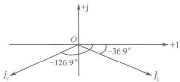

（2）描绘相量，如图9-7所示。

图 9-7 两个电流相量
 

### 9.3 电路元件与定律的相量模型

在运用相量法分析正弦交流电路之前，必须先得到相量形式的基本定律——基尔霍夫定律，以及电路基本元件 R、L、C 在相量形式下的电压与电流关系模型（Voltage Current Relationship，VCR）。

#### 9.3.1 基尔霍夫定律的相量形式

时域形式的基尔霍夫电流定律和基尔霍夫电压定律分别为

 $$ \begin{array}{r l r}{\mathrm{K C L:}\quad}&{}&{\displaystyle\sum_{k=1}^{n-1}i_{k}\left(t\right)=0}\end{array} $$ 

 $$ \begin{array}{r l r}{\mathrm{K V L}:\quad}&{{}}&{\sum_{l=1}^{m}u_{l}(t)=0}\end{array} $$ 

对于任意一个具有 n 个节点、b 条支路的线性电路，因为各处电流都是频率相同的正弦量，所以，可将 KCL 方程表示为相量形式

 $$ \sum_{k=1}^{n-1}i_{k}(t)=\mathrm{Re}\left[\sum_{k=1}^{n-1}\sqrt{2}\dot{I}_{k}\mathrm{e}^{\mathrm{j}\omega t}\right]=0 $$ 

即

$$  \sum_{k=1}^{n-1}\dot{I}_{k}=0   \tag*{（9-22）}$$

同理，有

$$  \sum_{l=1}^{m}\dot{U}_{l}=0   \tag*{（9-23）}$$

式（9-22）和式（9-23）分别为相量形式的基尔霍夫电流定律和基尔霍夫电压定律。

#### 9.3.2 线性时不变电阻元件的相量形式

设在线性时不变电阻上流过一个正弦电流

 $$ i_{_{R}}(t)=\sqrt{2}I_{_{R}}\cos(\omega t+\varphi_{_{i}}) $$

<!-- page: 254 -->

在关联参考方向下，电阻上的电压为

 $$ u_{R}(t)=\sqrt{2}U_{R}\cos(\omega t+\varphi_{u})=Ri_{R}(t)=\sqrt{2}RI_{R}\cos(\omega t+\varphi_{i}) $$ 

所以，电阻上的 VCR 相量形式为

$$  U_{R}\angle\varphi_{u}=RI_{R}\angle\varphi_{i}\quad 或 \quad\dot{U}_{R}=R\dot{I}_{R}   \tag*{（9-24）}$$

由式（9-24）可得

$$  U_{r}=RI_{r}\  并且 \ \angle\varphi_{u}=\angle\varphi_{i}   \tag*{（9-25）}$$

式（9-25）表明，电阻上的电压有效值与电流有效值满足欧姆定律，电阻上的电压与电流同相位。电阻元件的相量模型如图9-8所示，电阻元件上电压与电流的相量图如图9-9所示。

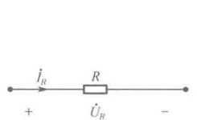

图 9-8 电阻元件的相量模型
 

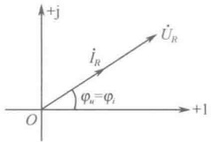

图 9-9 电阻元件上电压与电流的相量图
 

#### 9.3.3 线性时不变电容元件的相量形式

设线性时不变电容两端的正弦电压

 $$ u_{C}(t)=\sqrt{2}U_{C}\cos(\omega t+\varphi_{u}) $$ 

在关联参考方向下，流过电容元件的电流为

 $$ \begin{align*}i_{c}(t)&=C\frac{\mathrm{d}u_{c}(t)}{\mathrm{d}t}=-\sqrt{2}\omega CU_{c}\sin(\omega t+\varphi_{u})=\sqrt{2}\omega CU_{c}\cos\left(\omega t+\varphi_{u}+\frac{\pi}{2}\right)\\&=\sqrt{2}I_{c}\cos(\omega t+\varphi_{i})\end{align*} $$ 

所以，电容上的 VCR 相量形式为

$$  I_{c}\angle\varphi_{i}=\omega C U_{c}\angle\left(\varphi_{u}+\frac{\pi}{2}\right)\quad 或 \quad\dot{I}_{c}=\mathrm{j}\omega C\dot{U}_{c}   \tag*{（9-26）}$$

由式（9-26）可得

 $$ I_{c}=\omega C U_{c}\quad 并且 \quad\angle\varphi_{i}=\angle\left(\varphi_{u}+\frac{\pi}{2}\right) $$ 

式（9-27）表明，电容上的电压有效值与电流有效值满足欧姆定律， $ \omega C $ 具有与导纳相同的性质和单位，电容上的电流超前于电压  $ 90^{\circ} $。

通常，令  $ \omega C = B_{C} $，称  $ B_{C} $ 为容纳，单位为 S（西门子）。显然，频率越高，容纳越大。令容纳的倒数为容抗  $ X_{C} $，即  $ X_{C} = 1/\omega C $，容抗  $ X_{C} $ 的单位为  $ \Omega $。显然，频率越低，容抗越大，当  $ \omega \to 0 $（直流）时， $ X_{C} \to \infty $，这说明电容在直流电路中表现为开路。

电容元件的容抗型相量模型如图9-10所示，电容元件上电压与电流的相量图如图9-11所示。

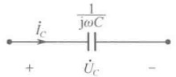

图 9-10 电容元件的容抗型相量模型
 

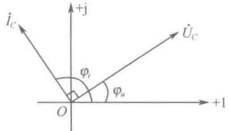

图 9-11 电容元件上电压与电流的相量图
 

<!-- page: 255 -->

#### 9.3.4 线性时不变电感元件的相量形式

设线性时不变电感上流过一个正弦电流

 $$ i_{L}(t)=\sqrt{2}I_{L}\cos(\omega t+\varphi_{i}) $$ 

在关联参考方向下，电感上的电压为

 $$ \begin{align*}u_{L}(t)&=L\frac{\mathrm{d}i_{L}(t)}{\mathrm{d}t}=-\sqrt{2}\omega LI_{L}\sin(\omega t+\varphi_{i})=\sqrt{2}\omega LI_{L}\cos\left(\omega t+\varphi_{i}+\frac{\pi}{2}\right)\\&=\sqrt{2}U_{L}\cos(\omega t+\varphi_{u})\end{align*} $$ 

所以，电感上的 VCR 相量形式为

$$  U_{L}\angle\varphi_{u}=\omega LI_{L}\angle\left(\varphi_{i}+\frac{\pi}{2}\right)\quad 或 \quad\dot{U}_{L}=\mathrm{j}\omega LI_{L}   \tag*{（9-28）}$$

由式（9-28）可得

$$  U_{L}=\omega LI_{L}\quad 并且 \quad\angle\varphi_{u}=\angle\left(\varphi_{i}+\frac{\pi}{2}\right)   \tag*{（9-29）}$$

式（9-29）表明，电感上的电压有效值与电流有效值满足欧姆定律， $ \omega L $ 具有与电阻相同的性质和单位，电感上的电压超前于电流  $ 90^{\circ} $。

通常，令  $ \omega L = X_L $，称  $ X_L $ 为感抗，单位为  $ \Omega $。显然，频率越高，感抗越大。令感抗的倒数为感纳  $ B_L $，即  $ B_L = 1/\omega L $，感纳  $ B_L $ 的单位为 S（西门子）。显然，频率越低，感抗越小，当  $ \omega \to 0 $（直流）时， $ X_L \to 0 $，这说明电感在直流电路中表现为短路。

电感元件的感抗型相量模型如图9-12所示，电感元件上电压与电流的相量图如图9-13所示。

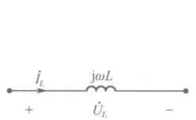

图 9-12 电感元件的感抗型相量模型
 

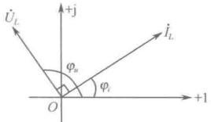

图 9-13 电感元件上电压与电流的相量图
 

以上 R、L、C 三种元件，在电压与电流取关联参考方向时，元件的阻抗型相量方程分别为

$$  \left.\begin{array}{r}\dot{U}_{R}=R\dot{I}_{R}\\ \dot{U}_{C}=\frac{1}{\mathrm{j}\omega C}\dot{I}_{C}\\ \dot{U}_{L}=\mathrm{j}\omega L\dot{I}_{L}\end{array}\right\}   \tag*{（9-30）}$$

这些相量方程在形式上与电阻元件的欧姆定律相似，故它们描述了相量形式的欧姆定律。

### 9.4 计算机仿真

在进行交流电路的仿真实验前，需要对 Multisim 的参数进行设置。在菜单 Option 中选择 Global Preferences，在弹出的对话框中打开 Simulation 选项卡，如图 9-14 所示，在 Positive phase shift direction 选项组中，选择 Shift right 选项，图形曲线即向右移动。

<!-- page: 256 -->

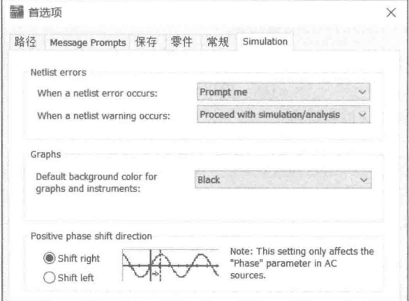

图 9-14 交流仿真参数设置
 

##### 例 9-5 正弦量三要素的测量。

对于任一正弦量，振幅（有效值）、频率和初相角是其三要素，在 Multisim 中可以利用示波器对三要素进行测量观察。如图 9-15（a）所示，在元件库中选择 Sources 组中的 POWER_SOURCES，并在其中选择 AC_POWER。将交流电源放置到电路图上后，进行参数设置，包括电压源的有效值（振幅）、频率和相位（初相角）。在 Multisim 自带元件库中的交流电源的表达式为 sin 函数，如果需要表达式为 cos 函数，则需要使用三角函数公式设定好相应的初相角。按图 9-15（b）所示，将相位设定为  $ 90^\circ $，按图 9-15（c）所示连接好示波器，得到如图 9-15（d）所示的余弦函数。 $ u_s(t) = 10\sqrt{2}\sin(100\pi t + 90^\circ) = 10\sqrt{2}\cos100\pi t $（V）。

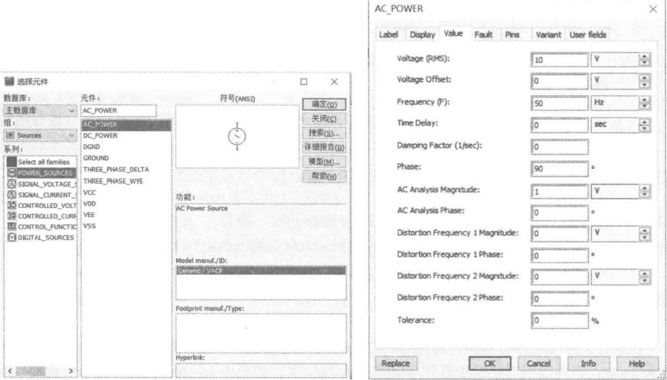

（a）正弦交流电源
 

（b）正弦交流电源参数设置
 

图 9-15 正弦交流电源
 

<!-- page: 257 -->

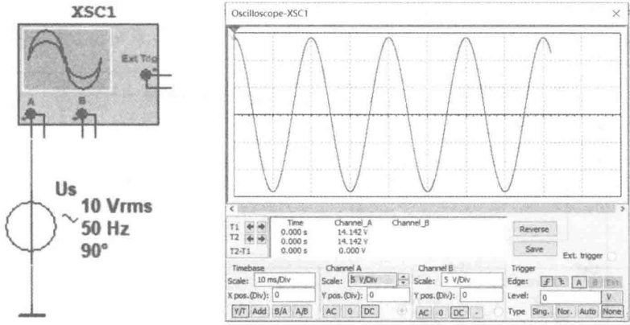

（c）正弦交流电源参数测量
 

（d）正弦交流电源波形
 

图 9-15 正弦交流电源（续）
 

对图 9-15（c）中的电源按图 9-16（a）所示设置好参数，此时交流电压源的表达式为  $ u(t)=100\sqrt{2}\cos(314t+60^\circ) $（V），接入示波器的输入端，仿真运行后，可以在示波器屏幕上观察到此正弦量的三要素。当  $ t=0 $ 时，瞬时电压为 70.71V，其初相角为  $ 60^\circ $；拖动屏幕上的滑动指针 2，将其移动到波峰处，可以测量出交流电压的最大值为 141.414V；将指针 2 向右移动一个周期，读取屏幕是 “T1-T2”，可以测量该电压的周期为 19.963ms，近似等于理论值 20ms。

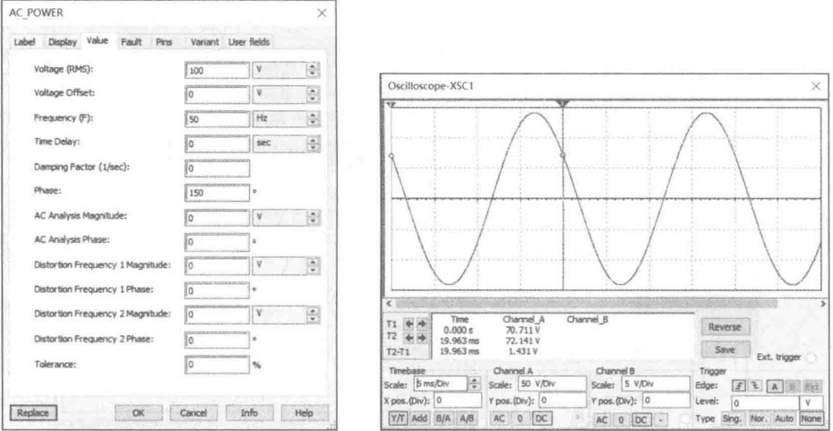

（a）测量电路
 

（b）电压源波形
 

图 9-16 正弦量三要素测量仿真
 

##### 例 9-6 同频率正弦量相位差的测量

如图 9-17（a）所示，电压源  $ U_{s1} $ 的初相角为  $ 90^{\circ} $ （或  $ \pi/2 $），电压源  $ U_{s2} $ 的初相角为  $ 180^{\circ} $，二者的相位差为  $ 90^{\circ} $，称二者正交。在示波器上，可以用时间游标测量出二者到峰值的时间差约为 5ms，折合成角度为  $ 90^{\circ} $。图 9-17（b）所示的两个正弦电压源，其中电压源  $ U_{s1} $ 的初相角为  $ 90^{\circ} $，电压源  $ U_{s2} $ 的初相角为  $ -90^{\circ} $，相位差为  $ 180^{\circ} $，称为反相。示波器的时间游标可以测出二者到达峰

<!-- page: 258 -->

值的时间差约为 10ms，折合成角度为  $ 180^\circ $。图 9-17（c）所示的两个正弦电压源，其电压分别为  $ u_{S1}(t) = 10\sqrt{2}\cos(100\pi t) $（V）， $ u_{S2}(t) = 5\sqrt{2}\cos(100\pi t) $（V），二者相位差为  $ 0^\circ $，称为同相。

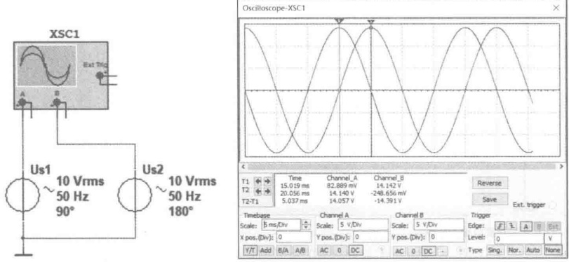

（a）两个正交的正弦交流电压
 

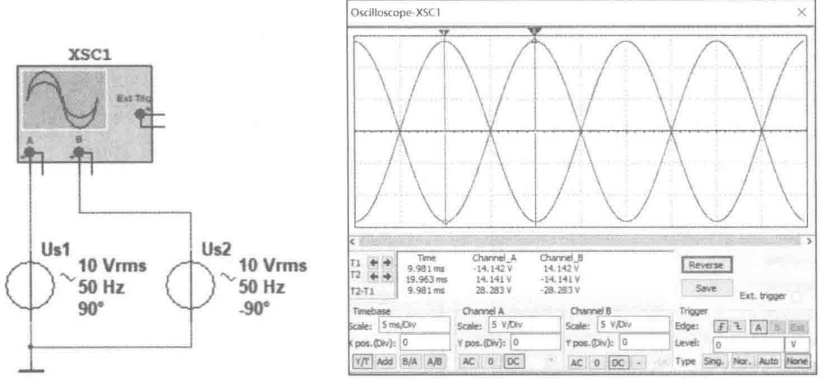

（b）两个相位相反的正弦交流电压
 

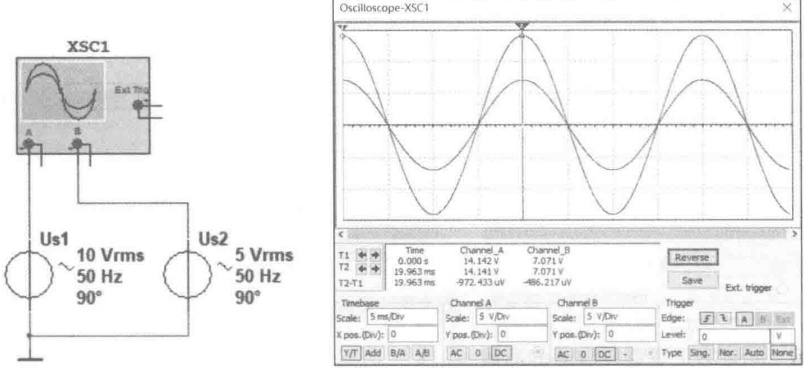

（c）两个相位相同的正弦交流电压
 

例 9-7 正弦交流电的有效值测量（周期信号的有效值测量）
 

图 9-18（a）所示为将  $ 10\Omega $ 的电阻接在  $ 10V $ 的直流电压源上，图 9-18（b）所示为将  $ 10\Omega $ 的

<!-- page: 259 -->

电阻接在交流电压源上。仿真结果显示，两个功率表的读数一致，说明 $ 10\Omega $电阻在这两个电压源的作用下消耗的电能完全相等，因此该交流电压源的有效值等于直流电压源的电压值（10V）。

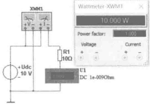

(a) 直流电的功率
 

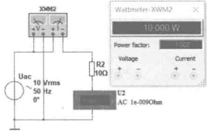

（b）交流电的功率
 

图 9-18 正弦交流电的有效值测量
 

##### 例 9-8 正弦交流电路仿真

##### （1）纯电阻电路

图 9-19 (a) 中的正弦交流电压源电压为  $ u_s = 10\sqrt{2}\cos(314t) $ (V)，用示波器和电流探针测量电阻两端的电压  $ u $ 和电阻上的电流  $ i $ 的相位关系。在图 9-19 (b) 中，示波器屏幕上显示  $ u $ 和  $ i $ 的相位相同。图 9-19 (c) 为测量纯电阻有功功率的电路，功率表 XWM1 测量  $ 10\Omega $ 电阻消耗的功率，功率表 XWM2 测量交流电源发出的功率，测量结果表明，电源发出的功率和电阻吸收的功率完全相等，电阻的功率因数  $ \cos\varphi = 1 $。对图 9-19 (d) 进行瞬态分析，执行菜单命令 Simulate  $ \rightarrow $ Analysis  $ \rightarrow $ Transient Analysis，设置参数如图 9-19 (e) 所示，选择探针电流、电压和电阻的功率作为输出变量，仿真执行后得到如图 9-19 (f) 所示的电阻瞬时功率波形图。图中，三条曲线分别是电阻的瞬时功率曲线、电压曲线和电流曲线。可以看出，在任意时刻，电阻的瞬时功率总是大于或等于 0 的，说明纯电阻是耗能元件。

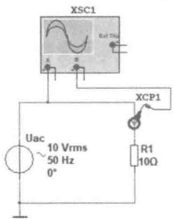

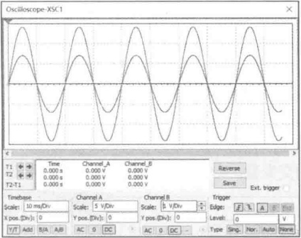

（a）纯电阻电路
 

（b）电阻的电压和电流相位关系
 

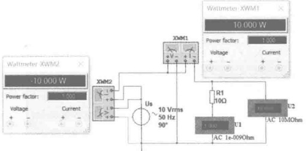

（c）纯电阻电路的有功功率
 

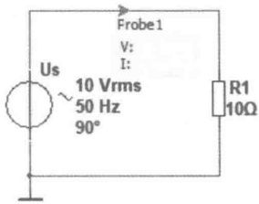

（d）瞬态分析电路
 

图 9-19 纯电阻电路的正弦稳态仿真
 

<!-- page: 260 -->

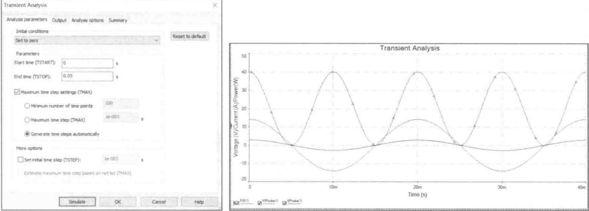

（e）瞬态分析参数设置
 

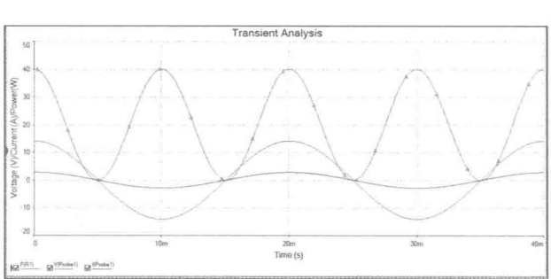

(f) 纯电阻瞬时功率波形图
 

图 9-19 纯电阻电路的正弦稳态仿真（续）
 

##### （2）纯电容电路

图 9-20（a）中的正弦交流电压源电压为  $ u_s = 10\sqrt{2}\cos(314t) $ (V)，用示波器和电流探针测量电容两端的电压  $ u $ 及其电流  $ i $ 的相位关系。在图 9-20（b）中，使用示波器的游标可以测得电容电流  $ i $ 与电压  $ u $ 达到最大值的时间差为 5ms，转换为相位是  $ 90^\circ $，因此电容电流超前电容电压  $ 90^\circ $。

接下来使用参数扫描功能观测电容的容抗对电流的阻碍作用。按图9-20（c）设置电容值按线性从1mF增大到3mF。按图9-20（d）设置瞬态分析参数，将输出变量设置为电容电流，即探针电流I（Probe1），单击Simulate按钮，即可得到如图9-20（e）所示的电容电流随电容值变化的曲线。从图中可以发现，电流振幅随电容值的减小而减小，说明容抗与电容值成反比。

图 9-20（f）为测量纯电容有功功率的电路，功率表 XWM1 测量交流电源发出的有功功率，功率表 XWM2 测量电容 C1 消耗的功率，测量结果表明，电源发出的有功功率和电容吸收的有功功率都为零，电容的功率因数  $ \cos\varphi = \cos(-90^\circ) = 0 $，表明它不消耗电能，但是会占用电源设备的容量。此时，可以计算出电容的平均无功功率  $ Q_{C1} = U_{C1}I_{C1} \sin\varphi \approx -3.14 $ Var。

仕图 9-20(a) 中添加静态探针 Probel，然后进行瞬态分析，执行菜单命令 Simulate→ Analysis→ Transient Analysis ，仿真执行后得到如图 9-20（g）所示的电容瞬时功率波形图。图中的三条曲线分别是电容的瞬时功率曲线、电压曲线和电流曲线。电容的瞬时功率曲线是一个幅值为 3.14Var、角频率为  $ 2\omega $ 的交变量，一个周期内电容的平均功率为零。

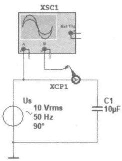

（a）纯电容电路
 

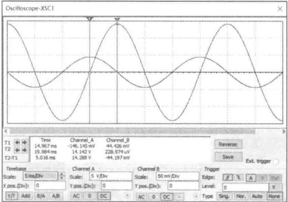

（b）电容的电压和电流相位关系
 

图 9-20 纯电容电路的正弦稳态仿真
 

<!-- page: 261 -->

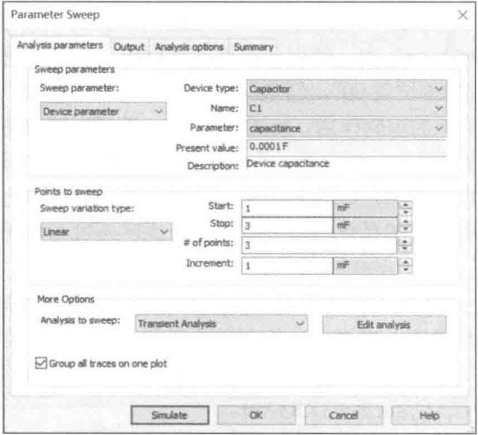

（c）电容参数扫描设置
 

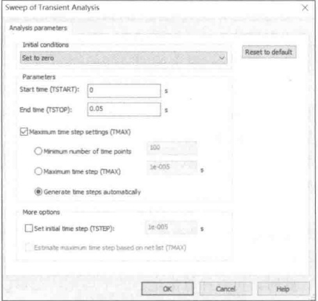

（d）电容参数扫描中的瞬态分析参数设置
 

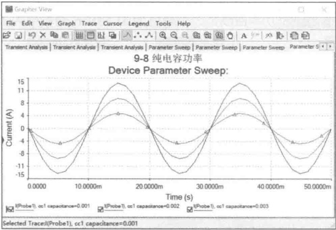

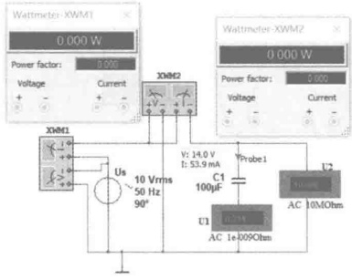

（e）电容的电流随容值的变化
 

（f）纯电容电路的有功功率
 

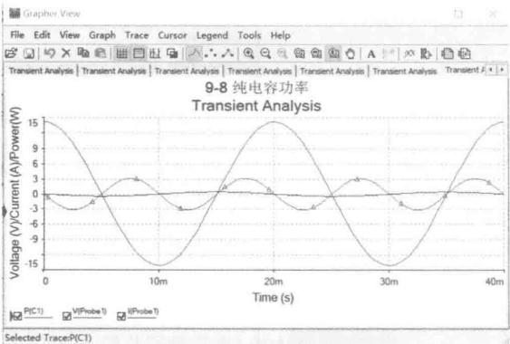

（g）纯电容瞬时功率波形图
 

图 9-20 纯电容电路的正弦稳态仿真（续）
 

##### （3）纯电感电路

图9-21（a）中的正弦交流电压源电压为 $ u_{s}=10\sqrt{2}\cos(314t) $（V），用示波器和电流探针测量电

<!-- page: 262 -->

感两端的电压 u 及其电流 i 的相位关系。为了能更好地观察示波器波形，将电流探针 XCP1 的电压电流比例调节为 1，如图 9-21（b）所示。在图 9-21（c）中，使用示波器的游标可以测得电感电压 u 与电流 i 达到最大值的时间差约为 5ms，转换为相位是  $ 90^{\circ} $，即电感电压超前电感电流  $ 90^{\circ} $。

接下来使用参数扫描功能观测电感的感抗对电流的阻碍作用。按图9-21（d）设置电感自感系数按线性从10mH增大到30mH。按图9-20（e）设置瞬态分析参数，将输出变量设置为电感电流，即探针电流I（Probe1），单击Simulate按钮，即可得到如图9-20（f）所示的电感电流随电感自感系数变化的曲线。从图中可以发现，电流振幅随电感自感系数的增大而减小，说明感抗与电感的自感系数成正比。

图 9-21（g）为测量纯电感有功功率的电路，功率表 XWM1 测量交流电源发出的有功功率，功率表 XWM2 测量电感 L1 消耗的功率。测量结果表明，电源发出的有功功率和电感吸收的有功功率都为零，电感的功率因数  $ \cos\varphi = \cos90^\circ = 0 $，表明它不消耗电能，但是会占用电源设备的容量。此时，可以计算出电容的平均无功功率  $ Q_{L1} = U_{L1}I_{L1}\sin\varphi \approx 31.83 $ Var。

对图 9-21（g）进行瞬态分析，执行菜单命令 Simulate→Analysis→Transient Analysis，仿真执行后得到如图 9-21（h）所示的电感瞬时功率波形图。图中的三条曲线按幅度从大到小依次为电感的瞬时功率曲线、电压曲线和电流曲线。电感的瞬时功率曲线是一个幅值为 31.83Var、角频率为  $ 2\omega $ 的交变量，一个周期内电感的平均功率为零。

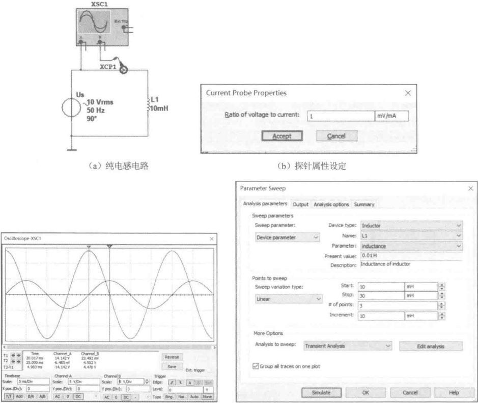

（b）探针属性设定
 

（c）电感的电压和电流相位关系
 

（d）电感参数扫描设置
 

图 9-21 纯电感电路的正弦稳态仿真
 

<!-- page: 263 -->

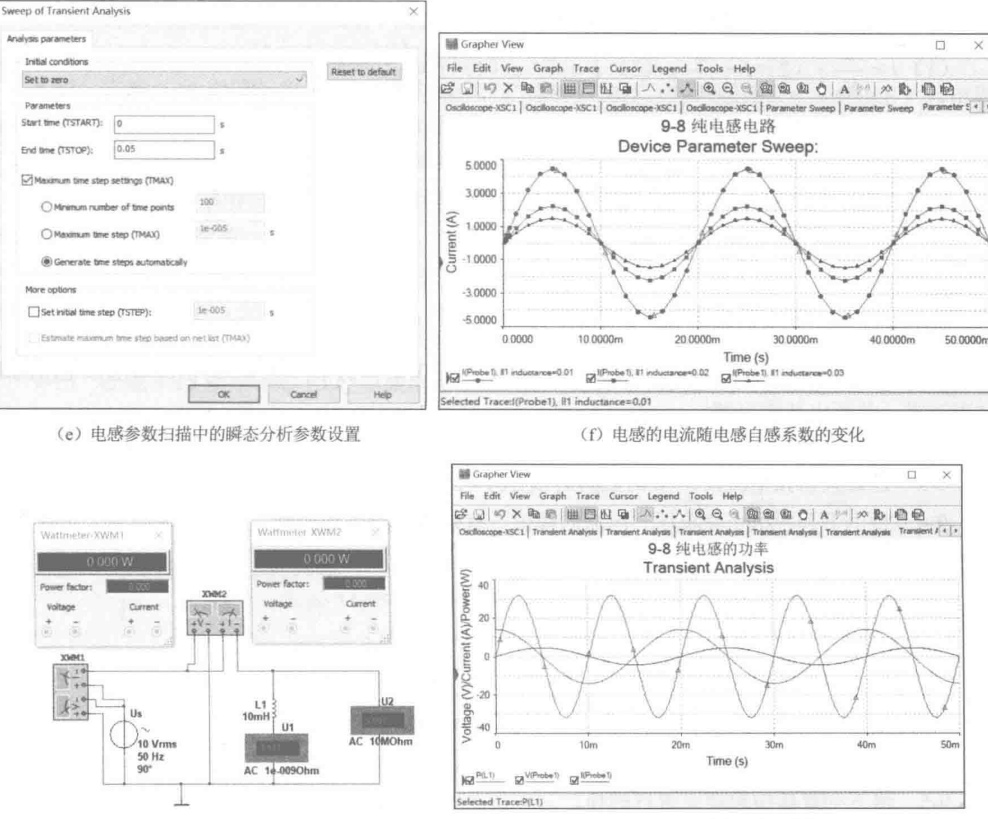

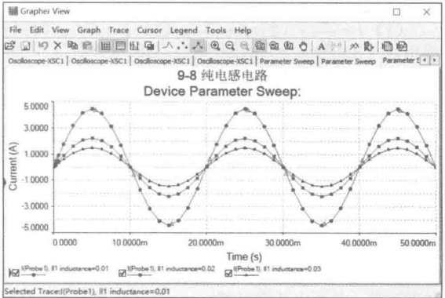

（e）电感参数扫描中的瞬态分析参数设置
 

(f) 电感的电流随电感自感系数的变化
 

（g）纯电感电路的有功功率
 

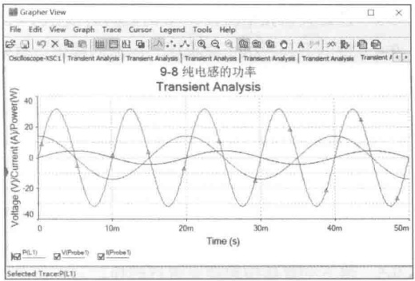

（h）纯电感瞬时功率曲线
 

图 9-21 纯电感电路的正弦稳态仿真（续）
 

### 思考题

9-1 直流电路与正弦交流电路有何区别？

9-2 何为正弦量的三要素？

9-3 在交流电路中，相位、初相位和相位差各表示什么？它们之间有什么不同？又有什么联系？初相位的大小与什么有关？

9-4 正弦量的有效值是如何定义的？

9-5 日常灯泡上的额定电压为 220V，实际上它承受的最大电压是多少？

9-6 两个正弦量之间的超前与滞后如何判定？

9-7 为什么电容器两端加直流电压时电路中没有电流，而当加交流电压时就有电流？

9-8 容抗表示什么？它与哪些因素有关？为什么  $ X_{c} \neq u/i $？

9-9 下列各式中，哪些正确？哪些不正确？

(1)  $ i = \frac{u}{X_C} $; (2)  $ i = \frac{u}{\omega C} $; (3)  $ I = \frac{U}{\omega C} $; (4)  $ I = \frac{U}{C} $; (5)  $ I = \omega CU $

9-10 感抗表示什么？它与哪些因素有关？为什么  $ X_{L} \neq u/i $？

<!-- page: 264 -->

9-11 下列各式中，哪些正确？哪些不正确？

(1)  $ i = \frac{u}{X_L} $; (2)  $ i = \frac{u}{\omega L} $; (3)  $ I = \frac{U}{\omega L} $; (4)  $ I = \frac{U}{L} $; (5)  $ I = \frac{U_m}{\omega L} $

9-12 什么是相量？为什么要用相量来表示正弦量？

9-13 什么是旋转因子？你所知道的旋转因子有哪些？它们的作用是什么？

9-14 相量与复数有何相同之处？有何不同之处？

9-15 什么是相量法？

### 习题

9-1 已知正弦电压的振幅  $ U_m = 200\text{V} $，频率  $ f = 50\text{Hz} $，初相位  $ \varphi_u = 90^\circ $，试写出该电压的瞬时表达式，并画出其波形图。

9-2 已知正弦电流  $ i(t)=5\cos(\omega t+30^{\circ}) $， $ f=50Hz $，问在  $ t=0.1s $ 时，电流的瞬时值为多少？

9-3 已知某正弦电流在 t=0 时的瞬时值  $ i(0)=5A $，其初相角为  $ 30^{\circ} $，试求其有效值。

9-4 指出下列各组正弦电压、电流的幅值、有效值、频率和初相，并说明每组两个正弦量之间的超前与滞后关系。

 $$ u_{1}(t)=220\sqrt{2}\cos314t,\quad u_{2}(t)=220\sqrt{2}\cos(314t-30^{\circ}); $$ 

 $$ i_{1}(t)=\sqrt{2}\cos(200\pi t+\pi/3),\quad i_{2}(t)=\sin(200\pi t+\pi/3); $$ 

 $$ u_{1}(t)=10\sqrt{2}\cos(100\pi t-120^\circ),\quad u_{2}(t)=20\sqrt{2}\cos(100\pi t+120^\circ); $$ 

 $$ (4)u(t)=20\cos(50\pi t+120^{\circ}),\quad i(t)=-10\sqrt{2}\cos(50\pi t-60^{\circ}); $$ 

 $$ i_{1}(t)=30\sqrt{2}\cos(\omega t-30^\circ),\quad i_{2}(t)=40\sqrt{2}\cos(3\omega t-30^\circ) $$ 

9-5 将下列复数按照要求进行转换。

（1）转换成极坐标形式：

 $$ \begin{array}{l} 3-j4 , \quad 6+j3 , \quad -8+j6 , \quad -5-j10 , \quad 10, \quad j10\end{array} $$ 

（2）转换成代数形式：

 $$ 5\angle36.87^{\circ},10\angle-53.13^{\circ},8\angle30^{\circ},1\angle120^{\circ},15\angle45^{\circ},2\angle-90^{\circ},3\angle180^{\circ} $$ 

9-6 写出下列各组正弦量的相量表达式，并画出各组的相量图。

 $$ u_{1}(t)=220\sqrt{2}\cos314t,\quad u_{2}(t)=220\sqrt{2}\cos(314t-30^{\circ}); $$ 

 $$ i_{1}(t)=\sqrt{2}\cos(200\pi t+\pi/3),\quad i_{2}(t)=\sin(200\pi t+\pi/3); $$ 

 $$ u_{1}(t)=10\sqrt{2}\cos(100\pi t-120^\circ),\quad u_{2}(t)=20\sqrt{2}\cos(100\pi t+120^\circ); $$ 

 $$ u(t)=20\cos(50\pi t+120^{\circ}),\quad i(t)=-10\sqrt{2}\cos(50\pi t-60^{\circ}) $$ 

9-7 写出下列各相量对应的正弦量的瞬时表达式，设正弦量的频率为 $ \omega $。

(1)  $ \dot{U} = 220\angle40^{\circ} $; (2)  $ \dot{U}_{\mathrm{m}} = j100 $; (3)  $ \dot{I}_{\mathrm{m}} = -10 $; (4)  $ \dot{I} = 4 - j3 $; (5)  $ \dot{U} = 60e^{-j45^{\circ}} $.

9-8 用相量法求下列两个正弦电流的和与差： $ i_{1}(t)=15\sqrt{2}\cos(\omega t+30^{\circ}) $， $ i_{2}(t)=8\sqrt{2}\cos(\omega t-55^{\circ}) $。

9-9 在一个 10μF 的电容器两端加上  $ u(t) = 70.7\sqrt{2}\cos(314t - \pi/6) $ V 的正弦电压，求通过电容器的电流有效值及电流的瞬时值表达式。若所加电压的有效值与初相角不变，而频率变为 100Hz，其结果又如何？

9-10 一个电感线圈， $ L = 5\,\text{mH} $，现把它接到 $ u(t) = 20\sqrt{2}\,\cos10^6 t\,\text{(V)} $的电源上，求电流的有效值和瞬时值表达式。

<!-- page: 265 -->

9-11 已知电感线圈的  $ L=10\,\text{mH} $，现把它接到  $ u(t)=100\cos\omega t(\text{V}) $ 的电源上，求当频率为  $ 50\,\text{Hz} $ 和  $ 50\,\text{kHz} $ 时，电感线圈的感抗及电流各为多少？

9-12 在题 9-12 图所示的 RLC 串联电路中，已知  $ R = 20\Omega $， $ L = 0.5\text{H} $， $ C = 400\mu\text{F} $，若电阻电压  $ u_R(t) = 40\cos100t\text{(V)} $，试用相量法求出电感电压  $ u_L(t) $ 和电容电压  $ u_C(t) $，并画出三个电压的相量图。

9-13 在题 9-13 图所示的 RLC 并联电路中，已知电流表 A、 $ A_{1} $、 $ A_{3} $ 的读数分别为 5A、4A、8A，求电流表  $ A_{2} $ 的读数。

9-14 如题 9-14 图所示电路，已知电流表 A_{1}、A_{2} 和 A_{3} 的读数分别为 5A、20A 和 25A。求：

（1）电流表 A 的读数；（2）维持电流表 A_{1} 的读数不变，把电源的频率提高 1 倍，再求其他各表的读数。

9-15 在题 9-15 图所示的 RLC 串联电路中，已知电压表  $ U_{R}=20V $， $ U_{L}=15V $， $ U_{C}=30V $，求电压  $ \dot{U} $ 的值。

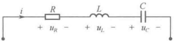

题9-12图
 

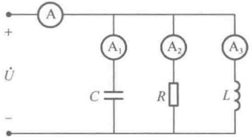

题9-13 图
 

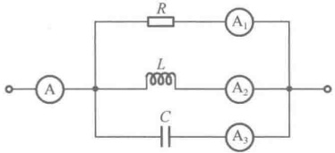

题9-14图
 

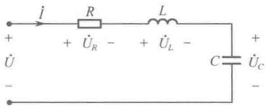

题9-15图
 

9-16 在如题 9-16 图所示电路中，已知  $ R = 40\Omega $， $ X_L = 30\Omega $， $ X_C = 20\Omega $，若  $ \dot{I}_L = 3\angle 0^\circ $，求总电压  $ u $ 和总电流  $ i $ 的表达式，并画出反映各电压、电流关系的相量图。

9-17 电路如题 9-17 图所示， $ u_s = 200\sqrt{2\cos(314t + \pi/3)}(V) $，电流表  $ A_1 $ 的读数为 2A，电压表  $ V_1 $、 $ V_2 $ 的读数为 200V。求参数  $ R $、 $ L $、 $ C $，并画出该电路的相量图。

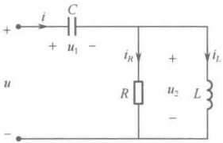

题9-16图
 

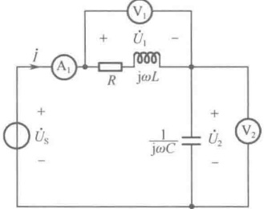

题9-17图
 

