# 10-第10章 正弦稳态电路分析

[返回全书目录](../../README.md)

> PDF 页码：266–294

<!-- page: 266 -->

### 第10章 正弦稳态电路分析

本章将从元件的复阻抗与复导纳入手，对 RLC 串/并联等简单电路进行分析。而后从概念上和方法上介绍如何使用相量法进行一般正弦稳态电路的分析，并引出关于有功功率、无功功率、视在功率和复功率的概念及其分析与计算。本章只讨论电路受到单一频率的正弦信号激励的情况。

### 10.1 运用相量法分析正弦稳态电路

对于线性电路，当激励是频率为  $ \omega $ 的正弦信号时，电路中各处电压与电流的稳态响应均为相同频率的正弦量，该特性称为线性电路的频率不变性。

#### 10.1.1 复阻抗与复导纳

用相量法分析电路时，电阻、电容、电感元件的 VCR 分别为

 $$ \begin{aligned}\frac{\dot{U}_{R}}{\dot{I}_{R}}=&R\quad&\frac{\dot{U}_{C}}{\dot{I}_{C}}=&\frac{1}{j\omega C}\quad&\frac{\dot{U}_{L}}{\dot{I}_{L}}=&j\omega L\\\frac{\dot{I}_{R}}{\dot{U}_{R}}=&G\quad&\frac{\dot{I}_{C}}{\dot{U}_{C}}=&j\omega C\quad&\frac{\dot{I}_{L}}{\dot{U}_{L}}=&\frac{1}{j\omega L}\end{aligned} $$ 

或

上述各式可以用统一的形式表示为

$$  \frac{\dot{U}}{\dot{I}}=Z\quad 或 \quad\frac{\dot{I}}{\dot{U}}=Y   \tag*{（10-1）}$$

式中，Z 称为元件的复阻抗，单位为  $ \Omega $；Y 称为元件的复导纳，单位为 S；在式（10-1）中，当电压相量与电流相量相比时，它们所隐含的旋转因子  $ e^{j\omega t} $ 可被约去，所以，Z 和 Y 是由两个相量相比后得到的纯复数，这表明：Z 和 Y 只是复数，而不是相量。

既然是复数，那么复阻抗 Z 的复数形式应为

$$  Z=a+\mathrm{j}b=\left|Z\right|\angle\varphi_{z}   \tag*{（10-2）}$$

式中，a、b均为实数，Z的模 $ \left|Z\right|=\sqrt{a^{2}+b^{2}} $， $ \varphi_{z} $称为阻抗角，并且 $ \varphi_{z}=\arctan\frac{b}{a} $。

由式（10-1）描述 Z 的相量关系式可知

$$  \varphi_{z}=\varphi_{u}-\varphi_{i}   \tag*{（10-3）}$$

同理，复导纳 Y 的复数形式应为

$$  Y=c+\mathrm{j}d=|\boldsymbol{Y}|\angle\varphi_{y}   \tag*{（10-4）}$$

式中，c、d 均为实数，复导纳 Y 的模  $ |Y| = \sqrt{c^2 + d^2} $， $ \varphi_y $ 称为导纳角，并且  $ \varphi_y = \arctan \frac{d}{c} $。

由式（10-1）描述 Y 的相量关系式可知

$$  \varphi_{y}=\varphi_{i}-\varphi_{u}   \tag*{（10-5）}$$

由式（10-1）可知，复阻抗与复导纳的关系为

 $$ Z=\frac{1}{Y}\quad 或 \quad Y=\frac{1}{Z} $$

<!-- page: 267 -->

所以，可将复阻抗等效为复导纳，即

 $$ Y=\frac{1}{Z}=\frac{1}{a+\mathrm{j}b}=\frac{a-\mathrm{j}b}{a^{2}+b^{2}}=\frac{a}{a^{2}+b^{2}}+\mathrm{j}\frac{-b}{a^{2}+b^{2}}=c+\mathrm{j}d $$ 

也可将复导纳等效为复阻抗，即

 $$ Z=\frac{1}{Y}=\frac{1}{c+\mathrm{j}d}=\frac{c-\mathrm{j}d}{c^{2}+d^{2}}=\frac{c}{c^{2}+d^{2}}+\mathrm{j}\frac{-d}{c^{2}+d^{2}}=a+\mathrm{j}b $$ 

#### 10.1.2 RLC 串联电路的分析

# 1. RLC 串联电路的复阻抗

RLC 串联电路如图 10-1 所示，如果在串联电路两端加上一正弦电压

 $$ u(t)=\sqrt{2}U\cos(\omega t+\varphi_{u}) $$ 

设串联电路上的电流为 $ i(t) $，则由KVL可得

$$  u(t)=u_{R}(t)+u_{L}(t)+u_{C}(t)=R i(t)+L\frac{\mathrm{d}i(t)}{\mathrm{d}t}+\frac{1}{C}\int i(t)\mathrm{d}t   \tag*{（10-6）}$$

将式（10-6）用相量表示，并与式（10-1）比较可得

$$  \dot{U}=\dot{U}_{R}+\dot{U}_{L}+\dot{U}_{C}=R\dot{I}+\mathrm{j}\omega L\dot{I}+\frac{1}{\mathrm{j}\omega C}\dot{I}=\left(R+\mathrm{j}\omega L+\frac{1}{\mathrm{j}\omega C}\right)\dot{I}=Z\dot{I}   \tag*{（10-7）}$$

即可得到相应的相量电路模型，如图10-2所示。

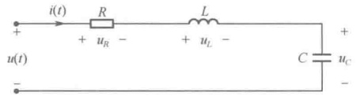

图 10-1 RLC 串联电路
 

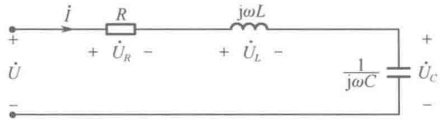

图 10-2 RLC 串联的相量电路模型
 

式（10-7）中，串联电路的复阻抗

 $$ Z=R+\mathrm{j}\omega L+\frac{1}{\mathrm{j}\omega C}=R+\mathrm{j}\left(\omega L-\frac{1}{\omega C}\right)=R+\mathrm{j}(X_{L}-X_{C})=R+\mathrm{j}X=\left|Z\right|\angle\varphi_{z} $$ 

复阻抗  $ Z $ 的模  $ |Z| = \sqrt{R^2 + X^2} $， $ \varphi_z $ 称为阻抗角，并且  $ \varphi_z = \arctan \frac{1}{R} $，这里  $ X(X = X_L - X_C) $ 为电抗，单位为  $ \Omega $。

# 2. 阻抗三角形与电压三角形

由欧拉公式可得，复阻抗

$$  Z=\left|Z\right|\angle\varphi_{z}=\left|Z\right|\cos\varphi_{z}+j\left|Z\right|\sin\varphi_{z}   \tag*{（10-9）}$$

与式（10-8）比较可知

 $$ R=\left|Z\right|\cos\varphi_{z},\quad X=\left|Z\right|\sin\varphi_{z} $$ 

于是可得到所谓的阻抗三角形，如图10-3所示。

由式（10-7）可得

 $$ \begin{align*}\dot{U}=&\dot{U}_{_{R}}+\dot{U}_{_{L}}+\dot{U}_{_{C}}=R\dot{I}+\mathrm{j}\omega L\dot{I}+\frac{1}{\mathrm{j}\omega C}\dot{I}=R\dot{I}+\left(\mathrm{j}\omega L+\frac{1}{\mathrm{j}\omega C}\right)\dot{I}\\=&R\dot{I}+\mathrm{j}\left(\omega L-\frac{1}{\omega C}\right)\dot{I}=R\dot{I}+\mathrm{j}X\dot{I}=\dot{U}_{_{R}}+\dot{U}_{_{X}}\end{align*} $$

<!-- page: 268 -->

可见，总电压 $ \dot{U} $与电阻电压 $ \dot{U}_{R} $、电抗电压 $ \dot{U}_{X} $也构成了一个直角三角形，该三角形反映了这三个电压相量之间的相位关系和有效值关系，称为电压三角形，如图10-4所示。

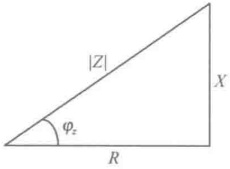

图 10-3 RLC 串联电路的阻抗三角形
 

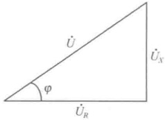

图 10-4 电压三角形
 

# 3. RLC 串联电路的性质与串联谐振

RLC 串联电路在端口所呈现的特性取决于感抗  $ X_L $ 和容抗  $ X_C $ 的大小。由于  $ Z = R + j(X_L - X_C) = R + jX = |Z| \angle \varphi_z = |Z| \angle(\varphi_u - \varphi_i) $，因此有如下结论。

（1）若  $ X_{L}=X_{C} $，则电抗 X=0，阻抗角  $ \varphi_{z}=0 $， $ \varphi_{u}-\varphi_{i}=0 $，此时阻抗 Z=R。这表明，当  $ X_{L}=X_{C} $ 时，RLC 串联电路在端口呈现纯阻性，端口电压相量与端口电流相量同相位。在电气技术领域中称：此时 RLC 串联电路发生了串联谐振。

（2）若  $ X_L > X_C $，则电抗  $ X > 0 $，阻抗角  $ \varphi_z > 0 $， $ \varphi_u - \varphi_i > 0 $，此时端口电压相量超前于端口电流相量，RLC 串联电路在端口呈现感性阻抗，相量图如图 10-5 所示。

（3）若  $ X_{L}<X_{C} $，则电抗 X<0，阻抗角  $ \varphi_{z}<0 $， $ \varphi_{u}-\varphi_{i}<0 $，此时端口电压相量滞后于端口电流相量，RLC 串联电路在端口呈现容性阻抗，相量图如图 10-6 所示。

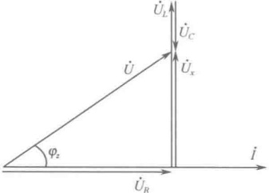

图 10-5 RLC 串联电路的感性相量图
 

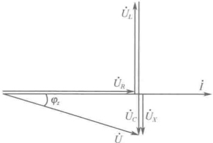

图 10-6 RLC 串联电路的容性相量图
 

#### 10.1.3 RLC 并联电路的分析

# 1. RLC 并联电路的复导纳

RLC 并联电路如图 10-7 所示，如果在并联电路两端加上一正弦电压

 $$ u(t)=\sqrt{2}U\cos(\omega t+\varphi_{u}) $$ 

设并联电路端口的电流为 $ i(t) $，则由KCL可得

$$  i(t)=i_{R}(t)+i_{L}(t)+i_{C}(t)=\frac{u(t)}{R}+C\frac{\mathrm{d}u(t)}{\mathrm{d}t}+\frac{1}{L}\int u(t)\mathrm{d}t   \tag*{（10-10）}$$

将式（10-10）用相量表示，并与式（10-1）比较可得

$$  \dot{I}=\dot{I}_{R}+\dot{I}_{L}+\dot{I}_{C}=\frac{\dot{U}}{R}+\mathrm{j}\omega C\dot{U}+\frac{1}{\mathrm{j}\omega L}\dot{U}=\left(\frac{1}{R}+\mathrm{j}\omega C+\frac{1}{\mathrm{j}\omega L}\right)\dot{U}=Y\dot{U}   \tag*{（10-11）}$$

即可得到相应的相量电路模型，如图10-8所示。

<!-- page: 269 -->

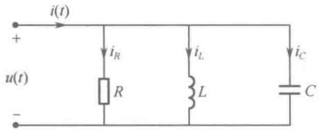

图 10-7 RLC 并联电路
 

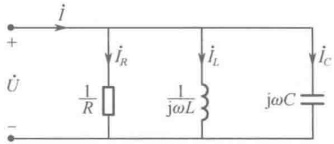

图 10-8 RLC 并联的相量电路模型
 

式（10-11）中，并联电路的复导纳

 $$ Y=\frac{1}{R}+\mathrm{j}\omega C-\mathrm{j}\frac{1}{\omega L}=G+\mathrm{j}(B_{C}-B_{L})=G+\mathrm{j}B=\left|Y\right|\angle\varphi_{y} $$ 

复导纳Y的模 $ |Y|=\sqrt{G^{2}+B^{2}} $， $ \varphi_{y} $称为导纳角，并且 $ \varphi_{y}=\arctan\frac{B}{G} $，这里 $ B(B=B_{C}-B_{L}) $为电纳，单位为S。

# 2. 导纳三角形与电流三角形

由欧拉公式可得，复导纳

 $$ Y=\left|Y\right|\angle\varphi_{y}=\left|Y\right|\cos\varphi_{y}+j\left|Y\right|\sin\varphi_{y} $$ 

 $$ G=\left|Y\right|\cos\varphi_{y},\quad B=\left|Y\right|\sin\varphi_{y} $$ 

与式（10-12）比较可知

于是可得到所谓的导纳三角形，如图10-9所示。

由式（10-11）可得

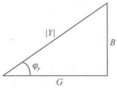

 $$ \begin{aligned}&\dot{I}=\dot{I}_{R}+\dot{I}_{L}+\dot{I}_{C}=\frac{\dot{U}}{R}+\mathrm{j}\omega C\dot{U}+\frac{1}{\mathrm{j}\omega L}\dot{U}=G\dot{U}+\mathrm{j}\Biggl(\omega C+\frac{1}{\mathrm{j}\omega L}\Biggr)\dot{U}\\&=G\dot{U}+\mathrm{j}\Biggl(\omega C-\frac{1}{\omega L}\Biggr)\dot{U}=G\dot{U}+\mathrm{j}B\dot{U}=\dot{I}_{R}+\dot{I}_{B}\\ \end{aligned} $$ 

图 10-9 RLC 并联电路的导纳三角形
 

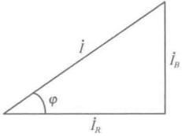

可见，总电流  $ \dot{I} $ 与电导电流  $ \dot{I}_{R} $ 、电纳电流  $ \dot{I}_{B} $ 也构成了一个直角三角形，该三角形反映了这三个电流相量之间的相位关系和有效值关系，称为电流三角形，如图10-10所示。

图 10-10 电流三角形
 

# 3. RLC 并联电路的性质与并联谐振

RLC 并联电路在端口所呈现的特性取决于感纳和容纳的大小。由于  $ Y = G + \mathrm{j}(B_C - B_L) = G + \mathrm{j}B = |Y| \angle \varphi_y = |Y| \angle (\varphi_i - \varphi_u) $，因此有如下结论。

 $$ B_{c}=B_{L} $$ 

 $$ \varphi_{y}=0 $$ 

纳 $ Y=G=1/R $。这表明，当 $ B_{C}=B_{L} $时，RLC并联电路在端口呈现纯阻性，端口电压相量与端口电流相量同相位。在电气技术领域中称：此时RLC并联电路发生了并联谐振。

 $$ \varphi_{i}-\varphi_{u}=0 $$ 

（2）若  $ B_{C} > B_{L} $，则电纳 B > 0，导纳角  $ \varphi_{y} > 0 $， $ \varphi_{i} - \varphi_{u} > 0 $，此时端口电流相量超前于端口电压相量，RLC 并联电路在端口呈现容性阻抗，相量图如图 10-11 所示。

（3）若  $ B_{C} < B_{L} $，则电纳 B < 0，导纳角  $ \varphi_{y} < 0 $， $ \varphi_{i} - \varphi_{u} < 0 $，此时端口电流相量滞后于端口电压相量，RLC 并联电路在端口呈现感性阻抗，相量图如图 10-12 所示。

#### 10.1.4 复阻抗与复导纳的串联、并联及混联电路的分析

# 1. 复阻抗的串联

图 10-13 所示为 n 个复阻抗串联的电路，根据 KVL 可得

<!-- page: 270 -->

$$ \begin{aligned}\dot{U}=&\dot{U}_{1}+\dot{U}_{2}+\dot{U}_{3}+\cdots+\dot{U}_{n}\\=&Z_{1}\dot{I}+Z_{2}\dot{I}+Z_{3}\dot{I}+\cdots+Z_{n}\dot{I}=(Z_{1}+Z_{2}+Z_{3}+\cdots+Z_{n})\dot{I}=Z\dot{I}\end{aligned} $$ 

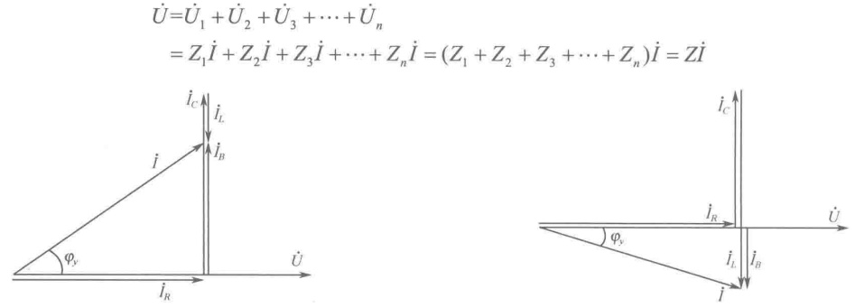

图 10-11 RLC 并联电路的容性相量图
 

图 10-12 RLC 并联电路的感性相量图
 

串联总阻抗

$$  Z=\sum_{k=1}^{n}Z_{k}   \tag*{（10-14）}$$

由式（10-14）可见，复阻抗串联电路的 VCR 关系与直流电路中电阻串联电路的 VCR 关系相仿。因此，类似的也有图 10-14 所示的两个复阻抗串联时的分压公式，即

 $$ \dot{U}_{1}\!=\!\frac{Z_{1}}{Z_{1}+Z_{2}}\dot{U},\quad\dot{U}_{2}\!=\!\frac{Z_{2}}{Z_{1}+Z_{2}}\dot{U} $$ 

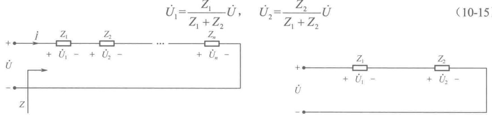

图 10-13 n 个复阻抗串联的电路
 

图 10-14 两个复阻抗串联的电路
 

# 2. 复导纳的并联

图 10-15 所示为 n 个复导纳并联的电路，根据 KCL 可得

 $$ \begin{aligned}\dot{I}=&\dot{I}_{1}+\dot{I}_{2}+\dot{I}_{3}+\cdots+\dot{I}_{n}=Y_{1}\dot{U}+Y_{2}\dot{U}+Y_{3}\dot{U}+\cdots+Y_{n}\dot{U}\\=&(Y_{1}+Y_{2}+Y_{3}+\cdots+Y_{n})\dot{U}=Y\dot{U}\end{aligned} $$ 

并联总导纳

$$  Y=\sum_{k=1}^{n}Y_{k}   \tag*{（10-16）}$$

由式（10-16）可见，复导纳并联电路的 VCR 关系与直流电路中电导并联电路的 VCR 关系相仿。因此，类似的也有图 10-16 所示的两个复阻抗并联时的分流公式，即

$$  \dot{I}_{1}=\frac{Z_{2}}{Z_{1}+Z_{2}}\dot{I},\quad\dot{I}_{2}=\frac{Z_{1}}{Z_{1}+Z_{2}}\dot{I}   \tag*{（10-17）}$$

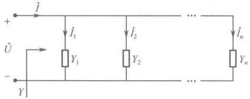

图 10-15 n 个复导纳并联的电路
 

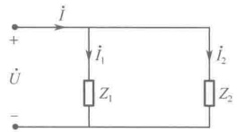

图 10-16 两个复阻抗并联的电路
 

<!-- page: 271 -->

# 3. 复阻抗混联电路的分析

从上面的结论可以看出，复阻抗混联电路的分析也应该与直流电路中电阻的混联电路分析相

类似，既有串联、并联、串并联的分析，也有 Y- $ \triangle $转换的分析，还有输入阻抗的化简分析等。

例如，在图10-17所示的复阻抗混联电路中，入端阻抗 $ Z_{ab} $为

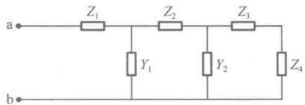

 $$ Z_{ab}=Z_{1}+\frac{1}{Y_{1}+\frac{1}{Z_{2}+\frac{1}{Y_{2}+\frac{1}{Z_{3}+Z_{4}}}}} $$ 

图 10-17 复阻抗混联
 

例 10-1 如图 10-18 的电路，已知  $ Z_{1}=10+j6.28 $， $ Z_{2}=20-j31.9 $， $ Z_{3}=15+j15.7 $，求 a-b 端的等值复阻抗  $ Z_{ab} $。

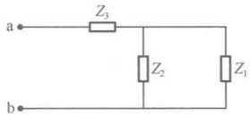

图 10-18 例 10-1 图
 

解：

 $$ \begin{aligned}Z_{ab}&=Z_{3}+\frac{Z_{1}Z_{2}}{Z_{1}+Z_{2}}=(15+j15.7)+\frac{(10+j6.28)(20-j31.9)}{(10+j6.28)+(20-j31.9)}\\&=(15+j15.7)+\frac{400.33-j193.4}{30-j25.62}=(15+j15.7)+\frac{444.6\angle-25.78^{\circ}}{39.45\angle-40.49^{\circ}}\\&=(15+j15.7)+11.27\angle14.7^{\circ}=(15+j15.7)+(10.9+j2.86)\\&=25.9+j18.56=31.86\angle35.63^{\circ}\\ \end{aligned} $$ 

# 4. 交流电桥的平衡

如图 10-19 所示的桥式电路，当满足

$$  Z_{1}Z_{4}=Z_{2}Z_{3}   \tag*{（10-18）}$$

时，对于端口 AB 而言，桥支路 CD 平衡，即 C 点与 D 点为等电位点。

需要指出的是，式（10-18）描述的由复阻抗构成的交流电桥的平衡条件与电阻性电桥的平衡条件有所不同，这时的平衡条件如下：

$$  \left\{\begin{aligned}\left|\boldsymbol{Z}_{1}\right|\cdot\left|\boldsymbol{Z}_{4}\right|=\left|\boldsymbol{Z}_{2}\right|\cdot\left|\boldsymbol{Z}_{3}\right|\\ \angle\varphi_{1}+\angle\varphi_{4}=\angle\varphi_{2}+\angle\varphi_{3}\end{aligned}\right.   \tag*{（10-19）}$$

一般情况下，若式（10-18）满足，则式（10-19）也就满足，但在特殊情况下却有例外。例如图10-20所示的电路，虽然有

 $$ \begin{aligned}Z_{1}Z_{4}=\mathrm{j}\cdot\mathrm{j}=-1,\quad&Z_{2}Z_{3}=(-\mathrm{j})(-\mathrm{j})=-1\\\angle\varphi_{1}+\angle\varphi_{4}=\pi,\quad&\angle\varphi_{2}+\angle\varphi_{3}=-\pi\end{aligned} $$ 

但是

所以，这个电桥并不平衡。利用 Y- $ \triangle $等效变换，再进行串并联化简，不难求得  $ Z_{AB}=1\Omega $ 。

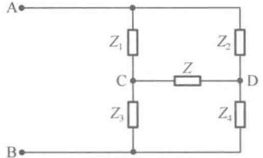

图 10-19 交流电桥
 

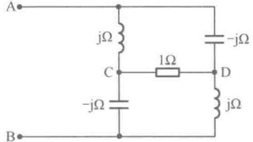

图 10-20 非平衡交流电桥
 

#### 10.1.5 正弦稳态电路的相量分析法

通过前面章节的学习可知，电路的分析方法大体有以下三大类。

<!-- page: 272 -->

# 1. 等效变换法

等效变换法包括：无源支路的串并联等效化简、对称电路的等效化简、桥式电路的等效化简、星形与三角形电路的等效变换、含源电路的戴维宁等效或诺顿等效变换、理想电压源与理想电流源的串并联等效化简、理想电压源或理想电流源的转移变换等。

# 2. 方程分析法

方程分析法包括：支路法、回路法（网孔法）、节点法等。

# 3. 网络定理分析法

网络定理分析法包括：叠加定理、替代定理、戴维宁定理、诺顿定理、特勒根定理、互易定理、最大功率传输定理等。

对于一个被正弦信号激励的复杂电路，若要运用相量法进行分析计算，一般包括以下步骤。

（1）将电路转换为相量模型。即将电路中的所有元件都变换成阻抗或导纳，并将电路中各处的电压瞬时值变量和电流瞬时值变量都表示成相量，同时将激励源也表示成相量。

（2）选择某一个电压相量或电流相量为参考相量，一般情况下，参考相量的初相角可选择为 $ 0^{\circ} $。

（3）运用上述三大类方法进行复数域的电路分析与计算。值得强调的是，在运用相量法进行电路的分析计算过程中，有时借助相量图进行分析，往往能获得事半功倍的效果。

（4）如果有必要，可将相量形式的计算结果还原成瞬时值形式。

在运用相量法进行电路的分析计算时，还需注意以下几点。

（1）相量法只能用于正弦稳态电路的分析计算，对于正弦信号的非稳态过程（如接入过程）不能使用相量法。

（2）只能对确定的单一频率正弦信号使用相量法，如果信号由多个不同频率的时域正弦信号叠加而成，则应对每个频率信号逐个采用相量法分析，所得结果要利用叠加定理在时域求和。

（3）对于非正弦信号不能直接使用相量法。

（4）相量法只适用于激励为同频率正弦量的线性非时变电路的分析计算，不能用于非线性变换。

例 10-2 如图 10-21 所示的电路，已知  $ R=2R_{3} $， $ C=C_{3}/2 $，试证明：当  $ \omega=1/RC $ 时， $ U_{2}=0 $

证明：先将两个 Y 形电路转换成两个 $ \triangle $形电路，如图 10-22、图 10-23 所示。

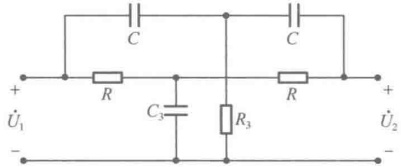

图10-21 例10-2图
 

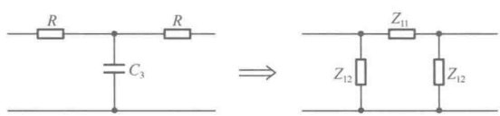

图 10-22 Y 形电路转换成  $ \triangle $ 形电路之一
 

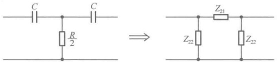

图 10-23 Y 形电路转换成△形电路之二
 

在图10-22中，

 $$ Z_{11}=R+R+\frac{R\times R}{\displaystyle\frac{1}{\mathrm{j}\omega2C}}=2R(1+\mathrm{j}\omega RC) $$

<!-- page: 273 -->

$$ Z_{12}=R+\frac{1}{\mathrm{j}\omega2C}+\frac{R\times\frac{1}{\mathrm{j}\omega2C}}{R}=R+\frac{1}{\mathrm{j}\omega C} $$ 

在图10-23中，

 $$ Z_{21}=\frac{1}{\mathrm{j}\omega C}+\frac{1}{\mathrm{j}\omega C}+\frac{\left(\frac{1}{\mathrm{j}\omega C}\right)^{2}}{R/2}=\frac{2(1+\mathrm{j}\omega RC)}{(\mathrm{j}\omega C)^{2}R} $$ 

 $$ Z_{22}=\frac{1}{j\omega C}+\frac{R}{2}+\frac{\frac{R}{2}\times\frac{1}{j\omega C}}{1/j\omega C}=R+\frac{1}{j\omega C} $$ 

这时电路变成图10-24所示。

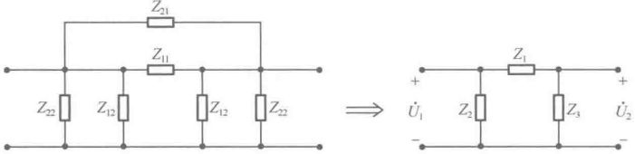

图 10-24 △形化简电路
 

在图10-24中， $ Z_{1}=\frac{Z_{11}Z_{21}}{Z_{11}+Z_{21}}=\frac{2R(1+\mathrm{j}\omega RC)}{1-(\omega RC)^{2}},\quad Z_{2}=Z_{3}=\frac{R+\frac{1}{\mathrm{j}\omega C}}{2}=\frac{1+\mathrm{j}\omega RC}{2\mathrm{j}\omega C} $

由分压公式可得

 $$ \dot{U}_{2}=\frac{Z_{3}}{Z_{1}+Z_{3}}\dot{U}_{1}=\frac{1-\left(\omega RC\right)^{2}}{1-\left(\omega RC\right)^{2}+j4\omega RC}\dot{U}_{1} $$ 

所以，当  $ \omega = \frac{1}{RC} $ 时，即  $ RC\omega = 1 $，此时  $ U_{2} = 0 $。

例 10-3 如图 10-25 所示的电路，已知  $ R_{1}=5\Omega $， $ X_{1}=5\Omega $， $ R=8\Omega $，欲使  $ \dot{I}_{0} $ 与电压  $ \dot{U} $ 在相

位上相差 $ 90^{\circ} $，问 $ R_{0} $的值为多少？

解：设参考相量 $ \dot{U}_{1}=U\angle0^{\circ} $，列节点方程可得

 $$ \left\{\begin{aligned}&\left(\frac{1}{R_{1}-\mathrm{j}X_{1}}+\frac{1}{R}+\frac{1}{R_{0}}\right)\dot{U}_{2}-\frac{1}{R_{0}}\dot{U}_{3}-\frac{1}{R_{1}-\mathrm{j}X_{1}}\dot{U}_{1}=0\\ &-\frac{1}{R}\dot{U}_{1}-\frac{1}{R_{0}}\dot{U}_{2}+\left(\frac{1}{R}+\frac{1}{R_{0}}+\frac{1}{R_{1}-\mathrm{j}X_{1}}\right)\dot{U}_{3}=0\end{aligned}\right. $$ 

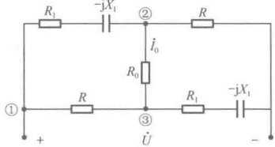

图 10-25 例 10-3 图
 

两式相减后，将已知条件  $ R_{1}=5\Omega $， $ X_{1}=5\Omega $， $ R=8\Omega $ 代入，得

 $$ \left[\frac{1}{5-\mathrm{j}5}+\frac{1}{8}+\frac{1}{R_{0}}\right](\dot{U}_{2}-\dot{U}_{3})+\frac{1}{R_{0}}(\dot{U}_{2}-\dot{U}_{3})+\left(\frac{1}{8}-\frac{1}{5-\mathrm{j}5}\right)\dot{U}_{1}=0 $$ 

 $$ \dot{I}_{0}=\frac{\dot{U}_{2}-\dot{U}_{3}}{R_{0}}=\frac{\left(\frac{1}{5-\mathrm{j}5}-\frac{1}{8}\right)U\angle0^{\circ}}{R_{0}\left(\frac{1}{5-\mathrm{j}5}+\frac{1}{8}+\frac{2}{R_{0}}\right)}=\frac{3+\mathrm{j}5}{13R_{0}+80-\mathrm{j}(5R_{0}+80)}U\angle0^{\circ} $$ 

要令 $ i_{0} $与 $ \dot{U} $相差 $ 90^{\circ} $，则有

<!-- page: 274 -->

$$ \begin{aligned}\frac{(3+\mathrm{j}5)[(13R_{0}+80)+\mathrm{j}(5R_{0}+80)]}{(13R_{0}+80)^{2}+(5R_{0}+80)^{2}}&=\frac{-160+14R_{0}+\mathrm{j}}{(13R_{0}+80)^{2}+(5R_{0}+80)^{2}}\\ &-160+14R_{0}=0\end{aligned} $$ 

令

 $$ R_{0}=\frac{160}{14}=\frac{80}{7}\Omega $$ 

可得

例 10-4 如图 10-26 所示电路，端口电压恒定，已知  $ X_{C}=48\Omega $，开关 S 闭合后电流表读数不变，试求  $ X_{L} $。

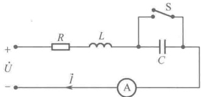

解：（1）方法1。

图 10-26 例 10-4 图
 

S 未闭合时，电路阻抗为

 $$ Z=R+\mathrm{j}(X_{L}-X_{C})=\left|Z\right|\angle\varphi $$ 

其中 $ \left|Z\right|=\sqrt{R^{2}+\left(X_{L}-X_{C}\right)^{2}} $，电流表读数为 $ U/\left|Z\right| $（U为端口电压有效值）。

S 闭合后，电路阻抗变为

 $$ Z^{\prime}=R+\mathrm{j}X_{L}=\left|Z^{\prime}\right|\angle\varphi^{\prime} $$ 

其中 $ \left|Z'\right|=\sqrt{R^{2}+X_{L}^{2}} $，电流表读数为 $ U/\left|Z'\right| $（U为端口电压有效值）。

依题意可得

所以

 $$ \left|Z\right|=\left|Z^{\prime}\right|,\  即 \sqrt{R^{2}+\left(X_{L}-X_{C}\right)^{2}}=\sqrt{R^{2}+X_{L}^{2}} $$ 

 $$ X_{L}=X_{C}/2=48/2=24\Omega $$ 

（2）方法2。

根据 KVL，S 未闭合时应有

 $$ \dot{U}=\dot{U}_{R}+\dot{U}_{L}+\dot{U}_{C} $$ 

S 闭合后应有

 $$ \dot{U}^{\prime}=\dot{U}_{_{R}}+\dot{U}_{_{L}} $$ 

依题意应有 $ |\dot{U}|=|\dot{U}'| $，故电压相量图应为一等腰三角形，如图10-27所示。

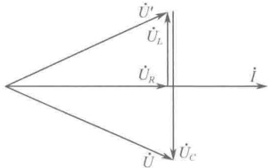

图 10-27 等腰三角形的相量图
 

所以有 $ \left|\dot{U}_{C}\right|=2\left|\dot{U}_{L}\right| $，即 $ X_{C}I=2X_{L}I $，得

 $$ X_{L}=X_{C}/2=48/2=24\Omega $$ 

例 10-5 如图 10-28 所示电路，已知  $ R = 1k\Omega $， $ f = 50Hz $，各电流表读数分别为  $ A = 0.04A $， $ A_1 = 0.035A $， $ A_2 = 0.01A $，试求元件参数  $ r $ 和  $ L $（电流表内阻忽略不计）。

解：已知各电流表读数均为有效值，若以电流 $ I_{1} $为参考相量，即

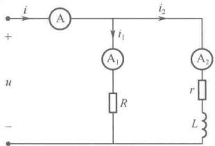

 $$ \dot{I}_{1}=I_{1}\angle0^{\circ}=0.035\angle0^{\circ} $$ 

图 10-28 例 10-5 图
 

则电压

 $$ \dot{U}=U\angle0^{\circ}=RI_{1}\angle0^{\circ}=0.035\times10^{3}\angle0^{\circ}=35\angle0^{\circ} $$ 

由于电路为感性（电压超前于电流），令  $ Z_{2}=r+j\omega L $ ，则其他电流为

 $$ \dot{I}=I\angle-\varphi=0.04\angle-\varphi,\quad\varphi>0 $$ 

即

 $$ \dot{I}_{2}=I_{2}\angle-\varphi_{2}=0.01\angle-\varphi_{2},\quad\varphi_{2}>0 $$ 

由KCL有

 $$ \dot{I}=\dot{I}_{1}+\dot{I}_{2} $$ 

 $$ 0.04\angle-\varphi=0.035\angle0^{\circ}+0.01\angle-\varphi_{2}\quad 或 \quad4\angle-\varphi=3.5+1\angle-\varphi_{2} $$ 

根据欧拉公式将等式两边展开，得

 $$ 4\cos\varphi-\mathrm{j}4\sin\varphi=3.5+\cos\varphi_{2}-\mathrm{j}\sin\varphi_{2} $$ 

令实部、虚部分别相等，得

<!-- page: 275 -->

$$ \left\{\begin{aligned}4\cos\varphi&=3.5+\cos\varphi_{2}\\ 4\sin\varphi&=\sin\varphi_{2}\end{aligned}\right. $$ 

对两式取平方后相加，得即

 $$ 4^{2}=3.5^{2}+7\cos\varphi_{2}+1 $$ 

 $$ \cos\varphi_{2}=0.4\quad 且 \quad\sin\varphi_{2}=0.916 $$ 

由于

 $$ \left|Z_{2}\right|=\frac{U}{I_{2}}=\frac{35}{0.01}=3500\Omega $$ 

 $$ r=\left|Z_{2}\right|\cos\varphi_{2}=3500\times0.4=1400\Omega $$ 

因此

 $$ L=\frac{\left|Z_{2}\right|}{\omega}\sin\varphi_{2}=\frac{3500\times0.916}{314}=10.2H $$ 

例 10-6 如图 10-29 所示电路, 已知  $ U = 193\,\text{V} $,  $ U_r = 60\,\text{V} $,  $ U' = 180\,\text{V} $,  $ r = 20\,\Omega $,  $ f = 50\,\text{Hz} $, 试求元件参数  $ R $ 和  $ C $。

解：以电压 $ \dot{U}_{r} $为参考相量，即

 $$ \dot{U}_{r}=U_{r}\angle0^{\circ}=60\angle0^{\circ} $$ 

则电流

 $$ \dot{I}=\frac{\dot{U}_{r}}{r}=3\angle0^{\circ} $$ 

定性地看，该电路一定是呈容性的，即必定有 $ \dot{U} $滞后于 $ \dot{I} $，且 $ \dot{U}=\dot{U}_{r}+\dot{U}^{\prime} $， $ \dot{I}_{R} $与 $ \dot{U}^{\prime} $同相位， $ \dot{I}_{C} $超前于 $ \dot{U}^{\prime}90^{\circ} $。据此先定性地描绘相量图，如图10-30所示。

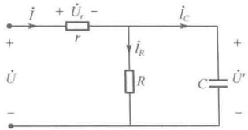

图 10-29 例 10-6 图
 

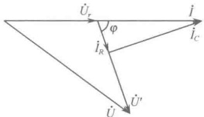

图 10-30 定性的相量图
 

根据图 10-30，使用余弦定理可得

 $$ \cos(180-\varphi)=\frac{U^{2}-U_{r}^{2}-U^{\prime}^{2}}{-2U_{r}U^{\prime}} $$ 

即

 $$ \cos\varphi=\frac{U^{2}-U_{r}^{2}-U^{\prime2}}{2U_{r}U^{\prime}}=\frac{193^{2}-60^{2}-180^{2}}{2\times60\times180}=0.058 $$ 

 $$ \varphi=86.68^{\circ} $$ 

因此有

 $$ I_{r}=I\cos\varphi=3\times0.058=0.174 $$ 

 $$ I_{c}=I\sin\varphi=3\times0.998=2.99 $$ 

可得

 $$ R=\frac{U^{\prime}}{I_{R}}=\frac{180}{0.174}=1034\Omega $$ 

 $$ C=\frac{I_{c}}{\omega U^{\prime}}=\frac{2.99}{314\times180}=53\mu F $$ 

（注：此题若不借助相量图法则较难求解。）

### 10.2 正弦稳态电路的功率

在正弦交流电路中，由于电感和电容的存在，使得电路中的功率表算比直流电阻电路要复杂

<!-- page: 276 -->

得多。特别是在使用相量法进行分析计算时，电路中的电压与电流转换成了相量，这时电压相量与电流相量的乘积是否还是一般意义上的功率？下面将围绕着运用相量法分析计算正弦稳态电路时的功率问题进行讨论。

#### 10.2.1 瞬时功率

所谓瞬时功率，是指瞬时电压与瞬时电流的乘积。对于图 10-31 所示的无源一端口电路，如果电源所提供的端口电压和端口电流分别为

 $$ u(t)=\sqrt{2}U\cos(\omega t+\varphi_{u}),\quad i(t)=\sqrt{2}I\cos(\omega t+\varphi_{i}) $$ 

则在正弦稳态情况下，该无源电路消耗的瞬时功率为

$$  \begin{aligned}p(t)&=u(t)i(t){=}2UI\cos(\omega t+\varphi_{u})\cos(\omega t+\varphi_{i})\\&={U I}[\cos(\varphi_{u}-\varphi_{i})+\cos(2\omega t+\varphi_{u}+\varphi_{i})]\end{aligned}   \tag*{（10-20）}$$

瞬时功率的波形如图10-32所示。

由式(10-20)可知，瞬时功率中包含恒定分量UI $ \cos(\varphi_u - \varphi_i) $和正弦分量UI $ \cos(2\omega t + \varphi_u + \varphi_i) $。通常 $ \varphi_u \neq \varphi_i $，所以瞬时功率中的恒定分量一般总是存在的，它表示了一个与时间无关的恒定量。另外，值得注意的是，瞬时功率中的正弦分量的频率是电压或电流频率的2倍。这表明，在电压或电流的一个周期内，瞬时功率中的正弦分量将出现两次 $ p(t) < 0 $的情况。在这两个 $ p(t) < 0 $的时间段内，电压 $ u(t) $与电流 $ i(t) $方向相反，电路将能量送回电源，这种情况是由于电路中存在储能元件造成的。

由于瞬时功率只反映了瞬时时刻的功率值，在实际应用中其实用意义并不大。

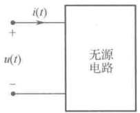

图 10-31 无源一端口电路
 

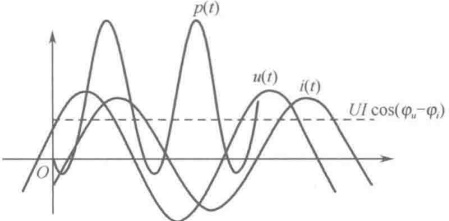

图 10-32 瞬时功率的波形
 

#### 10.2.2 平均（有功）功率

在一个周期内对瞬时功率取平均，可得到正弦交流稳态电路的平均功率，即

$$  \begin{aligned}P=&\frac{1}{T}\int_{0}^{T}p(t)\mathrm{d}t=\frac{1}{T}\int_{0}^{T}UI[\cos(\varphi_{u}-\varphi_{i})+\cos(2\omega t+\varphi_{u}+\varphi_{i})]\mathrm{d}t\\=&UI\cos(\varphi_{u}-\varphi_{i})\end{aligned}   \tag*{（10-21）}$$

显然，平均功率正是瞬时功率中的恒定分量，式中 U 和 I 分别为电压和电流的有效值，平均功率 P 的单位为 W（瓦特）。

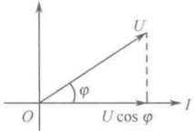

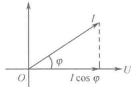

图 10-33 投影关系图
 

由于 $ \cos(\varphi_{u}-\varphi_{i})=\cos(\varphi_{i}-\varphi_{u}) $，因此可将上式写成

$$  P=U I\cos\varphi   \tag*{（10-22）}$$

从几何学的观点来看，式（10-22）表示 U 投影到了 I 上，或者 I 投影到了 U 上，如图 10-33 所示。而两个同相的量（图 10-33 中的  $ U \cos \varphi $ 与

<!-- page: 277 -->

I 或  $ I \cos \varphi $ 与 U）相乘类似于电阻上的电压与电流相乘（电阻上电压与电流的相位差为零），电阻又总是消耗功率的，这正说明了平均功率就是电路消耗的功率。因此，又将平均功率称为有功功率。

工程上常常将一个物理量乘以  $ \cos\phi $ 后的值称为这个物理量的有功分量。

由式（10-22）可知，电路消耗功率（即有功功率）的大小与  $ \cos\varphi $ 密切相关，因此将  $ \cos\varphi $ 称为功率因数，将角度  $ \varphi $ 称为功率因数角。

功率因数角  $ \varphi = \pm (\varphi_u - \varphi_t) $ 是电路端口电压与电流的相位差，也是从电路端口看进去的等效阻抗的阻抗角。当图 10-31 所示的无源一端口电路为纯电阻时， $ \varphi = 0 $， $ \cos \varphi = 1 $， $ P = UI $；当无源一端口电路为纯电感时， $ \varphi = \pi/2 $， $ \cos \varphi = 0 $， $ P = 0 $，即纯电感不消耗能量；当无源一端口电路为纯电容时， $ \varphi = -\pi/2 $， $ \cos \varphi = 0 $， $ P = 0 $，纯电容也不消耗能量；而当无源一端口电路既有电阻，又有电感和电容时，虽然电感和电容不消耗能量，但是电路的功率因数  $ \cos \varphi < 1 $，从而形成该无源电路与外电路的能量交换。显然，有功功率是一端口电路中全部电阻所消耗的功率。

#### 10.2.3 无功功率

令 $ \varphi=\varphi_{u}-\varphi_{i} $，有

 $$ \varphi_{u}+\varphi_{i}=\varphi_{u}-\varphi_{i}+2\varphi_{i}=\varphi+2\varphi_{i} $$ 

特殊地，可取 $ \varphi_{i}=0 $，这时式（10-20）可展开为

$$  \begin{aligned}p(t)&=UI[\cos(\varphi_{u}-\varphi_{i})+\cos(2\omega t+\varphi_{u}+\varphi_{i})]\\&=UI\cos\varphi+UI[\cos(2\omega t+\varphi)]=UI\cos\varphi+UI[\cos2\omega t\cos\varphi-\sin2\omega t\sin\varphi]\\&=UI\cos\varphi(1+\cos2\omega t)-UI\sin\varphi\sin2\omega t\\&=P(1+\cos2\omega t)-Q\sin2\omega t\\ \end{aligned}   \tag*{（10-23）}$$

式中， $ P = UI \cos \varphi $，并令  $ Q = UI \sin \varphi $。式（10-23）中的第一项为功率的脉动分量，其传输方向总是从电源到负载；第二项表示在电源与负载之间往返流动的功率分量，其幅值为  $ Q = UI \sin \varphi $。工程上将  $ UI \sin \varphi $ 这样的在电源与负载之间往返流动的功率称为无功功率，用大写字母  $ Q $ 表示，即

$$  Q=U I\sin\varphi   \tag*{（10-24）}$$

无功功率 Q 的单位为 Var（乏）。无功功率可正可负，当  $ \varphi > 0 $ 时，说明电压超前于电流，电路呈感性，而此时 Q > 0，说明电路在“吸收”无功功率；当  $ \varphi < 0 $ 时，说明电压滞后于电流，电路呈容性，而此时 Q < 0，说明电路在“发出”无功功率；当  $ \varphi = 0 $ 时，说明电压与电流同相位，电路呈阻性，而此时 Q = 0，说明电路既不“发出”无功功率，也不“吸收”无功功率。

从几何学的观点来看，式（10-24）表示 U 投影到了与 I 垂直的  $ 90^{\circ} $ 线上，或者 I 投影到了与 U 垂直的  $ 90^{\circ} $ 线上，如图 10-34 所示。而两个相互垂直的量（图 10-34 中的  $ U \sin \varphi $ 与 I 或  $ I \sin \varphi $ 与 U）相乘类似于电感或电容上的电压与电流相乘，而电感或电容是不消耗有功功率的，这也正符合了无功功率的含义。

与有功分量相对应的，工程上常常将一个物理量乘以 $ \sin\phi $后的值称为该物理量的无功分量。

将有功分量和无功分量的概念扩展，可以将一个相量 $ \dot{I} $分解成为有功分量 $ \dot{I}_{p} $和无功分量 $ \dot{I}_{Q} $，如图10-35所示。

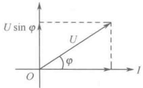

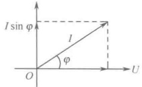

图 10-34 投影关系图
 

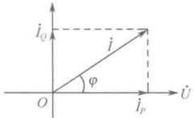

图 10-35 一个相量分解成为有功分量和无功分量
 

<!-- page: 278 -->

根据平行四边形法则，有

 $$ \dot{I}=\dot{I}_{P}+\dot{I}_{Q} $$ 

并且

 $$ \dot{I}_{P}=\dot{I}\cos\varphi\;,\quad\dot{I}_{Q}=\dot{I}\sin\varphi $$ 

即电流相量  $ \dot{I} $ 投影到电压相量  $ \dot{U} $ 上时类似于电阻上的电压与电流相乘，故  $ \dot{I}_{P} $ 为有功分量；电流相量  $ \dot{I} $ 投影到与电压相量  $ \dot{U} $ 垂直方向上时类似于电容（或电感）上的电压与电流相乘，故  $ \dot{I}_{Q} $ 为无功分量。

#### 10.2.4 视在功率

从前面所讨论的有功功率表达式和无功功率表达式来看，电压有效值 U 与电流有效值 I 的乘积就好像是一个最多可盛满容量为 UI 的功率容器， $ \cos\varphi $ 好像是从容器中取用有功功率的“勺子”，而  $ \sin\varphi $ 好像是从容器中取用无功功率的“勺子”。

因此，工程中将 UI 视为“容量”，专业术语称为视在功率（或表观功率），用大写字母 S 表示，即

$$  S=U I   \tag*{（10-25）}$$

视在功率 S 的单位为 VA（伏安）。在实际应用中，视在功率这个概念具有实用意义，电机、变压器等电气设备的“容量”就是指视在功率。

#### 10.2.5 功率三角形

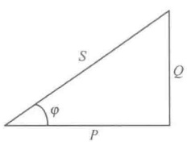

以上定义了三种形式的功率 P、Q、S，即

 $$  有功功率 \quad P=UI\cos\varphi $$ 

图 10-36 功率三角形
 

 $$  无功功率 \quad Q=U I\sin\varphi $$ 

 $$  视在功率 \quad S=UI $$ 

如同阻抗三角形一样，这三种形式的功率构成了一个功率三角形，如图10-36所示。根据功率三角形，三种功率的相互关系为

 $$ S=\sqrt{P^{2}+Q^{2}},\quad\varphi=\arctan\frac{Q}{P},\quad\cos\varphi=\frac{P}{S} $$ 

#### 10.2.6 复功率

在具备了应用相量法求解正弦稳态电路的基本概念和知识后，现在面临一个问题——电压相量与电流相量的乘积是什么功率？下面就来回答这个问题。

设电压相量和电流相量分别为 $ \dot{U}=Ue^{\mathrm{j}\varphi_{u}} $ 和  $ \dot{I}=Ie^{\mathrm{j}\varphi_{i}} $，但是

 $$ \dot{U}\mathrm{I}=U\mathrm{I}\mathrm{e}^{\mathrm{j}\varphi_{u}}\mathrm{e}^{\mathrm{j}\varphi_{i}}=U\mathrm{I}\mathrm{e}^{\mathrm{j}(\varphi_{u}+\varphi_{i})}=U I\cos(\varphi_{u}+\varphi_{i})+\mathrm{j}U I\sin(\varphi_{u}+\varphi_{i}) $$ 

此式显然与前面定义的三种形式的功率都无法一一对应，也就是说，电压相量与电流相量的乘积并不能用来表达已知的任何一种功率。但这个乘积却提供了一种思路：观察电压相量 $ \dot{U}=Ue^{j\varphi_u} $与电流共轭相量 $ \dot{I}^*=Ie^{-j\varphi_i} $的乘积

 $$ \dot{U}\mathrm{I}^{*}=U\mathrm{I}\mathrm{e}^{\mathrm{j}\varphi_{u}}\mathrm{e}^{-\mathrm{j}\varphi_{i}}=U\mathrm{I}\mathrm{e}^{\mathrm{j}(\varphi_{u}-\varphi_{i})} $$ 

沿用前面的定义  $ \varphi=\varphi_{u}-\varphi_{i} $，并根据欧拉公式可得

$$  \begin{aligned}\dot{U}\dot{I}^{*}&=U I\mathrm{e}^{\mathrm{j}(\varphi_{u}-\varphi_{i})}=U I\mathrm{e}^{\mathrm{j}\varphi}=U I(\cos\varphi+\mathrm{j}\sin\varphi)\\&=U I\cos\varphi+\mathrm{j}U I\sin\varphi=P+\mathrm{j}Q\end{aligned}   \tag*{（10-26）}$$

式（10-26）表明，电压相量  $ \dot{U} $ 与电流共轭相量  $ \dot{I}^{*} $ 的乘积是有意义的，可以用它来表达已知功率，例如，其实部为有功功率，虚部为无功功率，其模为视在功率，其相角为功率因数角。于是，将电压相量  $ \dot{U} $ 与电流共轭相量  $ \dot{I}^{*} $ 的乘积定义为复功率，用符号  $ \tilde{S} $ 表示，即

<!-- page: 279 -->

$$  \tilde{S}=\dot{U}\dot{I}^{*}   \tag*{（10-27）}$$

由式（10-26）可知

$$  P=\mathrm{R e}[\tilde{S}]   \tag*{（10-28）}$$

$$  Q=\mathrm{I m}[\tilde{S}]   \tag*{（10-29）}$$

$$  S=\sqrt{P^{2}+Q^{2}}=\left|\tilde{S}\right|   \tag*{（10-30）}$$

注意：复功率并不代表正弦量，引入复功率的目的是能用电压相量和电流相量来表达功率 P、Q、S。

当然，现在就可以下结论了：乘积 $ U\dot{I} $无意义。

例 10-7 如图 10-37 所示电路，已知  $ U = 240\angle0^\circ\mathrm{V} $， $ \omega = 1000\mathrm{rad/s} $，试求电源供出的复功率。解：电路阻抗为

 $$ Z=\frac{R\left(\mathrm{j}\omega L+\frac{1}{\mathrm{j}\omega C}\right)}{R+\mathrm{j}\omega L+\frac{1}{\mathrm{j}\omega C}}=\frac{R(1-\omega^{2}LC)}{1-\omega^{2}LC+\mathrm{j}\omega RC}=24\angle53^{\circ}\Omega $$ 

 $$ \dot{I}=\frac{\dot{U}}{Z}=\frac{240\angle0^{\circ}}{24\angle53^{\circ}}=10\angle-53^{\circ} $$ 

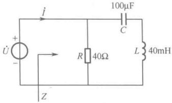

则电流

图 10-37 例 10-7 图
 

所以，电源供出的复功率为

 $$ \begin{aligned}\tilde{S}&=\dot{U}\dot{I}^{*}=240\angle0^{\circ}\times10\angle53^{\circ}=2400\angle53^{\circ}\\&=1440+\mathrm{j}1920\end{aligned} $$ 

由此可知：视在功率为 2400VA，有功功率为 1440W，无功功率为 1920Var，电路的功率因数角  $ \varphi = 53^{\circ} $。

#### 10.2.7 功率的可叠加性与守恒性

前面描述了瞬时功率、有功功率、无功功率、视在功率和复功率5种形式的功率，这些功率可以是图10-31所描述的一个无源一端口电路的端口所呈现的功率，也可以是电路中任何一个二端元件上的功率。于是，这里就产生了一个问题：整个电路的功率守恒性如何？一个无源一端口电路端口所呈现的功率是否等于电路中所有元件上的功率的叠加？即功率的可叠加性如何？

# 1. 复功率的可叠加性与守恒性

因为无源一端口电路端口的总复功率

 $$ \tilde{S}=\dot{U}\dot{I}^{*}\left\{\begin{aligned}&\Rightarrow( 由 \mathrm{KCL})\\ &\quad=\quad\dot{U}(\dot{I}_{1}+\dot{I}_{2}+\cdots+\dot{I}_{b})^{*}=\dot{U}\dot{I}_{1}^{*}+\dot{U}\dot{I}_{2}^{*}+\cdots+\dot{U}\dot{I}_{b}^{*}=\tilde{S}_{1}+\tilde{S}_{2}+\cdots+\tilde{S}_{b}\\ &\Rightarrow( 由 \mathrm{KVL})\\ &\quad=\quad(\dot{U}_{1}+\dot{U}_{2}+\cdots+\dot{U}_{b})\dot{I}^{*}=\dot{U}_{1}\dot{I}^{*}+\dot{U}_{2}\dot{I}^{*}+\cdots+\dot{U}_{b}\dot{I}^{*}=\tilde{S}_{1}+\tilde{S}_{2}+\cdots+\tilde{S}_{b}\end{aligned}\right. $$ 

所以，电路中所有元件上的复功率的叠加等于电路端口所呈现的总的复功率，即

$$  \tilde{S}=\sum_{k=1}^{b}\tilde{S}_{k}   \tag*{（10-31）}$$

结论：复功率满足可叠加性。

式（10-31）也表明，对于一个共有 b 条支路的完整电路，设 k 支路的电压和电流分别为  $ \dot{U}_{k} $ 与  $ \dot{I}_{k} $，在关联方向下，整个电路吸收的复功率的代数和等于零，该结论称为复功率守恒。

# 2. 有功功率的可叠加性与守恒性

根据式（10-28）描述的有功功率与复功率的关系，可得无源一端口电路端口的总有功功率与电路中各个元件上的有功功率的关系为

<!-- page: 280 -->

$$  P=\operatorname{Re}[\tilde{S}]=\operatorname{Re}\left[\sum_{k=1}^{b}\tilde{S}_{k}\right]=\sum_{k=1}^{b}\operatorname{Re}[\tilde{S}_{k}]=\sum_{k=1}^{b}P_{k}   \tag*{（10-32）}$$

结论：有功功率满足可叠加性。

式（10-32）也表明，对于一个有 b 条支路的完整电路，设 k 支路的电压和电流分别为  $ \dot{U}_{k} $ 与  $ \dot{I}_{k} $，在关联方向下，整个电路吸收的有功功率的代数和等于零，该结论称为有功功率守恒。

# 3. 无功功率的可叠加性与守恒性

根据式（10-29）描述的无功功率与复功率的关系，可得无源一端口电路端口的总无功功率与电路中各个元件上的无功功率的关系为

$$  Q=\mathrm{Im}[\tilde{S}]=\mathrm{Im}\left[\sum_{k=1}^{b}\tilde{S}_{k}\right]=\sum_{k=1}^{b}\mathrm{Im}[\tilde{S}_{k}]=\sum_{k=1}^{b}Q_{k}   \tag*{（10-33）}$$

结论：无功功率满足可叠加性。

式（10-33）也表明，对于一个有 b 条支路的完整电路，设 k 支路的电压和电流分别为  $ \dot{U}_{k} $ 与  $ \dot{I}_{k} $，在关联方向下，整个电路吸收的无功功率的代数和等于零，该结论称为无功功率守恒。

# 4. 视在功率的可叠加性与守恒性

根据式（10-30）描述的视在功率与复功率的关系，可得

$$  S=U I=\left|\tilde{S}\right|=\left|\sum_{b=1}^{n}\tilde{S}_{b}\right|\neq\sum_{b=1}^{n}\left|\tilde{S}_{b}\right|=\sum_{b=1}^{n}S_{b}   \tag*{（10-34）}$$

结论：视在功率一般不满足可叠加性，也不满足功率守恒。

例 10-8 如图 10-38 所示电路，已知  $ Z_{1}=4+j13 $,  $ Z_{2}=8+j4 $，电源电压 U=120V，试求：

（1）各支路电流和总电流；（2）各支路有功功率和总有功功率；（3）各支路无功功率和总无功功率；（4）各支路视在功率和总视在功率。

解：（1）以电压 $ \dot{U} $为参考相量，即

 $$ \dot{U}=U\angle0^{\circ}=120\angle0^{\circ} $$ 

则电流

 $$ \dot{I}_{1}=\frac{\dot{U}}{Z_{1}}=\frac{120\angle0^{\circ}}{4+\mathrm{j}13}=\frac{120\angle0^{\circ}}{13.6\angle72.9^{\circ}}=8.82\angle-72.9^{\circ} $$ 

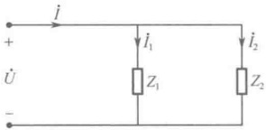

图 10-38 例 10-8 图
 

 $$ \begin{aligned}\dot{I}_{2}=\frac{\dot{U}}{Z_{2}}=\frac{120\angle0^{\circ}}{8+\mathrm{j}4}=\frac{120\angle0^{\circ}}{8.944\angle26.6^{\circ}}=13.42\angle-26.6^{\circ}\\\dot{I}=\dot{I}_{1}+\dot{I}_{2}=8.82\angle-72.9^{\circ}+13.42\angle-26.6^{\circ}\\=2.595-\mathrm{j}8.432+12-\mathrm{j}6=14.595-\mathrm{j}14.43\end{aligned} $$ 

 $$ 2.595-j8.432+12-j6=14.595-j14.432=20.53\angle-44.7^{\circ} $$ 

（2）

 $$ P_{1}=UI_{1}\cos\varphi_{1}=120\times8.82\times\cos72.9^{\circ}=311.35W $$ 

 $$ P_{2}=U I_{2}\cos\varphi_{2}=120\times13.42\times\cos26.6^{\circ}=1440W $$ 

 $$ P=UI\cos\varphi=120\times20.53\times\cos44.7^{\circ}=1751.35W $$ 

可知 $ P=P_{1}+P_{2} $

（3）

 $$ Q_{1}=U I_{1}\sin\varphi_{1}=120\times8.82\times\sin72.9^{\circ}=1012Var $$ 

 $$ Q_{2}=U I_{2}\sin\varphi_{2}=120\times13.42\times\sin26.6^{\circ}=720Var $$ 

 $$ Q=U I\sin\varphi=120\times20.53\times\sin44.7^{\circ}=1732Var $$ 

可知 $ Q=Q_{1}+Q_{2} $

（4）

 $$ S_{1}=UI_{1}=120\times8.82=1058.4VA $$ 

 $$ S_{2}=UI_{2}=120\times13.42=1610.4VA $$ 

 $$ S=U I=120\times20.53=2463.6VA $$ 

可知 $ S \neq S_{1} + S_{2} $

<!-- page: 281 -->

#### 10.2.8 功率因数

前面已经定义了功率因数 $ \cos\phi $，并且知道负载从电源发出的功率容量S中能够获得多少有功功率P是由功率因数 $ \cos\phi $决定的，或者说是由负载的阻抗角 $ \phi $决定的。

提高功率因数具有重要的经济意义。对于供电系统而言，要充分利用电源设备的容量，就必须提高功率因数  $ \cos\varphi $，或者说减小功率因数角  $ \varphi $。例如，一台供电变压器的容量  $ S $ 为  $ 7500\text{kVA} $，当  $ \cos\varphi=1 $ 时，输出的有功功率为  $ P=7500\text{kW} $，而当  $ \cos\varphi=0.5 $ 时，输出的有功功率为  $ P=3750\text{kW} $，显然，此时电源设备的容量没有得到充分利用，造成了浪费。其次，输电线路的传输效率  $ \eta $ 是负载接收到的功率  $ P_2 $ 与输电线路始端的输入功率  $ P_1 $ 之比，即

$$  \eta=\frac{P_{2}}{P_{1}}\times100\%=\frac{P_{2}}{P_{2}+R_{l} I^{2}}\times100\%   \tag*{（10-35）}$$

式中， $ R_{t} $ 为输电线的电阻， $ R_{t}I^{2} $ 为线路的有功损耗。当  $ P_{2} $ 为定值时，要提高传输效率，就必须减小输电线路中的电流 I，而

$$  I=\frac{P_{2}}{U_{2}\cos\varphi}   \tag*{（10-36）}$$

如果负载端电压  $ U_{2} $ 保持恒定，那么，要减小 I，就必须提高  $ \cos \varphi $，否则输电线路中的电流 I 就会变大，引起输电线路的损耗增大。为了降低线路损耗，供电部门要求用户必需采取一定的措施，将功率因数提高到规定的限度以上。

在日常生活和工业生产中，绝大多数电器都是感性负载，其上电压都是超前于电流的。在这种情况下，要提高功率因数  $ \cos\varphi\left(\varphi=\varphi_{u}-\varphi_{i}\right) $，即减小功率因数角  $ \varphi $，就需要增大  $ \varphi_{i} $，而增大  $ \varphi_{i} $ 的常用手段是在感性电路中并联电容。因为感性负载消耗无功功率，因此，需要使用电容来提供无功功率。之所以要并联电容，是因为采用并联方式后，电路中电流的无功分量可以得到补偿。这种方法称为静态补偿法，如图10-39所示。而在电力系统中，常采用同步补偿法，即安装调相机来增大  $ \varphi_{i} $。

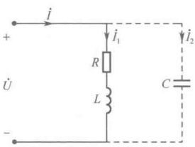

图 10-39 采用并联电容的静态补偿法
 

图 10-40 通过相量图描述了并联电容后功率因数角从  $ \varphi $ 减小到  $ \varphi' $ 的原理。在并联电容之前，电路中的总电流  $ \dot{I} = \dot{I}_{1} $，并且

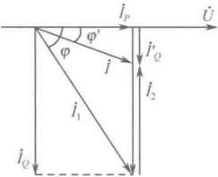

 $$ I_{1}=\frac{P}{U\cos\varphi} $$ 

并联电容 C 之后，电路中的总电流  $ \dot{I} = \dot{I}_1 + \dot{I}_2 $。这时负载电流  $ \dot{I}_1 $ 的有功分量不变，而由于电容电流  $ \dot{I}_2 $ 超前于电压  $ 90^\circ $，抵消了一部分负载电流  $ \dot{I}_1 $ 的无功分量，因此从图 10-40 可以看到，总电流 I 比并联电容之前的  $ I_1 $ 减小了。

图 10-40 功率因数角从  $ \varphi $ 减小到  $ \varphi' $ 的原理
 

并联电容之前，总电流 i 的无功分量为  $ i_{0} $，并且

 $$ I_{Q}=I_{1}\sin\varphi=\frac{P}{U\cos\varphi}\sin\varphi=\frac{P}{U}\tan\varphi $$ 

并联电容之后，总电流 i 的无功分量为  $ i_{Q}^{\prime} $，并且

 $$ I_{Q}^{\prime}=I\sin\varphi^{\prime}=\frac{P}{U\cos\varphi^{\prime}}\sin\varphi^{\prime}=\frac{P}{U}\tan\varphi^{\prime} $$

<!-- page: 282 -->

而由于电容电流 $ I_{2} $的有效值为

 $$ I_{2}=I_{Q}-I_{Q}^{\prime} $$ 

由图10-39可知，电容电流 $ I_{2}=\omega CU $，因此，需并联的电容值为

$$  C=\frac{I_{2}}{\omega U}=\frac{I_{Q}-I_{Q}^{\prime}}{\omega U}=\frac{P(\tan\varphi-\tan\varphi^{\prime})}{\omega U^{2}}   \tag*{（10-37）}$$

例 10-9 如图 10-41 所示为一个日光灯支路，已知日光灯功率为 40W，电压  $ U = 220V $，电流  $ I = 0.41A $，试求：（1）日光灯支路的功率因数  $ \cos\varphi $；（2）要使日光灯支路的功率因数提高到 1，需并联多大的电容？（3）功率因数提高到 1 时的总电流  $ I = ? $ （4）一般 40W 日光灯并联的电容为  $ 4.75\mu F $，问此时的功率因数为多少？

解：（1）已知日光灯支路的 P = 40W，容量  $ S = UI = 220 \times 0.41 = 90.2 ~VA $ 所以，日光灯支路的功率因数

 $$ \cos\varphi=\frac{P}{S}=\frac{40}{90.2}=0.4435 $$ 

功率因数角

 $$ \varphi=\arccos0.4435=63.67^{\circ} $$ 

（2）由式（10-37）可得，日光灯支路的功率因数提高到1时需并联的电容

 $$ C=\frac{P(\tan\varphi-\tan\varphi^{\prime})}{\omega U^{2}}=\frac{40(\tan\varphi-\tan\varphi^{\prime})}{2\pi\times50\times220^{2}}=\frac{40(\tan63.67^{\circ}-0)}{2\pi\times50\times220^{2}}=5.32\mu F $$ 

并联电容后的日光灯支路如图10-42所示。

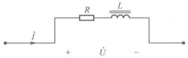

图 10-41 例 10-9 图
 

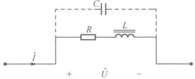

图 10-42 并联电容后的日光灯支路
 

（3）日光灯支路的功率因数提高到1时的总电流

 $$ I=\frac{P}{U\cos\varphi}=\frac{P}{U}=\frac{40}{220}=0.182A $$ 

可见，总电流 I 比并联电容之前减小了。

（4）由式（10-37）可得

 $$ \begin{aligned}\tan\varphi^{\prime}&=\tan\varphi-\frac{\omega CU^{2}}{P}=2.02-\frac{314\times4.75\times10^{-6}\times220^{2}}{40}=0.2153\\\varphi^{\prime}&=\arctan0.2153=12.15^{\circ}\\& 內 \\\cos\varphi^{\prime}&=\cos12.15^{\circ}=0.978\end{aligned} $$ 

所以，功率因数为

#### 10.2.9 正弦稳态电路中的最大功率传输

在直流电路分析中已经学习过最大功率传输定理，但在正弦稳态电路中，由于信号和负载发生了变化，因此，这时的最大功率传输定理也将随之也发生一些变化。根据戴维宁定理，这一问题可以归结为含源一端口网络向外电路（负载）传输最大功率的问题。如图10-43所示，左边为戴维宁等效支路，右边的 $ Z_{L} $为外接负载。

设戴维宁等效阻抗  $ Z_{eq} = R_{eq} + jX_{eq} $，负载  $ Z_L = R_L + jX_L $，则负载电流

<!-- page: 283 -->

$$ \dot{I}=\frac{\dot{U}_{\mathrm{oc}}}{Z_{\mathrm{eq}}+Z_{\mathrm{L}}}=\frac{\dot{U}_{\mathrm{oc}}}{(R_{\mathrm{eq}}+R_{\mathrm{L}})+\mathrm{j}(X_{\mathrm{eq}}+X_{\mathrm{L}})} $$ 

负载电流有效值

 $$ I=\frac{U_{oc}}{\sqrt{\left(R_{eq}+R_{L}\right)^{2}+\left(X_{eq}+X_{L}\right)^{2}}} $$ 

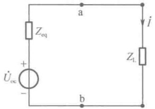

负载吸收的功率

$$  P_{\mathrm{L}}=R_{\mathrm{L}}I^{2}=\frac{R_{\mathrm{L}}U_{\mathrm{oc}}^{2}}{\left(R_{\mathrm{eq}}+R_{\mathrm{L}}\right)^{2}+\left(X_{\mathrm{eq}}+X_{\mathrm{L}}\right)^{2}}   \tag*{（10-38）}$$

图 10-43 含源一端口网络与外电路（负载）相连
 

从式（10-38）可知，负载获得最大功率的条件与 $ U_{oc} $、 $ R_{eq} $、 $ R_{L} $、 $ X_{eq} $、 $ X_{L} $ 5 个参数有关。但一般情况下， $ U_{oc} $、 $ R_{eq} $ 和  $ X_{eq} $ 常常是不变的，所以，只需考虑 $ R_{L} $ 和 $ X_{L} $ 这两个参数的影响。

（1）保持 $ R_{L} $不变，只改变 $ X_{L} $的情况

从式（10-38）可知，令 $ \frac{\partial P_{L}}{\partial X_{L}}=0 $可得负载获得最大功率的条件为

 $$ X_{L}=-X_{eq} $$ 

这时，负载获得的最大功率为

 $$ P_{Lmax}=\frac{R_{L}U_{oc}^{2}}{(R_{eq}+R_{L})^{2}} $$ 

并且，在图10-43所示的电路中发生了串联谐振。

（2） $ R_{L} $ 和  $ X_{L} $ 都可改变的情况

从式（10-38）可知，令 $ \frac{\partial P_{L}}{\partial R_{1}}=0 $ 和  $ \frac{\partial P_{L}}{\partial X_{1}}=0 $ 可得负载获得最大功率的条件为

 $$ \left\{\begin{aligned}R_{\mathrm{L}}&=R_{\mathrm{eq}}\\ X_{\mathrm{L}}&=-X_{\mathrm{eq}}\end{aligned}\right. $$ 

这个条件也可写成

$$  Z_{\mathrm{L}}=R_{\mathrm{L}}+\mathrm{j}X_{\mathrm{L}}=R_{\mathrm{eq}}-\mathrm{j}X_{\mathrm{eq}}=Z_{\mathrm{eq}}^{*}   \tag*{（10-39）}$$

也就是说，当负载  $ Z_{L} $ 等于戴维宁等效阻抗  $ Z_{eq} $ 的共轭  $ (Z_{eq}^{*}) $ 时，负载可获得最大功率，并且，负载获得的最大功率为

 $$ P_{L max}=\frac{U_{oc}^{2}}{4R_{eq}} $$ 

满足式（10-39）这个条件称为最佳匹配或共轭匹配。

注意，在共轭匹配时，能量的传输效率

 $$ \eta=\frac{R_{\mathrm{L}}I^{2}}{(R_{\mathrm{eq}}+R_{\mathrm{L}})I^{2}}\times100\%=50\% $$ 

在电力工程中，输电电压较高，而电源的内阻很小。如果系统处于共轭匹配状态，则不仅能量的传输效率太低，而且输电电流也会很大，从而损坏电源和负载设备。因此，电力系统不允许在共轭匹配状态下工作。而在通信工程和电子技术应用方面，由于传输信号的电压低、电流小，以损失部分能量为代价，使负载与信号源之间达成共轭匹配，以求负载获得较强的信号则是合理的。

例 10-10 如图 10-44 所示电路，已知  $ \dot{I}_s = 10\angle -90^\circ $， $ \dot{U}_s = 1 - j5 $，问  $ Z $ 为何值时它吸收的有功功率最大，并求此最大功率。

解：（1）先将电路从 a、b 点断开，求从 a、b 点往左看的戴维宁等效支路。

<!-- page: 284 -->

这时，由节点方程

 $$ \begin{cases}\left(1+\frac{1}{-\mathrm{j}}\right)\dot{U}_{\mathrm{d}}=\dot{I}_{\mathrm{s}}-\dot{U}\\\dot{U}=\dot{U}_{\mathrm{d}}\end{cases} $$ 

 $$ \dot{U}_{d}=4.47\angle-116.6^{\circ} $$ 

解得

所以，开路电压

 $$ \dot{U}_{ab}=-(-j)\dot{U}+\dot{U}_{d}=(1+j)\dot{U}_{d}=6.3\angle-71^{\circ}=2-j6 $$ 

如图 10-45 所示，在 a、b 端口加源  $ \dot{U}_{x} $，求戴维宁等效阻抗  $ Z_{eq} $。

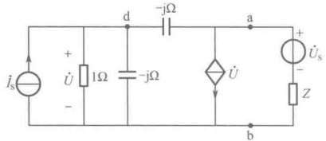

图 10-44 例 10-10 图
 

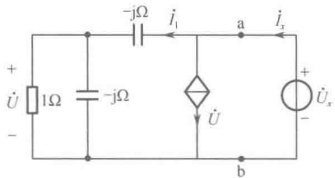

图 10-45 用端口加源法求等效阻抗
 

因为

 $$ \dot{U}=\frac{\frac{-\mathrm{j}}{1-\mathrm{j}}}{\frac{-\mathrm{j}}{1-\mathrm{j}}-\mathrm{j}}\dot{U}_{x}=\frac{1}{5}(2+\mathrm{j})\dot{U}_{x},\quad\dot{I}_{1}=\frac{\dot{U}_{x}}{\frac{-\mathrm{j}}{1-\mathrm{j}}-\mathrm{j}}=\frac{1}{5}(1+\mathrm{j}3)\dot{U}_{x} $$ 

 $$ \dot{I}_{x}=\dot{I}_{1}+\dot{U}=\frac{1}{5}(3+\mathrm{j}4)\dot{U}_{x} $$ 

所以

 $$ Z_{eq}=\frac{\dot{U}_{x}}{\dot{I}_{x}}=\frac{1}{5}(3-j4) $$ 

（2）根据最大功率传输的条件，当负载阻抗  $ Z = Z_{eq}^{*} = \frac{1}{5}(3 + j4) $ 时，可获最大功率。将从 a、b 点断开的负载支路连接还原，如图 10-46 所示。

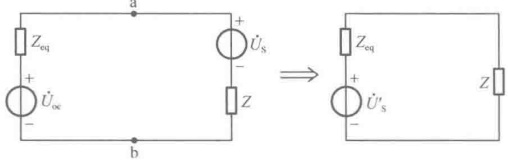

图 10-46 等效电路
 

等效电路中

 $$ \dot{U}_{\mathrm{s}}^{\prime}=\dot{U}_{\mathrm{oc}}-\dot{U}_{\mathrm{s}}=2-\mathrm{j}6-1+\mathrm{j}5=1-\mathrm{j}=\sqrt{2}\angle-45^{\circ} $$ 

所以，最大功率

 $$ P_{max}=\frac{U_{S}^{\prime2}}{4R_{eq}}=\frac{(\sqrt{2})^{2}}{4\times\frac{3}{5}}=0.83W $$ 

### 10.3 计算机仿真

##### 例 10-11 正弦交流电路仿真

##### （1）RLC 串联电路

RLC 串联电路如图 10-47（a）所示，正弦交流电压源为  $ u_s = 10\sqrt{2}\cos(314t) $ V，感抗值为

<!-- page: 285 -->

$ X_L = \omega L = 2\pi fL = 2 \times 3.14 \times 50 \times 20 \times 10^{-3} = 6.28\Omega $，容抗值  $ X_C = \frac{1}{\omega C} = \frac{1}{2\pi fC} = \frac{1}{2 \times 3.14 \times 50 \times 100 \times 10^{-6}} \approx 31.85\Omega $，容抗值大于感抗值，RLC 串联电路的阻抗为  $ Z = R + j(X_L - X_C) = 10 - j25.57 = 27.46\angle -68.64^\circ\Omega $，电压在相位上滞后于电流  $ 68.64^\circ $。在图 10-47（b）中，用示波器和电流探针测量 RLC 串联端口的电压  $ u $ 和电阻上的电流  $ i $ 的相位关系，示波器的波形显示端口电流  $ i $（通道 B）比端口电压  $ u $（通道 A）先到达最大值，可以判定该电路为容性电路。利用示波器的时间游标，可以读出电流  $ i $ 与电压  $ u $ 到达峰值的时间差为 3.825ms，转换成角度约为  $ \frac{3.825}{20} \times 360^\circ = 68.85^\circ $，理论计算和实际测量值基本相同。

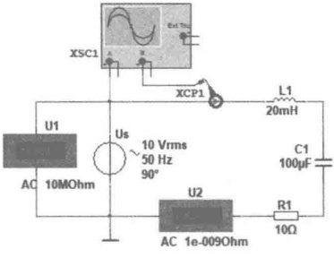

（a）RLC串联电路
 

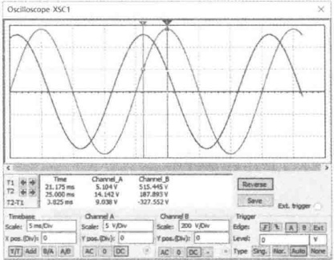

（b）RLC 串联电路的电压和电流相位关系
 

图 10-47 RLC 串联电路及其电压和电流相位关系仿真
 

在图 10-48（a）中，根据理论分析可得，该串联电路的电流为  $ \dot{I}=\frac{\dot{U}_{S}}{Z}=\frac{10\angle0^{\circ}}{27.46\angle-68.64^{\circ}}=0.364\angle68.64^{\circ} $（A），电阻的端电压为  $ \dot{U}_{R}=\frac{R}{Z}\dot{U}_{S}=\frac{10\times10\angle0^{\circ}}{27.46\angle-68.64^{\circ}}=3.64\angle68.64^{\circ} $（V），电感的端电压为  $ \dot{U}_{L}=\frac{\dot{j}X_{L}}{Z}\dot{U}_{S}=\frac{\dot{j}6.28\times10\angle0^{\circ}}{27.46\angle-68.64^{\circ}}=2.29\angle158.64^{\circ} $（V），电容的端电压为  $ \dot{U}_{C}=\frac{-\dot{j}X_{C}}{Z}\dot{U}_{S}=\frac{-\dot{j}31.85\times10\angle0^{\circ}}{27.46\angle-68.64^{\circ}}=11.6\angle-21.36^{\circ} $（V）。现用电压表和电流表对理论分析结果进行验证，串联电路的电流有效值为 0.364A，总电压有效值为 10V，电阻端电压有效值为 3.645V，电感的端电压有效值为 2.29V，电容的端电压有效值为 11.6V。将图 10-48（a）中的电感电压和电容电压接入双踪示波器的两个通道，得到图 10-48（b），利用游标可测得示波器中电感两端的电压和电容端电压在时间轴上相差约为 10ms，转换成角度为 180°，电感端电压超前电容端电压为 180°，在进行电压合成时，二者的电压是相减关系。电阻电压、电抗电压、电源电压满足直角三角形关系。理论计算可得

 $$ U_{S}=\sqrt{U_{R}^{2}+(U_{L}-U_{C})^{2}}=\sqrt{3.64^{2}+(2.29-11.6)^{2}}=\sqrt{99.999}=9.999\approx10\mathrm{V} $$ 

表明理论计算值与仿真测量结果一致。

##### （2）RLC 并联电路

RLC 并联电路如图 10-49（a）所示，正弦交流电压源为  $ u_s = 10\sqrt{2}\cos(314t) $ V，感纳值为  $ B_L = \frac{1}{\omega L} = \frac{1}{2\pi fL} = \frac{1}{2 \times 3.14 \times 50 \times 100 \times 10^{-3}} \approx 0.0318 $ S，电容  $ C_1 = 100\mu F $，容纳值  $ B_C = \omega C = 2\pi f C = 2 \times 3.14 \times 50 \times 100 \times 10^{-6} = 0.0314 $ Ω，感纳值大于容纳值，电路呈感性，此 RLC 并联电路的导纳为

<!-- page: 286 -->

$ Y = G + \mathrm{j}(B_C - B_L) = 0.1 - \mathrm{j}0.0004 = 0.1\angle -0.229^\circ\mathrm{S} $。根据理论分析可知，电阻支路电流为  $ \dot{I}_R = \frac{\dot{U}_S}{R} = \frac{10\angle0^\circ}{10} = 1\angle0^\circ(\mathrm{A}) $，电容支路电流为  $ \dot{I}_C = \dot{U}_S\mathrm{j}B_C = 10\angle0^\circ \times \mathrm{j}0.0314 = 0.314\angle90^\circ(\mathrm{A}) $，电感支路电流为  $ \dot{I}_L = \dot{U}_S(-\mathrm{j}B_L) = 10\angle0^\circ \times (-\mathrm{j}0.0318) = 0.318\angle -90^\circ(\mathrm{A}) $，电流源电流为  $ \dot{I} = \dot{U}_S Y = 10\angle0^\circ \times 0.1\angle -0.229^\circ \approx 1\angle -0.229^\circ(\mathrm{A}) $。在图 10-49（b）中，使用安培表测量各支路电流有效值。U1 显示电路中总的电流有效值为 1.001A，U2 显示电阻支路的电流有效值为 1A，U3 显示电容支路的电流有效值为 0.314A，U4 显示电感支路的电流有效值为 0.319A，与理论分析一致。

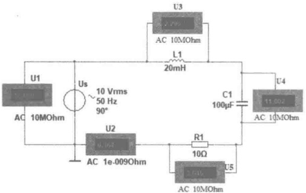

（a）RLC串联电路电压电流的测量
 

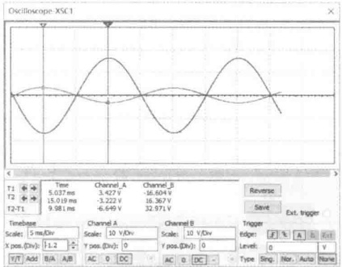

（b）电感电压和电容电压的相位关系
 

图 10-48 RLC 串联电路的电压仿真
 

（a）RLC 并联电路
 

（b）测量各支路电流有效值
 

图 10-49 RLC 并联电路的电流仿真
 

如图 10-50（a）所示，在电容支路和电感支路中放置电流探针，然后将探针 XCP1 接入双踪示波器 A 通道，将探针 XCP2 接入双踪示波器 B 通道。仿真开始后，得到如图 10-50（b）所示的电流波形，利用游标可以观测电容电流和电感电流到达最大值的时间差约为 10ms，换算成相位角为 180°，说明二者是反相关系，在电流合成时相减。理论计算可得电压源处总的电流为

 $$ I=\sqrt{I_{R}^{2}+\left(I_{C}-I_{L}\right)^{2}}=\sqrt{1^{2}+\left(0.314-0.318\right)^{2}}=\sqrt{1.0016}\approx1\mathrm{A} $$ 

表明理论计算值与仿真测量结果一致。

##### 例 10-12 正弦交流电路功率仿真。

图 10-51 所示为 RLC 并联电路的功率测量仿真图。功率表 XWM1 测得电压源的有功功率为 -10.007W，电压源的电压和电流为关联参考，表明电压源发出有功功率，功率因数为 0.961；功率表 XWM2 测得电阻的有功功率为 10W，功率因数为 1；功率表 XWM3 测得电容和电感的有功功率为 0W，功率因数为 0；说明电阻是耗能元件，电路中的有功功率即为电阻的功率，而电容和电感不耗能，有功功率为 0W。三个安培表：U1 测得电压源的电流有效值为 1.041A，U2 测得电阻的电流有效值为 1A，U3 测得电容和电感总的电流有效值为 0.287A，满足电流三角形关系：

<!-- page: 287 -->

$$ I=\sqrt{I_{R}^{2}+\left(I_{C}-I_{L}\right)^{2}}=\sqrt{1+0.287^{2}}=1.0404A $$ 

（a）支路电流测量
 

（b）电感电流和电容电流的相位关系
 

图 10-50 RLC 并联电路的电压电流相位关系仿真
 

图 10-51 RLC 并联电路的功率测量仿真图
 

根据各元件参数可以计算出电压源的功率如下：

端口等效导纳

 $$ \begin{aligned}Y&=G+\mathrm{j}(B_{C}-B_{L})=0.1+\mathrm{j}\left(2\pi\times50\times10\times10^{-6}-\frac{1}{2\pi\times50\times100\times10^{-3}}\right)\\&=0.1-\mathrm{j}0.0287=0.104\angle-16.01^{\circ}(\mathrm{S})\end{aligned} $$ 

电压源电流

 $$ I=U Y=10\times0.104=1.04A $$ 

视在功率

 $$ S=U I=U^{2}\mid Y\mid=10^{2}\times0.104=10.4VA $$ 

有功功率

 $$ P=UI\cos\varphi=I^{2}R=10\mathrm{W} $$ 

功率因数

 $$ \cos\varphi=\frac{P}{S}=\frac{10}{10.4}\approx0.961 $$ 

功率因数角

无功功率

 $$ \varphi\approx16.05^{\circ} $$ 

 $$ Q=UI\sin\varphi=10\times1.04\times0.276=2.875Var $$ 

说明仿真实验测量数据与理论计算结果相符。

##### 例 10-13 正弦交流电路功率因数提高仿真

在实际工作中，大部分负载属于感性负载，可以采用在感性负载两端并联补偿电容的方法来提高电路的功率因数。

图 10-52（a）所示为感性负载电路，在未并联补偿电容前，电路的功率因数为 0.167，电流表显示电源向负载的输出电流为 3.601A。

将开关 II 闭合，如图 10-52（b）所示，即将补偿电容并联到感性负载两侧，电路的功率因数

<!-- page: 288 -->

提高到0.984，电流表显示电源向负载的输出电流下降到0.609A。无论是否对感性负载进行补偿，图10-52（a）和（b）中功率表的读数几乎不变，表明并联电容不会影响感性负载的工作状态。

（a）未补偿电容的感性负载电路
 

（b）补偿电容后的感性负载电路
 

图 10-52 正弦交流电路功率因数提高仿真
 

##### 例 10-14 电感式镇流器日光灯功率因数提高仿真

电感式镇流器日光灯正常工作时，可以等效为电阻（灯管）、电感（镇流器）串联电路。以40W日光灯为例，其供电电压是有效值为220V、频率为50Hz的正弦交流电压，灯管的工作电压约为110V。根据理论分析可以求得以下参数：

灯管的等效电阻

 $$ R=\frac{V_{ 灯 }^{2}}{P}=\frac{110^{2}}{40}=302.5\Omega $$ 

电路的功率因数

 $$ \cos\varphi=\frac{P}{S}=\frac{U_{ 灯管 }}{U}=\frac{110}{220}=0.5 $$ 

镇流器的电感

 $$ \frac{\omega L}{R}=\tan\varphi\Rightarrow L=\frac{R\tan\varphi}{\omega}=\frac{302.5\sqrt{3}}{2\pi\times50}\approx1.67H $$ 

若将电路的功率因数提高到 0.95，则需要并联的电容

 $$ C=\frac{P}{\omega U^{2}}[\tan(\arccos0.5)-\tan(\arccos0.95)]=\frac{40}{2\pi\times50\times220^{2}}(1.732-0.329)=3.69\mu F $$ 

并联电容之前的电流

 $$ I=\frac{P}{U\cos\varphi}=\frac{40}{220\times0.5}=0.364A $$ 

 $$ I^{\prime}=\frac{P}{U\cos\varphi^{\prime}}=\frac{40}{220\times0.95}=0.191A $$ 

电感式镇流器日光灯仿真电路如图10-53（a）

图 10-53 电感式镇流器日光灯功率因数提高仿真
 

所示，当开关 J1 打开，未接入补偿电容时，由功率表 XWM1 可以读出日光灯管的功率为 39.967W，功率因数为 0.5，电流表 U1 显示负载侧总的电流为 0.363A。在图 10-53（b）中，开关 J1 闭合，接入补偿电容，由功率表 XWM1 可以读出负载侧总的功率为 39.953W，负载侧总的功率因数提高到 0.95，负载侧总的电流降低至 0.191A。仿真结果与理论分析一致，说明在感性负载旁并联电容可以在不改变负载原有工作状态的情况下，提高负载侧的功率因数。

<!-- page: 289 -->

（a）未补偿电容的镇流器式日光灯电路
 

（b）补偿电容后的镇流器式日光灯电路
 

图 10-53 电感式镇流器日光灯功率因数提高仿真（续）
 

##### 例 10-15 正弦交流电路的最大功率传输定理仿真

##### （1）最佳匹配

正弦稳态电路中的瞬时功率包括有功功率和无功功率，负载从电源获得最大功率的条件是指负载获得最大有功功率的条件。图 10-54（a）所示电路中，含源一端口的输入阻抗为  $ Z_{in} = R_S + j\omega L = 10 + j31.41\Omega $，负载阻抗为可变电阻 RL 串联可变电容 CL，两个功率表 XWM1 和 XWM2 分别测量电源输出的有功功率和负载从电源获得的有功功率。由于负载阻抗和一端口的输入阻抗不匹配，电源功率因数偏低。图 10-54（b）为负载的电阻部分和电抗部分均可变的情况，负载电阻部分为滑动变阻器，取值 10Ω，电抗部分为可变电容，取值 101.32μF，则负载阻抗为  $ Z_L = R_L + j/\omega C = 10 - j31.41\Omega $，满足最佳匹配条件，此时电源的输出功率近似为-5W，连接在负载阻抗上的功率表显示负载获得的有功功率为 2.501W，电源的效率为 50%。

（a）负载与电源内阻抗不匹配
 

（b）负载与电源最佳匹配
 

图 10-54 负载与含源一端口最佳匹配仿真
 

在仿真过程中，保持负载部分的电容不变，改变负载电阻 RL 的大小，观察功率表读数，会发现负载部分的有功功率只在 RL 等于  $ 10\Omega $（即含源一端口内阻抗的电阻部分）时取得最大，其余有功功率值均小于  $ 2.501W $。同样，若保持 RL 等于  $ 10\Omega $ 不变，改变可变电容 CL 取值，会发现只有在 CL 等于  $ 101\mu F $（20%的位置）时，功率表读数取得最大值，其余的电容取值对应的有功功率均小于  $ 2.501W $。以上仿真证明了最大功率传输条件，即当负载与含源一端口的内阻抗共轭时，负载获得最大传输功率。

<!-- page: 290 -->

图 10-55 负载与含源一端口模匹配仿真
 

##### （2）模匹配

图 10-55 为模匹配的仿真电路，电源内阻抗  $ Z_{\mathrm{in}} = R_{\mathrm{S}} + j\omega L = 10 + j31.41\Omega $，负载为可变电阻，为了实现模匹配，负载电阻的阻值应为  $ |Z_{\mathrm{L}}| = \sqrt{R_{\mathrm{L}}^{2} + X_{\mathrm{L}}^{2}} = \sqrt{10^{2} + 31.41^{2}} = 32.96\Omega $。启动仿真后，调节可变电阻的阻值，可以看到负载电阻为 33Ω 时，其获得的有功功率的最大值为 1.164W。负载电阻的阻值大于或小于 33Ω 时，其获得有功功率均小于 1.164W。因此，仿真实验验证了模匹配条件的正确性。

### 思考题

10-1 在 RLC 串联的正弦稳态电路中，各元件的电压有效值分别为  $ U_{R} $、 $ U_{L} $、 $ U_{C} $，串联电路的总电压为 U，是否有  $ U = U_{R} + U_{L} + U_{C} $？为什么？

10-2 在 RLC 并联的正弦稳态电路中，各元件的电流有效值分别为  $ I_{R} $、 $ I_{L} $、 $ I_{C} $，并联电路的总电流为 I，是否有  $ I = I_{R} + I_{L} + I_{C} $？为什么？

10-3 串联电路的阻抗三角形、电压三角形和功率三角形是否为相似三角形？为什么？

10-4 并联电路的导纳三角形、电流三角形和功率三角形是否为相似三角形？为什么？

10-5 何为串联谐振？发生串联谐振的条件是什么？串联谐振电路有哪些基本特点？

10-6 何为并联谐振？发生并联谐振的条件是什么？并联谐振电路有哪些基本特点？

10-7 为何有功功率只发生在电阻或电导上？

10-8 为何无功功率只发生在电抗或电纳上，即只存在于电感和电容中？

10-9 为什么视在功率不满足守恒性？

10-10 采用静态补偿法提高功率因数时，可否通过串联电容来完成？

10-11 本章的叙述中描述了电压与电流的相位差 $ \varphi $、阻抗角 $ \varphi $、功率因数角 $ \varphi $，这三个 $ \varphi $是同一个角吗？为什么？

10-12 最大功率传输的条件是什么？何为共轭匹配？最大功率传输有何实用意义？

### 习题

10-1 在题 10-1 图所示电路中，已知  $ R=60\Omega $， $ X_{L}=30\Omega $， $ X_{C}=80\Omega $，求各串联电路的等效复阻抗和各并联电路的等效复导纳。

(a)
 

(b)
 

(e)
 

(f)
 

(c)
 

(d)
 

(g)
 

（h）
 

题10-1 图
 

<!-- page: 291 -->

10-2 题 10-2 图所示电路中的参数为各元件的电阻、感抗和容抗，求各电路的端口等效复阻抗。

(a)
 

题10-2图
 

10-3 求题 10-3 图所示二端电路的输入端阻抗和导纳，并求其最简串联和并联等效电路的元件参数。

10-4 电路如题 10-4 图所示，已知  $ R_1 = 60\Omega $， $ R_2 = 100\Omega $， $ L = 0.2H $， $ C = 10\mu F $，若电流源的电流为  $ i_s(t) = 0.2\sqrt{2}\cos(314t + 30^\circ) $ (A)，试求电流  $ i_R $、 $ i_C $ 及电流源的电压  $ u $。

10-5 电路如题 10-5 图所示，已知  $ \dot{U}_S = 100\angle0^\circ(\mathrm{V}) $， $ R_1 = 50\Omega $， $ R_2 = 40\Omega $， $ X_L = 60\Omega $， $ X_C = 30\Omega $，求各支路电流。

题10-3图
 

题10-4图
 

题10-5图
 

10-6 电路如题 10-6 图所示，已知  $ R_1 = 2\,\text{k}\Omega $， $ R_2 = 10\,\text{k}\Omega $， $ L = 10\,\text{H} $， $ C = 1\,\mu\text{F} $，电源频率  $ f = 50\,\text{Hz} $，若  $ R_2 $ 中的电流  $ I_2 = 10\,\text{mA} $，求电源电压  $ U_s $。

10-7 电路如题 10-7 图所示，已知  $ L_1 = 63.7\,\text{mH} $， $ L_2 = 31.85\,\text{mH} $， $ R_2 = 100\,\Omega $，电路工作频率  $ f = 500\,\text{Hz} $，欲使电流  $ \dot{I} $ 与  $ \dot{I}_2 $ 的相位差分别为  $ 0^\circ $、 $ 45^\circ $、 $ 90^\circ $，求相应的电容值  $ C $ 应各为多少？

10-8 电路如题 10-8 图所示，欲使  $ \dot{U}_{1} $ 与  $ \dot{U} $ 同相位，电路的角频率应为多少？

题10-6图
 

题10-7图
 

题10-8图
 

10-9 电路如题 10-9 图所示，已知  $ U = 100\text{V} $， $ I = I_1 = I_2 = 10\text{A} $， $ \omega = 10^4\text{rad/s} $，求  $ R $、 $ L $、 $ C $ 的值。

10-10 电路如题 10-10 图所示，已知  $ R = 5\Omega $， $ X_L = 5\Omega $， $ X_C = 10\Omega $，电压表  $ V_1 $ 的读数为 100V，试求端口处的电压表 V 和电流表 A 的读数。

10-11 电路如题 10-11 图所示，已知两个电压表的读数分别为  $ V_{1}=81.65V $，

<!-- page: 292 -->

总电压U=100V， $ X_{c}=50\Omega $，求R和 $ X_{L} $的值。

题10-9图
 

题10-10图
 

题10-11图
 

10-12 电路如题 10-12 图所示，已知  $ R_1 = 50\Omega $， $ R_2 = 25\Omega $，若  $ \dot{U} = 100\angle0^\circ $， $ \omega = 10^3\text{rad/s} $，试求电容  $ C $ 为何值时电压  $ \dot{U} $ 与电流  $ \dot{I} $ 的相位差最大？最大相位差是多少？

10-13 试证明题 10-13 图所示的 RC 分压器中，当  $ R_{1}C_{1}=R_{2}C_{2} $ 时，输出与输入电压之比是一个与频率无关的常数。

10-14 电路如题 10-14 图所示，已知  $ R = X_L = X_C = 1\Omega $， $ \dot{U}_S = 4\angle0^\circ\mathrm{V} $， $ \dot{I}_S = 4\angle0^\circ\mathrm{A} $，试求各支路电流。

题10-12图
 

题10-13图
 

题10-14图
 

10-15 如题 10-15 图所示正弦稳态电路中，已知  $ \dot{I}_S = 5\angle0^\circ\mathrm{A} $，试求电流  $ \dot{I} $。

10-16 电路如题 10-16 图所示，已知  $ R_{1}=X_{L_{2}}=30\Omega $， $ R_{2}=X_{L_{1}}=40\Omega $， $ U_{s}=100V $，求：

（1）Z=33.6Ω时，流经其中的电流；（2）Z为何值时，流经其中的电流最大？

10-17 电路如题 10-17 图所示，已知有效值  $ U = 210V $， $ I = 3A $，且  $ \dot{I} $ 与  $ \dot{U} $ 同相，又知  $ R_{1} = 50\Omega $， $ X_{C} = 15\Omega $，试求  $ R_{2} $ 和  $ X_{L} $。

题10-15图
 

题10-16图
 

题10-17图
 

10-18 电路如题 10-18 图所示，已知  $ R_1 = X_C = 5\Omega $， $ R = 8\Omega $，试确定  $ R_0 $ 为何值时可使  $ \dot{I}_0 $ 与  $ \dot{U}_S $ 的相位差为  $ 90^\circ $。

<!-- page: 293 -->

10-19 电路如题 10-19 图所示，电压表 V 的读数为 220V， $ V_{1} $ 的读数为  $ 100\sqrt{2}V $，电流表  $ A_{2} $ 的读数为 30A， $ A_{3} $ 的读数为 20A，功率表 W 的读数为 1000W，试求电阻 R 和电抗  $ X_{1} $、 $ X_{2} $、 $ X_{3} $ 的值。

题10-18图
 

题10-19图
 

10-20 电路如题 10-20 图所示，已知各表的读数分别为  $ A=2A $， $ V_1=220V $， $ V_2=64V $， $ W_1=400W $， $ W_2=100W $，求电路元件参数  $ R_1 $、 $ X_{L_1} $、 $ R_2 $、 $ X_{L_2} $。

10-21 求题 10-4 中各支路的复功率和电流源发出的复功率。

10-22 正弦稳态电路如题 10-22 图所示，已知  $ i_{S}(t)=10\sqrt{2}\cos(100t) $ A， $ R_{1}=R_{2}=1\Omega $， $ C_{1}=C_{2}=0.01F $， $ L=0.02H $。求电源的复功率及各动态元件上的无功功率。

题10-20图
 

题10-22图
 

10-23 电路如题 10-23 图所示，已知  $ R_1 = R_2 = 10\Omega $， $ C = 10\mu\text{F} $， $ i_s(t) = 10\sqrt{2}\cos(5000t)\text{(A)} $，试求各支路电流，并验证电路功率平衡。

10-24 在 50Hz、380V 的电路中，一感性负载吸收的功率  $ P = 20 \, \text{kW} $，功率因数  $ \cos \varphi_1 = 0.6 $，若要使功率因数提高到 0.9，则在负载的端口上应并联多大的电容？并比较并联前后的各功率。

10-25 已知 50kW 电机在 50Hz、220V 电源下工作，如题 10-25 图所示。电机的功率因数为 0.5，试求：（1）电机的工作电流和无功功率；（2）欲使电路的功率因数为 1，电机需并联多大电容？此时电源提供的电流是多少？

题10-23图
 

题10-25图
 

<!-- page: 294 -->

10-26 功率为 40W 的日光灯和白炽灯各 100 只并联在电压为 220V 的工频交流电源上，已知日光灯的功率因数为 0.5（感性），求电路的总电流和总功率因数。若要将电路的总功率因数提高到 0.9，需并联多大的电容？并联电容后的总电流是多少？

10-27 电路如题 10-27 图所示，已知  $ Z_1 = 3 + j\delta(\Omega) $， $ Z_2 = 4 + j\delta(\Omega) $，试求：（1） $ Z_3 $ 为何值时， $ I_3 $ 最大？（2） $ Z_3 $ 为何值时，可获得最大功率？

10-28 电路如题 10-28 图所示，已知  $ i_S = 10\cos 500t $(mA)，求：(1) 若 A 为 1μF 的电容，则  $ u = ? $

(2) 如果从电源可获得最大功率，A 由什么元件组成，参数是多少？ (3) 若 A 为  $ L = 1H $ 的电感与  $ C = 4μF $ 的电容串联，则  $ u = ? $

题10-27图
 

题10-28图
 

10-29 电路如题 10-29 图所示，已知  $ u_s(t) = 2\sqrt{2}\cos 2t(\text{V}) $， $ i_s(t) = 2\sqrt{2}\cos 2t(\text{A}) $， $ L = 1\text{H} $， $ C = 0.25\text{F} $，试问负载  $ Z_L $ 为何值时可获得最大功率？最大功率为多少？

题10-29图
 

