# 11-第11章 含有磁耦合元件的正弦稳态电路分析

[返回全书目录](../../README.md)

> PDF 页码：295–315

<!-- page: 295 -->

### 第11章 含有磁耦合元件的正弦稳态电路分析

磁耦合电路是指存在磁耦合电感器这种元件的电路，磁耦合电感器由两个或多个静止不动的存在磁耦合联系的线圈组成。组成磁耦合电感器的各个线圈上的电压除了与本线圈的电流有关，还与其他线圈的电流有关。在电工技术中，磁耦合电感器可用来传输能量和信号，变压器就是利用磁耦合原理工作的最典型的磁耦合器件。

本章将从磁耦合现象、同名端概念及磁耦合电感元件入手，展开对磁耦合电路的分析和计算。在此基础上，对空心变压器和理想变压器的电路模型及分析方法进行一般性的讨论。

### 11.1 磁耦合

两个或多个彼此靠近的线圈，各自通以时变电流后，每个线圈产生的磁通不仅与自身线圈交链，同时还与其他线圈交链，这种载流线圈之间通过磁场作用而相互联系的现象称为磁耦合。

#### 11.1.1 磁耦合线圈

图 11-1 描述了两个匝数分别为  $ N_{1} $ 和  $ N_{2} $ 的具有磁耦合的线圈。

假设线圈 1 和线圈 2 的电压与电流均符合关联参考方向，并且各线圈上的电流所产生的磁通与该线圈电流符合右手螺旋定则。当线圈 1 中通以时变电流  $ i_{1}(t) $ 时，产生自感磁通  $ \Phi_{11}(t) $。磁通  $ \Phi_{11}(t) $ 与  $ N_{1} $ 匝线圈（线圈 1 是密绕的）交链后产生自感磁通链  $ \Psi_{11}(t) $，即

$$  \Psi_{11}(t)=N_{1}\varPhi_{11}(t)   \tag*{(11-1)}$$

自感磁通链 $ \Psi_{11}(t) $与激励电流 $ i_{1}(t) $的关系为

$$  \Psi_{11}(t)=L_{1}i_{1}(t)   \tag*{（11-2）}$$

式中， $ L_{1} $ 称为线圈 1 的自感系数，对于线性时不变电感线圈， $ L_{1} $ 为常数。

如图 11-1 所示，磁通  $ \varPhi_{11}(t) $ 除了与线圈 1 交链，还有一部分磁通  $ \varPhi_{21}(t) $ 要与线圈 2（线圈 2 是密绕的）交链，在线圈 2 中产生互感磁通链  $ \varPsi_{21}(t) $，即

$$  \varPsi_{21}(t)=N_{2}\varPhi_{21}(t)   \tag*{（11-3）}$$

互感磁通链 $ \psi_{21}(t) $与激励电流 $ i_{1}(t) $的关系为

$$  \Psi_{21}(t)=M_{21}i_{1}(t)   \tag*{（11-4）}$$

式中， $ M_{21} $ 称为线圈 1 对线圈 2 的互感系数，对于线性时不变电感线圈， $ M_{21} $ 为常数。

同理，在图11-2所示的线圈2中，若通以时变电流 $ i_{2}(t) $，将会产生自感磁通 $ \Phi_{22}(t) $。

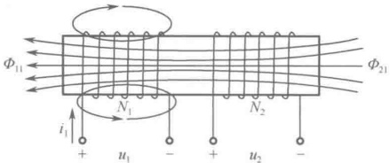

图 11-1 两个具有磁耦合的线圈
 

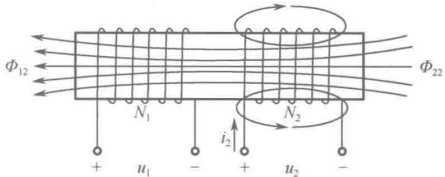

图 11-2 两个具有磁耦合的线圈
 

<!-- page: 296 -->

磁通  $ \Phi_{22}(t) $ 与  $ N_{2} $ 匝线圈（线圈 2 是密绕的）交链后产生自感磁通链  $ \Psi_{22}(t) $，即

$$  \Psi_{22}(t)=N_{2}\varPhi_{22}(t)   \tag*{（11-5）}$$

自感磁通链 $ \Psi_{22}(t) $与激励电流 $ i_{2}(t) $的关系为

$$  \Psi_{22}(t)=L_{2}i_{2}(t)   \tag*{（11-6）}$$

式中， $ L_{2} $ 称为线圈2的自感系数，对于线性时不变电感线圈， $ L_{2} $ 为常数。

如图 11-2 所示，磁通  $ \varPhi_{22}(t) $ 除了与线圈 2 交链，还有一部分磁通  $ \varPhi_{12}(t) $ 要与线圈 1（线圈 1 是密绕的）交链，在线圈 1 中产生互感磁通链  $ \varPsi_{12}(t) $，即

$$  \Psi_{12}(t)=N_{1}\varPhi_{12}(t)   \tag*{（11-7）}$$

互感磁通链 $ \psi_{12}(t) $与激励电流 $ i_{2}(t) $的关系为

$$  \Psi_{12}(t)=M_{12}i_{2}(t)   \tag*{（11-8）}$$

式中， $ M_{12} $ 称为线圈2对线圈1的互感系数，对于线性时不变电感线圈， $ M_{12} $ 为常数。

对于线性时不变电感线圈，互感系数具有如下关系：

$$  M_{12}=M_{21}\triangleq M   \tag*{（11-9）}$$

综上所述，如图11-3所示，若在线圈1中通以时变电流 $ i_{1}(t) $，同时在线圈2中通以时变电流 $ i_{2}(t) $，则在以上各种假设之下，线圈1中的总磁通链为

$$  \Psi_{1}(t)=\Psi_{11}(t)\pm\Psi_{12}(t)=N_{1}\varPhi_{11}\pm N_{1}\varPhi_{12}=L_{1}i_{1}(t)\pm M i_{2}(t)   \tag*{（11-10）}$$

而线圈2中的总磁通链则为

$$  \boldsymbol{\Psi}_{2}(t)=\boldsymbol{\Psi}_{22}(t)\pm\boldsymbol{\Psi}_{21}(t)=N_{2}\boldsymbol{\varPhi}_{22}\pm N_{2}\boldsymbol{\varPhi}_{21}=L_{2}\boldsymbol{i}_{2}(t)\pm M\boldsymbol{i}_{1}(t)   \tag*{（11-11）}$$

上述两式中的“±”号的取法为：线圈上的电流方向与所产生的磁通方向符合右手螺旋定则时取“+”，否则取“-”。

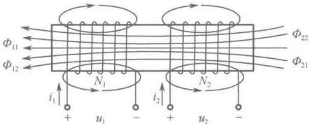

图 11-3 两个具有磁耦合的线圈
 

根据法拉第电磁感应定律，各线圈上的电压与电流满足关联参考方向时，线圈1上的电压 $ u_{1}(t) $和线圈2上的电压 $ u_{2}(t) $分别为

$$  \left\{\begin{aligned}u_{1}(t)&=\frac{\mathrm{d}\psi_{1}(t)}{\mathrm{d}t}=L_{1}\frac{\mathrm{d}i_{1}(t)}{\mathrm{d}t}\pm M\frac{\mathrm{d}i_{2}(t)}{\mathrm{d}t}=u_{11}(t)\pm u_{12}(t)\\ u_{2}(t)&=\frac{\mathrm{d}\psi_{2}(t)}{\mathrm{d}t}=L_{2}\frac{\mathrm{d}i_{2}(t)}{\mathrm{d}t}\pm M\frac{\mathrm{d}i_{1}(t)}{\mathrm{d}t}=u_{22}(t)\pm u_{21}(t)\end{aligned}\right.   \tag*{（11-12）}$$

式中， $ u_{11}(t) $ 和  $ u_{22}(t) $ 分别称为线圈 1 和线圈 2 的自感电压， $ u_{12}(t) $ 和  $ u_{21}(t) $ 分别称为线圈 1 中和线圈 2 中的互感电压。

在正弦电流激励下，式（11-12）可写成相量形式

$$  \left\{\begin{aligned}\dot{U}_{1}&=\mathrm{j}\omega L_{1}\dot{I}_{1}\pm\mathrm{j}\omega M\dot{I}_{2}\\ \dot{U}_{2}&=\mathrm{j}\omega L_{2}\dot{I}_{2}\pm\mathrm{j}\omega M\dot{I}_{1}\end{aligned}\right.   \tag*{（11-13）}$$

<!-- page: 297 -->

#### 11.1.2 磁耦合系数

从以上分析可知，磁耦合线圈的相互作用和联系是通过互感磁链来完成的，其相互作用的强弱显然与磁通  $ \Phi_{21}(t) $ 交链于线圈2或磁通  $ \Phi_{12}(t) $ 交链于线圈1的数量有关，通常采用耦合系数k来描述两个线圈之间耦合的紧密程度，并且定义耦合系数

$$  k=\frac{M}{\sqrt{L_{1}L_{2}}}   \tag*{(11-14)}$$

一般情况下，电流  $ i_{1}(t) $ 产生的磁通  $ \varPhi_{11}(t) $ 并非全部都与线圈2交链，电流  $ i_{2}(t) $ 产生的磁通  $ \varPhi_{22}(t) $ 也并非全部都与线圈1交链，未交链的部分称为漏磁通。

根据式（11-14）的定义可得

 $$ k^{2}=\frac{M^{2}}{L_{1}L_{2}}=\frac{M_{12}M_{21}}{L_{1}L_{2}}=\frac{\left(\frac{N_{1}\varPhi_{12}}{i_{2}}\right)\left(\frac{N_{2}\varPhi_{21}}{i_{1}}\right)}{\left(\frac{N_{1}\varPhi_{11}}{i_{1}}\right)\left(\frac{N_{2}\varPhi_{22}}{i_{2}}\right)}=\frac{\varPhi_{12}\varPhi_{21}}{\varPhi_{11}\varPhi_{22}} $$ 

即

 $$ k= {\sqrt{\frac{\Phi_{12}\Phi_{21}}{\Phi_{11}\Phi_{22}}}} $$ 

因为总有  $ \varPhi_{12} \leq \varPhi_{22} $ 和  $ \varPhi_{21} \leq \varPhi_{11} $，所以  $ k \leq 1 $。显然，k 值越大，漏磁通就越小。当 k = 1 时， $ \varPhi_{12} = \varPhi_{22} $ 和  $ \varPhi_{21} = \varPhi_{11} $，无漏磁通，称其为全耦合；若  $ 0 < k \leq 0.5 $，称线圈为松耦合；若  $ 0.5 < k < 1 $，则称线圈为紧耦合。

#### 11.1.3 同名端的概念

显然，式（11-12）中互感电压的正负取值不仅与电流方向有关，还与线圈的相对位置和绕向有关。但是，实际的耦合电感器一般都封装有外壳，很难看到其内部结构。为了让使用者能够简便直观地确定互感电压的正负取值，通常采用在耦合电感器上标记同名端的方法。

同名端的标记规定：如果电流 $ i_{1}(t) $和 $ i_{2}(t) $分别从两耦合电感线圈的某端钮流入，使其互感磁链与自感磁链的参考方向相同，则这两个端钮就称为同名端。

同名端可用圆点“●”、星号“*”、三角形“△”等符号标记，对于多个分别具有耦合关系的电感线圈，不同的同名端应使用不同的标记符号，如图11-4所示。

另一种同名端的标记规定：两耦合电感线圈中，一个电感线圈上电流的流入端与电流在另一线圈上产生的互感电压的参考方向正极性端称为同名端。显然，这种规定适用于两耦合电感线圈中，有一个电感线圈开路的情况，如图11-5所示。

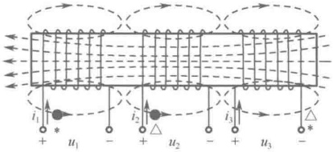

图 11-4 标记了同名端的耦合电感线圈
 

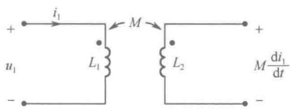

图 11-5 同名端的另一种标记规定
 

根据以上规定可知：如果电流  $ i_{1}(t) $ 和  $ i_{2}(t) $ 分别从两耦合电感线圈的同名端流入，则互感电压取正，否则取负。或者，一个电感线圈上电流的流入端与该电流在另一线圈上产生的互感电压的

<!-- page: 298 -->

参考方向正极性端处于同名端时，互感电压取正，否则取负。

### 11.2 含耦合电感电路的分析

本节将从两耦合电感线圈的串联和并联入手，解决耦合电感线圈的等效计算问题，然后对含有耦合电感线圈的电路进行分析。

#### 11.2.1 两耦合电感线圈的串联

两耦合电感线圈的串联有两种方式，一种是顺接串联，即将两耦合电感线圈的异名端相接，如图11-6所示。

由图11-6所示电路可得

$$  \begin{aligned}u(t)&=u_{1}(t)+u_{2}(t)=\left[L_{1}\frac{\mathrm{d}i(t)}{\mathrm{d}t}+M\frac{\mathrm{d}i(t)}{\mathrm{d}t}\right]+\left[L_{2}\frac{\mathrm{d}i(t)}{\mathrm{d}t}+M\frac{\mathrm{d}i(t)}{\mathrm{d}t}\right]\\&=(L_{1}+L_{2}+2M)\frac{\mathrm{d}i(t)}{\mathrm{d}t}=L\frac{\mathrm{d}i(t)}{\mathrm{d}t}\end{aligned}   \tag*{（11-15）}$$

式中， $ L=(L_{1}+L_{2}+2M) $，称为顺接串联的等效电感。

另一种接法是反接串联，即将两耦合电感线圈的同名端相接，如图11-7所示。

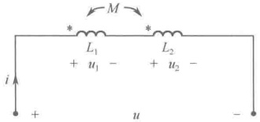

图 11-6 两耦合电感线圈的顺接串联
 

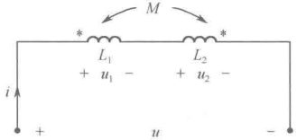

图 11-7 两耦合电感线圈的反接串联
 

由图 11-7 所示电路可得

$$  \begin{aligned}u(t)&=u_{1}(t)+u_{2}(t)=\left[L_{1}\frac{\mathrm{d}i(t)}{\mathrm{d}t}-M\frac{\mathrm{d}i(t)}{\mathrm{d}t}\right]+\left[L_{2}\frac{\mathrm{d}i(t)}{\mathrm{d}t}-M\frac{\mathrm{d}i(t)}{\mathrm{d}t}\right]\\&=(L_{1}+L_{2}-2M)\frac{\mathrm{d}i(t)}{\mathrm{d}t}=L^{\prime}\frac{\mathrm{d}i(t)}{\mathrm{d}t}\end{aligned}   \tag*{（11-16）}$$

式中， $ L'=(L_{1}+L_{2}-2M) $，称为反接串联的等效电感。

对于实际的耦合电感元件来说，必定有 $ (L_{1}+L_{2}-2M)\geq0 $，即

$$  M\leq\frac{L_{1}+L_{2}}{2}   \tag*{（11-17）}$$

式（11-17）说明，两耦合电感线圈的互感应不大于两自感的算术平均值。

例 11-1 两互感线圈串联接在 220V、50Hz 的正弦电源上，当顺接时测得  $ I = 2.5A $， $ P = 62.5W $，反接时测得  $ P' = 250W $，求互感  $ M $。

解：如图11-8所示，当两互感线圈顺接串联时，由 $ P=RI^{2} $，得 $ R=P/I^{2}=62.5/2.5^{2}=10\Omega $。并且，由 $ I=\frac{U}{\sqrt{R^{2}+X^{2}}}=2.5A $，得顺接时的感抗 $ X=\sqrt{\frac{U^{2}}{I^{2}}-R^{2}}=\sqrt{88^{2}-10^{2}}=87.4\Omega $。

如图 11-9 所示，当两互感线圈反接串联时，由  $ P' = RI'^{2} $，得  $ I' = \sqrt{P' / R} = \sqrt{250 / 10} = 5A $。并且，由  $ I' = \frac{U}{\sqrt{R^{2} + X'^{2}}} = 5A $ 得反接时的感抗  $ X' = \sqrt{\frac{U^{2}}{I'^{2}} - R^{2}} = \sqrt{44^{2} - 10^{2}} = 42.8\Omega $。

<!-- page: 299 -->

因为两互感线圈顺接时的感抗  $ X=\omega(L_{1}+L_{2}+2M) $，两互感线圈反接时的感抗  $ X'=\omega(L_{1}+L_{2}-2M) $，所以

 $$ X-X^{\prime}=4\omega M $$ 

故

 $$ M=\frac{X-X^{\prime}}{4\omega}=\frac{87.4-42.8}{4\times314}=35.5mH $$ 

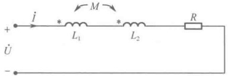

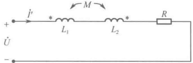

图11-8 例11-1图之一
 

图 11-9 例 11-1 图之二
 

#### 11.2.2 两耦合电感线圈的并联

两耦合电感线圈的并联也有两种方式，一种是同名端相接的并联，如图11-10所示。由图11-10所示电路可得

 $$ \left\{\begin{aligned}u(t)&=L_{1}\frac{\mathrm{d}i_{1}(t)}{\mathrm{d}t}+M\frac{\mathrm{d}i_{2}(t)}{\mathrm{d}t}\\ u(t)&=L_{2}\frac{\mathrm{d}i_{2}(t)}{\mathrm{d}t}+M\frac{\mathrm{d}i_{1}(t)}{\mathrm{d}t}\end{aligned}\right. $$ 

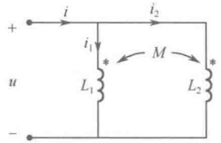

图 11-10 两耦合电感线圈的同名端相接的并联
 

将 $ i_{2}=i-i_{1} $代入上式，可得

 $$ \left\{\begin{aligned}u(t)=(L_{1}-M)\frac{\mathrm{d}i_{1}(t)}{\mathrm{d}t}+M\frac{\mathrm{d}i(t)}{\mathrm{d}t}\\ u(t)=-(L_{2}-M)\frac{\mathrm{d}i_{1}(t)}{\mathrm{d}t}+L_{2}\frac{\mathrm{d}i(t)}{\mathrm{d}t}\end{aligned}\right. $$ 

消去式中的 $ \frac{\mathrm{d}i_{1}(t)}{\mathrm{d}t} $，可得

 $$ \begin{align*}(L_{1}+L_{2}-2M)u(t)&=(L_{1}L_{2}-M^{2})\frac{\mathrm{d}i(t)}{\mathrm{d}t}\\u(t)&=\frac{L_{1}L_{2}-M^{2}}{L_{1}+L_{2}-2M}\frac{\mathrm{d}i(t)}{\mathrm{d}t}=L\frac{\mathrm{d}i(t)}{\mathrm{d}t}\end{align*} $$ 

即

式中， $ L=\frac{L_{1}L_{2}-M^{2}}{L_{1}+L_{2}-2M} $，称为同名端相接并联的等效电感。对于实际的耦合电感元件，必定有 $ (L_{1}+L_{2}-2M)>0 $ 和  $ L_{1}L_{2}\geq M^{2} $，即

$$  M<\frac{L_{1}+L_{2}}{2}\quad 并且 \quad M\leq\sqrt{L_{1}L_{2}}   \tag*{（11-19）}$$

两耦合电感线圈的另一种并联方式是异名端相接的并联，如图11-11所示。

与上述推导相同，由图11-11所示电路可得

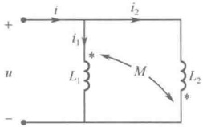

$$  u(t)=\frac{L_{1}L_{2}-M^{2}}{L_{1}+L_{2}+2M}\frac{\mathrm{d}i(t)}{\mathrm{d}t}=L^{\prime}\frac{\mathrm{d}i(t)}{\mathrm{d}t}   \tag*{（11-20）}$$

图 11-11 两耦合电感线圈的 异名端相接的并联
 

式中， $ L'=\frac{L_{1}L_{2}-M^{2}}{L_{1}+L_{2}+2M} $，称为异名端相接并联的等效电感。对于实际的耦合电感元件，必定有 $ L_{1}L_{2}\geq M^{2} $，即

$$  M\leq\sqrt{L_{1}L_{2}}   \tag*{（11-21）}$$

<!-- page: 300 -->

很容易证明： $ \frac{L_1 + L_2}{2} > \sqrt{L_1 L_2} $。因此，综合式（11-17）、式（11-19）和式（11-21）可知，当 $ M \leq \sqrt{L_1 L_2} $时，必定有 $ M < \frac{L_1 + L_2}{2} $。即，两耦合电感线圈的互感应不大于两自感的几何平均值。耦合系数k的定义正是出于此，即定义互感M与其最大极限值 $ \sqrt{L_1 L_2} $之比为耦合系数k。

#### 11.2.3 两耦合电感线圈的受控源等效去耦

在含有耦合电感元件的电路中，为了简化分析，常常将耦合电感元件等效为无互感的元件，这种做法称为耦合电感元件的等效去耦，使用受控电压源进行两耦合电感线圈的等效去耦是其中的方法之一。

（1）如图11-12所示，设电流从同名端流入耦合电感线圈。

线圈两端的电压分别为

$$  \left.\begin{aligned}u_{1}(t)&=L_{1}\frac{\mathrm{d}i_{1}(t)}{\mathrm{d}t}+M\frac{\mathrm{d}i_{2}(t)}{\mathrm{d}t}\\ u_{2}(t)&=L_{2}\frac{\mathrm{d}i_{2}(t)}{\mathrm{d}t}+M\frac{\mathrm{d}i_{1}(t)}{\mathrm{d}t}\end{aligned}\right\}   \tag*{（11-22）}$$

等式右边第二项可视为受控电压源，于是可得到使用受控电压源的等效去耦电路，如图 11-13 所示。

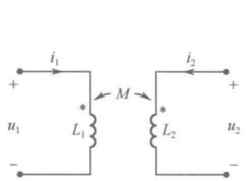

图 11-12 电流从同名端流入耦合电感线圈
 

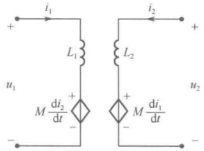

图 11-13 使用受控电压源的等效去耦
 

（2）如图11-14所示，设电流从异名端流入耦合电感线圈。线圈两端的电压分别为

$$  \left.\begin{aligned}u_{1}(t)&=L_{1}\frac{\mathrm{d}i_{1}(t)}{\mathrm{d}t}-M\frac{\mathrm{d}i_{2}(t)}{\mathrm{d}t}\\ u_{2}(t)&=L_{2}\frac{\mathrm{d}i_{2}(t)}{\mathrm{d}t}-M\frac{\mathrm{d}i_{1}(t)}{\mathrm{d}t}\end{aligned}\right\}   \tag*{（11-23）}$$

等式右的第二项可视为受控电压源，于是可得到使用受控电压源的等效去耦电路，如图 11-15 所示。

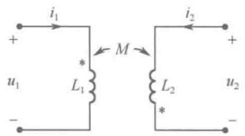

图 11-14 电流从异名端流入耦合电感线圈
 

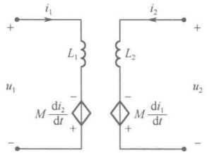

图 11-15 使用受控电压源的等效去耦
 

<!-- page: 301 -->

#### 11.2.4 两耦合电感线圈的 T 形等效去耦

如果两耦合电感线圈具有一个相连接的公共端子，这样的两耦合电感元件可以等效为 T 形无互感元件。

（1）如图11-16所示，设两耦合电感线圈具有同名端相连接的公共端子。

线圈两端的电压分别为

$$  \begin{align*}u_{1}(t)&=L_{1}\frac{\mathrm{d}i_{1}(t)}{\mathrm{d}t}+M\frac{\mathrm{d}i_{2}(t)}{\mathrm{d}t}=L_{1}\frac{\mathrm{d}i_{1}(t)}{\mathrm{d}t}+M\frac{\mathrm{d}i_{1}(t)}{\mathrm{d}t}+M\frac{\mathrm{d}i_{2}(t)}{\mathrm{d}t}-M\frac{\mathrm{d}i_{1}(t)}{\mathrm{d}t}\\&=(L_{1}-M)\frac{\mathrm{d}i_{1}(t)}{\mathrm{d}t}+M\frac{\mathrm{d}[i_{1}(t)+i_{2}(t)]}{\mathrm{d}t}\end{align*}   \tag*{（11-24）}$$

$$  \begin{align*}u_{2}(t)&=L_{2}\frac{\mathrm{d}i_{2}(t)}{\mathrm{d}t}+M\frac{\mathrm{d}i_{1}(t)}{\mathrm{d}t}=L_{2}\frac{\mathrm{d}i_{2}(t)}{\mathrm{d}t}+M\frac{\mathrm{d}i_{2}(t)}{\mathrm{d}t}+M\frac{\mathrm{d}i_{1}(t)}{\mathrm{d}t}-M\frac{\mathrm{d}i_{2}(t)}{\mathrm{d}t}\\&=(L_{2}-M)\frac{\mathrm{d}i_{2}(t)}{\mathrm{d}t}+M\frac{\mathrm{d}[i_{1}(t)+i_{2}(t)]}{\mathrm{d}t}\end{align*}   \tag*{（11-25）}$$

根据上述两式的电压与电流关系，图 11-16 所示的电路可等效为图 11-17 所示的 T 形等效去耦电路。

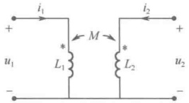

图 11-16 同名端相连接的耦合电感线圈
 

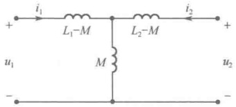

图 11-17 T 形等效去耦电路之一
 

（2）如图11-18所示，设两耦合电感线圈具有异名端相连接的公共端子。

$$  \begin{align*}u_{1}(t)&=L_{1}\frac{\mathrm{d}i_{1}(t)}{\mathrm{d}t}-M\frac{\mathrm{d}i_{2}(t)}{\mathrm{d}t}=L_{1}\frac{\mathrm{d}i_{1}(t)}{\mathrm{d}t}+M\frac{\mathrm{d}i_{1}(t)}{\mathrm{d}t}-M\frac{\mathrm{d}i_{2}(t)}{\mathrm{d}t}-M\frac{\mathrm{d}i_{1}(t)}{\mathrm{d}t}\\&=(L_{1}+M)\frac{\mathrm{d}i_{1}(t)}{\mathrm{d}t}-M\frac{\mathrm{d}[i_{1}(t)+i_{2}(t)]}{\mathrm{d}t}\end{align*}   \tag*{（11-26）}$$

$$  \begin{align*}u_{2}(t)&=L_{2}\frac{\mathrm{d}i_{2}(t)}{\mathrm{d}t}-M\frac{\mathrm{d}i_{1}(t)}{\mathrm{d}t}=L_{2}\frac{\mathrm{d}i_{2}(t)}{\mathrm{d}t}+M\frac{\mathrm{d}i_{2}(t)}{\mathrm{d}t}-M\frac{\mathrm{d}i_{1}(t)}{\mathrm{d}t}-M\frac{\mathrm{d}i_{2}(t)}{\mathrm{d}t}\\&=(L_{2}+M)\frac{\mathrm{d}i_{2}(t)}{\mathrm{d}t}-M\frac{\mathrm{d}[i_{1}(t)+i_{2}(t)]}{\mathrm{d}t}\end{align*}   \tag*{（11-27）}$$

根据上述两式的电压与电流关系，图 11-18 所示的电路可等效为图 11-19 所示的 T 形等效去耦电路。

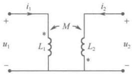

图 11-18 异名端相连接的耦合电感线圈
 

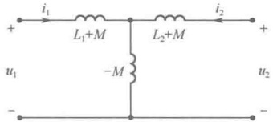

图 11-19 T 形等效去耦电路之二
 

例 11-2 电路如图 11-20 所示，已知  $ R_1 = 10\Omega $， $ R_2 = 6\Omega $， $ \omega L_1 = 15\Omega $， $ \omega L_2 = 12\Omega $， $ \omega M = 8\Omega $， $ 1/\omega C = 9\Omega $，正弦电压有效值  $ U = 120V $，求各支路电流。

<!-- page: 302 -->

解：对电路进行 T 形等效去耦，如图 11-21 所示。

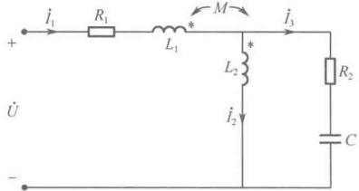

图11-20 例11-2图之一
 

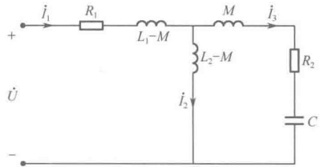

图 11-21 例 11-2 图之二
 

令电压 $ \dot{U} $为参考相量，即 $ \dot{U}=120\angle0^{\circ} $，可得KCL方程

和 KVL 方程

 $$ \dot{I}_{1}=\dot{I}_{2}+\dot{I}_{3} $$ 

 $$ [R_{1}+\mathrm{j}\omega(L_{1}-M)]\dot{I}_{1}+\mathrm{j}\omega(L_{2}-M)\dot{I}_{2}=\dot{U} $$ 

 $$ \left(R_{2}+\mathrm{j}\omega M+\frac{1}{\mathrm{j}\omega C}\right)\dot{I}_{3}-\mathrm{j}\omega(L_{2}-M)\dot{I}_{2}=0 $$ 

联立求解上述方程，可得  $ \dot{I}_{1}=7.67\angle-39.3^{\circ}(A) $， $ \dot{I}_{2}=6.92\angle-75.4^{\circ}(A) $， $ \dot{I}_{3}=4.58\angle23.7^{\circ}(A) $。

#### 11.2.5 含有耦合电感线圈的电路分析

对于含有耦合电感线圈的电路，一般可采用支路法、回路法等系统方法进行分析计算，值得注意的是，在分析计算含有耦合电感线圈的电路时，不宜使用节点法。

例 11-3 图 11-22 所示为利用交流电桥测量互感 M 的原理图，调节  $ R_{2} $、 $ R_{4} $ 使电桥平衡，求证此时有  $ M=\frac{L_{1}}{1+R_{2}/R_{4}} $。

解：电桥平衡时，a 点与 b 点等电位，于是有

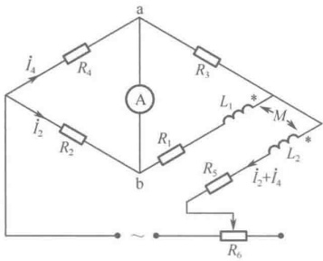

 $$ R_{4}\dot{I}_{4}=R_{2}\dot{I}_{2} $$ 

解得

图 11-22 利用交流电桥测量互感 M 的原理图
 

 $$ (R_{1}+\mathrm{j}\omega L_{1})\dot{I}_{2}-\mathrm{j}\omega M(\dot{I}_{2}+\dot{I}_{4})=R_{3}\dot{I}_{4} $$ 

 $$ \left\{R_{1}+\mathrm{j}\left[\omega L_{1}-\omega M\left(1+\frac{R_{2}}{R_{4}}\right)\right]\right\}\dot{I}_{2}=\frac{R_{2}R_{3}}{R_{4}}\dot{I}_{2} $$ 

所以有

 $$ \left\{\begin{aligned}R_{1}&=\frac{R_{2}R_{3}}{R_{4}}\\ \omega L_{1}&-\omega M\left(1+\frac{R_{2}}{R_{4}}\right)=0\end{aligned}\right. $$ 

即

 $$ M=\frac{L_{1}}{1+R_{2}/R_{4}} $$ 

例 11-4 电路如图 11-23 所示，已知  $ R_1 = 5\Omega $， $ X_1 = 40\Omega $， $ R_2 = 10\Omega $， $ X_2 = 90\Omega $， $ R_3 = 20\Omega $， $ X_3 = 80\Omega $，耦合系数  $ k = 33.3\% $，当开关 S 不闭合时，电压表为 100V，试求：

（1）电流表读数和外加电压的有效值；

（2）开关 S 闭合后，电压表和电流表读数。

解：（1）开关 S 不闭合时，因为  $ M = k\sqrt{L_1L_2} $， $ \omega M = k\sqrt{\omega L_1\omega L_2} $，即

 $$ X_{M}=k\sqrt{X_{1}X_{2}} $$

<!-- page: 303 -->

所以  $ X_{M}=33.3\%\times\sqrt{40\times90}=20\Omega $

由 $ \dot{U}_{2}=\mathrm{j}X_{M}\dot{I}_{1} $，可得 $ U_{2}=X_{M}I_{1} $，所以，电流

表读数为

 $$ I_{1}=\frac{U_{2}}{X_{M}}=\frac{100}{20}=5A $$ 

又因为此时 $ \dot{U}_{1}=(R+\mathrm{j}\omega L_{1})\dot{I}_{1} $，所以，外加电压为

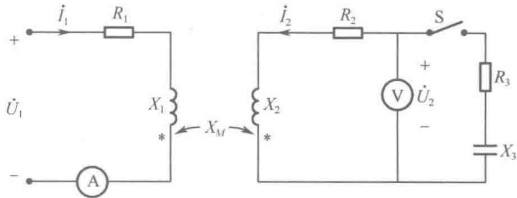

图 11-23 例 11-4 图
 

 $$ U_{1}=I_{1}\sqrt{R_{1}^{2}+X_{1}^{2}}=5\times\sqrt{5^{2}+40^{2}}=201.6V $$ 

（2）开关 S 闭合后，若以电压  $ \dot{U}_{1} $ 为参考相量，可得下列方程：

 $$ \begin{cases}(R_{1}+\mathrm{j}X_{1})\dot{I}_{1}+\mathrm{j}X_{M}\dot{I}_{2}=\dot{U}_{1}\ $ R_{2}+R_{3}+\mathrm{j}X_{2}-\mathrm{j}X_{3})\dot{I}_{2}+\mathrm{j}X_{M}\dot{I}_{1}=0\end{cases} $$ 

即

 $$ \begin{cases}(5+\mathrm{j}40)\dot{I}_{1}+\mathrm{j}20\dot{I}_{2}=201.6\angle0^\circ\ $ 30+\mathrm{j}10)\dot{I}_{2}+\mathrm{j}20\dot{I}_{1}=0\end{cases} $$ 

解得

 $$ \dot{I}_{1}=5.06\angle-64.8^{\circ}(A),\quad\dot{I}_{2}=3.2\angle-173.15^{\circ}(A) $$ 

并且

 $$ U_{2}=I_{2}\sqrt{R_{3}^{2}+X_{3}^{2}}=3.2\times\sqrt{20^{2}+80^{2}}=263.9V $$ 

因此，电流表读数为  $ I_{1}=5.06A $，电压表读数为  $ U_{2}=263.9V $。

例 11-5 电路如图 11-24 所示，试求电源角频率  $ \omega $ 为何值时，电路中的功率表读数为零。

解：因为功率表的读数应是 a-b 端口的有功功率，即电路中电阻消耗的功率。由功率表读数为零可知，电路中电阻上的电流为零，即图中的 d、b 两点等电位，于是有

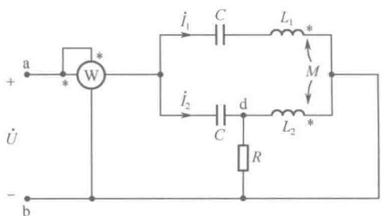

 $$ \left\{\begin{aligned}&\left(\frac{1}{\mathrm{j}\omega C}+\mathrm{j}\omega L_{1}\right)\dot{I}_{1}+\mathrm{j}\omega M\dot{I}_{2}=\dot{U}\\ &\frac{1}{\mathrm{j}\omega C}\dot{I}_{2}=\dot{U}\\ &\mathrm{j}\omega L_{2}\dot{I}_{2}+\mathrm{j}\omega M\dot{I}_{1}=0\end{aligned}\right. $$ 

图 11-24 例 11-5 图
 

联立求解得

 $$ -\omega L_{2}C\dot{U}+\frac{\omega M(1+\omega^{2}MC)\dot{U}}{\omega L_{1}-\frac{1}{\omega C}}=0 $$ 

即

 $$ \omega=\sqrt{\frac{L_{2}+M}{L_{1}L_{2}C-M^{2}C}} $$ 

注意：此式中的分母应满足 $ L_{1}L_{2}-M^{2}\neq0 $，这表明图11-24中的两个耦合电感线圈不能全耦合。

### 11.3 空心变压器

变压器是由两个（或两个以上）具有磁耦合的线圈构成，实现能量（或信号）从一个电路传输到另一个电路的器件。能量（或信号）的输入端线圈称为变压器的一次线圈（俗称原边线圈或初级线圈），能量（或信号）的输出端线圈称为变压器的二次线圈（俗称副边线圈或次级线圈）。

<!-- page: 304 -->

所谓空心变压器是相对于铁心变压器而言的。用具有高磁导率的铁磁材料作为心子而制成的变压器就是铁心变压器，这类变压器的耦合系数很高，属于紧耦合，常用来进行电力或能量传输。而以非铁磁材料作为心子制成的变压器称为空心变压器，这类变压器的耦合系数较小，属于松耦合，广泛应用在高频电路或测量仪器中。空心变压器的电路模型如图11-25所示。

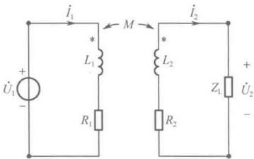

#### 11.3.1 空心变压器的一次侧等效电路

图 11-25 空心变压器的电路模型
 

由图 11-25 所示电路可得方程

 $$ \left\{\begin{aligned}(\boldsymbol{R}_{1}+\mathrm{j}\omega\boldsymbol{L}_{1})\dot{\boldsymbol{I}}_{1}-\mathrm{j}\omega\boldsymbol{M}\dot{\boldsymbol{I}}_{2}=\dot{\boldsymbol{U}}_{1}\\ (\boldsymbol{R}_{2}+\mathrm{j}\omega\boldsymbol{L}_{2})\dot{\boldsymbol{I}}_{2}+\boldsymbol{Z}_{\mathrm{L}}\dot{\boldsymbol{I}}_{2}-\mathrm{j}\omega\boldsymbol{M}\dot{\boldsymbol{I}}_{1}=0\end{aligned}\right. $$ 

令  $ Z_L = R_L + jX_L $， $ Z_{11} = R_1 + jX_1 $， $ Z_M = j\omega M = jX_M $， $ Z_{22} = R_2 + j\omega L_2 + R_L + jX_L = (R_2 + R_L) + j(X_2 + X_L) \triangleq R_{22} + jX_{22} $，则上式可写成

$$  \left\{\begin{aligned}Z_{11}\dot{I}_{1}-Z_{M}\dot{I}_{2}=\dot{U}_{1}\\ Z_{22}\dot{I}_{2}-Z_{M}\dot{I}_{1}=0\end{aligned}\right.   \tag*{（11-28）}$$

求解式（11-28）可得

$$  \dot{I}_{1}=\frac{\dot{U}_{1}}{Z_{11}-\frac{Z^{2}_{M}}{Z_{22}}}=\frac{\dot{U}_{1}}{Z_{11}+\frac{X^{2}_{M}}{Z_{22}}}   \tag*{（11-29）}$$

$$  \dot{I}_{2}=\frac{Z_{M}\dot{U}_{1}}{Z_{11}}\times\frac{1}{Z_{22}-\frac{Z_{M}^{2}}{Z_{11}}}=\frac{Z_{M}\dot{U}_{1}}{Z_{11}}\times\frac{1}{Z_{22}+\frac{X_{M}^{2}}{Z_{11}}}   \tag*{（11-30）}$$

由式（11-29）可知：空心变压器的二次侧对一次侧的影响，是在一次侧增加了一个串联复阻抗 $ \left(-\frac{Z_{M}^{2}}{Z_{22}}\right) $，由于

$$  -\frac{Z_{M}^{2}}{Z_{22}}=\frac{X_{M}^{2}}{Z_{22}}=\frac{X_{M}^{2}}{R_{22}+\mathrm{j}X_{22}}=\frac{X_{M}^{2}R_{22}}{R_{22}^{2}+X_{22}^{2}}-\mathrm{j}\frac{X_{M}^{2}X_{22}}{R_{22}^{2}+X_{22}^{2}}\triangleq R_{1}^{\prime}+\mathrm{j}X_{1}^{\prime}=Z_{1}^{\prime}   \tag*{（11-31）}$$

为此，将  $ Z_{1}^{\prime} $ 称为一次侧的引入阻抗（或反映阻抗），并将  $ R_{1}^{\prime} $ 称为一次侧的引入电阻（或反映电阻），将  $ X_{1}^{\prime} $ 称为一次侧的引入电抗（或反映电抗）。由于引入电阻  $ R_{1}^{\prime} $ 恒为正值，说明空心变压器所吸收的功率是一次侧通过磁耦合向二次侧输送的功率。而由于引入电抗  $ X_{1}^{\prime} $ 为负值，说明引入电抗的性质与二次侧电抗的性质相反。

根据式（11-29），可得出空心变压器从一次侧看进去的等效电路，如图11-26所示。

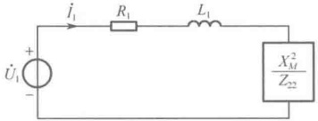

#### 11.3.2 空心变压器的二次侧等效电路

图 11-26 空心变压器的一次侧的等效电路
 

由式（11-30）可以得知：空心变压器的一次侧对二次

侧的影响，是在二次侧增加了一个串联复阻抗 $ \left(-\frac{Z_{M}^{2}}{Z_{11}}\right) $，并产生了一个等效电源 $ \left(\frac{Z_{M}\dot{U}_{1}}{Z_{11}}\right) $，由于

$$  -\frac{Z_{M}^{2}}{Z_{11}}=\frac{X_{M}^{2}}{Z_{11}}=\frac{X_{M}^{2}}{R_{1}+\mathrm{j}X_{1}}=\frac{X_{M}^{2}R_{1}}{R_{1}^{2}+X_{1}^{2}}-\mathrm{j}\frac{X_{M}^{2}X_{1}}{R_{1}^{2}+X_{1}^{2}}\triangleq R_{2}^{\prime}+\mathrm{j}X_{2}^{\prime}=Z_{2}^{\prime}   \tag*{（11-32）}$$

<!-- page: 305 -->

类似地，也可得到二次侧的引入阻抗（或反映阻抗） $ Z_{2}^{\prime} $，以及二次侧的引入电阻（或反映电阻） $ R_{2}^{\prime} $ 和二次侧的引入电抗（或反映电抗） $ X_{2}^{\prime} $。同时，根据式（11-30），可得出空心变压器从二次侧看进去的等效电路，如图11-27所示。

例 11-6 电路如图 11-28 所示，已知  $ R_1 = 2\Omega $， $ R_2 = 1\Omega $， $ L_1 = 2H $， $ L_2 = 1H $， $ M = 0.5H $， $ u_1 = \sqrt{2} \cos t $，试问 a、b 端负载  $ Z_L $ 为何值时可获最大功率，最大功率为多少？

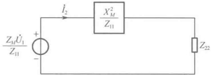

图 11-27 空心变压器的二次侧的等效电路
 

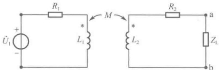

图 11-28 例 11-6 图之一
 

解：根据空心变压器的二次侧等效电路，可将图11-28所示电路等效为图11-29所示电路，再进一步简化为图11-30所示电路。在图11-30所示电路中，

 $$ \dot{U}_{oc}=\frac{Z_{M}\dot{U}_{1}}{Z_{1}}=0.177\angle45^{\circ} $$ 

 $$ Z_{i}=Z_{2}+\frac{X_{M}^{2}}{Z_{1}}=(R_{2}+\mathrm{j}\omega L_{2})+\frac{(\omega M)^{2}}{R_{1}+\mathrm{j}\omega L_{1}}=(1+\mathrm{j})+\frac{0.25}{2+\mathrm{j}2}=1.0625+\mathrm{j}0.9375 $$ 

所以，将图11-30所示电路与戴维宁等效电路进行比较可知，当 $ Z_{L}=Z_{i}^{*}=1.0625-j0.9375 $时，负载 $ Z_{L} $可获最大功率（最佳匹配）。

最大功率

 $$ P_{L max}=\frac{U_{oc}^{2}}{4R_{i}}=\frac{0.177^{2}}{4\times1.0625}=7.37mW $$ 

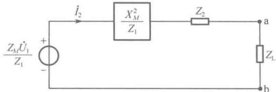

图 11-29 例 11-6 图之二
 

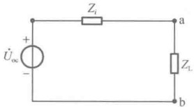

图 11-30 例 11-6 图之三
 

例 11-7 空心变压器电路如图 11-31 所示，已知  $ R_1 = 5\Omega $， $ R_2 = 15\Omega $， $ \omega L_1 = 30\Omega $， $ \omega L_2 = 120\Omega $， $ \omega M = 50\Omega $， $ \dot{U}_1 = 10\angle 0^\circ $，负载  $ R_L = 100\Omega $，试求  $ \dot{U}_2 $ 和此空心变压器的效率  $ \eta $，并分析变压器二

 $$ P_{2} $$ 

解：由图11-31所示电路可知

 $$ Z_{11}=R_{1}+\mathrm{j}\omega L_{1}=5+\mathrm{j}30=30.4\angle80.54^{\circ} $$ 

 $$ Z_{22}=R_{2}+\mathrm{j}\omega L_{2}+R_{\mathrm{L}}=115+\mathrm{j}120=166.2\angle46.2^{\circ} $$ 

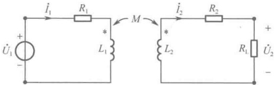

图 11-31 例 11-7 图
 

于是可得一次侧的引入阻抗

 $$ Z_{1}^{\prime}=\frac{X_{M}^{2}}{Z_{22}}=\frac{\left(\omega M\right)^{2}}{Z_{22}}=\frac{2500}{166.2\angle46.2^{\circ}}=15.04\angle-46.2^{\circ}=10.409-j10.86 $$ 

由此可见，二次侧的感性阻抗反映到一次侧成为容性阻抗（-j10.86）。

因为

<!-- page: 306 -->

$$ \dot{I}_{1}=\frac{\dot{U}_{1}}{Z_{11}+Z_{1}^{\prime}}=\frac{10}{(5+j30)+(10.409-j10.86)}=\frac{10}{24.57\angle51.2^{\circ}}=0.407\angle-51.2^{\circ} $$ 

 $$ \dot{I}_{2}=\frac{Z_{M}\dot{U}_{1}}{Z_{11}}\times\frac{1}{Z_{22}+\frac{X_{M}^{2}}{Z_{11}}}=\frac{500\angle90^{\circ}}{4082\angle97.4^{\circ}}=0.122\angle-7.4^{\circ} $$ 

所以

 $$ \dot{U}_{2}=R_{L}\dot{I}_{2}=12.2\angle-7.4^{\circ} $$ 

 $$ \eta=\frac{P_{\mathrm{L}}}{P_{1}}=\frac{R_{\mathrm{L}}I_{2}^{2}}{(R_{1}+R_{1}^{\prime})I_{1}^{2}}\frac{100\times0.122^{2}}{(5+10.409)\times0.407^{2}}=58.3\% $$ 

变压器二次侧消耗的有功功率

 $$ P_{2}=(R_{2}+R_{\mathrm{L}})I_{2}^{2}=(R_{2}+R_{\mathrm{L}})\frac{\left(\omega M\right)^{2}I_{1}^{2}}{\left(R_{2}+R_{\mathrm{L}}\right)^{2}+\left(\omega L_{2}\right)^{2}}=\frac{X_{M}^{2}R_{22}}{R_{22}^{2}+X_{22}^{2}}I_{1}^{2}=R_{1}^{\prime}I_{1}^{2} $$ 

可见，变压器二次侧消耗的有功功率实际上是一次侧的引入电阻  $ R_{1}^{\prime} $ 通过磁耦合传到二次侧的。也就是说，一次侧的引入电阻  $ R_{1}^{\prime} $ 吸收的功率并未损耗在一次侧，而是通过磁耦合传到二次侧后被二次侧所消耗。

### 11.4 理想变压器

从实际的变压器器件来看，变压器耦合的紧密程度取决于如下几方面因素：

（1）变压器中铁心的磁性能；

（2）组成变压器的各个线圈的匝数；

（3）组成变压器的各个线圈之间的相对位置和实际尺寸。

空心变压器是典型的松耦合变压器，而铁心变压器一般都是紧耦合变压器。

#### 11.4.1 理想变压器的定义

考察如图 11-32 所示的全耦合变压器。

从图 11-32 所示电路可以看到，假设一次线圈和二次线圈的电阻为零，可得方程

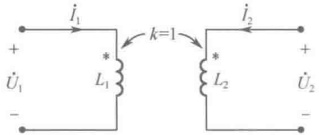

$$  \left.\begin{array}{l}\dot{U}_{1}=\mathrm{j}\omega L_{1}\dot{I}_{1}+\mathrm{j}\omega M\dot{I}_{2}\\ \dot{U}_{2}=\mathrm{j}\omega L_{2}\dot{I}_{2}+\mathrm{j}\omega M\dot{I}_{1}\end{array}\right\}   \tag*{（11-33）}$$

由式（11-33）可得

图 11-32 全耦合变压器
 

$$  \dot{I}_{1}=\frac{\dot{U}_{1}-\mathrm{j}\omega M\dot{I}_{2}}{\mathrm{j}\omega L_{1}}   \tag*{（11-34）}$$

$$  \dot{U}_{2}=\mathrm{j}\omega L_{2}\dot{I}_{2}+\mathrm{j}\omega M\frac{\dot{U}_{1}-\mathrm{j}\omega M\dot{I}_{2}}{\mathrm{j}\omega L_{1}}=\frac{M}{L_{1}}\dot{U}_{1}+\mathrm{j}\omega L_{2}\dot{I}_{2}-\mathrm{j}\omega M^{2}\frac{\dot{I}_{2}}{L_{1}}   \tag*{（11-35）}$$

在全耦合的情况下，耦合系数  $ k = \frac{M}{\sqrt{L_1L_2}} = 1 $，即  $ M = \sqrt{L_1L_2} $，因此，式（11-35）可写成

$$  \dot{U}_{2}=\frac{\sqrt{L_{1}L_{2}}}{L_{1}}\dot{U}_{1}+\mathrm{j}\omega L_{2}\dot{I}_{2}-\mathrm{j}\omega\frac{L_{1}L_{2}}{L_{1}}\dot{I}_{2}=\frac{\sqrt{L_{1}L_{2}}}{L_{1}}\dot{U}_{1}=\sqrt{\frac{L_{2}}{L_{1}}}\dot{U}_{1}   \tag*{（11-36）}$$

由式（11-1）和式（11-2）可知，当线圈1中通以交变电流 $ i_{1}(t) $时，产生的自感磁通链 $ \Psi_{11}(t)=N_{1}\Phi_{11}(t)=L_{1}i_{1}(t) $，产生的互感磁通链 $ \Psi_{21}(t)=N_{2}\Phi_{21}(t)=M i_{1}(t) $。

<!-- page: 307 -->

同样，由式（11-5）和式（11-6）可知，当线圈2中通以交变电流 $ i_2(t) $时，产生的自感磁通链 $ \Psi_{22}(t)=N_2\Phi_{22}(t)=L_2i_2(t) $，产生的互感磁通链 $ \Psi_{12}(t)=N_1\Phi_{12}(t)=M i_2(t) $。

于是，可得

$$  L_{1}=\frac{N_{1}\varPhi_{11}(t)}{i_{1}(t)}=M\frac{N_{1}\varPhi_{11}(t)}{N_{2}\varPhi_{21}(t)}=M\frac{N_{1}}{N_{2}}\left[ 注：全耦合时 \varPhi_{11}(t)=\varPhi_{21}(t)\right]   \tag*{（11-37）}$$

$$  L_{2}=\frac{N_{2}\varPhi_{22}(t)}{i_{2}(t)}=M\frac{N_{2}\varPhi_{22}(t)}{N_{1}\varPhi_{12}(t)}=M\frac{N_{2}}{N_{1}}\left[ 注：全耦合时 \varPhi_{22}(t)=\varPhi_{12}(t)\right]   \tag*{（11-38）}$$

式（11-36）可写成

$$  \dot{U}_{2}=\sqrt{\frac{L_{2}}{L_{1}}}\dot{U}_{1}=\frac{N_{2}}{N_{1}}\dot{U}_{1}   \tag*{（11-39）}$$

式（11-39）说明：忽略线圈电阻的全耦合变压器的输入电压与输出电压之比（ $ \dot{U}_1/\dot{U}_2 $）等于相应的两个耦合线圈的匝数之比（ $ N_1/N_2 $）。

若用 n 表示变压器的匝数比，即定义  $ n = N_{1}/N_{2} $，则式（11-39）可写成

$$  \dot{U}_{1}=n\dot{U}_{2}   \tag*{（11-40）}$$

式（11-40）描述了在忽略线圈电阻并且假设变压器为全耦合的理想化条件下，变压器的输入电压与输出电压之间的关系。对于电路分析来说，还希望知道变压器的输入电流与输出电流之间的关系。

再看式（11-34），在全耦合的情况下，该式可写成

 $$ \dot{I}_{1}=\frac{\dot{U}_{1}-\mathrm{j}\omega M\dot{I}_{2}}{\mathrm{j}\omega L_{1}}=\frac{\dot{U}_{1}}{\mathrm{j}\omega L_{1}}-\frac{M}{L_{1}}\dot{I}_{2}=\frac{\dot{U}_{1}}{\mathrm{j}\omega L_{1}}-\frac{\sqrt{L_{1}L_{2}}}{L_{1}}\dot{I}_{2}=\frac{\dot{U}_{1}}{\mathrm{j}\omega L_{1}}-\sqrt{\frac{L_{2}}{L_{1}}}\dot{I}_{2} $$ 

这时，如果假设  $ L_1 $ 和  $ L_2 $ 满足理想化条件： $ L_1 \to \infty $， $ L_2 \to \infty $，且  $ L_1/L_2 = $ 常数。再运用式（11-37）和式（11-38）的结论，则有

$$  \dot{I}_{1}=-\sqrt{\frac{L_{2}}{L_{1}}}\dot{I}_{2}=-\frac{N_{2}}{N_{1}}\dot{I}_{2}=-\frac{1}{n}\dot{I}_{2}   \tag*{（11-41）}$$

式（11-41）是添加了理想化条件后得到的变压器输入电流与输出电流之间的关系。综上所述，在获得变压器的电压关系和电流关系时，引入了下列理想化条件：

（1）变压器本身无损耗（线圈电阻为零）；

（2）变压器为全耦合状态（耦合系数k=1）；

（3）变压器的自感系数  $ L_{1} $ 和  $ L_{2} $ 均为无穷大，但  $ L_{1}/L_{2} $ 为常数。

将满足上述理想化条件，电压与电流关系符合式（11-40）和式（11-41）的变压器称为理想变压器。

理想变压器的模型符号如图 11-33 所示。

在时域中，理想变压器的电压方程与电流方程为

$$  u_{1}(t)=n u_{2}(t)   \tag*{（11-42）}$$

 $$ i_{1}(t)=-\frac{1}{n}i_{2}(t) $$ 

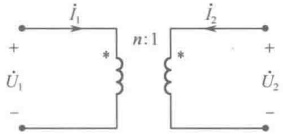

图 11-33 理想变压器
 

#### 11.4.2 理想变压器的特性

前面所描述的理想变压器的电压和电流关系是在图 11-32 所示的规定参考方向下得出的，一般情况下，理想变压器的电压和电流关系应为

$$  u_{1}(t)=\pm n u_{2}(t)   \tag*{（11-44）}$$

<!-- page: 308 -->

$$  i_{1}(t)=\mp\frac{1}{n}i_{2}(t)   \tag*{（11-45）}$$

式中的正、负号取决于电压、电流的参考方向与同名端的关系：如果 $ \dot{U}_{1} $、 $ \dot{U}_{2} $的参考方向的极性与同名端相同，则电压特性方程取“+”号，反之取“-”号；如果 $ \dot{I}_{1} $、 $ \dot{I}_{2} $的参考方向同时流入（或流出）同名端，则电流特性方程取“-”号，反之取“+”号。

理想变压器的特性方程适用于时变电压和时变电流，且与频率无关，但对直流却不适用，这是因为用于模拟理想变压器的实际变压器的工作原理是电磁感应定律。

由式（11-44）和式（11-45）可知，理想变压器的一次线圈和二次线圈消耗的瞬时功率之和为

$$  p=u_{1}i_{1}+u_{2}i_{2}=nu_{2}\left(-\frac{1}{n}i_{2}\right)+u_{2}i_{2}=0   \tag*{（11-46）}$$

并且，理想变压器在任意时刻所存储的能量为

$$  W=\int_{-\infty}^{t}p(\xi)\mathrm{d}\xi=0   \tag*{（11-47）}$$

因此，理想变压器既不消耗能量也不存储能量，纯为信号变换器。

例 11-8 电路如图 11-34 所示，已知理想变压器的匝数比 n=3， $ \dot{I}_{s1} $、 $ \dot{I}_{s2} $ 为同频率电流源， $ \dot{I}_{s1}=1A $， $ \dot{I}_{s2}=j4A $， $ R_{1}=3\Omega $， $ R_{2}=0.5\Omega $，问两个电流源发出的有功功率各为多少？

解：列写节点 a 和节点 b 的节点方程，并代入理想变压器的特性方程，可得

 $$ \frac{1}{R_{\mathrm{l}}}\dot{U}_{\mathrm{a}}=\dot{I}_{\mathrm{s l}}-\dot{I}_{\mathrm{l}}=\dot{I}_{\mathrm{s l}}+\frac{\dot{I}_{2}}{n},\quad\frac{1}{R_{2}}\dot{U}_{\mathrm{b}}=\frac{1}{n R_{2}}\dot{U}_{\mathrm{a}}=\dot{I}_{\mathrm{s}2}-\dot{I}_{2} $$ 

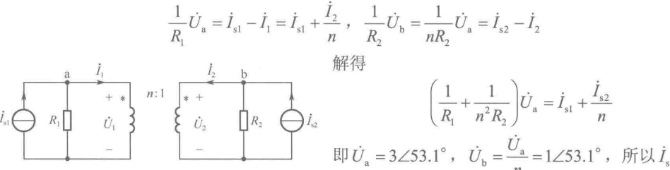

图 11-34 例 11-8 图
 

即 $ \dot{U}_{a}=3\angle53.1^{\circ} $， $ \dot{U}_{b}=\frac{U_{a}}{n}=1\angle53.1^{\circ} $，所以 $ \dot{I}_{sl} $发出的有功功率为

 $$ P_{s1}=Re[\dot{U}_{a}\dot{I}_{s1}^{*}]=Re[3\angle53.1^{\circ}]=1.8W $$ 

 $ \dot{I}_{s2} $ 发出的有功功率为  $ P_{s2} = \mathrm{Re}[\dot{U}_{\mathrm{b}}\dot{I}_{s2}^{*}] = \mathrm{Re}[1\angle53.1^{\circ}\times(-\mathrm{j}4)] = 3.2\,\mathrm{W} $

于是可知，两个电流源发出的总的有功功率为5W，全部被两个电阻消耗。

一次侧电阻  $ R_{1} $ 消耗的有功功率为  $ P_{1}=\frac{U_{a}^{2}}{R_{1}}=\frac{9}{3}=3W $

二次侧电阻  $ R_{2} $ 消耗的有功功率为  $ P_{2}=\frac{U_{b}^{2}}{R_{2}}=\frac{1}{0.5}=2W $

这说明，变压器将二次侧的  $ \dot{I}_{s2} $ 发出的一部分有功功率（1.2W）通过磁耦合传给了一次侧供电阻  $ R_{1} $ 消耗。

#### 11.4.3 理想变压器的阻抗变换性质

如图 11-35 所示，如果在理想变压器的二次侧接上阻抗  $ Z_{L} $，则从一次侧看进去的入端阻抗为

$$  Z_{i}=\frac{\dot{U}_{1}}{\dot{I}_{1}}=\frac{n\dot{U}_{2}}{-\frac{1}{n}\dot{I}_{2}}=n^{2}\frac{\dot{U}_{2}}{-\dot{I}_{2}}=n^{2}Z_{L}   \tag*{（11-48）}$$

可见，理想变压器具有阻抗变换的功能，它将负载阻抗的模扩大了 $ n^{2} $倍，而阻抗角不变。阻抗 $ Z_{i} $

<!-- page: 309 -->

称为二次侧折合到一次侧的折合阻抗，在电子技术中，常使用折合阻抗来实现最大功率传输时所要求的共模匹配。

同理，如图 11-36 所示，如果在理想变压器的一次侧接上阻抗  $ Z_{1} $，则从二次侧看进去的入端阻抗为

$$  Z_{0}=\frac{\dot{U}_{2}}{\dot{I}_{2}}=\frac{\frac{1}{n}\dot{U}_{1}}{-n\dot{I}_{1}}=\frac{1}{n^{2}}\frac{\dot{U}_{1}}{-\dot{I}_{1}}=\frac{Z_{1}}{n^{2}}   \tag*{（11-49）}$$

可见，理想变压器所具有的阻抗变换功能将输入端负载阻抗的模变成了 $ 1/n^{2} $倍，而阻抗角不变。阻抗 $ Z_{0} $称为一次侧折合到二次侧的折合阻抗。

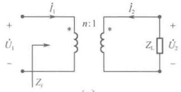

(a)
 

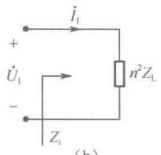

图 11-35 理想变压器从二次侧折合到一次侧的阻抗变换
 

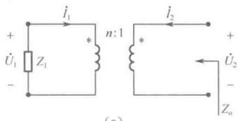

(a)
 

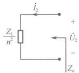

(b)
 

图 11-36 理想变压器从一次侧折合到二次侧的阻抗变换
 

例 11-9 电路如图 11-37 所示，为使  $ 10\Omega $ 负载电阻获得最大功率，试确定理想变压器的变比 n 为多少？

解：对图11-37所示电路进行等效变换，可得图11-38、图11-39所示电路。然后将二次侧电阻折合到一次侧，可得图11-40所示电路。

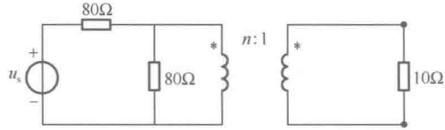

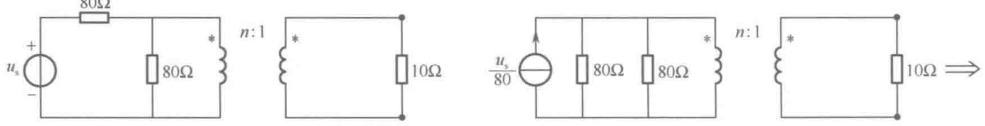

图 11-37 例 11-9 图之一
 

图 11-38 例 11-9 图之二
 

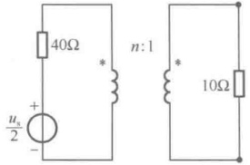

图 11-39 例 11-9 图之三
 

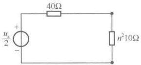

图 11-40 例 11-9 图之四
 

当 $ 10n^{2}=40 $时，负载电阻可获最大功率，所以理想变压器的变比n=2。

更进一步，如图11-41（a）所示，如果在理想变压器的一次侧接上阻抗 $ Z_{1} $和激励源 $ \dot{U}_{s} $，则从二次侧看进去的折合等效电路如图11-41（b）所示。

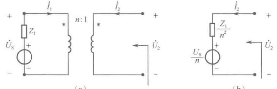

(a)
 

（b）
 

图 11-41 理想变压器从一次侧折合到二次侧的等效电路
 

请读者自行推导论证。

<!-- page: 310 -->

### 11.5 计算机仿真

##### 例 11-10 等效电感法测定耦合电感线圈的同名端

两个绕组顺接串联时的等效电感值为  $ L_{顺接}=L_1+L_2+2M $，两个绕组反接串联时的等效电感值为  $ L_{反接}=L_1+L_2-2M $。顺接串联时的电流  $ I_{顺接}=U/X_{L_{顺接}} $，反接串联时的电流  $ I_{反接}=U/X_{L_{反接}} $，由于  $ L_{顺接}>L_{反接} $，因此  $ I_{顺接}<I_{反接} $。根据此原理，可以用试验法测定耦合电感线圈的同名端。

为了方便验证，耦合电感线圈选取已经标注好同名端的非线性变压器 NLT_PQ_4_10，图 11-42（a）中的原、副边两个绕组为顺接串联，图 11-42（b）为反接串联，连接同样的电压源，观察电流表中电流的读数。测量结果表明，图（a）中的电流读数小于图（b）中的电流读数，说明图（a）中的线圈为正向串联，即 1、3（2、4）为同名端，图（b）中的线圈为反向串联，即 1、4（2、3）为同名端。

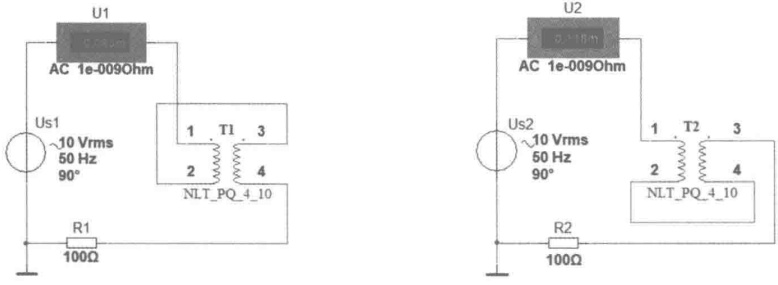

（a）顺接串联
 

（b）反接串联
 

图 11-42 等效电感法判断同名端
 

##### 例 11-11 互感系数 M 和耦合系数 k 的测量

耦合电感两绕组顺接串联时的等效电感值为  $ L_{顺接}=L_1+L_2+2M $，反接串联时的等效电感值为  $ L_{后控}=L_1+L_2-2M $，可推导出  $ M=(L_{顺接}-L_{后控})/4 $。

如图 11-43（a）所示，在参数对话框中设置 T1 的参数如下：初级线圈电感自感系数为 50mH，次级线圈电感自感系数为 10mH，耦合系数为 0.5。

图 11-43（b）、（c）分别为测量顺接串联和反接串联的耦合电感线圈互感系数的仿真电路，仿真运行后，根据电流表的度数可知  $ I_{顺接}=0.386A $， $ I_{反接}=0.846A $，由此可算出

互感系数： $ M=\left(\frac{10}{0.386}-\frac{10}{0.846}\right)/(4\times100\pi)\approx11.21\mathrm{mH} $

耦合系数： $ k=M/\sqrt{L_1L_2}=11.21\times10^{-3}/\sqrt{10\times10^{-3}\times50\times10^{-3}}=0.5013\approx0.5 $

此结果与最初的耦合电感线圈参数设置是一致的。

##### 例 11-12 理想变压器的仿真实验

##### （1）电压比与电流比

图 11-44（a）是对理想变压器进行变压的仿真电路，图中理想变压器 T1 的匝数比 n=10，初级线圈接 220V、50Hz 交流电，次级线圈上的负载电阻为 1Ω。理想变压器的参数设置如下：初级线圈的自感系数为 100H，次级线圈的自感系数为 1H，耦合系数为 1。

<!-- page: 311 -->

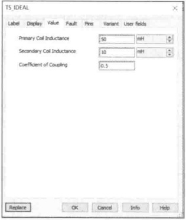

（a）理想变压器参数设置
 

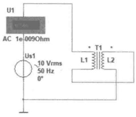

（b）顺接串联
 

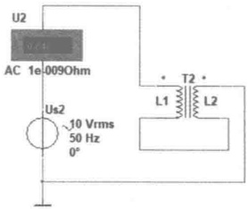

(c) 反接串联
 

图 11-43 互感系数和耦合系数的测量
 

由于理想变压器的匝数比  $ n=\sqrt{L_1/L_2}=\sqrt{100/1}=10 $ 。仿真运行后，由电压表和电流表的读数可以看出，初级电压为 220V，次级电压为 22V，初级电流为 0.22A。初级线圈阻抗  $ Z_1=U_1/I_1=220/0.22=1000\Omega $，次级线圈阻抗  $ Z_2=U_2/I_2=22/2.2=10\ \Omega $。仿真实验结果和理想变压器特性相符，即  $ U_1/U_2=N_1/N_2=10 $， $ I_1/I_2=N_2/N_1=1/10 $。变压器本身不耗能，理想变压器初级侧的输入功率等于次级侧的输出功率。功率  $ P_1=U_1I_1=220\times0.22=48.4W $；次级功率  $ P_2=U_2I_2=22\times2.2=48.4W $，与图 11-44（b）所示的测量结果一致。

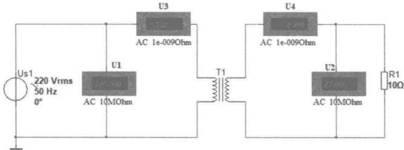

（a）理想变压器的变压、变流关系
 

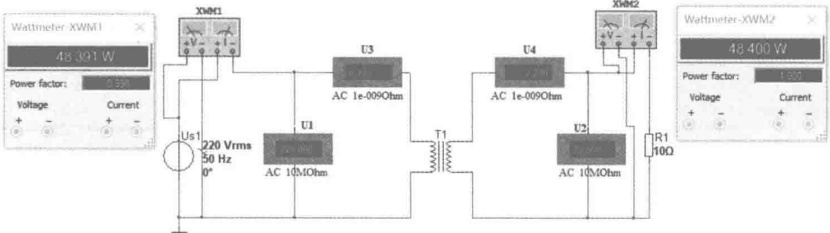

（b）理想变压器的功率
 

图 11-44 互感系数和耦合系数的测量
 

##### （2）阻抗变换

设置变压器的初级电感和次级电感分别为 100H 和 1H，使变压器的匝数比 n=10，图 11-45（a）中，变压器次级连接一个 10Ω 负载。用电流表测得初级电流为 0.22A。次级负载电阻折算到

<!-- page: 312 -->

初级的电阻为 $ 10\times10^{2}=1000\Omega $，将 $ 1000\Omega $电阻直接接在初级电源 $ U_{s2} $上，测得电流同样为0.22A，如图11-45（b）所示。

说明通过理想变压器连接负载  $ R_{L} $，相当于初级连接一个  $ n^{2}R_{L} $ 的负载。在电子线路中常常利用变压器的阻抗变换作用实现阻抗匹配，使负载获得最大功率。

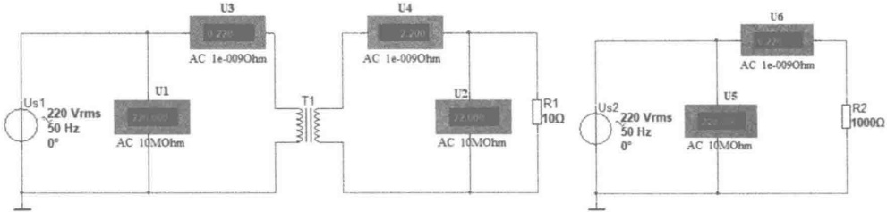

（a）理想变压器的阻抗变换
 

（b）折算到初级的电阻
 

图 11-45 理想变压器的阻抗变换
 

### 思考题

11-1 什么是互感的同名端？怎样按同名端符号分析电路？

11-2 如何测量互感 M，试举例说明测量方法。

11-3 为什么要将磁耦合系数 k 定义为 M 与  $ \sqrt{L_{1}L_{2}} $ 之比？这样定义的耦合系数反映了线圈耦合的紧密程度吗？

11-4 图11-19所示电路中出现了“-M”，这是否说明可以获得负电感？

11-5 图11-16和图11-18所示电路中，如果将电流 $ i_{2} $反向，会得出什么样的T形等效电路？

11-6 含有耦合电感线圈的电路可以采用节点法进行分析吗？为什么？

11-7 电子技术中采用的磁耦合器件（互感线圈或变压器）与电力系统中采用的变压器在作用上有何不同？

11-8 空心变压器和理想变压器都是由耦合电感组成的，两者有什么区别？

11-9 如图 11-46（a）、（b）所示电路中有两种 n 的标示，其含义有何不同？

(a)
 

(b)
 

图 11-46 不同标示的两种理想变压器
 

11-10 在图 11-32 所示电路中，将电流  $ \dot{I}_{2} $ 反向，式（11-40）和式（11-41）所描述的理想变压器的电压关系和电流关系会发生什么变化？

### 习题

11-1 电路如题 11-1 图所示，（1）试确定题 11-1 图（a）中两线圈的同名端；（2）若已知互

<!-- page: 313 -->

感  $ M = 0.04H $，流经  $ L_1 $ 的电流  $ i_1 $ 的波形如题 11-1 图（b）所示，试画出  $ L_2 $ 两端的互感电压  $ u_{21} $ 的波形；（3）如题 11-1 图（c）所示的两耦合线圈，已知  $ M = 0.0125H $， $ L_1 $ 中通过的电流  $ i_1 = 10\cos800t $（A），求  $ L_2 $ 两端的互感电压  $ u_{21} $。

题11-1图
 

11-2 有两组线圈，一组的参数为  $ L_{1}=0.01H $， $ L_{2}=0.04H $，M=0.01H；另一组的参数为  $ L_{1}^{\prime}=0.04H $， $ L_{2}^{\prime}=0.06H $，M'=0.02H。分别计算每组线圈的耦合系数，通过比较说明，是否互感大者耦合必紧？为什么？

11-3 题 11-3 图所示电路为测定耦合线圈同名端的一种实验电路，图中  $ U_{s} $ 为直流电源，如果在开关 S 闭合瞬间，电压表指针反向偏转，试确定两线圈的同名端，并说明理由。

11-4 将两个互相耦合的线圈串联起来接到 220V、50Hz 正弦电源上，顺接时测得  $ I = 2.7A $， $ P = 218.7W $，反接时测得  $ I' = 7A $，求两线圈的互感  $ M $。

11-5 求题 11-5 图所示两个电路的输入端复阻抗。

题11-3图
 

题11-5图
 

11-6 电路如题 11-6 图所示，已知  $ R_1=10\Omega $， $ R_2=6\Omega $， $ \omega L_1=15\Omega $， $ \omega L_2=12\Omega $， $ \omega M=8\Omega $， $ 1/\omega C=9\Omega $， $ U_s=120V $，求各支路电流。

11-7 电路如题 11-7 图所示，已知  $ R_1 = R_2 = 3\Omega $， $ \omega L_1 = \omega L_2 = 4\Omega $， $ \omega M = 2\Omega $， $ R = 5\Omega $， $ U_s = 10V $，求  $ U_0 $。

题11-6图
 

题11-7图
 

11-8 求题 11-8 图所示电路的戴维宁等效参数。

11-9 电路如题 11-9 图所示，三个串联线圈的电感为  $ L_{1}=L_{2}=L_{3}=10\,\text{mH} $，它们两两之间都存在互感，数值为  $ M_{12}=M_{23}=M_{31}=2\,\text{mH} $，试求电路的等效电感为多少？

<!-- page: 314 -->

题11-8图
 

题11-9图
 

11-10 电路如题 11-10 图所示，试求该电路的输入阻抗  $ Z_{AB} $。

题11-10图
 

11-11 如题 11-11 图所示两正弦稳态电路，求：（a）图中的端口等效电感；（b）图中的端口等效阻抗。

题11-11图
 

11-12 空心变压器处于题 11-12 图所示的正弦稳态电路中，已知  $ R_{1}=5\Omega $， $ R_{2}=10\Omega $， $ R_{3}=20\Omega $， $ X_{1}=40\Omega $， $ X_{2}=90\Omega $， $ X_{3}=80\Omega $， $ \omega M=20\Omega $，当开关 S 处于打开状态时，电压表读数为 100V，试求：（1）电流表的读数和外加电压有效值  $ U_{1} $；（2）开关 S 闭合后，电压表和电流表的读数。

题11-12图
 

11-13 空心变压器如题 11-13 图所示，已知  $ R_1=10\Omega $， $ R_2=40\Omega $， $ U_1=10V $， $ \omega=10^6\text{rad/s} $， $ L_1=L_2=1\text{mH} $， $ 1/\omega C_1=1/\omega C_2=1\text{k}\Omega $，为使  $ R_2 $ 获得最大功率，试求所需的  $ M $ 值、负载  $ R_2 $ 上的功率和  $ C_2 $ 上的电压。

题11-13图
 

<!-- page: 315 -->

11-14 电路如题 11-14 图所示，已知功率表的读数为 24W， $ u_s = 2\sqrt{2}\cos10t $ (V)，求互感  $ M $ 的值。

11-15 电路如题 11-15 图所示，已知  $ R_1=60\Omega $， $ \omega L=30\Omega $， $ 1/\omega C=8\Omega $， $ R_L=5\Omega $， $ \dot{U}_s=20\angle0^\circ(\text{V}) $，试求：当负载  $ R_L $ 获得最大功率时，理想变压器的变比  $ n $ 应为多大？最大功率为多少？

题11-14图
 

题11-15图
 

11-16 求题 11-16 图所示电路的输入阻抗  $ Z_{ab} $ 。

11-17 求题 11-17 图所示电路的输入阻抗  $ Z_{ab} $ 。

题11-16图
 

题11-17图
 

11-18 电路如题11-18图所示，已知 $ \dot{U}_s = 10\angle0^\circ\mathrm{V} $， $ Z_1 = (4 - j5)\Omega $， $ Z_2 = j3\Omega $，负载电阻 $ R_L = 2\Omega $，要使负载 $ R_L $获得最大功率，试确定理想变压器的变比 $ n $和 $ Z_C $值为多大？最大功率为多少？

11-19 电路如题 11-19 图所示，已知  $ i_S = 1.414 \cos 100t $ (A)，问负载阻抗  $ Z_L $ 为何值时可获得最大功率？最大功率是多少？

题11-18图
 

题11-19图
 

11-20 电路如题 11-20 图所示，已知  $ u_S = 200\sqrt{2}\cos10^6 t $ (V)，试求电流  $ i $ (t)、电压  $ u_2 $ (t) 及电路消耗的功率  $ P $。

11-21 电路如题 11-21 图所示，已知  $ U_S = 10\angle0^\circ\mathrm{V} $， $ R_1 = 1\Omega $， $ R_2 = 3\Omega $， $ \omega L = 4\Omega $， $ 1/\omega C = 6\Omega $， $ n=2 $，求  $ \dot{U}_2 $ 的值和  $ \dot{U}_S $ 发出的复功率。

题11-20图
 

题11-21图
 

