# 12-第12章 三相电路分析

[返回全书目录](../../README.md)

> PDF 页码：316–337

<!-- page: 316 -->

### 第12章 三相电路分析

电力系统广泛采用的供电方式是三相制。所谓三相制，是指由三个频率相同、相位不同的电源构成的供电系统。三相供电系统与单相供电系统相比具有更多的优越性。例如，在发电方面，相同尺寸的三相发电机比单相发电机发出的功率大；输电方面，在相同的输电电压和相同的线路功率损耗下，三相供电系统中三根输电线的导线截面积只是单相输电导线截面积的1/2，即可节约25%的导线材料；在用电方面，三相电动机比单相电动机运行更平稳、维护更方便、价格更低廉。

现代发电厂发出的都是正弦交流电，即构成三相供电系统的三个电源都是按正弦变化的，它们构成了正弦三相电源。而与正弦三相电源配套的负载和正弦三相电源一起构成了正弦三相电路（以下简称三相电路）。

本章将对三相电路的概念进行简要描述，并分别对正弦三相电源和三相负载的构成和特性进行分析，在此基础上，重点对正弦三相电源激励下的对称三相电路进行分析和计算。

### 12.1 三相电路的基本概念

#### 12.1.1 对称三相电源

# 1. 对称三相电源的定义

对称三相电源是由三个频率相同、幅值相同、相位互差 $ 120^{\circ} $的正弦电源组合而成的，这样的三相电源可用三相发电机制成。

三相发电机由定子（电枢）、转子、电枢绕组和励磁线圈等组成，定子的槽中间隔 $ 120^{\circ} $放置了三个各自独立的电枢绕组，如图12-1所示。这三个绕组的始端分别标记为A、B、C，三个绕组的末端分别标记为X、Y、Z。

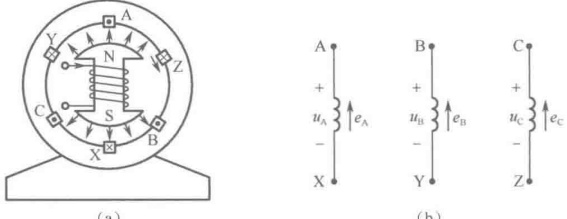

(a)
 

（b）
 

图 12-1 三个独立的电枢绕组
 

励磁线圈绕在转子上，并通以直流电励磁以产生一个恒定磁场。当转子旋转时，在三个电枢绕组中均感生出正弦电动势 $ (e_{A}, e_{B}, e_{C}) $，一般规定感应电动势的方向从末端指向始端。由于定子和电枢绕组的结构对称，所以，三个电动势的振幅相等，角频率也相等，只是相位互差 $ 120^{\circ} $，即

$$  \left.\begin{aligned}e_{\mathrm{A}}&=E_{\mathrm{m}}\cos\omega t\\ e_{\mathrm{B}}&=E_{\mathrm{m}}\cos(\omega t-120^{\circ})\\ e_{\mathrm{C}}&=E_{\mathrm{m}}\cos(\omega t-240^{\circ})=E_{\mathrm{m}}\cos(\omega t+120^{\circ})\end{aligned}\right\}   \tag*{（12-1）}$$

于是可得三相电压为

<!-- page: 317 -->

$$  \left.\begin{aligned}u_{\mathrm{A}}&=U_{\mathrm{m}}\cos\omega t\\ u_{\mathrm{B}}&=U_{\mathrm{m}}\cos(\omega t-120^{\circ})\\ u_{\mathrm{C}}&=U_{\mathrm{m}}\cos(\omega t-240^{\circ})=U_{\mathrm{m}}\cos(\omega t+120^{\circ})\end{aligned}\right\}   \tag*{（12-2）}$$

用相量表示的三相电压则为

$$  \left.\begin{array}{r}\dot{U}_{\mathrm{A}}=U\angle0^{\circ}\\ \dot{U}_{\mathrm{B}}=U\angle-120^{\circ}\\ \dot{U}_{\mathrm{C}}=U\angle120^{\circ}\end{array}\right\}   \tag*{（12-3）}$$

 $$ u_{\mathrm{A}}+u_{\mathrm{B}}+u_{\mathrm{C}}=0 $$ 

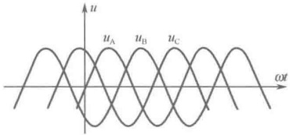

从上述电压关系可知

矢量图如图12-3所示。

$$  \dot{U}_{\mathrm{A}}+\dot{U}_{\mathrm{B}}+\dot{U}_{\mathrm{C}}=0   \tag*{（12-4）}$$

图 12-2 对称三相电压的波形图
 

或

# 2. 对称三相电源的相序

对称三相电源的相序就是三相电压和电流达到最大值的先后次序。如式（12-2）所描述的对称三相电源，若 A 相的电压和电流超前于 B 相的电压和电流  $ 120^{\circ} $，而 B 相的电压和电流超前于 C 相的电压和电流  $ 120^{\circ} $。

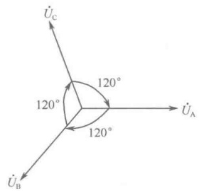

图 12-3 对称三相电压的矢量图
 

相的电压和电流 $ 120^{\circ} $，且C相的电压和电流又超前于A相的电压和电流 $ 120^{\circ} $，即电压和电流达到最大值的先后次序为 $ A\rightarrow B\rightarrow C\rightarrow A $，则将遵守这样次序的三相电源称为顺序（正序）三相电源。

如果 A 相的电压和电流滞后于 B 相的电压和电流  $ 120^{\circ} $，而 B 相的电压和电流滞后于 C 相的电压和电流  $ 120^{\circ} $，且 C 相的电压和电流又滞后于 A 相的电压和电流  $ 120^{\circ} $，即电压和电流达到最大值的先后次序为 C  $ \rightarrow $ B  $ \rightarrow $ A  $ \rightarrow $ C，则将这样的三相电源称为逆序（负序）三相电源。这时的电压表达式为

$$  \begin{cases}\dot{U}_{A}=U\angle0^{\circ}\\\dot{U}_{B}=U\angle120^{\circ}=U\angle-240^{\circ}\\\dot{U}_{C}=U\angle240^{\circ}=U\angle-120^{\circ}\end{cases}   \tag*{（12-6）}$$

在三相电路的分析和应用中，相序的概念是非常重要的。在实际工作中不能把相序搞错，为此，工业应用中常用油漆把 A 相母线涂成红色，B 相母线涂成绿色，C 相母线涂成黄色，以强调它们的相序。一般情况下，如无特别说明，三相电源电压的相序均指顺序（正序）。

# 3. 对称三相电源的连接

##### （1）对称三相电源的星形（Y）连接

将三个电源的末端 X、Y、Z 连接在一起，形成一个节点 O（通常将这个节点称为三相电源的中性点或中点），同时从三个电源的始端 A、B、C 向外引出三条线与输电线相联向负载供电，这样就构成了星形（Y）连接的三相电源，如图 12-4 所示。

连接成图12-4所示的三相电源称为三相三线制的星形（Y形）三相电源，通常将始端A、B、C向外引出的三条线称为三相电源的端线（俗称火线）。如果从中性点也向外引出的一条线，就成为了三相四线制的星形（ $ Y_{0} $形）三相电源。通常将中性点向外引出的这条线称为三相电源的中线或零线（俗称地线），如图12-5所示。

##### （2）对称三相电源的三角形（△）连接

将三个电源依次首尾相串接，形成一个封闭的三角形（闭合回路），同时从三角形的三个顶点向外引出三条线与输电线相联向负载供电，这样就构成了三角形（△形）连接的三相电源，如图12-6所示。

<!-- page: 318 -->

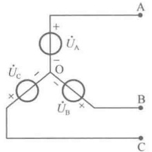

图 12-4 三相三线制的星形（Y）三相电源
 

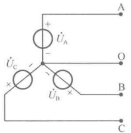

图 12-5 三相四线制的星形  $ (Y_{0}) $ 三相电源
 

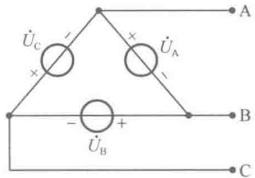

图 12-6 三角形（△）连接的三相电源
 

显然，三角形连接的三相电源只能引出去三条线（火线），属于无零线的三相电源。并且，虽然三个电源所构成的三角形形成了一个闭合回路，但由于三相电源对称，根据 KVL 有  $ \dot{U}_{A} + \dot{U}_{B} + \dot{U}_{C} = 0 $，所以在闭合回路中没有环流电流。由此可知，如果三角形连接的三个电源中有一个接反了，那么，闭合回路中将会出现很大的环流电流。此时，这三个电源不仅不能构成对称三相电源，而且还可能会因巨大的环流电流而烧坏电源设备。

#### 12.1.2 三相负载

与三相电源相配套，可接成星形或三角形的三个阻抗  $ Z_{A} $、 $ Z_{B} $、 $ Z_{C} $（或三个导纳）构成了一组三相负载，如图12-7所示。当这三个阻抗（或导纳）完全相等时，即  $ Z_{A}=Z_{B}=Z_{C} $，称其为对称三相负载。当然，为了与电源相匹配使用，三相星形负载也有三相三线制和三相四线制之分。

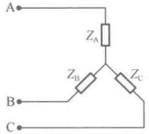

（a）三相三线制星形负载
 

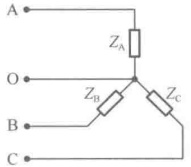

（b）三相四线制星形负载
 

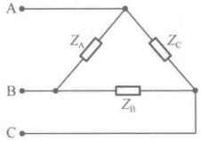

图 12-7 三相负载
 

（c）三相三线制三角形负载
 

#### 12.1.3 三相电路

# 1. 三相电路的基本接法

将三相电源与三相负载用输电线连接起来，就构成了三相电路。根据电源和负载所采用的连接方式，三相电路的连接方式有Y/Y、 $ Y_{0}/Y_{0} $、Y/ $ \triangle $、 $ \triangle/Y $、 $ \triangle/\triangle $五种基本接法，如图12-8所示。

# 2. 三相电路的相变量与线变量

##### （1）相变量与线变量的定义

三相电源是由三个电源所组成的，每个电源上的电压称为相电压，每个电源上的电流称为相电流。同样，三相负载是由三个阻抗所组成的，每个阻抗上的电压也称为相电压，每个阻抗上的电流也称为相电流，可以把所有的相电压和相电流统称为相变量。

在对称三相电路中，除了三相四线制的 $ Y_{0}/Y_{0} $系统多了一条中线外，不管电源和负载如何连接，它们之间均有从端点引出的三条输电线，输电线上的电流称为线电流，而输电线之间的电压则称为线电压。同样，也可以把所有的线电压和线电流统称为线变量。

对于三相四线制的  $ Y_{0}/Y_{0} $ 系统，若中线上有电流通过，则称为中线电流，电源中性点与负载中性点之间的电压称为中性点间电压。

<!-- page: 319 -->

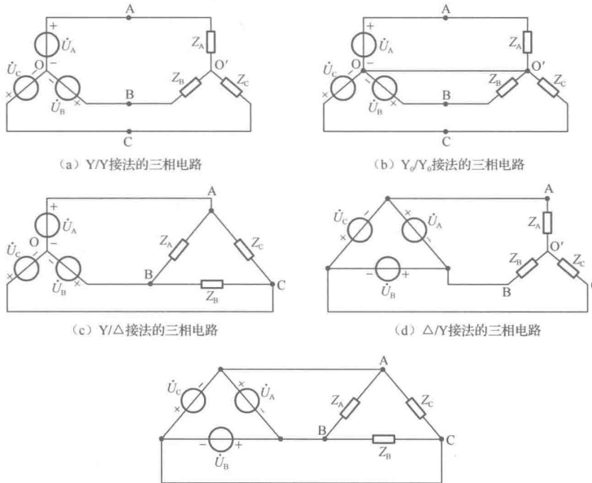

（a）Y/Y接法的三相电路
 

（b） $ Y_{0}/Y_{0} $ 接法的三相电路
 

（c）Y/ $ \triangle $ 接法的三相电路
 

(d)  $ \triangle/Y $ 接法的三相电路
 

(e)  $ \triangle/\triangle $ 接法的三相电路
 

图 12-8 三相电路的五种基本接法
 

##### （2）星形连接的对称三相电路中线变量与相变量的关系

如图 12-9 所示为星形连接的对称三相电路，设电源上的相电压分别为  $ \dot{U}_{A} $、 $ \dot{U}_{B} $、 $ \dot{U}_{C} $，电源上的相电流分别为  $ \dot{I}_{OA} $、 $ \dot{I}_{OB} $、 $ \dot{I}_{OC} $；设负载上的相电压分别为  $ \dot{U}_{A'O'} $、 $ \dot{U}_{B'O'} $、 $ \dot{U}_{C'O'} $；负载上的相电流分别为  $ \dot{I}_{A'O'} $、 $ \dot{I}_{B'O'} $、 $ \dot{I}_{C'O'} $；设线电压分别为  $ \dot{U}_{AB} $、 $ \dot{U}_{BC} $、 $ \dot{U}_{CA} $，线电流分别为  $ \dot{I}_{A} $、 $ \dot{I}_{B} $、 $ \dot{I}_{C} $。

由电路可知

$$  \dot{I}_{\mathrm{A}}=\dot{I}_{\mathrm{O A}}=\dot{I}_{\mathrm{A}^{\prime}\mathrm{O}^{\prime}},\quad\dot{I}_{\mathrm{B}}=\dot{I}_{\mathrm{O B}}=\dot{I}_{\mathrm{B}^{\prime}\mathrm{O}^{\prime}},\quad\dot{I}_{\mathrm{C}}=\dot{I}_{\mathrm{O C}}=\dot{I}_{\mathrm{C}^{\prime}\mathrm{O}^{\prime}}   \tag*{（12-7）}$$

这说明：星形连接的对称三相电路中，线电流等于相电流。

对于星形连接的三相三线制对称三相电路，根据 KCL 定律可知

$$  \dot{I}_{\mathrm{A}}+\dot{I}_{\mathrm{B}}+\dot{I}_{\mathrm{C}}=0   \tag*{（12-8）}$$

对于星形连接的三相四线制对称三相电路，由于 O、O' 等电位，根据 KCL 定律可知

$$  \dot{I}_{\mathrm{A}}+\dot{I}_{\mathrm{B}}+\dot{I}_{\mathrm{C}}=\dot{I}_{0}=0   \tag*{（12-9）}$$

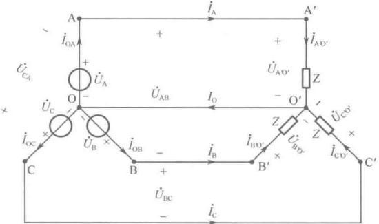

图 12-9 星形（ $ Y_{0} $）连接的对称三相电路
 

<!-- page: 320 -->

也就是说，星形连接的三相四线制对称三相电路的中线电流等于零。同时也说明，星形连接的对称三相电路中，三个线电流之和等于零。

其次，由图12-9的电路可得，线电压

$$  \left.\begin{aligned}\dot{U}_{\mathrm{AB}}=\dot{U}_{\mathrm{A}}-\dot{U}_{\mathrm{B}}=U\angle0^{\circ}-U\angle-120^{\circ}=\left(\frac{3}{2}+\mathrm{j}\frac{\sqrt{3}}{2}\right)\dot{U}_{\mathrm{A}}=\sqrt{3}\angle30^{\circ}\dot{U}_{\mathrm{A}}\\ \dot{U}_{\mathrm{BC}}=\dot{U}_{\mathrm{B}}-\dot{U}_{\mathrm{C}}=U\angle-120^{\circ}-U\angle120^{\circ}=\left(\frac{3}{2}+\mathrm{j}\frac{\sqrt{3}}{2}\right)\dot{U}_{\mathrm{B}}=\sqrt{3}\angle30^{\circ}\dot{U}_{\mathrm{B}}\\ \dot{U}_{\mathrm{CA}}=\dot{U}_{\mathrm{C}}-\dot{U}_{\mathrm{A}}=U\angle120^{\circ}-U\angle0^{\circ}=\left(\frac{3}{2}+\mathrm{j}\frac{\sqrt{3}}{2}\right)\dot{U}_{\mathrm{C}}=\sqrt{3}\angle30^{\circ}\dot{U}_{\mathrm{C}}\end{aligned}\right\}   \tag*{（12-10）}$$

于是可知：星形连接的对称三相电路中，各线电压超前于其相应的相电压 $ 30^{\circ} $，各线电压的有效值是其相应的相电压有效值的 $ \sqrt{3} $倍。

又因为

$$  \left.\begin{array}{r}\dot{U}_{\mathrm{AB}}=\sqrt{3}\angle30^{\circ}\dot{U}_{\mathrm{A}}=\sqrt{3}\angle30^{\circ}\times U\angle0^{\circ}=\sqrt{3}U\angle30^{\circ}\\ \dot{U}_{\mathrm{BC}}=\sqrt{3}\angle30^{\circ}\dot{U}_{\mathrm{B}}=\sqrt{3}\angle30^{\circ}\times U\angle-120^{\circ}=\sqrt{3}U\angle-90^{\circ}\\ \dot{U}_{\mathrm{CA}}=\sqrt{3}\angle30^{\circ}\dot{U}_{\mathrm{C}}=\sqrt{3}\angle30^{\circ}\times U\angle120^{\circ}=\sqrt{3}U\angle150^{\circ}\end{array}\right\}   \tag*{（12-11）}$$

所以还可得知：星形连接的对称三相电路中，各线电压的幅值相等，各线电压之间的相位差为 $ 120^{\circ} $

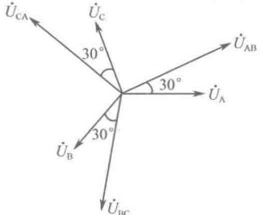

根据对称性的定义，可以说，星形连接的对称三相电路中，各线电压是对称的。图12-10描述了各线电压与相电压的矢量关系。

图 12-10 星形连接的对称三相电路中，线电压与相电压的矢量关系图
 

由式（12-10）可得，相电压

$$  \begin{aligned}&\dot{U}_{A}=\frac{\dot{U}_{AB}}{\sqrt{3}}\angle-30^{\circ}\\ &\dot{U}_{B}=\frac{\dot{U}_{BC}}{\sqrt{3}}\angle-30^{\circ}\\ &\dot{U}_{C}=\frac{\dot{U}_{CA}}{\sqrt{3}}\angle-30^{\circ}\\ \end{aligned}   \tag*{（12-12）}$$

图 12-9 中，负载上的相电压  $ \dot{U}_{A'O'} $、 $ \dot{U}_{B'O'} $、 $ \dot{U}_{CO'} $ 的推导类似于上述过程，结论是相同的。

（3）三角形连接的对称三相电路中线变量与相变量的关系

如图 12-11 所示为三角形连接的对称三相电路，设电源上的相电压分别为  $ \dot{U}_{A} $、 $ \dot{U}_{B} $、 $ \dot{U}_{C} $，电源上的相电流分别为  $ \dot{I}_{BA} $、 $ \dot{I}_{CB} $、 $ \dot{I}_{AC} $；负载上的相电压分别为  $ \dot{U}_{AB'} $、 $ \dot{U}_{BC'} $、 $ \dot{U}_{CA} $，负载上的相电流分别为  $ \dot{I}_{AB'} $、 $ \dot{I}_{BC'} $、 $ \dot{I}_{CA'} $；设线电压分别为  $ \dot{U}_{AB} $、 $ \dot{U}_{BC} $、 $ \dot{U}_{CA} $，线电流分别为  $ \dot{I}_{A} $、 $ \dot{I}_{B} $、 $ \dot{I}_{C} $。

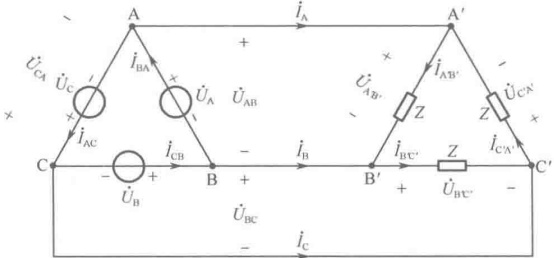

图 12-11 三角形连接的对称三相电路
 

<!-- page: 321 -->

由电路可知

$$  \dot{U}_{\mathrm{A B}}=\dot{U}_{\mathrm{A}}=\dot{U}_{\mathrm{A}^{\prime}\mathrm{B}^{\prime}},\quad\dot{U}_{\mathrm{B C}}=\dot{U}_{\mathrm{B}}=\dot{U}_{\mathrm{B}^{\prime}\mathrm{C}^{\prime}},\quad\dot{U}_{\mathrm{C A}}=\dot{U}_{\mathrm{C}}=\dot{U}_{\mathrm{C}^{\prime}\mathrm{A}^{\prime}}   \tag*{（12-13）}$$

这说明：三角形连接的对称三相电路中，线电压等于相电压。

由式（12-5）已知 $ \dot{U}_{A} + \dot{U}_{B} + \dot{U}_{C} = 0 $，所以有

$$  \dot{U}_{\mathrm{AB}}+\dot{U}_{\mathrm{BC}}+\dot{U}_{\mathrm{CA}}=0   \tag*{（12-14）}$$

这也就是说，三角形连接的对称三相电路中，三个线电压之和等于零。

其次，由图12-11的电路可得，线电流

$$  \left.\begin{array}{l}\dot{I}_{\mathrm{A}}=\dot{I}_{\mathrm{BA}}-\dot{I}_{\mathrm{AC}}\\ \dot{I}_{\mathrm{B}}=\dot{I}_{\mathrm{CB}}-\dot{I}_{\mathrm{BA}}\\ \dot{I}_{\mathrm{C}}=\dot{I}_{\mathrm{AC}}-\dot{I}_{\mathrm{CB}}\end{array}\right\}   \tag*{（12-15）}$$

在对称三相电源中，当相电压对称时，相电流也对称。于是设 $ \dot{I}_{BA}=I\angle0^{\circ} $，则 $ \dot{I}_{CB}=I\angle-120^{\circ} $， $ \dot{I}_{AC}=I\angle120^{\circ} $，所以有

$$  \left.\begin{array}{c}{\dot{I}_{\mathrm{A}}=\dot{I}_{\mathrm{B A}}-\dot{I}_{\mathrm{A C}}=I\angle0^{\circ}-I\angle120^{\circ}=\sqrt{3}\angle-30^{\circ}\dot{I}_{\mathrm{B A}}}\\ {\dot{I}_{\mathrm{B}}=\dot{I}_{\mathrm{C B}}-\dot{I}_{\mathrm{B A}}=I\angle-120^{\circ}-I\angle0^{\circ}=\sqrt{3}\angle-30^{\circ}\dot{I}_{\mathrm{C B}}}\\ {\dot{I}_{\mathrm{C}}=\dot{I}_{\mathrm{A C}}-\dot{I}_{\mathrm{C B}}=I\angle120^{\circ}-I\angle-120^{\circ}=\sqrt{3}\angle-30^{\circ}\dot{I}_{\mathrm{A C}}}\end{array}\right\}   \tag*{（12-16）}$$

于是可知：三角形连接的对称三相电路中，各线电流滞后于其相应的相电流 $ 30^{\circ} $，各线电流的有效值是其相应的相电流有效值的 $ \sqrt{3} $倍。

又因为

$$  \left\{\begin{aligned}\dot{I}_{\mathrm{A}}&=\sqrt{3}\angle-30^{\circ}\dot{I}_{\mathrm{B A}}=\sqrt{3}\angle-30^{\circ}\times I\angle0^{\circ}=\sqrt{3}I\angle-30^{\circ}\\ \dot{I}_{\mathrm{B}}&=\sqrt{3}\angle-30^{\circ}\dot{I}_{\mathrm{C B}}=\sqrt{3}\angle-30^{\circ}\times I\angle-120^{\circ}=\sqrt{3}I\angle-150^{\circ}\\ \dot{I}_{\mathrm{C}}&=\sqrt{3}\angle-30^{\circ}\dot{I}_{\mathrm{A C}}=\sqrt{3}\angle-30^{\circ}\times I\angle120^{\circ}=\sqrt{3}I\angle90^{\circ}\end{aligned}\right.   \tag*{（12-17）}$$

所以，还可得知：三角形连接的对称三相电路中，各线电流的幅值相等，各线电流之间的相位差为 $ 120^{\circ} $。根据对称性的定义，可以说，三角形连接的对称三相电路中，各线电流是对称的。图12-12描述了各线电流与相电流的矢量关系。

由式（12-16）可得，相电流

$$  \begin{aligned}&\dot{I}_{BA}=\frac{\dot{I}_{A}}{\sqrt{3}}\angle30^{\circ}\\ &\dot{I}_{CB}=\frac{\dot{I}_{B}}{\sqrt{3}}\angle30^{\circ}\\ &\dot{I}_{AC}=\frac{\dot{I}_{C}}{\sqrt{3}}\angle30^{\circ}\\ \end{aligned}   \tag*{（12-18）}$$

图12-11中，负载上的相电流 $ \dot{I}_{A'B'} $、 $ \dot{I}_{B'C'} $、 $ \dot{I}_{C'A'} $的推导类似上述过程，结论是相同的。

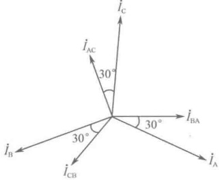

图 12-12 三角形连接的对称三相电路中，线电流与相电流的矢量关系图
 

最后需要强调的是，关于对称三相电路的线变量和相变量的关系，不管已知量是线变量还是相变量，一般都应从相变量去推得相应的线变量，而不必死记公式。此外，对于三角形连接的对称三相负载或电源，总可以将其化成等效的星形连接形式。

<!-- page: 322 -->

### 12.2 对称三相电路的分析与计算

关于三相对称电路的分析和计算，要紧紧抓住电路对称这一特点，并利用这一特点使电路的分析得到简化。同时，在分析和计算三相对称电路时，要善于利用前面已经获得的结论，这些结论可归纳如下。

# 1. 对于星形连接的三相对称电路

（1）线电流等于相电流；

（2）各线电压超前于其相应的相电压 $ 30^{\circ} $;

（3）各线电压的有效值是其相应的相电压有效值的 $ \sqrt{3} $倍；

（4）各线电压是对称的。

# 2. 对于三角形连接的三相对称电路

（1）线电压等于相电压；

（2）各线电流滞后于其相应的相电流 $ 30^{\circ} $

（3）各线电流的有效值是其相应的相电流有效值的 $ \sqrt{3} $倍；

（4）各线电流是对称的。

#### 12.2.1 对称三相四线制（ $ Y_{0}/Y_{0} $）系统的分析

图 12-13 所示为三相四线制系统，图中  $ Z_{1} $ 为输电线阻抗， $ Z_{N} $ 为中线阻抗。

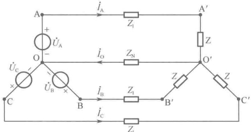

图 12-13 对称三相四线制  $ Y_{0}/Y_{0} $ 系统
 

以O点为参考点列写节点方程，可得

$$  \left(\frac{3}{Z+Z_{l}}+\frac{1}{Z_{N}}\right)\dot{U}_{o^{\prime}0}=\frac{1}{Z+Z_{l}}\left(\dot{U}_{A}+\dot{U}_{B}+\dot{U}_{C}\right)   \tag*{（12-19）}$$

由于电源对称，即 $ \dot{U}_{A} + \dot{U}_{B} + \dot{U}_{C} = 0 $，上式解得 $ \dot{U}_{O'O} = 0 $，即 $ \dot{I}_{O} = 0 $，因此，各相（线）电流为

$$  \dot{I}_{\mathrm{A}}=\frac{\dot{U}_{\mathrm{A}}}{Z+Z_{l}},\quad\dot{I}_{\mathrm{B}}=\frac{\dot{U}_{\mathrm{B}}}{Z+Z_{l}},\quad\dot{I}_{\mathrm{C}}=\frac{\dot{U}_{\mathrm{C}}}{Z+Z_{l}}   \tag*{（12-20）}$$

各相电压为

$$  \dot{U}_{\mathrm{A}^{\prime}\mathrm{O}^{\prime}}=Z\dot{I}_{\mathrm{A}},\quad\dot{U}_{\mathrm{B}^{\prime}\mathrm{O}^{\prime}}=Z\dot{I}_{\mathrm{B}},\quad\dot{U}_{\mathrm{C}^{\prime}\mathrm{O}^{\prime}}=Z\dot{I}_{\mathrm{C}}   \tag*{（12-21）}$$

从式（12-20）可以发现，由于电源的相电压是对称的，所以系统的线电流对称，并且负载上的各相电压也对称。

因此，对于  $ \mathrm{Y}_{0}/\mathrm{Y}_{0} $ 这样的对称三相电路系统，计算电压或电流时只需求出三相中的一相，然后根据电压或电流的对称关系就可写出其余两相的结果。同时，对于这样的对称三相电路系统，可将中线去掉变成三相三线制，计算的结果应该与前相同。

<!-- page: 323 -->

例 12-1 如图 12-14 为对称三相电路，已知  $ U_A = 220V $， $ f = 50Hz $， $ R = 100\Omega $， $ L = 0.618H $， $ M = 0.3H $，求电路中的线电流？

解：电路是Y/Y对称三相电路，所以，只需先求出三相中的一相，设 $ \dot{U}_{A}=220\angle0^{\circ}\mathrm{V} $

此题的关键是处理互感，在 A 相中，线圈上的电压为

 $$ \dot{U}_{\mathrm{L A}}=\mathrm{j}\omega L\dot{I}_{\mathrm{A}}+\mathrm{j}\omega M\dot{I}_{\mathrm{B}}+\mathrm{j}\omega M\dot{I}_{\mathrm{C}} $$ 

由对称性知 $ \dot{I}_{A}+\dot{I}_{B}+\dot{I}_{C}=0 $，所以，上式变为

 $$ \dot{U}_{\mathrm{L A}}=\mathrm{j}\omega L\dot{I}_{\mathrm{A}}+\mathrm{j}\omega M(\dot{I}_{\mathrm{B}}+\dot{I}_{\mathrm{C}})=\mathrm{j}\omega(L-M)\dot{I}_{\mathrm{A}} $$ 

因此，A 相的去耦电路如图 12-15 所示。

由图12-15可得

 $$ \dot{I}_{\mathrm{A}}=\frac{\dot{U}_{\mathrm{A}}}{R+\mathrm{j}\omega(L-M)}=\frac{220\angle0^{\circ}}{100+\mathrm{j}314\times0.318}=1.556\angle-45^{\circ} $$ 

然后根据对称性写出其余两相，可得

 $$ \dot{I}_{\mathrm{B}}=\dot{I}_{\mathrm{A}}\angle-120^{\circ}=1.556\angle-165^{\circ},\quad\dot{I}_{\mathrm{C}}=\dot{I}_{\mathrm{A}}\angle120^{\circ}=1.556\angle75^{\circ} $$ 

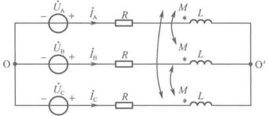

图 12-14 例 12-1 图之一
 

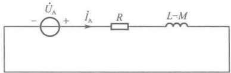

图 12-15 例 12-1 图之二
 

#### 12.2.2 复杂对称三相电路的分析

所谓复杂对称三相电路，无非是负载和电源有多组相联的情况，而且有的还出现星形与三角形混联，或者出现输电线阻抗不为零等情况，但不管多么复杂，所依据的基本原理是不变的。

在方法上，复杂对称三相电路的分析有其一定的特点。一般的思路是将电源和负载通过Y/ $ \Delta $等效变换统统变化成Y/Y连接的对称三相电路，然后将所有电源的中点和负载的中点短接起来，抽出一相（如A相）进行分析计算，再根据线变量与相变量的关系及对称性写出其余两相的结果。

例 12-2 如图 12-16 为对称三相电路，已知电源线电压为 380V， $ Z_1 = 30\Omega $， $ Z_2 = 12 + j16(\Omega) $，求  $ Z_1 = 0 $ 或  $ Z_1 = 1 + j2(\Omega) $ 时，各负载上的相电流和输电线中的电流为多少？

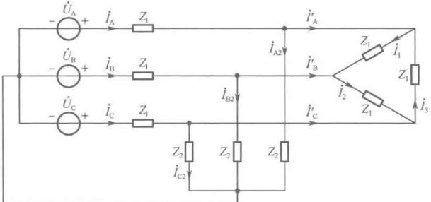

图 12-16 例 12-2 图之一
 

解：设 $ \dot{U}_{AB} = 380\angle0^\circ V $，由图12-16可得

<!-- page: 324 -->

（1）当 $ Z_{1}=0 $时，三角形负载的相电流为

 $$ \dot{I}_{1}=\frac{\dot{U}_{AB}}{Z_{1}}=\frac{380\angle0^{\circ}}{30}=12.67\angle0^{\circ} $$ 

根据对称性有

 $$ \dot{I}_{2}=\dot{I}_{1}\angle-120^{\circ}=12.67\angle-120^{\circ} $$ 

 $$ \dot{I}_{3}=\dot{I}_{1}\angle120^{\circ}=12.67\angle120^{\circ} $$ 

所以，三角形负载的线电流为

 $$ \dot{I}_{A}^{\prime}=\sqrt{3}\dot{I}_{1}\angle-30^{\circ}=21.94\angle-30^{\circ} $$ 

 $$ \begin{align*}\dot{I}_{\mathrm{B}}^{\prime}&=\dot{I}_{\mathrm{A}}\angle-120^{\circ}=21.94\angle-150^{\circ}\\\dot{I}_{\mathrm{C}}^{\prime}&=\dot{I}_{\mathrm{A}}\angle120^{\circ}=21.94\angle90^{\circ}\end{align*} $$ 

因为，星形电源的相电压  $ \dot{U}_{A} = \frac{\dot{U}_{AB}}{\sqrt{3}} \angle -30^{\circ} = \frac{380}{\sqrt{3}} \angle -30^{\circ} = 220 \angle -30^{\circ} $

所以，星形负载的相电流

 $$ \dot{I}_{A2}=\frac{\dot{U}_{A}}{Z_{2}}=\frac{220\angle-30^{\circ}}{12+j16}=\frac{220\angle-30^{\circ}}{20\angle53.1^{\circ}}=11\angle-83.1^{\circ} $$ 

根据对称性有

 $$ \dot{I}_{B2}=\dot{I}_{A2}\angle-120^{\circ}=11\angle-203.1^{\circ} $$ 

 $$ \dot{I}_{C2}=\dot{I}_{A2}\angle120^{\circ}=11\angle36.9^{\circ} $$ 

于是可得输电线上的电流为

 $$ \dot{I}_{\mathrm{A}}=\dot{I}_{\mathrm{A}}^{\prime}+\dot{I}_{\mathrm{A}2}=(19-\mathrm{j}10.97)+(1.32-\mathrm{j}10.92)=29.87\angle-47.1^{\circ} $$ 

根据对称性有

 $$ \dot{I}_{B}=\dot{I}_{A}\angle-120^{\circ}=29.87\angle-167.1^{\circ} $$ 

 $$ \dot{I}_{\mathrm{C}}=\dot{I}_{\mathrm{A}}\angle120^{\circ}=29.87\angle72.9^{\circ} $$ 

（2）当 $ Z_{1}=1+j2 $时，先将三角形负载化成的星形负载，则等效的每相阻抗 $ Z_{Y1}=30/3=10\Omega $，这时，A相如图12-17所示。

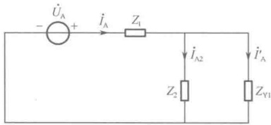

图 12-17 例 12-2 图之二
 

总的阻抗为

 $$ Z=Z_{1}+\frac{Z_{2}Z_{\mathrm{Y}1}}{Z_{2}+Z_{\mathrm{Y}1}}=(1+\mathrm{j}2)+\frac{10(12+\mathrm{j}16)}{22+\mathrm{j}16}=9\angle27.5^{\circ} $$ 

于是可得输电线上的电流为

 $$ \dot{I}_{A}=\frac{\dot{U}_{A}}{Z}=\frac{220\angle-30^{\circ}}{9\angle27.5^{\circ}}=24.5\angle-57.5^{\circ} $$ 

根据对称性有  $ \dot{I}_{\mathrm{B}} = \dot{I}_{\mathrm{A}} \angle -120^{\circ} = 24.5 \angle -177.5^{\circ} $

 $$ \dot{I}_{\mathrm{C}}=\dot{I}_{\mathrm{A}}\angle120^{\circ}=24.5\angle62.5^{\circ} $$ 

由分流公式可得星形负载的相电流为

 $$ \dot{I}_{\mathrm{A}2}=\frac{Z_{\mathrm{Y}1}}{Z_{2}+Z_{\mathrm{Y}1}}\dot{I}_{\mathrm{A}}=\frac{10}{22+j16}\times24.5\angle-57.5^{\circ}=\frac{245\angle-57.5^{\circ}}{27.2\angle36^{\circ}}=9\angle-93.5^{\circ} $$ 

根据对称性有

 $$ \dot{I}_{B2}=\dot{I}_{A2}\angle-120^{\circ}=9\angle-213.5^{\circ} $$ 

 $$ \dot{I}_{C2}=\dot{I}_{A2}\angle120^{\circ}=9\angle26.5^{\circ} $$ 

再由分流公式可得三角形负载的线电流为

 $$ \dot{I}_{\mathrm{A}}^{\prime}=\frac{Z_{2}}{Z_{2}+Z_{\mathrm{Y}1}}\dot{I}_{\mathrm{A}}=\frac{12+\mathrm{j}16}{22+\mathrm{j}16}\times24.5\angle-57.5^{\circ}=18\angle-40.4^{\circ} $$ 

根据对称性有

 $$ \dot{I}_{B}^{\prime}=\dot{I}_{A}\angle-120^{\circ}=18\angle-160.4^{\circ} $$ 

 $$ \dot{I}_{C}^{\prime}=\dot{I}_{A}\angle120^{\circ}=18\angle79.6^{\circ} $$

<!-- page: 325 -->

现在，再将等效的星形负载还原成原来的三角形负载，则三角形负载的相电流为

 $$ \dot{I}_{1}=\frac{\dot{I}_{\mathrm{A}}^{\prime}}{\sqrt{3}}\angle30^{\circ}=10.4\angle-10.4^{\circ} $$ 

根据对称性有

 $$ \dot{I}_{2}=\dot{I}_{1}\angle-120^{\circ}=10.4\angle-130.4^{\circ} $$ 

 $$ \dot{I}_{3}=\dot{I}_{1}\angle120^{\circ}=10.4\angle109.6^{\circ} $$ 

### 12.3 不对称三相电路概述

在三相电路中，当三相电源或三相负载不对称时就构成了不对称三相电路。所谓的三相电源不对称，是指三相电源不满足“频率相同、幅值相同、相位互差 $ 120^{\circ} $”的条件；所谓的三相负载不对称是指三相负载不满足“三个负载阻抗（或导纳）完全相等”的条件。

一般情况下，在电力系统中，由于发电机制造工艺的保证，三相电源可以认为是对称的。因此，所谓的不对称三相电路，常常是指负载不对称的情况。而且在日常生活中，要使 A、B、C 三相负载严格相等的确是太过于理想了。也就是说，在日常生活中，三相电路系统的表现其实总是不对称的，下面所描述的不对称三相电路仅针对电源对称而负载不对称的系统。

目前，供给居民生活用电的三相系统均属于三相四线制星形（ $ Y_{0}/Y_{0} $）不对称三相电路系统。在这样的不对称三相电路中，如果中线连接正常，并且在忽略中线阻抗的情况下，不论三相负载是否对称，其相电压总是对称的。当然，若三相负载不对称，其相电流就是不对称的。不过，在中线的强制作用下，三相电源的中点与三相负载的中点之间总是等电位的。这时尽管负载不对称，其各相也是独立的，同样可以分相计算。如果中线连接不正常，比如中线断开了，这时电源的中点与负载的中点之间将出现中点位移，从而产生中点之间的电位差，那么由于负载的不对称将会引起相电压也不对称，如图12-18所示，这时候三相电路的计算不能简化为单相电路的计算。

电源的中点 O 与负载的中点  $ O' $ 之间发生偏移的程度取决于三相负载不对称的程度，严重时会使三相负载工作不正常。

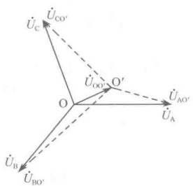

图 12-18 电源的中点 O 与负载的中点 O' 之间出现中点位移
 

从以上描述可知， $ Y_{0}/Y_{0} $ 系统中的中线异常重要，必须选用电

阻小、机械强度高的导线做中线，并且，在中线上不允许安装保险装置和任何开关。

### 12.4 三相电路的功率及其测量

三相电路的功率是指三相电源发出的有功功率、无功功率和视在功率，或者是指一组三相负载消耗的有功功率、无功功率和视在功率。

#### 12.4.1 对称三相电路的功率

# 1. 对称三相电路的有功功率

在对称三相电路中，假设 A、B、C 三相负载的相电压有效值分别为  $ U_{A} $、 $ U_{B} $、 $ U_{C} $，三相负载的相电流有效值分别为  $ I_{A} $、 $ I_{B} $、 $ I_{C} $，三相负载的相电压与相电流的相位差分别为  $ \varphi_{A} $、 $ \varphi_{B} $、 $ \varphi_{C} $，则三相电路的有功功率

$$  P=P_{\mathrm{A}}+P_{\mathrm{B}}+P_{\mathrm{C}}=U_{\mathrm{A}}I_{\mathrm{A}}\cos\varphi_{\mathrm{A}}+U_{\mathrm{B}}I_{\mathrm{B}}\cos\varphi_{\mathrm{B}}+U_{\mathrm{C}}I_{\mathrm{C}}\cos\varphi_{\mathrm{C}}   \tag*{（12-22）}$$

<!-- page: 326 -->

对于对称三相电路，有

 $$ U_{\mathrm{A}}=U_{\mathrm{B}}=U_{\mathrm{C}}\triangleq U_{\mathrm{p}},\quad I_{\mathrm{A}}=I_{\mathrm{B}}=I_{\mathrm{C}}\triangleq I_{\mathrm{p}},\quad\varphi_{\mathrm{A}}=\varphi_{\mathrm{B}}=\varphi_{\mathrm{C}}\triangleq\varphi_{\mathrm{p}} $$ 

这里的下标 “p” 表示 “phase（相）”， $ U_{p} $ 和  $ I_{p} $ 为相电压和相电流的统称。

于是，对称三相电路的有功功率为

$$  P=P_{\mathrm{A}}+P_{\mathrm{B}}+P_{\mathrm{C}}=3U_{\mathrm{p}}I_{\mathrm{p}}\cos\varphi_{\mathrm{p}}   \tag*{（12-23）}$$

即，对称三相电路的有功功率等于其一相有功功率的3倍。

使用 $ U_{1} $和 $ I_{1} $作为线电压和线电流的统称，这里的下标“1”表示“line（线）”。如果三相负载是星形接法，则 $ U_{1}=\sqrt{3}U_{p} $， $ I_{1}=I_{p} $，于是星形连接的对称三相电路的有功功率为

$$  P_{\mathrm{Y}}=3U_{\mathrm{p}}I_{\mathrm{p}}\cos\varphi_{\mathrm{p}}=3\frac{1}{\sqrt{3}}U_{1}I_{1}\cos\varphi_{\mathrm{p}}=\sqrt{3}U_{1}I_{1}\cos\varphi_{\mathrm{p}}   \tag*{（12-24）}$$

如果三相负载是三角形接法，则 $ U_{1}=U_{p} $， $ I_{1}=\sqrt{3}I_{p} $，于是三角形连接的对称三相电路的有功功率为

$$  P_{\triangle}=3U_{\mathrm{p}}I_{\mathrm{p}}\cos\varphi_{\mathrm{p}}=3\frac{1}{\sqrt{3}}U_{1}I_{1}\cos\varphi_{\mathrm{p}}=\sqrt{3}U_{1}I_{1}\cos\varphi_{\mathrm{p}}   \tag*{（12-25）}$$

这表明，无论对称三相电路是星形连接的还是三角形连接的，其有功功率都可写成

$$  P=\sqrt{3}U_{1}I_{1}\cos\varphi_{p}   \tag*{（12-26）}$$

因此，对称三相电路的有功功率可以用式（12-23）求解，也可用式（12-26）求解。

# 2. 对称三相电路的无功功率

与上述假设相同，三相电路的无功功率

$$  Q=Q_{\mathrm{A}}+Q_{\mathrm{B}}+Q_{\mathrm{C}}=U_{\mathrm{A}}I_{\mathrm{A}}\sin\varphi_{\mathrm{A}}+U_{\mathrm{B}}I_{\mathrm{B}}\sin\varphi_{\mathrm{B}}+U_{\mathrm{C}}I_{\mathrm{C}}\sin\varphi_{\mathrm{C}}   \tag*{（12-27）}$$

对于对称三相电路，有

 $$ U_{\mathrm{A}}=U_{\mathrm{B}}=U_{\mathrm{C}}\triangleq U_{\mathrm{p}},\quad I_{\mathrm{A}}=I_{\mathrm{B}}=I_{\mathrm{C}}\triangleq I_{\mathrm{p}},\quad\varphi_{\mathrm{A}}=\varphi_{\mathrm{B}}=\varphi_{\mathrm{C}}\triangleq\varphi_{\mathrm{p}} $$ 

于是，对称三相电路的无功功率为

$$  Q=Q_{\mathrm{A}}+Q_{\mathrm{B}}+Q_{\mathrm{C}}=3U_{\mathrm{p}}I_{\mathrm{p}}\sin\varphi_{\mathrm{p}}   \tag*{（12-28）}$$

即，对称三相电路的无功功率等于其一相无功功率的3倍。

如果三相负载是星形接法，则 $ U_{1}=\sqrt{3}U_{p} $， $ I_{1}=I_{p} $，于是星形连接的对称三相电路的无功功率为

$$  Q_{\mathrm{Y}}=3U_{\mathrm{p}}I_{\mathrm{p}}\sin\varphi_{\mathrm{p}}=3\frac{1}{\sqrt{3}}U_{1}I_{1}\sin\varphi_{\mathrm{p}}=\sqrt{3}U_{1}I_{1}\sin\varphi_{\mathrm{p}}   \tag*{（12-29）}$$

如果三相负载是三角形接法，则 $ U_{1}=U_{p} $， $ I_{1}=\sqrt{3}I_{p} $，于是三角形连接的对称三相电路的无功功率为

$$  Q_{△}=3U_{p}I_{p}\sin\varphi_{p}=3\frac{1}{\sqrt{3}}U_{1}I_{1}\sin\varphi_{p}=\sqrt{3}U_{1}I_{1}\sin\varphi_{p}   \tag*{（12-30）}$$

这表明，无论对称三相电路是星形连接的还是三角形连接的，其无功功率都可写成

$$  Q=\sqrt{3}U_{1}I_{1}\sin\varphi_{p}   \tag*{（12-31）}$$

因此，对称三相电路的无功功率可以用式（12-28）求解，也可用式（12-31）求解。

# 3. 对称三相电路的视在功率

与上述假设相同，三相电路的视在功率

$$  \begin{aligned}&\boldsymbol{S}=\boldsymbol{S}_{\mathrm{A}}+\boldsymbol{S}_{\mathrm{B}}+\boldsymbol{S}_{\mathrm{C}}=\boldsymbol{U}_{\mathrm{A}}\boldsymbol{I}_{\mathrm{A}}+\boldsymbol{U}_{\mathrm{B}}\boldsymbol{I}_{\mathrm{B}}+\boldsymbol{U}_{\mathrm{C}}\boldsymbol{I}_{\mathrm{C}}\\ &\\&\boldsymbol{U}_{\mathrm{A}}=\boldsymbol{U}_{\mathrm{B}}=\boldsymbol{U}_{\mathrm{C}}\triangleq\boldsymbol{U}_{\mathrm{p}},\quad\boldsymbol{I}_{\mathrm{A}}=\boldsymbol{I}_{\mathrm{B}}=\boldsymbol{I}_{\mathrm{C}}\triangleq\boldsymbol{I}_{\mathrm{p}}\\ \end{aligned}   \tag*{（12-32）}$$

对于对称三相电路，有

<!-- page: 327 -->

于是，对称三相电路的视在功率为

$$  S=S_{\mathrm{A}}+S_{\mathrm{B}}+S_{\mathrm{C}}=3U_{\mathrm{p}}I_{\mathrm{p}}   \tag*{（12-33）}$$

即，对称三相电路的视在功率等于其一相视在功率的3倍。

如果三相负载是星形接法，则 $ U_{1}=\sqrt{3}U_{p} $， $ I_{1}=I_{p} $，于是星形连接的对称三相电路的视在功率为

$$  S_{\mathrm{Y}}=3U_{\mathrm{p}}I_{\mathrm{p}}=3\frac{1}{\sqrt{3}}U_{1}I_{1}=\sqrt{3}U_{1}I_{1}   \tag*{（12-34）}$$

如果三相负载是三角形接法，则 $ U_{1}=U_{p} $， $ I_{1}=\sqrt{3}I_{p} $，于是三角形连接的对称三相电路的视在功率为

$$  S_{\triangle}=3U_{\mathrm{p}}I_{\mathrm{p}}=3\frac{1}{\sqrt{3}}U_{1}I_{1}=\sqrt{3}U_{1}I_{1}   \tag*{（12-35）}$$

这表明，无论对称三相电路是星形连接的还是三角形连接的，其视在功率都可写成

$$  S=\sqrt{3}U_{1}I_{1}   \tag*{（12-36）}$$

因此，对称三相电路的视在功率可以用式（12-33）求解，也可用式（12-36）求解。

# 4. 对称三相电路的功率因数

$$  \cos\varphi=\frac{P}{S}=\cos\varphi_{p}   \tag*{（12-37）}$$

注意：对于不对称三相电路，功率因数这个指标无实际意义。

5. 对称三相电路的瞬时功率

假设对称三相电路的 A 相瞬时电压和瞬时电流分别为

 $$ \boldsymbol{u}_{\mathrm{p A}}=\sqrt{2}\boldsymbol{U}_{\mathrm{p}}\cos\omega t\mathrm{,}\quad\boldsymbol{i}_{\mathrm{p A}}=\sqrt{2}\boldsymbol{I}_{\mathrm{p}}\cos(\omega t-\varphi_{\mathrm{p}}) $$ 

则 A 相的瞬时功率为

 $$ \begin{aligned}\boldsymbol{p}_{\mathrm{A}}&=u_{\mathrm{pA}}i_{\mathrm{pA}}=\sqrt{2}U_{\mathrm{p}}\cos\omega t\times\sqrt{2}I_{\mathrm{p}}\cos(\omega t-\varphi_{\mathrm{p}})\\&=U_{\mathrm{p}}I_{\mathrm{p}}[\cos\varphi_{\mathrm{p}}+\cos(2\omega t-\varphi_{\mathrm{p}})]\end{aligned} $$ 

同理可得，B 相的瞬时功率为

 $$ \begin{aligned}p_{\mathrm{B}}&=u_{\mathrm{pB}}i_{\mathrm{pB}}=\sqrt{2}U_{\mathrm{p}}\cos(\omega t-120^{\circ})\times\sqrt{2}I_{\mathrm{p}}\cos(\omega t-120^{\circ}-\varphi_{\mathrm{p}})\\&=U_{\mathrm{p}}I_{\mathrm{p}}[\cos\varphi_{\mathrm{p}}+\cos(2\omega t-240^{\circ}-\varphi_{\mathrm{p}})]\end{aligned} $$ 

C 相的瞬时功率为

 $$ \begin{aligned}p_{\mathrm{C}}&=u_{\mathrm{p C}}i_{\mathrm{p C}}=\sqrt{2}U_{\mathrm{p}}\cos(\omega t+120^{\circ})\times\sqrt{2}I_{\mathrm{p}}\cos(\omega t+120^{\circ}-\varphi_{\mathrm{p}})\\&=U_{\mathrm{p}}I_{\mathrm{p}}[\cos\varphi_{\mathrm{p}}+\cos(2\omega t-120^{\circ}-\varphi_{\mathrm{p}})]\end{aligned} $$ 

因此，三相瞬时功率之和为

$$  p=p_{\mathrm{A}}+p_{\mathrm{B}}+p_{\mathrm{C}}=3U_{\mathrm{p}}I_{\mathrm{p}}\cos\varphi_{\mathrm{p}}   \tag*{（12-38）}$$

此式表明：对称三相电路的总的瞬时功率是个常数，其值等于对称三相电路的总的有功功率。这正是三相制的优点之一，因为不管是三相发电机还是三相电动机，它的瞬时功率是个常数，这就意味着它们的机械转矩是恒定的，从而运行平稳。

问题提示：从上面的分析可知，无论对称三相负载接成星形还是三角形，其有功功率均为

 $$ P=\sqrt{3}U_{1}I_{1}\cos\varphi_{p} $$ 

但要注意：对于同样的三相负载，从星形连接改成三角形连接后，若保持线电压不变，则星形接

法的有功功率  $ P_{Y} $ 与三角形接法的有功功率  $ P_{\triangle} $ 在数值上的关系应该是

$$  P_{△}=3P_{Y}   \tag*{（12-39）}$$

<!-- page: 328 -->

对于有功功率和视在功率也有同样的结论。

例 12-3 设对称三相电路中，其每相负载均为电阻  $ R = 8.68\Omega $，试问：（1）在 380V 线电压下，接成三角形负载和接成星形负载时各吸收了多少功率？（2）在 220V 线电压下，接成三角形负载时吸收了多少功率？

解：（1）将三个8.68 $ \Omega $的电阻接成三角形负载

此时，相电压 = 线电压 = 380V，线电流是相电流的  $ \sqrt{3} $ 倍，所以

相电流

 $$ I_{p}=\frac{U_{p}}{R}=\frac{U_{1}}{R}=\frac{380}{8.68}=43.8A $$ 

线电流

 $$ I_{1}=\sqrt{3}I_{p}=43.8\sqrt{3}=75.8A $$ 

有功功率

 $$ P_{\triangle}=\sqrt{3}U_{1}I_{1}\cos\varphi_{p}=\sqrt{3}\times380\times75.8\times1=50kW $$ 

又将三个 $ 8.68\Omega $的电阻接成星形负载

此时，相电流=线电流，线电压是相电压的 $ \sqrt{3} $倍，即

相电压

 $$ U_{p}=\frac{U_{1}}{\sqrt{3}}=\frac{380}{\sqrt{3}}=220V $$ 

线电流

 $$ I_{1}=I_{p}=\frac{U_{p}}{R}=\frac{220}{8.68}=25.3A $$ 

有功功率  $ P_{Y} = \sqrt{3}U_{1}I_{1}\cos\varphi_{p} = \sqrt{3} \times 380 \times 25.3 \times 1 = 16.7\text{kW} $

可见，这时就有 $ P_{\triangle}=3P_{Y} $。

（2）当线电压 $ U_{1}=220V $，则

相电流

 $$ I_{p}=\frac{U_{p}}{R}=\frac{U_{1}}{R}=\frac{220}{8.68}=25.3A $$ 

线电流

 $$ I_{1}=\sqrt{3}I_{p}=25.3\sqrt{3}=43.8A $$ 

有功功率

 $$ P_{△}=\sqrt{3}U_{1}I_{1}\cos\varphi_{p}=\sqrt{3}\times380\times43.8\times1=16.7kW $$ 

与（1）中的结论比较可知，只要每相负载所承受的相电压相同，则不管这个负载接成三角形还是星形，其相电流和功率均相等。在实际应用中，有些三相用电器的铭牌上标示着220V/380V—△/Y，就是指这个用电器可在线电压220V下接成三角形，或者在线电压380V下接成星形，两者功率相等。

#### 12.4.2 三相电路的功率测量

针对不同情况，三相电路的有功功率测量分别有一瓦特计法、二瓦特计法和三瓦特计法等几种测量方法。

# 1. 三相四线制电路的有功功率测量

在三相四线制电路中，当负载不对称时，需要用三个单相功率表测量三相负载的功率，如图12-19所示。这种测量方法称为三瓦特计法，此时三相电路的有功功率

 $$ P=P_{\mathrm{A}}+P_{\mathrm{B}}+P_{\mathrm{C}} $$ 

在三相四线制电路中，当负载对称时，只需要用一个单相功率表测量三相负载的功率，如在图12-19中，保留任何一个表都可以，这时

 $$ P=3P_{\mathrm{A}}=3P_{\mathrm{B}}=3P_{\mathrm{C}} $$ 

即任何一个表的读数乘以3就是三相负载的功率，这种测量方法称为一瓦特计法。

<!-- page: 329 -->

# 2. 三相三线制电路的功率测量

对于三相三线制电路，无论负载对称还是不对称，也无论负载是接成三角形还是星形，都可以用两个单相功率表来测量三相负载的功率，如图12-20所示。这种测量方法称为二瓦特计法。

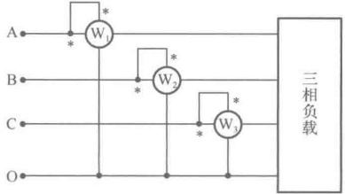

图 12-19 三相四线制电路的功率测量
 

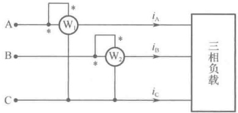

图 12-20 三相三线制电路的功率测量
 

使用二瓦特计法的前提条件是：三个线电流之和等于零，即

 $$ i_{\mathrm{A}}+i_{\mathrm{B}}+i_{\mathrm{C}}=0 $$ 

假设负载是星形连接（对三角形连接的负载，可以通过等效变换变成星形），三相负载的瞬时功率为

 $$ p=p_{A}+p_{B}+p_{C}=u_{A O^{\prime}}i_{A}+u_{B O^{\prime}}i_{B}+u_{C O^{\prime}}i_{C} $$ 

式中下标 $ O' $是星形负载的中点，由KCL可知

 $$ i_{\mathrm{A}}+i_{\mathrm{B}}+i_{\mathrm{C}}=0 $$ 

即 $ i_{C}=-i_{A}-i_{B} $，代入上式有

$$  \begin{aligned}\boldsymbol{p}&=\boldsymbol{p}_{\mathrm{A}}+\boldsymbol{p}_{\mathrm{B}}+\boldsymbol{p}_{\mathrm{C}}=u_{\mathrm{AO}^{\prime}}\boldsymbol{i}_{\mathrm{A}}+u_{\mathrm{BO}^{\prime}}\boldsymbol{i}_{\mathrm{B}}+u_{\mathrm{CO}^{\prime}}(-\boldsymbol{i}_{\mathrm{A}}-\boldsymbol{i}_{\mathrm{B}})\\&=(\boldsymbol{u}_{\mathrm{AO}^{\prime}}-\boldsymbol{u}_{\mathrm{CO}^{\prime}})\boldsymbol{i}_{\mathrm{A}}+(\boldsymbol{u}_{\mathrm{BO}^{\prime}}-\boldsymbol{u}_{\mathrm{CO}^{\prime}})\boldsymbol{i}_{\mathrm{B}}=u_{\mathrm{AC}}\boldsymbol{i}_{\mathrm{A}}+u_{\mathrm{BC}}\boldsymbol{i}_{\mathrm{B}}\end{aligned}   \tag*{（12-40）}$$

则三相负载的有功功率

$$  P=\frac{1}{T}\int_{0}^{T}p\mathrm{d}t=\frac{1}{T}\int_{0}^{T}(u_{\mathrm{AC}}i_{\mathrm{A}}+u_{\mathrm{BC}}i_{\mathrm{B}})\mathrm{d}t=U_{\mathrm{AC}}I_{\mathrm{A}}\cos\varphi_{\mathrm{A}}+U_{\mathrm{BC}}I_{\mathrm{B}}\cos\varphi_{\mathrm{B}}=P_{1}+P_{2}   \tag*{（12-41）}$$

式中， $ \varphi_{A} $ 是  $ \dot{U}_{AC} $ 与  $ \dot{I}_{A} $ 之间的相位差， $ \varphi_{B} $ 是  $ \dot{U}_{BC} $ 与  $ \dot{I}_{B} $ 之间的相位差。式（12-41）说明：只要将一个功率表的电流线圈接入 A 线电流，其电压线圈接在 AC 线电压上；另一个功率表的电流线圈接入 B 线电流，其电压线圈接在 BC 线电压上，则两功率表的读数之和就是该三相电路的有功功率。

可以证明，若三相电路对称，则有

 $$ \left\{\begin{aligned}P_{\mathrm{l}}&=U_{\mathrm{AC}}I_{\mathrm{A}}\cos(30^{\circ}-\varphi_{\mathrm{p}})\\ P_{2}&=U_{\mathrm{BC}}I_{\mathrm{B}}\cos(30^{\circ}+\varphi_{\mathrm{p}})\end{aligned}\right. $$ 

式中， $ \varphi_{p} $ 是相电压与相电流之间的相位差，也称作负载的阻抗角。当 $ \varphi_{p} > 60^{\circ} $ 时，功率表  $ W_{2} $ 会出现反转，可将功率表  $ W_{2} $ 的“极性旋钮”旋至“-”的位置，此时功率表  $ W_{2} $ 的读数应取负值，即

 $$ P=P_{1}-P_{2} $$ 

例 12-4 测量对称三相电路功率的接线图如图 12-20 所示，已知电路线电压为 380V，线电流为 5.5A，功率因数角为  $ 79^{\circ} $，求功率表  $ W_{1} $ 和  $ W_{2} $ 的读数，以及电路的总有功功率 P 。

解：相电压 $ \dot{U}_{A}=\frac{380}{\sqrt{3}}\angle0^{\circ}=220\angle0^{\circ} $，根据式（12-43）可得

 $$ \begin{aligned}&P_{1}=U_{\mathrm{AC}}I_{\mathrm{A}}\cos(30^{\circ}-\varphi_{\mathrm{p}})=380\times5.5\times\cos(30^{\circ}-79^{\circ})=1370\mathrm{W}\\ &P_{2}=U_{\mathrm{BC}}I_{\mathrm{B}}\cos(30^{\circ}+\varphi_{\mathrm{p}})=380\times5.5\times\cos(30^{\circ}+79^{\circ})=-680\mathrm{W}\\ \end{aligned} $$ 

功率表  $ W_{2} $ 出现反转，将功率表  $ W_{2} $ 的“极性旋钮”旋至“-”的位置，此时功率表  $ W_{2} $ 的读数应取负值，即

 $$ P=P_{1}-P_{2}=1370-680=690W $$

<!-- page: 330 -->

例 12-5 测量对称三相电路功率的接线图如图 12-21 所示，已知  $ \dot{U}_{AB} = 380\angle0^\circ(V) $， $ \dot{I}_A = 1\angle -60^\circ $，求功率表  $ W_1 $ 和  $ W_2 $ 的读数。

解：从所给图看，功率表  $ W_{1} $ 的电流线圈接入 A 线电流，其电压线圈接在 AB 线电压上；功率表  $ W_{2} $ 的电流线圈接入 C 线电流，其电压线圈接在 CB 线电压上。

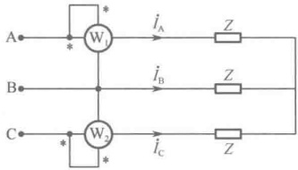

图 12-21 例 12-5 图
 

已知 $ \dot{U}_{AB}=380\angle0^{\circ}(V) $， $ \dot{I}_{A}=1\angle-60^{\circ} $，则功率表 $ W_{1} $的读数为

 $$ P_{1}=\mathrm{Re}[\dot{U}_{\mathrm{AB}}\dot{I}_{\mathrm{A}}^{*}]=\mathrm{Re}[380\angle60^{\circ}]=380\cos60^{\circ}=190\mathrm{W} $$ 

又根据对称性知 $ \dot{U}_{BC} = 380\angle -120^\circ(V) $， $ \dot{I}_C = 1\angle 60^\circ $所以

 $$ \dot{U}_{CB}=-\dot{U}_{BC}=380\angle180^{\circ}-120^{\circ}=380\angle60^{\circ}(V) $$ 

则功率表 $ W_{2} $的读数为

 $$ P_{2}=\mathrm{Re}[\dot{U}_{\mathrm{CB}}\dot{I}_{\mathrm{C}}^{*}]=\mathrm{Re}[380\angle60^{\circ}\times1\angle-60^{\circ}]=380\cos0^{\circ}=380\mathrm{W} $$ 

# 3. 对称三相电路的无功功率测量

对称三相电路的无功功率也可以采用功率表进行测量。由式（12-31）可知，对称三相电路的无功功率为

 $$ Q=\sqrt{3}U_{1}I_{1}\sin\varphi_{p} $$ 

由图 12-22（a）所示的矢量图可知， $ \dot{I}_{B} $ 与  $ \dot{U}_{CA} $ 的相位差为  $ 90^{\circ} - \varphi_{p} $。因此，可以将功率表的电流线圈接入 B 线电流，电压线圈接在 CA 线电压上，如图 12-22（b）所示。

于是

 $$ W=U_{1}I_{1}\cos(90^{\circ}-\varphi_{p})=U_{1}I_{1}\sin\varphi_{p} $$ 

即，对称三相电路的无功功率为  $ Q = \sqrt{3}U_1I_1\sin\varphi_p = \sqrt{3}W(\mathrm{Var}) $

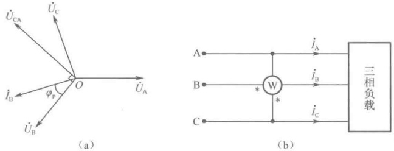

图 12-22 用功率表测量对称三相电路的无功功率
 

从以上分析可以再一次认识到：功率表的读数等于该表电压线圈所接电压的有效值、电流线圈所通过电流的有效值及电压与电流相位差的余弦这三者的乘积。分析计算功率表的读数时，弄清楚电压线圈所接电压和电流线圈所通过电流是至关重要的。

### 12.5 计算机仿真

##### 例 12-6 对称三相电源仿真

三相电源的瞬时值表达式分别为： $ u_A = 220\cos100\pi t $ (V)， $ u_B = 220\cos(100\pi t - 120^\circ) $ (V)， $ u_C = 220\cos(100\pi t + 120^\circ) $ (V)，如图 12-23（a）所示为该对称三相电源的星形连接方式，负极性端 X、Y、Z 连接到一起成为一个节点，三相电源的正极性端 A、B、C 三端向外引出三条线，称为端线。A、B、C 三相的端线分别接入四通道示波器的 A、B、C 三个通道，并将三条端线颜色设置成

<!-- page: 331 -->

不同的颜色，便于观察波形。Multisim 的元件库中也提供对称的星形电源，元件符号如图 12-23（b）所示。仿真运行后，可以观察示波器波形如图 12-23（c）所示。三相电源的电压波形幅度、频率均一致，拖动时间游标，可以测出 A 相与邻近的 B 相波峰时间差为 6.701ms，换算成相位为  $ 120^{\circ} $。

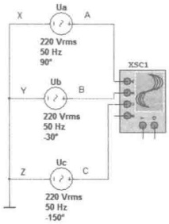

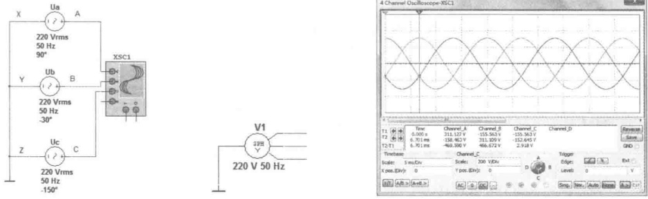

(a) 星形连接
 

（b）星形接法电源符号
 

（c）对称三相电源的电压波形
 

图 12-23 对称三相电源的星形连接仿真
 

如图 12-24（a）所示，将对称三相电源的 X 与 B 连接在一起，Y 与 C 连接在一起，Z 与 A 连接在一起，再从 A、B、C 三端引出三条端线，即构成三相电源的三角形连接。Multisim 的元件库中提供对称三角形电源，元件符号如图 12-24（b）所示。

三角形连接时要注意接线的正确性，当三相电源连接正确时，在三角形闭合回路中总的电压为零，这样才能保证在没有输出的情况下，电源内部没有环形电流，如图12-24（c）所示。但是，若将一相电源（如A相）反接，则三角形回路电压在闭合前为一相电压的两倍，如图12-24（d）所示，电压表测得A、Z两点间电压为440V。由于电压源的内阻抗很小，在三角形回路内会产生较大的环路电流，造成电压源的损坏。

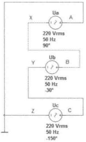

(a) 三角形连接
 

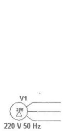

（b）三角形接法电源符号
 

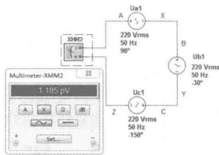

（c）正确的三角形连接方法
 

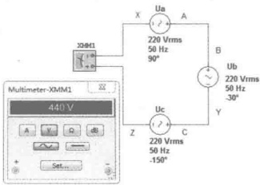

（d）错误的三角形连接方法
 

图 12-24 对称三相电源的三角形连接仿真
 

##### 例 12-7 对称三相负载仿真

##### （1）Y-Y连接

如图 12-25 所示，电路中的电源为对称的星形连接，负载为对称的星形连接。仿真启动后，可以看出该电路有如下特点。

① 线电压的有效值是相电压有效值的  $ \sqrt{3} $ 倍。由双踪示波器测量出线电压为 381V，相电压为 220V。线电压超前各自相应的相电压  $ 30^{\circ} $，如图 12-26 所示，图中线电压与相电压邻近的两个波峰之间的时间差约为 1.67ms，换算成角度为  $ 30^{\circ} $。

<!-- page: 332 -->

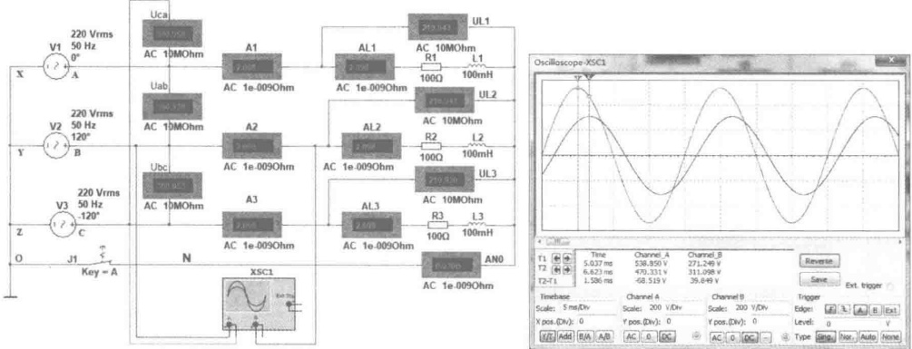

图 12-25 星形对称负载电路仿真
 

图 12-26 线电压和相电压的相位差
 

② 线电流等于相电流。线电流即为负载的相电流。

③ 中性线上的电流等于零。接通或断开中心线上的开关，对电路没有影响。所以，图 12-26 也可以称为三相三线制电路。

（2）Y-Y 连接（负载不对称）

图 12-27（a）所示电路中，为对称的星形三相电源，负载为不对称的星形接法。中性线上有一个开关，处于闭合状态。运行仿真电路，三个线电压均为 380V，三个相电压均为 220V，尽管负载不对称，但是三个相电压是对称的。线电流等于相电流，由于三个相上的负载不对称，所以三个相电流彼此不相等，任何瞬间三个相电流的相量和都不等于零，所以中性线上的电流表读数不为零。

如果将中性线上的开关断开，如图12-27（b）所示电路中，三相负载上的相电压不再相等，有的相电压会低于用电器的额定工作电压，用电器不能正常工作；有的相电压会高于用电器的额定工作电压，造成用电器的损坏。因此，在三相负载不对称的情况下，中性线是必不可少的，它的存在保证了不对称的三相负载获得对称的三相电压。所以，在三相四线制供电线路中，中性线不能去掉，也不能在中性线上安装保险丝或开关，要用机械强度较好的钢丝作为中性线。

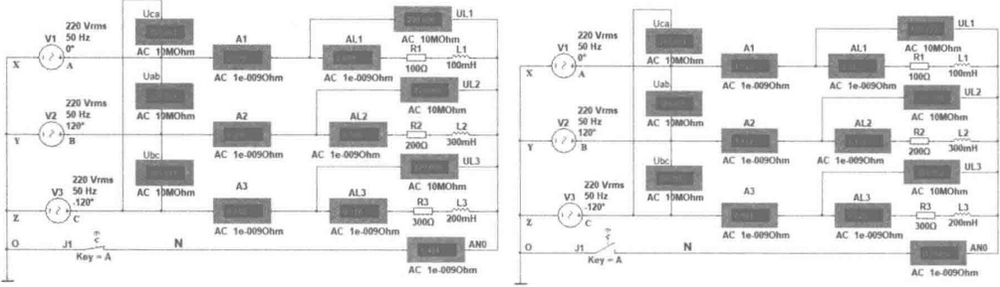

（a）中性线存在时
 

（b）中性线断开时
 

图 12-27 不对称三相负载连接仿真
 

##### （3）负载的三角形连接

如图 12-28 所示，电源为星形连接，负载为对称的三角形连接。仿真运行后，观察测量结果，可以发现该电路具有以下特点。

<!-- page: 333 -->

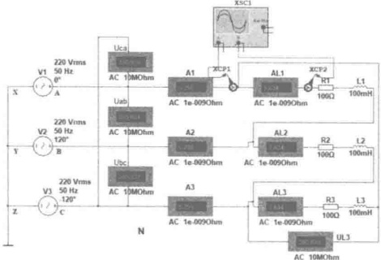

图 12-28 对称三角形负载连接仿真
 

① 线电压等于相电压。途中三个线电压和每一相负载的电压均为 381V。

② 三相负载电流对称，所以三条相线上的线电流也是对称的，线电流有效值的大小为相电流的 $ \sqrt{3} $倍。将电流探针安置在电源 A 端线与对应的 A 相负载上，分别接入双踪示波器的 A、B 通道，线电流与对应相电流的波形如图 12-29 所示，图中线电流与相电流邻近的两个波峰之间的时间差约为 1.766ms，换算成角度约为  $ 30^{\circ} $。

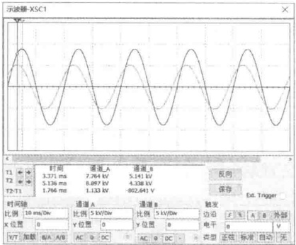

图 12-29 对称三角形负载的线电流与相应相电流相位差
 

③ 三相负载上的相电流的瞬时值之和为零，图12-30（a）为测量三相负载相电流的电路，图12-30（b）为测量结果，从测量数据可以看出，任意瞬间三个相电流的相位差为 $ 120^{\circ} $，瞬时值之和为零。

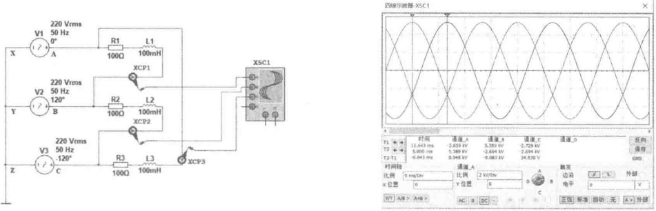

（a）三角形负载电流测量电路
 

（b）三角形负载相电流瞬时波形
 

图 12-30 三角形负载电流测量仿真
 

<!-- page: 334 -->

##### 例 12-8 三相电路的功率仿真

##### （1）三相四线制星形接法

对于三相四线制的星形连接电路，无论对称与否，可以采用三只功率表分别测量三相负载的功率，这种测量方法称为三表法。三相负载吸收的总功率等于各相负载吸收的功率之和。如图 12-31 所示，电源为星形接法，负载为不对称的星形接法，三个功率表 XWM1、XWM2 和 XWM3 分别测量 A 相、B 相和 C 相负载的有功功率。每一相负载上的电压表和电流表读数的乘积为视在功率。将三个功率表上的读数加起来就是三相负载消耗的总的有功功率，即  $ P_{总}=P_{A}+P_{B}+P_{C}=440.509+220.259+146.836=807.6W $。

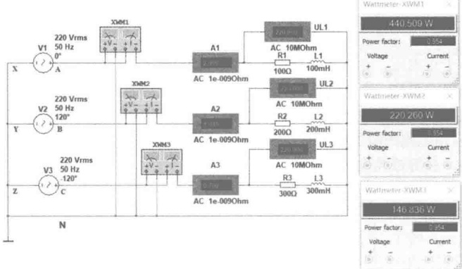

图 12-31 三相四线制总功率的测量
 

##### （2）三相三线制接法

① Y-Y 连接。对于三相三线制电路，无论对称与否，都可以用两只功率表进行测量，这种测量方法称为二表法。图 12-32（a）、（b）均为对称的 Y-Y 连接形式，图 13-32（a）所示为用三表法测量各项负载的功率，测得功率为  $ P_{总}=P_{A}+P_{B}+P_{C}=440.514+440.514+440.514=1321.542W $。图 12-32（b）为使用二表法测量负载功率，将两个功率表的电流线圈分别串连接入任意两相的端线中（图中所示为 A 线和 B 线），电压线圈的负极性端“-”共同接到第三条端线上（图中所示为 C 线）。负载消耗的总功率等于这两只功率表的读数之和，即  $ P_{总}=P_{AC}+P_{BC}=780.579+540.647=1321.226W $，与图 12-32（a）的测量结果一致。

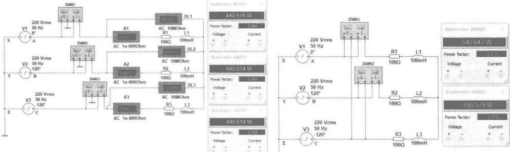

(a) 三表法
 

（b）二表法
 

图 12-32 对称的 Y-Y 连接功率测量仿真
 

<!-- page: 335 -->

② Y-△连接。如图12-33（a）、（b）所示，电源为星形连接，负载为对称的三角形连接。图12-33（a）所示为用三表法测量各项负载的功率，测得功率为 $ P_{总}=P_{A}+P_{B}+P_{C}=1.322+1.322+1.322=3.966kW $。图12-33（b）为使用二表法测量负载功率，将两个功率表的电流线圈分别串连接入任意两相的端线中（图中所示为A线和B线），电压线圈的负极性端“-”共同接到第三条端线上（图中所示为C线）。负载消耗的总功率等于这两只功率表的读数之和，即 $ P_{总}=P_{AC}+P_{BC}=2.342+1.622=3.964kW $，与图12-33（a）的测量结果一致。

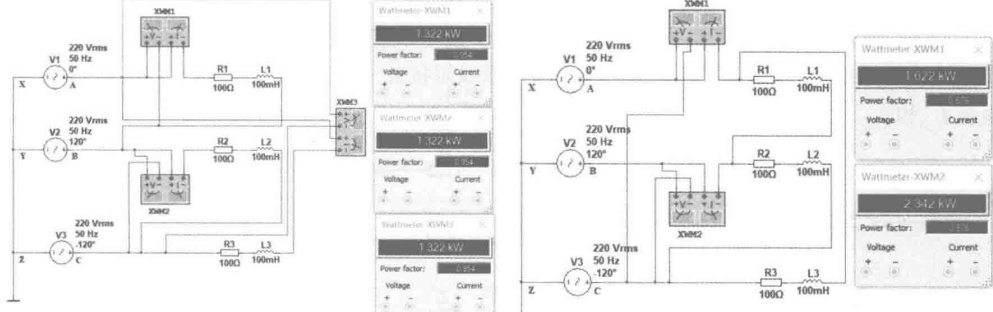

图 12-33 对称的 Y- $ \triangle $ 连接功率测量仿真
 

### 思考题

12-1 三相电源有哪两种基本连接方式？三相负载有哪两种基本连接方式？

12-2 三相电源的相和相序是指什么？有哪两种相序？

12-3 发电机发出三相电压的相序受哪些因素影响？

12-4 一台电动机的相序接错了会出现什么问题？

12-5 什么是对称三相电源？什么是对称三相负载？什么是对称三相电路？

12-6 三相电路有哪些连接方式？

12-7 星形（Y）连接的对称三相电路中，线电压与相电压有什么关系？线电流与相电流有什么关系？

12-8 三角形（△）连接的对称三相电路中，线电压与相电压有什么关系？线电流与相电流有什么关系？

12-9 星形（Y）连接的对称三相电路如何计算？

12-10 三角形（△）连接的对称三相电路如何计算？

12-11 居民生活用电为什么要采用三相四线制？三相四线制系统中，中线断开会出现什么问题？

12-12 对称三相电路的有功功率、无功功率、视在功率如何计算？

12-13 对称三相电路瞬时功率等于什么？它说明了什么？

12-14 三相电路的有功功率如何测量？

12-15 对称三相电路的无功功率如何测量？

### 习题

12-1 已知某对称星形三相电源的 A 相电压  $ \dot{U}_{AN}=220\angle30^{\circ}(V) $，求各线电压  $ \dot{U}_{AB} $、 $ \dot{U}_{BC} $ 和  $ \dot{U}_{CA} $。

<!-- page: 336 -->

12-2 一个对称星形负载与对称三相电源相接，若已知线电压 $ \dot{U}_{AB}=380\angle0^{\circ}(V) $，线电流 $ \dot{I}_{A}=10\angle-60^{\circ}(A) $，求每相负载阻抗Z等于多少？

12-3 某对称三相负载，每相阻抗为  $ Z = 40 + j30(\Omega) $，接于线电压  $ \dot{U}_1 = 380\mathrm{V} $ 的对称星形三相电源上，（1）若负载为星形连接，求负载相电压和相电流，并画出电压、电流相量图；（2）若负载为三角形连接，求负载相电流和线电流，并画出相电流和线电流的相量图。

12-4 如题 12-4 图所示电路为对称三相电路，已知负载阻抗  $ Z_L = 150 + j150(\Omega) $，传输线参数  $ X_1 = 2\Omega $， $ R_1 = 2\Omega $，负载线电压为 380V，试求电源端线电压。

12-5 如题 12-5 图所示为对称三相电源向两组星形并联负载供电电路，已知线电压为 380V，负载阻抗  $ Z_1 = 100\angle30^\circ(\Omega) $， $ Z_2 = 50\angle60^\circ(\Omega) $，端线阻抗  $ Z_1 = 10\angle45^\circ(\Omega) $，试求线电流  $ \dot{I}_A $、负载电流  $ \dot{I}_{1A} $ 和  $ \dot{I}_{2A} $。

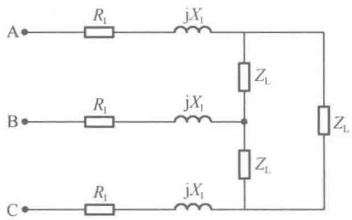

题12-4图
 

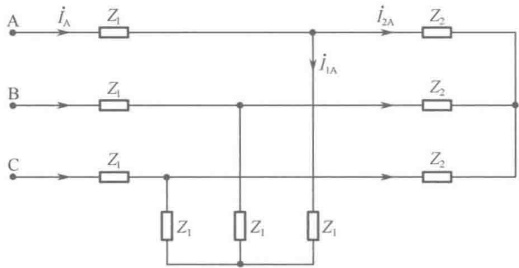

题12-5图
 

12-6 如题 12-6 图所示电路可由单相电源得到对称三相电压，作为小功率三相电路的电源。若所加单相电源的频率为 50Hz，负载每相电阻  $ R=20\Omega $，试确定电感 L 和电容 C 之值。

12-7 如题 12-7 图所示的电路接于对称三相电源上，已知电源线电压为  $ U_1 = 380\,\text{V} $，电路中  $ R = 380\,\Omega $， $ Z = 220\,\angle -30^\circ\,\Omega $，求各线电流。

12-8 如题 12-8 图所示，有一个三角形负载，每相阻抗为  $ Z = 15 + j20(\Omega) $，接在线电压为 380V 的对称三相电源上，（1）求负载相电流和线电流；（2）设 AB 相负载开路，重求负载相电流和线电流；（3）设 A 线断开，再求负载相电流和线电流。

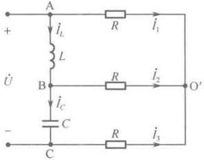

题12-6图
 

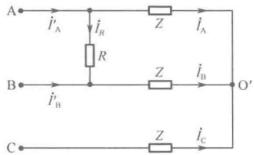

题12-7图
 

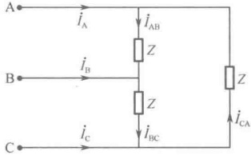

题12-8图
 

12-9 在如题 12-9 图对称三相电路中，已知电源线电压为  $ U_1 = 380\,\text{V} $，端线阻抗为  $ Z_1 = 1 + j2(\Omega) $，负载阻抗  $ Z_1 = 30 + j20(\Omega) $， $ Z_2 = 30 + j30(\Omega) $，中线阻抗  $ Z_0 = 2 + j4(\Omega) $，求总的线电流和负载各相的电流。

12-10 两组对称负载（均为感性）同时连接在电源的输出线上，如题 12-10 图所示。其中一组接成三角形，负载功率为 10kW，功率因数为 0.8；另一组接成星形，负载功率也为 10kW，功率因数为 0.855；端线阻抗为  $ Z_{1}=0.1+j0.2(\Omega) $，欲使负载端线电压保持为 380V，求电源端线电压

<!-- page: 337 -->

应为多少？

12-11 如题 12-11 图所示用二表法测三相电路的功率。已知线电压  $ U_1 = 380\,\text{V} $，线电流  $ I_1 = 5.5\,\text{A} $，负载各相阻抗角为  $ \varphi = 79^\circ $，求两只功率表的读数和电路的总功率。

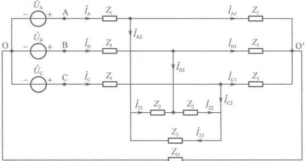

题12-9图
 

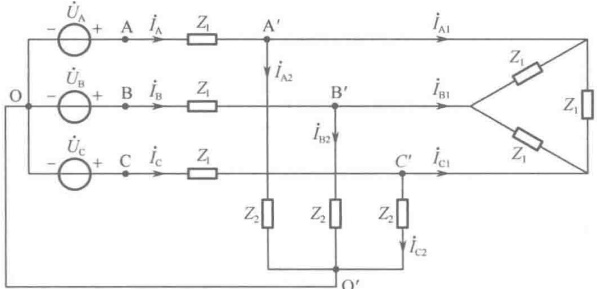

题12-10图
 

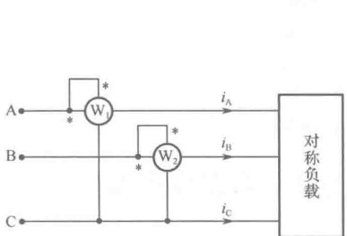

题12-11图
 

12-12 将三个复阻抗均为 Z 的负载分别接成星形和三角形，连接到同一对称三相电源的三条端线上，问哪一组负载吸收的功率大？两组负载功率在数值上有什么关系？

12-13 证明在对称三相制中，如题 12-11 图所示两只功率表的读数分别为

 $$ P_{1}=U_{1}I_{1}\cos(\varphi-30^{\circ}) $$ 

 $$ P_{2}=U_{1}I_{1}\cos(\varphi+30^{\circ}) $$ 

式中  $ P_{1} $ 和  $ P_{2} $ 分别为功率表  $ W_{1} $ 和  $ W_{2} $ 的读数， $ \varphi $ 为负载阻抗角。

12-14 如题 12-14 图所示，在对称三相制中，把功率表的电流线圈串接在 A 线中，把电压线圈跨接在 B、C 两条端线间，若功率表的读数为 P，试证明：三相负载吸收的无功功率为  $ Q = \sqrt{3}P $ 。

12-15 如题 12-15 图所示为对称三相电路，已知  $ \dot{U}_{AB} = 380\angle0^\circ(\mathrm{V}) $， $ \dot{I}_A = 1\angle -60^\circ(\mathrm{A}) $，问功率表读数各为多少？

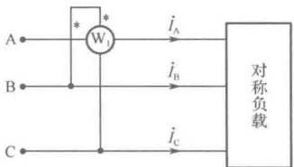

题12-14图
 

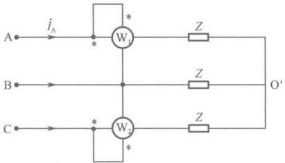

题12-15图
 

