# 13-第13章 非正弦周期信号激励下的稳态电路分析

[返回全书目录](../../README.md)

> PDF 页码：338–355

<!-- page: 338 -->

### 第13章 非正弦周期信号激励下的稳态电路分析

在实际生产中存在着大量的非正弦信号，如方波信号、三角波信号、锯齿波信号等。这些非正弦信号中，有的本身就是由非正弦信号源产生的，而有的是由正弦信号通过非线性元件后所产生的，所有这些非正弦信号根据其变化情况分为周期变化的非正弦信号和非周期变化的非正弦信号。

对于周期变化的非正弦信号，可以用傅里叶级数将其分解成一系列不同频率的简谐分量（正弦量），这些简谐分量各有一定的频率、振幅和初相，讨论它们的振幅和初相随角频率变化的分布情况，就构成了振幅频谱和相位频谱，即可构成所谓的信号频谱图。

周期变化的非正弦信号作用于线性电路时，其稳态响应可以看成由组成激励信号的各简谐分量分别作用于电路时所产生的响应的叠加。每一简谐分量都是正弦量，针对每一简谐分量作用于电路的稳态响应的求解，都可分别使用正弦稳态分析中的相量法。也就是说，叠加原理是非正弦周期信号激励下电路分析的理论基础，相量法是非正弦周期信号激励下电路分析的基本方法。通常，将建立在该理论基础之上的分析方法称为谐波分析法，本章将围绕着这一主题来展开讨论。

对于非周期变化的非正弦信号激励下的电路，在分析时可借助傅里叶积分变换，先将激励信号看成由无穷多个频率连续变化的简谐分量的叠加，再按照叠加关系进行计算。本书不讨论这方面的内容。

### 13.1 非正弦周期信号的简谐分量分解

#### 13.1.1 周期信号的分解

一个周期信号可用一个周期函数  $ f(t) $ 表示，即如果  $ f(t) $ 满足

 $$ f(t)=f(t+kT) $$ 

则  $ f(t) $ 为周期函数。式中，T 为周期函数的周期， $ k=0,1,2,\cdots $。

如果周期函数  $ f(t) $ 满足狄里克雷条件，可将周期函数  $ f(t) $ 展开成为傅里叶级数。所谓狄里克雷条件如下：

（1）在任一周期内，函数  $ f(t) $ 连续或只有有限个第一类间断点；

（2）在任一周期内，函数 $ f(t) $只有有限个极值。

第一类间断点：若 $ t_{0} $是 $ f(t) $的间断点，且左极限 $ f(t_{0}-0) $和右极限 $ f(t_{0}+0) $都存在，则 $ t_{0} $为第一类间断点。

根据数学知识可知，周期函数  $ f(t) $ 满足狄里克雷条件时，可展开为傅里叶级数，有三角函数形式和指数形式两种表示法。

1. 周期函数  $ f(t) $ 展开为三角函数形式的傅里叶级数

$$  f(t)=a_{0}+\sum_{k=1}^{\infty}(a_{k}\cos k\omega_{1}t+b_{k}\sin k\omega_{1}t)   \tag*{（13-1）}$$

式中， $ \omega_{1}=2\pi/T $，为周期函数的角频率， $ k=1,2,\cdots $； $ a_{0} $、 $ a_{k} $、 $ b_{k} $称为傅里叶系数，并且

 $$ a_{0}=\frac{1}{T}\int_{0}^{T}f(t)\mathrm{d}t=\frac{1}{T}\int_{-T/2}^{T/2}f(t)\mathrm{d}t $$

<!-- page: 339 -->

$$ \begin{aligned}&a_{k}=\frac{2}{T}\int_{0}^{T}\ f(t)\cos k\omega_{1}t\mathrm{d}t=\frac{1}{\pi}\int_{0}^{2\pi}\ f(t)\cos k\omega_{1}t\mathrm{d}(\omega_{1}t)=\frac{1}{\pi}\int_{-\pi}^{\pi}\ f(t)\cos k\omega_{1}t\mathrm{d}(\omega_{1}t)\\ &b_{k}=\frac{2}{T}\int_{0}^{T}\ f(t)\sin k\omega_{1}t\mathrm{d}t=\frac{1}{\pi}\int_{0}^{2\pi}\ f(t)\sin k\omega_{1}t\mathrm{d}(\omega_{1}t)=\frac{1}{\pi}\int_{-\pi}^{\pi}\ f(t)\sin k\omega_{1}t\mathrm{d}(\omega_{1}t)\\ \end{aligned} $$ 

对于式（13-1），将同频率的正弦项与余弦项合并，并以余弦项为参考，可写成

$$  f(t)=A_{0}+\sum_{k=1}^{\infty}A_{km}\cos(k\omega_{1}t+\psi_{k})   \tag*{（13-2）}$$

式中的恒定分量  $ A_0 $ 也称为直流分量， $ k=1 $ 时的简谐分量  $ A_{1m} \cos(\omega_1 t + \psi_1) $ 称为周期函数  $ f(t) $ 的一次谐波，或称为基波； $ k=2 $ 时的简谐分量  $ A_{2m} \cos(2\omega_1 t + \psi_2) $ 称为周期函数  $ f(t) $ 的二次谐波； $ \cdots $； $ k=n $ 时的简谐分量  $ A_{nm} \cos(n\omega_1 t + \psi_n) $ 称为周期函数  $ f(t) $ 的  $ n $ 次谐波。

式（13-1）和式（13-2）中的参数关系为

$$  \begin{aligned}&\left\{\begin{aligned}\\ &A_{0}=a_{0}\\&A_{km}=\sqrt{a_{k}^{2}+b_{k}^{2}}\\&\psi_{k}=\arctan^{-1}\left(-\frac{b_{k}}{a_{k}}\right)\\ &\end{aligned}\right.\quad\left\{\begin{aligned}&a_{k}=A_{km}\cos\psi_{k}\\&b_{k}=A_{km}\sin\psi_{k}\\ &\end{aligned}\right.\\ \end{aligned}   \tag*{（13-3）}$$

将一个周期函数  $ f(t) $ 分解为谐波的主要工作就是计算傅里叶系数。例 13-1 试求图 13-1 所示锯齿波的傅里叶级数。

解：电压 $ u(t) $在一个周期内的表达式为

 $$ u=5\times10^{3}t $$ 

锯齿波的周期  $ T = 10^{-3} $ s，基波角频率  $ \omega = \frac{2\pi}{T} = 2000\pi $ rad。

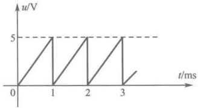

各傅里叶系数分别为

图 13-1 例 13-1 图
 

 $$ a_{0}=\frac{1}{T}\int_{0}^{T}u(t)\mathrm{d}t=\frac{1}{T}\int_{0}^{T}5000t\mathrm{d}t=2.5 $$ 

 $$ a_{k}=\frac{2}{T}\int_{0}^{T}u(t)\cos k\omega_{1}t\mathrm{d}t=\frac{2}{T}\int_{0}^{T}5000t\cos k\omega_{1}t\mathrm{d}t=0 $$ 

 $$ b_{k}=\frac{2}{T}\int_{0}^{T}u(t)\sin k\omega_{1}t\mathrm{d}t=\frac{2}{T}\int_{0}^{T}5000t\sin k\omega_{1}t\mathrm{d}t=-5/\mathrm{k}\pi $$ 

所以， $ u(t) $ 的傅里叶级数展开式为

 $$ u(t)=2.5-\frac{5}{\pi}(\sin\omega t+\frac{1}{2}\sin2\omega t+\frac{1}{3}\sin3\omega t+\cdots) $$ 

2. 周期函数  $ f(t) $ 展开成为指数形式的傅里叶级数

将一个周期函数  $ f(t) $ 分解成三角函数形式的傅里叶级数时，虽然含义很清楚，但其表达并不简洁。于是，可利用指数形式的傅里叶级数来描述周期函数  $ f(t) $。

根据欧拉公式

 $$ \left\{\begin{aligned}\mathrm{e}^{\mathrm{j}\omega}&=\cos\omega+\mathrm{j}\sin\omega\\ \mathrm{e}^{-\mathrm{j}\omega}&=\cos\omega-\mathrm{j}\sin\omega\end{aligned}\right. $$ 

可将式（13-1）写成

 $$ f(t)=a_{0}+\sum_{k=1}^{\infty}\left(a_{k}\frac{\mathrm{e}^{\mathrm{j}k\omega_{1}t}+\mathrm{e}^{-\mathrm{j}k\omega_{1}t}}{2}+b_{k}\frac{\mathrm{e}^{\mathrm{j}k\omega_{1}t}-\mathrm{e}^{-\mathrm{j}k\omega_{1}t}}{2\mathrm{j}}\right) $$

<!-- page: 340 -->

$$ =a_{0}+\sum_{k=1}^{\infty}\left(\frac{a_{k}-\mathrm{jb}_{k}}{2}\mathrm{e}^{\mathrm{jk}\omega_{1}t}+\frac{a_{k}+\mathrm{jb}_{k}}{2}\mathrm{e}^{-\mathrm{jk}\omega_{1}t}\right) $$ 

令 $ k=-k' $，可得

 $$ f(t)=a_{0}+\sum_{k=1}^{\infty}\left(\frac{a_{k}-\mathrm{jb}_{k}}{2}\mathrm{e}^{\mathrm{jk}\omega_{k}t}+\frac{a_{-k^{\prime}}+\mathrm{jb}_{-k^{\prime}}}{2}\mathrm{e}^{\mathrm{jk}^{\prime}\omega_{k}t}\right) $$ 

因为

 $$ a_{-k^{\prime}}=\frac{2}{T}\int_{0}^{T}f(t)\cos(-k^{\prime})\omega_{1}t\mathrm{d}t=\frac{2}{T}\int_{0}^{T}f(t)\cos k^{\prime}\omega_{1}t\mathrm{d}t=a_{k}, $$ 

 $$ b_{-k^{\prime}}=\frac{2}{T}\int_{0}^{T}f(t)\sin(-k^{\prime})\omega_{1}t\mathrm{d}t=-\frac{2}{T}\int_{0}^{T}f(t)\sin k^{\prime}\omega_{1}t\mathrm{d}t=-b_{k^{\prime}} $$ 

所以

 $$ \begin{align*}f(t)&=a_{0}+\sum_{k=1}^{\infty}\left(\frac{a_{k}-\mathrm{jb}_{k}}{2}\mathrm{e}^{\mathrm{jk}\omega_{1}t}+\frac{a_{-k^{\prime}}+\mathrm{jb}_{-k^{\prime}}}{2}\mathrm{e}^{\mathrm{jk}^{\prime}\omega_{1}t}\right)\\&=a_{0}+\sum_{k=1}^{\infty}\left(\frac{a_{k}-\mathrm{jb}_{k}}{2}\right)\mathrm{e}^{\mathrm{jk}\omega_{1}t}+\sum_{k^{\prime}=-1}^{-\infty}\left(\frac{a_{k^{\prime}}-\mathrm{jb}_{k^{\prime}}}{2}\right)\mathrm{e}^{\mathrm{jk}^{\prime}\omega_{1}t}\\&=a_{0}+\sum_{k=-\infty\atop k\neq0}^{\infty}\left(\frac{a_{k}-\mathrm{jb}_{k}}{2}\right)\mathrm{e}^{\mathrm{jk}\omega_{1}t}=\sum_{k=-\infty}^{\infty}c_{k}\mathrm{e}^{\mathrm{jk}\omega_{1}t}\end{align*} $$ 

即

$$  f(t)=\sum_{k=-\infty}^{\infty}c_{k}\mathrm{e}^{\mathrm{j}k\omega_{1}t}   \tag*{（13-4）}$$

式（13-4）称为指数形式的傅里叶级数，式中的傅里叶系数为

 $$ \left\{\begin{aligned}c_{0}&=a_{0}=\frac{1}{T}\int_{0}^{T}f(t)\mathrm{d}t,\qquad& 当 k=0 时 \\ c_{k}&=\frac{a_{k}-\mathrm{j}b_{k}}{2}=\frac{1}{T}\int_{0}^{T}f(t)(\cos k\omega_{1}t-\mathrm{j}\sin k\omega_{1}t)\mathrm{d}t=\frac{1}{T}\int_{0}^{T}f(t)\mathrm{e}^{-\mathrm{j}k\omega_{1}t}\mathrm{d}t,\quad& 当 k\neq0 时 \end{aligned}\right. $$ 

#### 13.1.2 周期信号的频谱

使用频谱图可以直观地了解周期信号分解为傅里叶级数后包含哪些谐波分量，各谐波分量所占的比重和相互关系。频谱图分为振幅频谱和相位频谱。

# 1. 振幅频谱

将周期信号中各次谐波的振幅大小按其角频率依次排列的分布图称为振幅频谱，其纵坐标表示振幅，横坐标表示角频率。

# 2. 相位频谱

将周期信号中各次谐波的初相角按其角频率依次排列的分布图称为相位频谱，其纵坐标表示相位，横坐标表示角频率。

注意，当振幅相量为正实数时，初相角记为 0；当振幅相量为负实数时，初相角记为  $ \pi $。

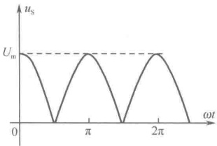

例 13-2 如图 13-2 中所示的  $ u_s $ 是一个全波整流电压，其中  $ U_m = 157\text{V} $， $ \omega = 314\text{rad/s} $，试将  $ u_s $ 展开成三角函数形式和指数形式的傅里叶级数，并画出频谱图。

图 13-2 例 13-2 图
 

解：（1）因为 $ u_{S}(t) $对称于纵轴，为偶函数，所以系数 $ b_{k}=0 $，只存在 $ a_{0} $和 $ a_{k} $；又因为 $ u_{S}(t)=u_{S}(t\pm T/2) $，波形为半波对称，所以系数 $ a_{k} $中只含偶数项。即

 $$ a_{0}=\frac{1}{T}\int_{-T/2}^{T/2}u_{\mathrm{S}}(t)\mathrm{d}t=\frac{4}{T}\int_{0}^{T/4}U_{\mathrm{m}}\cos\omega_{1}t\mathrm{d}t=\frac{4U_{\mathrm{m}}}{T\omega_{1}}\int_{0}^{\pi/2}\cos\omega_{1}t\mathrm{d}(\omega_{1}t) $$

<!-- page: 341 -->

$$ \begin{aligned}&=\frac{4U_{\mathrm{m}}}{T\omega_{1}}\sin\omega_{1}t\Bigg|_{0}^{\frac{\pi}{2}}=\frac{2U_{\mathrm{m}}}{\pi}=100\mathrm{V}\\a_{k}=&\frac{1}{T}\int_{-T/2}^{T/2}u_{\mathrm{s}}(t)\cos k\omega_{1}t\mathrm{d}t=\frac{8}{T}\int_{0}^{T/4}U_{\mathrm{m}}\cos\omega_{1}t\cos k\omega_{1}t\mathrm{d}t=\frac{4U_{\mathrm{m}}}{\pi}\int_{0}^{\frac{1}{\pi/2}}\cos\omega_{1}t\cos k\omega_{1}t\mathrm{d}(\omega_{1}t)\\=&\frac{2U_{\mathrm{m}}}{\pi}\Bigg[\frac{\sin(k+1)\omega_{1}t}{k+1}+\frac{\sin(k-1)\omega_{1}t}{k-1}\Bigg]\Bigg|_{0}^{\frac{\pi}{2}}=\frac{2U_{\mathrm{m}}}{\pi}\left[\frac{(k-1)\sin(k+1)\frac{\pi}{2}+(k+1)\sin(k-1)\frac{\pi}{2}}{k^{2}-1}\right]\\=&\begin{cases}0,&k=1,3,5,\cdots\\-\frac{200}{k^{2}-1}\cos k\frac{\pi}{2},&k=2,4,6,\cdots\end{cases}\end{aligned} $$ 

所以，三角函数形式的傅里叶级数展开式为

 $$ \begin{align*}u_{\mathrm{S}}(t)=&100+\sum_{k=1}^{\infty}a_{k}\cos k\omega_{1}t=100+\sum_{k=1}^{\infty}\left(-\frac{200}{k^{2}-1}\cos k\frac{\pi}{2}\right)\cos k\omega_{1}t\\=&100+66.67\cos2\omega_{1}t-13.33\cos4\omega_{1}t+\cdots\end{align*} $$ 

（2）又知

 $$ \begin{align*}C_{k}=&\frac{1}{T}\int_{0}^{T}u_{\mathrm{S}}(t)\mathrm{e}^{-\mathrm{j}k\omega_{l}t}\mathrm{d}t=\frac{1}{T}\int_{-T/2}^{T/2}u_{\mathrm{S}}(t)\mathrm{e}^{-\mathrm{j}k\omega_{l}t}\mathrm{d}t=\frac{1}{\omega_{1}T}\int_{-\pi}^{\pi}u_{\mathrm{S}}(t)\mathrm{e}^{-\mathrm{j}k\omega_{l}t}\mathrm{d}(\omega_{1}t)\\=&\frac{1}{2\pi}\int_{-\pi}^{\pi}u_{\mathrm{S}}(t)\mathrm{e}^{-\mathrm{j}k\omega_{l}t}\mathrm{d}(\omega_{1}t)\end{align*} $$ 

因为 $ u_{s}(t) $可用分段函数描述为

 $$ u_{\mathrm{S}}(t)=\left\{\begin{aligned}&-\cos\omega t,\quad&-\pi\leq\omega_{1}t\leq-\pi/2\\ &\cos\omega t,\quad&-\pi/2\leq\omega_{1}t\leq\pi/2\\ &-\cos\omega t,\quad&\pi/2\leq\omega_{1}t\leq\pi\end{aligned}\right. $$ 

对  $ C_k $ 进行分段积分，并利用积分式  $ \int \cos px e^{ax} \, dx = \frac{e^{ax}(a \cos px + p \sin px)}{a^2 + p^2} $，可得

 $$ C_{k}=\left\{\begin{aligned}&0,&k 为奇数 \\ &-\frac{100}{k^{2}-1}\cos k\frac{\pi}{2},&k 为偶数 \end{aligned}\right. $$ 

所以，指数形式的傅里叶级数展开式为

 $$ u_{s}(t)=\sum_{k=-\infty}^{\infty}C_{k}\mathrm{e}^{jk\omega_{1}t}=-100\sum_{k=-\infty}^{\infty}\frac{\cos k\frac{\pi}{2}}{k^{2}-1}\mathrm{e}^{jk\omega_{1}t},\quad k 为偶数 $$ 

##### （3）描绘频谱图

由三角函数形式的傅里叶级数展开式可得幅值

 $ a_{2}=\frac{200}{k^{2}-1}=66.67,\quad a_{4}=-13.33,\quad a_{6}=5.71,\quad a_{8}=-3.17 $

由于 $ u_{S}(t)=100+\sum_{k=1}^{\infty}a_{k}\cos k\omega_{1}t=100+\sum_{k=1}^{\infty}\left(-\frac{200}{k^{2}-1}\cos k\frac{\pi}{2}\right)\cos k\omega_{1}t $，因此

当 $ k=2 $时，振幅相量 $ \left(-\frac{200}{k^{2}-1}\cos k\frac{\pi}{2}\right) $为正实数，故取初相为0；

<!-- page: 342 -->

② 当 $k=4$ 时，振幅相量 $\left(-\frac{200}{k^2-1}\cos k\frac{\pi}{2}\right)$ 为负实数，故取初相为 $\pi$；

③ 当 k=6 时，振幅相量 $ \left(-\frac{200}{k^{2}-1}\cos k\frac{\pi}{2}\right) $为正实数，故取初相为0；

④ 当 k=8 时，振幅相量 $ \left(-\frac{200}{k^{2}-1}\cos k\frac{\pi}{2}\right) $为负实数，故取初相为 $ \pi $；于是，可描绘出振幅频谱和相位频谱如图13-3所示。

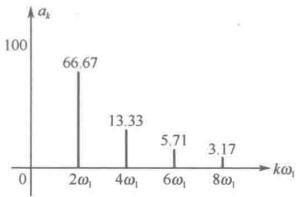

（a）振幅频谱
 

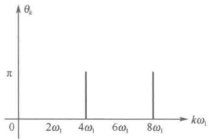

（b）相位频谱
 

图 13-3 三角函数展开式的频谱图
 

由指数函数形式的傅里叶级数展开式可得幅值

 $$ c_{2}=\frac{100}{k^{2}-1}=33.33,\ c_{4}=-6.67,\ c_{6}=2.86,\ c_{8}=-1.58,\ \cdots $$ 

由于 $ u_S(t) = \sum_{k=-\infty}^{\infty} C_k e^{jk\omega_t} = -100 \sum_{k=-\infty}^{\infty} \frac{\cos k\frac{\pi}{2}}{k^2 - 1} e^{jk\omega_t} $，因此，

① 当 k=2 时，振幅相量  $ \left(-\frac{100}{k^{2}-1}\cos k\frac{\pi}{2}\right) $ 为正实数，故取初相为 0；

② 当 $k=4$ 时，振幅相量 $\left(-\frac{100}{k^2-1}\cos k\frac{\pi}{2}\right)$ 为负实数，故取初相为 $\pi$；

③ 当  $ k=6 $ 时，振幅相量  $ \left(-\frac{100}{k^2-1}\cos k\frac{\pi}{2}\right) $ 为正实数，故取初相为 0；

④ 当 k=8 时，振幅相量  $ \left(-\frac{100}{k^{2}-1}\cos k\frac{\pi}{2}\right) $ 为负实数，故取初相为  $ \pi $；于是，可描绘出振幅频谱和相位频谱如图 13-4 所示。

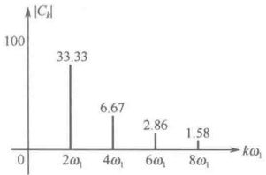

（a）振幅频谱
 

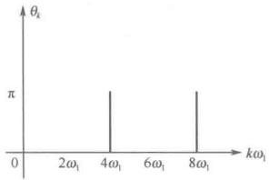

（b）相位频谱
 

图 13-4 指数函数展开式的频谱图
 

注意，从本例可以看出，指数形式下的振幅频谱中谱线的高度（模）只是三角函数展开式的振幅频谱的一半。

<!-- page: 343 -->

### 13.2 非正弦周期信号的有效值、平均值和平均功率

#### 13.2.1 非正弦周期信号的有效值

第9章曾给出了正弦信号有效值的定义。对于任意非正弦周期信号 $ f(t) $，仍然可沿用前面的定义，即任意非正弦周期信号 $ f(t) $的有效值定义为

$$  F=\sqrt{\frac{1}{T}\int_{0}^{T}f^{2}(t)\mathrm{d}t}   \tag*{（13-5）}$$

根据式（13-2），设非正弦周期电流 $ i(t) $的傅里叶展开式为

$$  i(t)=I_{0}+\sum_{k=1}^{\infty}I_{km}\cos(k\omega_{1}t+\psi_{k})   \tag*{（13-6）}$$

则其有效值为

 $$ I=\sqrt{\frac{1}{T}\int_{0}^{T}i^{2}(t)\mathrm{d}t}=\sqrt{\frac{1}{T}\int_{0}^{T}[I_{0}+\sum_{k=1}^{\infty}I_{km}\cos(k\omega_{1}t+\psi_{k})]^{2}\mathrm{d}t} $$ 

式中的平方项展开得

 $$ \begin{align*}\frac{1}{T}\int_{0}^{T}I_{0}^{2}\mathrm{d}t+\frac{1}{T}\int_{0}^{T}I_{km}^{2}\cos^{2}(k\omega_{1}t+\psi_{k})\mathrm{d}t+\frac{1}{T}\int_{0}^{T}2I_{0}I_{km}\cos(k\omega_{1}t+\psi_{k})\mathrm{d}t+\\+\frac{1}{T}\int_{0}^{T}2I_{km}\cos(k\omega_{1}t+\psi_{k})I_{qm}\cos(q\omega_{1}t+\psi_{q})\mathrm{d}t\Big|_{(k\neq q)}\end{align*} $$ 

后两项在一个周期内的积分为零，故上式为

$$  \begin{aligned}I=&\sqrt{\frac{1}{T}\int_{0}^{T}i^{2}(t)\mathrm{d}t}=\sqrt{\frac{1}{T}\int_{0}^{T}I_{0}^{2}\mathrm{d}t+\frac{1}{T}\int_{0}^{T}I_{km}^{2}\cos^{2}(k\omega_{1}t+\psi_{k})\mathrm{d}t}\\=&\sqrt{I_{0}^{2}+\left(\frac{I_{1m}}{\sqrt{2}}\right)^{2}+\left(\frac{I_{2m}}{\sqrt{2}}\right)^{2}+\cdots+\left(\frac{I_{km}}{\sqrt{2}}\right)^{2}}=\sqrt{I_{0}^{2}+I_{1}^{2}+I_{2}^{2}+\cdots+I_{k}^{2}}\end{aligned}   \tag*{（13-7）}$$

同理，若非正弦周期电压 $ u(t) $的傅里叶展开式为

$$  u(t)=U_{0}+\sum_{k=1}^{\infty}U_{km}\cos(k\omega_{1}t+\psi_{k})   \tag*{（13-8）}$$

则其有效值为

$$  U=\sqrt{U_{0}^{2}+U_{1}^{2}+U_{2}^{2}+\cdots+U_{k}^{2}}   \tag*{（13-9）}$$

式中， $ U_{k}=U_{km}/\sqrt{2} $。

综上所述，可以得出结论：非正弦周期信号的有效值等于其恒定分量的平方与各次谐波分量有效值的平方和的正平方根。

例 13-3 求下列非正弦周期信号的有效值：

 $$ i(t)=1+2\sqrt{2}\cos100t+\sqrt{2}\cos200t $$ 

（2）

 $$ u(t)=220\sqrt{2}\cos(\omega t-120^{\circ})+50\sqrt{2}\cos3\omega t+10\sqrt{2}(5\omega t+120^{\circ}) $$ 

解：（1）由题知，非正弦周期电流各次谐波分量的有效值分别为 $ I_{0}=1A $， $ I_{1}=2A $， $ I_{2}=1A $，根据式（13-7）可得

 $$ I=\sqrt{I_{0}^{2}+I_{1}^{2}+I_{2}^{2}}=\sqrt{1+4+1}=\sqrt{6}=2.45A $$ 

（2）由题知，非正弦周期电压各次谐波分量的有效值分别为 $ U_{1}=220V $， $ U_{3}=50V $， $ U_{5}=10V $，根据式（13-9）可得

 $$ U=\sqrt{U_{1}^{2}+U_{3}^{2}+U_{5}^{2}}=\sqrt{220^{2}+50^{2}+10^{2}}=225.83V $$

<!-- page: 344 -->

#### 13.2.2 非正弦周期信号的平均值

根据数学知识可知，一个函数  $ f(t) $ 的平均值  $ F_{av} $ 的计算如下：

$$  F_{av}=\frac{1}{T}\int_{0}^{T}f(t)\mathrm{d}t   \tag*{（13-10）}$$

显然，按照式（13-10）计算任意非正弦周期信号  $ f(t) $ 的平均值时，由于各次谐波都是频率不同的正弦波，它们关于横轴对称，因此，计算所得结果应为  $ f(t) $ 中的恒定分量（直流分量） $ F_{0} $，即

$$  \left.\begin{array}{r}I_{0}=\frac{1}{T}\int_{0}^{T}\ i(t)\mathrm{d}t\\ U_{0}=\frac{1}{T}\int_{0}^{T}\ u(t)\mathrm{d}t\end{array}\right\}   \tag*{（13-11）}$$

那么，如果要计算包含各次谐波的平均值，则必须采用绝对值的平均值，即所谓的“均绝值”进行计算，定义为

$$  F_{aa}=\frac{1}{T}\int_{0}^{T}\left|f(t)\right|\mathrm{d}t   \tag*{（13-12）}$$

对于任意非正弦周期信号  $ f(t) $ 的均绝值，由于各次谐波都关于横轴对称，故可只取半个周期计算，即

$$  F_{aa}=\frac{2}{T}\int_{0}^{T/2}\left|f(t)\right|\mathrm{d}t   \tag*{（13-13）}$$

在电子技术应用中，整流电路的输出波形就是均绝值。比如正弦电流的均绝值为

$$  I_{\mathrm{aa}}=\frac{2}{T}\int_{0}^{T/2}\left|I_{\mathrm{m}}\cos\omega t\right|\mathrm{d}t=\frac{2I_{\mathrm{m}}}{\pi}=0.637I_{\mathrm{m}}=0.898I   \tag*{（13-14）}$$

例 13-4 电路如图 13-5（a）所示， $ u(t) $ 为矩形方波，如图 13-5（b）所示，试求其端口电流  $ i(t) $ 的有效值、平均值和均绝值。

解：根据理想二极管 VD 的导通和截止状况，可得端口电流的波形如图 13-6 所示。

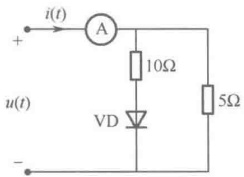

(a)
 

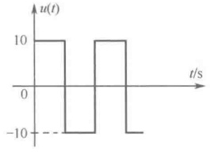

（b）
 

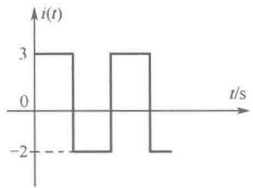

图 13-5 例 13-4 图之一
 

图 13-6 例 13-4 图之二
 

于是可得

有效值

 $$ I=\sqrt{\frac{1}{T}\int_{0}^{T}i^{2}(t)dt}=\sqrt{\frac{1}{T}\left(9\times\frac{T}{2}+4\times\frac{T}{2}\right)}=2.55A $$ 

平均值

 $$ I_{0}=\frac{1}{T}\int_{0}^{T}i(t)\mathrm{d}t=\frac{1}{T}\left(3\times\frac{T}{2}-2\times\frac{T}{2}\right)=0.5A $$ 

均绝值

 $$ I_{a}=\frac{1}{T}\int_{0}^{T}\left|i(t)\right|\mathrm{d}t=\frac{1}{T}\left(3\times\frac{T}{2}+2\times\frac{T}{2}\right)=2.5\mathrm{A} $$

<!-- page: 345 -->

#### 13.2.3 非正弦周期信号的平均功率

设电路输入端口的电压和电流分别为

 $$ \left\{\begin{aligned}u(t)&=U_{0}+\sum_{k=1}^{\infty}U_{km}\cos(k\omega_{1}t+\psi_{uk})\\ i(t)&=I_{0}+\sum_{k=1}^{\infty}I_{km}\cos(k\omega_{1}t+\psi_{ik})\end{aligned}\right. $$ 

若 $ u(t) $、 $ i(t) $取关联参考方向，则其平均功率为

$$  P=\frac{1}{T}\int_{0}^{T}u(t)i(t)\mathrm{d}t=U_{0}I_{0}+\sum_{k=1}^{\infty}U_{k}I_{k}\cos\psi_{k}=P_{0}+P_{1}+P_{2}+\cdots+P_{k}+\cdots   \tag*{（13-15）}$$

上式所得结果运用了三角函数的正交性，即不同频率的电压与电流的乘积在一个周期内的积分等于零。式中， $ U_{k}=U_{km}/\sqrt{2} $， $ I_{k}=I_{km}/\sqrt{2} $， $ \psi_{k}=\psi_{uk}-\psi_{ik} $。

从式（13-15）可得出结论：非正弦周期信号电路的平均功率等于恒定分量构成的功率与各次谐波构成的平均功率之和。

注意，只有频率相同的电压和电流才能构成平均功率，频率不同的电压和电流只构成瞬时功率。

例 13-5 已知某电路的激励为  $ u_{S}(t)=50+50\cos500t+30\cos1000t+20\cos1500t $，电路的响应为  $ i(t)=1.663\cos(500t+86.19^{\circ})+15\cos1000t+1.191\cos(1500t-83.16^{\circ}) $，试求：（1）激励和响应的有效值；（2）电路消耗的平均功率。

解：（1）激励的有效值为

 $$ U_{S}=\sqrt{U_{0}^{2}+U_{1}^{2}+U_{2}^{2}+U_{3}^{2}}=\sqrt{50^{2}+\left(\frac{50}{\sqrt{2}}\right)^{2}+\left(\frac{30}{\sqrt{2}}\right)^{2}+\left(\frac{20}{\sqrt{2}}\right)^{2}}=\sqrt{4400}=66.33V $$ 

响应的有效值为  $ I=\sqrt{I_{1}^{2}+I_{2}^{2}+I_{3}^{2}}=\sqrt{\left(\frac{1.663}{\sqrt{2}}\right)^{2}+\left(\frac{15}{\sqrt{2}}\right)^{2}+\left(\frac{1.191}{\sqrt{2}}\right)^{2}}=10.7\mathrm{~A} $

（2）电路消耗的平均功率为

 $$ \begin{aligned}P&=P_{0}+P_{1}+P_{2}+P_{3}\\&=50\times0+\frac{50}{\sqrt{2}}\times\frac{1.663}{\sqrt{2}}\cos(0^{\circ}-86.19^{\circ})+\frac{30}{\sqrt{2}}\times\frac{15}{\sqrt{2}}\cos(0^{\circ}-0^{\circ})+\frac{20}{\sqrt{2}}\times\frac{1.191}{\sqrt{2}}\cos(0^{\circ}+83.16^{\circ})\\&=229.18W\end{aligned} $$ 

### 13.3 非正弦周期信号激励下的稳态电路分析

当电路的激励是非正弦周期电源，或者电路的激励由几个不同频率的独立电源构成时，这样的电路就属于非正弦周期信号激励的电路。对这样的电路进行稳态分析时必须依据叠加原理，利用相量法分别计算各个谐波分量所产生的响应，最后再将所有结果在时域内进行叠加。

具体的分析步骤如下：

（1）将时域中给定的周期函数按照傅里叶级数展开，得到一系列不同频率的谐波分量。注意，这一步完成了从时域到频域的变换，但由于傅里叶级数是一个无穷级数，因此，变换后的谐波取到哪一项为止，要由所需的精度确定。

（2）若激励为电压源，则分解后的各次谐波电压源视为相串联；若激励为电流源，则分解后的各次谐波电流源视为相并联。

<!-- page: 346 -->

（3）对于恒定分量激励（直流激励），运用直流电路的分析方法进行求解；对于各次谐波激励，运用正弦交流电路的相量法分别计算电路对各次谐波激励的响应。

注意，在计算各次谐波激励的响应时，应注意容抗和感抗是频率的函数，即第 k 次谐波的容抗为  $ X_{Ck} = \frac{1}{k\omega_1 C} = \frac{1}{k} X_C $。（ $ X_C = \frac{1}{\omega_1 C} $ 为基波容抗），第 k 次谐波的感抗为  $ X_{Lk} = k\omega_1 L = k X_L $（ $ X_L = \omega_1 L $ 为基波感抗）。

（4）将各次谐波激励的响应写成时域形式后，再根据叠加定理在时域内将各响应进行叠加，即得电路总的稳态响应。

注意，不能在频域内进行各次谐波相量的叠加，因为各次谐波相量所隐含的频率不同。

例 13-6 电路如图 13-7 所示，已知  $ u_s(t) = 100 + 276\cos\omega_1t + 100\cos3\omega_1t + 50\cos9\omega_1t $， $ R = 20\Omega $， $ \omega_1L_1 = 0.625\Omega $， $ \omega_1L_2 = 5\Omega $， $ 1/\omega_1C = 45\Omega $，求电流  $ i(t) $。

解：题目所给非正弦周期信号已分解成傅里叶级数，其中恒定分量  $ U_0 = 100\text{V} $，基波分量  $ u_1 = 276\cos\omega_1 t\text{(V)} $，三次谐波分量  $ u_3 = 100\cos3\omega_1 t\text{(V)} $，九次谐波分量  $ u_9 = 50\cos9\omega_1 t\text{(V)} $，根据叠加原理，可将电路视为图 13-8 所示的电路。

下面分别计算各次谐波激励的响应。

（1）直流激励 $ U_{0}=100V $，此时电路如图13-9所示，故 $ I_{0}=U_{0}/R=100/20=5A $。

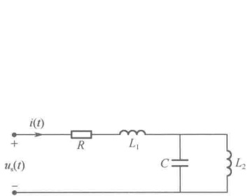

图 13-7 例 13-6 图之一
 

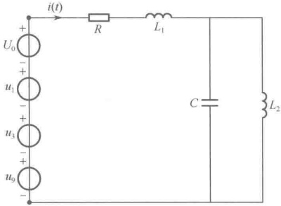

图 13-8 例 13-6 图之二
 

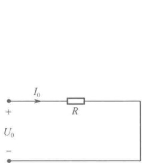

图 13-9 例 13-6 图之三
 

（2）基波激励 $ u_1 = 276\cos\omega_1t $（V）， $ \dot{U}_{1m} = 276\angle0^\circ $，此时电路如图13-10所示。

因为

 $$ Z_{1}(\omega_{1})=R+\mathrm{j}\omega_{1}L_{1}+\left(\mathrm{j}\omega_{1}L_{2}//\frac{1}{\mathrm{j}\omega_{1}C}\right)=20+\mathrm{j}6.25=20.95\angle17.4^{\circ} $$ 

 $$ \dot{I}_{1m}=\frac{\dot{U}_{1m}}{Z_{1}(\omega_{1})}=\frac{276\angle0^{\circ}}{20.95\angle17.4^{\circ}}=13.17\angle-17.4^{\circ}(\mathrm{A}) $$ 

故

（3）三次谐波激励 $ u_3=100\cos3\omega_1t $（V）， $ \dot{U}_{3m}=100\angle0^\circ $，此时电路如图13-11所示。因为 $ \mathrm{j}3\omega_1L_2=\mathrm{j}15 $， $ \frac{1}{\mathrm{j}3\omega_1C}=-\mathrm{j}15 $，故 $ L_2 $与 $ C $发生并联谐振，有 $ Z_3(3\omega_1)=\infty $，故 $ \dot{I}_{3m}=0 $。

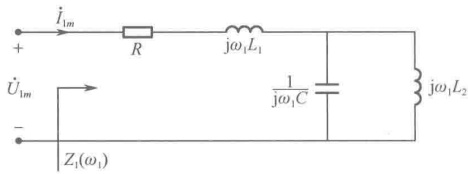

图 13-10 例 13-6 图之四
 

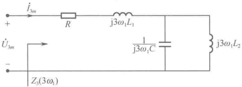

图 13-11 例 13-6 图之五
 

<!-- page: 347 -->

（4）九次谐波激励 $ u_9 = 50\cos 9\omega_1 t $（V）， $ \dot{U}_{9m} = 50\angle 0^\circ $，此时电路如图13-12所示。

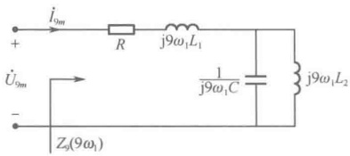

 $$ \begin{aligned}Z_{9}(9\omega_{1})&=R+\mathrm{j}9\omega_{1}L_{1}+\left(\mathrm{j}9\omega_{1}L_{2}//\frac{1}{\mathrm{j}9\omega_{1}C}\right)\\&=20+\mathrm{j}5.625-\mathrm{j}5.625=20\Omega\end{aligned} $$ 

图 13-12 例 13-6 图之六
 

 $$ \dot{I}_{9m}=\frac{\dot{U}_{9m}}{Z_{9}(9\omega_{1})}=\frac{50\angle0^{\circ}}{20}=2.5\angle0^{\circ}(\mathrm{A}) $$ 

最后将各次谐波激励的响应写成时域形式后，再根据叠加定理在时域内将各响应进行叠加，即得电流 $ i(t) $为

 $$ i(t)=I_{0}+i_{1}(t)+i_{3}(t)+i_{9}(t)=5+13.17\cos(\omega_{1}t-17.4^{\circ})+2.5\cos9\omega_{1}t(\mathrm{A}) $$ 

例 13-7 如图 13-13 所示为一滤波电路，已知  $ u_1(t) = U_{m1} \cos \omega_1 t + U_{m3} \cos 3\omega_1 t $，若要求输出  $ u_2(t) = U_{m1} \cos \omega_1 t $，问  $ C_1 $、 $ C_2 $ 应满足什么条件？

解：由图13-13所示电路可知 $ u_{2}=Ri_{2} $，本题要求 $ u_{2} $中无三次谐波，其实是要使 $ i_{2} $中无三次谐波。要达到滤掉三次谐波的目的，必须有 $ Z(3\omega_{1})=\infty $，即让 $ L_{1} $和 $ C_{1} $对三次谐波发生并联谐振，这时

$$  3\omega_{1}L_{1}=\frac{1}{3\omega_{1}C_{1}}   \tag*{（13-16）}$$

题目还要求，当一次谐波作用时信号直通，即  $ u_2 = u_{1(1)} = U_{m1} \cos \omega_1 t $， $ Z(\omega_1) = R $，这时应有  $ L_1 $、 $ C_1 $ 和  $ C_2 $ 对一次谐波发生串联谐振，即

 $$ \frac{\mathrm{j}\omega_{1}L_{1}\times\frac{1}{\mathrm{j}\omega_{1}C_{1}}}{\mathrm{j}\omega_{1}L_{1}+\frac{1}{\mathrm{j}\omega_{1}C_{1}}}+\frac{1}{\mathrm{j}\omega_{1}C_{2}}=0 $$ 

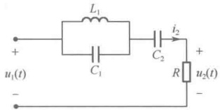

 $$ 1-\omega_{1}^{2}L_{1}(C_{1}+C_{2})=0 $$ 

整理得

图 13-13 例 13-7 图
 

将式（13-16）代入式（13-17）可得

 $$ C_{2}=8C_{1} $$ 

例 13-8 电路如图 13-14 所示，已知  $ u_s $ 为非正弦周期电压源， $ I_{s1} $ 和  $ I_{s2} $ 均为直流源，当  $ R_1 = 1\Omega $ 时， $ i = 3.6 + 2.4\cos500t $，若将  $ R_1 $ 改为  $ 2\Omega $，试求电压 u 和  $ R_1 $ 消耗的平均功率。

解：先用戴维宁定理求 a、b 端口的等效电路，从 a、b 端口看进去的电路如图 13-15 所示。再用 Y/△转换可求得  $ R_{ab} = 4\Omega $，电路可化简为图 13-16 所示。

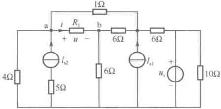

图 13-14 例 13-8 图之一
 

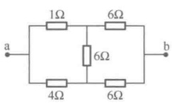

图 13-15 例 13-8 图之二
 

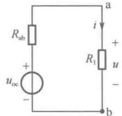

由题意，当 $ R_1=1\Omega $时， $ i=3.6+2.4\cos500t $，所以 $ u_{oc}=R_{ab}i+u=18+12\cos500t $。

图 13-16 例 13-8 图之三
 

<!-- page: 348 -->

当 $ R_{1}=2\Omega $时， $ i=\frac{u_{\mathrm{oc}}}{R_{\mathrm{ab}}+R_{1}}=3+2\cos500t $，所以

 $$ u=R_{1}i=6+4\cos500t $$ 

 $ R_{1} $ 消耗的平均功率为

 $$ P=R_{1}I_{0}^{2}+R_{1}I_{(1)}^{2}=2\left[3^{2}+\left(\frac{2}{\sqrt{2}}\right)^{2}\right]=22\mathrm{W} $$ 

例13-9 电路如图13-17所示，已知 $ u(t)=10+80\cos(\omega_1t+30^\circ)+18\cos3\omega_1t $， $ R=6\Omega $， $ \omega_1L=2\Omega $， $ 1/\omega_1C=18\Omega $，试求电流 $ i(t) $和各电表的读数。

解：由叠加原理，当 $ u(t) $中的直流分量作用于电路时，电容开路，所以 $ I_0=0 $；

当 $ u(t) $中的基波分量作用于电路时， $ \dot{U}_{(1)}=\frac{80}{\sqrt{2}} $

 $ \angle30^{\circ} $，所以

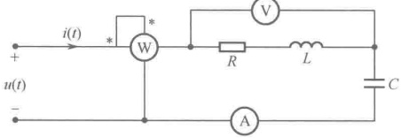

图 13-17 例 12-9 图
 

 $$ \dot{I}_{(1)}=\frac{\dot{U}_{(1)}}{R+\mathrm{j}\left(\omega_{1}L-\frac{1}{\omega_{1}C}\right)}=\frac{\frac{80}{\sqrt{2}}\angle30^{\circ}}{6+\mathrm{j}(2-18)}=\frac{4.68}{\sqrt{2}}\angle99.4^{\circ} $$ 

有

 $$ \dot{U}_{R L(1)}=(R+\mathrm{j}\omega_{1}L)\dot{I}_{(1)}=(6+\mathrm{j}2)\frac{4.68}{\sqrt{2}}\angle99.4^{\circ}=\frac{29.6}{\sqrt{2}}\angle117.8^{\circ} $$ 

当 $ u(t) $中的三次谐波分量作用于电路时， $ \dot{U}_{(3)}=\frac{18}{\sqrt{2}}\angle0^{\circ} $，而由于 $ 3\omega_{1}L=6 $，并且 $ \frac{1}{3\omega_{1}C}=6 $，即电路发生串联谐振，因此

 $$ \dot{I}_{(3)}=\frac{\dot{U}_{(3)}}{R}=\frac{3}{\sqrt{2}}\angle0^{\circ} $$ 

有

 $$ \dot{U}_{R L(3)}=(R+\mathrm{j}3\omega_{1}L)\dot{I}_{(3)}=(6+\mathrm{j}6)\frac{3}{\sqrt{2}}\angle0^{\circ}=18\angle45^{\circ} $$ 

所以

 $$ i=I_{0}+i_{(1)}+i_{(3)}=0+4.68\cos(\omega_{1}t+99.4^{\circ})+3\cos3\omega_{1}t $$ 

电压表的读数为 $ u_{RL} $的有效值，即

 $$ U_{RL}=\sqrt{U_{RL(1)}^{2}+U_{RL(3)}^{2}}=\sqrt{\left(\frac{29.6}{\sqrt{2}}\right)^{2}+18^{2}}=27.6V $$ 

电流表的读数为i的有效值，即

 $$ I=\sqrt{I_{(1)}^{2}+I_{(3)}^{2}}=\sqrt{\left(\frac{4.68}{\sqrt{2}}\right)^{2}+\left(\frac{3}{\sqrt{2}}\right)^{2}}=3.93\mathrm{A} $$ 

功率表的读数为

 $$ P=R I^{2}=6\times3.93^{2}=92.6W $$ 

### 13.4 计算机仿真

##### 例 13-10 方波信号的傅里叶分析

图 13-18（a）是单极性方波仿真电路。单极性方波信号可以使用函数信号发生器产生，按图 13-18（b）设置好参数，可以获得频率为 1kHz、占空比为 50%、幅值为 10V 的单极性方波，图 13-18（c）是单极性方波的波形图。

<!-- page: 349 -->

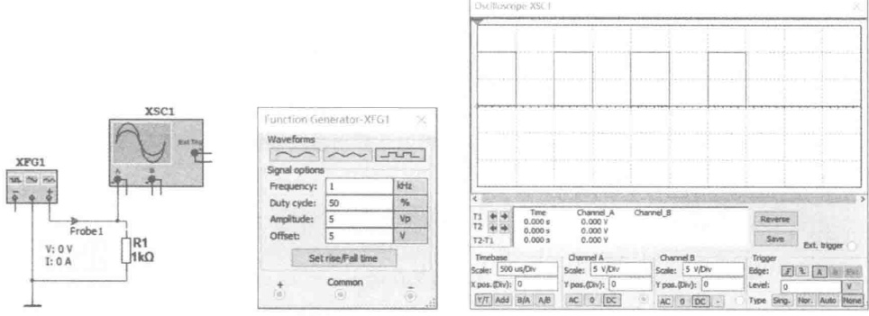

（a）单极性方波仿真电路
 

（b）函数信号发生器设置
 

（c）单极性方波波形
 

图 13-18 单极性方波的测量
 

函数信号发生器在使用时需要注意两点：（1）函数信号发生器产生的方波默认是双极性的，参数设置界面的幅值是正的最大值，若要获得单极性方波，需要设置偏置电压“Offset”。（2）函数信号发生器有三个输出端子，函数发生器接线时若将“+”与“Common”端接入电路，则输出正极性信号，信号幅度与设置值相同；函数信号发生器接线时若将“-”与“Common”端接入电路，则输出负极性信号，信号幅度与设置值相同；若只将“+”与“-”端接入电路，“Common”端悬空，则输出信号幅度为设置值的两倍；若将“+”与“-”端接入电路，“Common”端接地，则输出两路幅值相等、相位相反的信号，每路信号的幅度为设置值。

此外，本例中的单极性方波信号的发生还可以使用 Multisim 元件库来获得，具体为 Sources→SIGNAL_VOLTAGE_SOURCE→CLOCK_VOLTAGE；参数设置为：幅值（Voltage）=10V，频率（Frequency）=1kHz。

方波信号的傅里叶级数展开式为  $ f(t)=\frac{A_{\mathrm{m}}}{2}+\frac{2A_{\mathrm{m}}}{\pi}\left(\sin\omega t+\frac{1}{3}\sin3\omega t+\frac{1}{5}\sin5\omega t+\cdots\right) $， $ A_{\mathrm{m}}=10\mathrm{V} $，根据傅里叶级数展开式可以算出信号平均幅值为5V，基波幅值为6.368V，三次谐波最大幅值为2.1232V，五次谐波幅值为1.2738V等。对图13-18（a）产生的方波信号进行傅里叶分析，执行菜单命令Simulate→Analysis→Fourier，弹出傅里叶分析对话框，设置好分析参数后，可以得到如图13-19所示的分析结果。信号均值、基波、各次谐波的幅值与理论计算值一致。

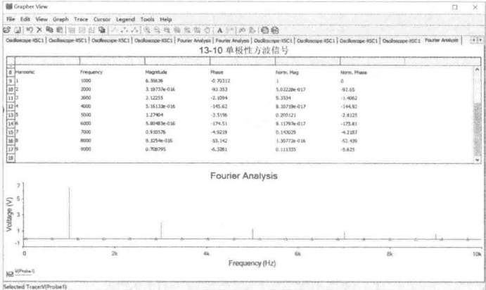

图 13-19 单极性方波的傅里叶分析
 

<!-- page: 350 -->

##### 例 13-11 三角波信号的傅里叶分析

图 13-20（a）是三角波信号仿真电路，图 13-20（b）是三角波的波形图。三角波的幅度为 5V，傅里叶展开式为  $ f(t)=\frac{8A_{\mathrm{m}}}{\pi^{2}}\left(\sin\omega t-\frac{1}{9}\sin3\omega t+\frac{1}{25}\sin5\omega t-\cdots\right) $。由于三角波在横轴上下部分包围的面积相等，因此其直流分量为零。设  $ A_{\mathrm{m}}=5V $，可以计算出基波幅值为 4.057V，三次谐波最大幅值为 0.4507V，五次谐波幅值为 0.1622V 等。

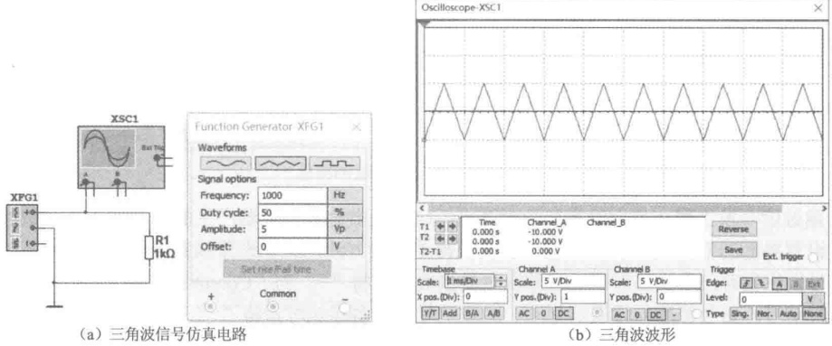

图 13-20 三角波的测量
 

对图 13-20（a）产生的三角波信号进行傅里叶分析，可以得到如图 13-21 所示的分析结果。信号均值为 0、基波幅值为 4.053V、三次谐波幅值为 0.4505V、五次谐波幅值为 0.1623V，偶次谐波幅值几乎为零，可以忽略不计，其余的高次谐波幅值衰减得很快，与理论计算值一致。

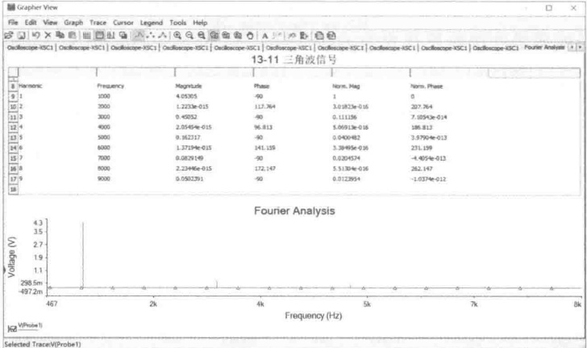

图 13-21 三角波的傅里叶分析
 

##### 例 13-12 非正弦周期电流信号的有效值

流过  $ 10\Omega $ 电阻的电流为  $ i(t)=5+10\sqrt{2}\cos200\pi t+5\sqrt{2}\cos400\pi t $ (A)，根据非正弦周期电流有效值的计算公式，可以计算出电流有效值为

 $$ I=\sqrt{5^{2}+\left(\frac{10\sqrt{2}}{\sqrt{2}}\right)^{2}+\left(\frac{5\sqrt{2}}{\sqrt{2}}\right)^{2}}\approx12.247A $$

<!-- page: 351 -->

如图 13-22（a）所示，用功率表 XWM1 测量三个电流同时作用产生的功率为 1.5kW，图 13-22（b）所示是用功率表 XWM2 测量电流为 12.247A 的直流电流源作用于 10Ω 电阻上产生的功率为 1.5kW，结果相同。

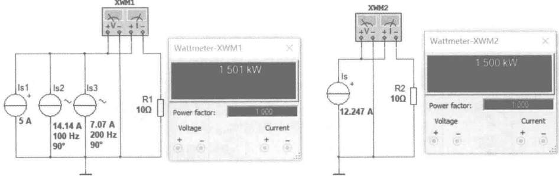

（a）非正弦周期电流的功率
 

（b）直流电流的功率
 

图 13-22 非正弦周期电流的有效值
 

##### 例 13-13 非正弦周期电压信号的有效值

10kΩ 电阻的端电压为  $ u(t)=50+110\cos200\pi t+50\cos(400\pi t+30^\circ) $(V)，根据非正弦周期电压有效值的计算公式，可以计算出电压有效值为

 $$ U=\sqrt{50^{2}+\left(\frac{110}{\sqrt{2}}\right)^{2}+\left(\frac{50}{\sqrt{2}}\right)^{2}}\approx99\mathrm{V} $$ 

如图 13-23（a）所示，用功率表 XWM1 测量三个电流同时作用产生的功率为 19.612W，图 13-23（b）所示是用功率表 XWM2 测量电压为 140V 的直流电流源作用于 10kΩ 电阻上输出的功率为 19.6W，结果相同。

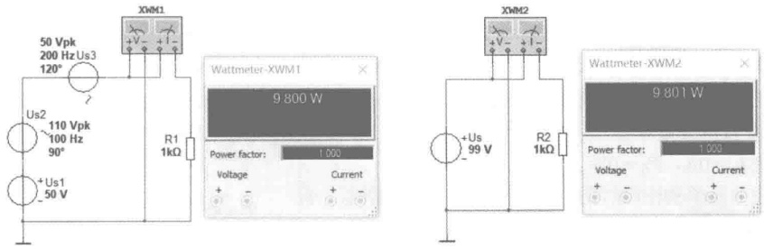

（a）非正弦周期电压的功率
 

（b）直流电压的功率
 

图 13-23 非正弦周期电压的有效值
 

##### 例 13-14 非正弦周期电压信号的平均功率

加在  $ 10\Omega $ 电阻上的电压为  $ u(t)=5+10\sqrt{2}\cos(200\pi t+30^\circ)+5\sqrt{2}\cos(400\pi t-30^\circ)(\text{V}) $，根据非正弦周期电路平均功率的计算公式，可以计算出各分量的平均功率：

直流分量

 $$ P_{0}=\frac{U_{S0}^{2}}{R}=\frac{5^{2}}{10}=2.5W $$ 

基波功率

 $$ P_{1}=\frac{U_{S1}^{2}}{R}\cos0^{\circ}=\frac{10^{2}}{10}=10W $$

<!-- page: 352 -->

二次谐波功率

 $$ P_{2}=\frac{U_{S2}^{2}}{R}\cos0^{\circ}=\frac{5^{2}}{10}=2.5W $$ 

总的平均功率为

 $$ P_{ 总 }=P_{0}+P_{1}+P_{2}=2.5+10+2.5=15W $$ 

图13-24（a）为非正弦周期电压的平均功率（15W），图13-24（b）为直流分量产生的平均功率（2.5W），图13-24（c）为基波产生的平均功率（10W），图13-24（d）为二次谐波产生的平均功率（2.5W）。测量结果表明，电路总平均功率等于直流分量与各次谐波的平均功率之和。

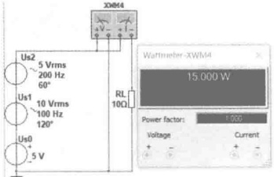

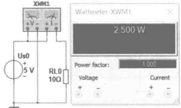

（a）非正弦周期电压的平均功率
 

（b）直流分量的功率
 

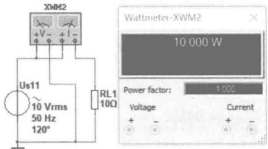

（c）基波的平均功率
 

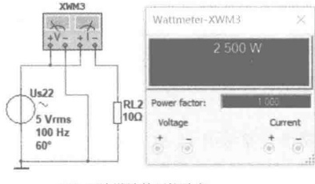

(d) 二次谐波的平均功率
 

图 13-24 非正弦周期电压的平均功率
 

##### 例 13-15 非正弦周期电流电路的稳态分析

如图 13-25（a）所示为 RLC 串联电路，已知  $ R = 50\Omega $， $ L = 10\,\text{mH} $， $ C = 100\,\mu\text{F} $，外加电压为  $ u_s(t) = 20 + 120\cos{628t} + 60\cos(1256t - 30^\circ) $（V），试求电路中的电流  $ i $ 和电路消耗的功率。

非止弦周期电压  $ u_S $ 的傅里叶级数已经给出，分别求出直流分量、基波和二次谐波分电路中的 i 和功率。直流分量单独作用时的电路如图 13-25（b）所示，此时电感相当于短路，电容相当于开路，电流  $ I_0 = 0\text{A} $， $ P_0 = 0\text{W} $。

基波分量单独作用时的电路如图 13-25（c）所示，有

 $$ \begin{aligned}Z_{1}=&50+\mathrm{j}628\times0.01-\mathrm{j}\frac{1}{628\times100\times10^{-6}}=50-\mathrm{j}9.64\approx50.92\angle-10.91^{\circ}(\Omega)\\&\dot{U}_{1}=\frac{120}{\sqrt{2}}\approx84.85\angle0^{\circ}(\mathrm{V})\\\dot{I}_{1}=&\frac{\dot{U}_{1}}{Z_{1}}=\frac{84.85\angle0^{\circ}}{50.92\angle-10.91^{\circ}}\approx1.67\angle10.91^{\circ}(\mathrm{A})\\&i_{1}=1.67\sqrt{2}\cos(628t+10.91^{\circ})(\mathrm{A})\end{aligned} $$ 

 $$ P_{1}=U_{1}I_{1}\cos\varphi_{1}=84.85\times1.67\cos10.91^{\circ}\approx139.14W $$ 

由图 13-25（c）所示的仿真结果可知，电流有效值为 1.666A，功率表测出此时电流消耗的功率为 138.855W，功率因数  $ \cos \varphi_{1}=0.982 $，对应的功率因数角  $ \varphi_{1}=10.89^{\circ} $。

二次谐波分量单独作用时的电路如图13-25（d）所示，有

<!-- page: 353 -->

$$ Z_{2}=50+\mathrm{j}1256\times0.01-\mathrm{j}\frac{1}{1256\times100\times10^{-6}}=50+\mathrm{j}4.6\approx50.21\angle5.26^{\circ}(\Omega) $$ 

 $$ \dot{U}_{2}=\frac{60}{\sqrt{2}}\angle-30^{\circ}\approx42.43\angle-30^{\circ}(V) $$ 

 $$ \dot{I}_{2}=\frac{\dot{U}_{2}}{Z_{2}}=\frac{42.43\angle-30^{\circ}}{50.21\angle5.26^{\circ}}\approx0.85\angle-35.26^{\circ}(\mathrm{A}) $$ 

 $$ i_{2}=0.85\sqrt{2}\cos(1256t-35.26^{\circ})(A) $$ 

 $$ P_{2}=U_{2}I_{2}\cos\varphi_{2}=42.43\times0.85\cos(-30^{\circ}+35.26^{\circ})\approx35.91W $$ 

由图 13-25（d）所示的仿真结果可知，电流有效值为 0.845A，功率表测出此时电流消耗的功率为 35.705W，功率因数  $ \cos\varphi_{2}=0.996 $，对应的功率因数角  $ \varphi_{2}=5.13^{\circ} $。

因此13-25（a）所示电路中的电流为

 $$ i=i_{1}+i_{2}=1.67\sqrt{2}\cos(628t+10.91^{\circ})+0.85\sqrt{2}\cos(1256t-35.26^{\circ})\mathrm{(A)} $$ 

电路消耗的功率为  $ P=P_{0}+P_{1}+P_{2}=0+139.14+35.91=175.05W $

与图13-25（a）中功率表测得的消耗功率一致。

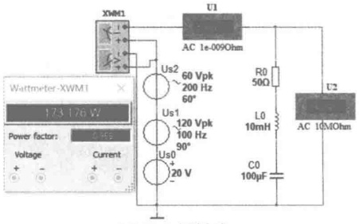

（a）RLC串联电路
 

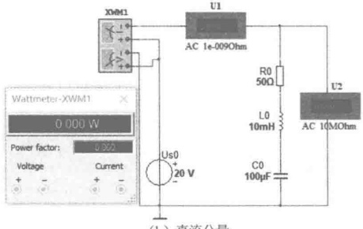

（b）直流分量
 

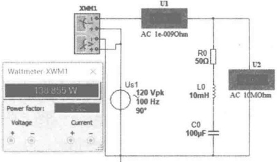

(c) 基波分量
 

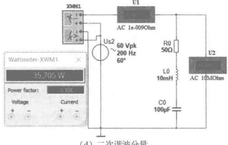

（d）二次谐波分量
 

图 13-25 非正弦周期电流电路的稳态分析
 

### 思考题

13-1 什么是谐波分析法？谐波分析法的理论依据是什么？

13-2 狄里克雷条件的内容和含义是什么？

13-3 非正弦周期函数  $ f(t) $ 在什么情况下可以分解成傅里叶级数？所分解的傅里叶级数具有什么形式？

13-4 在一个非正弦周期函数  $ f(t) $ 分解成傅里叶级数时，函数的奇偶性与计时起点有关吗？

<!-- page: 354 -->

13-5 指数形式下的振幅频谱中谱线的高度（模）只是三角函数展开式的振幅频谱的一半，为什么？

13-6 什么是三角函数的正交性？

13-7 如何获得非正弦周期信号电路的无功功率？

13-8 对信号激励的电路进行稳态分析时，可否使用相量法？如何使用？

#### 习题

13-1 求如题 13-1 图所示方波的傅里叶级数展开式。

13-2 求如题 13-2 图所示方波的傅里叶级数展开式，并画出频谱图。

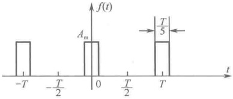

题13-1 图
 

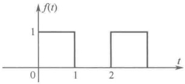

题13-2图
 

13-3 如题 13-3 图所示的矩形脉冲波，高度为 U，脉冲宽度为  $ \tau $，脉冲重复周期为 T，并且 T = 4 $ \tau $，试将此矩形脉冲分解为傅里叶级数的指数形式。

13-4 题 13-4 图所示为两个电压源串联，各电压源的电压分别为

 $$ u_{a}(t)=30\sqrt{2}\cos\omega t+20\sqrt{2}\cos(3\omega t+60^{\circ})~,~u_{b}(t)=10\sqrt{2}\cos(3\omega t+45^{\circ})+10\sqrt{2}\cos(5\omega t+30^{\circ}) $$ 

求端电压 $ u(t) $的有效值。

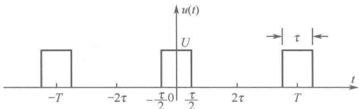

题13-3图
 

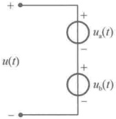

题13-4图
 

13-5 电路如题 13-5 图所示，已知  $ u = 10 + 80\cos(\omega t + 30^\circ) + 18\cos3\omega t $， $ R = 6\Omega $， $ \omega L = 2\Omega $， $ 1/\omega C = 18\Omega $，求电流  $ i $ 及各表读数。

13-6 如题 13-6 图所示电路，已知  $ i_{S}(t)=1+2\sqrt{2}\cos2t $ (A)。求稳态电流  $ i(t) $ 及电路消耗的功率。

13-7 如题 13-7 图所示电路，已知直流电压源  $ U_{S1}=2V $，电压源  $ u_{S2}(t)=2+3\sqrt{2}\cos2t(V) $， $ L=0.5H $， $ C=1F $， $ R=1\Omega $，求  $ u_{0} $ 和  $ i $。

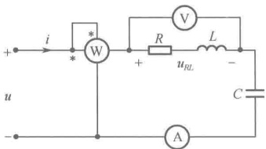

题13-5图
 

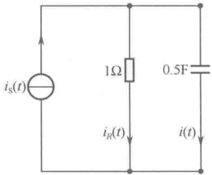

题13-6图
 

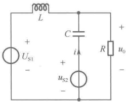

题13-7图
 

<!-- page: 355 -->

13-8 若 RC 串联电路的电流为  $ i = 2\cos1000t + \cos3000t $ (A)，总电压的有效值为 155V，且总电压不含直流分量，电流消耗的平均功率为 120W，求 R 和 C。

13-9 电路如题 13-9 图所示，已知  $ u_S = 20 + 200\sqrt{2\cos\omega t} + 100\sqrt{2\cos(2\omega t + 30^\circ)}(V) $， $ R = 100\Omega $， $ \omega L = 1/\omega C = 200\Omega $，求各支路电流  $ i_1 $、 $ i_2 $、 $ i_3 $ 及电路消耗的平均功率  $ P $。

13-10 电路如题13-10图所示，已知 $ R=10\Omega $， $ L=0.1\text{H} $， $ C_1=500\mu\text{F} $，当 $ u_S=10\sqrt{2}\cos100t\text{(V)} $， $ i_S=1\text{A} $时，安培表 $ A_2 $的读数为1.414A，问当 $ i_S $保持不变， $ u_S $改为 $ u_S=10\sqrt{2}\cos200t\text{(V)} $时，两个安培表的读数各为多少？

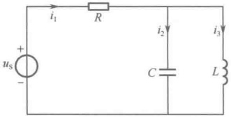

题13-9图
 

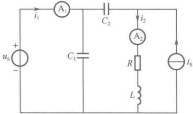

13-11 电路如题 13-11 图所示，已知  $ R_1 = 20\Omega $， $ R_2 = 10\Omega $， $ \omega L_1 = 6\Omega $， $ \omega L_2 = 4\Omega $， $ \omega M = 2\Omega $， $ 1/\omega C = 16\Omega $， $ u_s = 100 + 50\cos(2\omega t + 10^\circ) $ (V)，求两个安培表的读数及电源发出的平均功率。

13-12 如题 13-12 图所示电路，端口电压  $ u_S(t) = 6 + 10\sqrt{2}\cos100t + 6\sqrt{2}\cos200t $ (V)， $ L_1 = L_2 = 4 $H， $ M = 1 $H， $ C = 25\mu $F， $ R = 600\Omega $。求：（1）电阻电压的有效值  $ U_R $；（2）电容电压的瞬时值  $ u_C(t) $。

13-13 电路如题 13-13 图所示，已知  $ R = 1\Omega $， $ L = 1 $H， $ C = 1 $F， $ i_S = 1 $A， $ u_S = \cos t $ (V)，求  $ i_L $。

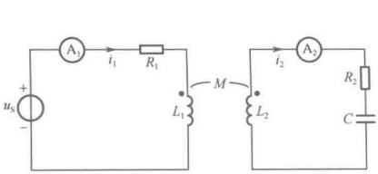

题13-11图
 

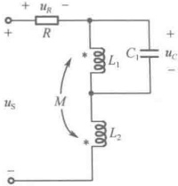

题13-12图
 

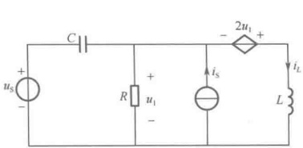

题13-13图
 

13-14 电路如题 13-14 图所示，已知  $ L = 0.1 \, \text{H} $， $ C_1 $、 $ C_2 $ 可调， $ R_L $ 为负载，输入电压信号  $ u_i = U_{1m} \cos 1000t + U_{3m} \cos 3000t \, (\text{V}) $，欲使基波毫无衰减地传输给负载，而将三次谐波全部滤除，求电容  $ C_1 $ 和  $ C_2 $ 的值。

13-15 电路如题 13-15 图所示，电压  $ u(t) $ 含有基波和三次谐波分量，已知基波频率  $ \omega = 10^4 $ rad/s，若要求电容电压  $ u_C(t) $ 中不含基波，仅含与  $ u(t) $ 完全相同的三次谐波分量，且已知  $ R = 1 $ k $ \Omega $， $ L = 1 $ mH，求电容  $ C_1 $ 和  $ C_2 $ 的值。

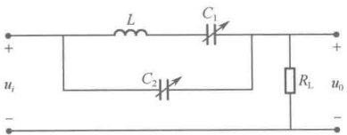

题13-14图
 

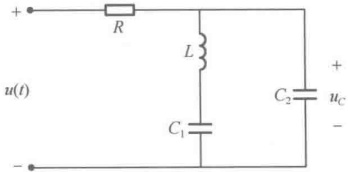

题13-15图
 

