# 14-第14章 正弦交流电路的频率特性

[返回全书目录](../../README.md)

> PDF 页码：356–384

<!-- page: 356 -->

### 第14章 正弦交流电路的频率特性

在第9章中引用相量时曾经发现，复数 $ e^{j\omega t} $并未参与电路的运算，因此，当使用相量 $ \dot{A} = |A| e^{j\varphi} $来表示正弦量，并借助相量进行电路分析时，其中隐含了复数 $ e^{j\omega t} $，或者说是隐含了频率 $ \omega $。

从那时开始，采用相量法对电路所进行的各种分析和计算都基于一个大家共同遵守的约定：一个给定的线性电路中频率 $ \omega $是固定不变的。在此约定下，可以很方便地用相量法来计算在频率为 $ \omega $的正弦信号激励下电路中各处的电压、电流等变量。

本章所要讨论的内容是上述问题的另一面，即当正弦激励信号的频率  $ \omega $ 发生变化时，电路的状态会随之发生什么样的变化。

电路的工作状态随频率的变化而发生变化的现象称为电路的频率特性，又称频率响应。电路的频率特性一般是通过电路的输入（激励）与输出（响应）之间所建立的函数关系来进行分析的，这样的函数关系称为电路的网络函数，网络函数的频率特性实质上就是电路的频率特性。

本章将对正弦信号激励下电路的频率特性进行初步分析，并且只考虑单输入、单输出的情况。第15章还将进一步对其进行研究和探讨。

### 14.1 网络函数

#### 14.1.1 网络函数的定义

正弦激励信号的频率  $ \omega $ 发生变化时，会引起电路中的阻抗  $ j\omega L $ 和  $ 1/j\omega C $ 发生变化，从而使电路的状态发生变化。也就是说，除了元件参数  $ L $ 和  $ C $，还有一个参量  $ j\omega $ 需要关注。

在正弦稳态电路中，激励和响应都可表示为相量形式。同时，单输入、单输出电路可以形象地描述为图14-1所示的二端口电路。

在正弦稳态电路中，激励和响应都可表示为相量形式。同时，单输入、单输出电路可以形象地描述为图14-1所示的二端口电路。

于是定义：线性时不变电路中，响应（输出）相量与激励

（输入）相量之比为电路的网络函数，用 $ H(j\omega) $表示，即

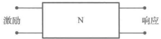

$$  H(j\omega)=\frac{ 响应（相量 )}{ 激励（相量 )}   \tag*{（14-1）}$$

图 14-1 单输入、单输出的二端口电路
 

式中，响应（相量）既可以是线性时不变电路中某处的电压 $ \dot{U}(j\omega) $，也可以是电路中某处的电流 $ \dot{I}(j\omega) $，为了表达方便，用统一的符号 $ \dot{R}(j\omega) $来表示；同样，激励（相量）可以是电路中某处的电压源 $ \dot{U}_{s}(j\omega) $，或电路中某处的电流源 $ \dot{I}_{s}(j\omega) $，为了表达方便，也用统一的符号 $ \dot{E}_{s}(j\omega) $来表示。于是，网络函数的定义式可写成

$$  H(j\omega)=\frac{\dot{R}(j\omega)}{\dot{E}_{s}(j\omega)}   \tag*{（14-2）}$$

通过网络函数，可以研究电路（系统）的特性，即激励一定而频率可变时，频率 $ \omega $从零到无穷大的整个频域内，网络函数随频率改变所呈现的规律。而后，对于给定激励，就可以很容易地确定电路（系统）的输出。利用网络函数可以进行信号变换，如选频、滤波等。

<!-- page: 357 -->

#### 14.1.2 网络函数的分类

在定义的网络函数中，如果激励  $ \dot{E}_{s}(j\omega) $ 与响应  $ \dot{R}(j\omega) $ 在电路的同一端口，如图 14-2 所示，则网络函数称为驱动（策动）点网络函数。

由于激励和响应既可以是电压，也可以是电流，因此驱动点网络函数有如下两种类型：

$$   驱动点阻抗 \quad H(j\omega)=Z_{11}(j\omega)=\frac{\dot{U}_{1}(j\omega)}{\dot{I}_{1}(j\omega)}   \tag*{（14-3）}$$

$$   驱动点导纳 \quad H(j\omega)=Y_{11}(j\omega)=\frac{\dot{I}_{1}(j\omega)}{\dot{U}_{1}(j\omega)}   \tag*{（14-4）}$$

如果激励  $ \dot{E}_{s}(j\omega) $ 与响应  $ \dot{R}(j\omega) $ 处在电路的不同端口，如图 14-3 所示，则网络函数称为转移（传输）网络函数。

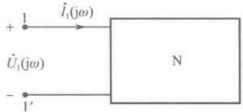

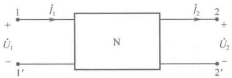

图 14-2 激励与响应处于同一端口的电路
 

图 14-3 激励与响应处于不同端口的电路
 

由于激励和响应既可以是电压，也可以是电流，因此转移网络函数有如下四种类型：

$$   转移阻抗 \quad H(j\omega)=Z_{21}(j\omega)=\frac{\dot{U}_{2}(j\omega)}{\dot{I}_{1}(j\omega)}   \tag*{（14-5）}$$

$$   转移导纳 \quad H(j\omega)=Y_{21}(j\omega)=\frac{\dot{I}_{2}(j\omega)}{\dot{U}_{1}(j\omega)}   \tag*{（14-6）}$$

$$   转移电压比 \quad H_{U}(j\omega)=\frac{\dot{U}_{2}(j\omega)}{\dot{U}_{1}(j\omega)}   \tag*{（14-7）}$$

$$   转移电流比 \quad H_{l}(j\omega)=\frac{\dot{I}_{2}(j\omega)}{\dot{I}_{1}(j\omega)}   \tag*{（14-8）}$$

例 14-1 求如图 14-4 所示电路的转移导纳  $ \dot{I}_{2}/\dot{U}_{S} $ 和转移电压比  $ \dot{U}_{L}/\dot{U}_{S} $

解：由电路图列写回路电流方程

 $$ \left\{\begin{aligned}(\mathrm{j}\omega L_{1}+R_{1})\dot{I}_{1}(\mathrm{j}\omega)-R_{1}\dot{I}_{2}(\mathrm{j}\omega)=\dot{U}_{\mathrm{s}}\\ (\mathrm{j}\omega L_{2}+R_{1}+R_{2})\dot{I}_{2}(\mathrm{j}\omega)-R_{1}\dot{I}_{1}(\mathrm{j}\omega)=0\end{aligned}\right. $$ 

所以，转移导纳

 $$ H(\mathrm{j}\omega)=\frac{\dot{I}_{2}(\mathrm{j}\omega)}{\dot{U}_{\mathrm{s}}(\mathrm{j}\omega)}=\frac{R_{1}}{\mathrm{j}\omega(R_{1}L_{1}+R_{2}L_{1}+R_{1}L_{2})-\omega^{2}L_{1}L_{2}+R_{1}R_{2}} $$ 

$$H(\mathrm{j}\omega)=\frac{U_{L}(\mathrm{j}\omega)}{\dot{U}_{\mathrm{S}}(\mathrm{j}\omega)}=\frac{\mathrm{j}\omega R_{1}L_{2}}{\mathrm{j}\omega(R_{1}L_{1}+R_{2}L_{1}+R_{1}L_{2})-\omega^{2}L_{1}L_{2}+R_{1}R_{2}}$$

转移电压比

例 14-2 求如图 14-5 所示电路的转移电压比  $ \dot{U}_{2} / \dot{U}_{1} $ 和驱动点导纳  $ \dot{I}_{1} / \dot{U}_{1} $。

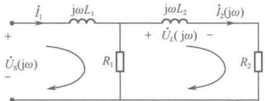

图 14-4 例 14-1 图
 

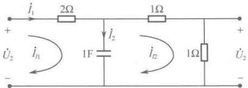

图 14-5 例 14-2 图
 

<!-- page: 358 -->

解：设 $ i_{11} $ 和 $ i_{12} $ 是两个回路电流，由电路图列写回路电流方程

 $$ \begin{cases}\left(2-\mathrm{j}\frac{1}{\omega}\right)\dot{I}_{l1}-\left(-\mathrm{j}\frac{1}{\omega}\right)\dot{I}_{l2}=\dot{U}_{1}\\\left(2-\mathrm{j}\frac{1}{\omega}\right)\dot{I}_{l2}-\left(-\mathrm{j}\frac{1}{\omega}\right)\dot{I}_{l1}=0\end{cases} $$ 

因为 $ \dot{I}_{l1}=\dot{I}_{1} $， $ \dot{I}_{l2}\times1=\dot{U}_{2} $，所以

转移电压比为

 $$ H(j\omega)=\frac{\dot{U}_{2}}{\dot{U}_{1}}=\frac{1}{4(1+j\omega)} $$ 

驱动点导纳为

 $$ H(j\omega)=\frac{\dot{I}_{1}}{\dot{U}_{1}}=\frac{1+j2\omega}{4(1+j\omega)} $$ 

#### 14.1.3 网络函数的频率特性表示方法

常见的网络函数的频率特性表示方法有如下几种。

# 1. 幅频特性图、相频特性图表示法

由于网络函数  $ H(j\omega) $ 是一个复数，要研究网络函数随频率改变所呈现的规律，就必须从网络函数的模和相位角两方面来进行研究。根据复数的表达方式，可将  $ H(j\omega) $ 表示成模和相位角的形式

$$  H(j\omega)=\left|H(j\omega)\right|\angle\theta(j\omega)   \tag*{（14-9）}$$

式中，随频率变化的  $ H(\mathrm{j}\omega) $ 的模  $ |H(\mathrm{j}\omega)| $ 称为幅频特性，随频率变化的  $ H(\mathrm{j}\omega) $ 的相角  $ \theta(\mathrm{j}\omega) $ 称为相频特性。通常，对于幅频特性和相频特性，用横坐标表示频率、纵坐标表示幅值或相位的图形，即用幅频特性图和相频特性图来表示网络函数的频率特性。

例 14-3 求如图 14-6 所示电路的转移阻抗  $ H(j\omega) = \dot{U}_2 / \dot{I}_S $ 的频率特性。

解：由电路图可得

 $$ H(\mathrm{j}\omega)=\frac{\dot{U}_{2}}{\dot{I}_{\mathrm{s}}}=\frac{R_{1}R_{2}}{R_{1}+R_{2}+\frac{1}{\mathrm{j}\omega C}}=\frac{R_{1}R_{2}}{R_{1}+R_{2}}\times\frac{1}{1+\frac{1}{\mathrm{j}\omega C(R_{1}+R_{2})}} $$ 

设

 $$ R=\frac{R_{1}R_{2}}{R_{1}+R_{2}},\quad\omega_{0}=\frac{1}{C(R_{1}+R_{2})} $$ 

则

 $$ H(\mathrm{j}\omega)=\frac{\dot{U}_{\mathrm{2}}}{\dot{I}_{\mathrm{s}}}=R\times\frac{1}{1+\omega_{0}/\mathrm{j}\omega} $$ 

可得幅频特性

 $$ \left|H(\mathrm{j}\omega)\right|=\left|\frac{\dot{U}_{\mathrm{2}}}{\dot{I}_{\mathrm{s}}}\right|=\frac{R}{\sqrt{1+\left(\omega_{0}/\omega\right)^{2}}} $$ 

相频特性

 $$ \theta(j\omega)=\arctan\frac{\omega_{0}}{\omega} $$ 

幅频和相频随频率变化的曲线如图14-7所示。

# 2. 伯德（Bode）图表示法

在使用幅频特性曲线和相频特性曲线来描述电路的频率特性时，如果采用对数坐标，这些特性曲线就变成了近似的折线。这种以对数为标尺，用折线绘制的幅频特性曲线和相频特性曲线称为伯德（Bode）图，或称为对数坐标图。（本书不讨论。）

# 3. 极坐标图（奈奎斯特图）表示法

极坐标图表示法是将幅度和相角关系图形表示在极坐标上（本书不讨论）。

<!-- page: 359 -->

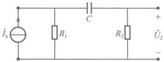

图 14-6 例 14-3 图之一
 

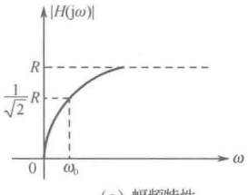

（a）幅频特性
 

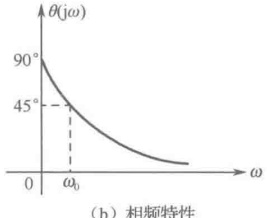

（b）相频特性
 

图 14-7 例 14-3 图之二
 

# 4. 对数幅相图（尼柯尔斯图）表示法

对数幅相图表示法是在直角坐标系中，以对数振幅作为相位的函数来描绘图形（本书不讨论）。

# 5. 零、极点分布图表示法

零、极点分布图表示法是将幅度和相角关系图形表示在极坐标上（将在第15章中讨论）。

### 14.2 谐振电路的频率特性

由第10章可知，电路发生谐振时一定存在电感和电容，于是，谐振电路的基本模型有串联谐振电路和并联谐振电路两种，如图14-8（a）、（b）所示。

在实际问题中，还要考虑信号源的内阻  $ R_S $、负载电阻  $ R_L $，以及电感元件、电容元件的损耗电阻。设串联电路中电感元件的损耗电阻为  $ r_{HL} $，电容元件的损耗电阻为  $ r_{HC} $，并联电路中电感元件的损耗电阻为  $ R_{HL} $，电容元件的损耗电阻为  $ R_{HC} $。这时，电路的模型如图 14-8（c）、（d）所示。显然，将各电阻合并后，可得图 14-8（e）、（f）所示的 RLC 串联电路模型和 RLC 并联电路模型。因此，以下的分析将围绕着 RLC 串联电路和 RLC 并联电路来展开。

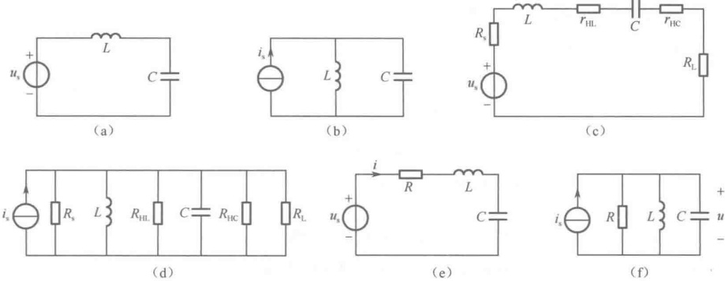

图 14-8 串联谐振电路和并联谐振电路的两种基本模型
 

#### 14.2.1 RLC 串联谐振电路的频率特性

# 1. RLC 串联谐振的特点

第10章中已指出，在RLC串联复阻抗 $ Z = R + j(\omega L - 1/\omega C) $中，当 $ \omega L = 1/\omega C $时，RLC串联电路在端口呈现纯阻性。端口电压相量与端口电流相量同相位，此时RLC串联电路发生串联谐振。

在图 14-8（e）中，假定信号源为  $ u_s = \sqrt{2}U_s \cos \omega t $，写成相量为  $ \dot{U}_s = U_s \angle 0^\circ $，则图中电流相量为

<!-- page: 360 -->

$$ \dot{I}=\dot{U}_{s}/Z $$ 

式中， $ Z = R + j(\omega L - 1/\omega C) $，解得 $ \dot{I} = I e^{j\theta_i} $，并且

 $$ I=\frac{U_{\mathrm{s}}}{\sqrt{R^{2}+\left(\omega L-1/\omega C\right)^{2}}},\quad\theta_{i}=-\arctan\left(\frac{\omega L-1/\omega C}{R}\right) $$ 

所以，当 $ \omega L-1/\omega C=0 $时，电路发生串联谐振，谐振频率为

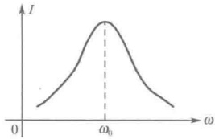

$$  \omega_{0}=1/\sqrt{LC}   \tag*{（14-10）}$$

式（14-10）就是电路发生串联谐振的条件。这时电流取得最大值 $ I_{max}=U_{S}/R $，并且相位 $ \theta_{i}=0 $。

以  $ \omega $ 为横坐标，可画出发生串联谐振的电路中  $ I(\mathrm{j}\omega) $ 和  $ \theta_{i}(\mathrm{j}\omega) $ 的频率特性曲线，如图 14-9 所示。

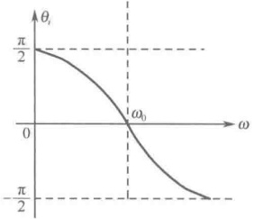

图 14-9 串联谐振电路中  $ I(j\omega) $ 和  $ \theta_{i}(j\omega) $ 的频率特性曲线
 

另外，对图14-8（e）列写KVL方程，可得

 $$ \dot{U}_{s}=\dot{U}_{r}+\dot{U}_{L}+\dot{U}_{c} $$ 

当电路发生串联谐振时，电路在端口呈现纯阻性，有 $ \dot{U}_{S} = \dot{U}_{R} $，即 $ \dot{U}_{L} + \dot{U}_{C} = 0 $。这说明，此时电感和电容的串联支路对外电路而言相当于短路。同时，已知电感从电路吸收的瞬时功率 $ p_{L} = u_{L}i $，电容从电路吸收的瞬时功率 $ p_{C} = u_{C}i $，当电路发生串联谐振时， $ u_{L} = -u_{C} $，所以， $ p_{L} + p_{C} = 0 $。可见，从电感和电容串联的总体来讲，此时它们既不从外电路吸收能量，也不向外电路释放能量。它们的能量传递和转换只在电感和电容之间进行，这种现象在工程中称为电磁振荡。

# 2. RLC 串联谐振的特性阻抗和品质因数

##### （1）特性阻抗

从前面的叙述可知，电路发生谐振时的谐振频率  $ \omega_{0}=1/\sqrt{LC} $，此时电路中的感抗为  $ X_{L}(\omega_{0})=\omega_{0}L $，容抗为  $ X_{C}(\omega_{0})=1/\omega_{0}C $，将  $ \omega_{0}=1/\sqrt{LC} $ 代入，得

 $$ \begin{aligned}\left\{\begin{aligned}X_{L}(\omega_{0})&=\omega_{0}L=L/\sqrt{LC}=\sqrt{L/C}\\ X_{C}(\omega_{0})&=1/\omega_{0}C=\sqrt{LC}/C=\sqrt{L/C}\end{aligned}\right.\\\rho&=\sqrt{L/C}=X_{L}(\omega_{0})=X_{C}(\omega_{0})\end{aligned} $$ 

令

显然， $ \rho $ 的单位也是欧姆，故将  $ \rho $ 称为谐振电路的特性阻抗。

##### （2）通频带

电路发生串联谐振时，若 $ U_{s} $一定，则电流取得最大值 $ I_{max}=U_{s}/R $

在电子技术中，通常将信号从最大值下降到最大值的 $ 1/\sqrt{2} $处的两个点 $ \omega_{1} $和 $ \omega_{2} $称为下半功率点频率和上半功率点频率，如图14-10所示。再通过 $ \omega_{1} $和 $ \omega_{2} $来给定谐振电路的带宽（通频带）B，即

$$  B=\omega_{2}-\omega_{1}=\Delta\omega   \tag*{（14-12）}$$

显然，B 越小，谐振电路的幅值曲线就越尖锐。

##### （3）品质因数

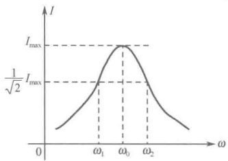

反映谐振电路幅值曲线尖锐程度的另一个量是品质因数Q。品质因数定义为

图 14-10 串联谐振电路的通频带
 

<!-- page: 361 -->

$$  Q=2\pi\frac{ 谐振条件下电路存储的电磁能量总和 }{ 谐振条件下电路在一个周期内消耗的能量总和 }   \tag*{（14-13）}$$

设发生谐振时，电路的电压  $ u = U_{m} \cos \omega_{0} t $，电路阻抗  $ Z = R $，电流  $ i = I_{m} \cos \omega_{0} t $，即  $ \dot{I}_{m} = I_{m} \angle 0^{\circ} = \frac{U_{m}}{R} \angle 0^{\circ} $。所以，电感储存的能量为

 $$ W_{L}=\frac{1}{2}Li^{2}=\frac{LU_{m}^{2}}{2R^{2}}\cos^{2}\omega_{0}t $$ 

电容两端的电压为 $ \dot{U}_{Cm}=\frac{I_{m}}{j\omega_{0}C}=\frac{U_{m}}{\omega_{0}RC}\angle-90^{\circ} $，即 $ u_{C}=\frac{U_{m}}{\omega_{0}RC}\cos(\omega_{0}t-90^{\circ}) $，则电容储存的能量为

 $$ W_{c}=\frac{1}{2}Cu_{c}^{2}=\frac{LU_{m}^{2}}{2R^{2}}\sin^{2}\omega_{0}t $$ 

所以，谐振条件下电路储存的电磁能量总和为

 $$ W_{L}+W_{C}=\frac{LU_{m}^{2}}{2R^{2}} $$ 

谐振条件下，电路在一个周期 $ T_{0} $内消耗的能量应是电阻在一个周期 $ T_{0} $内消耗的能量，即

 $$ P_{R}T_{0}=RI^{2}T_{0}=R\left(\frac{I_{\mathrm{m}}}{\sqrt{2}}\right)^{2}\left(\frac{2\pi}{\omega_{0}}\right)=\frac{\pi U_{\mathrm{m}}^{2}}{R\omega_{0}} $$ 

所以，根据式（14-13）的定义，可得品质因数

$$  Q=2\pi\frac{W_{L}+W_{C}}{P_{R}T_{0}}=\frac{\omega_{0}L}{R}=\frac{1}{\omega_{0}R C}=\frac{1}{R}\sqrt{\frac{L}{C}}=\frac{\rho}{R}   \tag*{（14-14）}$$

由此可知，品质因数 Q 是一个只与电路参数 R、L、C 有关的量，其大小可以反映谐振电路的特征。式（14-14）还表明：RLC 串联支路的品质因数 Q 等于谐振时感抗或容抗与电阻之比，或等于特性阻抗与电阻之比。

在电路发生串联谐振时，各元件上的电压分别为

 $$ \begin{aligned}\dot{U}_{R}&=R\dot{I}=R\frac{U}{R}=\dot{U}\\\dot{U}_{L}=j\omega_{0}L\dot{I}&=j\omega_{0}L\frac{\dot{U}}{R}=j Q\dot{U}\\\dot{U}_{C}=-j\frac{1}{\omega_{0}C}\dot{I}=-j\frac{\dot{U}}{\omega_{0}R C}=-j Q\dot{U}\end{aligned} $$ 

因为 $ \dot{U}_{L} + \dot{U}_{C} = 0 $，所以又将串联谐振称为电压谐振。另外，上式表明，电路谐振时电感和电容上将出现超过外加电压Q倍的高电压，它对电路是否会造成破坏是值得注意的。

当串联电路端口的外加电压有效值不变时，电路中电流的幅值为

 $$ I(\omega)=\frac{U}{\left|Z(\omega)\right|} $$ 

电流有效值  $ I(\omega) $ 的变化曲线如图 14-9 所示。由曲线可知，当  $ \omega $ 偏离  $ \omega_{0} $ 时， $ I(\omega) $ 将从最大值下降。这说明在偏离  $ \omega_{0} $ 处，电路对电流信号有抑制作用，偏离得越远，抑制越强。从而使串联谐振电路具有选择最接近  $ \omega_{0} $ 附近的电流信号的性能，在无线电技术中，这种性能称为“选择性”。

电路对电流信号的抑制能力用下面的相对抑制比 $ I(\omega)/I(\omega_{0}) $来表示，即

<!-- page: 362 -->

$$ \begin{aligned}\frac{I(\omega)}{I(\omega_{0})}=&\frac{U}{\left|Z(\omega)\right|}\times\frac{\left|Z(\omega_{0})\right|}{U}=\frac{R}{\left|Z(\omega)\right|}=\frac{R}{\sqrt{R^{2}+\left(\omega L-\frac{1}{\omega C}\right)^{2}}}\\ =&\frac{1}{\sqrt{1+\left(\frac{\omega L}{R}-\frac{1}{\omega RC}\right)^{2}}}=\frac{1}{\sqrt{1+\left(\frac{\omega_{0}L}{R}\cdot\frac{\omega}{\omega_{0}}-\frac{1}{\omega_{0}RC}\cdot\frac{\omega_{0}}{\omega}\right)^{2}}}\end{aligned} $$ 

已知， $ Q=\frac{\omega_{0}L}{R}=\frac{1}{\omega_{0}RC} $，并且令 $ \eta=\omega/\omega_{0} $，表示 $ \omega $偏离 $ \omega_{0} $的程度。则上式为

$$  \frac{I(\omega)}{I(\omega_{0})}=\frac{1}{\sqrt{1+\left(\frac{\omega_{0}L}{R}\cdot\frac{\omega}{\omega_{0}}-\frac{1}{\omega_{0}RC}\cdot\frac{\omega_{0}}{\omega}\right)^{2}}}=\frac{1}{\sqrt{1+Q^{2}\left(\eta-\frac{1}{\eta}\right)^{2}}}   \tag*{（14-15）}$$

式（14-15）表明，相对抑制比  $ I(\omega)/I(\omega_0) $ 的大小由谐振电路的 Q 值决定，Q 值越大，当  $ \omega $ 偏离  $ \omega_0 $ 时，抑制能力越强  $ (I(\omega)/I(\omega_0) $ 曲线急剧下降)，选择性就越好，如图 14-11 所示。图中， $ \eta = \omega/\omega_0 $， $ \eta_1 = \omega_1/\omega_0 $， $ \eta_2 = \omega_2/\omega_0 $。

从图 14-11 可见，当  $ \frac{I(\omega)}{I(\omega_0)} = \frac{1}{\sqrt{2}} $ 时，对应的  $ \omega_1 $ 和  $ \omega_2 $ 之间的宽度就是通频带，它表明了谐振电路允许通过的信号的频率范围。这时

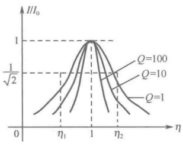

图 14-11 相对抑制比曲线
 

 $$ \frac{I(\omega)}{I(\omega_{0})}=\frac{1}{\sqrt{1+Q^{2}\left(\frac{\omega}{\omega_{0}}-\frac{\omega_{0}}{\omega}\right)^{2}}}=\frac{1}{\sqrt{2}} $$ 

所以， $ Q\left(\frac{\omega}{\omega_{0}}-\frac{\omega_{0}}{\omega}\right)=\pm1 $。

当等号右边取“+”号时，可得  $ \eta_{2}=\frac{\omega_{2}}{\omega_{0}}=\frac{1+\sqrt{1+4Q^{2}}}{2Q} $

当等号右边取 “-” 号时，可得  $ \eta_{1}=\frac{\omega_{1}}{\omega_{0}}=\frac{-1+\sqrt{1+4Q^{2}}}{2Q} $

所以，通频带为

$$  B=\omega_{2}-\omega_{1}=\Delta\omega=\omega_{0}\left(\frac{\omega_{2}}{\omega_{0}}-\frac{\omega_{1}}{\omega_{0}}\right)=\frac{\omega_{0}}{Q}   \tag*{（14-16）}$$

显然，式（14-16）描述的是绝对通频带。可将

$$  \frac{\Delta\omega}{\omega_{0}}=\frac{1}{Q}   \tag*{（14-17）}$$

称为相对通频带，即相对通频带与品质因数 Q 成反比。

可见，Q值越大，通频带B越窄，选择性越好。因此，品质因数Q是反映谐振电路幅值曲线尖锐程度的一个重要参量。

另外，还可得知绝对通频带的另一种表达形式为

$$  B=\frac{\omega_{0}}{Q}=\frac{\omega_{0}}{\omega_{0}L/R}=\frac{R}{L}   \tag*{（14-18）}$$

<!-- page: 363 -->

3. RLC 串联电路中  $ U_{L}(\omega) $ 与  $ U_{C}(\omega) $ 的频率特性

已知

$$  \begin{aligned}U_{L}(\omega)=\omega LI(\omega)=\frac{\omega LU}{\sqrt{R^{2}+\left(\omega L-\frac{1}{\omega C}\right)^{2}}}=\frac{\frac{\omega L}{R}U}{\sqrt{1+\left(\frac{\omega L}{R}-\frac{1}{\omega RC}\right)^{2}}}\\ =\frac{\frac{\omega_{0}L}{R}\cdot\frac{\omega}{\omega_{0}}U}{\sqrt{1+Q^{2}\left(\frac{\omega}{\omega_{0}}-\frac{\omega_{0}}{\omega}\right)^{2}}}=\frac{QU}{\sqrt{\left(\frac{\omega_{0}}{\omega}\right)^{2}+Q^{2}\left[1-\left(\frac{\omega_{0}}{\omega}\right)^{2}\right]^{2}}}=\frac{QU}{\sqrt{\frac{1}{\eta^{2}}+Q^{2}\left(1-\frac{1}{\eta^{2}}\right)^{2}}}\\ U_{C}(\omega)=\frac{1}{\omega C}I(\omega)=\frac{U}{\omega C\sqrt{R^{2}+\left(\omega L-\frac{1}{\omega C}\right)^{2}}}=\frac{QU}{\sqrt{\eta^{2}+Q^{2}(\eta^{2}-1)^{2}}}\end{aligned}   \tag*{（14-19）}$$

由式（14-19）和式（14-20）可知：

① 当 $ \eta=0 $，即 $ \omega/\omega_{0}=0 $时， $ U_{L}(\omega)=0 $（直流）；当 $ \eta=1 $，即 $ \omega=\omega_{0} $时， $ U_{L}(\omega)=QU $；当 $ \eta>1 $，即 $ \omega>\omega_{0} $时， $ U_{L}(\omega) $上升；当 $ \eta\to\infty $，即 $ \omega\to\infty $时， $ U_{L}(\omega)\to U $。

② 当 $ \eta=0 $，即 $ \omega/\omega_{0}=0 $时， $ U_{C}(\omega)=U $（直流）；当 $ \eta=1 $，即 $ \omega=\omega_{0} $时， $ U_{C}(\omega)=QU $；当 $ \eta>1 $，即 $ \omega>\omega_{0} $时， $ U_{C}(\omega) $下降；当 $ \eta\to\infty $，即 $ \omega\to\infty $时， $ U_{C}(\omega)\to0 $。

可以证明，当  $ Q > 1/\sqrt{2} $ 时， $ U_{L}(\omega) $ 和  $ U_{C}(\omega) $ 的峰值相等，但不出现在  $ \omega_{0} $ 处。Q 值越大，两个峰值就越靠近  $ \omega_{0} $，同时，峰值电压也增大，如图 14-12 所示。于是，可以用串联谐振电路来选择  $ \omega_{0} $ 附近的电压，而对  $ \omega_{0} $ 以外的电压加以抑制。

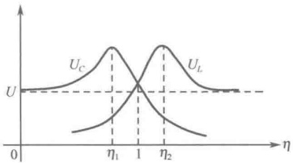

图 14-12  $ U_{L}(\omega) $ 和  $ U_{C}(\omega) $ 的频率特性曲线
 

例 14-4 电路如图 14-13 所示，已知电源电压  $ U = 10V $， $ \omega = 5000rad/s $，调节电容 C 使电路中的电流最大时为

200mA，此时电容电压为600V，求R、L、C的值及回路的品质因数Q。

解：当电流最大时，电路发生串联谐振，电阻电压等于电源电压，即

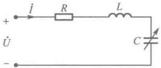

 $$ U=U_{r}=RI=10V $$ 

图 14-13 例 14-4 图
 

所以 $ R=U_{R}/I=10/0.2=50\Omega $

发生串联谐振时，电容电压是电源电压的Q倍，即

 $$ U_{c}=Q U=600V $$ 

所以 $ Q=U_{c}/U=600/10=60 $

谐振时的电容电流

 $ I_{c}=\omega CU_{c} $，则  $ C=\frac{I_{c}}{\omega U_{c}}=\frac{0.2}{5000\times600}=0.0667\mu F $

电感电流

 $$ I_{L}=\frac{U_{L}}{\omega L},\  则 \ L=\frac{U_{L}}{\omega I_{L}}=\frac{600}{5000\times0.2}=0.6H $$ 

#### 14.2.2 RLC 并联谐振电路的频率特性

# 1. RLC 并联谐振电路的特点

在图 14-8（f）中，假定信号源为  $ i_S = \sqrt{2}I_S \cos \omega t $，写成相量为  $ \dot{I}_S = I_S \angle 0^\circ $，则图中电压相量为

<!-- page: 364 -->

$$ \dot{U}=\frac{\dot{I}_{\mathrm{s}}}{Y} $$ 

其中， $ Y = G + \mathrm{j}(\omega C - 1/\omega L) $，解得 $ \dot{U} = U e^{\mathrm{j}\theta_u} $，其中

 $$ U=\frac{I_{\mathrm{s}}}{\sqrt{G^{2}+\left(\omega C-1/\omega L\right)^{2}}}，\theta_{u}=-\arctan\left(\frac{\omega C-1/\omega L}{G}\right) $$ 

所以，当 $ \omega C - 1 / \omega L = 0 $时，电路发生并联谐振，谐振频率为

$$  \omega_{0}=1/\sqrt{LC}   \tag*{（14-21）}$$

这时输出电压取得最大值 $ U_{max}=I_{S}/G=I_{S}R $，并且相位为零，即 $ \theta_{u}=0 $。

以  $ \omega $ 为横坐标，可画出发生并联谐振的电路中  $ U(j\omega) $ 和  $ \theta_{u}(j\omega) $ 的频率特性曲线，此曲线与串联谐振电路中  $ I(j\omega) $ 和  $ \theta_{i}(j\omega) $ 的频率特性曲线类似，故此处从略。

# 2. RLC 并联谐振的特性导纳和品质因数

与串联谐振电路相类似，由于并联谐振频率  $ \omega_{0}=1/\sqrt{LC} $，故电路中的感纳为  $ B_{L}(\omega_{0})=1/\omega_{0}L $，容纳为  $ B_{C}(\omega_{0})=\omega_{0}C $，将  $ \omega_{0}=1/\sqrt{LC} $ 代入，得

 $$ \begin{aligned}&\left\{\begin{aligned}B_{L}(\omega_{0})&=\frac{1}{\omega_{0}L}=\frac{\sqrt{LC}}{L}=\sqrt{\frac{C}{L}}\\B_{C}(\omega_{0})&=\omega_{0}C=\frac{C}{\sqrt{LC}}=\sqrt{\frac{C}{L}}\end{aligned}\right.\\ &\gamma=\sqrt{\frac{C}{L}}=B_{L}(\omega_{0})=B_{C}(\omega_{0})=\frac{1}{\rho}\\ \end{aligned} $$ 

令

将 $ \gamma $称为并联谐振电路的特性导纳，它与串联谐振电路的特性阻抗 $ \rho $互为倒数。

RLC 并联支路的品质因数 Q 等于谐振时感纳或容纳与电导之比，或特性导纳与电导之比，即

$$  Q_{ 并 }=\frac{\omega_{0}C}{G}=\frac{1}{\omega_{0}LG}=\frac{1}{G}\sqrt{\frac{C}{L}}   \tag*{（14-23）}$$

与 RLC 串联谐振电路一样，RLC 并联谐振时的电场与磁场能量之和为常数，等于电场能量的最大值或磁场能量的最大值，它在端口处不发生能量交换。

$$  W=W_{L}+W_{C}=L I_{L m}^{2}/2=C U_{C m}^{2}/2   \tag*{（14-24）}$$

品质因数 Q 与电磁场能量及电导上消耗的功率之间的关系与式（14-14）相似，即

$$  Q_{ 井 }=\frac{\omega_{0}C}{G}=\frac{0.5\omega_{0}C U_{m}^{2}}{0.5G U_{m}^{2}}=\omega_{0}\frac{W}{P}=2\pi\frac{W}{T_{0}P}   \tag*{（14-25）}$$

需要指出的是，同样的 R、L、C 三个元件，把它们串联起来用电压源激励，以及把它们并联起来用电流源激励，两者的品质因数互为倒数，即

$$  Q_{ 串 }=1/Q_{ 并 }   \tag*{（14-26）}$$

因为并联谐振时  $ \mathrm{Im}[\dot{I}_{L} + \dot{I}_{C}] = 0 $，所以，又将并联谐振称为电流谐振。

并联谐振电路的其他特性都与串联谐振电路的特性相类似，不再赘述。

例 14-5 已知一个电阻为10Ω的电感线圈，品质因数Q=100，与电容C并联成为谐振电路。如果再并联一个100kΩ的电阻，则电路的品质因数为多少？

解：根据题意，原电路如图14-14（a）所示。由图14-14（a）可得并联电路的复导纳为

<!-- page: 365 -->

$$ \begin{aligned}Y=&\frac{1}{R+\mathrm{j}\omega L}+\mathrm{j}\omega C=\frac{R}{R^{2}+\left(\omega L\right)^{2}}+\mathrm{j}\Biggl(\omega C-\frac{\omega L}{R^{2}+\left(\omega L\right)^{2}}\Biggr)\\=&G_{\mathrm{eq}}+\mathrm{j}(B_{C}-B_{\mathrm{L e q}})=G_{\mathrm{e q}}+\mathrm{j}B_{\mathrm{e q}}\end{aligned} $$ 

式中， $ G_{\mathrm{eq}} = \frac{R}{R^2 + (\omega L)^2} $，故等效电阻  $ R_{\mathrm{eq}} = \frac{1}{G_{\mathrm{eq}}} = \frac{R^2 + (\omega L)^2}{R} $， $ B_{\mathrm{eq}} = B_C - B_{L\mathrm{eq}} $， $ B_C = \omega C $， $ B_{L\mathrm{eq}} = \frac{1}{\omega L} = \frac{\omega L}{R^2 + (\omega L)^2} $，故等效电感  $ L_{\mathrm{eq}} = \frac{R^2 + (\omega L)^2}{\omega^2 L} $。

于是，可将图 14-14（a）所示电路等效为

图 14-14（b）所示电路，从而可按照 RLC 并联电路的关系来计算。

电路谐振时，线圈的感抗为

 $$ \omega_{_{0}}L=Q R=100\times10=1000\Omega $$ 

则  $  R_{\text{eq}} = \frac{R^2 + (\omega L)^2}{R} = \frac{10^2 + 1000^2}{10} \approx 100\,\text{k}\Omega  $

如果再并联一个100kΩ的电阻，则电路中的电阻为

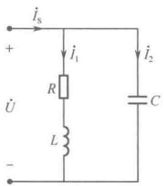

(a)
 

 $$ R^{\prime}_{eq}=50k\Omega $$ 

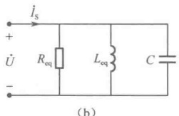

(b)
 

图 14-14 例 14-5 图
 

这时，电路的品质因数为

 $$ Q^{\prime}=\frac{R^{\prime}_{eq}}{\omega_{0}L}=\frac{50\times10^{3}}{1000}=50 $$ 

### 14.3 基本滤波器电路及其频率特性

滤波器是基于谐波阻抗而建立的电路，滤波器电路具有这样的功能：抑制不需要的频率分量，而让所需要的频率分量顺利通过。允许通过滤波器电路的频率范围称为通带，被抑制的频率范围称为阻带。根据通带和阻带在频率范围中的相对位置，将滤波器分为低通滤波器、高通滤波器、带通滤波器、带阻滤波器、截止滤波器和选频滤波器等。根据组成元件的性质又可将滤波器分为有源滤波器和无源滤波器，由电阻、电感、电容等无源元件构成的滤波器是无源滤波器；如果构成元件中含有晶体管、运算放大器等有源元件，则是有源滤波器。

#### 14.3.1 低通滤波器

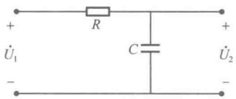

图 14-15 RC 低通滤波器电路
 

RC 低通滤波器电路如图 14-15 所示，由图可得电路的网络函数为

 $$ H(\mathrm{j}\omega)=\frac{\dot{U}_{2}(\mathrm{j}\omega)}{\dot{U}_{1}(\mathrm{j}\omega)}=\frac{1/\mathrm{j}\omega C}{R+1/\mathrm{j}\omega C}=\frac{1}{1+\mathrm{j}\omega RC} $$ 

其幅频特性为

 $$ \left|H(\mathrm{j}\omega)\right|=\frac{1}{\sqrt{1+\left(\omega RC\right)^{2}}}=\frac{1}{\sqrt{1+\left(\omega/\omega_{H}\right)^{2}}} $$ 

其相频特性为  $ \theta(j\omega) = -\arctan\omega RC = -\arctan(\omega/\omega_{H}) $

式中， $ \omega_{H}=1/RC $ 。从上式可以看出，高频被抑制，所以该电路为低通滤波器，频率特性曲线如图14-16所示。

<!-- page: 366 -->

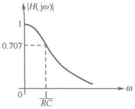

（a）幅频特性
 

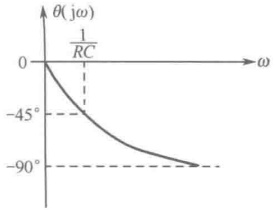

（b）相频特性
 

图 14-16 RC 低通滤波器的特性曲线
 

RL 低通滤波器电路如图 14-17 所示，由图可得电路的网络函数为

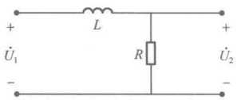

 $$ H(\mathrm{j}\omega)=\frac{\dot{U}_{2}(\mathrm{j}\omega)}{\dot{U}_{1}(\mathrm{j}\omega)}=\frac{R}{R+\mathrm{j}\omega L}=\frac{1}{1+\mathrm{j}\omega L/R} $$ 

其幅频特性为  $ \left|H(j\omega)\right|=\frac{1}{\sqrt{1+\left(\omega L/R\right)^2}}=\frac{1}{\sqrt{1+\left(\omega/\omega_H\right)^2}} $

图 14-17 RL 低通滤波器电路 其相频特性为  $ \theta(j\omega) = -\arctan(\omega L/R) = -\arctan(\omega/\omega_{H}) $

式中， $ \omega_{H}=R/L $ 。同样，高频被抑制，所以该电路为低通滤波器，频率特性曲线如图14-18所示。

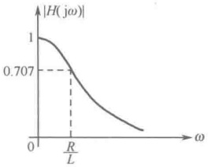

(a) 幅频特性
 

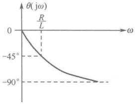

（b）相频特性
 

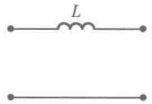

图 14-18 RL 低通滤波器的特性曲线
 

如图 14-19 所示的几种电路也属于低通滤波器。

(a)
 

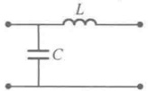

(b)
 

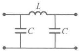

(c)
 

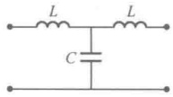

图 14-19 几种低通滤波器
 

(d)
 

#### 14.3.2 高通滤波器

 $$ H(\mathrm{j}\omega)=\frac{\dot{U}_{2}(\mathrm{j}\omega)}{\dot{U}_{1}(\mathrm{j}\omega)}=\frac{R}{R+1/\mathrm{j}\omega C}=\frac{1}{1+1/\mathrm{j}\omega RC} $$ 

RC 高通滤波器电路如图 14-20 所示，由图可得电路的网络函数为

其幅频特性为  $ \left|H(j\omega)\right|=\frac{1}{\sqrt{1+\left(1/\omega RC\right)^2}}=\frac{1}{\sqrt{1+\left(\omega_H/\omega\right)^2}} $

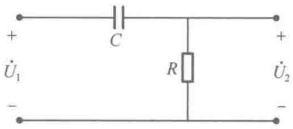

其相频特性为  $ \theta(j\omega)=\arctan(1/\omega RC)=\arctan(\omega_{H}/\omega) $

图 14-20 RC 高通滤波器电路
 

式中， $ \omega_{H}=1/RC $ 。可以看出低频段被抑制，所以该电路为高通滤波器，频率特性曲线如图14-21所示。

<!-- page: 367 -->

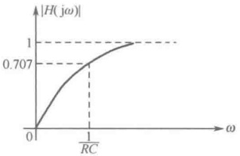

（a）幅频特性
 

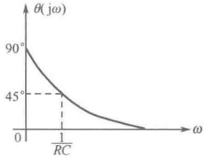

（b）相频特性
 

图 14-21 RC 高通滤波器的特性曲线
 

RL 高通滤波器电路如图 14-22 所示，由图可得电路的网络函数为

 $$ H(j\omega)=\frac{\dot{U}_{2}(j\omega)}{\dot{U}_{1}(j\omega)}=\frac{j\omega L}{R+j\omega L}=\frac{1}{1+R/j\omega L} $$ 

其幅频特性为  $ \left|H(j\omega)\right|=\frac{1}{\sqrt{1+\left(R/\omega L\right)^2}}=\frac{1}{\sqrt{1+\left(\omega_H/\omega\right)^2}} $

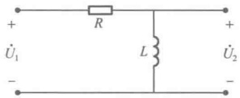

其相频特性为  $ \theta(j\omega)=\arctan(R/\omega L)=\arctan(\omega_{H}/\omega) $

图 14-22 RL 高通滤波器电路
 

式中， $ \omega_{H}=R/L $ 。同样，低频段被抑制，所以该电路为高通滤波器，频率特性曲线如图14-23所示。

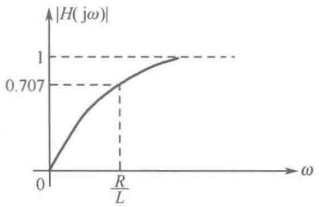

（a）幅频特性
 

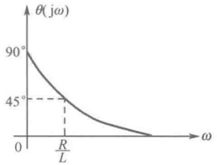

（b）相频特性
 

图 14-23 RL 高通滤波器的特性曲线
 

如图 14-24 所示的几种电路也属于高通滤波器。

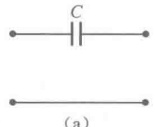

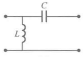

(b)
 

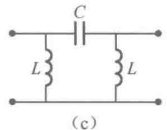

(c)
 

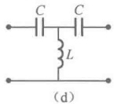

图 14-24 几种高通滤波器
 

#### 14.3.3 带通滤波器

RLC 串联带通滤波器电路如图 14-25 所示，由图可得电路的网络函数为

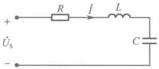

图 14-25 RLC 串联带通滤波器电路
 

 $$ H(\mathrm{j}\omega)=\frac{\dot{I}(\mathrm{j}\omega)}{\dot{U}_{\mathrm{s}}(\mathrm{j}\omega)}=\frac{1}{R+\mathrm{j}(\omega L-1/\omega C)} $$ 

其幅频特性为

 $$ \left|H(\mathrm{j}\omega)\right|=\frac{1}{\sqrt{R^{2}+\left(\omega L-1/\omega C\right)^{2}}} $$ 

其相频特性为

 $$ \theta(j\omega)=-\arctan\frac{\omega L-1/\omega C}{R} $$ 

从上式可知， $ \omega<\omega_{1} $ 和  $ \omega>\omega_{2} $ 的频段被抑制，所以该电路为带通滤波器，频率特性曲线如图 14-26 所示。

<!-- page: 368 -->

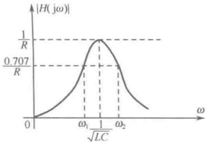

(a) 幅频特性
 

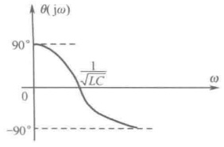

（b）相频特性
 

图 14-26 RLC 串联高通滤波器的特性曲线
 

RLC 并联带通滤波器电路如图 14-27 所示，由图可得电路的网络函数为

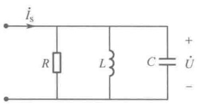

图 14-27 RLC 并联带通滤波器电路
 

 $$ H(\mathrm{j}\omega)=\frac{\dot{U}(\mathrm{j}\omega)}{\dot{I}_{\mathrm{s}}(\mathrm{j}\omega)}=\frac{1}{\frac{1}{R}+\mathrm{j}\left(\omega C-\frac{1}{\omega L}\right)} $$ 

其幅频特性为

 $$ \left|H(j\omega)\right|=\frac{1}{\sqrt{\frac{1}{R^{2}}+\left(\omega C-\frac{1}{\omega L}\right)^{2}}} $$ 

其相频特性为

 $$ \theta(j\omega)=-\arctan R\left(\omega C-\frac{1}{\omega L}\right) $$ 

从上式可知， $ \omega < \omega_{1} $ 和  $ \omega > \omega_{2} $ 的频段被抑制，所以该电路为带通滤波器，频率特性曲线如图 14-28 所示。

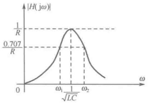

(a) 幅频特性
 

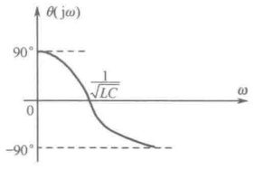

(b) 相频特性
 

图 14-28 RLC 并联带通滤波器的特性曲线
 

例 14-6 如图 14-29 所示为文氏电桥电路，求网络函数  $ H(\mathrm{j}\omega)=\dot{U}_{2}/\dot{U}_{1} $ 及其频率响应； $ \dot{U}_{2}/\dot{U}_{1} $ 在哪个频率值上最大？

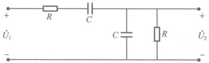

图 14-29 文氏电桥电路
 

解：由串并联分压关系可得

 $$ H(\mathrm{j}\omega)=\frac{\dot{U_{2}}}{\dot{U}_{1}}=\frac{\frac{R\times1/\mathrm{j}\omega C}{R+1/\mathrm{j}\omega C}}{(R+1/\mathrm{j}\omega C)+\frac{R\times1/\mathrm{j}\omega C}{R+1/\mathrm{j}\omega C}}=\frac{1}{3+\mathrm{j}(\omega RC-1/\omega RC)} $$

<!-- page: 369 -->

所以，幅频特性为

 $$ \left|H(\mathrm{j}\omega)\right|=\frac{1}{\sqrt{3^{2}+\mathrm{j}(\omega RC-1/\omega RC)^{2}}} $$ 

当  $ \omega RC - 1/\omega RC = 0 $ 时， $ \left|H(j\omega)\right| $ 最大，为 1/3，此时  $ \omega = \omega_H = 1/RC $；可画出幅频特性曲线，如图 14-30（a）所示。

相频特性为

 $$ \theta(j\omega)=-\arctan\frac{\omega RC-1/\omega RC}{3} $$ 

当  $ \omega = \omega_H $ 时， $ \theta(j\omega) = 0 $；当  $ \omega > \omega_H $ 时， $ \theta(j\omega) < 0 $；当  $ \omega < \omega_H $ 时， $ \theta(j\omega) > 0 $；当  $ \omega \to \infty $ 时， $ \theta(j\omega) \to -\pi/2 $；当  $ \omega \to 0 $ 时， $ \theta(j\omega) \to \pi/2 $。于是可画出相频特性曲线，如图 14-30（b）所示。

如图 14-31 所示，将两个滤波器级联起来，并且使低通滤波器的截止频率  $ f_{2} $ 大于高通滤波器的截止频率  $ f_{1} $，它们就构成了带通滤波器，可使  $ f_{1} < f < f_{2} $ 这一频带的谐波分量通过。

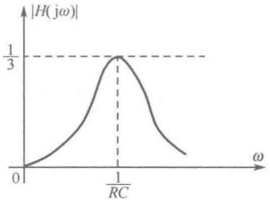

（a）幅频特性
 

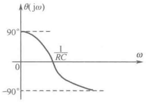

（b）相频特性
 

图 14-30 文氏电桥电路的特性曲线
 

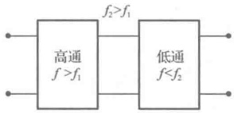

图 14-31 带通滤波器
 

#### 14.3.4 其他形式的滤波器简介

# 1. 截止滤波器

截止滤波器是利用谐振的方法，使输出端不出现某次谐波分量。如图 14-32 所示的两种电路都是截止滤波器，当  $ k\omega=1/\sqrt{LC} $ 时，k 次谐波分量通不过，即在输出端没有 k 次谐波分量。

# 2. 选频滤波器

选频滤波器也是利用谐振的办法，使输出端对某次谐波分量不衰减。如图 14-33 所示的两种电路都是选频滤波器，当  $ k\omega=1/\sqrt{LC} $ 时，k 次谐波分量不衰减，直接传输到输出端。

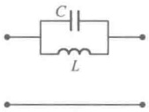

(a)
 

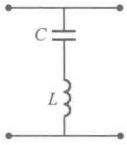

（b）
 

图 14-32 截止滤波器
 

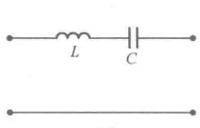

(a)
 

(b)
 

图 14-33 选频滤波器
 

# 3. 带阻滤波器

如图 14-34 所示，将两个滤波器并联起来，并且使低通滤波器的截止频率  $ f_{2} $ 小于高通滤波器的截止频率  $ f_{1} $，它们就构成了带阻滤波器，可使  $ f_{1} < f < f_{2} $ 这一频带的谐波分量不能通过。

图 14-34 带阻滤波器
 

<!-- page: 370 -->

### 14.4 计算机仿真

##### 例 14-7 串联谐振电路的仿真

如图 14-35（a）所示的 RLC 串联电路，当元件参数不变而外加激励频率可变时，在某一频率处，端口电压电流同相位，电路呈纯电阻特性，则称电路发生了串联谐振。

根据理论分析可知，图14-35(a)中的串联谐振频率为 $ f_0 = \frac{1}{2\pi\sqrt{LC}} = \frac{1}{2\pi\sqrt{10\times10^{-3}}\times100\times10^{-9}} \approx 5033\text{Hz} $，设置电压源的频率为电路的谐振频率5033Hz。图14-35（b）所示为示波器显示的端口电压和电流瞬时波形，是谐振时的同相位关系。电路的品质因数为 $ Q = \frac{\omega_0 L}{R} = \frac{L}{R\sqrt{LC}} = \frac{1}{R}\sqrt{\frac{L}{C}} \approx 6.3 $，谐振时电容电压和电感电压为端口电压的 $ Q $倍， $ U_C = U_L = QU_S = 6.3\text{V} $，电阻电压等于激励电压 $ U_R = U_S = 1\text{V} $，串联电路的电流为激励电压除以电阻值 $ I_0 = U_S/R = 0.02\text{A} $。利用图14-35（c）所示电路对上述各元件电压和电流进行测量，与理论分析一致。注意，串联谐振时电容电压和电感电压大小相等，相位相反，二者代数和为零，因此可以串联等效为短路。利用图14-35（d）所示的电路测量电容和电感电压的瞬时值，可以得到图14-35（e）所示的电容和电感瞬时电压波形，与理论分析相同。

（a）RLC串联谐振电路
 

（b）RLC 串联谐振电路的端口电压和电流瞬时波形
 

（c）RLC 串联谐振电路的元件电压和电流
 

（d）RLC 串联谐振电路电容和电感电压瞬时值
 

（e）RLC 串联谐振电路中电容和电感瞬时电压波形
 

图 14-35 RLC 串联谐振仿真
 

##### 例 14-8 RLC 并联谐振电路的仿真

如图 14-36（a）所示的 RLC 并联电路，当元件参数不变而外加激励频率可变时，在某一频率

<!-- page: 371 -->

处，端口电压电流同相位，电路呈纯电阻特性，则称电路发生了并联谐振。

根据理论分析可知，图14-36(a)中的并联谐振频率为 $ f_0 = \frac{1}{2\pi\sqrt{LC}} = \frac{1}{2\pi\sqrt{10\times10^{-3}}\times100\times10^{-9}} \approx 5033\text{Hz} $，设置电流源的频率为电路的谐振频率5033Hz，图14-36（b）所示为示波器显示的端口电压和电流瞬时波形，是谐振时的同相位关系。电路的品质因数为 $ Q = 1/\omega_0LG = \approx 3.2 $，谐振时电容流和电感电流为端口电流的 $ Q $倍 $ I_c = I_L = QI_s = 22.6\text{mA} $，电阻电流等于激励电流 $ I_R = I_S = 7.07\text{mA} $，并联电路的电压为激励电流乘以电阻值 $ U_0 = I_S R = 7.07\text{V} $。利用图14-36（c）所示电路对上述各元件电压和电流进行测量，与理论分析一致。注意，并联谐振时电容电流和电感电流大小相等，相位相反，二者代数和为零，因此可以并联等效为开路。利用图14-36（d）所示的电路测量电容和电感电流的瞬时值，可以得到图14-36（e）所示的电容和电感瞬时电流波形，与理论分析相同。

（a）RLC 并联谐振电路
 

（b）RLC 并联谐振电路的端口电压和电流瞬时波形
 

（c）RLC 并联谐振电路的元件电压和电流
 

（d）RLC 并联谐振电路电容和电感电流瞬时值
 

（e）RLC 并联谐振电路中电容和电感瞬时电流波形
 

图 14-36 RLC 并联谐振仿真
 

##### 例 14-9 实际电感线圈与电容并联谐振电路的仿真

在实际电路中更常见的并联谐振结构是如图 14-37（a）所示的实际电感线圈与电容并联电路，其中 R1 是线圈 L1 的阻值，该电路也会发生并联谐振。

根据理论分析可知，图 14-37（a）中的等效导纳为  $ Y = \mathrm{j}\omega C + \frac{1}{R + \mathrm{j}\omega L} = \frac{R}{R^2 + (\omega L)^2} + \mathrm{j}\left[\omega C - \frac{\omega L}{R^2 + (\omega L)^2}\right] $，当  $ R < \sqrt{\frac{L}{C}} $ 时可以发生并联谐振，一般线圈电阻  $ R \ll \omega L $，则等效导纳可近似为  $ Y = \frac{R}{R^2 + (\omega L)^2} + \mathrm{j}\left[\omega C - \frac{\omega L}{R^2 + (\omega L)^2}\right] \approx \frac{R}{(\omega L)^2} + \mathrm{j}\left(\omega C - \frac{1}{\omega L}\right) $，谐振时等效导纳为纯电导，电纳

<!-- page: 372 -->

部分为零，可以推出谐振角频率为  $ \omega_0 = \frac{1}{\sqrt{LC}} $，谐振频率为  $ f_0 = \frac{1}{2\pi\sqrt{LC}} = \frac{1}{2\pi\sqrt{1 \times 10^{-3} \times 10 \times 10^{-6}}} \approx 1591\text{Hz} $，谐振时的等效导纳最小，等效阻抗最大，谐振时的等效阻抗为纯电阻，大小为  $ Z_0 = 1/Y_0 = L/RC $。设置电流源的频率为电路的谐振频率 1591Hz，图 14-37（b）所示为示波器显示的端口电压和电流瞬时波形，是谐振时的同相位关系。电路的品质因数为  $ Q = \frac{1}{\omega_0 L G} = \frac{\omega_0 C}{G} = \frac{\omega_0 L}{R} $ [此时  $ G \approx \frac{R}{(\omega_0 L)^2} $]，可算出图 14-37（a）电路的  $ Q = 10 $。谐振时电容电流和电感线圈电流近似为端口电流的  $ Q $ 倍  $ I_C = I_L = Q I_S = 70.7\text{mA} $，电阻电流等于激励电流  $ I_R = I_S = 7.07\text{mA} $，并联电路的电压为激励电流乘以电阻值  $ U_0 = I_S Z_0 = 0.707\text{V} $。利用图 14-37（c）所示电路对上述各元件电压和电流进行测量，与理论分析一致。并联谐振时电容电流和电感支路电流大小相等，相位相反。利用图 14-37（d）所示的电路测量电容和电感支路电流的瞬时值，可以得到图 14-37（e）所示的电容和电感支路瞬时电流波形，与理论分析相同。

（a）电感线圈与电容并联谐振电路
 

（b）电感线圈与电容并联谐振电路的端口电压和电流瞬时波形
 

（c）电感线圈与电容并联谐振电路的元件电压和电流
 

（d）电感线圈与电容并联谐振电路电容和电感电流瞬时值
 

（e）电感线圈与电容并联谐振电路中电容和电感支路瞬时电流波形
 

图 14-37 电感线圈与电容并联谐振仿真
 

<!-- page: 373 -->

##### 例 14-10 一阶 RC 低通滤波器仿真

如图 14-38（a）为一阶 RC 低通滤波器，以电容的端电压为输出。RC 无源低通滤波器的传递函数为

 $$ H(\mathrm{j}\omega)=\frac{\dot{U}_{\mathrm{out}}}{\dot{U}_{\mathrm{in}}}=\frac{1/\mathrm{j}\omega C}{R+\mathrm{j}\omega C}=\frac{1}{\sqrt{1+\left(\omega RC\right)^{2}}}\angle-\arctan(\omega RC) $$ 

其幅频特性为

 $$ |H(j\omega)|=\frac{1}{\sqrt{1+\left(\omega RC\right)^2}} $$ 

其相频特性为

 $$ \varphi(j\omega)=-\arctan(\omega RC) $$ 

随着输入信号频率  $ \omega $ 的增大， $ |H(\omega)| $ 将减小，说明低频信号可以通过，高频信号将被抑制或衰减。当  $ \omega = 1/RC $ 或  $ f = 1/(2\pi RC) $ 时， $ |H(\omega)| = 0.707 $，通常把此时的频率  $ \omega_c $（或  $ f_c $）称为上截止频率，本例中为 1591Hz。用波特图示仪可以测量该电路的幅频特性和相频特性，其设置方法为：双击波特图示仪图标，打开设置面板，首先单击 Magnitude 按钮，在 Horizontal 区设置水平坐标轴的刻度为线性（Lin），设置频率的初始值（Initial）为 1Hz，频率的终值（Final）为 1MHz；然后，在控制区单击 Set 按钮，设置扫描的分辨率为 1000（分辨率越高，得到的曲线越光滑）。单击仿真运行开关，得到图 14-38（b）所示的 RC 低通滤波器的幅频特性曲线。在曲线上拖动读数指针可以看到，当输入信号频率较低时，增益为 0dB，随着信号频率增大，增益变为负数，上截止频率为 1617Hz，通频带为 0～1617Hz。图 14-38（c）是相频特性曲线，从测量结果可以看出，输出电压滞后于输入电压。当输入信号频率较低时，相移为 0，随着信号频率增大，相移也逐渐增大，最大相移达 90°。所以该电路称为低通 RC 电路，同时具有从 0° 逐渐变到 -90° 的相移功能。当一个频带足够宽的信号经过低通滤波电路后，其中的高频成分被大大削弱，主要保留了低频成分。

一阶 RC 电路的频率特性还可以用 “交流分析” 法进行分析，只要执行菜单命令 Analysis，在弹出的对话框中，选择起始频率为 1Hz，终止频率为 3kHz，扫描方式选为 Decade，采样点为 10，纵坐标刻度为 Decibel。选中 V（Probe1）为分析对象，单击 Simulate 按钮，即可得到幅频和相频特性，与图 14-38（b）、（c）完全一样，这里不再赘述。

（a）一阶 RC 低通滤波电路
 

（b）一阶 RC 低通滤波器的幅频特性曲线
 

（c）一阶 RC 低通滤波器的相频特性曲线
 

图 14-38 RC 低通滤波器仿真分析
 

<!-- page: 374 -->

##### 例 14-11 二阶 RC 低通滤波器仿真

如图 14-39（a）为二阶 RC 低通滤波器，以电容 C2 的端电压为输出。在相量域中对该电路列写节点电压方程如下：

节点n：

 $$ \left(\frac{1}{R}+\frac{1}{R}+\mathrm{j}\omega C\right)\dot{U}_{\mathrm{n}}-\frac{1}{R}\dot{U}_{\mathrm{o}}=\frac{1}{R}\dot{U}_{\mathrm{s}} $$ 

输出节点O：

 $$ \left(\frac{1}{R}+\mathrm{j}\omega C\right)\dot{U}_{\mathrm{o}}-\frac{1}{R}\dot{U}_{\mathrm{n}}=0 $$ 

消去 $ \dot{U}_{n} $，可得该二阶 RC 无源低通滤波器的传递函数为

 $$ H(\mathrm{j}\omega)=\frac{\dot{U}_{\mathrm{o}}}{\dot{U}_{\mathrm{s}}}=\frac{1}{(1-\omega^{2}R^{2}C^{2})+\mathrm{j}3\omega RC}=\frac{1}{\sqrt{(1-\omega^{2}R^{2}C^{2})^{2}+9\omega^{2}R^{2}C^{2}}}\angle-\arctan\left(\frac{3\omega RC}{1-\omega^{2}R^{2}C^{2}}\right) $$ 

其幅频特性为

 $$ |H(\mathrm{j}\omega)|=\frac{1}{\sqrt{(1-\omega^{2}R^{2}C^{2})^{2}+9\omega^{2}R^{2}C^{2}}} $$ 

其相频特性为

 $$ \varphi(j\omega)=-\arctan\left(\frac{3\omega RC}{1-\omega^{2}R^{2}C^{2}}\right) $$ 

随着输入信号频率  $ \omega $ 的增大， $ |H(\omega)| $ 将减小，说明低频信号可以通过，高频信号将被抑制或衰减。当  $ |H(j\omega)|=1/\sqrt{2} $ 时， $ (1-\omega^2R^2C^2)^2+9\omega^2R^2C^2=2 $，可算出此时  $ \omega_C=1/2.6726RC $，本例中为 595Hz。用波特图示仪可以测量该电路的幅频特性和相频特性，图 14-36（b）为 RC 低通滤波器的幅频特性曲线，拖动读数指针可以看到，当输入信号频率较低时，增益为 0dB，随着信号频率增大，增益变为负数，上截止频率为 587Hz，通频带为 0～587Hz。图 14-39（c）是相频特性曲线，从测量结果可以看出，输出电压滞后于输入电压。当输入信号频率较低时，相移为 0°，随着信号频率增大，相移也逐渐增大，最大相移达 180°，当  $ \omega=\omega_C $ 时，相移为 -52.06°。对比例 14-9 中的一阶 RC 低通滤波器可以看出，增加滤波器的阶数，可以提高对通频带外的信号的抑制能力，滤波效果更好，通频带变窄，相移范围更大。综上，该电路为低通 RC 电路，同时具有从 0° 逐渐变到 -180° 的相移功能。当一个频带足够宽的信号经过低通滤波电路后，其中的高频成分被大大削弱，主要保留了低频成分。

可以在时域直观地观察滤波器的滤波效果，将图 14-39（a）改为图 14-39（b）函数发生器的输入信号接入示波器的 A 通道，滤波器的输出接入示波器的 B 通道，按图 14-39（e）所示将滤波器的输入信号设置为频率为 500Hz 的三角波，图 14-39（f）为从示波器观察到的滤波器输入/输出波形。观察发现滤波器的输出为与输入三角波同频率的正弦波，这是由于三角波中的谐波分量均已被低通滤波器滤除，只留下基波分量。

（a）二阶 RC 低通滤波电路
 

（b）二阶 RC 低通滤波器的幅频特性曲线
 

图 14-39 二阶 RC 低通滤波器仿真分析
 

<!-- page: 375 -->

（c）二阶 RC 低通滤波器的相频特性曲线
 

（d）二阶滤波器时域仿真
 

（e）三角波参数设置
 

（f）二阶 RC 低通滤波输入和输出的波形
 

图 14-39 二阶 RC 低通滤波器仿真分析（续）
 

##### 例 14-12 一阶 RC 高通滤波器仿真

如图 14-40（a）图为一阶 RC 高通滤波器，以电阻的端电压为输出。RC 无源高通滤波器的传递函数为

 $$ \begin{aligned}H(\mathrm{j}\omega)=\frac{\dot{U}_{\mathrm{out}}}{\dot{U}_{\mathrm{in}}}=\frac{R}{R+1/\mathrm{j}\omega C}=\frac{\omega RC}{\sqrt{1+\left(\omega RC\right)^{2}}}\angle\frac{\pi}{2}-\arctan(\omega RC)\\|H(\mathrm{j}\omega)|=\frac{\omega RC}{\sqrt{1+\left(\omega RC\right)^{2}}}=\frac{1}{\sqrt{1+(1/\omega RC)^{2}}}\\\varphi(\mathrm{j}\omega)=\pi/2-\arctan(\omega RC)\end{aligned} $$ 

其幅频特性为

其相频特性为

随着输入信号频率  $ \omega $ 的增大， $ |H(\omega)| $ 从 0 逐渐增大到 1，说明高频信号可以通过，低频信号将被抑制或衰减。当  $ \omega = 1/RC $ 或  $ f = 1/(2\pi RC) $ 时， $ |H(\omega)| = 0.707 $，通常把此时的频率  $ \omega_C $（或  $ f_C $）称为下载止频率。用波特图示仪可以测量该电路的幅频特性和相频特性，图 14-40（b）为 RC 高通滤波器的幅频特性曲线，拖动读数指针可以看到，当输入信号频率较低时，增益为负数，随着信号频率的增大，增益变为 0dB，下载止频率为 1617Hz。图 14-40（c）是相频特性曲线，从测量结果可以看出，输出电压超前于输入电压。当输入信号频率较低时，相移为  $ 90^\circ $，随着信号频率增大，相移也逐渐减小，最小相移为  $ 0^\circ $。所以该电路称为高通 RC 电路，同时具有从  $ 90^\circ $ 逐渐变到  $ 0^\circ $ 的相移功能。当一个频带足够宽的信号经过高通滤波电路后，其中的低频成分被大大削弱，主要保留了高频成分。

<!-- page: 376 -->

（b）一阶 RC 高通滤波器幅频特性曲线
 

（c）一阶 RC 高通滤波器相频特性曲线
 

图 14-40 一阶 RC 高通滤波器仿真
 

##### 例14-13 RC带通滤波器仿真

如图 14-41（a）所示的 RC 带通滤波器为例 14-6 中的文氏电桥电路，其传递函数为

 $$ H(\mathrm{j}\omega)=\frac{\dot{U}_{\mathrm{out}}}{\dot{U}_{\mathrm{in}}}=\frac{\frac{R\times1/\mathrm{j}\omega C}{R+1/\mathrm{j}\omega C}}{\left(R+1/\mathrm{j}\omega C\right)+\frac{R\times1/\mathrm{j}\omega C}{R+1/\mathrm{j}\omega C}}=\frac{1}{3+\mathrm{j}(\omega RC-1/\omega RC)} $$ 

其幅频特性为

 $$ |H(\mathrm{j}\omega)|=\frac{1}{\sqrt{3^{2}+\left(\omega RC-\frac{1}{\omega RC}\right)^{2}}}=\frac{1}{\sqrt{3^{2}+\left(\frac{\omega}{\omega_{0}}-\frac{\omega_{0}}{\omega}\right)^{2}}} $$ 

其相频特性为

 $$ \varphi(j\omega)=-\arctan\frac{\left(\omega RC-\frac{1}{\omega RC}\right)}{3}=-\arctan\frac{\frac{\omega}{\omega_{0}}-\frac{\omega_{0}}{\omega}}{3} $$ 

式中，$\omega_0$ 为 RC 带通滤波器的中心频率，$\omega_0=1/RC$ 或 $f_0=1/(2\pi RC)$ 时，由公式可以计算出该滤波器的中心频率为 $1591\mathrm{Hz}$。图 14-41（b）为波特图示仪显示的幅频特性曲线，拖动读数指针可以看到，幅频特性曲线的最高点为滤波器的中心频率，约为 $1617\mathrm{Hz}$，增益为 $-9.543\mathrm{dB}$。当输入信号频率等于带通滤波器的中心频率时，输出电压大小为输入电压的 $1/3$，换算成增益为 $-9.545\mathrm{dB}$。将两个读数指针分别向左、右移动，使增益分别下降 $3\mathrm{dB}$，便可测得带通滤波器的上截止频率和下截止频率，二者之差为带通滤波器的通频带。测量结果为，下截止频率 $f_L=475\mathrm{Hz}$，上截止频率 $f_H=5200\mathrm{Hz}$，$B_w=f_H-f_L=5200-475=4725\mathrm{Hz}$。由图 14-41（c）所示的相频特性曲线可以观察到，当输入信号的频率等于中心频率时，输出与输入同相位。综上，此 RC 带通滤波器的作用是当一个频带足够宽的信号经过带通滤波电路后，其中的低频成分和高频成分被大大削弱，只允许中间一部分频率成分通过。

##### 例14-14 RLC带通滤波器仿真

利用 LC 的谐振原理，可以设计出不同频率特性的滤波器。如图 14-42（a）所示电路，若以电阻 R1 上的电压  $ \dot{U}_0 $ 作为输出，则该滤波器的网络函数为  $ H(\mathrm{j}\omega) = \frac{\dot{U}_0}{\dot{U}_S} = \frac{R}{R + \mathrm{j}(\omega L - 1/\omega C)} $，其幅

<!-- page: 377 -->

频特性为 $ |H(\mathrm{j}\omega)|=\frac{1}{\sqrt{1+\left(\frac{\omega L}{R}-\frac{1}{\omega RC}\right)^2}} $，相频特性为 $ \varphi(\mathrm{j}\omega)=-\arctan\left(\frac{\omega L}{R}-\frac{1}{\omega RC}\right) $。

（a）RC 带通滤波器电路
 

（b）幅频特性曲线
 

（c）相频特性曲线
 

图 14-41 RC 带通滤波器仿真
 

令 $ |H(\mathrm{j}\omega)|=\frac{1}{\sqrt{2}} $，则 $ \left(\frac{\omega L}{R}-\frac{1}{\omega RC}\right)^2=1 $，可得 $ \frac{\omega L}{R}-\frac{1}{\omega RC}=\pm1 $。

当 $ \frac{\omega L}{R} - \frac{1}{\omega RC} = 1 \Rightarrow \omega_{\mathrm{H}} = \frac{RC \pm \sqrt{(RC)^2 + 4LC}}{2LC} $，由于 $ \sqrt{(RC)^2 + 4LC} > RC $，所以只保留正根 $ \omega_{\mathrm{H}} = \frac{RC + \sqrt{(RC)^2 + 4LC}}{2LC} $；同理， $ \frac{\omega L}{R} - \frac{1}{\omega RC} = -1 \Rightarrow \omega_{\mathrm{L}} = \frac{-RC \pm \sqrt{(RC)^2 + 4LC}}{2LC} $，只保留正根 $ \omega_{\mathrm{L}} = \frac{-RC + \sqrt{(RC)^2 + 4LC}}{2LC} $。因此滤波器带宽为 $ B = |\omega_{\mathrm{H}} - \omega_{\mathrm{L}}| = \frac{R}{L} $。

据此，可以算出图 14-42（a）滤波器的上截止频率  $ \omega_H $ 和  $ \omega_L $，及其带宽  $ B = |\omega_H - \omega_L| = R/L $。具体运算结果如下：

 $$ \begin{aligned}\omega_{H}=&\frac{10^{3}\times0.1\times10^{-6}+\sqrt{(10^{3}\times0.1\times10^{-6})^{2}+4\times10\times10^{-3}\times0.1\times10^{-6}}}{2\times10\times10^{-3}\times0.1\times10^{-6}}\\=&\frac{10^{4}+\sqrt{10^{-8}+4\times10^{-9}}}{2\times10^{-9}}=\frac{(1+\sqrt{1.4})\times10^{4}}{2\times10^{-9}}\approx1.09\times10^{5}rad/s\end{aligned} $$ 

 $$ \begin{aligned}\omega_{L}=&\frac{-10^{3}\times0.1\times10^{-6}+\sqrt{(10^{3}\times0.1\times10^{-6})^{2}+4\times10\times10^{-3}\times0.1\times10^{-6}}}{2\times10\times10^{-3}\times0.1\times10^{-6}}\\=&\frac{-10^{4}+\sqrt{10^{-8}+4\times10^{-9}}}{2\times10^{-9}}=\frac{(\sqrt{1.4}-1)\times10^{4}}{2\times10^{-9}}\approx9000rad/s\end{aligned} $$ 

 $$ f_{H}=\frac{\omega_{H}}{2\pi}=\frac{1.09\times10^{5}}{2\pi}\approx17.347kHz,\quad f_{L}=\frac{\omega_{L}}{2\pi}=\frac{9000}{2\pi}\approx1.432kHz $$

<!-- page: 378 -->

$$ B=\left|f_{H}-f_{L}\right|=15.915kHz $$ 

通过图 14-42（a）的波特仪观察幅频特性曲线，最高点在谐振频率处，理论计算可得  $ f_0 = \frac{1}{2\pi\sqrt{LC}} = \frac{1}{2\pi\sqrt{10\times10^{-3}\times0.1\times10^{-6}}} \approx 5033\text{Hz} $，如图 14-42（b）所示，仿真结果与理论值基本吻合。将游标从最高点向低频处移动，直到增益下降为-3dB，如图 14-42（c）所示，可以读取下载止频率为 1462Hz；将游标从最高点向高频处移动，直到增益下降为-3dB，如图 14-42（d）所示，可以读取上截止频率为 17.449kHz，均与理论分析一致。从图 14-42（e）所示的相频特性曲线可以观察 RLC 带通滤波器的关系为：在谐振频率处，输出电压与输入电压的相移为 0；当信号频率小于谐振频率时，电路呈容性，输出电压相位超前输入电压相位，在 0～90° 之间；当信号频率大于谐振频率时，电路呈感性，输出电压相位滞后输入电压相位，在 0～-90° 之间。

（a）RLC 带通滤波器电路
 

（b）谐振频率曲线
 

（c）下截止频率曲线
 

（d）上截止频率曲线
 

（e）相频特性曲线
 

图 14-42 RLC 带通滤波器仿真
 

改变电阻、电容和电感的元件参数，可以调整 RLC 带通滤波器的频率特性。如图 14-43（a）所示，添加探针，进行参数扫描，如图 14-43（b）所示，以列表将 R1 设置为 10Ω、100Ω、1000Ω，由于 LC 参数不变，因此 RLC 的谐振频率不变，R1 的改变会影响电路的品质因数 Q，Q 值随着阻值的增大而减小。按图 14-43（c）、（d）设置好后，仿真得到图 14-43（e）所示的频率响应曲线。对于图 14-43（e）中的幅频特性曲线，Q 值越大，曲线越尖锐，通频带越窄；对于图 14-43（e）中的相频特性曲线，Q 值越大，曲线在谐振频率附近的变化就越陡峭，线性范围越窄。

<!-- page: 379 -->

（a）RLC 带通滤波器电路
 

（b）设置电阻值
 

（c）设置交流分析参数
 

（d）设置输出变量
 

（e）不同R1值的频率响应曲线
 

图 14-43 RLC 带通滤波器不同参数的频率特性仿真
 

##### 例 14-15 组合带通滤波器仿真

如果高通滤波器的转折频率低于低通滤波器的转折频率，则 RC、RL 电路可以组合出带通滤波器。如图 14-44（a）所示，将 RC 低通滤波器和 RL 高通滤波器级联在一起。可以计算出 RC 低通滤波器的转折频率为  $ f_{cl} = 1/2\pi RC = 159\text{kHz} $，RL 高通滤波器的转折频率为  $ f_{c2} = R/2\pi L = 15.9\text{Hz} $， $ f_{c2} < f_{cl} $，允许频率在  $ f_{c2} \sim f_{cl} $ 之间的信号通过，滤除其他信号，因此具有带通性。

参照二阶 RC 电路的分析方法，在相量域中对该电路列写节点电压方程如下：

节点n:

 $$ \left(\frac{1}{R}+\frac{1}{R}+\mathrm{j}\omega C\right)\dot{U}_{\mathrm{n}}-\frac{1}{R}\dot{U}_{\mathrm{o}}=\frac{1}{R}\dot{U}_{\mathrm{s}} $$ 

输出节点O：

 $$ \left(\frac{1}{R}+\frac{1}{\mathrm{j}\omega L}\right)\dot{U}_{\mathrm{o}}-\frac{1}{R}\dot{U}_{\mathrm{n}}=0 $$ 

消去 $ \dot{U}_{n} $，可得滤波器的传递函数为

 $$ H(\mathrm{j}\omega)=\frac{\dot{U_{o}}}{\dot{U}_{\mathrm{s}}}=\frac{1}{\left(1+\frac{R^{2}C}{L}\right)+\mathrm{j}\left(\omega RC-\frac{2R}{\omega L}\right)}=\frac{1}{\sqrt{\left(1+\frac{R^{2}C}{L}\right)^{2}+\left(\omega RC-\frac{2R}{\omega L}\right)^{2}}}\angle-\arctan\left(\frac{\omega^{2}RLC-2R}{\omega L+\omega R^{2}C}\right) $$

<!-- page: 380 -->

其幅频特性为

 $$ |H(\mathrm{j}\omega)|=\frac{1}{\sqrt{\left(1+\frac{R^{2}C}{L}\right)^{2}+\left(\omega RC-\frac{2R}{\omega L}\right)^{2}}} $$ 

其相频特性为

 $$ \varphi(j\omega)=-\arctan\left(\frac{\omega^{2}RLC-2R}{\omega L+\omega R^{2}C}\right) $$ 

当网络函数的虚部为零时，取得最大值，此时的频率称为组合电路的谐振频率， $ \omega RC - \frac{2R}{\omega L} = 0 \Rightarrow \omega_0 = \sqrt{\frac{2}{LC}} \Rightarrow f_0 = \frac{\sqrt{2}}{2\pi \sqrt{LC}} $，此时  $ |H(\mathrm{j}\omega)| = \frac{1}{\sqrt{(1 + R^2 C/L)^2}} \approx 1 $，输出信号的相移为  $ 0^\circ $。代入本例中的元件参数可求得  $ f_0 = \frac{\sqrt{2}}{2\pi \sqrt{LC}} = 2250 Hz $。

（a）组合带通滤波器电路
 

（b）下截止频率曲线
 

（c）上截止频率曲线
 

（d）相频特性曲线
 

图 14-44 组合带通滤波器仿真
 

利用波特仪得到图14-44（b）中的下截止频率约为31Hz，图14-44（c）中的上截止频率约为161.7kHz，图14-44（d）为相频特性曲线，均与理论分析一致。

##### 例 14-16 双通带滤波器仿真

双通带滤波器由电阻、电感和电容构成，可以由如图 14-45（a）中的两个 LC 谐振电路并联实现。可以对其定性分析，每个 LC 串联电路均有一个谐振频率，必然会使得在谐振频率附近的信号顺利通过，这样，设计两个不同的谐振频率，会出现两个峰值点。

将网络分析仪按如图 14-45（b）右侧面板所示进行设置，得到滤波器的幅频特性和相频特性仿真结果如图 14-45（b）左侧所示。Functions 区中的 Scale 可以按照图 14-45（c）所示对仿真图中的纵轴刻度进行调整；Set up 可以按照图 14-45（d）所示对仿真图的曲线、网格、文本等属性行设置。Settings 区提供数据管理功能，单击 Simulation set 按钮弹出如图 14-45（e）所示的 Measurement Setup 对话框，可以设置仿真的起始频率、终止频率、扫描类型等。

<!-- page: 381 -->

（a）双通带滤波电路
 

（b）双通带滤波器频率响应仿真
 

(c) 刻度设置
 

（d）绘图区相关属性设置
 

(e) 测量参数设置
 

图 14-45 双通带滤波器仿真
 

### 思考题

14-1 网络函数是如何定义的？为什么可以用网络函数来描述电路的频率特性？

14-2 网络函数的分类除了书中所描述的六种，还有其他类型吗？为什么？

14-3 什么是网络函数的幅频特性？什么是网络函数的相频特性？

14-4 谐振电路的基本模型是怎样归结为 RLC 串联谐振电路和 RLC 并联谐振电路的？

14-5 为什么将串联谐振称为电压谐振？为什么将并联谐振称为电流压谐振？

14-6 电路发生串联谐振或并联谐振时，各具有什么特点？

14-7 谐振电路的特性阻抗是常数吗？它与什么有关？

14-8 品质因数Q是如何定义的？为什么要用Q值来描述电路特性？

14-9 下半功率点频率和上半功率点频率是如何确定的？

14-10 什么是通频带？什么是选择性？这两个指标是相互有联系的，还是相互独立的？

14-11 如何使用谐振电路来抑制不需要的信号？

14-12 滤波器的作用是什么？

### 习题

14-1 电路如题 14-1 图所示，求网络的电压转移比  $ H(j\omega) = \dot{U}_2 / \dot{U}_1 $ 及频率特性。

<!-- page: 382 -->

14-2 如题14-2图所示电路为RC选频网络，求网络的电压转移比 $ H(j\omega)=\dot{U}_{2}/\dot{U}_{1} $及频率特性。

14-3 求题14-3图所示电路的转移电压比 $ \dot{U}_{2}/\dot{U}_{1} $，并定性地绘出其幅频特性曲线和相频特性曲线。

题14-1 图
 

题14-2图
 

题14-3图
 

14-4 如题 14-4 图所示为有源滤波器电路，求电压转移比  $ H(j\omega) = \dot{U}_2 / \dot{U}_1 $ 及频率特性。

14-5 电路如题 14-5 图所示，K 值在 0 到 1 之间变动，试求网络的电压转移比  $ H(j\omega) = \dot{U}_{0} / \dot{U}_{s} $，并求  $ \dot{U}_{0} $ 超前和滞后  $ \dot{U}_{s} $ 的 K 值变化范围。

题14-4图
 

题14-5图
 

14-6 RLC 串联电路的谐振频率  $ f_0 = 400\text{kHz} $， $ R = 5\Omega $， $ C = 900\text{pF} $。（1）求电感  $ L $、特性阻抗  $ \rho $ 和品质因数  $ Q $；（2）若信号源电压  $ U_s = 1\text{mV} $，求谐振时的电路电流和各元件电压。

14-7 在如题 14-7 图所示的 RLC 串联电路中，R 的数值可变，问：（1）改变 R 时电路的谐振频率是否改变？改变 R 对谐振电路有何影响？（2）若在 C 两端并联电阻  $ R_{1} $，是否会改变电路的谐振频率？

14-8 在如题 14-8 图所示的 RLC 串联电路中，已知电源电压  $ U_{s}=1V $，角频率  $ \omega=4000rad/s $，调节电容 C 使毫安表读数最大，为 250mA，此时电压表测得电容电压有效值为 50V，求 R、L、C 的值及电路的 Q 值。

题14-7图
 

题14-8图
 

14-9 电路如题 14-9 图所示，试导出谐振频率  $ \omega_{0} $ 、品质因数 Q 与带宽的表达式。

14-10 如题 14-10 图所示电路为 RLC 并联电路，若  $ I_s = 1\,\text{mA} $， $ C = 1000\,\text{pF} $，电路的品质因数  $ Q = 60 $，谐振角频率  $ \omega_0 = 10^6\,\text{rad/s} $，试求：（1）电感  $ L $ 和电阻  $ R $；（2）谐振时的回路电压  $ \dot{U} $ 和各支路电流。

<!-- page: 383 -->

题14-9图
 

题14-10图
 

14-11 电路如题 14-11 图所示，已知  $ u_S(t) = 30\sqrt{2} \cos 500t $ (V)， $ R_S = 1\text{k}\Omega $， $ C = 1\mu\text{F} $， $ L = 2\text{H} $。

（1）使电路在  $ \omega_0 = 500\text{rad/s} $ 时发生并联谐振，且  $ U = 20\text{V} $，试确定  $ \alpha $ 和  $ R $ 的值；（2）在此  $ \alpha $ 和  $ R $ 值下，确定电路的品质因数  $ Q $ 与带宽  $ \Delta f $。

14-12 求题 14-12 图所示电路的谐振角频率，并讨论电路发生谐振的条件。

题14-11图
 

题14-12图
 

14-13 测量线圈品质因数  $ Q $ 值及电感或电容的  $ Q $ 值的原理电路如题 14-13 图所示，其中电压源  $ \dot{U}_s $ 的幅值恒定但频率可调。当电源频率  $ f = 450\text{kHz} $ 时，调节电容使  $ C = 450\text{pF} $，此时电路达到谐振，电压表读数为  $ U_1 = 10\text{mV} $， $ U_2 = 1.5\text{V} $，试求：电阻  $ R $ 与电感  $ L $ 的值及品质因数  $ Q $ 值。

14-14 如题 14-14 图所示电路为选频电路，当角频率为一特定值  $ \omega_{0} $ 时， $ U_{c}/U_{s} $ 达到最大，求此时的电路参数 R、C 与  $ \omega_{0} $ 之间的关系，并计算最大的  $ U_{c}/U_{s} $ 值。

题14-13图
 

题14-14图
 

14-15 电路如题 14-15 图所示，调节电容  $ C_1 $ 和  $ C_2 $ 使原边和副边都达到谐振，已知  $ \omega_0 = 1000\text{rad/s} $，试求：（1） $ C_1 $ 和  $ C_2 $ 的值；（2）输出电压  $ \dot{U}_2 $。

14-16 广播收音机的输入回路如题 14-16 图所示，左侧为天线，右侧为调谐回路，若调谐可变电容器的容量为 30～305pF，欲使最低谐振频率为 530kHz，问线圈的自感系数应为多少？接入上述线圈后，该收音机的调谐频率范围是多少？

14-17 某收音机输入回路的等效电路如题 14-17 图所示。已知  $ R = 6\Omega $， $ L = 300\mu\text{H} $，C 为可调

<!-- page: 384 -->

电容。广播电台信号  $ U_{S1} = 1.5\text{mV} $， $ f_1 = 540\text{kHz} $； $ U_{S2} = 1.5\text{mV} $， $ f_2 = 600\text{kHz} $。

（1）当电路对信号  $ U_{S1} $ 发生谐振时，求电容 C 值和电路的品质因数 Q；

（2）保持（1）中的 C 值不变，分别计算  $ U_{S1} $ 和  $ U_{S2} $ 在电路中产生的电流（有效值）及在电感 L 上的输出电压（有效值）。

题14-15图
 

题14-16图
 

题14-17图
 

14-18 带通滤波器如题 14-18 图所示， $ C=0.0047\mu F $，电感线圈的阻值为  $ R_L=50\Omega $，自感系数为  $ L=10mH $，电阻  $ R=51\Omega $，试求其带宽为多少？

14-19 带阻滤波器如题 14-19 图所示，已知  $ C = 0.01\mu\text{F} $，电感线圈的阻值为  $ R_L = 30\Omega $，自感系数为  $ L = 15\text{mH} $，电阻  $ R = 47\Omega $，试求其带宽为多少？

14-20 试求题 14-20 图所示电路的转移电流比、截止频率和通频带。

题14-18图
 

题14-19图
 

题14-20图
 

