# 15-第15章 电路的复频域分析

[返回全书目录](../../README.md)

> PDF 页码：385–413

<!-- page: 385 -->

### 第15章 电路的复频域分析

第8章在动态电路的过渡过程时域分析中采用了经典方法来求解描述动态电路的微分方程，但是当电路的阶数较高时，运用经典方法求解会遇到许多困难。

在科学技术领域中，“变换”是一种经常被用来解决问题的方法和手段。如求解电路的正弦稳态响应时采用了相量法，将时域电路变换到复频域，解决了正弦稳态响应的计算问题；在非正弦周期稳态电路分析中，将非正弦周期信号分解成傅里叶级数，从而将非正弦周期信号激励的电路分析变换成各个不同频率的正弦稳态电路的分析。

本章将引入一种数学中的积分变换——拉普拉斯变换，利用它将时域电路问题变换到 s 复频域，从而可将描述高阶动态电路的高阶微分方程转换成 s 复频域的代数方程，使得经典方法很难解决的问题迎刃而解。

应用拉普拉斯变换求解电路的过渡过程问题类似于应用相量法求解正弦稳态电路，它能够直接求出符合初始条件的微分方程的解。这种方法称为运算法，是分析高阶线性动态电路的一种有效的方法。

采用运算法分析电路时还可以在更广泛的意义上定义电路的网络函数  $ H(s) $，这里所说的网络函数  $ H(s) $ 与第 14 章定义的网络函数  $ H(j\omega) $ 具有内在的确定关系。

### 15.1 拉普拉斯变换

#### 15.1.1 傅里叶变换简介

根据第13章的定义和描述可知，一个周期函数 $ f(t) $在满足狄里克雷条件的情况下，可以分解成傅里叶级数

$$  f(t)=\sum_{k=-\infty}^{\infty}c_{K}\mathrm{e}^{\mathrm{j}k\omega_{1}t}   \tag*{（15-1）}$$

其中，

$$  c_{K}=\frac{1}{T}\int_{0}^{T}f(t)\mathrm{e}^{-\mathrm{j}k\omega_{1}t}\mathrm{d}t=\frac{1}{T}\int_{-T/2}^{T/2}f(t)\mathrm{e}^{-\mathrm{j}k\omega_{1}t}\mathrm{d}t\qquad(k=0,\pm1,\pm2,\cdots)   \tag*{（15-2）}$$

系数  $ c_{K} $ 的幅度频谱和相位频谱是  $ k\omega_{1} $ 的函数，且为离散的线谱，其线间距离为

 $$ \Delta\omega_{k}=(k+1)\omega_{1}-k\omega_{1}=\omega_{1}=\frac{2\pi}{T} $$ 

可见，当T变大时，系数 $ c_K $及线间距离 $ \Delta\omega_K $都将变小，当 $ T \to \infty $时，频谱将变为连续的。而此时幅度 $ \left|c_K\right| $将趋于无穷小，但 $ T c_K $应为有限值，于是根据式（15-2）定义一个新函数

$$  F(\mathrm{j}k\omega_{1})=T\cdot c_{K}=\frac{2\pi}{\Delta\omega_{K}}\cdot c_{K}=\int_{-T/2}^{T/2}f(t)\mathrm{e}^{-\mathrm{j}k\omega_{1}t}\mathrm{d}t   \tag*{（15-3）}$$

这时，当 $ T \to \infty $时，其线间距离 $ \omega_{1} = \frac{2\pi}{T} \to \mathrm{d}\omega $， $ k\omega_{1} \to \omega $，谱线从离散变为连续，式（15-3）变为

$$  F(j\omega)=\int_{-\infty}^{\infty}f(t)e^{-j\omega t}dt   \tag*{（15-4）}$$

式（15-4）称为傅里叶变换，它是一个把时域的周期函数  $ f(t) $ 变换成频域函数  $ F(j\omega) $ 的积分变换。

<!-- page: 386 -->

由式（15-3）又知

$$  c_{_{K}}=\frac{F(\mathrm{j}k\omega_{1})}{T}=\frac{\Delta\omega_{_{K}}F(\mathrm{j}k\omega_{1})}{2\pi}   \tag*{（15-5）}$$

将式（15-5）代入式（15-1）可得

 $$ f(t)=\sum_{k=-\infty}^{\infty}c_{K}\mathrm{e}^{\mathrm{j}k\omega_{1}t}=\sum_{k=-\infty}^{\infty}\frac{\Delta\omega_{K}F(\mathrm{j}k\omega_{1})}{2\pi}\mathrm{e}^{\mathrm{j}k\omega_{1}t} $$ 

当 $ T \to \infty $时，式中的求和变积分， $ \Delta\omega_k \to \mathrm{d}\omega $， $ k\omega_1 \to \omega $，上式变为

$$  f(t)=\frac{1}{2\pi}\int_{-\infty}^{\infty}F(j\omega)\mathrm{e}^{j\omega t}\mathrm{d}\omega   \tag*{（15-6）}$$

式（15-6）称为傅里叶逆变换，它将频域函数  $ F(j\omega) $ 逆变换成时域的周期函数  $ f(t) $。

观察傅里叶变换的定义，面对这样的积分变换，函数  $ f(t) $ 应满足下列条件：

（1）函数  $ f(t) $ 满足狄里克雷条件。

（2）函数  $ f(t) $ 应绝对可积，即  $ \int_{-\infty}^{\infty}|f(t)|\,\mathrm{d}t $ 为有限值。

要求函数  $ f(t) $ 绝对可积是有道理的，例如增长性函数  $ \mathrm{e}^{\alpha t} (\alpha > 0) $ 的傅里叶变换就不存在，并且正弦函数、阶跃函数等一些幅度不衰减函数的傅里叶变换也不能直接由式（15-4）求出，为了解决这种一般性的问题，使傅里叶变换广泛适用于普通函数，必须对其进行推广。

#### 15.1.2 拉普拉斯变换

# 1. 从傅里叶变换到拉普拉斯变换

为了更好地适应傅里叶变换，在式（15-4）中引入一个衰减因子  $  \mathbf{e}^{-\sigma t}  $（ $ \sigma $ 为正实数），只要  $ \sigma $ 选得足够大， $  \mathbf{e}^{-\sigma t} f(t)  $ 就一定收敛，绝对可积的条件就能够满足。

于是，由式（15-4）可定义一个新的函数

 $$ F_{1}(\mathrm{j}\omega)=F(\mathrm{j}\omega)\mathrm{e}^{-\sigma t}=\int_{-\infty}^{\infty}f(t)\mathrm{e}^{-\sigma t}\mathrm{e}^{-\mathrm{j}\omega t}\mathrm{d}t=\int_{-\infty}^{\infty}f(t)\mathrm{e}^{-(\sigma+\mathrm{j}\omega t)}\mathrm{d}t=F(\sigma+\mathrm{j}\omega) $$ 

令 $ s = \sigma + j\omega $，称s为复变数，则上式变为

$$  F(s)=\int_{-\infty}^{\infty}f(t)\mathrm{e}^{-st}\mathrm{d}t   \tag*{（15-7）}$$

式（15-7）称为拉普拉斯变换，它是推广的傅里叶变换。

考虑到在电路分析中，通常将换路时刻取为 t=0 ，即在 t<0 时，激励函数或响应函数  $ f(t)=0 $ 又考虑到  $ f(t) $ 可能包括冲激函数，所以将积分下限取为 t=0 ，于是可将式（15-7）写成

$$  F(s)=\int_{0}^{\infty}f(t)\mathrm{e}^{-st}\mathrm{d}t   \tag*{（15-8）}$$

式（15-8）称为单边拉普拉斯变换，对应地又可将式（15-7）称为双边拉普拉斯变换。本章所讨论的拉普拉斯变换均为单边拉普拉斯变换，简单起见，简称为拉普拉斯变换。

式（15-8）中的函数  $ f(t) $ 称为原函数，将  $ F(s) $ 称为函数  $ f(t) $ 的象函数，从符号上可以将拉普拉斯变换记为

 $$ L[f(t)]=F(s)=\int_{0}^{\infty}f(t)\mathrm{e}^{-st}\mathrm{d}t $$ 

可见，拉普拉斯变换将一个时域的函数  $ f(t) $ 变换成了复数域内的复变函数  $ F(s) $。

在拉普拉斯变换中，要求函数  $ f(t) $ 满足以下条件：

（1）函数  $ f(t) $ 满足狄里克雷条件；

（2）应有 $ \int_{-\infty}^{\infty}\left|f(t)\right|\mathrm{e}^{-\sigma t}\mathrm{d}t<\infty $。

<!-- page: 387 -->

在拉普拉斯变换中，习惯用小写字母表示原函数，用大写字母表示象函数。

# 2. 拉普拉斯逆变换

根据傅里叶逆变换的定义，新函数  $ F(\sigma + j\omega) $ 的逆变换为

所以

 $$ \begin{align*}f(t)\mathrm{e}^{-\sigma t}&=\frac{1}{2\pi}\int_{-\infty}^{\infty}F(\sigma+\mathrm{j}\omega)\mathrm{e}^{\mathrm{j}\omega t}\mathrm{d}\omega\\f(t)=\frac{1}{2\pi}\int_{-\infty}^{\infty}F(\sigma+\mathrm{j}\omega)\mathrm{e}^{(\sigma+\mathrm{j}\omega)t}\mathrm{d}\omega\\f(t)=\frac{1}{2\pi\mathrm{j}}\int_{\sigma-\mathrm{j}\infty}^{\sigma+\mathrm{j}\infty}F(\sigma+\mathrm{j}\omega)\mathrm{e}^{(\sigma+\mathrm{j}\omega)t}\mathrm{d}(\sigma+\mathrm{j}\omega)\end{align*} $$ 

或

即为

$$  f(t)=\frac{1}{2\pi\mathrm{j}}\int_{\sigma-\mathrm{j}\infty}^{\sigma+\mathrm{j}\infty}F(s)\mathrm{e}^{st}\mathrm{d}s   \tag*{（15-9）}$$

式（15-9）称为拉普拉斯逆变换，符号记为

$$  L^{-1}[F(s)]=f(t)=\frac{1}{2\pi\mathrm{j}}\int_{\sigma-\mathrm{j}\infty}^{\sigma+\mathrm{j}\infty}F(s)\mathrm{e}^{s t}\mathrm{d}s   \tag*{（15-10）}$$

#### 15.1.3 拉普拉斯变换的基本性质

# 1. 唯一性

拉普拉斯变换中的象函数  $ F(s) $ 与定义在  $ [0,\infty) $ 区间的原函数  $ f(t) $ 之间存在一一对应的关系。（证明略。）

# 2. 线性性质

 $$ \begin{aligned} 设 L[f_{1}(t)]=F_{1}(s),\quad L[f_{2}(t)]=F_{2}(s)\\L[A f_{1}(t)\pm B f_{2}(t)]=A F_{1}(s)\pm B F_{2}(s)\quad(A、B 为任意常数 )\end{aligned} $$ 

则

例 15-1 求  $ f(t) = \cos \omega t $ 的象函数。

解：因为 $ \cos\omega t=\frac{1}{2}(e^{\mathrm{j}\omega t}+e^{-\mathrm{j}\omega t}) $，运用线性性质可得

 $$ \begin{align*}L[\cos\omega t]=&\int_{0_{-}}^{\infty}\frac{1}{2}(\mathrm{e}^{\mathrm{j}\omega t}+\mathrm{e}^{-\mathrm{j}\omega t})\mathrm{e}^{-s t}\mathrm{d}t=\frac{1}{2}\int_{0_{-}}^{\infty}\mathrm{e}^{-(s-\mathrm{j}\omega)t}\mathrm{d}t+\frac{1}{2}\int_{0_{-}}^{\infty}\mathrm{e}^{-(s+\mathrm{j}\omega)t}\mathrm{d}t\\=&\frac{1}{2}\Biggl(\frac{1}{s-\mathrm{j}\omega}+\frac{1}{s+\mathrm{j}\omega}\Biggr)=\frac{s}{s^{2}+\omega^{2}}\end{align*} $$ 

3. 微分性质

设 $ L[f(t)]=F(s) $

则

$$  L\left[\frac{\mathrm{d}f(t)}{\mathrm{d}t}\right]=s L[f(t)]-f(0_{-})=s F(s)-f(0_{-})   \tag*{（15-12）}$$

证明：因为 $ L\left[\frac{\mathrm{d}f(t)}{\mathrm{d}t}\right]=\int_{0_{-}}^{\infty}\frac{\mathrm{d}f(t)}{\mathrm{d}t}\mathrm{e}^{-st}\mathrm{d}t $

采用分部积分法，令  $ \mathrm{d}v = \frac{\mathrm{d}f(t)}{\mathrm{d}t}\mathrm{d}t $， $ u = \mathrm{e}^{-st}\mathrm{d}t $，有  $ v = f(t) $， $ \mathrm{d}u = -s\mathrm{e}^{-st}\mathrm{d}t $

因为 $ \int u\,dv = uv - \int v\,du $

所以 $ L\left[\frac{\mathrm{d}f(t)}{\mathrm{d}t}\right]=\int_{0}^{\infty}\frac{\mathrm{d}f(t)}{\mathrm{d}t}\mathrm{e}^{-st}\mathrm{d}t=f(t)\mathrm{e}^{-st}\bigg|_{0}^{\infty}-\int_{0}^{\infty}f(t)(-s\mathrm{e}^{-st})\mathrm{d}t=-f(0_{-})+s\int_{0}^{\infty}f(t)\mathrm{e}^{-st}\mathrm{d}t=-f(0_{-})+sF(s) $

证毕。

<!-- page: 388 -->

微分性质的推广：

$$  L\left[\frac{\mathrm{d}^{2}f(t)}{\mathrm{d}t^{2}}\right]=s^{2}F(s)-s f(0_{-})-\frac{\mathrm{d}f(0_{-})}{\mathrm{d}t}   \tag*{（15-13）}$$

$$  L\left[\frac{\mathrm{d}^{n}f(t)}{\mathrm{d}t^{n}}\right]=s^{n}F(s)-s^{n-1}f(0_{-})-s^{n-2}\frac{\mathrm{d}f(0_{-})}{\mathrm{d}t}-s^{n-3}\frac{\mathrm{d}^{2}f(0_{-})}{\mathrm{d}t^{2}}-\cdots-\frac{\mathrm{d}^{n-1}f(0_{-})}{\mathrm{d}t^{n-1}}   \tag*{（15-14）}$$

例 15-2 求  $ f(t)=\sin \omega t $ 的象函数。

解：已知  $ L[\cos \omega t] = \frac{s}{s^2 + \omega^2} $，运用微分性质可得

 $$ \begin{align*}L[\sin\omega t]&=L\left[-\frac{\mathrm{d}\cos\omega t}{\mathrm{d}t}\cdot\frac{1}{\omega}\right]=-\frac{1}{\omega}L\left[\frac{\mathrm{d}\cos\omega t}{\mathrm{d}t}\right]\\&=-\frac{1}{\omega}[sL[\cos\omega t]-f(0_{-})]=-\frac{1}{\omega}\left[\frac{s^{2}}{s^{2}+\omega^{2}}-1\right]=\frac{\omega}{s^{2}+\omega^{2}}\end{align*} $$ 

例 15-3 求  $ f(t)=\frac{\mathrm{d}\delta}{\mathrm{d}t} $ 的象函数。

解：因为  $ L[\delta(t)] = \int_{0}^{\infty} \delta(t) e^{-st} dt = \int_{0}^{0_{+}} \delta(t) dt = 1 $，运用微分性质可得

 $$ L\left[\frac{\mathrm{d}\delta}{\mathrm{d}t}\right]=s L[\delta(t)]-f(0_{-})=s $$ 

4. 积分性质

设 $ L[f(t)]=F(s) $，则

$$  L\left[\int_{-\infty}^{t}f(\tau)\mathrm{d}\tau\right]=\frac{1}{s}L[f(t)]+\frac{1}{s}f^{-1}(0_{-})   \tag*{（15-15）}$$

式中， $ f^{-1}(0_{-})=\int_{-\infty}^{0_{-}}f(\tau)\mathrm{d}\tau $，是函数 $ f(t) $的积分式在 $ t=0_{-} $时的取值。

证明：因为 $ L\left[\int_{-\infty}^{t}f(\tau)\mathrm{d}\tau\right]=L\left[\int_{-\infty}^{0_{-}}f(\tau)\mathrm{d}\tau+\int_{0_{-}}^{t}f(\tau)\mathrm{d}\tau\right] $

等号右边第一项为常数，所以 $ L\left[\int_{-\infty}^{0_{-}}f(\tau)\mathrm{d}\tau\right]=\frac{1}{s}f^{-1}(0_{-}) $

等号右边第二项为  $ L\left[\int_{0}^{t} f(\tau)d\tau\right]=\int_{0}^{\infty}\left[\int_{0}^{t} f(\tau)d\tau\right]\cdot e^{-st}dt $

采用分部积分法，令  $ u = \int_{0}^{t} f(\tau) \, \mathrm{d}\tau $， $ \mathrm{d}v = \mathrm{e}^{-st} \, \mathrm{d}t $，有  $ \mathrm{d}u = f(t) \, \mathrm{d}t $， $ v = -\frac{1}{s} \mathrm{e}^{-st} $

故 $ L\left[\int_{-\infty}^{t}f(\tau)\mathrm{d}\tau\right]=\frac{1}{s}L[f(t)]+\frac{1}{s}f^{-1}(0_{-}) $

证毕。

例 15-4 已知流过电容器的电流  $ i_{c} $ 的拉普拉斯变换式为  $ L[i_{c}] = I_{c}(s) $，求其两端电压  $ u_{c} $ 的拉普拉斯变换式。

<!-- page: 389 -->

解：已知 $ u_{C}=\frac{1}{C}\int_{-\infty}^{t}i_{C}dt=\frac{1}{C}\int_{-\infty}^{0_{-}}i_{C}dt+\frac{1}{C}\int_{0_{-}}^{t}i_{C}dt=u_{C}(0_{-})+\frac{1}{C}\int_{0_{-}}^{t}i_{C}dt $，运用积分性质可得

 $$ U_{C}(s)=L\left[u_{C}(0_{-})+\frac{1}{C}\int_{0_{-}}^{t}i_{C}\mathrm{d}t\right]=\frac{u_{C}(0_{-})}{s}+\frac{1}{sC}I_{C}(s) $$ 

5. 时域平移（延时）性质

设 $ L[f(t)]=F(s) $，则

$$  L[f(t-t_{0})\varepsilon(t-t_{0})]=\mathrm{e}^{-st_{0}}F(s)   \tag*{（15-16）}$$

证明： $ L[f(t-t_0)\varepsilon(t-t_0)]=\int_{0}^{\infty}f(t-t_0)\varepsilon(t-t_0)\mathrm{e}^{-st}\mathrm{d}t $

令 $ \tau=t-t_{0} $，则上式为 $ \int_{-t_{0}}^{\infty}f(\tau)\varepsilon(\tau)\mathrm{e}^{-s(\tau+t_{0})}\mathrm{d}\tau $

当 $ \tau<0 $时， $ f(\tau)\varepsilon(\tau)=0 $，故上式可写成

 $$ \int_{0}^{\infty}f(\tau)\varepsilon(\tau)\mathrm{e}^{-s(\tau+t_{0})}\mathrm{d}\tau=\mathrm{e}^{-st_{0}}\int_{0}^{\infty}f(\tau)\varepsilon(\tau)\mathrm{e}^{-st}\mathrm{d}\tau=\mathrm{e}^{-st_{0}}F(s) $$ 

证毕。

同理，还可证得

$$  L[f(t+t_{0})\varepsilon(t+t_{0})]=\mathrm{e}^{st_{0}}F(s)   \tag*{（15-17）}$$

例 15-5 求如图 15-1 所示的脉冲信号的拉普拉斯变换。

解：由图15-1可知 $ f(t)=A\varepsilon(t)-A\varepsilon(t-t_{0}) $

运用线性性质和时域平移性质可得

 $$ \begin{align*}L[f(t)]&=L[A\varepsilon(t)-A\varepsilon(t-t_{0})]=AL[\varepsilon(t)]-AL[\varepsilon(t-t_{0})]\\&=\frac{A}{s}-\frac{A}{s}\mathrm{e}^{-st_{0}}=\frac{A}{s}(1-\mathrm{e}^{-st_{0}})\end{align*} $$ 

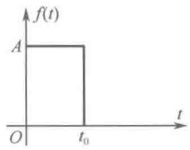

图 15-1 脉冲信号
 

6. 复频域平移性质

设 $ L[f(t)]=F(s) $，则

$$  L[f(t)\mathrm{e}^{-s_{0}t}]=F(s+s_{0})   \tag*{（15-18）}$$

证明： $ L[f(t)\mathrm{e}^{-s_{0}t}]=\int_{0}^{\infty}f(t)\mathrm{e}^{-s_{0}t}\mathrm{e}^{-st}\mathrm{d}t=\int_{0}^{\infty}f(t)\mathrm{e}^{-(s+s_{0})t}\mathrm{d}t=F(s+s_{0}) $

证毕。

例 15-6 求  $ te^{-at} $ 的象函数。

解：已知  $ L[t]=\frac{1}{s^{2}} $，由复频域平移性质可得

 $$ L[t\mathbf{e}^{-at}]=\frac{1}{\left(s+a\right)^{2}} $$ 

#### 15.1.4 常用函数的拉普拉斯变换

一些常用函数的原函数与象函数的对应关系如表15-1所示。

表 15-1 一些常用函数的原函数与象函数
 

<table border=1 style='margin: auto; word-wrap: break-word;'><tr><td style='text-align: center; word-wrap: break-word;'>原函数</td><td style='text-align: center; word-wrap: break-word;'>象函数</td><td style='text-align: center; word-wrap: break-word;'>原函数</td><td style='text-align: center; word-wrap: break-word;'>象函数</td></tr><tr><td style='text-align: center; word-wrap: break-word;'>冲激 $ \delta(t) $</td><td style='text-align: center; word-wrap: break-word;'>1</td><td style='text-align: center; word-wrap: break-word;'>$ t e^{-at} $</td><td style='text-align: center; word-wrap: break-word;'>$ \frac{1}{(s+a)^2} $</td></tr><tr><td style='text-align: center; word-wrap: break-word;'>阶跃 $ \varepsilon(t) $</td><td style='text-align: center; word-wrap: break-word;'>$ \frac{1}{s} $</td><td style='text-align: center; word-wrap: break-word;'>$ t^n e^{-at} $（n为正整数）</td><td style='text-align: center; word-wrap: break-word;'>$ \frac{n!}{(s+a)^{n+1}} $</td></tr></table>

<!-- page: 390 -->

续表

<table border=1 style='margin: auto; word-wrap: break-word;'><tr><td style='text-align: center; word-wrap: break-word;'>原函数</td><td style='text-align: center; word-wrap: break-word;'>象函数</td><td style='text-align: center; word-wrap: break-word;'>原函数</td><td style='text-align: center; word-wrap: break-word;'>象函数</td></tr><tr><td style='text-align: center; word-wrap: break-word;'>$ e^{-at} $</td><td style='text-align: center; word-wrap: break-word;'>$ \frac{1}{s+a} $</td><td style='text-align: center; word-wrap: break-word;'>$ t \sin \omega t $</td><td style='text-align: center; word-wrap: break-word;'>$ \frac{2\omega s}{(s^2+\omega^2)^2} $</td></tr><tr><td style='text-align: center; word-wrap: break-word;'>$ t^n $（n为正整数）</td><td style='text-align: center; word-wrap: break-word;'>$ \frac{n!}{s^{n+1}} $</td><td style='text-align: center; word-wrap: break-word;'>$ t \cos \omega t $</td><td style='text-align: center; word-wrap: break-word;'>$ \frac{s^2-\omega^2}{(s^2+\omega^2)^2} $</td></tr><tr><td style='text-align: center; word-wrap: break-word;'>$ \sin \omega t $</td><td style='text-align: center; word-wrap: break-word;'>$ \frac{\omega}{s^2+\omega^2} $</td><td style='text-align: center; word-wrap: break-word;'>$ \frac{d\delta}{dt} $</td><td style='text-align: center; word-wrap: break-word;'>s</td></tr><tr><td style='text-align: center; word-wrap: break-word;'>$ \cos \omega t $</td><td style='text-align: center; word-wrap: break-word;'>$ \frac{s}{s^2+\omega^2} $</td><td style='text-align: center; word-wrap: break-word;'>$ \frac{1}{a}(1-e^{-at}) $</td><td style='text-align: center; word-wrap: break-word;'>$ \frac{1}{s(s+a)} $</td></tr><tr><td style='text-align: center; word-wrap: break-word;'>$ e^{-at} \sin \omega t $</td><td style='text-align: center; word-wrap: break-word;'>$ \frac{\omega}{(s+a)^2+\omega^2} $</td><td style='text-align: center; word-wrap: break-word;'>$ \frac{1}{b-a}(e^{-at}-e^{-bt}) $</td><td style='text-align: center; word-wrap: break-word;'>$ \frac{1}{(s+a)(s+b)} $</td></tr><tr><td style='text-align: center; word-wrap: break-word;'>$ e^{-at} \cos \omega t $</td><td style='text-align: center; word-wrap: break-word;'>$ \frac{s+a}{(s+a)^2+\omega^2} $</td><td style='text-align: center; word-wrap: break-word;'></td><td style='text-align: center; word-wrap: break-word;'></td></tr></table>

### 15.2 拉普拉斯逆变换

#### 15.2.1 拉普拉斯逆变换的基本方法

拉普拉斯逆变换是从象函数求原函数的一种运算，从15.1节的描述可知，拉普拉斯逆变换的基本公式为

$$  f(t)=L^{-1}[F(s)]=\frac{1}{2\pi\mathrm{j}}\int_{\sigma-\mathrm{j}\infty}^{\sigma+\mathrm{j}\infty}F(s)\mathrm{e}^{s t}\mathrm{d}s   \tag*{（15-19）}$$

该式又称布罗米维奇积分公式，它是涉及以s为变量的复变函数积分，比较复杂。

显然，直接采用基本公式进行拉普拉斯逆变换是相当困难的。最简单的逆变换方法是查表法，例如，可使用表15-1查出一些象函数的原函数。然而，有许多象函数 $ F(s) $并非能简单地直接从表中查出，于是对于较为复杂的象函数，一般首先采用部分分式分解法将 $ F(s) $展开成部分分式，然后进行查表。

#### 15.2.2 部分分式分解法

设象函数  $ F(s) $ 的一般形式为

$$  F(s)=\frac{A(s)}{B(s)}=\frac{a_{m}s^{m}+a_{m-1}s^{m-1}+a_{m-2}s^{m-2}+\cdots+a_{0}}{b_{n}s^{n}+b_{n-1}s^{n-1}+b_{n-2}s^{n-2}+\cdots+b_{0}}   \tag*{（15-20）}$$

式中， $ a_{k} $、 $ b_{k} $ 均为实数，m、n 均为正整数。

为了便于分解，将  $ A(s) $ 写成

 $$ A(s)=a_{m}(s-z_{0})(s-z_{1})(s-z_{2})\cdots(s-z_{m-1}) $$ 

式中， $ z_{0}, z_{1}, \cdots, z_{m-1} $ 称为  $ F(s) $ 的零点，它们是方程  $ A(s) = 0 $ 的根。

同样，将 $ B(s) $写成

 $$ B(s)=b_{n}(s-p_{0})(s-p_{1})(s-p_{2})\cdots(s-p_{n-1}) $$ 

式中， $ p_{0}, p_{1}, \cdots, p_{n-1} $ 称为  $ F(s) $ 的极点，它们是方程  $ B(s) = 0 $ 的根。

从式（15-20）的描述可知，零点只对  $ F(s) $ 的大小（模）有影响，而极点会影响  $ F(s) $ 的性质。按照极点性质的不同，部分分式的分解一般有如下几种情况。

# 1. 极点为不等实数的情况

假设  $ p_{0}, p_{1}, \cdots, p_{n-1} $ 均为实数，且各不相等，即  $ B(s) $ 无重根。例如

<!-- page: 391 -->

$$ F(s)=\frac{A(s)}{(s-p_{0})(s-p_{1})(s-p_{2})}\quad(p_{0},p_{1},p_{2} 为不相等的实数 ) $$ 

（1）若 m<n， $ F(s) $ 为真分式，即  $ F(s) $ 的分母多项式阶次高于分子多项式阶次，且分子与分母不可约。则  $ F(s) $ 可分解为如下的部分分式形式：

$$  F(s)=\frac{k_{0}}{s-p_{0}}+\frac{k_{1}}{s-p_{1}}+\frac{k_{2}}{s-p_{2}}   \tag*{（15-21）}$$

这时通过查表可得式（15-21）的逆变换为

 $$ f(t)=L^{-1}[F(s)]=L^{-1}\left[\frac{k_{0}}{s-p_{0}}+\frac{k_{1}}{s-p_{1}}+\frac{k_{2}}{s-p_{2}}\right]=k_{0}\mathrm{e}^{p_{0}t}+k_{1}\mathrm{e}^{p_{1}t}+k_{2}\mathrm{e}^{p_{2}t} $$ 

在这里，进行逆变换的关键问题是确定系数  $ k_{0} $、 $ k_{1} $、 $ k_{2} $ 的值，观察式（15-21）可知，用  $ (s-p_{0}) $ 乘以  $ F(s) $ 可得

 $$ (s-p_{0})F(s)=k_{0}+\frac{s-p_{0}}{s-p_{1}}k_{1}+\frac{s-p_{0}}{s-p_{2}}k_{2} $$ 

令 $ s=p_{0} $，得 $ k_{0}=(s-p_{0})F(s)\mid_{s=p_{0}} $。

同理，可得与任意极点 $ p_{i} $对应的系数为

 $$ k_{i}=(s-p_{i})F(s)\mid_{s=p_{i}} $$ 

例 15-7 已知象函数  $ F(s)=\frac{10(s^{2}+7s+10)}{s^{3}+4s^{2}+3s} $，求其原函数  $ f(t) $。

解：已知  $ F(s) $ 可写成

 $$ F(s)=\frac{10(s+2)(s+5)}{s(s+1)(s+3)} $$ 

 $ F(s) $ 是一个真分式，其零点为  $ z_{0} = -2 $， $ z_{1} = -5 $，极点为  $ p_{0} = 0 $， $ p_{1} = -1 $， $ p_{2} = -3 $，即  $ F(s) $ 有三个单极点，所以  $ F(s) $ 可以分解成如下形式：

 $$ F(s)=\frac{k_{0}}{s}+\frac{k_{1}}{s+1}+\frac{k_{2}}{s+3} $$ 

求系数 $ k_{0} $、 $ k_{1} $、 $ k_{2} $的值：

 $$ k_{0}=(s-p_{0})F(s)\mid_{s=p_{0}}=s F(s)\mid_{s=0}=\frac{10(s+2)(s+5)}{(s+1)(s+3)}\mid_{s=0}=\frac{100}{3} $$ 

 $$ k_{1}=(s-p_{1})F(s)\mid_{s=p_{1}}=(s+1)F(s)\mid_{s=-1}=\frac{10(s+2)(s+5)}{s(s+3)}\mid_{s=-1}=-20 $$ 

 $$ k_{2}=(s-p_{2})F(s)\mid_{s=p_{2}}=(s+3)F(s)\mid_{s=-3}=\frac{10(s+2)(s+5)}{s(s+1)}\mid_{s=-3}=-\frac{10}{3} $$ 

所以， $ F(s)=\frac{100}{3s}-\frac{20}{s+1}-\frac{10}{3(s+3)} $。

查表得  $ f(t)=L^{-1}[F(s)]=\frac{100}{3}\varepsilon(t)-20\mathrm{e}^{-t}-\frac{10}{3}\mathrm{e}^{-3t} $。

（2）若  $ m \geq n $， $ F(s) $ 为假分式，即  $ F(s) $ 的分子多项式阶次大于或等于分母多项式阶次，这时需先使用多项式长除法，将分子  $ A(s) $ 中的高次项提出，使余下部分成为满足 m < n 的真分式，再对真分式部分按照（1）中所述方法分解即可。

例 15-8 已知象函数  $ F(s)=\frac{s^{3}+5s^{2}+9s+7}{s^{2}+3s+2} $，求其原函数  $ f(t) $。

<!-- page: 392 -->

解：已知  $ F(s) $ 为假分式，先使用多项式长除法提出分子  $ A(s) $ 中的高次项

 $$ \begin{array}{r} s+2 \\ s^{2}+3s+2 \quad \sqrt{s^{3}+5s^{2}+9s+7} \\ \quad \frac{s^{3}+3s^{2}+2s}{2s^{2}+7s+7} \\ \quad \frac{2s^{2}+6s+4}{s+3} \end{array} $$ 

这时  $ F(s) $ 可表示为

 $$ F(s)=s+2+\frac{s+3}{s^{2}+3s+2}=s+2+\frac{s+3}{(s+1)(s+2)} $$ 

其中的真分式部分可分解为

 $$ \frac{k_{0}}{s+1}+\frac{k_{1}}{s+2} $$ 

而

 $$ k_{0}=(s+1)F(s)\mid_{s=-1}=\frac{s+3}{s+2}\mid_{s=-1}=2 $$ 

 $$ k_{1}=(s+2)F(s)\mid_{s=-2}=\frac{s+3}{s+1}\mid_{s=-2}=-1 $$ 

所以  $ F(s) $ 可最终分解为

 $$ F(s)=s+2+\frac{2}{s+1}-\frac{1}{s+2} $$ 

查表得

 $$ f(t)=L^{-1}[F(s)]=\frac{\mathrm{d}\delta}{\mathrm{d}t}+2\delta(t)+2\mathrm{e}^{-t}-\mathrm{e}^{-2t} $$ 

# 2. 极点中含有共轭复数极点的情况

例如

 $$ F(s)=\frac{A(s)}{D(s)[(s+\alpha)^2+\beta^2]}=\frac{A(s)}{D(s)(s+\alpha-\mathrm{j}\beta)(s+\alpha+\mathrm{j}\beta)} $$ 

式中， $ D(s) $ 为分母多项式中除共轭复数极点外的其余部分，分母中含有一对共轭复数极点  $ s = -\alpha \pm j\beta $，在分解时可按照单根来对待。

即令  $ F_{1}(s)=\frac{A(s)}{D(s)} $，有

 $$ \begin{aligned}F(s)=&\frac{F_{1}(s)}{(s+\alpha-\mathrm{j}\beta)(s+\alpha+\mathrm{j}\beta)}=\frac{k_{1}}{s+\alpha-\mathrm{j}\beta}+\frac{k_{2}}{s+\alpha+\mathrm{j}\beta}\\&k_{1}=(s+\alpha-\mathrm{j}\beta)F(s)\mid_{s=-\alpha+\mathrm{j}\beta}=\frac{F_{1}(-\alpha+\mathrm{j}\beta)}{2\mathrm{j}\beta}\\&k_{2}=(s+\alpha+\mathrm{j}\beta)F(s)\mid_{s=-\alpha-\mathrm{j}\beta}=\frac{F_{1}(-\alpha-\mathrm{j}\beta)}{-2\mathrm{j}\beta}\end{aligned} $$ 

 $ k_{1} $ 与  $ k_{2} $ 为共轭关系，即  $ k_{2}=k_{1}^{*} $

设  $ k_{1}=P+\mathrm{j}Q $，则  $ k_{2}=k_{1}^{*}=P-\mathrm{j}Q $，于是与共轭复极点有关部分的拉普拉斯逆变换为

 $$ \begin{aligned}f_{0}(t)&=L^{-1}\left[\frac{k_{1}}{s+\alpha-\mathrm{j}\beta}+\frac{k_{2}}{s+\alpha+\mathrm{j}\beta}\right]=\mathrm{e}^{-\alpha t}\left(k_{1}\mathrm{e}^{\mathrm{j}\beta t}+k_{2}\mathrm{e}^{-\mathrm{j}\beta t}\right)\\&=2\mathrm{e}^{-\alpha t}\left(P\cos\beta t-Q\sin\beta t\right)=2\sqrt{P^{2}+Q^{2}}\mathrm{e}^{-\alpha t}\cos(\beta t+\theta)\end{aligned} $$ 

式中， $ \theta=\arctan\frac{Q}{P} $

例 15-9 已知象函数  $ F(s)=\frac{s^{2}+3}{s^{3}+4s^{2}+9s+10} $，求其原函数  $ f(t) $。

解：已知  $ F(s) $ 可写成

<!-- page: 393 -->

$$ \begin{aligned}F(s)&=\frac{s^{2}+3}{(s+2)(s^{2}+2s+5)}=\frac{s^{2}+3}{(s+2)(s+1-\mathrm{j}2)(s+1+\mathrm{j}2)}\\&=\frac{k_{0}}{s+2}+\frac{k_{1}}{s+1-\mathrm{j}2}+\frac{k_{2}}{s+1+\mathrm{j}2}\end{aligned} $$ 

 $$ k_{0}=(s+2)F(s)\mid_{s=-2}=\frac{s^{2}+3}{s^{2}+2s+5}\mid_{s=-2}=\frac{7}{5} $$ 

 $$ \begin{aligned}k_{1}=(s+1-\mathrm{j}2)F(s)\mid_{s=-1+\mathrm{j}2}=&\frac{s^{2}+3}{(s+2)(s+1+\mathrm{j}2)}\mid_{s=-1+\mathrm{j}2}=-\frac{1}{1+\mathrm{j}2}=-\frac{1}{5}+\mathrm{j}\frac{2}{5}\\&k_{2}=k_{1}^{*}=-\frac{1}{5}-\mathrm{j}\frac{2}{5}\end{aligned} $$ 

所以$F(s)$分解为$F(s)=\frac{7}{5(s+2)}+\frac{-1+j2}{5}\cdot\frac{1}{s+1-j2}+\frac{-1-j2}{5}\cdot\frac{1}{s+1+j2}$

式中，$\alpha=1$，$\beta=2$，$P=-\frac{1}{5}$，$Q=\frac{2}{5}$。

所以，原函数为

 $$ f(t)=\frac{7}{5}\mathrm{e}^{-2t}-2\mathrm{e}^{-t}\left(\frac{1}{5}\cos2t+\frac{2}{5}\sin2t\right) $$ 

# 3. 有多重极点的情况

例如

 $$ F(s)=\frac{A(s)}{D(s)(s-p_{0})^{n}} $$ 

式中， $ D(s) $ 为分母多项式中除重根以外的其余部分，分母中含有一个在 s = p_{0} 处的 n 重极点。则  $ F(s) $ 可展开成

 $$ F(s)=\frac{k_{0}}{(s-p_{0})^{n}}+\frac{k_{1}}{(s-p_{0})^{n-1}}+\cdots+\frac{k_{n-1}}{(s-p_{0})}+\frac{E(s)}{D(s)} $$ 

式中， $ \frac{E(s)}{D(s)} $ 为与重极点无关的其余部分。与重极点有关的各系数为

 $$ k_{0}=(s-p_{0})^{n}F(s)\mid_{s=p_{0}} $$ 

对于  $ k_{1}, k_{2}, \cdots, k_{n-1} $ 不能采用求  $ k_{0} $ 的方法，因为分母将出现零值。这时需定义一个新函数

 $$ F_{1}(s)=(s-p_{0})^{n}F(s) $$ 

即

 $$ F_{1}(s)=k_{0}+k_{1}(s-p_{0})+k_{2}(s-p_{0})^{2}+\cdots+k_{n-1}(s-p_{0})^{n-1}+(s-p_{0})^{n}\frac{E(s)}{D(s)} $$ 

则

 $$ \frac{\mathrm{d}F_{1}(s)}{\mathrm{d}s}=k_{1}+2k_{2}(s-p_{0})+\cdots+(n-1)k_{n-1}(s-p_{0})^{n-2}+\cdots $$ 

显然

 $$ k_{0}=F_{1}(s) 氵 \big|_{s=p_{0}} $$ 

 $$ k_{1}=\frac{\mathrm{d}F_{1}(s)}{\mathrm{d}s}\mid_{s=p_{0}} $$ 

 $$ k_{2}=\frac{1}{2}\frac{\mathrm{d}^{2}F_{1}(s)}{\mathrm{d}s^{2}}\mid_{s=p_{0}} $$ 

 $$ k_{i}=\frac{1}{i!}\frac{\mathrm{d}^{i}F_{1}(s)}{\mathrm{d}s^{i}}\mid_{s=p_{0}}\quad(i=0,1,2,\cdots,n-1) $$

<!-- page: 394 -->

例 15-10 已知象函数  $ F(s)=\frac{s-2}{s(s+1)^{3}} $，求其原函数  $ f(t) $。

解：已知  $ F(s) $ 可分解成

 $$ F(s)=\frac{k_{0}}{(s+1)^{3}}+\frac{k_{1}}{(s+1)^{2}}+\frac{k_{2}}{(s+1)}+\frac{k_{3}}{s} $$ 

与重极点无关的系数为

 $$ k_{3}=sF(s)\mid_{s=0}=\frac{s-2}{\left(s+1\right)^{3}}\mid_{s=0}=-2 $$ 

定义一个新函数

 $$ F_{1}(s)=(s+1)^{3}F(s)=\frac{s-2}{s} $$ 

 $$ k_{0}=F_{1}(s) 氵 \big|_{s=-1}=3 $$ 

则

 $$ k_{1}=\frac{\mathrm{d}F_{1}(s)}{\mathrm{d}s}\mid_{s=-1}=2 $$ 

 $$ k_{2}=\frac{1}{2}\frac{\mathrm{d}^{2}F_{1}(s)}{\mathrm{d}s^{2}}\mid_{s=-1}=2 $$ 

所以

 $$ F(s)=\frac{3}{\left(s+1\right)^{3}}+\frac{2}{\left(s+1\right)^{2}}+\frac{2}{\left(s+1\right)}-\frac{2}{s} $$ 

查表得

 $$ f(t)=L^{-1}[F(s)]=\frac{3}{2}t^{2}\mathrm{e}^{-t}+2t\mathrm{e}^{-t}+2\mathrm{e}^{-t}-2 $$ 

### 15.3 运用拉普拉斯变换分析线性电路

由第8章可知，描述动态电路的方程是微分方程，当微分方程的阶数大于2时，用经典法求解较为困难。运用拉普拉斯变换分析这类电路时有一个非常明显的优点，即可将微分方程或积分方程转化为代数方程，从而使方程的求解变得简单易行，这就是所谓的运算法。

将微分方程转化为代数方程有两种做法，一种是先选择合适的时域电路变量列写描述电路的微分方程或积分方程，再对方程取拉普拉斯变换以获得电路方程的运算形式。不过这种做法并没有解决用经典法求解线性电路时所遇到的困难，本书不做介绍。另一种是先将线性电路的时域模型转化为复频域的 s 域模型，称为运算电路，再选择合适的电路分析方法进行分析计算，最后进行拉普拉斯逆变换求得时域解，这是本章将要重点介绍的内容。其次，也可以运用拉普拉斯变换法代替相量法来分析正弦交流电路。

#### 15.3.1 KCL 和 KVL 的运算形式

# 1. KCL 的运算形式

在时域电路的任意节点上，KCL 方程为

 $$ \sum i(t)=0 $$ 

对上式两边取拉普拉斯变换，并利用拉普拉斯变换的线性性质可得

$$  \sum I(s)=0   \tag*{（15-22）}$$

式（15-22）表明，运算电路中的任意节点上所有支路电流象函数的代数和为零，式（15-22）称为KCL的运算形式。

# 2. KVL 的运算形式

在时域电路的任意闭合回路中，KVL 方程为

<!-- page: 395 -->

$$ \sum u(t)=0 $$ 

对上式两边取拉普拉斯变换，并利用拉普拉斯变换的线性性质可得

$$  \sum U(s)=0   \tag*{（15-23）}$$

式（15-23）表明，运算电路中的任意闭合回路中所有支路电压象函数的代数和为零，式（15-23）称为KVL的运算形式。

#### 15.3.2 电路元件的 s 域模型

# 1. 电阻元件的 s 域模型

在时域电路中，电阻元件的模型如图15-2（a）所示，元件的VCR为

 $$ u_{_{R}}(t)=Ri_{_{R}}(t) $$ 

对上式两边取拉普拉斯变换，并利用拉普拉斯变换的线性性质可得

$$  U_{R}(s)=RI_{R}(s)   \tag*{（15-24）}$$

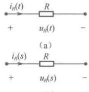

根据式（15-24），可得电阻元件的运算电路模型，如图15-2（b）所示。

# 2. 电感元件的 s 域模型

(b)
 

在时域电路中，电感元件的模型如图 15-3（a）所示，元件的 VCR 为

图 15-2 电阻元件的时域模型和运算电路模型
 

 $$ u_{L}(t)=L\frac{\mathrm{d}i_{L}(t)}{\mathrm{d}t} $$ 

对上式两边取拉普拉斯变换，并利用拉普拉斯变换的线性性质和微分性质可得

 $$ \int_{0_{-}}^{\infty}u_{L}(t)\mathrm{e}^{-st}\mathrm{d}t=\int_{0_{-}}^{\infty}L\frac{\mathrm{d}i_{L}(t)}{\mathrm{d}t}\mathrm{e}^{-st}\mathrm{d}t $$ 

即

$$  U_{_{L}}(s)=s L I_{_{L}}(s)-L i_{_{L}}(0_{-})   \tag*{（15-25）}$$

或

$$  I_{L}(s)=\frac{1}{sL}U_{L}(s)+\frac{i_{L}(0_{-})}{s}   \tag*{（15-26）}$$

根据式（15-25）和式（15-26），可得电感元件的运算电路模型，如图 15-3（b）、（c）所示。由图 15-3（b）、（c）可知，当  $ i_{L}(0) $ 不为零时，电感元件的运算电路模型中将出现附加电源。

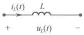

(a)
 

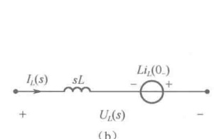

（b）
 

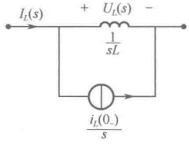

(c)
 

图 15-3 电感元件的时域模型和运算电路模型
 

# 3. 电容元件的 s 域模型

在时域电路中，电容元件的模型如图15-4（a）所示，元件的VCR为

 $$ i_{c}(t)=C\frac{\mathrm{d}u_{c}(t)}{\mathrm{d}t} $$ 

对上式两边取拉普拉斯变换，并利用拉普拉斯变换的线性性质和微分性质可得

 $$ \begin{aligned}\int_{0_{-}}^{\infty}i_{_{C}}(t)\mathrm{e}^{-s t}\mathrm{d}t=&\int_{0_{-}}^{\infty}C\frac{\mathrm{d}u_{_{C}}(t)}{\mathrm{d}t}\mathrm{e}^{-s t}\mathrm{d}t\\I_{_{C}}(s)=&s C U_{_{C}}(s)-C u_{_{C}}(0_{-})\end{aligned} $$ 

即

<!-- page: 396 -->

或

$$  U_{C}(s)=\frac{1}{sC}I_{C}(s)+\frac{u_{C}(0_{-})}{s}   \tag*{（15-28）}$$

根据式（15-27）和式（15-28），可得电容元件的运算电路模型，如图 15-4（b）、（c）所示。由图 15-4（b）、（c）可知，当  $ u_{c}(0_{-}) $ 不为零时，电容元件的运算电路模型中将出现附加电源。

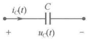

(a)
 

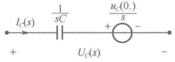

（b）
 

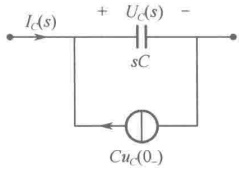

(c)
 

图 15-4 电容元件的时域模型和运算电路模型
 

# 4. 耦合电感元件的 s 域模型

在时域电路中，耦合电感元件的模型如图 15-5（a）所示，元件的 VCR 为

 $$ \left\{\begin{aligned}u_{1}(t)&=L_{1}\frac{\mathrm{d}i_{1}(t)}{\mathrm{d}t}+M\frac{\mathrm{d}i_{2}(t)}{\mathrm{d}t}\\ u_{2}(t)&=L_{2}\frac{\mathrm{d}i_{2}(t)}{\mathrm{d}t}+M\frac{\mathrm{d}i_{1}(t)}{\mathrm{d}t}\end{aligned}\right. $$ 

对上式两边取拉普拉斯变换，并利用拉普拉斯变换的线性性质和微分性质可得

$$  \left\{\begin{aligned}U_{1}(s)&=sL_{1}I_{1}(s)+sMI_{2}(s)-L_{1}i_{1}(0_{-})-Mi_{2}(0_{-})\\ U_{2}(s)&=sL_{2}I_{2}(s)+sMI_{1}(s)-L_{2}i_{2}(0_{-})-Mi_{1}(0_{-})\end{aligned}\right.   \tag*{（15-29）}$$

根据式（15-29），可得耦合电感元件的运算电路模型，如图15-5(b)所示。

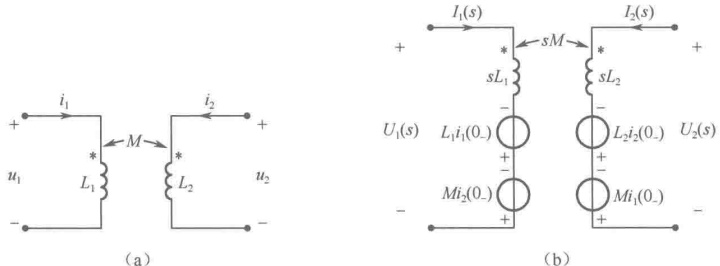

(a)
 

图 15-5 耦合电感元件的时域模型和运算电路模型
 

#### 15.3.3 运用拉普拉斯变换法求解线性电路——运算法

采用运算法求解线性电路时域响应的主要步骤如下：

（1）由给定的时域电路确定电路的初始状态 $ u_{c}(0_{-}) $和 $ i_{L}(0_{-}) $，以便利用它们确定电路元件的运算模型中的附加电源。

（2）根据各元件的运算电路模型画出换路后的运算电路图，与此同时，要将时域激励变换成象函数形式。

（3）根据题意选用适当的电路分析方法求出响应的象函数。

（4）利用部分分式分解法及表15-1获得拉普拉斯逆变换，求出响应象函数的原函数，即可得到电路响应的时域解。

<!-- page: 397 -->

由运算电路所建立的方程是代数方程，显然它比直接求解高阶微分方程要容易，况且在运算电路中已包含了初值，这样就避免了在时域中确定积分常数的麻烦。

例 15-11 电路如图 15-6 所示，已知  $ i_{L_1}(0_-) = 0 $， $ i_{L_2}(0_-) = 0 $， $ u_S(t) = 12\varepsilon(t)\mathrm{V} $， $ L_1 = 1\mathrm{mH} $， $ L_2 = 9\mathrm{mH} $， $ R_1 = 3\mathrm{k\Omega} $， $ R_2 = 24\mathrm{k\Omega} $，求  $ i_{L_2}(t) $。

解：先画出运算电路，如图15-7所示，图中 $ U_{s}(s)=\frac{12}{s} $。

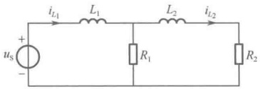

图 15-6 例 15-11 图
 

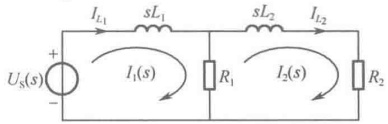

图 15-7 例 15-11 的运算电路
 

列写网孔电流方程

 $$ \left\{\begin{aligned}&(R_{1}+sL_{1})I_{1}(s)-R_{1}I_{2}(s)=U_{s}(s)\\ &(R_{1}+R_{2}+sL_{2})I_{2}(s)-R_{1}I_{1}(s)=0\end{aligned}\right. $$ 

解得

 $$ \begin{aligned}I_{2}(s)&=\frac{U_{s}(s)/R_{2}}{\frac{L_{1}L_{2}}{R_{1}R_{2}}s^{2}+\left(\frac{L_{1}}{R_{1}}+\frac{L_{1}}{R_{2}}+\frac{L_{2}}{R_{2}}\right)s+1}=\frac{4\times10^{9}}{s(s+2\times10^{6})(s+4\times10^{6})}\\&=\frac{0.5\times10^{-3}}{s}-\frac{10^{-3}}{s+2\times10^{6}}+\frac{0.5\times10^{-3}}{s+4\times10^{6}}\end{aligned} $$ 

 $$ i_{L_{2}}(t)=i_{2}(t)=L^{-1}[I_{2}(s)]=0.5\times10^{-3}(1-2\mathrm{e}^{-2\times10^{6}t}+\mathrm{e}^{-4\times10^{6}t})\varepsilon(t) $$ 

所以

例 15-12 电路如图 15-8 所示，已知  $ R = 6\Omega $， $ L = 1H $， $ C = 0.04F $， $ u_C(0_-) = 1V $， $ i(0_-) = 5A $，求  $ i(t) $。

解：已知 $ u_{C}(0)=1V $， $ i(0_-)=5A $，激励 $ U_S(s)=L[\delta(t)]=1 $，可画出运算电路，如图15-9所示。

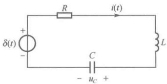

图 15-8 例 15-12 图
 

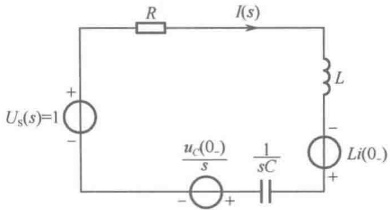

图 15-9 例 15-12 的运算电路
 

由图可得

 $$ I_{2}(s)=\frac{U_{s}(s)+Li(0_{-})-\frac{u_{C}(0_{-})}{s}}{R+sL+\frac{1}{sC}}=\frac{6s-1}{s^{2}+6s+25}=\frac{6s-1}{(s+3-j4)(s+3+j4)}=\frac{k_{1}}{s+3-j4}+\frac{k_{2}}{s+3+j4} $$ 

可求得

 $$ k_{1}=(s+3-\mathrm{j}4)I(s)\mid_{s=-3+\mathrm{j}4}=3+\mathrm{j}\frac{19}{8},\quad k_{2}=k_{1}^{*}=3-\mathrm{j}\frac{19}{8} $$ 

所以

 $$ i(t)=2\mathrm{e}^{-3t}\left(3\cos4t-\frac{19}{8}\sin4t\right) $$ 

例 15-13 电路如图 15-10 所示，开关动作前电路为稳态，t=0 时将开关从 1 合向 2，求  $ i_{L}(t) $

<!-- page: 398 -->

解：t<0 时  $ i_{L}(0_{-})=-E_{1}/R_{1} $，开关从1合向2后的运算电路如图15-11所示。

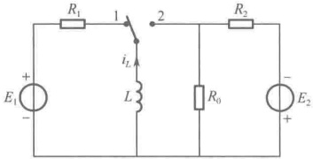

图 15-10 例 15-13 图
 

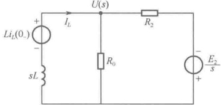

图 15-11 例 15-13 的运算电路
 

列写节点电压方程

 $$ \left(\frac{1}{R_{0}}+\frac{1}{R_{2}}+\frac{1}{sL}\right)U(s)=\frac{Li_{L}(0_{-})}{sL}-\frac{E_{2}}{sR_{2}}=-\frac{E_{1}}{sR_{1}}-\frac{E_{2}}{sR_{2}} $$ 

即

 $$ U(s)=\frac{-\frac{E_{1}}{sR_{1}}-\frac{E_{2}}{sR_{2}}}{\frac{1}{R_{0}}+\frac{1}{R_{2}}+\frac{1}{sL}} $$ 

所以

 $$ I_{L}(s)=\frac{Li_{L}(0_{-})-U(s)}{sL}=\frac{E_{2}}{sR_{2}}-\left(\frac{E_{1}}{R_{1}}+\frac{E_{2}}{R_{2}}\right)\frac{1}{s+1/\tau} $$ 

式中， $ \tau=\frac{L(R_{0}+R_{2})}{R_{0}R_{2}} $。即

 $$ i_{L}(t)=L^{-1}[I_{L}(s)]=\frac{E_{2}}{R_{2}}-\left(\frac{E_{1}}{R_{1}}+\frac{E_{2}}{R_{2}}\right)\mathrm{e}^{-\frac{t}{\tau}} $$ 

例 15-14 电路如图 15-12（a）所示，已知  $ R_1 = R_2 = 3\Omega $， $ L_1 = L_2 = 1H $， $ C = 1F $， $ u_{S1} = 60V $， $ u_{S2}(t) $ 的波形如图 15-12（b）所示，开关动作前电路为稳态， $ t = 0 $ 时将开关从 1 合向 2，求  $ u_C(t) $。

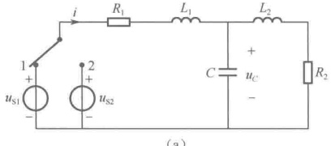

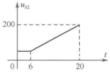

图 15-12 例 15-14 图
 

解：t<0 时， $ i_{L_{1}}(0_{-})=i_{L_{2}}(0_{-})=\frac{u_{\mathrm{SI}}}{R_{1}+R_{2}}=10\mathrm{A} $， $ u_{C}(0_{-})=\frac{R_{2}}{R_{1}+R_{2}}u_{\mathrm{SI}}=30\mathrm{V} $

激励

 $$ u_{\mathrm{S}2}(t)=60\varepsilon(t)+10(t-6)\varepsilon(t-6)-10(t-20)\varepsilon(t-20)-200\varepsilon(t-20) $$ 

 $$ U_{\mathrm{s}2}(s)=\frac{60}{s}+\frac{10}{s^{2}}\mathrm{e}^{-6s}-\frac{10}{s^{2}}\mathrm{e}^{-20s}-\frac{200}{s}\mathrm{e}^{-20s} $$ 

即

开关从1合向2后的运算电路如图15-13所示。

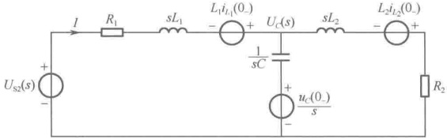

图 15-13 例 15-14 的运算电路
 

<!-- page: 399 -->

由运算电路图列写节点电压方程

 $$ \begin{align*}\left(\frac{1}{R_{1}+sL_{1}}+\frac{1}{R_{2}+sL_{2}}+sC\right)&U_{C}(s)=\frac{U_{S2}(s)+L_{1}i_{L_{1}}(0_{-})}{R_{1}+sL_{1}}+Cu_{C}(0_{-})-\frac{L_{2}i_{L_{2}}(0_{-})}{R_{2}+sL_{2}}\\\left(\frac{1}{s+3}+\frac{1}{s+3}+s\right)&U_{C}(s)=\frac{U_{S2}(s)}{s+3}+30\end{align*} $$ 

即

则

 $$ U_{c}(s)=\frac{U_{s2}(s)}{s^{2}+3s+2}+\frac{30(s+3)}{s^{2}+3s+2}=\frac{U_{s2}(s)}{(s+1)(s+2)}+\frac{30(s+3)}{(s+1)(s+2)}\triangleq U_{c}^{\prime}(s)+U_{c}^{\prime \prime}(s) $$ 

 $$ \begin{aligned}U_{c}^{\prime}(s)=&\frac{60}{s(s+1)(s+2)}+\frac{10\mathrm{e}^{-6s}}{s^{2}(s+1)(s+2)}-\frac{10\mathrm{e}^{-20s}}{s^{2}(s+1)(s+2)}-\frac{200\mathrm{e}^{-20s}}{s(s+1)(s+2)}\\ =&\left(\frac{30}{s}-\frac{60}{s+1}+\frac{30}{s+2}\right)+\mathrm{e}^{-6s}\left(\frac{5}{s^{2}}-\frac{7.5}{s}+\frac{10}{s+1}-\frac{2.5}{s+2}\right)\\ &-\mathrm{e}^{-20s}\left(\frac{5}{s^{2}}-\frac{7.5}{s}+\frac{10}{s+1}-\frac{2.5}{s+2}\right)-\frac{20}{6}\mathrm{e}^{-20s}\left(\frac{30}{s}-\frac{60}{s+1}+\frac{30}{s+2}\right)\end{aligned} $$ 

 $$ U_{c}^{^{\prime \prime}}(s)=\frac{30(s+3)}{(s+1)(s+2)}=\frac{60}{s+1}-\frac{30}{s+2} $$ 

所以

 $$ \begin{align*}u_{C}(t)=&L^{-1}[U_{C}^{\prime}(s)]+L^{-1}[U_{C}^{\prime \prime}(s)]\\=&(30-60\mathrm{e}^{-t}+30\mathrm{e}^{-2t})\varepsilon(t)+[5(t-6)-7.5+10\mathrm{e}^{-(t-6)}-2.5\mathrm{e}^{-2(t-6)}]\varepsilon(t-6)\\&-[5(t-20)-7.5+10\mathrm{e}^{-(t-20)}-2.5\mathrm{e}^{-2(t-20)}]\varepsilon(t-20)\\&-\frac{20}{6}(30-60\mathrm{e}^{-(t-20)}+30\mathrm{e}^{-2(t-20)})\varepsilon(t-20)+60\mathrm{e}^{-t}-30\mathrm{e}^{-2t}\end{align*} $$ 

### 15.4 复频域中的网络函数

在第 14 章描述的正弦稳态单输入-单输出电路中，曾经定义输出相量与输入相量之比为网络函数  $ H(\mathrm{j}\omega) $。本节将在更一般的意义上定义复频域中的网络函数  $ H(s) $。网络函数  $ H(s) $ 与  $ H(\mathrm{j}\omega) $ 及冲激响应  $ h(t) $ 之间具有确定的内在关系， $ H(s) $ 在理论和实际应用中都具有非常重要的价值。对于线性时不变电路，一旦确定了网络函数  $ H(s) $，就可确定电路对任意输入所产生的零状态响应。通过分析  $ H(s) $ 的极点，还可以分析和判断电路的类型及电路的稳定性等。

#### 15.4.1 复频域网络函数的定义和性质

# 1. 复频域网络函数的定义

在线性时不变电路中，零状态响应 $ r(t) $的拉普拉斯变换式 $ R(s) $与单一激励 $ e(t) $的拉普拉斯变换式 $ E(s) $之比，称为该电路的网络函数，用 $ H(s) $表示，即

$$  H(s)\triangleq\frac{R(s)}{E(s)}   \tag*{（15-30）}$$

显然， $ H(s) $ 不随激励的大小变化而改变，只与网络的拓扑结构和元件参数有关。

# 2. 网络函数  $ H(s) $ 的分类

与第14章中网络函数 $ H(j\omega) $的分类相同， $ H(s) $也分为如下6种类型：

 $$  驱动点阻抗 \quad H(s)=Z_{11}(s)=\frac{U_{1}(s)}{I_{1}(s)} $$

<!-- page: 400 -->

$$  驱动点导纳 \quad H(s)=Y_{11}(s)=\frac{I_{1}(s)}{U_{1}(s)} $$ 

 $$ H(s)=Z_{21}(s)=\frac{U_{2}(s)}{I_{1}(s)} $$ 

 $$  转移导纳 \quad H(s)=Y_{21}(s)=\frac{I_{2}(s)}{U_{1}(s)} $$ 

 $$  转移电压比 \quad H_{U}(s)=\frac{U_{2}(s)}{U_{1}(s)} $$ 

 $$  转移电流比 \quad H_{I}(s)=\frac{I_{2}(s)}{I_{1}(s)} $$ 

# 3. 网络函数  $ H(s) $ 与冲激响应的关系

当激励为冲激函数  $ \delta(t) $ 时，即  $ e(t) = \delta(t) $，其象函数  $ E(s) = L[\delta(t)] = 1 $，由定义可知

 $$ H(s)=R(s) $$ 

由于  $ R(s) $ 是冲激响应的象函数，上式说明：网络函数  $ H(s) $ 等于冲激响应的象函数。因此，网络函数的原函数就是时域的冲激响应  $ h(t) $，即

$$  h(t)=L^{-1}[H(s)]   \tag*{（15-31）}$$

# 4. 网络函数  $ H(s) $ 与网络的零状态响应

根据式（15-30）的定义可知

 $$ R(s)=H(s)E(s) $$ 

即网络的零状态响应等于网络函数  $ H(s) $ 乘以激励的象函数，由此可知，网络函数是计算线性网络零状态响应的重要工具。

利用网络函数计算网络零状态响应的步骤如下：

（1）求出激励 $ e(t) $的象函数 $ E(s)=L[e(t)] $。

（2）画出换路后的s域运算电路，并用线性网络的计算方法求出网络函数 $ H(s) $。

（3）由 $ R(s)=H(s)E(s) $求出零状态响应的象函数 $ R(s) $。

（4）用拉普拉斯逆变换求出零状态响应 $ r(t)=L^{-1}[R(s)] $。

例 15-15 电路如图 15-14，已知  $ u_{C}(0_{-}) = 0 $， $ u_{S}(t) = U_{S}e^{-2t} $，t = 0 时闭合开关，求 t > 0 时的  $ u(t) $。

解：激励的象函数为 $ U_{S}(s)=L[u_{S}(t)]=\frac{U_{S}}{s+2} $，画出换路后的s域运算电路如图15-15所示。

由阻抗分压关系得

 $$ H(s)=\frac{U(s)}{U_{s}(s)}=\frac{1}{2+\frac{1}{1+0.5s}}\times\frac{1}{1+0.5s}=\frac{1}{3+s} $$ 

所以

 $$ U(s)=H(s)U_{s}(s)=\frac{1}{3+s}\times\frac{U_{s}}{s+2}=\frac{-U_{s}}{3+s}+\frac{U_{s}}{s+2} $$ 

 $$ \boldsymbol{u}(t)=\boldsymbol{L}^{-1}[\boldsymbol{U}(s)]=-\boldsymbol{U}_{S}\mathrm{e}^{-3t}+\boldsymbol{U}_{S}\mathrm{e}^{-2t}=\boldsymbol{U}_{S}\left(\mathrm{e}^{-2t}-\mathrm{e}^{-3t}\right) $$ 

即

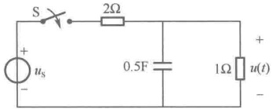

图 15-14 例 15-15 图
 

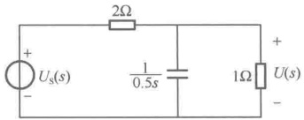

图 15-15 例 15-15 的运算电路
 

<!-- page: 401 -->

#### 15.4.2 复频率平面上网络函数的零点、极点

对于集中参数的线性时不变电路，其网络函数  $ H(s) $ 的分子和分母都可分解为如下的因式表达形式

$$  H(s)=H_{0}\frac{(s-z_{1})(s-z_{2})\cdots(s-z_{m})}{(s-p_{1})(s-p_{2})\cdots(s-p_{n})}=H_{0}\frac{\displaystyle\prod_{i=1}^{m}(s-z_{i})}{\displaystyle\prod_{i=1}^{n}(s-p_{i})}   \tag*{（15-32）}$$

式中， $ z_{1},\cdots,z_{m} $ 称为 $ H(s) $的零点， $ p_{1},\cdots,p_{n} $ 称为 $ H(s) $的极点。

于是，一个网络函数  $ H(s) $ 可以用 m 个零点、n 个极点和系数  $ H_{0} $ 来描述。由于  $ s = \sigma + j\omega $，因此，复频率平面  $ (s $ 平面 $ ) $ 的横轴为实部  $ \sigma $，纵轴为虚部  $ j\omega $。将  $ H(s) $ 的零点、极点描绘在复频率平面  $ (s $ 平面 $ ) $ 上，就得到了反映  $ H(s) $ 特性的零点、极点分布图。 $ H(s) $ 的零点在复频率平面  $ (s $ 平面 $ ) $ 上用“○”表示； $ H(s) $ 的极点在复频率平面  $ (s $ 平面 $ ) $ 上用“×”表示。

例 15-16 已知网络函数为

 $$ H(s)=\frac{s+2}{s^{3}+6s^{2}+13s+20} $$ 

求网络函数的零点、极点，并在 s 平面上画出零点、极点分布图。

解：网络函数的因式表达形式为

 $$ H(s)=\frac{s+2}{(s+4)(s+1-\mathrm{j}2)(s+1+\mathrm{j}2)} $$ 

所以，该网络函数有一个零点  $ z_1 = -2 $；有三个极点  $ p_1 = -4 $， $ p_2 = -1 + j2 $， $ p_3 = -1 - j2 $，其零点、极点分布图如图15-16所示。

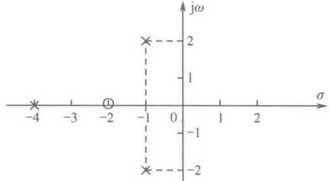

图 15-16 零点、极点分布图
 

#### 15.4.3 极点与网络的特性

若将  $ H(s) $ 按照部分分式展开，则每个极点将决定一项相应的时间函数。简单起见，假设  $ H(s) $ 具有一阶极点，即  $ H(s) $ 无重极点，则对网络函数  $ H(s) $ 求拉普拉斯逆变换后所得到的时域函数就是冲激响应  $ h(t) $，即

$$  h(t)=L^{-1}[H(s)]=L^{-1}\left[\sum_{i=1}^{n}\frac{A_{i}}{(s-p_{i})}\right]=L^{-1}\left[\sum_{i=1}^{n}H_{i}(s)\right]=\sum_{i=1}^{n}h_{i}(t)=\sum_{i=1}^{n}A_{i}\mathbf{e}^{p_{i}t}   \tag*{（15-33）}$$

式中，极点可能是实数，也可能是共轭复数。极点  $ p_{i} $ 就是电路微分方程的特征根，由于极点  $ p_{i} $ 反映了零状态响应的自由分量的性质，故将  $ p_{i} $ 称为网络的自然频率或固有频率，根据极点的性质可对网络函数的特性分析如下。

（1）若  $ H_{i}(s)=\frac{s_{i}}{s+a} $，即  $ p_{i}=-a(a>0) $， $ p_{i} $ 为负实数，极点位于 s 平面的负实轴上，如图 15-17（a）所示，其对应的原函数为

 $$ h_{i}(t)=A_{i}\mathrm{e}^{-at} $$ 

原函数按照指数衰减，如图15-17（b）所示，这样的电路为渐近稳定电路。

（2）若  $ H_{i}(s)=\frac{A_{i}}{s-a} $，即  $ p_{i}=a(a>0) $， $ p_{i} $ 为正实数，极点位于 s 平面的正实轴上，如

<!-- page: 402 -->

图 15-18（a）所示，其对应的原函数为

 $$ h_{i}(t)=A_{i}\mathrm{e}^{at} $$ 

原函数按照指数上升，如图15-18（b）所示，这样的电路为非稳定电路。

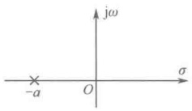

(a)
 

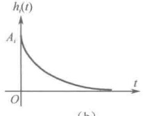

(b)
 

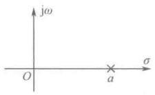

图 15-17 渐近稳定电路的极点分布与响应曲线
 

(a)
 

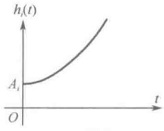

（b）
 

图 15-18 非稳定电路的极点分布与响应曲线
 

（3）若  $ H_{i}(s)=\frac{A_{i}}{s} $，即 p_{i}=0，极点位于 s 平面的原点上，如图 15-19（a）所示，其对应的原函数为

 $$ h_{i}(t)=A_{i}\varepsilon(t) $$ 

原函数为阶跃函数，如图15-19（b）所示，这样的电路为临界稳定状态。

（4）若  $ H_{i}(s)=\frac{A_{i}}{s+\mathrm{j}\omega}+\frac{A_{i}}{s-\mathrm{j}\omega} $，即  $ p_{1}=\mathrm{j}\omega $， $ p_{2}=p_{1}^{*}=-\mathrm{j}\omega $，极点位于 s 平面的虚轴上，如图 15-20（a）所示，其对应的原函数为

 $$ h_{i}(t)=L^{-1}\left[\frac{\omega}{s^{2}+\omega^{2}}\right]=\sin\omega t $$ 

原函数为正弦函数，如图15-20（b）所示，这样的电路为等幅振荡状态。

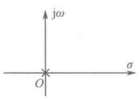

(a)
 

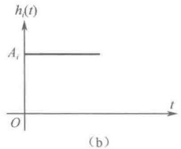

（b）
 

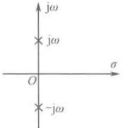

图 15-19 临界稳定电路的极点分布与响应曲线
 

(a)
 

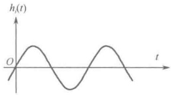

（b）
 

图 15-20 等幅振荡状态电路的极点分布与响应曲线
 

（5）若  $ H_{i}(s)=\frac{A_{i}}{s+a-\mathrm{j}\omega}+\frac{A_{i}^{*}}{s+a+\mathrm{j}\omega}(a>0) $，即  $ p_{1}=-a+\mathrm{j}\omega $， $ p_{2}=p_{1}^{*}=-a-\mathrm{j}\omega $，极点位于 s 平面的左半平面内，如图 15-21（a）所示，其对应的原函数为

 $$ h_{i}(t)=L^{-1}\left[\frac{\omega}{\left(s+a\right)^{2}+\omega^{2}}\right]=\mathrm{e}^{-at}\sin\omega t $$ 

原函数为振荡衰减曲线，如图15-21（b）所示，这样的电路为渐近稳定电路。

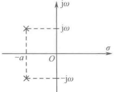

(a)
 

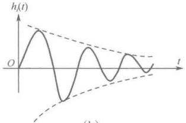

(b)
 

图 15-21 渐近稳定电路的极点分布与响应曲线
 

<!-- page: 403 -->

（6）若  $ H_{i}(s)=\frac{A_{i}}{s-a-\mathrm{j}\omega}+\frac{A_{i}}{s-a+\mathrm{j}\omega}(a>0) $，即  $ p_{1}=a+\mathrm{j}\omega $， $ p_{2}=p_{1}^{*}=a-\mathrm{j}\omega $，极点位于 s 平面的右半平面内，如图 15-22（a）所示，其对应的原函数为

 $$ h_{i}(t)=L^{-1}\left[\frac{\omega}{\left(s-a\right)^{2}+\omega^{2}}\right]=\mathrm{e}^{at}\sin\omega t $$ 

原函数为振荡增幅曲线，如图15-22（b）所示，这样的电路为不稳定电路。

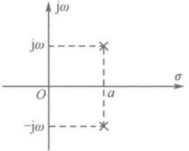

(a)
 

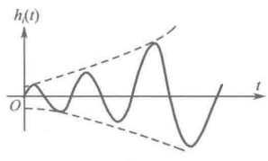

(b)
 

图 15-22 不稳定电路的极点分布与响应曲线
 

综上所述，可以得出如下结论：

（1）当网络函数  $ H(s) $ 的极点位于复频率平面  $ (s $ 平面 $ ) $ 的左半平面时，电路属于渐近稳定电路；当网络函数  $ H(s) $ 的极点位于复频率平面  $ (s $ 平面 $ ) $ 的右半平面时，电路属于不稳定电路；当网络函数  $ H(s) $ 的极点位于复频率平面  $ (s $ 平面 $ ) $ 的纵轴上时，电路处于临界稳定状态。

（2）网络函数  $ H(s) $ 的零点只影响系数  $ A_{i} $ 的大小，不影响电路的变化规律；而网络函数  $ H(s) $ 的极点则影响电路的变化规律和特性。

例 15-17 电路如图 15-23 所示，求 A 为何值时电路为稳态电路。解：输出与输入的关系为

因为

 $$ \begin{aligned}U_{0}&=A(U_{2}-U_{1})\\\frac{U_{2}(s)}{U_{0}(s)}&=\frac{1/sC}{R+1/sC}=\frac{1}{1+sRC}\end{aligned} $$ 

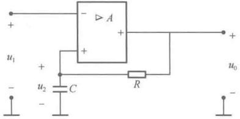

即

图 15-23 例 15-17 图
 

 $$ U_{2}(s)=\frac{1}{1+sRC}U_{0}(s) $$ 

所以

 $$ U_{0}(s)=A[U_{2}(s)-U_{1}(s)]=A\bigg[\frac{1}{1+s R C}U_{0}(s)-U_{1}(s)\bigg] $$ 

 $$ \left(1-\frac{A}{1+sRC}\right)U_{0}(s)=-AU_{1}(s) $$ 

即

 $$ \frac{U_{0}(s)}{U_{1}(s)}=H(s)=-\frac{A}{1-\frac{A}{1+sRC}}=-\frac{A(1+sRC)}{RC\left(\frac{1-A}{RC}+s\right)} $$ 

所以，当 $ \frac{1-A}{RC}>0 $，即A<1时，电路为稳态。

### 15.5  $ H(j\omega) $ 与  $ H(s) $ 的关系

第14章中曾经定义正弦稳态下的网络函数

 $$ H(j\omega)=\frac{ 响应 ( 相量 )}{ 激励 ( 相量 )}=\frac{\dot{R}(j\omega)}{\dot{E}_{s}(j\omega)} $$

<!-- page: 404 -->

事实上， $ H(\mathrm{j}\omega) $ 是本章所定义的网络函数  $ H(s) $ 的一个特例。如果在一个渐近稳定的网络中施加一个正弦电源，那么产生的响应必为强制分量和自由分量的组合。强制分量是与正弦电源同频率的正弦量，而自由分量的变化规律取决于网络的固有频率。由于渐近稳定网络的固有频率全部位于 s 平面的左半平面内，因此当 t 趋于无穷大时，自由分量趋于零，网络进入正弦稳态。因此，网络函数  $ H(s) $ 必然会有一个对应的  $ H(\mathrm{j}\omega) $ 存在。从电路图上看，若将运算电路图中的 s 换成 jω，即可得到一个对应的角频率为 ω 的正弦稳态相量模型电路图，而  $ H(s) $ 也随之变成  $ H(\mathrm{j}\omega) $。反之，若知  $ H(\mathrm{j}\omega) $，也可得到对应的  $ H(s) $。即

 $$ H(s)\xleftarrow{s=\mathrm{j}\omega}H(\mathrm{j}\omega) $$ 

例 15-18 已知某网络在单位冲激电流源  $ i_{s}=\delta(t) $ 的作用下，产生了单位冲激响应

 $$ h(t)=u=2\mathrm{e}^{-t}\cos3t $$ 

试求，当 $ i_{S}=4\sqrt{2}\cos2t $时网络的正弦稳态响应 $ u(t) $。

解：已知  $ h(t)=L^{-1}[H(s)] $，所以运算形式的网络函数为

 $$ H(s)=\frac{U}{I_{\mathrm{s}}}=L[h(t)]=L[2\mathrm{e}^{-t}\cos3t]=\frac{2(s+1)}{(s+1)^{2}+\omega^{2}}=\frac{2(s+1)}{s^{2}+2s+10} $$ 

令s=j2，则对应的正弦稳态下的网络函数为

 $$ H(j2)=\frac{\dot{U}}{\dot{I}_{s}}=\frac{2(j2+1)}{(j2)^{2}+2(j2)+10}=\frac{1+j2}{3+j2} $$ 

所以

 $$ \dot{U}=H(\mathrm{j}2)\dot{I}_{\mathrm{s}}=\frac{1+\mathrm{j}2}{3+\mathrm{j}2}\times4\angle0^{\circ}=2.48\angle29.74^{\circ} $$ 

即

 $$ u(t)=2.48\sqrt{2}\cos(2t+29.74^{\circ}) $$ 

例 15-19 电路如图 15-24 所示，已知  $ u_{1}(t)=10\cos4t $，求  $ u_{2}(t) $。

解：由图可得网络函数为

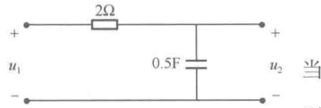

图 15-24 例 15-19 图
 

 $$ H(s)=\frac{U_{2}}{U_{1}}=\frac{1/sC}{R+1/sC}=\frac{1}{1+sRC}=\frac{1}{1+s} $$ 

 $$ u_{1}(t)=\delta(t) 时 ,\ U_{1}(s)=1 $$ 

 $$ h(t)=L^{-1}[H(s)]=L^{-1}[U_{2}(s)]=L^{-1}\left[\frac{1}{1+s}\right]=\mathrm{e}^{-t} $$ 

这表明， $ u_{2}(t) $ 中的自由分量（零输入响应）一定是按照  $ e^{-t} $ 的规律变化的，网络的固有频率  $ p_{i} = -1 $ 。

当 $ u_{1}(t)=10\cos4t $时，拉普拉斯变换为 $ U_{1}(s)=\frac{10s}{s^{2}+16} $

故

 $$ \begin{aligned}U_{2}(s)&=H(s)U_{1}(s)=\frac{10s}{(s+1)(s^{2}+16)}=\frac{10s}{(s+1)(s+\mathrm{j}4)(s-\mathrm{j}4)}\\&=-\frac{10}{17}\times\frac{1}{1+s}+\frac{5}{17}(1+\mathrm{j}4)\times\frac{1}{s+\mathrm{j}4}+\frac{5}{17}(1-\mathrm{j}4)\times\frac{1}{s-\mathrm{j}4}\end{aligned} $$ 

所以

 $$ u_{2}(t)=-\frac{10}{17}\mathrm{e}^{-t}+2.425\cos(4t+75.96^{\circ}) $$ 

可见，自由分量按照  $ e^{-t} $ 的规律变化，而强制分量则是与激励同频率的正弦量。

### 15.6 零点、极点与频率特性

第14章中曾经将网络函数表示为

<!-- page: 405 -->

$$ H(j\omega)=\left|H(j\omega)\right|\angle\theta(j\omega) $$ 

并且将  $ H(j\omega) $ 的模  $ |H(j\omega)| $ 随频率变化的关系称为幅频特性，而将  $ H(j\omega) $ 的相角  $ \theta(j\omega) $ 随频率变化的关系称为相频特性，幅频特性和相频特性又统称为频率特性。

为了讨论零点和极点对频率特性的影响，将式（15-32）重写如下：

 $$ H(s)=H_{0}\frac{(s-z_{1})(s-z_{2})\cdots(s-z_{m})}{(s-p_{1})(s-p_{2})\cdots(s-p_{n})}=H_{0}\frac{\displaystyle\prod_{i=1}^{m}\ (s-z_{i})}{\displaystyle\prod_{i=1}^{n}\ (s-p_{i})} $$ 

当激励信号是角频率为  $ \omega $ 的正弦信号时，在稳态条件下，可令上式中的  $ s = j\omega $，于是有

$$  H(\mathrm{j}\omega)=H_{0}\frac{(\mathrm{j}\omega-z_{1})(\mathrm{j}\omega-z_{2})\cdots(\mathrm{j}\omega-z_{m})}{(\mathrm{j}\omega-p_{1})(\mathrm{j}\omega-p_{2})\cdots(\mathrm{j}\omega-p_{n})}=H_{0}\frac{\prod\limits_{i=1}^{m}{\left(\mathrm{j}\omega-z_{i}\right)}}{\prod\limits_{i=1}^{n}{\left(\mathrm{j}\omega-p_{i}\right)}}   \tag*{（15-34）}$$

则幅频特性为

$$  \left|H(\mathrm{j}\omega)\right|=H_{0}\frac{\displaystyle\prod_{i=1}^{m}\left|\mathrm{j}\omega-z_{i}\right|}{\displaystyle\prod_{i=1}^{n}\left|\mathrm{j}\omega-p_{i}\right|}   \tag*{（15-35）}$$

相频特性为

$$  \theta(\mathrm{j}\omega)=\sum_{i=1}^{m}\ \arg(\mathrm{j}\omega-z_{i})-\sum_{i=1}^{n}\ \arg(\mathrm{j}\omega-p_{i})   \tag*{（15-36）}$$

式中，“ $ \arg $”表示“角度”。

从式（15-35）和式（15-36）可知，网络函数的零点、极点一旦确定，就可计算出网络的频率特性，也可将零点、极点标示在 s 平面上，定性地描绘出频率特性曲线。也就是说，频率特性取决于零点、极点的分布，即  $ z_{i} $ 和  $ p_{i} $ 的位置，而系数  $ H_{0} $ 对于频率特性的研究是无关紧要的。

### 15.7 计算机仿真

MATLAB 作为一个非常强大的数值分析软件包，可以用来求解在不同激励下列出的电路方程组。最直接的方法是使用求解常系数微分方程（ODE）的函数 ode23() 和 ode45()。这两个函数采用了基于微分方程数值解的方法，函数 ode45() 的精度相对高一些。不过这种方法求得的只是一些离散时刻上的解，并没有求出所有时刻上的解。当取的点足够密时，在许多情况下离散解也足以解决问题。

拉普拉斯变换提供了求微分方程精确表达式的一种方法，比用 ODE 函数求得的数值解要好得多。在后面介绍 s 域表达式时将讲到拉普拉斯变换的另一个突出优点，特别是在对分母多项式分解因式之后。进行拉普拉斯变换时采用查表的方法非常方便。这时，也可以使用 MALTAB 来辅助求解。

在 MATLAB 中，多项式  $ p(x) = a_n x^n + a_{n-1} x^{n-1} + \cdots + a_1 x + a_0 $ 以矢量形式  $ [a_n a_{n-1} \cdots a_1 a_0] $ 存储。多项式的根可以调用函数 roots(p) 求解，其中 p 为一个矢量，它包含多项式的系数。例如，求解多项式  $ p(x) = x^2 + 8x + 16 $，在命令窗口输入：

>>p=[1 8 16];
>>roots(p)
可以得到 ans=

<!-- page: 406 -->

象函数  $ F(s) $ 的一般形式为  $ F(s)=\frac{N(s)}{D(s)} $，可以利用 MATLAB 函数 residue()来求解有理函数  $ N(s)/D(s) $ 的函数。在录入多项式系数矢量 N 和 D 后，可以使用指令：

 $$ \gg[r\text{p y}]=residue(N\text{D}); $$ 

该指令可以返回 3 个矢量 r、p 和 y，分别对应于象函数的部分分式展开系数：

 $$ \frac{N(s)}{D(s)}=\frac{r_{1}}{x-p_{1}}+\frac{r_{2}}{x-p_{2}}+\cdots+\frac{r_{n}}{x-p_{n}}+y(s) $$ 

上式是没有重极点的情况。对于有 n 个重极点的情况：

 $$ \frac{N(s)}{D(s)}=\frac{r_{1}}{(x-p)^{2}}+\frac{r_{2}}{(x-p)^{2}}+\cdots+\frac{r_{n}}{(x-p)^{n}}+y(s) $$ 

注意，只要分子多项式的阶数比分母多项式的阶数低，那么矢量  $ y(s) $ 总是空的。

例 15-20 求象函数  $ F(s)=\frac{2}{s^{3}+12s^{2}+36} $ 的拉普拉斯逆变换。

解：

 $$ F(s)=\frac{2}{s^{3}+12s^{2}+36s}=\frac{2}{s(s-6)^{2}} $$ 

该函数有3个极点，在s=0处有一个，在s=-6处有两个。因此，象函数可以分解为

 $$ F(s)=\frac{a_{1}}{(s-6)^{2}}+\frac{a_{2}}{s-6}+\frac{a_{3}}{s} $$ 

可以求出  $ a_{1}=-\frac{1}{3} $， $ a_{2}=-\frac{1}{18} $， $ a_{3}=\frac{1}{18} $。

因此，可以将  $ F(s) $ 展开为

 $$ F(s)=\frac{-\frac{1}{3}}{\left(s-6\right)^{2}}+\frac{-\frac{1}{18}}{s-6}+\frac{\frac{1}{18}}{s} $$ 

 $ F(s) $的逆函数为

 $$ f(t)=-\frac{1}{3}t\mathrm{e}^{-6t}\varepsilon(t)-\frac{1}{18}\mathrm{e}^{-6t}\varepsilon(t)+\frac{1}{18}\varepsilon(t) $$ 

该题用 MATLAB 求解过程如下：

对于象函数  $ F(s)=\frac{2}{s^{3}+12s^{2}+36s} $，分子和分母的多项式分别为  $ N(s)=2 $ 和  $ D(s)=s^{3}+12s^{2}+36s $，在 MATLAB 命令窗口输入：

>>N=[2];
>>D=[1 12 36 0];
>>[r p y]=residue(N D)

r=

-0.0556

-0.3333

0.0556

p=

y=

[]

与手工求解的结果一致。

<!-- page: 407 -->

MATLAB 软件的功能非常强大，它内置了许多程序，能够处理代数式。代数式是以字符串的形式储存的，用一对单括号定义表达式。例如，将多项式  $ p(s) = s^3 - 12s + 6 $ 表示为矢量：

 $$ \gg p=[1\;0\;-12\;6] $$ 

也可以直接用符号表示为

 $$ \gg p=^{\prime}s^{3}-12s+6^{\prime} $$ 

这两种表达方式在 MATLAB 中是不同的，代表两个不同的概念。希望以符号方式处理代数表达式时，必须采用第二种表达方式。在处理瞬时表达式时，该方式很有效。

考虑以下方程组：

 $$ \left\{\begin{aligned}&(3s+10)I_{1}-10I_{2}=\frac{4}{s+2}\\ &-10I_{1}+(4s+10)I_{2}=\frac{-2}{s+1}\end{aligned}\right. $$ 

在 MATLAB 命令窗口输入如下指令，采用 MATLAB 的符号标注定义两串变量为

 $$ \begin{array}{l}>>\mathrm{eqn1}=\prime(3\mathrm{\*s}+10)\mathrm{\*I1}-10\mathrm{\*I2}=4/\left(\mathrm{s}+2\right)\mathrm{\prime};\\>>\mathrm{eqn2}=\prime-10\mathrm{\*I1}+\left(4\mathrm{\*s}+10\right)\mathrm{\*I2}=-2/\left(\mathrm{s}+1\right)\mathrm{\prime}\end{array} $$ 

每个方程与一个字符串对应，然后使用 MATLAB 中的 solve()函数解出方程。solve（）函数通过将方程（定义成字符串）列表和未知量列表（定义成字符串）作为参数来调用。例如，继续求解上一个方程，在命令窗口继续输入如下指令：

 $$ \gg solution=solve(eqn1,eqn2,I1,I2^{\prime}); $$ 

返回的结果保存在变量 solution 中，其格式稍微有点特殊，称为结构，想要提取出未知量 I1 和 I2 的解可以在命令窗口输入：

 $$ \gg I1=solution.I1 $$ 

可以得到结果：

II=
2*(4*s+9)/(s+1)/(6*s^2+47*s+70)

该结果表明 s 域的表达式赋予变量 I1，同样的语句用于提取出 I2.

接着可以直接用 ilaplace()函数确定拉普拉斯逆变换：

 $$ \begin{array}{l} \text{>>i1=ilaplace(I1)}\\{\mathrm{i1=10/29*}\mathrm{e x p}\left(-\mathrm{t}\right)-172/667*\mathrm{e x p}\left(-35/6*\mathrm{t}\right)-2/23*\mathrm{e x p}\left(-2*\mathrm{t}\right)}\end{array} $$ 

按照上述方法，可以快速求得 s 域方程的解及其拉普拉斯逆变换。使用语句 ezplot（i1）可以查看解的形式。但要注意，有时一些复杂的表达式会使 MATLAB 产生错误，在这种情况下，ilaplace() 可能无法返回有用的解。

此外，还有一些函数可以用于快速检验手工计算的结果。函数 numden()可以把有理函数分解为两项：一项是分子，一项是分母。例如，在命令窗口输入：

 $$ >>[N,D]=numden\left(I1\right) $$ 

返回的两个代数式分别保存在N和D中：

N=
8*s+18
D=
(s+1)*(6*s^2+47*s+70)

为了使用函数 residue()，需要将每个多项式的字符串表达式转化为多项式系数为元素的矢量，该功能可以通过函数 sym2poly()来实现：

>>n=sym2poly(N);
>>d=sym2poly(D)

<!-- page: 408 -->

然后确定留数：

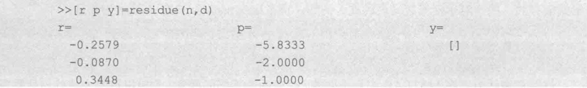

这与使用 ilaplace()得到的结果一致。

例 15-21 电路如图 15-25 所示，电路中的动态元件无初始储能，试确定网孔电流  $ i_{1} $ 和  $ i_{2} $。

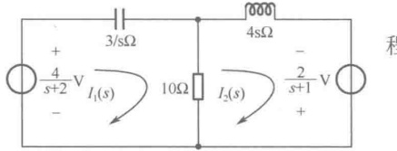

解：两个网孔电流顺时针绕行，该电路的网孔电流方程如下：

图 15-25 例 15-21 电路图
 

 $$ \begin{cases}\left(\frac{3}{s}+10\right)I_{1}-10I_{2}=\frac{4}{s+2}\\-10I_{1}+(4s+10)I_{2}=\frac{2}{s+1}\end{cases} $$ 

求解  $ I_{1} $ 和  $ I_{2} $，可得  $ I_{1}=\frac{2s(4s^{2}+19s+20)}{20s^{4}+66s^{3}+73s^{2}+57s+30} $， $ I_{2}=\frac{30s^{2}+43s+6}{(s+2)(20s^{3}+26s^{2}+21s+15)} $

因此， $ i_{1}(t) = -96.39e^{-2t} - 344.8e^{-t} + 841.2e^{-0.15t} \cos 0.8529t + 197.7e^{-0.15t} \sin 0.8529t $（mA）

 $$ i_{2}(t)=-481.9\mathrm{e}^{-2t}-241.4\mathrm{e}^{-t}+723.3\mathrm{e}^{-0.15t}\cos0.8529t+472.8\mathrm{e}^{-0.15t}\sin0.8529t\quad(\mathrm{m A}) $$ 

本题可以使用 MATLAB 求解，在命令窗口输入以下指令：

>>eqn1=' (3*s+10) *I1-10*I2=4/(s+2)';
>>eqn2='-10*I1+(4*s+10)*I2=-2/(s+1)'
>>solution=solve(eqn1,eqn2,'I1','I2');
>>I1=solution.I1;
>>I2=solution.I2;
>>il=ilaplace(I1)
>>i2=ilaplace(I2)

返回结果与手工求解一致。

### 思考题

15-1 在线性电路问题中，运用拉普拉斯变换进行分析研究有何优点？

15-2 什么是 s 域的元件模型？建立 s 域元件模型要考虑哪些因素？

15-3 什么是运算法？如何用运算法求解电路问题？

15-4 什么是网络函数？ $ H(s) $ 与  $ H(j\omega) $ 有什么区别？

15-5 什么是网络的冲激响应？冲激响应与网络函数有什么关系？怎样利用冲激响应求网络的响应函数？

15-6 什么是网络的零点、极点？网络的冲激响应与网络的零点、极点有何对应关系？

15-7 什么是稳定电路和不稳定电路？它们与网络函数的零点、极点分布有何关系？

15-8 什么是网络的固有频率或自然频率？它与什么有关？

### 习题

15-1 求下列各函数的拉普拉斯变换。

<!-- page: 409 -->

(1)  $ A[\varepsilon(t) - \varepsilon(t - t_0)] $ (A 为常数)

(2)  $ t[\varepsilon(t) - \varepsilon(t-1)] $

(3)  $ e^{-at} \sin \omega t $

（4）

 $$ \mathrm{e}^{-at}\cos\omega t $$ 

(5)  $ \mathrm{e}^{-t}[\varepsilon(t)-\varepsilon(t-1)] $

15-2 求下列各象函数的原函数。

(1)  $  F(s) = \frac{s + 1}{s^{2} + 5s + 6}  $

(2)

 $$ F(s)=\frac{2s^{2}+s+2}{s(s^{2}+1)} $$ 

(3)  $  F(s) = \frac{4}{s(s+2)^2}  $

 $$ F(s)=\frac{s^{3}+5s^{2}+9s+1}{s^{2}+3s+2} $$ 

15-3 求下列各象函数的拉普拉斯逆变换。

(1)

 $$ F(s)=\frac{s^{3}}{(s+1)^{3}} $$ 

(2)

 $$ F(s)=\frac{3s+8}{s^{2}+5s+6}(1-\mathrm{e}^{-s}) $$ 

(3)  $  F(s) = \frac{e^{-s}}{s(s^{2} + 1)}  $

15-4 电路如题 15-4 图所示，开关动作前电路为稳态。t=0 时合上开关，试用拉普拉斯变换法求  $ t \geq 0 $ 时的电压  $ u_{L}(t) $。

15-5 电路如题 15-5 图所示，开关动作前电路为稳态。t=0 时打开开关，在  $ t \geqslant 0 $ 时，（1）画出运算电路；（2）求电流  $ i(t) $ 的象函数  $ I(s) $；（3）求电流  $ i(t) $。

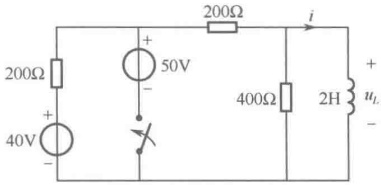

题15-4图
 

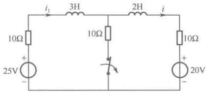

题15-5图
 

15-6 电路如题 15-6 图所示，开关动作前电路为稳态。t=0 时闭合开关，试用拉普拉斯变换法求  $ t \geq 0 $ 时的电压  $ u_{2}(t) $ 和电流  $ i_{2}(t) $。

15-7 电路如题 15-7 图所示，开关动作前电路为稳态，并且  $ u_{C2}(0_-) = 0 $。t = 0 时闭合开关，试用拉普拉斯变换法求  $ t \geq 0 $ 时的电压  $ u_{C2}(t) $，并画出其波形。

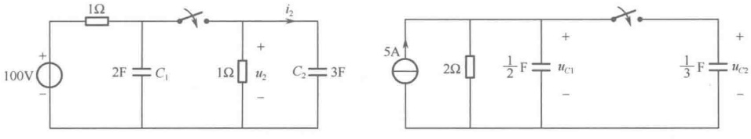

题15-6图
 

题15-7图
 

15-8 电路如题 15-8 图所示，求电路的零状态响应  $ i_{1}(t) $ 和  $ i_{2}(t) $。

15-9 电路如题 15-9 图所示，开关动作前电路为稳态，在 t=0 时闭合开关，试用拉普拉斯变换法求  $ t \geq 0 $ 时的电容电压  $ u_{C}(t) $ 和电感电流  $ i_{L}(t) $。

15-10 电路如题 15-10 图所示，已知  $ u_1(0) = -2\text{V} $， $ i_L(0) = 1\text{A} $，求零输入响应  $ u_2(t) $。

15-11 电路如题 15-11 图所示，开关动作前电路为稳态，在 t=0 时闭合开关，试求  $ t \geq 0 $ 时的全响应  $ i_{2}(t) $。

<!-- page: 410 -->

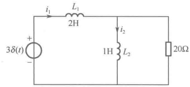

题15-8图
 

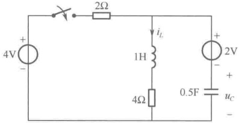

题15-9图
 

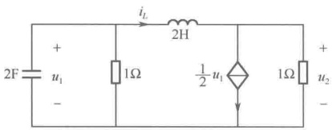

题15-10图
 

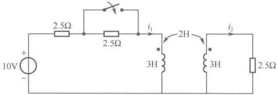

题15-11图
 

15-12 电路如题 15-12 图所示，开关动作前电路为稳态，在 t=0 时闭合开关，试求  $ t \geq 0 $ 时流过开关的电流  $ i_{s}(t) $。

15-13 如题 15-13 图所示电路已处于稳态，开关在 t=0 时打开，试用运算法求响应  $ u_{C}(t) $。

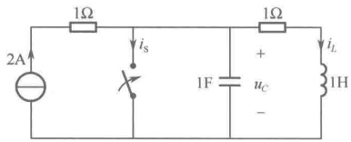

题15-12图
 

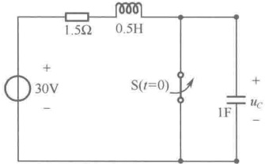

题15-13图
 

15-14 电路如题 15-14 图所示，开关动作前电路为稳态，t=0 时打开开关，试求  $ t \geq 0 $ 时的  $ u_{c}(t) $

15-15 电路如题 15-15 图所示，开关动作前电路为稳态，t=0 时打开开关，试求  $ t \geq 0 $ 时电容电压  $ u_{C}(t) $ 的零输入响应  $ u_{CP}(t) $ 和零状态响应  $ u_{CR}(t) $。

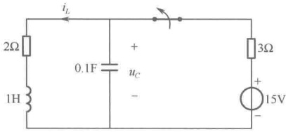

题15-14图
 

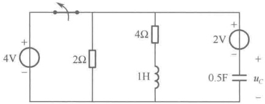

题15-15图
 

15-16 电路如题 15-16 图所示，已知  $ L = 0.2\,\text{H} $， $ R = 2/7\,\Omega $， $ C = 0.5\,\text{F} $， $ u_C(0_-) = 2\,\text{V} $， $ i_L(0_-) = 3\,\text{A} $， $ i(t) = 10\sin(5t)\varepsilon(t)(\text{A}) $，求响应  $ u(t) $，并指出零输入响应、零状态响应、稳态响应、暂态响应。

15-17 电路如题 15-17 图所示，已知  $ R_1 = 6\Omega $， $ R_2 = 3\Omega $， $ L = 1\text{H} $， $ \mu = 1 $，求当  $ u_S(t) $ 的波形如题 15-17 图（b）所示时电路的零状态响应  $ i_L(t) $。

<!-- page: 411 -->

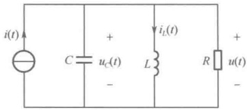

题15-16图
 

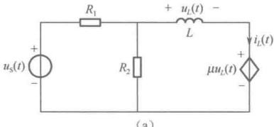

(a)
 

题15-17图
 

(b)
 

15-18 已知网络的冲激响应，求相应的网络函数：

 $$ h(t)=\mathrm{e}^{-2t}\varepsilon(t) $$ 

 $$ h(t)=(1-\mathrm{e}^{-2t})\varepsilon(t) $$ 

(3)  $ h(t) = \delta(t) - e^{-t} \varepsilon(t) $ (4)  $ h(t) = (e^{-t} + e^{-2t}) \varepsilon(t) $

15-19 如题 15-19 图所示电路，先求  $ i_{L}(t) $ 的单位冲激响应  $ h(t) $，再求其单位阶跃响应  $ s(t) $。

15-20 电路如题 15-20 图所示，求：（1）电压转移函数  $ H(s)=U_{2}(s)/U_{1}(s) $；（2）单位阶跃响应  $ u_{2}(t) $。

题15-19图
 

题15-20图
 

15-21 题 15-21 图所示电路中的初始条件为零，试求：（1）网络函数  $ H(s)=I_{0}(s)/U_{s}(s) $；（2）响应  $ i_{0}(t) $ 的冲激响应  $ h(t) $ 和阶跃响应  $ S(t) $。

15-22 如题 15-22 图所示电路中  $ C = 0.1\,\text{F} $,  $ L = 0.2\,\text{H} $,  $ R_1 = 6\,\Omega $,  $ R_2 = 4\,\Omega $,  $ u_s = 7e^{-2t}\varepsilon(t) $ (V), 求零状态响应  $ i_2 $，并求网络函数  $ H(s) = I_2(s)/U_S(s) $ 及单位冲激响应。

题15-21 图
 

题15-22图
 

15-23 题 15-23 图（a）所示为线性无源一端口网络，图（b）为该网络的驱动点导纳的零点、极点图。已知当  $ u(t)=10V $ （直流）时， $ i(t)=1A $ （直流），试求当  $ u(t)=\delta(t) $ (V) 时  $ i(t) $ 的表达式。

(b)
 

题15-23图
 

<!-- page: 412 -->

15-24 已知某网络函数  $ H(s) $ 的零点、极点分布如题 15-24 图所示，且知  $ |H(j2)| = 3.29 $。试写出网络函数。

15-25 求如题 15-25 图所示电路的网络函数  $ H(s)=U_{2}(s)/U_{S}(s) $

题15-24图
 

题15-25图
 

15-26 题 15-26 图（a）所示电路的策动点阻抗  $ Z(s) $ 的零点、极点分布如图（b）所示，且知  $ Z(0)=3\Omega $ 。试求电路参数 R、L、C 的值。

15-27 已知某网络函数  $ H(s) $ 的零点、极点分布如题 15-27 图所示，且知  $ H(0)=1/3 $ 。试写出网络函数，并求冲激响应和阶跃响应。

(a)
 

(b)
 

题15-26图
 

题15-27图
 

15-28 某电路的网络函数  $ H(s) = H_0 \frac{s + 5}{s^2 + 3s + 2} $，其中  $ H_0 $ 为未知常数。已知该电路的单位阶跃响应的终值为 1，试求该电路对何种激励的零状态响应为  $ \left(1 - \frac{4}{3} e^{-t} + \frac{1}{3} e^{-2t}\right) \varepsilon(t) $。

15-29 求题 15-29 图所示电路的网络函数  $ H(s)=U_{2}(s)/U_{1}(s) $，以及单位冲激响应。

15-30 电路如题 15-30 图所示，已知输入信号  $ u_{1}(t)=(3\mathrm{e}^{-2t}+2\mathrm{e}^{-3t})\varepsilon(t) $，求电路响应  $ u_{2}(t) $。

题15-29图
 

题15-30图
 

15-31 在题 15-31 图（a）所示电路中，已知  $ R_1 = 1\text{k}\Omega $， $ R_2 = 0.5\text{k}\Omega $， $ C = 1\mu\text{F} $， $ g = 10^{-3}\text{s} $，（1）求网络函数  $ H(s) = U_2(s)/U_S(s) $；（2）若激励  $ u_S(t) $ 的波形如题 15-31 图（b）所示，求  $ u_2(t) $ 的零状态响应。

15-32 题 15-32 图所示为一个二端口网络，已知其单位阶跃响应为  $ \mathrm{e}^{-\frac{1}{2}t}(\mathrm{V}) $，若激励改为

<!-- page: 413 -->

$ 2\sin 2t(V) $，试求网络的零状态响应 $ u_{0}(t) $。

题15-31 图
 

15-33 电路如题 15-33 图所示，（1）求网络函数  $ H(s)=U_2(s)/F(s) $；（2）若输入信号  $ f(t)=\cos(2t)\varepsilon(t) $（V），今欲使  $ u_2(t) $ 中不出现强制响应分量（正弦稳态分量），试求 L、C 的值；（3）若  $ R=1\Omega $， $ L=1H $，试按照第（2）问的条件求  $ u_2(t) $。

题15-32图
 

题15-33图
 

