# 16-第16章 二端口网络分析

[返回全书目录](../../README.md)

> PDF 页码：414–446

<!-- page: 414 -->

### 第16章 二端口网络分析

此前各章所讨论的电路分析方法均可用来求解电路中各处的电压和电流等变量，但在许多时候人们并不关心电路中各处的所有响应，而只关心电路中某几个端子上的量，于是提出了二端口网络的概念。

根据所关心的电路变量，可将电路划分为一端口网络、二端口网络、三端口网络等。实际工程中常用的变压器、滤波器、放大器等都是二端口网络。

本章将围绕着内部不含独立电源、无初始储能的线性二端口网络进行讨论。

### 16.1 二端口网络及其分类

#### 16.1.1 二端口网络的定义

如图 16-1 所示，网络 N 引出 4 个端子，如果任意时刻都满足  $ \dot{I}_{1} = \dot{I}_{1}^{\prime} $， $ \dot{I}_{2} = \dot{I}_{2}^{\prime} $ 的端口条件，则该网络称为二端口网络。其中，1-1' 构成端口 1，2-2' 构成端口 2。图 16-2 所示为常见的二端口网络。

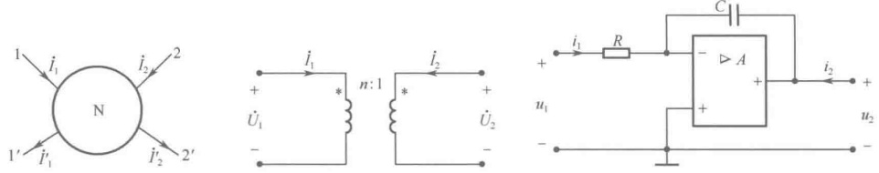

图 16-1 4 个引出端子的网络 N
 

图 16-2 常见的二端口网络
 

二端口是具有4个端子的网络，但具有4个端子的网络不一定就是二端口网络。如果图16-1所示网络不满足端口条件，即 $ \dot{I}_{1} \neq \dot{I}_{1}^{\prime} $， $ \dot{I}_{2} \neq \dot{I}_{2}^{\prime} $，则网络只能称为四端网络，而不是二端口网络。

#### 16.1.2 二端口网络的分类

按照组成元件性质，可将二端口网络分为线性二端口与非线性二端口、时变二端口与非时变二端口、集中参数二端口与分布参数二端口、无源二端口与有源二端口、双向二端口（满足互易定理）与单向二端口（不满足互易定理）。

按照组成网络的连接形式，可将二端口网络分为对称二端口与非对称二端口、平衡二端口与非平衡二端口、L形二端口、T形二端口、 $ \pi $形二端口、X形二端口等。

内部不含独立电源、无初始储能的二端口网络又称为松弛二端口网络，否则称为非松弛二端口网络。一般情况下，非松弛二端口网络可由相应的松弛网络与独立电源构成的网络来等效。

### 16.2 二端口网络的端口特性方程及其参数

如图16-3所示，如果所关心的只是两个端口的 $ \dot{U}_{1} $、 $ \dot{I}_{1} $、 $ \dot{U}_{2} $、 $ \dot{I}_{2} $，则输入端口（端口1）与

<!-- page: 415 -->

输出端口（端口2）之间所经过的网络参数一定可以表征两个端口的关系。

下面以线性松弛二端口网络为例来描述二端口网络的端口特性方程与参数。针对端口量 $ \dot{U}_{1} $、 $ \dot{I}_{1} $、 $ \dot{U}_{2} $、 $ \dot{I}_{2} $可以有6种组合的端口特性方程，本书重点描述其中的4种，即Z参数方程、Y参数方程、T参数方程和H参数方程。

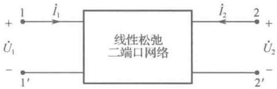

图 16-3 二端口网络
 

#### 16.2.1 开路阻抗参数——Z 参数

针对图 16-3 所示的二端口网络，以电流  $ \dot{I}_{1} $、 $ \dot{I}_{2} $ 为激励，根据线性网络的叠加定理可知，在  $ \dot{I}_{1} $、 $ \dot{I}_{2} $ 共同作用下的响应  $ \dot{U}_{1} $、 $ \dot{U}_{2} $ 为

$$  \left.\begin{array}{l}\dot{U}_{1}=Z_{11}\dot{I}_{1}+Z_{12}\dot{I}_{2}\\ \dot{U}_{2}=Z_{21}\dot{I}_{1}+Z_{22}\dot{I}_{2}\end{array}\right\}   \tag*{（16-1）}$$

这就是二端口网络的Z参数方程，式中的参数

$$  \left.\begin{array}{l l}{Z_{11}=\displaystyle\frac{\dot{U}_{1}}{\dot{I}_{1}}\bigm|_{\dot{I}_{2}=0}}&{\quad Z_{12}=\displaystyle\frac{\dot{U}_{1}}{\dot{I}_{2}}\bigm|_{\dot{I}_{1}=0}}\\ {Z_{21}=\displaystyle\frac{\dot{U}_{2}}{\dot{I}_{1}}\bigm|_{\dot{I}_{2}=0}}&{\quad Z_{22}=\displaystyle\frac{\dot{U}_{2}}{\dot{I}_{2}}\bigm|_{\dot{I}_{1}=0}}\end{array}\right\}   \tag*{（16-2）}$$

从特征上看，这4个参数均为开路阻抗参数，具体为：

①  $ Z_{11} $ 是输出端开路时的输入端阻抗；②  $ Z_{12} $ 是输入端开路时的反向转移阻抗；

③  $ Z_{21} $ 是输出端开路时的正向转移阻抗；④  $ Z_{22} $ 是输入端开路时的输出端阻抗。

可将式（16-1）写成矩阵形式

 $$ \begin{bmatrix}\dot{U}_{1}\\ \dot{U}_{2}\end{bmatrix}=\begin{bmatrix}Z_{11}&Z_{12}\\ Z_{21}&Z_{22}\end{bmatrix}\begin{bmatrix}\dot{I}_{1}\\ \dot{I}_{2}\end{bmatrix}\quad\Rightarrow\quad\dot{U}=Z\dot{I} $$ 

称 Z 为开路阻抗矩阵或 Z 参数矩阵。

从 Z 参数的物理含义可知，二端口网络的 4 个阻抗型参数都是在网络的某一端口开路的条件下得到的，它们取决于网络内部结构与元件参数，而与网络的端口变量无关，但却可以用来表征网络端口变量的关系。就好比一个  $ 5\Omega $ 电阻，其阻值与其两端电压和流过它的电流无关，但这个阻值却反映了该电阻上电压和电流应满足的关系。

若二端口网络的两个端口满足互易定理，即为双向网络或互易网络，则在端口1加电流源 $ \dot{I}_{1} $时在端口2产生的开路电压 $ \dot{U}_{2}\big|_{\dot{I}_{2}=0} $与在端口2加电流源 $ \dot{I}_{2} $时在端口1产生的开路电压 $ \dot{U}_{1}\big|_{\dot{I}_{1}=0} $应相等，

即

 $$ \begin{aligned}\frac{\dot{U}_{2}}{\dot{I}_{1}}\mid_{i_{2}=0}&=\frac{\dot{U}_{1}}{\dot{I}_{2}}\mid_{i_{1}=0}\\Z_{12}&=Z_{21}\end{aligned} $$ 

或

若二端口网络是对称网络，根据对称性关系有

 $$ \begin{aligned}\frac{\dot{U}_{1}}{\dot{I}_{1}}\mid_{i_{2}=0}&=\frac{\dot{U}_{2}}{\dot{I}_{2}}\mid_{i_{1}=0}\\Z_{11}&=Z_{22}\end{aligned} $$ 

即

<!-- page: 416 -->

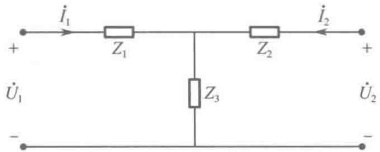

例 16-1 求图 16-4 所示 T 形网络的 Z 参数。

解：将 $ i_{1} $和 $ i_{2} $设为两个回路电流，列写回路电流方程为

图 16-4 T 形网络
 

 $$ \left\{\begin{aligned}\dot{U}_{1}&=(Z_{1}+Z_{3})\dot{I}_{1}+Z_{3}\dot{I}_{2}\\ \dot{U}_{2}&=Z_{3}\dot{I}_{1}+(Z_{2}+Z_{3})\dot{I}_{2}\end{aligned}\right. $$ 

与Z参数方程（16-1）比较可得

 $$ Z_{11}=Z_{1}+Z_{3},\quad Z_{12}=Z_{3},\quad Z_{21}=Z_{3},\quad Z_{22}=Z_{2}+Z_{3} $$ 

例 16-2 求图 16-5 所示 X 形网络的 Z 参数。

解：由 Z 参数的定义可知

 $$ Z_{11}=\frac{\dot{U}_{1}}{\dot{I}_{1}}\mid_{i_{2}=0}=\frac{1}{2}(Z_{1}+Z_{2}),\quad Z_{12}=\frac{\dot{U}_{1}}{\dot{I}_{2}}\mid_{i_{1}=0}=\frac{1}{2}(Z_{2}-Z_{1}) $$ 

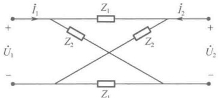

由于网络是双向的、对称的，因此有

 $$ Z_{22}=Z_{11}=\frac{1}{2}(Z_{1}+Z_{2}),\qquad Z_{21}=Z_{12}=\frac{1}{2}(Z_{2}-Z_{1}) $$ 

图 16-5 X 形网络
 

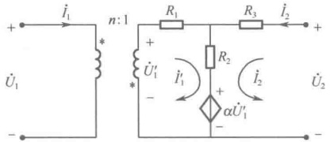

图16-6 例16-3图
 

例 16-3 求图 16-6 所示二端口网络的 Z 参数。

解：列写回路电流方程

整理得

 $$ \begin{cases}\dot{U}_{1}^{\prime}=(R_{1}+R_{2})\dot{I}_{1}^{\prime}+R_{2}\dot{I}_{2}+\alpha\dot{U}_{1}^{\prime}\\\dot{U}_{2}=(R_{2}+R_{3})\dot{I}_{2}+R_{2}\dot{I}_{1}^{\prime}+\alpha\dot{U}_{1}^{\prime}\\\dot{U}_{1}=-n\dot{U}_{1}^{\prime}\\\dot{I}_{1}^{\prime}=-n\dot{I}_{1}\end{cases} $$ 

 $$ \left\{\begin{aligned}\dot{U}_{1}&=-\frac{n^{2}}{\alpha-1}(R_{1}+R_{2})\dot{I}_{1}+\frac{n}{\alpha-1}R_{2}\dot{I}_{2}\\ \dot{U}_{2}&=\left[-nR_{2}+\frac{\alpha n}{\alpha-1}(R_{1}+R_{2})\right]\dot{I}_{1}+\left(R_{2}+R_{3}-\frac{\alpha}{\alpha-1}R_{2}\right)\dot{I}_{2}\end{aligned}\right. $$ 

所以，Z参数矩阵为

 $$ \begin{aligned}&Z=\begin{bmatrix}\\ &-\frac{n^{2}}{\alpha-1}(R_{1}+R_{2})&\frac{n}{\alpha-1}R_{2}\\&-nR_{2}+\frac{\alpha n}{\alpha-1}(R_{1}+R_{2})&R_{2}+R_{3}-\frac{\alpha}{\alpha-1}R_{2}\\ &\end{bmatrix}\\ \end{aligned} $$ 

#### 16.2.2 短路导纳参数——Y参数

针对图16-3所示的二端口网络，以电压 $ \dot{U}_{1} $、 $ \dot{U}_{2} $为激励，根据线性网络的叠加定理可知，在 $ \dot{U}_{1} $、 $ \dot{U}_{2} $共同作用下的响应 $ \dot{I}_{1} $、 $ \dot{I}_{2} $为

$$  \left.\begin{array}{l}\dot{I}_{1}=Y_{11}\dot{U}_{1}+Y_{12}\dot{U}_{2}\\ \dot{I}_{2}=Y_{21}\dot{U}_{1}+Y_{22}\dot{U}_{2}\end{array}\right\}   \tag*{（16-5）}$$

这就是二端口网络的 Y 参数方程，式中的参数

$$  \left.\begin{array}{l l}{{Y_{11}=\displaystyle\frac{\dot{I}_{1}}{\dot{U}_{1}}\left\vert_{\dot{U}_{2}=0}\right.}}&{{\quad Y_{12}=\displaystyle\frac{\dot{I}_{1}}{\dot{U}_{2}}\left\vert_{\dot{U}_{1}=0}\right.}}\\ {{Y_{21}=\displaystyle\frac{\dot{I}_{2}}{\dot{U}_{1}}\left\vert_{\dot{U}_{2}=0}\right.}}&{{\quad Y_{22}=\displaystyle\frac{\dot{I}_{2}}{\dot{U}_{2}}\left\vert_{\dot{U}_{1}=0}\right.}}\end{array}\right\}   \tag*{（16-6）}$$

从特征上看，这4个参数均为短路导纳参数，具体为：

①  $ Y_{11} $ 是输出端短路时的输入端导纳；②  $ Y_{12} $ 是输入端短路时的反向转移导纳；

<!-- page: 417 -->

可将式（16-5）写成矩阵形式

 $$ \begin{bmatrix}\dot{I}_{1}\\ \dot{I}_{2}\end{bmatrix}=\begin{bmatrix}Y_{11}&Y_{12}\\ Y_{21}&Y_{22}\end{bmatrix}\begin{bmatrix}\dot{U}_{1}\\ \dot{U}_{2}\end{bmatrix}\Rightarrow\dot{I}=Y\dot{U} $$ 

称 Y 为短路导纳矩阵或 Y 参数矩阵。

与 Z 参数类似，若二端口网络的两个端口满足互易定理，即为双向网络，则有

$$  Y_{12}=Y_{21}   \tag*{（16-7）}$$

若二端口网络是对称网络，根据对称性关系有

 $$ Y_{11}=Y_{22} $$ 

例 16-4 求图 16-7 所示传输线网络的 Y 参数。

解：由图16-7可得

 $$ \left\{\begin{aligned}\dot{U}_{1}-\dot{U}_{2}&=Z_{0}\dot{I}_{1}\\ \dot{I}_{1}&=-\dot{I}_{2}\end{aligned}\right.\quad 即 \quad\left\{\begin{aligned}\dot{I}_{1}&=\frac{\dot{U}_{1}}{Z_{0}}-\frac{\dot{U}_{2}}{Z_{0}}\\ \dot{I}_{2}&=-\dot{I}_{1}=-\frac{\dot{U}_{1}}{Z_{0}}+\frac{\dot{U}_{2}}{Z_{0}}\end{aligned}\right. $$ 

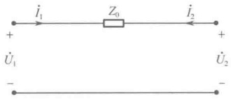

图 16-7 传输线网络
 

与 Y 参数方程（16-5）比较可得

 $$ Y_{11}=\frac{1}{Z_{0}},\quad Y_{12}=-\frac{1}{Z_{0}},\quad Y_{21}=-\frac{1}{Z_{0}},\quad Y_{22}=\frac{1}{Z_{0}} $$ 

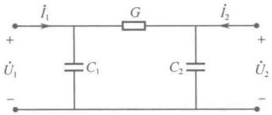

例 16-5 求图 16-8 所示二端口网络的 Y 参数。

图 16-8 例 16-5 图
 

解：由图16-8列写节点电压方程（视 $ \dot{I}_{1} $、 $ \dot{I}_{2} $为电流源）

 $$ \left\{\begin{aligned}&(G+\mathrm{j}\omega C_{1})\dot{U}_{1}-G\dot{U}_{2}=\dot{I}_{1}\\ &(G+\mathrm{j}\omega C_{2})\dot{U}_{2}-G\dot{U}_{1}=\dot{I}_{2}\end{aligned}\right. $$ 

与 Y 参数方程（16-5）比较可得

 $$ Y_{11}=G+\mathrm{j}\omega C_{1},\quad Y_{12}=-G,\quad Y_{21}=-G,\quad Y_{22}=G+\mathrm{j}\omega C_{2} $$ 

解：由图16-9列写节点电压方程（视 $ \dot{I}_{1} $、 $ \dot{I}_{2} $为电流源）

 $$ \left\{\begin{aligned}\left(\frac{1}{R_{\mathrm{b}}}+\mathrm{j}\omega C\right)\dot{U}_{1}-\mathrm{j}\omega C\dot{U}_{2}&=\dot{I}_{1}+\frac{\mu}{R_{\mathrm{b}}}\dot{U}_{2}\\ (G+\mathrm{j}\omega C)\dot{U}_{2}-\mathrm{j}\omega C\dot{U}_{1}&=\dot{I}_{2}-\beta\dot{I}_{\mathrm{b}}\\ \dot{I}_{\mathrm{b}}=\frac{1}{R_{\mathrm{b}}}(\dot{U}_{1}-\mu\dot{U}_{2})\end{aligned}\right. $$ 

整理可得

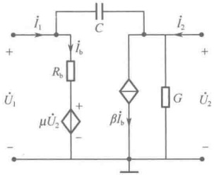

 $$ \left\{\begin{aligned}&\left(\frac{1}{R_{\mathrm{b}}}+\mathrm{j}\omega C\right)\dot{U}_{1}+(-\mathrm{j}\omega C-\frac{\mu}{R_{\mathrm{b}}})\dot{U}_{2}=\dot{I}_{1}\\ \left(-\mathrm{j}\omega C+\frac{\beta}{R_{\mathrm{b}}}\right)\dot{U}_{1}+\left(G+\mathrm{j}\omega C-\frac{\beta\mu}{R_{\mathrm{b}}}\right)\dot{U}_{2}=\dot{I}_{2}\end{aligned}\right. $$ 

图 16-9 例 16-6 图
 

所以，Y参数用矩阵表示为

 $$ \boldsymbol{Y}=\left[\begin{aligned}&\frac{1}{R_{\mathrm{b}}}+j\omega C&-j\omega C-\frac{\mu}{R_{\mathrm{b}}}\\ &-j\omega C+\frac{\beta}{R_{\mathrm{b}}}&G+j\omega C-\frac{\beta\mu}{R_{\mathrm{b}}}\end{aligned}\right] $$

<!-- page: 418 -->

#### 16.2.3 传输参数——T参数

针对图 16-3 所示的二端口网络，以电压  $ \dot{U}_2 $、 $ -\dot{I}_2 $ 为激励，根据线性网络的叠加定理可知，在  $ \dot{U}_2 $、 $ -\dot{I}_2 $ 共同作用下的响应  $ \dot{U}_1 $、 $ \dot{I}_1 $ 为

$$  \left.\begin{array}{l}\dot{U}_{1}=A\dot{U}_{2}-B\dot{I}_{2}\\ \dot{I}_{1}=C\dot{U}_{2}-D\dot{I}_{2}\end{array}\right\}   \tag*{（16-9）}$$

这就是二端口网络的传输参数方程，式中“-”号体现了“传输性”，其参数为

$$  \left.\begin{array}{l l}{{A=\displaystyle\frac{\dot{U}_{1}}{\dot{U}_{2}}\left\vert_{i_{2}=0}\right.}}&{{\quad B=\displaystyle\frac{\dot{U}_{1}}{-\dot{I}_{2}}\left\vert_{\dot{U}_{2}=0}\right.}}\\ {{C=\displaystyle\frac{\dot{I}_{1}}{\dot{U}_{2}}\left\vert_{i_{2}=0}\right.}}&{{\quad D=\displaystyle\frac{\dot{I}_{1}}{-\dot{I}_{2}}\left\vert_{\dot{U}_{2}=0}\right.}}\end{array}\right\}   \tag*{（16-10）}$$

从特征上看，这4个参数各不相同，具体为：

① A 是输出端开路时的反向电压传输比；② B 是输出端短路时的反向转移阻抗；

③ C 是输出端开路时的反向转移导纳；④ D 是输出端短路时的反向电流传输比。

可将式（16-9）写成矩阵形式

 $$ \begin{aligned}\begin{bmatrix}\dot{U}_{1}\\\dot{I}_{1}\end{bmatrix}=\begin{bmatrix}A&B\\C&D\end{bmatrix}\begin{bmatrix}\dot{U}_{2}\\-\dot{I}_{2}\end{bmatrix}=T\begin{bmatrix}\dot{U}_{2}\\-\dot{I}_{2}\end{bmatrix}\end{aligned} $$ 

式中，T为传输参数矩阵或T参数矩阵。

若二端口网络的两个端口满足互易定理，即为双向网络，则有

$$  AD-BC=1   \tag*{（16-11）}$$

若二端口网络是对称网络，根据对称性关系有

$$  A=D   \tag*{（16-12）}$$

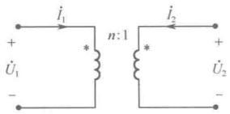

例 16-7 求图 16-10 所示理想变压器的 T 参数。

图 16-10 例 16-7 图
 

解：已知理想变压器方程为

 $$ \left\{\begin{aligned}\dot{U}_{1}&=n\dot{U}_{2}\\ \dot{I}_{1}&=-\frac{1}{n}\dot{I}_{2}\end{aligned}\right. $$ 

与T参数方程（16-9）比较可得 A=n，B=0，C=0， $ D=\frac{1}{n} $

例 16-8 求图 16-11 所示二端口网络的 T 参数。

解：由 T 参数定义可得

 $$ A=\frac{\dot{U}_{1}}{\dot{U}_{2}}\mid_{I_{2}=0}=1,\quad B=\frac{\dot{U}_{1}}{-\dot{I}_{2}}\mid_{I_{2}=0}=\frac{\dot{U}_{1}}{\dot{U}_{1}/0.25}=0.25, $$ 

 $$ C=\frac{\dot{I}_{1}}{\dot{U}_{2}}\mid_{\dot{I}_{2}=0}=\frac{\dot{I}_{1}}{4\dot{I}_{1}}=0.25,\quad D=\frac{\dot{I}_{1}}{-\dot{I}_{2}}\mid_{\dot{U}_{2}=0}=\frac{\dot{I}_{1}}{\frac{4}{4+0.25}\dot{I}_{1}}=\frac{17}{16}, $$ 

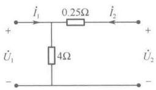

图 16-11 例 16-8 图
 

例 16-9 电路如图 16-12 所示，已知开关打开时  $ \dot{U}_3 = 9\mathrm{V} $， $ \dot{U}_1 = 5\mathrm{V} $， $ \dot{U}_2 = 3\mathrm{V} $，开关闭合时  $ \dot{U}_3 = 8\mathrm{V} $， $ \dot{U}_1 = 4\mathrm{V} $， $ \dot{U}_2 = 2\mathrm{V} $，求二端口网络的 T 参数。

解：由 T 参数定义可得，开关打开时

 $$ A=\frac{\dot{U}_{1}}{\dot{U}_{2}}\mid_{i_{2}=0}=\frac{5}{3},\quad C=\frac{\dot{I}_{1}}{\dot{U}_{2}}\mid_{i_{2}=0}=\frac{\dot{U}_{3}-\dot{U}_{1}}{R_{1}\dot{U}_{2}}=\frac{1}{3} $$

<!-- page: 419 -->

开关闭合时

 $$ \dot{I}_{1}=\frac{\dot{U}_{3}-\dot{U}_{1}}{R_{1}}=1\mathrm{A},\qquad\dot{I}_{2}=-\frac{\dot{U}_{2}}{R_{2}}=-\frac{1}{3}\mathrm{A} $$ 

所以，由 T 参数方程可得

 $$ \left\{\begin{aligned}\dot{U}_{1}&=A\dot{U}_{2}+B(-\dot{I}_{2})=\frac{5}{3}\times2+\frac{1}{3}\times B=4\\ \dot{I}_{1}&=C\dot{U}_{2}+D(-\dot{I}_{2})=\frac{1}{3}\times2+\frac{1}{3}\times D=1\end{aligned}\right. $$ 

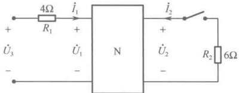

图 16-12 例 16-9 图
 

求得B=2，D=1，所以T参数用矩阵表示为

 $$ T=\begin{bmatrix}{{{5/3}}}&{{{2}}} \\{{{1/3}}}&{{{1}}}\end{bmatrix} $$ 

#### 16.2.4 混合参数——H参数

针对图 16-3 所示的二端口网络，以电压  $ \dot{I}_{1} $、 $ \dot{U}_{2} $ 为激励，根据线性网络的叠加定理可知，在  $ \dot{I}_{1} $、 $ \dot{U}_{2} $ 共同作用下的响应  $ \dot{U}_{1} $、 $ \dot{I}_{2} $ 为

$$  \left.\begin{array}{l}\dot{U}_{1}=H_{11}\dot{I}_{1}+H_{12}\dot{U}_{2}\\ \dot{I}_{2}=H_{21}\dot{I}_{1}+H_{22}\dot{U}_{2}\end{array}\right\}   \tag*{（16-13）}$$

这就是二端口网络的混合参数方程，其参数为

$$  \left.\begin{aligned}H_{11}=&\frac{\dot{U}_{1}}{\dot{I}_{1}}\left|_{\dot{U}_{2}=0}\right.,\quad&H_{12}=&\frac{\dot{U}_{1}}{\dot{U}_{2}}\left|_{\dot{I}_{1}=0}\right.\\ H_{21}=&\frac{\dot{I}_{2}}{\dot{I}_{1}}\left|_{\dot{U}_{2}=0}\right.,\quad&H_{22}=&\frac{\dot{I}_{2}}{\dot{U}_{2}}\left|_{\dot{I}_{1}=0}\right\}\end{aligned}\right.   \tag*{（16-14）}$$

从特征上看，这4个参数各不相同，具体为：

①  $ H_{11} $ 是输出端短路时的输入阻抗；②  $ H_{12} $ 是输入端开路时的反向电压传输比；

③  $ H_{21} $ 是输出端短路时的正向电流传输比；④  $ H_{22} $ 是输入端开路时的输出导纳。

可将式（16-13）写成矩阵形式

 $$ \begin{aligned}\begin{bmatrix}\dot{U}_{1}\\\dot{I}_{2}\end{bmatrix}=\begin{bmatrix}H_{11}&H_{12}\\H_{21}&H_{22}\end{bmatrix}\begin{bmatrix}\dot{I}_{1}\\\dot{U}_{2}\end{bmatrix}=H\begin{bmatrix}\dot{I}_{1}\\\dot{U}_{2}\end{bmatrix}\end{aligned} $$ 

式中，H为混合参数矩阵或H参数矩阵。

若二端口网络的两个端口满足互易定理，即为双向网络，则有

 $$ H_{12}=-H_{21} $$ 

若二端口网络是对称网络，根据对称性关系有

$$  H_{11}H_{22}-H_{12}H_{21}=1   \tag*{（16-16）}$$

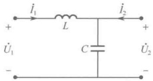

例 16-10 求如图 16-13 所示网络的 H 参数。

图 16-13 例 16-10 图
 

解：由H参数定义可得

 $$ \begin{aligned}&H_{11}=\frac{\dot{U}_{1}}{\dot{I}_{1}}\left|_{\dot{U}_{2}=0}\right.=\mathrm{j}\omega L,\quad&H_{12}=\frac{\dot{U}_{1}}{\dot{U}_{2}}\left|_{\dot{I}_{1}=0}\right.=1,\\&H_{21}=\frac{\dot{I}_{2}}{\dot{I}_{1}}\left|_{\dot{U}_{2}=0}\right.=-1,\quad&H_{22}=\frac{\dot{I}_{2}}{\dot{U}_{2}}\left|_{\dot{I}_{1}=0}\right.=\mathrm{j}\omega C\\ \end{aligned} $$

<!-- page: 420 -->

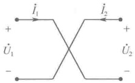

例 16-11 求如图 16-14 所示交叉短路线的 H 参数。

解：由H参数定义可得

图 16-14 例 16-11 图
 

 $$ H_{11}=\frac{\dot{U}_{1}}{\dot{I}_{1}}\mid_{\dot{U}_{2}=0}=0,\quad H_{12}=\frac{\dot{U}_{1}}{\dot{U}_{2}}\mid_{I_{1}=0}=-1, $$ 

 $$ H_{21}=\frac{\dot{I}_{2}}{\dot{I}_{1}}\left|_{\dot{U}_{2}=0}\right.=1,\quad H_{22}=\frac{\dot{I}_{2}}{\dot{U}_{2}}\left|_{\dot{I}_{1}=0}\right.=0 $$ 

例 16-12 电路如图 16-15 所示，已知开关打开时  $ \dot{I}_S = 10\,\text{mA} $， $ \dot{I}_1 = 5\,\text{mA} $， $ \dot{U}_2 = -250\,\text{V} $；开关闭合时  $ \dot{I}_S = 10\,\text{mA} $， $ \dot{I}_1 = 5\,\text{mA} $， $ \dot{U}_2 = -125\,\text{V} $，求二端口网络的 H 参数。

解：由于图16-15中的 $ i_{2} $反向，所以H参数方程为

 $$ \left\{\begin{aligned}\dot{U}_{1}&=H_{11}\dot{I}_{1}+H_{12}\dot{U}_{2}\\ -\dot{I}_{2}&=H_{21}\dot{I}_{1}+H_{22}\dot{U}_{2}\end{aligned}\right. $$ 

开关打开时  $ \dot{U}_{1}=R_{1}(\dot{I}_{s}-\dot{I}_{1})=0.5V $， $ \dot{I}_{2}=0 $ 代入 H 参数方程得

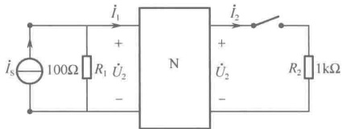

 $$ \left\{\begin{aligned}0.5&=H_{11}\times5\times10^{-3}-H_{12}\times250\\ 0&=H_{21}\times5\times10^{-3}-H_{22}\times250\end{aligned}\right. $$ 

图 16-15 例 16-12 图
 

开关闭合时

代入 H 参数方程得

 $$ \dot{U}_{1}=R_{1}(\dot{I}_{s}-\dot{I}_{1})=0.5\mathrm{V},\quad\dot{I}_{2}=-0.125\mathrm{A} $$ 

 $$ \left\{\begin{aligned}0.5&=H_{11}\times5\times10^{-3}-H_{12}\times125\\ 0.125&=H_{21}\times5\times10^{-3}-H_{22}\times125\end{aligned}\right. $$ 

联立上述方程求解，可得H参数阵为

 $$ \boldsymbol{H}=\begin{bmatrix}100&0&\\ 50&10^{-3}&\end{bmatrix} $$ 

#### 16.2.5 四种参数之间的互换

以上介绍的四种参数方程之间有着密切的关系，由一种形式的参数方程经过一定的代数运算，可以转化为其他形式的参数方程，它们之间可以根据所定义的方程进行换算。

表16-1列出了这四种参数之间的相应关系。

表 16-1 四种参数之间的对应关系
 

<table border="1" style="margin: auto; word-wrap: break-word;"><tr><td style="text-align: center; word-wrap: break-word;"></td><td style="text-align: center; word-wrap: break-word;">Z参数</td><td style="text-align: center; word-wrap: break-word;">Y参数</td><td style="text-align: center; word-wrap: break-word;">T参数</td><td style="text-align: center; word-wrap: break-word;">H参数</td></tr><tr><td style="text-align: center; word-wrap: break-word;">Z参数</td><td style="text-align: center; word-wrap: break-word;">$ Z_{11} $  $ Z_{12} $\n $ Z_{21} $  $ Z_{22} $</td><td style="text-align: center; word-wrap: break-word;">$ \frac{Y_{22}}{\Delta Y} $  $ -\frac{Y_{12}}{\Delta Y} $\n $ -\frac{Y_{21}}{\Delta Y} $  $ \frac{Y_{11}}{\Delta Y} $</td><td style="text-align: center; word-wrap: break-word;">$ \frac{A}{C} $  $ \frac{\Delta T}{C} $\n $ \frac{1}{C} $  $ \frac{D}{C} $</td><td style="text-align: center; word-wrap: break-word;">$ \frac{\Delta H}{H_{22}} $  $ \frac{H_{12}}{H_{22}} $\n $ -\frac{H_{21}}{H_{22}} $  $ \frac{1}{H_{22}} $</td></tr><tr><td style="text-align: center; word-wrap: break-word;">Y参数</td><td style="text-align: center; word-wrap: break-word;">$ \frac{Z_{22}}{\Delta Z} $  $ -\frac{Z_{12}}{\Delta Z} $\n $ -\frac{Z_{21}}{\Delta Z} $  $ \frac{Z_{11}}{\Delta Z} $</td><td style="text-align: center; word-wrap: break-word;">$ Y_{11} $  $ Y_{12} $\n $ Y_{21} $  $ Y_{22} $</td><td style="text-align: center; word-wrap: break-word;">$ \frac{D}{B} $  $ -\frac{\Delta T}{B} $\n $ -\frac{1}{B} $  $ \frac{A}{B} $</td><td style="text-align: center; word-wrap: break-word;">$ \frac{1}{H_{11}} $  $ -\frac{H_{12}}{H_{11}} $\n $ \frac{H_{21}}{H_{11}} $  $ \frac{\Delta H}{H_{11}} $</td></tr><tr><td style="text-align: center; word-wrap: break-word;">T参数</td><td style="text-align: center; word-wrap: break-word;">$ \frac{Z_{11}}{Z_{21}} $  $ \frac{\Delta Z}{Z_{21}} $\n $ \frac{1}{Z_{21}} $  $ \frac{Z_{22}}{Z_{21}} $</td><td style="text-align: center; word-wrap: break-word;">$ -\frac{Y_{22}}{Y_{21}} $  $ -\frac{1}{Y_{21}} $\n $ -\frac{\Delta Y}{Y_{21}} $  $ -\frac{Y_{11}}{Y_{21}} $</td><td style="text-align: center; word-wrap: break-word;">A B\nC D</td><td style="text-align: center; word-wrap: break-word;">$ -\frac{\Delta H}{H_{21}} $  $ -\frac{H_{11}}{H_{21}} $\n $ -\frac{H_{22}}{H_{21}} $  $ -\frac{1}{H_{21}} $</td></tr><tr><td style="text-align: center; word-wrap: break-word;">H参数</td><td style="text-align: center; word-wrap: break-word;">$ \frac{\Delta Z}{Z_{22}} $  $ \frac{Z_{12}}{Z_{22}} $
 $ -\frac{Z_{21}}{Z_{22}} $  $ \frac{1}{Z_{22}} $</td><td style="text-align: center; word-wrap: break-word;">$ \frac{1}{Y_{11}} $  $ -\frac{Y_{12}}{Y_{11}} $
 $ \frac{Y_{21}}{Y_{11}} $  $ \frac{\Delta Y}{Y_{11}} $</td><td style="text-align: center; word-wrap: break-word;">$ \frac{B}{D} $  $ \frac{\Delta T}{D} $
 $ -\frac{1}{D} $  $ \frac{C}{D} $</td><td style="text-align: center; word-wrap: break-word;">$ H_{11} $  $ H_{12} $
 $ H_{21} $  $ H_{22} $</td></tr></table>

<!-- page: 421 -->

续表

注：表中 $ \Delta_{Z}=Z_{11}Z_{22}-Z_{12}Z_{21} $， $ \Delta_{Y}=Y_{11}Y_{22}-Y_{12}Y_{21} $， $ \Delta T=AD-BC $， $ \Delta H=H_{11}H_{22}-H_{12}H_{21} $。

### 16.3 二端口网络的特性阻抗

#### 16.3.1 输入端阻抗与输出端阻抗

如图16-16所示，设网络N的T参数已知，当输出端接负载 $ Z_{L2} $时，输入端阻抗为

 $$ Z_{i1}=\frac{\dot{U}_{1}}{\dot{I}_{1}}=\frac{A\dot{U}_{2}-B\dot{I}_{2}}{C\dot{U}_{2}-D\dot{I}_{2}} $$ 

由于 $ \dot{U}_{2}=-Z_{L2}\dot{I}_{2} $，代入上式得

$$  Z_{i1}=\frac{\dot{U}_{1}}{\dot{I}_{1}}=\frac{AZ_{L2}+B}{CZ_{L2}+D}   \tag*{（16-17）}$$

此式表明，输入端负载 $ Z_{i1} $随着输出端负载 $ Z_{L2} $的变化而变，即二端口网络能进行阻抗变换。

又如图 16-17 所示，设网络 N 的 T 参数已知，当输入端接负载  $ Z_{L1} $ 时，输出端阻抗为

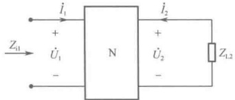

图 16-16 输出端接负载的二端口网络
 

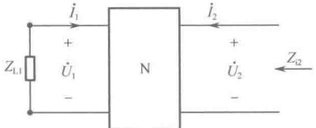

图 16-17 输入端接负载的二端口网络
 

 $$ Z_{i2}=\frac{\dot{U}_{2}}{\dot{I}_{2}}=\frac{D\dot{U}_{1}-B\dot{I}_{1}}{C\dot{U}_{1}-A\dot{I}_{1}} $$ 

由于 $ \dot{U}_{1}=-Z_{L1}\dot{I}_{1} $，代入上式得

$$  Z_{i2}=\frac{\dot{U}_{2}}{\dot{I}_{2}}=\frac{DZ_{L1}+B}{CZ_{L1}+A}   \tag*{（16-18）}$$

此式表明，输出端负载 $ Z_{i2} $随着输入端负载 $ Z_{L1} $的变化而变，即二端口网络能进行阻抗变换。上述两方面的结论说明，二端口网络能进行双向的阻抗变换。

#### 16.3.2 二端口网络的输入端特性阻抗  $ Z_{C1} $ 与输出端特性阻抗  $ Z_{C2} $

已知输出端接负载的二端口网络的输入端阻抗为

 $$ Z_{il}=\frac{AZ_{L2}+B}{CZ_{L2}+D} $$ 

当负载处于两种极端情况，即 $ Z_{L2}=0 $和 $ Z_{L2}=\infty $时，有

$$  \left.\begin{array}{l}Z_{\mathrm{i i}}(0)=\frac{B}{D}\\Z_{\mathrm{i i}}(\infty)=\frac{A}{C}\end{array}\right\}   \tag*{（16-19）}$$

<!-- page: 422 -->

于是定义：二端口网络的输入端特性阻抗 $ Z_{Cl} $等于 $ Z_{il}(0) $和 $ Z_{il}(\infty) $的几何平均值，即

$$  Z_{C1}=\sqrt{Z_{il}(0)Z_{il}(\infty)}=\sqrt{\frac{AB}{CD}}   \tag*{（16-20）}$$

同样，已知输入端接负载的二端口网络的输出端阻抗为

 $$ Z_{i2}=\frac{DZ_{L1}+B}{CZ_{L1}+A} $$ 

当负载处于两种极端情况，即 $ Z_{L1}=0 $和 $ Z_{L1}=\infty $时，有

$$  \left.\begin{aligned}Z_{i2}(0)&=\frac{B}{A}\\ Z_{i2}(\infty)&=\frac{D}{C}\end{aligned}\right\}   \tag*{（16-21）}$$

于是定义：二端口网络的输出端特性阻抗 $ Z_{C2} $等于 $ Z_{i2}(0) $和 $ Z_{i2}(\infty) $的几何平均值，即

$$  Z_{\mathrm{C}2}=\sqrt{Z_{\mathrm{i}2}(0)Z_{\mathrm{i}2}(\infty)}=\sqrt{\frac{DB}{AC}}   \tag*{（16-22）}$$

从以上定义可知， $ Z_{C1} $ 和  $ Z_{C2} $ 只与网络参数有关，而与外电路无关，故称  $ Z_{C1} $ 和  $ Z_{C2} $ 为网络的特性阻抗。

#### 16.3.3 对称二端口网络的特性阻抗  $ Z_{C} $

当二端口网络对称时，T参数中的A=D，此时有

$$  Z_{c1}=Z_{c2}=\sqrt{\frac{B}{C}}\triangleq Z_{c}   \tag*{（16-23）}$$

于是，在对称二端口网络的输出（入）端接上负载  $ Z_{c} $ 时，从输入（出）端看进去的阻抗也等于  $ Z_{c} $，因此，又将  $ Z_{c} $ 称为重复阻抗。此时有

$$  Z_{c}=\sqrt{Z_{i}(0)Z_{i}(\infty)}   \tag*{（16-24）}$$

#### 16.3.4 二端口网络特性阻抗的重要性质

性质 1：当二端口网络的负载阻抗  $ Z_{L2} $ 等于输出端特性阻抗  $ Z_{C2} $ 时，其输入端阻抗  $ Z_{i1} $ 将等于输入端特性阻抗  $ Z_{c1} $。

证明：

 $$ Z_{\mathrm{i l}}=\frac{A Z_{\mathrm{L}2}+B}{C Z_{\mathrm{L}2}+D}=\frac{A Z_{\mathrm{C}2}+B}{C Z_{\mathrm{C}2}+D}=\frac{A\sqrt{\frac{D B}{A C}}+B}{C\sqrt{\frac{D B}{A C}}+D}=\sqrt{\frac{A B}{C D}}=Z_{\mathrm{C l}} $$ 

性质 2：当二端口网络的负载阻抗  $ Z_{L1} $ 等于输入端特性阻抗  $ Z_{C1} $ 时，其输出端阻抗  $ Z_{i2} $ 将等于输出端特性阻抗  $ Z_{C2} $。

证明：

 $$ Z_{\mathrm{i}2}=\frac{DZ_{\mathrm{L}1}+B}{CZ_{\mathrm{L}1}+A}=\frac{DZ_{\mathrm{C}1}+B}{CZ_{\mathrm{C}1}+A}=\frac{D\sqrt{\frac{AB}{CD}}+B}{C\sqrt{\frac{AB}{CD}}+A}=\sqrt{\frac{DB}{CA}}=Z_{\mathrm{C}2} $$ 

性质3：当二端口网络的输入端所接负载阻抗 $ Z_{L1}=Z_{C1} $，并且输出端所接负载阻抗 $ Z_{L2}=Z_{C2} $，则信号通过该网络时能量损失最小，网络的这种工作状态称为“全匹配”。

例 16-13 如图 16-18 所示，已知网络 N 的 T 参数为  $ A=4/3 $，B=1，C=1/3，D=1，并

<!-- page: 423 -->

且  $ R_{2}=1\Omega $， $ R_{1}=Z_{Cl} $（特性阻抗）， $ u_{S}=22\cos\omega t $，求电流  $ i_{3} $

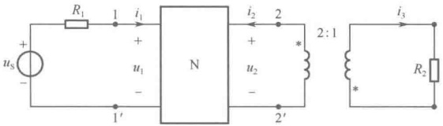

图 16-18 例 16-13 图之一
 

解：先求出从2-2′往左看的戴维宁等效电路。

已知  $ R_{1}=Z_{Cl}=\sqrt{\frac{AB}{CD}}=2\Omega $，根据上述性质2可知

 $$ R_{22^{\prime}}=Z_{C2}=\sqrt{\frac{DB}{CA}}=1.5\Omega $$ 

由 T 参数方程

 $$ \left\{\begin{aligned}u_{1}&=A u_{2}-B i_{2}\\ i_{1}&=C u_{2}-D i_{2}\end{aligned}\right. $$ 

求  $ 2-2' $ 的开路电压  $ u_{22'} $。当  $ 2-2' $ 开路时  $ i_2=0 $，此时  $ u_2=u_{22'} $，即  $ \left\{\begin{aligned}u_1&=Au_{22'}\\ i_1&=Cu_{22'}\end{aligned}\right. $。又知  $ u_1=u_S-R_1i_1 $，于是可得

 $$ u_{22^{\prime}}=\frac{u_{S}}{A+CR_{1}}=11\cos\omega t $$ 

此时电路等效为图16-19所示电路。

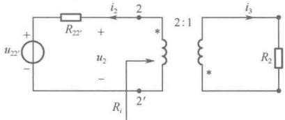

图 16-19 例 16-13 图之二
 

根据理想变压器的特性方程  $ \left\{\begin{array}{l} u_{2}=-nu_{1} \\ i_{3}=ni_{2} \end{array}\right. $

则

 $$ R_{i}=\frac{-u_{2}}{i}=n^{2}\frac{u_{3}}{i_{3}}=n^{2}R_{2} $$ 

所以

 $$ i_{3}=2i_{2}=2\left(-\frac{u_{22^{\prime}}}{R_{22^{\prime}}+R_{i}}\right)=2\left(-\frac{u_{22^{\prime}}}{R_{22^{\prime}}+n^{2}R_{2}}\right)=-4\cos\omega t $$ 

例 16-14 求图 16-20 所示网络的特性阻抗  $ Z_{c} $

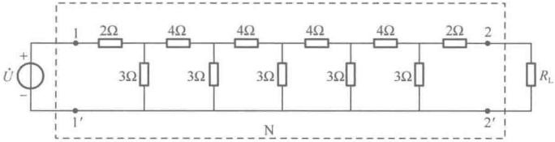

图 16-20 例 16-14 图之一
 

解：该网络是一个对称网络，所以 $ Z_{C1}=Z_{C2}=Z_{C} $，网络中的一个环节如图16-21所示。

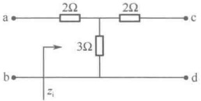

当cd短接时，得 $ Z_{i}(0)=2+\frac{2\times3}{2+3}=\frac{16}{5}\Omega $

图 16-21 例 16-14 图之二
 

当cd开路时，得 $ Z_{i}(\infty)=2+3=5\Omega $

 $$ Z_{\mathrm{c}}=\sqrt{Z_{\mathrm{i}}(0)Z_{\mathrm{i}}(\infty)}=4\Omega $$

<!-- page: 424 -->

根据上述性质可知，整个网络的特性阻抗

 $$ Z_{c}=4\Omega $$ 

### 16.4 二端口网络的等效电路

任意复杂的无源线性一端口网络可用一个等效阻抗来表征其端口特性，同样，对于图16-3所示的任何线性无源二端口网络的端口特性也可以用由特性参数确定的简单电路来等效，下面分别描述用Z参数、Y参数、T参数和H参数表征的二端口网络等效电路。

#### 16.4.1 用 Z 参数表征的二端口等效电路

由Z参数方程

 $$ \left\{\begin{aligned}\dot{U}_{1}&=Z_{11}\dot{I}_{1}+Z_{12}\dot{I}_{2}\\ \dot{U}_{2}&=Z_{21}\dot{I}_{1}+Z_{22}\dot{I}_{2}\end{aligned}\right. $$ 

进行恒等变换

$$  \left.\begin{array}{r}\dot{U}_{1}=(Z_{11}-Z_{12})\dot{I}_{1}+Z_{12}(\dot{I}_{1}+\dot{I}_{2})\\ \dot{U}_{2}=(Z_{21}-Z_{12})\dot{I}_{1}+(Z_{22}-Z_{12})\dot{I}_{2}+Z_{12}(\dot{I}_{1}+\dot{I}_{2})\end{array}\right\}   \tag*{（16-25）}$$

根据式（16-25）描述的端口变量关系，可用图16-22所示的由Z参数确定的简单电路来等效二端口网络。

若二端口网络为互易网络，即 $ Z_{12}=Z_{21} $，则上述二端口网络变为T形，如图16-23所示。

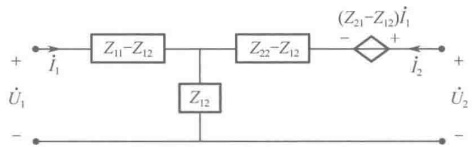

图 16-22 由 Z 参数确定的二端口网络等效电路
 

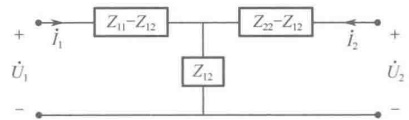

图 16-23 由 Z 参数确定的互易二端口网络等效电路
 

#### 16.4.2 用 Y 参数表征的二端口等效电路

由 Y 参数方程

 $$ \left\{\begin{aligned}\dot{I}_{1}&=Y_{11}\dot{U}_{1}+Y_{12}\dot{U}_{2}\\ \dot{I}_{2}&=Y_{21}\dot{U}_{1}+Y_{22}\dot{U}_{2}\end{aligned}\right. $$ 

进行恒等变换

$$  \left.\begin{array}{r}\dot{I}_{1}=(Y_{11}+Y_{12})\dot{U}_{1}-Y_{12}(\dot{U}_{1}-\dot{U}_{2})\\ \dot{I}_{2}=(Y_{21}-Y_{12})\dot{U}_{1}+(Y_{22}+Y_{12})\dot{U}_{2}+Y_{12}(\dot{U}_{1}-\dot{U}_{2})\end{array}\right\}   \tag*{（16-26）}$$

根据上式描述的端口变量关系，可用图16-24所示的由Y参数确定的简单电路来等效二端口网络。若二端口网络为互易网络，即 $ Y_{1}=Y_{2} $，则上述二端口网络变为 $ \pi $形，如图16-25所示。

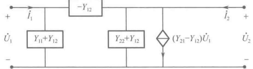

图 16-24 由 Y 参数确定的二端口网络等效电路
 

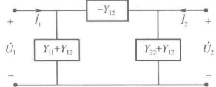

图 16-25 由 Y 参数确定的互易二端口网络等效电路
 

<!-- page: 425 -->

例 16-15 求如图 16-26 所示二端口网络的等效电路。

解：此网络列写节点电压方程较为容易，故列写节点电压方程如下：

 $$ \left\{\begin{aligned}&\left(\frac{1}{10}+\frac{1}{2}+\frac{1}{5}\right)\dot{U}_{1}-\frac{1}{2}\times3\dot{U}_{2}-\frac{1}{5}\dot{U}_{2}=\dot{I}_{1}\\ &\left(\frac{1}{10}+\frac{1}{5}+\frac{1}{5}\right)\dot{U}_{2}-\frac{1}{10}\times3\dot{U}_{2}-\frac{1}{5}\dot{U}_{1}=\dot{I}_{2}\end{aligned}\right. $$ 

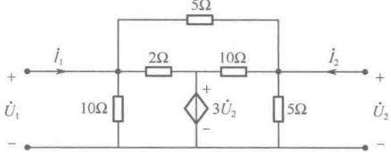

整理得

图 16-26 例 16-15 图之一
 

 $$ \left\{\begin{aligned}0.8\dot{U}_{1}-1.7\dot{U}_{2}&=\dot{I}_{1}\\ -0.2\dot{U}_{1}+0.2\dot{U}_{2}&=\dot{I}_{2}\end{aligned}\right.\quad 即 \quad\boldsymbol{Y}=\begin{bmatrix}0.8&-1.7\\ -0.2&0.2\end{bmatrix} $$ 

看起来，这个二端口网络可以等效为 Y 参数表示的等效电路，如图 16-27 所示。

图中， $ Y_{a}=Y_{11}+Y_{12}=0.8-1.7=-0.9(\mathrm{S}) $， $ Y_{b}=-Y_{12}=1.7(\mathrm{S}) $， $ Y_{c}=Y_{22}+Y_{12}=-1.7+0.2=-1.5(\mathrm{S}) $

注意，等效电路中的导纳出现了负数，这显然与原线性网络的性质不符，故图 16-27 的等效电路不成立。

负数的出现是由受控源造成的，为此将节点电压方程改写如下：

 $$ \begin{cases}0.8\dot{U}_{1}-1.7\dot{U}_{2}=0.8\dot{U}_{1}-0.2\dot{U}_{2}-1.5\dot{U}_{2}=\dot{I}_{1}\\-0.2\dot{U}_{1}+0.2\dot{U}_{2}=\dot{I}_{2}\end{cases} $$ 

即

 $$ \left\{\begin{aligned}&0.8\dot{U}_{1}-0.2\dot{U}_{2}=\dot{I}_{1}+1.5\dot{U}_{2}\\ &-0.2\dot{U}_{1}+0.2\dot{U}_{2}=\dot{I}_{2}\end{aligned}\right.\quad 有 \quad Y=\left[\begin{matrix}0.8&-0.2\\ -0.2&0.2\end{matrix}\right] $$ 

这时应有  $ Y_a = Y_{11} + Y_{12} = 0.8 - 0.2 = 0.6(S) $， $ Y_b = -Y_{12} = 0.2(S) $， $ Y_c = Y_{22} + Y_{12} = -0.2 + 0.2 = 0(S) $，并且上述方程右边的  $ 1.5\dot{U}_2 $ 应视为受控电流源，于是等效电路如图 16-28 所示。

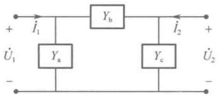

图 16-27 例 16-15 图之二
 

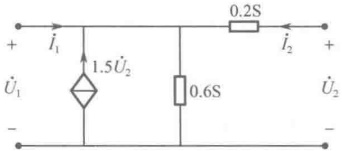

图 16-28 例 16-15 图之三
 

由 T 参数方程

 $$ \left\{\begin{aligned}\dot{U}_{1}&=A\dot{U}_{2}-B\dot{I}_{2}\\ \dot{I}_{1}&=C\dot{U}_{2}-D\dot{I}_{2}\end{aligned}\right. $$ 

进行恒等变换

$$  \left.\begin{aligned}\dot{U}_{1}=&\left(\frac{A}{C}-\frac{\Delta T}{C}\right)\dot{I}_{1}+\frac{\Delta T}{C}(\dot{I}_{1}+\dot{I}_{2})\\ \dot{U}_{2}=&\left(\frac{1}{C}-\frac{\Delta T}{C}\right)\dot{I}_{1}+\left(\frac{D}{C}-\frac{\Delta T}{C}\right)\dot{I}_{2}+\frac{\Delta T}{C}(\dot{I}_{1}+\dot{I}_{2})\end{aligned}\right\}   \tag*{（16-27）}$$

式中， $ \Delta T = AD - BC $，根据式（16-27）描述的端口变量关系，可用图16-29所示的由T参数确定的简单电路来等效二端口网络。

若二端口网络为互易网络，即 $ \Delta T = AD - BC = 1 $，则上述二端口网络变为T形，如图16-30所示。

<!-- page: 426 -->

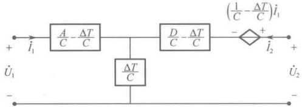

图 16-29 由 T 参数确定的二端口网络等效电路
 

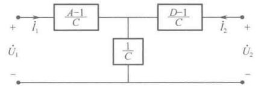

图 16-30 由 T 参数确定的互易二端口网络等效电路
 

#### 16.4.4 用 H 参数表征的二端口等效电路

由H参数方程

 $$ \begin{cases}\dot{U}_{1}=H_{11}\dot{I}_{1}+H_{12}\dot{U}_{2}\\\dot{I}_{2}=H_{21}\dot{I}_{1}+H_{22}\dot{U}_{2}\end{cases} $$ 

进行恒等变换

$$  \left.\begin{aligned}\dot{U}_{1}=&\left(\frac{\Delta H}{H_{22}}-\frac{H_{12}}{H_{22}}\right)\dot{I}_{1}+\frac{H_{12}}{H_{22}}(\dot{I}_{1}+\dot{I}_{2})\\ \dot{U}_{2}=&-\left(\frac{H_{12}+H_{21}}{H_{22}}\right)\dot{I}_{1}+\left(\frac{1-H_{12}}{H_{22}}\right)\dot{I}_{2}+\frac{H_{12}}{H_{22}}(\dot{I}_{1}+\dot{I}_{2})\end{aligned}\right\}   \tag*{（16-28）}$$

式中， $ \Delta H = H_{11}H_{22} - H_{12}H_{21} $，根据式（16-28）描述的端口变量关系，可用图16-31所示的由H参数确定的简单电路来等效二端口网络。

若二端口网络为互易网络，即  $ H_{12} = -H_{21} $，则上述二端口网络等效电路变为 T 形，如图 16-32 所示。

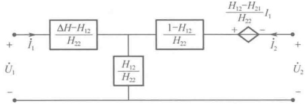

图 16-31 由 H 参数确定的二端口网络等效电路
 

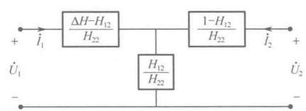

图 16-32 由 H 参数确定的互易二端口网络等效电路
 

### 16.5 二端口网络的联接

在实际应用中，为获得所需要的网络特性，可将若干个二端口网络按照不同的方式连接起来，常见的是二端口的级联、串联和并联。同样，也可以将一个复杂的二端口网络视其连接情况，分解成为若干个简单二端口网络的连接。

#### 16.5.1 二端口网络的级联

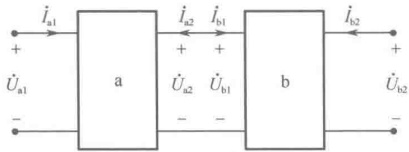

图 16-33 二端口网络的级联
 

a、b 两个二端口网络的级联如图 16-33 所示。

根据前面所定义的特性参数方程可知，对于二端口网络的级联，使用 T 参数来描述较为方便。

已知二端口网络 a 和 b 的 T 参数分别为

 $$ T_{\mathrm{a}}=\begin{bmatrix}A_{\mathrm{a}}&B_{\mathrm{a}}\\ C_{\mathrm{a}}&D_{\mathrm{a}}\end{bmatrix}\quad T_{\mathrm{b}}=\begin{bmatrix}A_{\mathrm{b}}&B_{\mathrm{b}}\\ C_{\mathrm{b}}&D_{\mathrm{b}}\end{bmatrix} $$

<!-- page: 427 -->

由 T 参数方程可得

 $$ \begin{aligned}\left[\begin{array}{c}\dot{U}_{\mathrm{a}1}\\ \dot{I}_{\mathrm{a}1}\end{array}\right]=&\left[\begin{array}{l l}A_{\mathrm{a}}&B_{\mathrm{a}}\\ C_{\mathrm{a}}&D_{\mathrm{a}}\end{array}\right]\left[\begin{array}{c}\dot{U}_{\mathrm{a}2}\\ -\dot{I}_{\mathrm{a}2}\end{array}\right]=\left[\begin{array}{l l}A_{\mathrm{a}}&B_{\mathrm{a}}\\ C_{\mathrm{a}}&D_{\mathrm{a}}\end{array}\right]\left[\begin{array}{l}\dot{U}_{\mathrm{b}1}\\ \dot{I}_{\mathrm{b}1}\end{array}\right]=\left[\begin{array}{l l l}A_{\mathrm{a}}&B_{\mathrm{a}}\\ C_{\mathrm{a}}&D_{\mathrm{a}}\end{array}\right]\left[\begin{array}{l l}A_{\mathrm{b}}&B_{\mathrm{b}}\\ C_{\mathrm{b}}&D_{\mathrm{b}}\end{array}\right]\left[\begin{array}{c}\dot{U}_{\mathrm{b}2}\\ -\dot{I}_{\mathrm{b}2}\end{array}\right]=T_{\mathrm{a}}T_{\mathrm{b}}\left[\begin{array}{c}\dot{U}_{\mathrm{b}2}\\ -\dot{I}_{\mathrm{b}2}\end{array}\right]\end{aligned} $$ 

由此推广可得结论：n个二端口网络级联后，总的T参数矩阵等于各子网络的T参数矩阵的乘积，即

$$  T=T_{1}\cdot T_{2}\cdot\cdots\cdot T_{n}   \tag*{（16-29）}$$

例 16-16 图 16-34 所示为 RC 移项电路，求其电压传输系数  $ K = \dot{U}_{2} / \dot{U}_{1} $。

解：此网络可视为三节 RC 的级联，如图 16-35 所示为其中的一节 RC 电路。

先求得一节 RC 电路的 T 参数，由 T 参数定义可得

 $$ \begin{aligned}A=\frac{\dot{U}_{1}}{\dot{U}_{2}}\mid_{i_{2}=0}=1+\frac{1}{\mathrm{j}\omega RC},\quad&B=\frac{\dot{U}_{1}}{-\dot{I}_{2}}\mid_{U_{2}=0}=\frac{1}{\mathrm{j}\omega C},\\C=\frac{\dot{I}_{1}}{\dot{U}_{2}}\mid_{i_{2}=0}=\frac{1}{R},\quad&D=\frac{\dot{I}_{1}}{-\dot{I}_{2}}\mid_{U_{2}=0}=1\end{aligned} $$ 

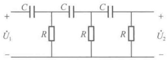

图 16-34 例 16-16 图之一
 

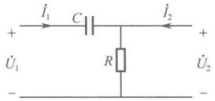

图 16-35 例 16-16 图之二
 

因为三个 RC 环节完全一样，所以三节 RC 电路级联后，总的 T 参数为

 $$ \begin{aligned}&\begin{bmatrix}\boldsymbol{A}_{\Sigma}&\boldsymbol{B}_{\Sigma}\\ \boldsymbol{C}_{\Sigma}&\boldsymbol{D}_{\Sigma}\end{bmatrix}=\begin{bmatrix}\boldsymbol{A}&\boldsymbol{B}\\ \boldsymbol{C}&\boldsymbol{D}\end{bmatrix}\begin{bmatrix}\boldsymbol{A}&\boldsymbol{B}\\ \boldsymbol{C}&\boldsymbol{D}\end{bmatrix}\begin{bmatrix}\boldsymbol{A}&\boldsymbol{B}\\ \boldsymbol{C}&\boldsymbol{D}\end{bmatrix}\\ &=\begin{bmatrix}\boldsymbol{A}^{3}+2\boldsymbol{A}\boldsymbol{B}\boldsymbol{C}+\boldsymbol{B}\boldsymbol{C}\boldsymbol{D}&\boldsymbol{A}^{2}\boldsymbol{B}+\boldsymbol{B}^{2}\boldsymbol{C}+\boldsymbol{A}\boldsymbol{B}\boldsymbol{D}+\boldsymbol{D}^{2}\boldsymbol{B}\\ \boldsymbol{A}^{2}\boldsymbol{C}+\boldsymbol{A}\boldsymbol{C}\boldsymbol{D}+\boldsymbol{C}^{2}\boldsymbol{B}+\boldsymbol{D}^{2}\boldsymbol{C}&\boldsymbol{A}\boldsymbol{B}\boldsymbol{C}+2\boldsymbol{C}\boldsymbol{D}\boldsymbol{B}+\boldsymbol{D}^{3}\end{bmatrix}\\ \end{aligned} $$ 

电压传输系数为

 $$ K=\frac{\dot{U}_{2}}{\dot{U}_{1}}\mid_{i_{2}=0}=\frac{1}{A_{\Sigma}}=\frac{1}{A^{3}+2ABC+BCD}=\frac{1}{\left[1-5\left(\frac{1}{\omega RC}\right)^{2}\right]+\mathrm{j}\left[\left(\frac{1}{\omega RC}\right)^{3}-\frac{6}{\omega RC}\right]} $$ 

例 16-17 求如图 16-36 所示二端口网络的转移阻抗  $ \dot{U}_{2}/\dot{I}_{1} $。

解：此网络可视为四节单元电路的级联，如图16-37所示。

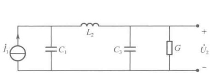

图 16-36 例 16-17 图之一
 

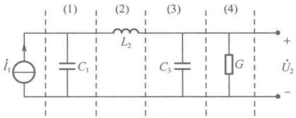

图 16-37 例 16-17 图之二
 

第（1）单元： $ T_{1}=\begin{bmatrix}1&0\\ j\omega C_{1}&1\end{bmatrix} $

第（2）单元： $ T_{2}=\begin{bmatrix}1&j\omega L_{2}\\ 0&1\end{bmatrix} $

第（3）单元： $ T_{3}=\begin{bmatrix}1&0\\ j\omega C_{3}&1\end{bmatrix} $

第（4）单元： $ T_{4}=\begin{bmatrix}1&0\\ G&1\end{bmatrix} $

<!-- page: 428 -->

故总的T参数为

 $$ \begin{aligned}&T=T_{1}\cdot T_{2}\cdot T_{3}\cdot T_{4}=\begin{bmatrix}1&0\\ \mathbf{j}\omega C_{1}&1\end{bmatrix}\begin{bmatrix}1&\mathbf{j}\omega L_{2}\\ 0&1\end{bmatrix}\begin{bmatrix}1&0\\ \mathbf{j}\omega C_{3}&1\end{bmatrix}\begin{bmatrix}1&0\\ G&1\end{bmatrix}\\ &=\begin{bmatrix}1-\omega^{2}L_{2}C_{3}+\mathbf{j}\omega L_{2}G&\mathbf{j}\omega L_{2}\\ G(1-\omega^{2}C_{1}L_{2})+\mathbf{j}\omega(C_{1}+C_{3}-\omega^{2}C_{1}C_{3}L_{2})&1-\omega^{2}C_{1}L_{2}\end{bmatrix}\\ &\quad\frac{\dot{U}_{2}}{\dot{I}_{1}}\mid_{i_{2}=0}=\frac{1}{C}=\frac{1}{G(1-\omega^{2}C_{1}L_{2})+\mathbf{j}\omega(C_{1}+C_{3}-\omega^{2}C_{1}C_{3}L_{2})}\\ \end{aligned} $$ 

则转移阻抗

例 16-18 求如图 16-38 所示二端口网络的 T 参数。

解：此网络可视为三节单元电路的级联，如图16-39所示。

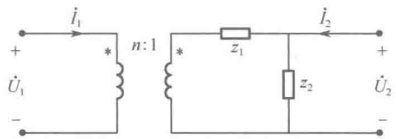

图 16-38 例 16-18 图之一
 

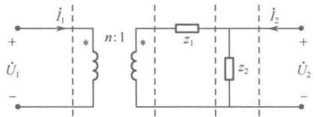

图 16-39 例 16-18 图之二
 

第（1）单元： $ T_{1}=\begin{bmatrix}n&0\\ 0&\frac{1}{n}\end{bmatrix} $，第（2）单元： $ T_{2}=\begin{bmatrix}1&z_{1}\\ 0&1\end{bmatrix} $，第（3）单元： $ T_{3}=\begin{bmatrix}1&0\\ \frac{1}{z_{2}}&1\end{bmatrix} $

故总的T参数为

 $$ T=T_{1}\cdot T_{2}\cdot T_{3}=\begin{bmatrix}{{{n}}}&{{{0}}} \\{{{0}}}&{{{\frac{1}{n}}}}\end{bmatrix}\begin{bmatrix}{{{1}}}&{{{z_{1}}}} \\{{{0}}}&{{{1}}}\end{bmatrix}\begin{bmatrix}{{{1}}}&{{{0}}} \\{{{\frac{1}{z_{2}}}}}&{{{1}}}\end{bmatrix}=\begin{bmatrix}{{{n+\frac{nz_{1}}{z_{2}}}}}&{{{nz_{1}}}} \\{{{\frac{1}{nz_{2}}}}}&{{{\frac{1}{n}}}}\end{bmatrix} $$ 

#### 16.5.2 二端口网络的并联

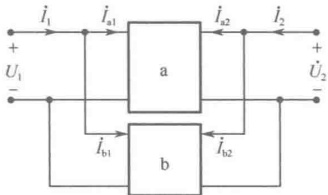

a、b 两个二端口网络的并联如图 16-40 所示。

根据前面所定义的特性参数方程可知，对于二端口网络的并联，使用 Y 参数来描述较为方便。

已知二端口网络 a 和 b 的 Y 参数分别为

图 16-40 二端口网络的并联
 

 $$ Y_{\mathrm{a}}=\begin{bmatrix}Y_{11\mathrm{a}}&Y_{12\mathrm{a}}\\ Y_{21\mathrm{a}}&Y_{22\mathrm{a}}\end{bmatrix},\quad Y_{\mathrm{b}}=\begin{bmatrix}Y_{11\mathrm{b}}&Y_{12\mathrm{b}}\\ Y_{21\mathrm{b}}&Y_{22\mathrm{b}}\end{bmatrix} $$ 

由 Y 参数方程可得

 $$ \begin{aligned}\begin{bmatrix}\dot{I}_{1}\\\dot{I}_{2}\end{bmatrix}=&\begin{bmatrix}\dot{I}_{\mathrm{a}1}+\dot{I}_{\mathrm{b}1}\\\dot{I}_{\mathrm{a}2}+\dot{I}_{\mathrm{b}2}\end{bmatrix}=\begin{bmatrix}\dot{I}_{\mathrm{a}1}\\\dot{I}_{\mathrm{a}2}\end{bmatrix}+\begin{bmatrix}\dot{I}_{\mathrm{b}1}\\\dot{I}_{\mathrm{b}2}\end{bmatrix}=\begin{bmatrix}Y_{11\mathrm{a}}&Y_{12\mathrm{a}}\\Y_{21\mathrm{a}}&Y_{22\mathrm{a}}\end{bmatrix}\begin{bmatrix}\dot{U}_{1}\\\dot{U}_{2}\end{bmatrix}+\begin{bmatrix}Y_{11\mathrm{b}}&Y_{12\mathrm{b}}\\Y_{21\mathrm{b}}&Y_{22\mathrm{b}}\end{bmatrix}\begin{bmatrix}\dot{U}_{1}\\\dot{U}_{2}\end{bmatrix}=(Y_{\mathrm{a}}+Y_{\mathrm{b}})\begin{bmatrix}\dot{U}_{1}\\\dot{U}_{2}\end{bmatrix}\end{aligned} $$ 

由此推广可得结论：n个二端口网络并联后，总的Y参数矩阵等于各子网络的Y参数矩阵之和：

 $$ Y=Y_{1}+Y_{2}+\cdots+Y_{n} $$ 

例 16-19 求如图 16-41 所示二端口网络的 Y 参数。

解：此网络可视为两个单元电路的并联，如图16-42所示。

<!-- page: 429 -->

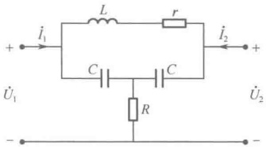

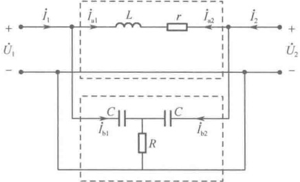

图 16-41 例 16-19 图之一
 

图 16-42 例 16-19 图之二
 

根据 Y 参数的定义，网络 a 的 Y 参数为

 $$ \left\{\begin{aligned}Y_{11a}=&\frac{\dot{I}_{\mathrm{a}1}}{\dot{U}_{1}}\mid_{\dot{U}_{2}=0}=\frac{1}{r+\mathrm{j}\omega L}\\ Y_{21a}=&\frac{\dot{I}_{\mathrm{a}2}}{\dot{U}_{1}}\mid_{\dot{U}_{2}=0}=-\frac{1}{r+\mathrm{j}\omega L}\end{aligned}\right.\quad\begin{aligned}Y_{12a}=&\frac{\dot{I}_{\mathrm{a}1}}{\dot{U}_{2}}\mid_{\dot{U}_{1}=0}=-\frac{1}{r+\mathrm{j}\omega L}\\ Y_{22a}=&\frac{\dot{I}_{\mathrm{a}2}}{\dot{U}_{2}}\mid_{\dot{U}_{1}=0}=\frac{1}{r+\mathrm{j}\omega L}\end{aligned} $$ 

根据 Y 参数的定义，网络 b 的 Y 参数为

 $$ \left\{\begin{aligned}Y_{11\mathrm{b}}=&\frac{\dot{I}_{\mathrm{b}1}}{\dot{U}_{1}}\mid_{\dot{U}_{2}=0}=\frac{\mathrm{j}\omega C-R\omega^{2}C^{2}}{1+\mathrm{j}2\omega RC}&\quad Y_{12\mathrm{b}}=&\frac{\dot{I}_{\mathrm{b}1}}{\dot{U}_{2}}\mid_{\dot{U}_{1}=0}=\frac{R\omega^{2}C^{2}}{1+\mathrm{j}2\omega RC}\\ Y_{21\mathrm{b}}=&\frac{\dot{I}_{\mathrm{b}2}}{\dot{U}_{1}}\mid_{\dot{U}_{2}=0}=\frac{R\omega^{2}C^{2}}{1+\mathrm{j}2\omega RC}&\quad Y_{22\mathrm{b}}=&\frac{\dot{I}_{\mathrm{b}2}}{\dot{U}_{2}}\mid_{\dot{U}_{1}=0}=\frac{\mathrm{j}\omega C-R\omega^{2}C^{2}}{1+\mathrm{j}2\omega RC}\end{aligned}\right. $$ 

故总的Y参数为

 $$ Y=Y_{\mathrm{a}}+Y_{\mathrm{b}}=\left[\begin{aligned}\frac{1}{r+\mathrm{j}\omega L}+\frac{\mathrm{j}\omega C-R\omega^{2}C^{2}}{1+\mathrm{j}2\omega RC}&\quad-\frac{1}{r+\mathrm{j}\omega L}+\frac{R\omega^{2}C^{2}}{1+\mathrm{j}2\omega RC}\\ -\frac{1}{r+\mathrm{j}\omega L}+\frac{R\omega^{2}C^{2}}{1+\mathrm{j}2\omega RC}&\quad\frac{1}{r+\mathrm{j}\omega L}+\frac{\mathrm{j}\omega C-R\omega^{2}C^{2}}{1+\mathrm{j}2\omega RC}\end{aligned}\right] $$ 

#### 16.5.3 二端口网络的串联

a、b 两个二端口网络的串联如图 16-43 所示。

根据前面所定义的特性参数方程可知，对于二端口网络的串联，使用 Z 参数来描述较为方便。

已知二端口网络 a 和 b 的 Z 参数分别为

 $$ Z_{\mathrm{a}}=\begin{bmatrix}Z_{11\mathrm{a}}&Z_{12\mathrm{a}}\\ Z_{21\mathrm{a}}&Z_{22\mathrm{a}}\end{bmatrix},\qquad Z_{\mathrm{b}}=\begin{bmatrix}Z_{11\mathrm{b}}&Z_{12\mathrm{b}}\\ Z_{21\mathrm{b}}&Z_{22\mathrm{b}}\end{bmatrix} $$ 

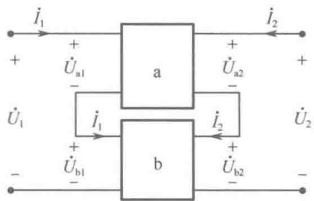

图 16-43 二端口网络的串联
 

由 Z 参数方程可得

 $$ \begin{aligned}\begin{bmatrix}\dot{U}_{1}\\\dot{U}_{2}\end{bmatrix}=&\begin{bmatrix}\dot{U}_{\mathrm{a}1}+\dot{U}_{\mathrm{b}1}\\\dot{U}_{\mathrm{a}2}+\dot{U}_{\mathrm{b}2}\end{bmatrix}=\begin{bmatrix}\dot{U}_{\mathrm{a}1}\\\dot{U}_{\mathrm{a}2}\end{bmatrix}+\begin{bmatrix}\dot{U}_{\mathrm{b}1}\\\dot{U}_{\mathrm{b}2}\end{bmatrix}=\begin{bmatrix}Z_{11\mathrm{a}}&Z_{12\mathrm{a}}\\Z_{21\mathrm{a}}&Z_{22\mathrm{a}}\end{bmatrix}\begin{bmatrix}\dot{I}_{1}\\\dot{I}_{2}\end{bmatrix}+\begin{bmatrix}Z_{11\mathrm{b}}&Z_{12\mathrm{b}}\\Z_{21\mathrm{b}}&Z_{22\mathrm{b}}\end{bmatrix}\begin{bmatrix}\dot{I}_{1}\\\dot{I}_{2}\end{bmatrix}=(Z_{\mathrm{a}}+Z_{\mathrm{b}})\begin{bmatrix}\dot{I}_{1}\\\dot{I}_{2}\end{bmatrix}\end{aligned} $$ 

由此推广可得结论：n个二端口网络串联后，总的Z参数矩阵等于各子网络的Z参数矩阵之和：

$$  Z=Z_{1}+Z_{2}+\cdots+Z_{n}   \tag*{（16-31）}$$

例 16-20 求如图 16-44 所示二端口网络的 Z 参数。

解：此网络可视为两个单元电路的串联，如图16-45所示。

<!-- page: 430 -->

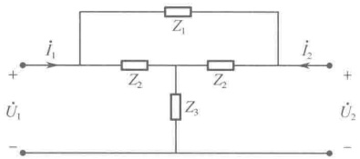

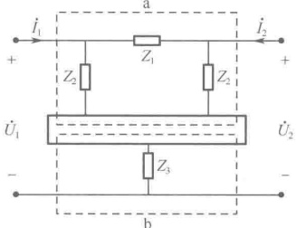

图 16-44 例 16-20 图之一
 

图 16-45 例 16-20 图之二
 

可求得

 $$ \boldsymbol{Z}_{\mathrm{a}}=\left[\begin{matrix}{\displaystyle\frac{Z_{2}\left(Z_{1}+Z_{2}\right)}{2Z_{2}+Z_{1}}}&{\displaystyle\frac{Z_{2}^{2}}{2Z_{2}+Z_{1}}}\\ {\displaystyle\frac{Z_{2}^{2}}{2Z_{2}+Z_{1}}}&{\displaystyle\frac{Z_{2}\left(Z_{1}+Z_{2}\right)}{2Z_{2}+Z_{1}}}\\ \end{matrix}\right],\quad\boldsymbol{Z}_{\mathrm{b}}=\left[\begin{matrix}{Z_{3}}&{Z_{3}}\\ {Z_{3}}&{Z_{3}}\\ \end{matrix}\right] $$ 

故总的Z参数为

 $$ \boldsymbol{Z}=\boldsymbol{Z}_{\mathrm{a}}+\boldsymbol{Z}_{\mathrm{b}}=\left[\begin{aligned}&\frac{\boldsymbol{Z}_{2}\left(\boldsymbol{Z}_{1}+\boldsymbol{Z}_{2}\right)}{2\boldsymbol{Z}_{2}+\boldsymbol{Z}_{1}}+\boldsymbol{Z}_{3}&\quad\frac{\boldsymbol{Z}_{2}^{2}}{2\boldsymbol{Z}_{2}+\boldsymbol{Z}_{1}}+\boldsymbol{Z}_{3}\\&\frac{\boldsymbol{Z}_{2}^{2}}{2\boldsymbol{Z}_{2}+\boldsymbol{Z}_{1}}+\boldsymbol{Z}_{3}&\quad\frac{\boldsymbol{Z}_{2}\left(\boldsymbol{Z}_{1}+\boldsymbol{Z}_{2}\right)}{2\boldsymbol{Z}_{2}+\boldsymbol{Z}_{1}}+\boldsymbol{Z}_{3}\end{aligned}\right] $$ 

### 16.6 二端口网络的网络函数

二端口网络常常工作在输入端口接电源、输出端口接负载的情况下，研究这一类问题相当于研究二端口的网络函数。对于图16-3所示的线性松弛二端口网络，在零状态下，可将网络函数变成复变数s的函数，即二端口网络的网络函数可以用拉普拉斯变换的输出与输入之比表示。

当二端口网络无外接负载，并且网络的激励源无内阻时，网络函数可以用该二端口的Y参数、Z参数、T参数或H参数来表示。也就是说，若考虑网络负载和激励源内阻，则网络函数不仅与二端口参数有关，还与负载及内阻有关。

二端口网络无外接负载，并且网络的激励源无内阻时，称其为无端接二端口网络；否则，称为有端接二端口网络。

#### 16.6.1 无端接二端口网络的转移函数

无端接二端口网络有四种转移函数：电压转移函数  $ U_{2}(s)/U_{1}(s) $，电流转移函数  $ I_{2}(s)/I_{1}(s) $，转移阻抗  $ U_{2}(s)/I_{1}(s) $，转移导纳  $ I_{2}(s)/U_{1}(s) $。这四种函数均为输出端开路或短路情况下输出端口量与输入端口量之比，故称为转移函数，下面分别对这几种转移函数进行讨论。

# 1. 电压转移函数  $ U_{2}(s)/U_{1}(s) $

已知 Z 参数定义方程为

 $$ \left\{\begin{aligned}U_{1}(s)&=Z_{11}(s)I_{1}(s)+Z_{12}(s)I_{2}(s)\\ U_{2}(s)&=Z_{21}(s)I_{1}(s)+Z_{22}(s)I_{2}(s)\end{aligned}\right. $$ 

令 $ I_{2}(s)=0 $（输出端开路），可得开路电压转移函数

<!-- page: 431 -->

$$  \frac{U_{2}(s)}{U_{1}(s)}=\frac{Z_{21}(s)}{Z_{11}(s)}   \tag*{（16-32）}$$

由于 Z 参数可用 Y 参数表示为（见表 16-1）

 $$ Z_{11}(s)=\frac{Y_{22}(s)}{\Delta Y}\;,\quad Z_{21}(s)=-\frac{Y_{21}(s)}{\Delta Y} $$ 

因此，电压转移函数可用 Y 参数表示为

$$  \frac{U_{2}(s)}{U_{1}(s)}=-\frac{Y_{21}(s)}{Y_{22}(s)}   \tag*{（16-33）}$$

由于 Z 参数可用 T 参数表示为（见表 16-1）

 $$ Z_{11}(s)=\frac{A(s)}{C(s)},\qquad Z_{21}(s)=\frac{1}{C(s)} $$ 

因此，电压转移函数可用 T 参数表示为

$$  \frac{U_{2}(s)}{U_{1}(s)}=\frac{1}{A(s)}   \tag*{（16-34）}$$

由于 Z 参数可用 H 参数表示为（见表 16-1）

 $$ Z_{11}(s)=\frac{\Delta H}{H_{22}(s)},\qquad Z_{21}(s)=-\frac{H_{21}(s)}{H_{22}(s)} $$ 

因此，电压转移函数可用H参数表示为

$$  \frac{U_{2}(s)}{U_{1}(s)}=-\frac{H_{21}(s)}{\Delta H}   \tag*{（16-35）}$$

# 2. 电流转移函数  $ I_{2}(s)/I_{1}(s) $

已知 Y 参数定义方程为

 $$ \left\{\begin{aligned}I_{1}(s)&=Y_{11}(s)U_{1}(s)+Y_{12}(s)U_{2}(s)\\ I_{2}(s)&=Y_{21}(s)U_{1}(s)+Y_{22}(s)U_{2}(s)\end{aligned}\right. $$ 

令 $ U_{2}(s)=0 $（输出端短路），可得短路电流转移函数

$$  \frac{I_{2}(s)}{I_{1}(s)}=\frac{Y_{21}(s)}{Y_{11}(s)}   \tag*{（16-36）}$$

同样，可以用 Z 参数、T 参数和 H 参数来表示电流转移函数，即

$$  \frac{I_{2}(s)}{I_{1}(s)}=-\frac{Z_{21}(s)}{Z_{22}(s)}=-\frac{1}{D(s)}=H_{21}(s)   \tag*{（16-37）}$$

# 3. 转移阻抗  $ U_{2}(s)/I_{1}(s) $

在 Z 参数方程中令  $ I_{2}(s)=0 $ （输出端开路），可得转移阻抗为

$$  \frac{U_{2}(s)}{I_{1}(s)}=Z_{21}(s)=-\frac{Y_{21}(s)}{\Delta Y}=-\frac{1}{C(s)}=-\frac{H_{21}(s)}{H_{22}(s)}   \tag*{（16-38）}$$

# 4. 转移导纳  $ I_{2}(s)/U_{1}(s) $

在 Y 参数方程中令  $ U_{2}(s)=0 $ （输出端短路），可得转移导纳为

$$  \frac{I_{2}(s)}{U_{1}(s)}=Y_{21}(s)=-\frac{Z_{21}(s)}{\Delta z}=-\frac{1}{B(s)}=\frac{H_{21}(s)}{H_{11}(s)}   \tag*{（16-39）}$$

#### 16.6.2 有端接二端口网络的转移函数

有端接二端口网络如图 16-46 所示。

<!-- page: 432 -->

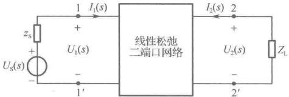

由 Y 参数方程

 $$ \left\{\begin{aligned}I_{1}(s)&=Y_{11}(s)U_{1}(s)+Y_{12}(s)U_{2}(s)\\ I_{2}(s)&=Y_{21}(s)U_{1}(s)+Y_{22}(s)U_{2}(s)\end{aligned}\right. $$ 

图 16-46 有端接二端口网络
 

1. 先只考虑输出端接负载  $ Z_{L} $ 的情况（单端接）将  $ U_{2}(s) = -Z_{L}I_{2}(s) $ 代入 Y 参数方程，可得

电压转移函数

$$  \frac{U_{2}(s)}{U_{1}(s)}=-\frac{Y_{21}(s)}{Y_{22}(s)+Y_{L}}\qquad(Y_{L}=\frac{1}{Z_{L}})   \tag*{（16-40）}$$

电流转移函数

$$  \frac{I_{2}(s)}{I_{1}(s)}=\frac{Y_{21}(s)}{Y_{11}(s)+Z_{L}\Delta Y}   \tag*{（16-41）}$$

转移阻抗

$$  \frac{U_{2}(s)}{I_{1}(s)}=-\frac{Z_{\mathrm{L}}Y_{21}(s)}{Y_{11}(s)+Z_{\mathrm{L}}\Delta Y}   \tag*{（16-42）}$$

转移导纳

$$  \frac{I_{2}(s)}{U_{1}(s)}=\frac{Y_{21}(s)}{1+Z_{L}Y_{22}(s)}   \tag*{（16-43）}$$

# 2. 考虑两端接的情况（双端接）

从图16-46可知

 $$ \begin{cases}U_{1}(s)=U_{\mathrm{S}}(s)-Z_{\mathrm{S}}(s)I_{1}(s)\\U_{2}(s)=-Z_{\mathrm{L}}(s)I_{2}(s)\end{cases} $$ 

即有端接二端口网络的电压转移函数为

$$  \begin{aligned}\frac{U_{2}(s)}{U_{\mathrm{S}}(s)}&=\frac{U_{2}(s)}{U_{1}(s)}\cdot\frac{U_{1}(s)}{U_{\mathrm{S}}(s)}=\frac{U_{2}(s)}{U_{1}(s)}\cdot\frac{U_{1}(s)}{U_{1}(s)+Z_{\mathrm{S}}(s)I_{1}(s)}=\frac{U_{2}(s)}{U_{1}(s)}\cdot\frac{1}{1+Z_{\mathrm{S}}(s)\frac{I_{1}(s)}{U_{1}(s)}}\\&=\frac{U_{2}(s)}{U_{1}(s)}\cdot\frac{1}{1+Z_{\mathrm{S}}(s)\frac{I_{1}(s)}{I_{2}(s)}\frac{I_{2}(s)}{U_{1}(s)}}\end{aligned}   \tag*{（16-44）}$$

将单端接情况中的 $ \frac{U_{2}(s)}{U_{1}(s)} $、 $ \frac{I_{2}(s)}{I_{1}(s)} $、 $ \frac{I_{2}(s)}{U_{1}(s)} $代入式（16-44）可得

$$  \frac{U_{2}(s)}{U_{\mathrm{S}}(s)}=\frac{-Y_{21}(s)Y_{\mathrm{S}}(s)}{[Y_{11}(s)+Y_{\mathrm{S}}(s)][Y_{22}(s)+Y_{\mathrm{L}}(s)]-Y_{12}(s)Y_{21}(s)}   \tag*{（16-45）}$$

同理，可得有端接二端口网络的电流转移函数为

 $$ \frac{I_{2}(s)}{I_{\mathrm{S}}(s)}=\frac{I_{2}(s)}{U_{\mathrm{S}}(s)/Z_{\mathrm{S}}}=Z_{\mathrm{S}}(s)\frac{I_{2}(s)}{U_{\mathrm{S}}(s)}=-\frac{Z_{\mathrm{S}}(s)}{Z_{\mathrm{L}}(s)}\cdot\frac{-Z_{\mathrm{L}}(s)I_{2}(s)}{U_{\mathrm{S}}(s)}=-\frac{Z_{\mathrm{S}}(s)}{Z_{\mathrm{L}}(s)}\frac{U_{2}(s)}{U_{\mathrm{S}}(s)} $$ 

将式（16-45）代入，得

$$  \frac{I_{2}(s)}{I_{S}(s)}=-\frac{Z_{S}(s)}{Z_{L}(s)}\frac{U_{2}(s)}{U_{S}(s)}=\frac{Y_{21}(s)Y_{L}(s)}{[Y_{11}(s)+Y_{S}(s)][Y_{22}(s)+Y_{L}(s)]-Y_{12}(s)Y_{21}(s)}   \tag*{（16-46）}$$

有端接二端口网络的转移阻抗为

$$  \begin{aligned}\frac{U_{2}(s)}{I_{s}(s)}=&\frac{U_{2}(s)}{U_{s}(s)}\cdot\frac{U_{s}(s)}{I_{s}(s)}=\frac{1}{Y_{s}(s)}\cdot\frac{U_{2}(s)}{U_{s}(s)}\\=&\frac{-Y_{21}(s)}{[Y_{11}(s)+Y_{s}(s)][Y_{22}(s)+Y_{L}(s)]-Y_{12}(s)Y_{21}(s)}\end{aligned}   \tag*{（16-47）}$$

有端接二端口网络的转移导纳为

<!-- page: 433 -->

$$  \begin{aligned}\frac{I_{2}(s)}{U_{S}(s)}=&\frac{I_{S}(s)}{U_{S}(s)}\cdot\frac{I_{2}(s)}{I_{S}(s)}=Y_{S}(s)\cdot\frac{I_{2}(s)}{I_{S}(s)}\\=&\frac{Y_{21}(s)Y_{L}(s)Y_{S}(s)}{[Y_{11}(s)+Y_{S}(s)][Y_{22}(s)+Y_{L}(s)]-Y_{12}(s)Y_{21}(s)}\end{aligned}   \tag*{（16-48）}$$

例 16-21 图 16-47 所示，已知  $ R_1 = 500\Omega $， $ R_2 = 5k\Omega $， $ i_S = \sqrt{2}\cos1000t $，二端口网络 N 的 Z 参数为  $ Z = \begin{bmatrix} 100 & -500 \\ 10^3 & 10^4 \end{bmatrix} $，求电压  $ u_2(t) $。

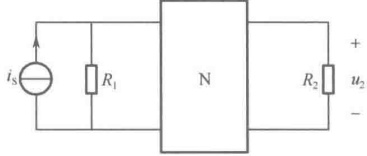

解：已知有端接的转移阻抗为

图 16-47 例 16-21 图
 

 $$ \frac{U_{2}(s)}{I_{S}(s)}=\frac{-Y_{21}(s)}{[Y_{11}(s)+Y_{S}(s)][Y_{22}(s)+Y_{L}(s)]-Y_{12}(s)Y_{21}(s)}~,~~Y_{L}(s)=\frac{1}{R_{2}}~,~~Y_{S}(s)=\frac{1}{R_{1}} $$ 

由表16-1，可将上式中的Y参数转换成Z参数，即

已知

 $$ \frac{U_{2}(s)}{I_{\mathrm{S}}(s)}=\frac{Z_{21}}{1+Z_{11}Y_{\mathrm{S}}+Z_{22}Y_{\mathrm{L}}+Y_{\mathrm{S}}Y_{\mathrm{L}}\Delta Z} $$ 

 $$ \Delta\mathrm{Z}=\mathrm{Z}_{11}\mathrm{Z}_{22}-\mathrm{Z}_{12}\mathrm{Z}_{21}=15\times10^{5} $$ 

所以

 $$ \frac{U_{2}(s)}{I_{\mathrm{s}}(s)}=\frac{Z_{21}}{1+Z_{11}Y_{\mathrm{s}}+Z_{22}Y_{\mathrm{L}}+Y_{\mathrm{s}}Y_{\mathrm{L}}\Delta Z}=\frac{1000}{1+1\times\frac{1}{5}+10\times\frac{1}{5}+\frac{15}{25}}=263 $$ 

即

 $$ U_{2}(s)=263I_{s}(s) $$ 

两端取拉普拉斯逆变换得

 $$ u_{2}(t)=263i_{s}(t)=263\sqrt{2}\cos1000t $$ 

例 16-22 图 16-48 所示，已知二端口网络 N 的 T 参数为  $ T = \begin{bmatrix} 0.5 & 25 \\ 0.02 & 1 \end{bmatrix} $，问  $ Z_L $ 为何值时可获得最大功率？

解：设从输出端往左看的阻抗为  $ Z_0 $，先考虑无端接的情况。此时

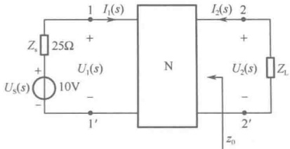

图 16-48 例 16-22 图
 

即

 $$ \begin{aligned}\frac{U_{2}(s)}{U_{1}(s)}\mid_{I_{2}=0}=&\frac{1}{A},\quad\frac{I_{2}(s)}{I_{1}(s)}\mid_{U_{2}=0}=-\frac{1}{D}\\&\left\{\begin{aligned}U_{2}(s)=&\frac{1}{A}U_{1}(s)\\I_{2}(s)=&-\frac{1}{D}I_{1}(s)\end{aligned}\right.\end{aligned} $$ 

可得

 $$ \frac{U_{2}(s)}{I_{2}(s)}=\frac{D}{A}\cdot\frac{U_{1}(s)}{-I_{1}(s)} $$ 

根据戴维宁定理，求 $ Z_{0} $时应将10V电压源短接，则有

 $$ \frac{U_{2}(s)}{I_{2}(s)}=\frac{D}{A}\cdot\frac{U_{1}(s)}{-I_{1}(s)}=\frac{D}{A}\cdot Z_{s}=\frac{1}{0.5}\times25=50\Omega $$ 

所以，当 $ Z_{L}=Z_{0}=50\Omega $时可获得最大功率。

例 16-23 如图 16-49 所示，已知  $ R = 5\Omega $， $ C = 0.01F $， $ U_S = 10V $，松弛二端口网络 N 的 T 参数为  $ T = \begin{bmatrix} 2 & 10 \\ 0.1 & 1 \end{bmatrix} $， $ t < 0 $ 时电路处于稳态， $ t = 0 $ 将开关由 a 合向 b，求  $ t > 0 $ 时的响应  $ u(t) $。

<!-- page: 434 -->

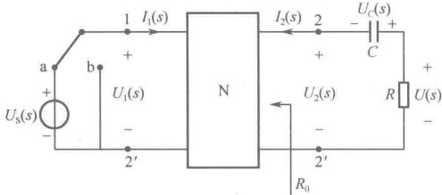

解：t<0 时电容开路，输入端电源无内阻，所以此时为无端接的情况。

图 16-49 例 16-23 图
 

这时有  $ \frac{U_{2}(s)}{U_{1}(s)}=\frac{U_{2}(s)}{U_{S}(s)}=\frac{1}{A} $ 即  $ U_{2}(s)=\frac{1}{A}U_{s}(s) $

两端进行拉普拉斯逆变换得 $ u_{2}(t)=\frac{1}{A}u_{S}(t) $，即得

 $$ u_{2}(0_{-})=\frac{1}{A}u_{S}(0_{-})=\frac{10}{2}=5V $$ 

根据换路定则可得

 $$ u_{C}(0_{+})=u_{C}(0_{-})=u_{2}(0_{-})=5\mathrm{V} $$ 

t>0 时，设从输出端往左看的电阻抗为  $ R_{0} $，由 T 参数方程

 $$ \left\{\begin{aligned}u_{1}&=A u_{2}+B(-i_{2})\\ i_{1}&=C u_{2}+D(-i_{2})\end{aligned}\right. $$ 

可得

 $$ R_{0}=\frac{u_{2}}{i_{2}}\mid_{u_{1}=0}=\frac{B}{A}=\frac{10}{2}=5\Omega $$ 

所以

 $$ u(0_{+})=\frac{R}{R_{0}+R}u_{C}(0_{+})=2.5\mathrm{V},\qquad\tau=(R_{0}+R)C=0.1\mathrm{s} $$ 

由三要素法可得

 $$ u(t)=u(0_{+})\mathrm{e}^{\frac{t}{\tau}}=2.5\mathrm{e}^{-10t}\mathrm{V} $$ 

### 16.7 计算机仿真

##### 例 16-24 阻抗参数的测量

如果在无源线性二端口网络的两个端口上施加电流源  $ \dot{I}_{1} $ 和  $ \dot{I}_{2} $ 作为二端口的激励，则两个端口的电压  $ \dot{U}_{1} $ 和  $ \dot{U}_{2} $ 为响应。测量阻抗参数（Z 参数）时需将一个端口开路，用测量得到的数据进行计算得出结果，因此也称为开路参数。在进行二端口网络参数的仿真测量时，要注意电流表、电压表接入电路的方向一定要与二端口网络定义的方向一致，如图 16-50（a）所示，否则会发生符号错误。下面以图 16-50（b）所示的 T 形二端口为例进行阻抗参数的测量。

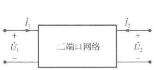

（a）二端口网络的电压电流定义方向
 

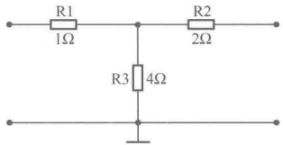

（b）T形二端口网络仿真电路
 

图 16-50 二端口网络的定义与仿真电路
 

（1）输出端口开路时，测量输入端阻抗 $ Z_{11} $。

测量电路如图 16-51（a）所示，在二端口网络的输入端外接 1A 独立电流源作为激励，输出端口开路，用电压表测量输入端口电压  $ \dot{U}_{1} $，根据测量数据可以求得输入端阻抗  $ Z_{11} $。

 $$ Z_{11}=\frac{\dot{U}_{1}}{\dot{I}_{1}}\bigg|_{\dot{I}_{2}=0}=\frac{5}{1}=5\Omega $$ 

（2）输出端口开路时，测量输出端对输入端的反向转移阻抗 $ Z_{21} $。

测量电路如图 16-51（b）所示，在二端口网络的输入端外接 1A 独立电流源作为激励，输出

<!-- page: 435 -->

端口开路，用电压表测量输出端开路电压 $ \dot{U}_{2} $，根据测量数据可以求得反向转移阻抗 $ Z_{21} $

 $$ Z_{21}=\frac{\dot{U}_{2}}{\dot{I}_{1}}\bigg|_{\dot{I}_{2}=0}=\frac{4}{1}=4\Omega $$ 

（3）输入端口开路时，测量输入端对输出端的正向转移阻抗 $ Z_{12} $。

测量电路如图 16-51（c）所示，在二端口网络的输出端外接 2A 独立电流源作为激励，输入端开路，用电压表测量输入端开路电压  $ \dot{U}_{1} $，根据测量数据可以求得正向转移阻抗  $ Z_{12} $。

 $$ Z_{12}=\frac{\dot{U}_{1}}{\dot{I}_{2}}\bigg|_{\dot{I}_{1}=0}=\frac{8}{2}=4\Omega $$ 

（4）输入端口开路时，测量输出端阻抗 $ Z_{22} $

测量电路如图 16-51（d）所示，在二端口网络的输出端外接 2A 独立电流源作为激励，输出端开路，用电压表测量输出端开路电压  $ \dot{U}_{2} $，根据测量数据可以求得输出端阻抗  $ Z_{22} $。

 $$ Z_{22}=\frac{\dot{U}_{2}}{\dot{I}_{2}}\bigg|_{\dot{I}_{1}=0}=\frac{12}{2}=6\Omega $$ 

如果无源线性二端口网络内不含受控源，则 $ Z_{12}=Z_{21} $，这种二端口网络又称为互易二端口网络。

（a） $ Z_{11} $ 测量仿真电路
 

（b） $ Z_{21} $ 测量仿真电路
 

（c） $ Z_{12} $ 测量仿真电路
 

（d） $ Z_{22} $ 测量仿真电路
 

图 16-51 二端口网络的阻抗参数测量仿真电路
 

##### 例 16-25 导纳参数的测量

如果在无源线性二端口网络的两个端口施加电压源 $ \dot{U}_{1} $和 $ \dot{U}_{2} $作为二端口激励，则两个端口的电流 $ \dot{I}_{1} $和 $ \dot{I}_{2} $为响应。测量导纳参数（Y参数）时需将一个端口短路，用测量得到的数据进行计算得出结果，因此也称为短路参数。

（1）输出端口短路时，测量输入端导纳 $ Y_{11} $。

测量电路如图 16-52（a）所示，在二端口网络的输入端外接 10V 独立电流源作为激励，将输出端口短路，用电流表测量输入端电流  $ \dot{I}_{1} $，根据测量数据可以求得输入端导纳  $ Y_{11} $。

 $$ Y_{11}=\frac{\dot{I}_{1}}{\dot{U}_{1}}\Bigg|_{\dot{U}_{2}=0}=\frac{4.286}{10}=0.4286S $$

<!-- page: 436 -->

（2）输出端口短路时，测量输出端对输入端的正向转移导纳 $ Y_{21} $。

测量电路如图 16-52（b）所示，在二端口网络的输入端外接 10V 独立电压源作为激励，输出端口呈短路状态，用电流表测量输出端短路电流  $ \dot{I}_{2} $，根据测量数据可以求得正向转移导纳  $ Y_{21} $。

 $$ Y_{21}=\frac{\dot{I}_{2}}{\dot{U}_{1}}\Bigg|_{\dot{U}_{2}=0}=\frac{-2.857}{10}=-0.2857\ $$ 

（3）输入端口短路时，测量输入端对输出端的反向转移导纳 $ Y_{12} $。

测量电路如图 16-52（c）所示，在二端口网络的输出端外接 10V 独立电流源作为激励，输入端呈短路状态，用电流表测量输入端短路电流  $ \dot{I}_{1} $，根据测量数据可以求得反向转移导纳  $ Y_{12} $。

 $$ Y_{12}=\frac{\dot{I}_{1}}{\dot{U}_{2}}\Bigg|_{\dot{U}_{1}=0}=\frac{-2.857}{10}=-0.2857\mathrm{S} $$ 

（4）输入端口短路时，测量输出端导纳 $ Y_{22} $。

测量电路如图 16-52（d）所示，在二端口网络的输出端外接 10V 独立电流源作为激励，输入端呈短路状态，用电流表测量输出端短路电流  $ \dot{I}_{2} $，根据测量数据可以求得输出端导纳  $ Y_{22} $。

 $$ Z_{22}=\frac{\dot{I}_{2}}{\dot{U}_{2}}\Bigg|_{\dot{U}_{1}=0}=\frac{3.571}{10}=0.3571\ $$ 

由于该无源线性二端口网络为互易网络，因此  $ Y_{12}=Y_{21} $

(a)  $ Y_{11} $ 测量仿真电路
 

（b）Y_{21} 测量仿真电路
 

（c）Y_{12} 测量仿真电路
 

（d）Y_{22} 测量仿真电路
 

图 16-52 二端口网络的导纳参数测量仿真电路
 

##### 例 16-26 传输参数的测量

在许多工程实际问题中，往往需要求出一个端口的电压和电流与另一个端口的电压和电流之间的直接关系。

（1）输出端口开路时，测量反向电压传输比A（电压增益的倒数）。

测量电路如图 16-53（a）所示，在二端口网络的输入端口外接 1V 独立电压源作为激励，输出端口开路，用电压表测量输出端电压  $ \dot{U}_{2} $，根据测量数据可以求得输入电压与输出电压的比值 A。

 $$ A=\frac{\dot{U}_{1}}{\dot{U}_{2}}\bigg|_{i_{2}=0}=\frac{1}{0.8}=1.25 $$

<!-- page: 437 -->

（2）输出端口开路时，测量输入端对输出端的反向转移导纳C。

测量电路如图 16-53（b）所示，在二端口网络的输入端外接 1V 独立电流源作为激励，在输入端串联电流表测量输入端口电流  $ \dot{I}_{1} $，输出端口开路，用电压表测量输出端开路电压  $ \dot{U}_{2} $，根据测量数据可以求得输入端对输出端的反向转移导纳  $ C $。

 $$ C=\frac{\dot{I}_{1}}{\dot{U}_{2}}\bigg|_{\dot{I}_{2}=0}=\frac{0.2}{0.8}=0.25\mathrm{S} $$ 

（3）输出端口短路时，测量输入端对输出端的反向转移阻抗B。

测量电路如图 16-53（c）所示，在二端口网络的输入端外接 3A 独立电流源作为激励，用电压表测量输入端电压  $ \dot{U}_{1} $，输出端短路，用电流表测量输出端的短路电流  $ \dot{I}_{2} $，根据测量数据可以得到输入端对输出端的反向转移阻抗。

 $$ B=\frac{\dot{U}_{1}}{\dot{I}_{2}}\Bigg|_{\dot{U}_{2}=0}=\frac{7}{-2}=-3.5\Omega $$ 

（4）输出端短路时，测量反向电流传输比D。

测量电路如图 16-53（d）所示，在二端口网络的输入端外接 3A 独立电流源作为激励，输出端短路，用电流表测量输出端的短路电流  $ \dot{I}_{2} $，根据测量数据可以得到输入端对输出端的电流比。

 $$ D=\frac{\dot{I}_{1}}{\dot{I}_{2}}\Bigg|_{\dot{U}_{2}=0}=\frac{3}{-2}=-1.5 $$ 

（a）A参数的测量仿真电路
 

（b）C参数的测量仿真电路
 

(c) B 参数的测量仿真电路
 

(d) D 参数的测量仿真电路
 

图 16-53 二端口网络的传输参数测量仿真电路
 

##### 例 16-27 混合参数的测量

在无源线性二端口网络的一个端口施加电流源  $ \dot{I}_{1} $ 作为激励，在另一个端口施加电压源  $ \dot{U}_{2} $ 作为激励，以电流源端口的电压  $ \dot{U}_{1} $ 和电压源端口的电流  $ \dot{I}_{2} $ 作为响应，得到混合参数模型。

（1）输出端口短路时，测量输入端口的输入阻抗 $ H_{11} $

测量电路如图 16-54（a）所示，在二端口网络的输入端外接独立电流源作为激励，输出端口开路，用电压表测量输入端电压  $ \dot{U}_{1} $，根据测量数据可以得到输入端口的输入阻抗。

 $$ H_{11}=\frac{\dot{U}_{1}}{\dot{I}_{1}}\Bigg|_{\dot{I}_{2}=0}=\frac{5}{0.075}=66.667\Omega $$

<!-- page: 438 -->

##### （2）输出端口短路时，测量正向电流传输比 $ H_{21} $。

测量电路如图 16-54（b）所示，在二端口网络的输入端外接 5V 独立电压源作为激励，输出端口短路，用电流表测量输入端电流  $ \dot{I}_{1} $ 和输出端短路电流  $ \dot{I}_{2} $，根据测量数据可得输出端短路电流与输入电流之比，又称为电流放大倍数（短路电流增益）。

 $$ H_{21}=\frac{\dot{I}_{2}}{\dot{I}_{1}}\bigg|_{\dot{U}_{2}=0}=\frac{-0.025}{0.075}=-0.333 $$ 

##### （3）输入端口开路时，测量反向电压传输比 $ H_{12} $。

测量电路如图 16-54（c）所示，在二端口网络的输出端外接 5V 独立电压源作为激励，输入端开路，用电压表测量输入端开路电压  $ \dot{U}_{1} $，根据测量数据可得输入端电压对输出端电压之比。

 $$ H_{12}=\frac{\dot{U}_{1}}{\dot{U}_{2}}\bigg|_{\dot{I}_{1}=0}=\frac{1.667}{5}=0.333 $$ 

##### （4）输入端口开路时，测量输出导纳 $ H_{22} $。

测量电路如图 16-54（d）所示，在二端口网络的输出端外接 5V 独立电压源作为激励，输入端开路，用电流表测量输出端电流  $ \dot{I}_{2} $，根据测量结果可得输出导纳。

 $$ H_{22}=\frac{\dot{I}_{2}}{\dot{U}_{2}}\bigg|_{\dot{I}_{1}=0}=\frac{0.033}{5}=0.007\mathrm{S} $$ 

(a)  $ H_{11} $ 测量仿真电路
 

（b） $ H_{21} $ 测量仿真电路
 

（c） $ H_{12} $ 测量仿真电路
 

（d） $ H_{22} $ 测量仿真电路
 

图 16-54 二端口网络的混合参数测量仿真电路
 

##### 例 16-28 利用网络分析仪测量二端口网络参数

##### （1）网络分析仪测量 Z 参数

测量二端口网络 Z 参数的电路如图 16-55（a）所示。将网络分析仪的两个接线端 P1、P2 分别与二端口网络的输入端、输出端相连。双击仪器图标，打开网络分析仪面板对其进行设置。如图 16-55（b）所示，首先在 Mode 区选择 Measurement，接着在 Graph 区选择 Z-Parameters（Z 参数），再单击 Re/Im 按钮（以复数的实部和虚部方式显示）。这时 Trace 区中的 4 个 Z 参数按钮显示为蓝色，测量出的 Z 参数值在仿真时将会出现在左侧的绘图区。

在 Functions 区的 Marker 下拉列表中选择 Re/Im 选项。单击 Simulation set 按钮，弹出如图 16-55（c）所示的 Measurement Setup 对话框。在该对话框中可以设置仿真的起始频率、终止频

<!-- page: 439 -->

率、扫描类型，每10倍坐标刻度的点数和特性阻抗。将特性阻抗从50改为1，对话框中其余各指标均默认，设置完成后单击OK按钮关闭对话框。按下“仿真”开关，网络分析仪左侧绘图区显示出Z参数数据，如图16-55（b）所示，与例16-24的测量结果一致。

（a）网络分析仪测量Z参数仿真电路
 

(c) 测量参数设置
 

（b）网络分析仪设置
 

图 16-55 网络分析仪测量 Z 参数仿真
 

##### （2）网络分析仪测量 Y 参数

测量二端口网络 Y 参数的电路如图 16-56（a）所示。将网络分析仪的两个接线端 P1、P2 分别与二端口网络的输入端、输出端相连。双击仪器图标，打开网络分析仪面板对其进行设置。首先在 Mode 区选择 Measurement，接着在 Graph 区选择 Y-Parameters（Y 参数），其余操作与测量 Z 参数相同。仿真结果如图 16-56（b）所示，与例 16-25 的测量结果一致。

（a）Y参数测量仿真电路
 

（b）Y参数测量仿真结果
 

图 16-56 网络分析仪测量 Y 参数仿真
 

<!-- page: 440 -->

##### （3）网络分析仪测量H参数

测量二端口网络 H 参数的电路如图 16-57（a）所示。将网络分析仪的两个接线端 P1、P2 分别与二端口网络的输入端、输出端相连。双击仪器图标，打开网络分析仪面板对其进行设置。首先在 Mode 区选择 Measurement，接着在 Graph 区选择 H-Parameters（H 参数），其余操作与测量 Z 参数相同。仿真结果如图 16-57（b）所示，与例 16-27 的测量结果一致。

(a) H 参数测量仿真电路
 

（b）H参数测量仿真结果
 

图 16-57 网络分析仪测量 H 参数仿真
 

### 思考题

16-1 二端口网络有4个端子，它与四端网络的区别是什么？

16-2 什么是二端口网络？它有哪些类型？

16-3 什么是松弛二端口网络？

16-4 所有线性松弛二端口网络都同时存在 Z 参数、Y 参数、T 参数和 H 参数吗？举例说明。

16-5 由线性电阻、线性电感和线性电容所组成的线性无源二端口网络一定是互易的，对吗？

16-6 二端口网络一般有哪几种连接方式？连接方式与网络参数的对应关系如何？

16-7 什么是无端接的二端口网络？如何描述它？

16-8 什么是有端接的二端口网络？如何描述它？

### 习题

16-1 求题 16-1 图所示二端口网络的 Z 参数。

题16-1 图
 

<!-- page: 441 -->

(c)
 

题16-1 图（续）
 

(d)
 

16-2 求题 16-2 图所示的二端口网络在正弦激励情况下的 Z 参数。

16-3 求题 16-3 图所示二端口网络的 Z 参数。

题16-2图
 

题16-3 图
 

16-4 求题 16-4 图所示二端口网络的 Y 参数。

(a)
 

(c)
 

(b)
 

(d)
 

题16-4图
 

16-5 求题 16-5 图所示二端口网络的 Y 参数，已知  $ R=10\Omega $， $ X_{C}=5\Omega $， $ X_{L}=10\Omega $。

16-6 求题 16-6 图所示二端口网络的 Y 参数。

题16-5图
 

题16-6图
 

16-7 求题 16-7 图所示二端口网络的 T 参数。

<!-- page: 442 -->

题16-7图
 

16-8 求题 16-8 图所示二端口网络的 T 参数。

16-9 求题 16-9 图所示二端口网络的 T 参数。

题16-8图
 

题16-9图
 

16-10 求题 16-10 图所示二端口网络的 H 参数。

(a)
 

题16-10图
 

16-11 求题 16-11 图所示二端口网络的 H 参数。

16-12 求题 16-12 图所示二端口网络的 H 参数。

题16-11题
 

题16-12图
 

<!-- page: 443 -->

16-13 试判断题 16-13 图所示各二端口网络是否具有互易性。

(a)
 

题16-13图
 

(c)
 

16-14 试判断题 16-14 图所示二端口网络是否具有互易性和对称性。
 

16-15 题 16-15 图所示为二端口电阻网络，已知 Z 参数阵为  $ Z = \begin{bmatrix} 4 & 3 \\ 3 & 5 \end{bmatrix} $，（1）试求该二端口的 H 参数矩阵；（2）若给定  $ i_1 = 10A $， $ u_2 = 20V $，求该二端口消耗的功率。

题16-14图
 

题16-15图
 

16-16 电路如题 16-16 图所示，二端口网络中 1-1′ 端的电压  $ \dot{U}_{1} $ 和该网络的 Z 参数均为已知，试求从 2-2′ 端向左看进去的等效电流源参数  $ \dot{I}_{c} $ 和 Z 参数。

16-17 电路如题 16-17 图所示，已知二端口网络的传输矩阵为  $ T = \begin{bmatrix} 0.5 & j25 \\ j0.02 & 1 \end{bmatrix} $，正弦电流源  $ \dot{I}_{S} = 1\text{A} $，问负载阻抗  $ Z_{L} $ 为何值时，它将获得最大功率？最大功率是多少？

题16-16图
 

题16-17图
 

16-18 题 16-18 图所示电路为线性无源电阻二端口网络，已知其 Z 参数矩阵为  $ Z = \begin{bmatrix} 2 & 3 \\ 4 & 8 \end{bmatrix} $，当端口 1-1′ 处接电压为 5V 的直流电压源、端口 2-2′ 处接负载电阻 R 时，调节 R 使其获得最大功率，求该最大功率。

16-19 已知题 16-19 图所示二端口网络的 H 参数为  $ H_{11}=1k\Omega $， $ H_{12}=-2 $， $ H_{21}=3 $， $ H_{22}=2mS $，二端口的输出端接 1kΩ 电阻，求输入阻抗。

题16-18图
 

题16-19图
 

<!-- page: 444 -->

16-20 题 16-20 图所示网络中，已知 T 参数矩阵为  $ T = \begin{bmatrix} 2.5 & 55 \\ 0.05 & 1.5 \end{bmatrix} $， $ \omega L_1 = 0.75\Omega $， $ \omega L_2 = 6\Omega $， $ 1/\omega C = 6\Omega $， $ u_S(t) = 10 + 100\sqrt{2}\cos\omega t + 10\sqrt{2}\cos3\omega t $（V），求  $ i(t) $ 及其有效值  $ I $。

16-21 求题 16-21 图所示二端口网络的特性阻抗  $ Z_{c} $

题16-20图
 

题16-21 图
 

16-22 求题 16-22 图所示二端口网络的特性阻抗  $ Z_{c} $

16-23 电路如题 16-23 图所示，已知电压源电压 U = 240V，试求（1）二端口网络 N 的特性阻抗；（2）负载  $ R_{L} $ 吸收的功率。

题16-22图
 

题16-23图
 

16-24 题 16-24 图所示为相移网络，试求：（1）网络的特性阻抗；（2）若在输出端接入一电阻，并且  $ R^{2}=L/C $ ，求此时的输入阻抗  $ Z_{i} $。

16-25 已知题 16-25 图所示二端口等效电路的 Z 参数矩阵为  $ Z=\begin{bmatrix}10&8\\ 5&10\end{bmatrix} $，求  $ R_{1} $、 $ R_{2} $、 $ R_{3} $ 和 r 的值。

题16-24图
 

题16-25
 

16-26 已知题 16-26 图所示二端口网络的 Y 参数矩阵为  $ Y=\begin{bmatrix}1&-0.25\\ -0.25&0.5\end{bmatrix} $，该网络在  $ 1-1' $ 端接 4V 电压源，在  $ 2-2' $ 端接电阻 R，试问 R 为多大时，R 可获得最大功率，最大功率为多大？此时电压源发出的功率为多大？

16-27 某互易二端口网络的传输参数 A=7，B=3，C=9，求其 T 形和  $ \pi $ 形等效电路中的各元件参数，并画出该等效电路图。

16-28 求题 16-28 图所示二端口网络的 T 形等效电路中的各元件参数，并画出该等效电路图。

<!-- page: 445 -->

题16-26图
 

题16-28图
 

16-29 求题 16-29 图所示二端口网络的 T 形等效电路中的各元件参数，并画出该等效电路图。

16-30 试判断题 16-30 图所示二端口网络是否具有互易性和对称性。

题16-29图
 

题16-30图
 

16-31 试求题 16-31 图所示二端口网络的 T 参数矩阵。已知  $ \omega L_1 = 10\Omega $， $ \omega L_2 = \omega L_3 = 8\Omega $， $ 1/\omega C = 20\Omega $， $ \omega M = 4\Omega $。

题16-31 图
 

16-32 已知  $ R=1\Omega $，试求题 16-32 图所示二端口网络的 Y 参数矩阵。

题16-32图
 

16-33 题 16-33 图所示为有载二端口网络，虚框中的二端口子网络 N 为某晶体管放大器，已知其 H 参数矩阵为  $ H = \begin{bmatrix} 10^3 & 10^{-4} \\ 100 & 10^{-5} \end{bmatrix} $，若  $ U_S = 10\,\text{mV} $， $ R_f = R_2 = 1000\,\Omega $，求电压  $ U_2 $ 的值。

16-34 求题 16-34 图所示二端口网络的 Z 参数矩阵。

16-35 电路如题 16-35 图所示，已知二端口网络的 Y 参数矩阵为  $ Y=\begin{bmatrix}2 & 3 \\ 5 & 4\end{bmatrix} $， $ R_2=1\Omega $，试求该二端口的电压转移函数  $ U_2(s)/U_S(s) $。

<!-- page: 446 -->

题16-33 图
 

题16-34 图
 

16-36 电路如题 16-36 图所示，已知二端口网络的 H 参数矩阵为  $ H=\begin{bmatrix}40&0.4\\ 10&0.1\end{bmatrix} $，试求该二端口的电压转移函数  $ U_{2}(s)/U_{s}(s) $。

题16-35图
 

题16-36图
 

16-37 电路如题 16-37 图所示，已知二端口网络的 Z 参数矩阵为  $ Z = \begin{bmatrix} 2 & 3 \\ 3 & 3 \end{bmatrix} $，试求该二端口的电压转移函数  $ U_2(s)/U_S(s) $。

题16-37图
 

