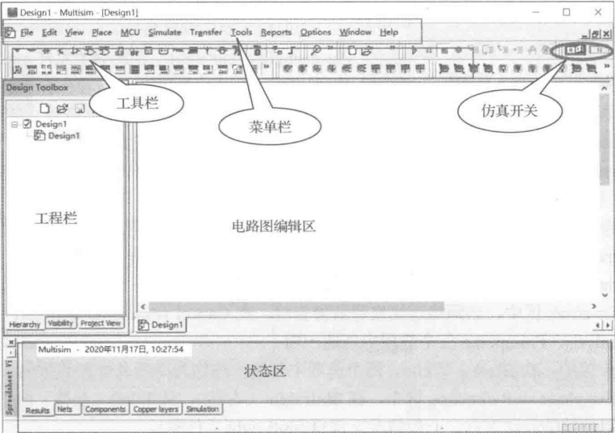
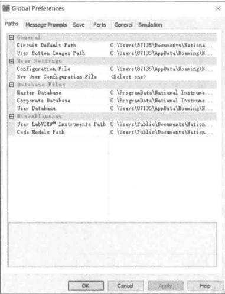
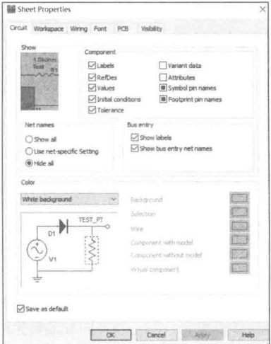
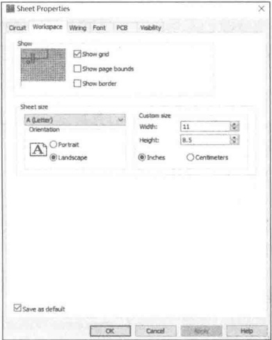
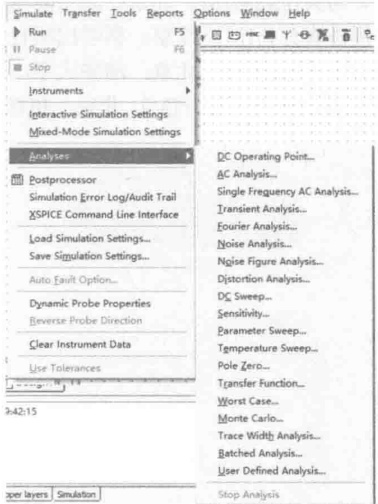

# 17-附录A Multisim简明教程

[返回全书目录](../../README.md)

> PDF 页码：447–451

<!-- page: 447 -->

### 附录 A Multisim 简明教程

在众多的 EDA 仿真软件中，Multisim 软件界面友好、功能强大、易学易用，受到电类设计开发人员的青睐。Multisim 用软件方法虚拟电子元器件及仪器仪表，将元器件和仪器集合为一体，是原理图设计、电路测试的虚拟仿真软件。

Multisim 来源于加拿大图像交互技术公司（Interactive Image Technologies，简称 IIT 公司）推出的以 Windows 为基础的仿真工具，原名 EWB。IIT 公司于 1988 年推出一个用于电子电路仿真和设计的 EDA 工具软件 Electronics Work Bench（电子工作台，简称 EWB），以界面形象直观、操作方便、分析功能强大、易学易用而得到迅速推广使用。1996 年 IIT 推出了 EWB5.0 版本，在 EWB5.x 版本之后，从 EWB6.0 版本开始，IIT 对 EWB 进行了较大变动，名称改为 Multisim（多功能仿真软件）。IIT 后被美国国家仪器（NI，National Instruments）公司收购，软件更名为 NI Multisim，Multisim 经历了多个版本的升级，目前最新版本为 Multisim14。

### A.1 Multisim 的获取与使用

NI 的官网提供教育版试用下载链接，也可登录 Multisim 在线仿真网站，注册后可以进行在线仿真。

下面以 Multisim11 为例介绍其基本操作。图 A-1 是 Multisim11 的用户界面，包括菜单栏、标准工具栏、主工具栏、虚拟仪器工具栏、元器件工具栏、仿真开关、状态栏、电路图编辑区、工程栏等组成部分。

图 A-1 Multisim11 工作界面
 

菜单栏与 Windows 应用程序相似，如图 A-2 所示。

<!-- page: 448 -->

图 A-2 Multisim 菜单栏
 

可以在 View→Toolbars 菜单下设置工具栏的显示项目，常用的工具栏有：
标准工具栏（Standard）：☐ ☐ ☐ ☐ ☐ ☐ ☐ ☐ ☐ ☐ ☐ ☐ ☐ ☐ ☐ ☐ ☐ ☐ ☐ ☐ ☐ ☐ ☐ ☐ ☐ ☐ ☐ ☐ ☐ ☐ ☐ ☐ ☐ ☐ ☐ ☐ ☐ ☐ ☐ ☐ ☐ ☐ ☐ ☐ ☐ ☐ ☐ ☐ ☐ ☐ ☐ ☐ ☐ ☐ ☐ ☐ ☐ ☐ ☐ ☐ ☐ ☐ ☐ ☐ ☐ ☐ ☐ ☐ ☐ ☐ ☐ ☐ ☐ ☐ ☐ ☐ ☐ ☐ ☐ ☐ ☐ ☐ ☐ ☐ ☐ ☐ ☐ ☐ ☐ ☐ ☐ ☐ ☐ ☐ ☐ ☐ ☐ ☐ ☐ ☐ ☐ ☐ ☐ ☐ ☐ ☐ ☐ ☐ ☐ ☐ ☐ ☐ ☐ ☐ ☐ ☐ ☐ ☐ ☐ ☐ ☐ ☐ ☐ ☐ ☐ ☐ ☐ ☐ ☐ ☐ ☐ ☐ ☐ ☐ ☐ ☐ ☐ ☐ ☐ ☐ ☐ ☐ ☐ ☐ ☐ ☐ ☐ ☐ ☐ ☐ ☐ ☐ ☐ ☐ ☐ ☐ ☐ ☐ ☐ ☐ ☐ ☐ ☐ ☐ ☐ ☐ ☐ ☐ ☐ ☐ ☐ ☐ ☐ ☐ ☐ ☐ ☐ ☐ ☐ ☐ ☐ ☐ ☐ ☐ ☐ ☐ ☐ ☐ ☐ ☐ ☐ ☐ ☐ ☐ ☐ ☐ ☐ ☐ ☐ ☐ ☐ ☐ ☐ ☐ ☐ ☐ ☐ ☐ ☐ ☐ ☐ ☐ ☐ ☐ ☐ ☐ ☐ ☐ ☐ ☐ ☐ ☐ ☐ ☐ ☐ ☐ ☐ ☐ ☐ ☐ ☐ ☐ ☐ ☐ ☐ ☐ ☐ ☐ ☐ ☐ ☐ ☐ ☐ ☐ ☐ ☐ ☐ ☐ ☐ ☐ ☐ ☐ ☐ ☐ ☐ ☐ ☐ ☐ ☐ ☐ ☐ ☐ ☐ ☐ ☐ ☐ ☐ ☐ ☐ ☐ ☐ ☐ ☐ ☐ ☐ ☐ ☐ ☐ ☐ ☐ ☐ ☐ ☐ ☐ ☐ ☐ ☐ ☐ ☐ ☐ ☐ ☐ ☐ ☐ ☐ ☐ ☐ ☐ ☐ ☐ ☐ ☐ ☐ ☐ ☐ ☐ ☐ ☐ ☐ ☐ ☐ ☐ ☐ ☐ ☐ ☐ ☐ ☐ ☐ ☐ ☐ ☐ ☐ ☐ ☐ ☐ ☐ ☐ ☐ ☐ ☐ ☐ ☐ ☐ ☐ ☐ ☐ ☐ ☐ ☐ ☐ ☐ ☐ ☐ ☐ ☐ ☐ ☐ ☐ ☐ ☐ ☐ ☐ ☐ ☐ ☐ ☐ ☐ ☐ ☐ ☐ ☐ ☐ ☐ ☐ ☐ ☐ ☐ ☐ ☐ ☐ ☐ ☐ ☐ ☐ ☐ ☐ ☐ ☐ ☐ ☐ ☐ ☐ ☐ ☐ ☐ ☐ ☐ ☐ ☐ ☐ ☐ ☐ ☐ ☐ ☐ ☐ ☐ ☐ ☐ ☐ ☐ ☐ ☐ ☐ ☐ ☐ ☐ ☐ ☐ ☐ ☐ ☐ ☐ ☐ ☐ ☐ ☐ ☐ ☐ ☐ ☐ ☐ ☐ ☐ ☐ ☐ ☐ ☐ ☐ ☐ ☐ ☐ ☐ ☐ ☐ ☐ ☐ ☐ ☐ ☐ ☐ ☐ ☐ ☐ ☐ ☐ ☐ ☐ ☐ ☐ ☐ ☐ ☐ ☐ ☐ ☐ ☐ ☐ ☐ ☐ ☐ ☐ ☐ ☐ ☐ ☐ ☐ ☐ ☐ ☐ ☐ ☐ ☐ ☐ ☐ ☐ ☐ ☐ ☐ ☐ ☐ ☐ ☐ ☐ ☐ ☐ ☐ ☐ ☐ ☐ ☐ ☐ ☐ ☐ ☐ ☐ ☐ ☐ ☐ ☐ ☐ ☐ ☐ ☐ ☐ ☐ ☐ ☐ ☐ ☐ ☐ ☐ ☐ ☐ ☐ ☐ ☐ ☐ ☐ ☐ ☐ ☐ ☐ ☐ ☐ ☐ ☐ ☐ ☐ ☐ ☐ ☐ ☐ ☐ ☐ ☐ ☐ ☐ ☐ ☐ ☐ ☐ ☐ ☐ ☐ ☐ ☐ ☐ ☐ ☐ ☐ ☐ ☐ ☐ ☐ ☐ ☐ ☐ ☐ ☐ ☐ ☐ ☐ ☐ ☐ ☐ ☐ ☐ ☐ ☐ ☐ ☐ ☐ ☐ ☐ ☐ ☐ ☐ ☐ ☐ ☐ ☐ ☐ ☐ ☐ ☐ ☐ ☐ ☐ ☐ ☐ ☐ ☐ ☐ ☐ ☐ ☐ ☐ ☐ ☐ ☐ ☐ ☐ ☐ ☐ ☐ ☐ ☐ ☐ ☐ ☐ ☐ ☐ ☐ ☐ ☐ ☐ ☐ ☐ ☐ ☐ ☐ ☐ ☐ ☐ ☐ ☐ ☐ ☐ ☐ ☐ ☐ ☐ ☐ ☐ ☐ ☐ ☐ ☐ ☐ ☐ ☐ ☐ ☐ ☐ ☐ ☐ ☐ ☐ ☐ ☐ ☐ ☐ ☐ ☐ ☐ ☐ ☐ ☐ ☐ ☐ ☐ ☐ ☐ ☐ ☐ ☐ ☐ ☐ ☐ ☐ ☐ ☐ ☐ ☐ ☐ ☐ ☐ ☐ ☐ ☐ ☐ ☐ ☐ ☐ ☐ ☐ ☐ ☐ ☐ ☐ ☐ ☐ ☐ ☐ ☐ ☐ ☐ ☐ ☐ ☐ ☐ ☐ ☐ ☐ ☐ ☐ ☐ ☐ ☐ ☐ ☐ ☐ ☐ ☐ ☐ ☐ ☐ ☐ ☐ ☐ ☐ ☐ ☐ ☐ ☐ ☐ ☐ ☐ ☐ ☐ ☐ ☐ ☐ ☐ ☐ ☐ ☐ ☐ ☐ ☐ ☐ ☐ ☐ ☐ ☐ ☐ ☐ ☐ ☐ ☐ ☐ ☐ ☐ ☐ ☐ ☐ ☐ ☐ ☐ ☐ ☐ ☐ ☐ ☐ ☐ ☐ ☐ ☐ ☐ ☐ ☐ ☐ ☐ ☐ ☐ ☐ ☐ ☐ ☐ ☐ ☐ ☐ ☐ ☐ ☐ ☐ ☐ ☐ ☐ ☐ ☐ ☐ ☐ ☐ ☐ ☐ ☐ ☐ ☐ ☐ ☐ ☐ ☐ ☐ ☐ ☐ ☐ ☐ ☐ ☐ ☐ ☐ ☐ ☐ ☐ ☐ ☐ ☐ ☐ ☐ ☐ ☐ ☐ ☐ ☐ ☐ ☐ ☐ ☐ ☐ ☐ ☐ ☐ ☐ ☐ ☐ ☐ ☐ ☐ ☐ ☐ ☐ ☐ ☐ ☐ ☐ ☐ ☐ ☐ ☐ ☐ ☐ ☐ ☐ ☐ ☐ ☐ ☐ ☐ ☐ ☐ ☐ ☐ ☐ ☐ ☐ ☐ ☐ ☐ ☐ ☐ ☐ ☐ ☐ ☐ ☐ ☐ ☐ ☐ ☐ ☐ ☐ ☐ ☐ ☐ ☐ ☐ ☐ ☐ ☐ ☐ ☐ ☐ ☐ ☐ ☐ ☐ ☐ ☐ ☐ ☐ ☐ ☐ ☐ ☐ ☐ ☐ ☐ ☐ ☐ ☐ ☐ ☐ ☐ ☐ ☐ ☐ ☐ ☐ ☐ ☐ ☐ ☐ ☐ ☐ ☐ ☐ ☐ ☐ ☐ ☐ ☐ ☐ ☐ ☐ ☐ ☐ ☐ ☐ ☐ ☐ ☐ ☐ ☐ ☐ ☐ ☐ ☐ ☐ ☐ ☐ ☐ ☐ ☐ ☐ ☐ ☐ ☐ ☐ ☐ ☐ ☐ ☐ ☐ ☐ ☐ ☐ ☐ ☐ ☐ ☐ ☐ ☐ ☐ ☐ ☐ ☐ ☐ ☐ ☐ ☐ ☐ ☐ ☐ ☐ ☐ ☐ ☐ ☐ ☐ ☐ ☐ ☐ ☐ ☐ ☐ ☐ ☐ ☐ ☐ ☐ ☐ ☐ ☐ ☐ ☐ ☐ ☐ ☐ ☐ ☐ ☐ ☐ ☐ ☐ 

图 A-3 Global Preferences 对话框
 

# 1. 全局参数设置

（1）Paths 选项卡：用来设置 Multisim 仿真电路的路径、配置文件、元件库数据文件存储路径等，可以直接使用默认设置。

选中菜单 Options→Global Preferences，弹出 Global Preferences 对话框，共有 6 个选项卡如图 A-3 所示。

（2）Message Prompts 选项卡：用来设置何种情况下需要弹出提示消息。

（3）Save 选项卡：用于设置设计文档自动备份和仪器仪表的测量数据进行保存。

（4）Parts 选项卡：设置元器件的放置模式和符号标准。

① 在 Place component mode 区种选择元器件放置模式。

Return to Component Browser after placement: 放置一个元件后自动返回元器件浏览窗口。

Place single component: 放置单个元件。

Continuous placement for multi-section part only(Esc to

quit): 放置单个元件，但是对集成电路内相同的模块可以连续放置，按 Esc 键停止放置

Continuous placement (Esc to quit): 连续放置元器件，按 Esc 键停止放置。

②在 Symbol standard 区中选择元器件符号标准，Multisim11 提供两套电气元器件符号标准：

ANSI：美国国家标准学会，美国标准，默认为该标准；

DIN：德国国家标准学会，欧洲标准，与中国符号标准一致，本附录采用此标准。

（5）General 选项卡：用来设置选择矩形、鼠标滚轮、自动连线方式、语言等。

（6）Simulation 选项卡：用来设置电路仿真模式。

在 Netlist errors 区中，当网络连续出错或警告时，在 Cancel simulation/analysis、Proceed with simulation/analysis、Prompt me 三个选项中任选一项。

在 Graph 区中，在 Black、White、两个选项中任选一项作为曲线及仪表的颜色。

在 Positive phase shift direction 区中，在 Shift right（右移）、Shift left（左移）两个选项中任选一项作为仿真曲线的移动方向，一般情况下选择 Shift right（右移）。

# 2. 电路图属性设置

选中菜单 Options→Sheet Properties，弹出 Sheet Properties 对话框，共有 6 个选项卡，如图 A-4 所示。

<!-- page: 449 -->

（1）Cirtuit选项卡：用来设置Multisim仿真电路和元器件参数的显示属性。

在 Show 区中，可以设置 Multisim 电路工作窗口显示或隐藏元件的主要参数。

① 在 Component 区中的复选框 Labels、RefDes、Values、Initial conditions、Tolerance、Variant data、Attributes、Symbol pin names、Footprint pin names 用来决定是否显示元器件的标识符、编号、元件参数、初始条件、容差、可变元件的数值、元件属性、元件符号引脚名、元件封装引脚名。

② 在 Net names 区中的复选框 Show all、Use net-specific Setting、Hide all 用来控制电路图中的节点全部显示、设置部分特殊节点显示或将全部节点隐藏。

③ 在 Bus entry 区中的 Show labels、Show bus entry net names 复选框分别用来选择是否显示总线标识、总线的接入线标识。

④ 在 Color 区的下拉菜单中选择一种预定的配色方案或用户自定义配色方案对电路图的背景、选择框、导线、有模型的元件、无模型的元件和虚拟元件进行颜色配置。

（2）Workspace选项卡：用来设置工作区的图纸大小、显示等，如图A-5所示。

① 在 Show 区中的复选框作用如下：

Show grid: 是否显示背景点状网格，方便用户绘制电路图时对元器件进行定位；

Show page bounds: 是否显示纸张边界，纸张边界决定了界面大小，绘制电路图时不能超出这个范围；

Show border: 是否显示电路图的边框，该边框为电路图绘制提供了标尺。

② Sheet size 区设定绘图纸张的尺寸。

在该区左侧的下拉列表框中可以选择 Multisim 预设的 A、B、C、D、E、A4、A3、A2、A1、A0、Legal、Executive 和 Folio 共 13 种标准规格的图纸，每种图纸的具体尺寸显示在该区右侧，长度单位可以用右侧的单选按钮设定为 Inches（英寸）或 Centimeters（厘米）。用户如果想自定义图纸，可以选择下拉列表框中的 Custom 后，在右侧的 Custom size 区输入纸张的 Width（宽度）和 Height（高度）值。下拉列表框下方的 Orientation 区用来设定纸张的方向：Portrait 为纵向，Landscape 为横向。

图 A-4 Sheet Properties 对话框
 

图 A-5 Workspace 选项卡
 

（3）Wiring 选项卡：设置电路图中导线和总线的宽度。

（4）Font 选项卡：设置电路中元件的参考序号、元件参数、元件属性、封装引脚名、符号引脚名、节点、电路图文本、注释、探针和总线名称等文本的字体。

<!-- page: 450 -->

（5）PCB 选项卡：设置制作 PCB(printed circuit board)印制电路板时的相关参数。

（6）Visibility 选项卡：设置一些自定义选项。

### A.2 Multisim 仿真基本操作

如图 A-6 所示，Multisim11 仿真的基本步骤为：（1）建立电路文件；（2）放置元器件和仪表；（3）元器件编辑；（4）连线和进一步调整；（5）电路仿真；（6）输出分析结果。

图 A-6 Multisim11 仿真步骤
 

# 2. 放置元器件和仪表

Multisim11 的元件数据库有：主元件库 Master Database（厂商提供的元件库），用户元件库 User Database（用户自定义的元件库），合作元件库 Corporate Database（仅在专业版中有效，用于多人共同开发项目时建立共用的元件库），后两个库由用户或合作人创建，新安装的 Multisim11 中这两个数据库是空的。

放置元器件的方法有：

菜单 Place Component:

元件工具栏：Place/Component；

在绘图区右击，利用弹出菜单放置；

快捷键 Ctrl+W。

放置仪表可以点击虚拟仪器工具栏相应按钮，或者使用菜单方式。

# 3. 元器件编辑

（1）元器件参数设置

双击元器件，弹出相关对话框，选项卡包括：

Label: 标签，Refdes 编号，由系统自动分配，可以修改，但须保证编号唯一性；

Display: 显示;

Value: 数值:

Fault: 故障设置，Leakage 漏电；Short 短路；Open 开路；None 无故障（默认）；

Pins：引脚，各引脚编号、类型、电气状态。

（2）元器件向导（Component Wizard）

对特殊要求，可以用元器件向导编辑自己的元器件，一般是在已有元器件基础上进行编辑和修改。方法是：菜单 Tools/Component Wizard，按照规定步骤编辑，用元器件向导编辑生成的元器件放置在 User Database（用户数据库）中。

# 4. 连线和进一步调整

连线：

（1）自动连线：单击起始引脚，鼠标指针变为“十”字形，移动鼠标至目标引脚或导线，单击，则连线完成，当导线连接后呈现丁字交叉时，系统自动在交叉点放节点（Junction）；

<!-- page: 451 -->

（2）手动连线：单击起始引脚，鼠标指针变为“十”字形后，在需要拐弯处单击，可以固定连线的拐弯点，从而设定连线路径；

（3）关于交叉点，Multisim11 默认丁字交叉为导通，十字交叉为不导通，对于十字交叉而希望导通的情况，可以分段连线，即先连接起点到交叉点，然后连接交叉点到终点；也可以在已有连线上增加一个节点（Junction），从该节点引出新的连线，添加节点可以使用菜单 Place/Junction，或者使用快捷键 Ctrl+J。

进一步调整：

（1）调整位置：单击选定元件，移动至合适位置；

（2）改变标号：双击进入属性对话框更改；

（3）显示节点编号以方便仿真结果输出：菜单 Options/Sheet Properties/Circuit/Net Names，选择 Show All;

（4）导线和节点删除：右击/Delete，或者点击选中，按键盘 Delete 键。

# 5. 电路仿真

基本方法：

按下仿真开关，电路开始工作，Multisim界面的状态栏右端出现仿真状态指示；

双击虚拟仪器，进行仪器设置，获得仿真结果。

# 6. 输出分析结果

如图 A-7 所示，使用菜单命令 Simulate→Analyses 调出仿真分析菜单后，可以按需求选择相应的分析功能，具体的分析范例已在本书各章例题中进行过演示，此处不再赘述。

图 A-7 Multisim 仿真分析菜单
 

